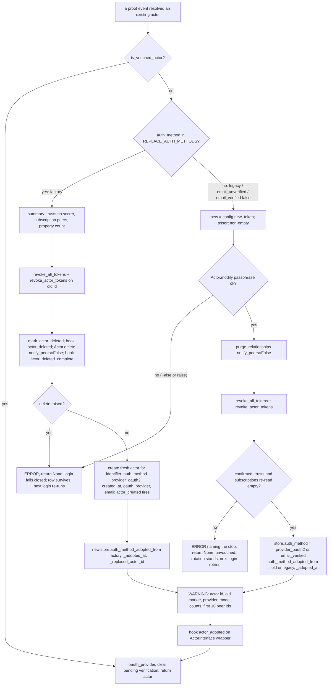

# Implementation Plan: vouched actors, clean-slate adoption on OAuth login, a closable factory, and SPA `prompt`

**Date:** 2026-10-26
**Research:** thoughts/research/2026-10-26-v3.16-scope-oauth-adoption-vouching-and-spanned-list-items.md (Part 1); triage in thoughts/research/2026-10-26-inbound-triage-factory-squat-list-item-size-spa-prompt.md
**Todos:** thoughts/todo/oauth-adoption-of-unvouched-actors-and-open-factory.md, thoughts/todo/spa-authorize-prompt.md
**Branch:** master (work on `release/3.16.0-oauth-adoption-vouching`)
**Release:** 3.16.0, the first of the two plans that make it (the second is spanned list items; if it slips, this plan ships as 3.16.0 alone)

## Overview

An unauthenticated JSON `POST /` creates an actor for any address nobody has
claimed, with a passphrase of the caller's choosing, and the address owner's
first OAuth login later adopts that actor with the squatter's credentials
still live: the passphrase, any trust relationship made with it (including
an `admin` one to the squatter's own actor with a chosen secret), any
subscription, and any property the squatter prefilled. This plan makes every
creation path record how the actor was created; makes a login that proves an
address over an actor no provider vouched for either **replace** it (a
factory-created actor is deleted and a fresh one created, since nothing
legitimate can exist there) or **clean it in place** (a legacy or
unverified-email actor is rotated, stripped of relationships and sessions,
and keeps its data); tells the application through a new hook; adds a switch
that closes the factory for OAuth-only deployments; and lets a SPA ask the
provider for account selection. The protocol-mandated factory stays; the fix
is that a self-asserted `creator` can no longer be inherited as a verified
identity.

## Decisions Made

- **Rotate and clean the slate, do not refuse** (owner, 2026-10-26). The
  security review showed rotation alone leaves a prepared squatter in control
  through an `admin` trust (`handlers/trust.py:139-140`, `:326-327`;
  `config.py:240-285` grants admin `"a"` everywhere; `auth.py:263-275`
  authenticates the secret). Refusing would lock out every legacy actor.
- **Two populations, two wipes** (owner chose hard delete and recreate for
  squat markers, 2026-10-26; narrowed here to `"factory"` alone):
  - **Replace** when `auth_method == "factory"`. Nothing legitimate can
    exist on an actor created from unauthenticated input in a deployment
    where the address owner signs in with OAuth. The old actor is deleted
    through the tested wipe (tombstone, `actor_deleted`, `Actor.delete`,
    `actor_deleted_complete`) without contacting peers, and a fresh actor is
    created for the identifier; the victim gets a new actor id and
    `actor_created` fires again, so the consumer provisions it as new.
  - **Clean in place** when the marker is absent (pre-3.16), is
    `"email_unverified"`, or `store.email_verified == "false"`. These
    actors may belong to their legitimate creator: a pre-3.16 deployment's
    factory-then-OAuth users, and the self-asserted email flow's users, who
    by design hold a two-week session and real data before they verify
    (`handlers/oauth_email.py:638-652`). Deleting them would destroy that
    data. They are rotated, stripped of every trust relationship,
    subscription and token chain (all local, no network), marked, and keep
    their properties; the hook carries the property names so the
    application can inspect what a squatter may have prefilled.
  - The owner's question named `email_unverified` with `factory`; the plan
    narrows it for the reason above and flags it in the summary.
- **Address-proof events trigger the rule, not only OAuth logins.** A
  provider login and the emailed verification link both prove the address.
  At verification (`handlers/oauth_email.py:213-217`) an unvouched actor is
  cleaned in place and marked `"email_verified"`; otherwise a squatter whose
  provider profile carries the victim's unverified address keeps a session
  through a phished "verify your email" click.
- **Bearer-token access does not adopt** (owner, 2026-10-26). `auth.py:320-336`
  authenticates a provider access token (or the `oauth_token` cookie both
  integrations turn into a Bearer) as creator by email match without
  reaching the rule. Documented as a limitation.
- **The gate sits at the top of `RootFactoryHandler.post()`** (owner). It
  closes creation and the unauthenticated existing-creator redirect
  (`factory.py:232-243`, an actor-id oracle). A basic-auth deployment that
  needs that form login keeps the factory open.
- **One minor, 3.16.0** (owner). A split into a 3.15.x security patch plus a
  3.16.0 minor was presented twice (triage, outside voice) and declined.
- **Three phases** (owner): markers, the rule, the backfill script; the
  switch and SPA `prompt`; docs, changelog, migration guide.
- **`auth_method` defaults to `"app"` at both layers.** `Actor.create()` is
  public and autodoc'd; a `None` default there would keep minting unmarked
  rows from consumers on the core API. Every library creation path passes
  its value explicitly and a test pins each caller. The trade-off (a
  forgotten future library path defaults to vouched) is accepted because
  the squat needs an unauthenticated creation path, which review catches.
- **Vouched is defined positively.** Vouched when `auth_method` is a
  non-empty string not in `UNVOUCHED_AUTH_METHODS = {"factory",
  "email_unverified"}` **and** `store.email_verified != "false"`. The second
  clause catches pre-3.16 free-text actors, which carry
  `"<provider>_oauth2"` for an address the provider never verified. A
  consumer typo such as `"unverified"` counts as vouched; accepted over a
  closed allow-list so consumers' own values need no registration.
- **A new lifecycle hook, `actor_adopted`** (owner), fired once per
  adoption on the surviving actor with the previous marker, the previous
  actor id when replaced, the provider, and what was removed (trusts as
  `peerid`/`relationship`/`approved`/`established_via`, never `secret`;
  subscription peer ids; token count; property names for the in-place
  case).
- **Keep the factory login path** (owner). `actor.py:373-378`, out of scope.
- **Rotate first, wipe second, confirm third, mark last.** The attribute
  write cannot fail visibly (`attribute.py:56-58` discards `set_attr`'s
  result) and `Trusts.delete()` returns `True` regardless of the backend
  result (`trust.py:374-379`; PostgreSQL returns `False` on exception at
  `db/postgresql/trust.py:777-803`, DynamoDB raises mid-loop at
  `db/dynamodb/trust.py:509-519`). So the in-place rule re-reads the trust
  and subscription lists and writes the marker only when both are empty; if
  not, it logs an ERROR and the login fails closed, leaving the actor
  unvouched so the next login retries (the rotation stands, which only
  helps). The replacement's wipe is `Actor.delete()`, which removes the
  actor row last, so an interrupted replacement is found again by the next
  login and re-run.
- **No network during adoption.** `delete_reciprocal_trust(delete_peer=True)`
  and `delete_peer_trustee` issue `requests.delete` to the peer's stored
  `baseuri` with a 15-second timeout (`actor.py:1326-1337`, `:565-566`),
  and a squatter chooses that URL (`handlers/trust.py:318-328`). Both wipes
  run with a new `notify_peers=False` that keeps every local cleanup
  (permission store, remote-peer store, callback state, subscriptions and
  diffs, peer-trustee rows) and skips the remote call.
- **One adoption function, called from every site that finds an existing
  actor.** Four sites bypass `lookup_or_create_actor_by_identifier` when
  the actor exists; each calls `adopt_actor` directly (re-routing would
  double the creator probe per login on DynamoDB) and drops its inline
  `clear_pending_email_verification`, which otherwise erases the
  `email_verified == "false"` evidence before the vouching check.
- **Existing token primitives are reused.** `revoke_all_tokens(actor_id)`
  (`oauth_session.py:864`) already removes every SPA row for an actor,
  chain or not; the MCP side gets `revoke_actor_tokens(actor_id)` as
  `revoke_client_tokens` (`token_manager.py:1485`) minus the client filter,
  reusing `_remove_access_token` and `_remove_refresh_token_row` so the
  system actor's index rows and provider-token rows go with the tokens.
- **`open_factory` uses the builder sentinel contract** (`app.py:211-215`,
  `:1358-1360`): a value assigned on the Config survives until
  `with_open_factory()` is called; after that the builder's value wins.
- **SPA `prompt` is additive and accepts `select_account` only.** `consent`
  is always sent; the client may add `select_account`; Google receives
  `select_account consent` (its documented values are `none`, `consent`,
  `select_account`; `login` is not among them, so it is not accepted);
  GitHub and Apple drop the addition; anything else answers 400.
- **[Added 2026-10-27] A creator set over `PUT /<id>/trust/trustee` unvouches**
  (`creator_changed`), with two exemptions: `"trustee"` and the actor's own
  stored email. Under `force_email_prop_as_creator`, any other address is
  refused with 400 (owner, after the second verification). See Iterations
  entries 6 and 10. [Updated 2026-10-27] A `factory` actor keeps `factory`
  (still replaced, never downgraded to a clean); an unreadable `_internal`
  bucket or a failed change answers 500 and applies nothing from the request.
  Iterations entry 14.
- **[Added 2026-10-27] The backfill ships as `actingweb-mark-actors-vouched`**
  in `actingweb.maintenance`, like the other operator tools; it needs the 3.16
  library and runs before the first sign-in, not before the upgrade.
- **[Added 2026-10-27] Sibling actors with one creator** (owner, after the
  fourth verification):
  - A replacement deletes every other `factory` actor with the same creator.
  - A lookup by creator prefers a vouched actor.
  - Other unvouched siblings (no marker, `creator_changed`,
    `email_unverified`) are not deleted. They may hold a legitimate
    creator's data, and are cleaned in place if a sign-in ever resolves to
    them.
  - A `factory` actor created beside a vouched one stays, inert: no lookup
    reaches it.

  Iterations entry 22.

## Decisions Deferred

(none)

## What We're NOT Doing

- Refusing adoption, or a strict opt-in. Owner's call; the marker makes it
  possible later without changing the rule's shape.
- Adopting on the bearer-token path. Owner's call; documented.
- Replacing `email_unverified` or legacy actors. Legitimate users hold data
  there (see Decisions); in-place with property names in the hook.
- Rotating sibling actors that share the creator (`unique_creator` off,
  `actor.py:310-324` picks the lowest id). The rule acts on the actor the
  login resolves to; siblings are a creator-uniqueness problem
  (`thoughts/todo/creator-uniqueness-not-enforced.md`), named as a
  limitation. The "paid once" property of the in-place wipe holds only
  with `unique_creator=True` or the factory closed.
- A pre-create veto hook. The switch is what was asked for.
- Tying `open_factory` to `devtest`. Coupling two switches hides one.
- Changing the protocol specification text. The deviation is documented.
- `prompt` on the web factory form's OAuth redirect. No client passes a
  choice there.
- Fixing the stale `@app.actor_factory` changelog line (`CHANGELOG.rst:4210`).
- Folding the duplicate `oauth_provider` write at `oauth_session.py:372`.
  Pre-existing; widens a security diff.
- A paginated `DbActorList` iterator. The backfill script lists ids and
  creators (both backends return the whole list,
  `db/dynamodb/actor.py:169-185`, `db/postgresql/actor.py:286`) and resumes
  with `--start-after`; a streaming scan is a maintenance improvement for
  another day.
- Spanned list items and the typed too-large error. The second 3.16 plan.

## What Already Exists

- `actingweb/actor.py:439` `Actor.modify(creator)` and
  `DbActor.modify(creator, passphrase: bytes)` on both backends
  (`db/dynamodb/actor.py:110`, `db/postgresql/actor.py:167`,
  `db/protocols.py:68`). The backend write exists; `Actor.modify` gains the
  parameter and its guard changes. PostgreSQL's `UPDATE` does not check
  `rowcount` (`db/postgresql/actor.py:211-223`); the passphrase branch will.
- `actingweb/handlers/root.py:87-115`: the HTTP delete sequence (tombstone,
  `actor_deleted`, `Actor.delete()`, `actor_deleted_complete`) the
  replacement reproduces programmatically.
- `actingweb/actor.py:462-481` `Actor.delete()`: the wipe (peer-trustee
  rows, properties, subscriptions with diffs, trusts with side-stores,
  attribute buckets, actor row last). Gains `notify_peers`.
- `actingweb/actor.py:1300-1425` `delete_reciprocal_trust`: the remote
  DELETE (`:1326-1337`) and the local side-store cleanup
  (`TrustPermissionStore.delete_permissions`, `RemotePeerStore.delete_all`,
  `CallbackProcessor.clear_all_state_for_peer`, `:1386-1420`), which the
  in-place wipe needs without the former.
- `actingweb/oauth_session.py:864-926` `revoke_all_tokens(actor_id)`; the
  3.15.1 note at `:946-950` that chain-less www-cookie tokens are otherwise
  left to expire (this call removes them too).
- `actingweb/oauth2_server/token_manager.py:1485-1530` `revoke_client_tokens`
  with `_remove_access_token` (index rows and provider-token rows,
  `:779-795`, `:1061-1073`) and `_remove_refresh_token_row`.
- `actingweb/oauth2.py:948` `lookup_or_create_actor_by_identifier`: one
  adoption site; `oauth2_server.py:826-832` the MCP server's copy;
  `oauth_session.py:351` reaches the first through the deprecated wrapper
  at `oauth2.py:931`; `oauth2.py:1019-1023` the one existing `auth_method`
  write; `:1553` `clear_pending_email_verification` sets `email_verified`
  to `None`.
- `actingweb/handlers/oauth_email.py:213-217`: the verification handler's
  "mark verified" block, where the second proof event hooks in.
- `actingweb/interface/hooks.py:219` `LifecycleEvent`, `:750`
  `execute_lifecycle_hooks(event, actor, **kwargs)`; `actor.py:421-425` the
  `ActorInterface` wrapper before a hook.
- `actingweb/interface/app.py:211-215`, `:1358-1360` the sentinel pattern;
  `:1327-1349` the explicit `Config(...)` kwargs; `config.py:288-289` the
  kwargs loop; `:83` the sibling `unique_creator`.
- `actingweb/oauth2.py:122` `authorize_extra_params()` with Google (`:230`)
  and Apple (`:425`) overrides; `:1345-1346` the provider registry (an
  unknown name resolves to Google, `name == "google"`).
- `actingweb/handlers/oauth2_spa.py:416-445` authorize field parsing;
  `:1790-1794` the `{"error", "status_code", "message"}` JSON error shape;
  `:306-312` per-provider SPA config entries; `factory.py:102` the
  duplicated config payload.
- `actingweb/handlers/devtest.py:134-158` `GET /<id>/devtest/attributes/{bucket}/{key}`.
- `tests/integration/test_harness.py:23-31` `create_test_app(...)` flags;
  `conftest.py:552`, `:630` extra servers on worker ports;
  `tests/integration/test_oauth2_security.py:72-78` in-process `Config`
  against the shared backend; `tests/test_actor_created_fires_once.py:163-178`
  handler on `AWWebObj`, `:95-130` bare `Config` with `hooks=`;
  `tests/test_mcp_apple_signin.py:102-105` `create_authorization_url` on a
  real config; `tests/test_trust_core.py:62` direct `Trust(...).create()`.
- `scripts/backfill_property_lookup.py`: the maintenance-script shape.

## Phase 1: markers on every creation path, the adoption rule, the backfill script

### Changes

**Markers**

- `actingweb/actor.py` `Actor.create(..., auth_method: str = "app")`: write
  `self.store.auth_method = auth_method` after `self.store` is built and
  `trustee_root` is written, before `actor_created` fires, **only when
  `created` is true** (`actor.py:400-408`; the tail currently runs even when
  the row was not persisted, and the marker must not land in an existing
  actor's bucket on a caller-supplied `actor_id` collision). Mark the fresh
  `InternalStore` loaded when built here so the first write skips reading
  an empty bucket.
- `actingweb/interface/actor_interface.py:93` `create(...,
  service_registry=None, *, auth_method: str = "app")`: forward. Docstring:
  a trust assertion; `"app"` means the application vouches for the creator;
  pass `"factory"` for anything created from unauthenticated input.
  `get_or_create` (`:230`) inherits; its docstring says so.
- Every library creation path passes its value:
  `handlers/factory.py:247` `"factory"`; `oauth2.py:1009`
  `f"{self.provider.name}_oauth2"` (remove `:1019-1021`; `created_at`,
  `oauth_provider`, `email` stay); `handlers/oauth_email.py:477` free-text
  branch `auth_method="email_unverified"` when `email_requires_verification`,
  threaded through `oauth_session.complete_claimed_session` (`:304`) and
  `lookup_or_create_actor_by_email`/`_by_identifier`;
  `handlers/mcp.py:2429` `"oauth2_bearer"`; `oauth2_server/system_actor.py:58`
  and `trust_type_registry.py:126` `"system"`.
- `actingweb/oauth2.py`: `UNVOUCHED_AUTH_METHODS = frozenset({"factory",
  "email_unverified"})`; `is_vouched_actor(actor) -> bool` as defined in
  Decisions; `REPLACE_AUTH_METHODS = frozenset({"factory"})`.

**Primitives**

- `actingweb/actor.py:439` `Actor.modify(creator: str | None = None,
  passphrase: str | None = None) -> bool`: guard `if not self.handle or not
  (creator or passphrase)`; UTF-8 bytes to the backend; update
  `self.passphrase` and `self.actor["passphrase"]` only after the backend
  returned true; return the backend result on both paths (CHANGED).
  DynamoDB raises on a failed save, PostgreSQL returns `False`
  (`db/dynamodb/actor.py:123-124`, `db/postgresql/actor.py:224-226`);
  callers treat both as failure. `db/postgresql/actor.py:211-223`: return
  `False` when `cur.rowcount != 1` so a rotation of a vanished row is not
  reported as success.
- `actingweb/actor.py` `Actor.delete(notify_peers: bool = True)`,
  `delete_peer_trustee(..., notify_peers=True)`,
  `delete_reciprocal_trust(..., notify_peers=True)`: `False` skips the
  `requests.delete` calls (`:565-566`, `:1326-1337`) and nothing else.
- `actingweb/actor.py` new `purge_relationships(notify_peers: bool = False)
  -> dict[str, Any]`: for every trust row `delete_reciprocal_trust(peerid,
  delete_peer=False, notify_peers=notify_peers)` (which runs the local
  side-store cleanup), then `Trusts.delete()`; `Subscriptions.fetch();
  .delete()` (diffs included, `subscription.py:260-275`);
  `delete_peer_trustee(shorttype="*", notify_peers=notify_peers)`. Returns
  the summary the hook needs (trusts without `secret`, subscription peer
  ids, peer-trustee count) and re-reads `Trusts.fetch()` and
  `Subscriptions.fetch()` afterwards, reporting `confirmed: bool`.
- `actingweb/oauth2_server/token_manager.py` `revoke_actor_tokens(actor_id)
  -> int`: `revoke_client_tokens` without the client filter, same removal
  helpers.

**The adoption rule**

- `actingweb/oauth2.py` new module-level `adopt_actor(existing, *,
  provider_name, config, hooks, user_info=None) -> Actor | None`. It never
  raises (every path is inside one `try` that logs and returns `None`), so
  the three direct call sites that have no surrounding `except` fail closed
  the same way the identifier path does (`oauth2.py:1043-1047`).

  Rules: `hooks=None` skips the hooks; the hook kwargs and the log line
  never carry a passphrase or a trust secret; `previous_auth_method` is the
  string stored in `auth_method_adopted_from` (`"legacy"` for absent); the
  provider recorded is the base name (`google-mobile` adopts as
  `"google_oauth2"`, `oauth2.py:210`, `:292`, `:372`); under two concurrent
  first logins both run and the hook fires twice, documented as "may fire
  more than once" (the legacy case has no row for the attribute CAS,
  `db/dynamodb/attribute.py:299`, and a lock row is not worth its own
  failure modes). The replacement fires `actor_deleted` and
  `actor_deleted_complete` for the old actor with
  `reason="replaced_at_adoption"` and `replaced_by_identifier=<creator>`
  as kwargs, so a consumer hook that mails "your account was deleted" or
  cancels billing can tell this apart from a user-initiated delete; the
  hooks reference (`:158-168`) and `actor_interface.py:377` say those hooks
  fire only on HTTP `DELETE`, and both docs change in Phase 3. The fresh
  create in the replacement branch and the create in
  `lookup_or_create_actor_by_identifier` share one helper
  (`_create_actor_for_identifier`), so the post-create writes exist once.
  SPA revocation goes through
  `get_oauth2_session_manager(config).revoke_all_tokens(old_id)`. Callers use the returned actor: for the
  replacement its id differs from the one they resolved, and the
  implementer confirms each site below redirects and stores against
  `actor_instance`, not the id it started from (`oauth2_callback.py:543-600`,
  `oauth2_spa.py:951-1000` already do).

- Call sites, each after its own creator check, each dropping its inline
  `clear_pending_email_verification` (the clear moves inside `adopt_actor`,
  after the vouching decision):
  - `oauth2.py:996-1003` inside `lookup_or_create_actor_by_identifier`.
  - `handlers/oauth2_spa.py:943-951` (`_handle_authorization_code`) and
    `:1113-1119` (`_finalize_native_session`).
  - `handlers/oauth2_callback.py:493-543` (state-selected actor), after the
    creator check at `:508`.
  - `handlers/oauth_email.py:213-217` (verification link): `adopt_actor(...,
    provider_name=None, verified_by_email=True)` runs the in-place rule and
    marks `"email_verified"`; a vouched actor is marked verified as today.
  - `oauth2_server/oauth2_server.py:826-832`: the body of
    `_get_or_create_actor_for_email(email, provider_name)` becomes
    `self._get_authenticator(provider_name).lookup_or_create_actor_by_identifier(email)`
    (cached authenticator, `:61-67`, the seam
    `tests/test_oauth2_pkce_binding.py:131` patches; `hooks=` redundant).
    The hand-rolled create, both post-create checks, both `except` blocks
    and the local imports (`:823-824`, `:829`, `:849-875`) go. The caller
    at `:378` passes `provider_name` from `:341`. **Behaviour change**
    recorded in Phase 3: MCP logins now write `oauth_provider` on every
    sign-in and `created_at`, `oauth_provider`, `email` on create
    (`oauth2.py:999-1001`, `:1023-1038`).
  - Not changed, documented: `auth.py:320-336` (bearer email match), and
    `oauth2.py:1087` plus both integrations' legacy-cookie `GET /` paths
    (`flask_integration.py:685`, `fastapi_integration.py:1499`), which adopt
    through `lookup_or_create_actor_by_email` with the **default**
    provider's marker.
- `actingweb/interface/hooks.py:219` `LifecycleEvent.ACTOR_ADOPTED = "actor_adopted"`.

**Backfill script**

- `scripts/mark_actors_vouched.py`: for operators upgrading a deployment
  whose actors were created through the factory before OAuth creation
  existed and must not be replaced or wiped on first login. Lists
  `DbActorList.fetch()` (id and creator; a full scan, maintenance only,
  both backends), sorts by id, reads each actor's marker, writes
  `auth_method` to an operator-chosen value (default `"operator"`) on
  actors with no marker; `--include-factory` also re-marks `"factory"`
  actors (the ones 3.16 would otherwise replace); `--creator <address>`;
  `--start-after <id>` to resume; `--dry-run`; never touches a vouched
  actor. Same environment as the application.

### New Tests, both unit and integration tests

Unit (`tests/`, DynamoDB Local; the PostgreSQL CI run exercises the same
files):

- `tests/test_actor_auth_method_marker.py`
  - `Actor.create()` default `"app"`; explicit value written; visible inside
    an `actor_created` hook; nothing written when `handle.create` returned
    false (mocked collision).
  - `ActorInterface.create()` default and explicit; `get_or_create`.
  - `RootFactoryHandler.post()` on an `AWWebObj` with a JSON body writes
    `"factory"`.
  - Every `Actor.create` caller in `actingweb/` passes `auth_method`: a
    source-grep test over `\.create(` calls on `Actor` instances (pins the
    six paths; a seventh without the keyword fails).
  - `ensure_oauth2_system_actor` and the trust-type registry pass
    `"system"`: mocked `Actor.create` kwargs (the system actor exists in the
    shared test prefix).
  - `Actor.modify(passphrase=...)`: stored row changes; in-memory value
    updated; backend result returned; neither argument → `False`;
    PostgreSQL rowcount zero → `False` (mock the cursor).
  - `is_vouched_actor`: `"app"`, `"google_oauth2"`, `"operator"` vouched;
    `None`, `""`, `"factory"`, `"email_unverified"`, any marker with
    `email_verified == "false"` unvouched.
- `tests/test_actor_purge_relationships.py`: trust rows with permission
  store, remote-peer store and callback state, a subscription with diffs, a
  peer-trustee row; after `purge_relationships(notify_peers=False)` all are
  gone, `confirmed` is true, the summary has no `secret`, and
  `requests.delete` was never called (mock `requests`). `Actor.delete(
  notify_peers=False)` likewise makes no network call while
  `notify_peers=True` still does (mocked).
- `tests/test_oauth2_adoption.py` (fixtures from
  `tests/test_actor_created_fires_once.py`; provider `"google"` with
  `config.oauth` where the MCP server is involved):
  - **replacement**: factory-created actor (passphrase `P`, an `admin`
    trust with a chosen secret and an unroutable `baseuri`, a subscription,
    a property, an SPA access token for its id, an MCP access token in its
    bucket) then `lookup_or_create_actor_by_identifier(creator)`: the
    returned actor has a new id; the old id loads nothing and carries a
    tombstone; the new actor has no trusts, subscriptions or properties,
    marker `"google_oauth2"`, `auth_method_adopted_from == "factory"`,
    `auth_method_replaced_actor_id` is the old id; the SPA and MCP tokens
    no longer validate; `actor_deleted`, `actor_deleted_complete`,
    `actor_created` and `actor_adopted` each fired once, in that order,
    the two deletion hooks with `reason == "replaced_at_adoption"`,
    `actor_adopted` with `previous_actor_id`, the removed trust (no
    `secret` key), the subscription peer, `tokens_revoked >= 2`;
    `requests.delete` was never called; the WARNING names the peer and
    contains neither passphrase.
  - **in place, legacy**: unmarked actor with the same planted state:
    `secret_equals(P, actor.passphrase)` false and the row agrees; same id;
    trusts and subscriptions gone; property still present;
    `auth_method_adopted_from == "legacy"`; hook carries
    `property_names`; `actor_created` and `actor_deleted` did not fire.
  - **in place, pre-3.16 free-text**: `"google_oauth2"` marker with
    `email_verified == "false"`: cleaned in place, marker rewritten,
    `email_verified` cleared only after the decision.
  - **verification link**: an `"email_unverified"` actor holding a
    www-cookie SPA token (no chain) and a trust: `OAuth2EmailHandler` verify
    path cleans in place, the token no longer validates, marker
    `"email_verified"`, `email_verified == "true"`.
  - vouched actors (`"app"`, `"google_oauth2"` verified, `"operator"`): no
    change, no hook.
  - a second login after adoption changes nothing.
  - `create_only=True` still refuses before any change.
  - failures: `Actor.modify` returning `False` and raising → `None`,
    marker unchanged (`"legacy"` stays absent), old passphrase works,
    trusts intact, no hook; `Actor.delete` raising mid-wipe → `None`, the
    old row still loads, the next call completes the replacement;
    `Trusts.delete` leaving a row (mocked) → `None`, actor unvouched,
    passphrase rotated, ERROR names the step, no hook; empty `new_token()`
    → `None` before any write.
  - a hook that raises undoes nothing; `hooks=None` fires nothing (bare
    `Config`).
  - each bypass site runs the rule on a pre-3.16 free-text actor (the case
    the inline clear would have hidden): `OAuth2SPAHandler._handle_authorization_code`
    and `_finalize_native_session` with a mocked authenticator,
    `OAuth2CallbackHandler` with a state carrying the actor id,
    `OAuth2Server._get_or_create_actor_for_email(email, "google")` (also
    pins `oauth_provider`).
- `tests/test_mark_actors_vouched.py`: dry run writes nothing; live run
  marks unmarked actors, skips vouched and `"factory"` unless
  `--include-factory`; `--creator` and `--start-after` restrict.

Integration (`tests/integration/`):

- `test_factory_squat_adoption.py`: `actor_factory.create()` over HTTP (the
  squat, passphrase `P`); `POST /<id>/trust` with basic auth planting an
  `admin` trust whose `baseuri` points at the test server itself; `PUT
  /<id>/properties/x`; `GET /<id>/devtest/attributes/_internal/auth_method`
  reads `"factory"`; in-process `OAuth2Authenticator(Config(database=DATABASE_BACKEND),
  OAuth2Provider(...)).lookup_or_create_actor_by_identifier(creator)` against
  the same backend (`test_oauth2_security.py:72-78` shape) returns an actor
  with a new id; over HTTP: `GET /<old>/meta` with basic auth `P` answers
  404 or 403; `GET /<new>/meta` with the new passphrase answers 200; the
  planted secret as Bearer answers 401 or 403 on both ids; `GET /<new>/trust`
  and `/<new>/properties` are empty; the new marker reads the provider's
  value and `auth_method_adopted_from` reads `"factory"`.

### Failure Scenarios

- Rotation write fails (raise or `False`, either backend): `None`; login
  fails with the existing error path; nothing changed. Tested both shapes.
- `Actor.delete` raises mid-wipe: `None`; the old row survives (deleted
  last) under a tombstone; the next proof event finds it and re-runs.
  Tested.
- In-place wipe unconfirmed (a trust row survives): `None`; actor stays
  unvouched; rotation stands; ERROR names the step; next login retries.
  Tested.
- Two concurrent first logins: both run. For the replacement the second
  `Actor.delete` finds the row gone or mid-wipe; with `unique_creator`
  **off** the second create makes a second fresh actor under the same
  creator (a duplicate the existing WARNING at `actor.py:312-316`
  reports); with it **on** (the consumer's setting) the second create hits
  the uniqueness check, returns false, `ActorInterface.create` raises and
  that login fails closed while the first succeeds. Documented, no test.
- `new_token()` empty: asserted before `modify`, since both backends no-op
  on empty bytes (`db/dynamodb/actor.py:121`, `db/postgresql/actor.py:199`).
- A peer's `baseuri` unreachable or internal: never contacted (no network
  during adoption). Tested with a mocked `requests`.
- Hook raises: swallowed by `execute_lifecycle_hooks`.
- Devtest enabled in production: `PUT /devtest/attributes/_internal/auth_method`
  lets the squatter mark themselves vouched (`devtest.py:50-56`, `:254-262`).
  Not a new exposure; named in the security reference.

### Verification

- [x] Run the contract's `### Checks` fast tier verbatim (unsandboxed; needs
  DynamoDB Local on `:8001`)
- [x] Full tier on both backends: `pytest tests/ -n auto --dist loadgroup`
  3944 passed on DynamoDB, 3835 passed on PostgreSQL (`:5433`);
  `verify_groups.py` 50 groups documented; ruff, ruff format, pyright 0/0
- [x] `grep -rn "store.auth_method =" actingweb` shows writes only in
  `Actor.create`, `adopt_actor` and the script
- [x] `grep -rn "clear_pending_email_verification" actingweb`: called only
  inside `adopt_actor` (two calls, both in `_adopt_actor`); pinned by
  `test_pending_state_is_cleared_only_inside_adopt_actor`
- [x] `grep -rn "get_from_creator" actingweb/handlers actingweb/oauth2_server actingweb/oauth2.py`:
  every hit that keeps the existing actor is followed by `adopt_actor`
  (`oauth2.py:1003`, `oauth2_spa.py:944` and `:1122`; the callback loads by id
  and calls it after the creator check); `actingweb/oauth2_server` has none
- [x] `grep -rn "requests.delete" actingweb/actor.py`: the two wipe paths
  (`delete_peer_trustee`, `delete_reciprocal_trust`) are guarded by
  `notify_peers`; the third hit (`delete_remote_subscription`) is not reached
  from `Actor.delete` or `purge_relationships`, which call the database-level
  `Subscriptions.delete()`

### Implementation Notes

- **Docs build needs `.claude/**` excluded locally.** Sibling worktrees under
  `.claude/worktrees/` make `sphinx-build -W` report ~1700 "duplicate object
  description" warnings. Local runs add
  `-D exclude_patterns="_build,Thumbs.db,.DS_Store,actingweb.egg-info,dist,.venv,.venv/**,venv,venv/**,.claude/**"`;
  CI has no such worktrees. Build is clean (exit 0) that way.
- **`ActorInterface.get_or_create` does not exist** (the plan cited `:230`);
  nothing to forward, its docstring line is dropped from Phase 3.
- **`purge_relationships` summary** carries `trusts`, `subscription_peers`,
  `confirmed`; no peer-trustee count (the hook signature never carried one).
  Subscriptions are read before the trusts are removed, since removing a
  trust removes that peer's subscriptions.
- **`adopt_actor` takes `provider=` (the authenticator's provider object)**
  instead of `provider_name=`: the replacement branch needs
  `provider.store_provider_identity` to recreate an actor for a provider-id
  identifier. `provider=None` is the verification-link case, where a
  `factory` marker is cleaned in place (no provider to create the successor).
  `provider.name` is already the base name (`google-mobile` builds a
  `GoogleOAuth2Provider` named `google`), so no stripping was needed.
- **`complete_claimed_session` passes `auth_method` only when set**, so
  authenticators and tests that predate the keyword see the same call.
- **`OAuth2Authenticator.authenticate_bearer_token`
  (`oauth2.py`, the `lookup_or_create_actor_by_email` call) also adopts**, as
  do the legacy-cookie `GET /` paths; only `auth.py:320-336` does not. The
  limitation text in Phase 3 must say "the bearer email match in `auth.py`",
  not "bearer access".
- **Devtest all-buckets listing hardened** (`handlers/devtest.py`): every
  created actor now has an `_internal` bucket whose entries carry no
  timestamp, and the listing called `.strftime` on `None` (HTTP 500, eight
  integration tests). Root cause found by the failing
  `test_devtest*` tests; the guard mirrors the single-bucket branch. The latent
  bug was reachable before for OAuth-created actors.
- **MCP server consolidation**: `_get_or_create_actor_for_email(email,
  provider_name="google")` now delegates to the cached authenticator. The
  existing `test_oauth2_pkce_binding` patches still hold.
- **Existing tests updated**: mock actors in six OAuth tests now carry
  `auth_method="google_oauth2"`/`email_verified=None` (vouched); the two
  clear-pending tests assert `adopt_actor` is called, since the clear moved
  inside it.
- **Phase 3 notes**: `actor_deleted`/`actor_deleted_complete` with
  `reason="replaced_at_adoption"` may fire more than once for one old actor
  (a replacement that fails mid-wipe is re-run by the next sign-in), same as
  `actor_adopted`; the hooks reference says so. Verifying an emailed link on an
  unvouched actor rotates its passphrase and revokes its sessions; the
  migration guide says so.
- **Integration test plants the `admin` trust in-process** (same backend)
  instead of through `POST /<id>/trust`, which verifies the peer over the
  network; the exploit precondition (planted secret as Bearer opens
  `/properties`) is asserted before the adoption, and `/properties` stands in
  for `/meta`, which is public.

### Implementation Status: Complete

---

## Phase 2: `with_open_factory` and SPA `prompt`

### Changes

- `actingweb/config.py:83` (beside `unique_creator`): `self.open_factory =
  True` with a comment naming what it closes; the kwargs loop at `:288-289`
  applies `Config(open_factory=False)`.
- `actingweb/interface/app.py`: `self._open_factory: bool | None = None`;
  `with_open_factory(self, enable: bool = True)` next to `with_devtest`;
  stamped after construction at `:1358-1360` and in
  `_apply_runtime_changes_to_config`, both guarded by `is not None`.
- `actingweb/handlers/factory.py` `post()`: first statement:
  `if not getattr(self.config, "open_factory", True):` sniff `Content-Type`
  for `application/json` (`_wants_json()` reads `Accept`; `is_json` does
  not exist before the parse); 403 with the house JSON body
  `{"error": true, "status_code": 403, "message": "Actor creation is
  disabled on this server (with_open_factory); sign in through OAuth
  instead"}` for JSON, and for a form `template_values["error"]` with the
  same message. Give the duplicate-creator 403 at `:260` the same body
  shape with its own message.
- `actingweb/interface/integrations/flask_integration.py:919` and
  `fastapi_integration.py:1766`: render `aw-root-failed.html` on 403 as
  well as 400 (`docs/guides/web-ui.rst:351-355` documents the `error`
  variable). An empty closed form post still answers 400 "Email is
  required" before the handler (`fastapi_integration.py:1690-1691`);
  acceptable.
- `actingweb/oauth2.py`: `OAuth2Provider.authorize_prompt_params(self,
  requested: str) -> dict[str, str]`, base `{}`, Google
  `{"prompt": f"{requested} consent"}`; `create_authorization_url(...,
  prompt: str = "")` applies it after the default `extra_params`.
- `actingweb/handlers/oauth2_spa.py:416`: `prompt = params.get("prompt") or
  ""`; `isinstance(prompt, str)` and `prompt in ("", "select_account")`,
  else `_json_error(400, f"Invalid prompt: {prompt!r}; accepted:
  select_account")`; `prompt=prompt` at `:525`. `_handle_config` (`:344`)
  adds `"prompt_values": ["select_account"]` and a
  per-provider `"prompt_supported": bool` beside `response_mode`/`platform`
  (`:306-312`); `factory.py:102` gets `prompt_values` too.

### New Tests, both unit and integration tests

Unit:

- `tests/test_actingweb_app.py`: default `True`; `with_open_factory(False)`;
  `Config(open_factory=False)` honoured and kept across a later
  `app.with_mcp()`; `with_open_factory(False)` after a direct `True` wins.
- `tests/test_factory_open_switch.py` (handler on `AWWebObj`): flag off:
  JSON → 403 with the JSON body and no actor; form → 403 with
  `template_values["error"]`; existing-creator form redirect refused;
  `_method=POST` via `get()` refused; `get()` renders; config without the
  attribute is open; flag on → 201; duplicate-creator 403 carries the body.
- `tests/test_flask_factory_fallback.py` (new; no Flask factory POST test
  exists) and an addition to `tests/test_fastapi_template_response.py`: no
  OAuth, flag off, form post renders `aw-root-failed.html` with 403.
- `tests/test_oauth2_spa.py`: unknown `prompt` → 400 listing accepted
  values; non-string `prompt` → 400; `create_authorization_url` called with
  `prompt="select_account"` (mocked); config lists `prompt_values` and
  `prompt_supported`.
- `tests/test_oauth2_authorization_url_prompt.py` on a real config: Google
  URL's parsed query has `prompt == "select_account consent"` and
  `access_type == "offline"`; GitHub and Apple keep `prompt == "consent"`;
  no argument leaves the URL unchanged.

Integration:

- `tests/integration/test_factory_open_switch.py`: `create_test_app(...,
  open_factory=False)` gains the flag; fixture `closed_factory_app` on its
  own worker port (`conftest.py:630` shape): JSON `POST /` → 403 with the
  body; form `POST /` → 403; `GET /` and `GET /login` → 200. On the default
  server JSON `POST /` → 201, pinned.

### Failure Scenarios

- Flag off, OAuth configured, form posted: redirected to the provider as
  today; existing tests. Flag off, no OAuth, form posted: 403 page; tested.
- `prompt` to a provider that drops it: no-op, advertised by
  `prompt_supported`; tested.
- Config without the attribute: open; tested.

### Verification

- [x] Run the contract's `### Checks` fast tier verbatim
- [x] Full tier on both backends: 3974 passed on DynamoDB, 3865 on
  PostgreSQL; ruff, ruff format, pyright 0/0; `verify_groups.py` 50 groups
- [ ] Manual: demo app with `OPEN_FACTORY=false`, `curl -X POST -H 'Content-Type: application/json' -d '{"creator":"x@example.com"}' http://localhost:5000/` answers 403 with the JSON body.
  **Moved to Phase 3**: the `OPEN_FACTORY` switch in the demo app is a Phase 3
  change. The same request is covered meanwhile by
  `tests/integration/test_factory_open_switch.py` against a real
  `with_open_factory(False)` server.

### Implementation Notes

- Duplicate-creator 403 now answers JSON clients with the house body and form
  clients with `template_values["error"]` (shared `_refuse` helper); it was an
  empty 403 before.
- FastAPI renders `aw-root-failed.html` on 403 with status 403 (its 400 branch
  keeps answering 200 as before); Flask carries the status on both.
- `prompt_supported` is derived from the provider (`authorize_prompt_params`
  non-empty), so it stays true to the strategy method instead of a name list.
- Test template `tests/integration/templates/aw-root-failed.html` prints
  `error_message`, not the documented `error`, so the FastAPI 403 test uses the
  library's default templates.
- New integration fixture `closed_factory_app` on port `5559 + offset`.

### Implementation Status: Complete

---

## Phase 3: documentation, changelog, migration guide

### Changes

- `docs/quickstart/configuration.rst:37-47` Runtime Switches: `open_factory`
  (closes the actor factory `POST /`, `trustee_root` instantiation, the form
  fallback and the existing-creator redirect; default on; a deviation from
  the protocol's mandatory factory). Say "the actor factory (`POST /`)"
  throughout, since "factory" also names the authenticator factory
  functions (`docs/guides/authentication.rst:186`, `docs/reference/security.rst:50`).
- `docs/reference/security.rst:47-62` OAuth2: close the actor factory when
  OAuth is the sign-in; what a proof event does to an unvouched actor
  (replace for `factory`, clean in place otherwise, properties kept in
  place and reported); what "unvouched" means; the limitations (bearer
  access does not adopt; siblings under a shared creator untouched;
  concurrent first logins may both run); `devtest` off is a precondition.
- `docs/reference/hooks-reference.rst`: `actor_adopted` under Event Details
  with signature `func(actor: ActorInterface, previous_auth_method: str,
  previous_actor_id: str | None, provider: str | None, mode: str,
  removed_trusts: list[dict], removed_subscription_peers: list[str],
  tokens_revoked: int, property_names: list[str]) -> None` ("may fire more
  than once"; provider is the base name; `mode` is `"replaced"` or
  `"cleaned"`); add to the Common events line (`:128`); correct
  `:133-139` so only `auth_method` moves before `actor_created` and qualify
  the 3.14.5 note at `:143-149`; `actor_deleted` and
  `actor_deleted_complete` (`:158-168`) now also fire when a replacement
  deletes a factory-created actor, with `reason="replaced_at_adoption"` and
  `replaced_by_identifier` kwargs; `actor_interface.py:377` docstring the
  same.
- `docs/guides/authentication.rst` near `:325`: "How an actor was created":
  the `auth_method` values, which are unvouched, the create keyword, the
  store fields `auth_method_adopted_from`, `auth_method_adopted_at`,
  `auth_method_replaced_actor_id`.
- `docs/sdk/actor-interface.rst:40-46`, `docs/quickstart/getting-started.rst:116-124`:
  the keyword; `docs/sdk/developer-api.rst:61`:
  `actor.core_actor.modify(passphrase=...)`; `docs/sdk/attributes-buckets.rst:175`:
  the new `_internal` fields.
- `docs/guides/spa-authentication.rst:250-275`, `:1346-1375`, `:1393-1412`:
  `prompt`, `prompt_values`, `prompt_supported`.
- Factory-as-always-open text: `docs/quickstart/overview.rst:100-107`,
  `docs/guides/p2p-quickstart.rst:124-141`, `docs/reference/routing-overview.rst:27`,
  `docs/quickstart/getting-started.rst:152-156`, `docs/contributing/testing.rst:233`;
  builder lists at `getting-started.rst:197-203` and
  `docs/quickstart/local-dev-setup.rst:152`.
- `docs/migration/v3.16.rst` (new), `v3.15.rst:11-40` shape, headings
  per feature so the spanned-list-items plan appends a section rather than
  restructuring: (1) every pre-3.16 actor is unmarked, whatever path created
  it, including every actor the MCP OAuth server created: its first proof
  event after the upgrade cleans it in place (passphrase, relationships,
  sessions; data kept); run `scripts/mark_actors_vouched.py` before
  upgrading to skip that, and read a rotated passphrase from
  `GET /<actor_id>` with the session token (`Accept: application/json`);
  (2) only actors created through `POST /` **after** the upgrade carry
  `"factory"` and are **replaced** (new id, data gone) at their first proof
  event; a deployment that legitimately creates actors through the factory
  and later signs the same users in with OAuth should create them through
  `ActorInterface.create()` instead, or close the factory; `--include-factory`
  is for a deployment that kept the factory open after upgrading and wants
  to vouch what it created; (3) direct `Actor.create` callers: `"app"` by
  default, nothing to do; (4) MCP OAuth server: markers and
  `oauth_provider` now written; (5) the switch and the spec deviation;
  (6) `prompt`; (7) what survives: bearer-token access does not adopt;
  squatter-prefilled properties on a cleaned-in-place actor are reported,
  not removed. `docs/migration/index.rst:36-46`: paragraph and toctree row.
- `examples/demo/application.py:71`: `.with_open_factory(enable=os.getenv("OPEN_FACTORY", "true").lower() == "true")`;
  `examples/demo/.env.example:17-19`: the line, with why the reference app
  stays open (the quickstart curl) and that production OAuth deployments
  set it to false.
- `CHANGELOG.rst` under `Unreleased`: SECURITY (the squat; the rule in both
  modes with the **Behavior change** sentence: every pre-3.16 actor is
  cleaned in place at its first proof event after the upgrade, and an actor
  created through the actor factory after the upgrade is replaced at its
  first proof event; the script; the limitations), ADDED (`with_open_factory`, `actor_adopted`, `auth_method`
  on create, SPA `prompt`, `Actor.modify(passphrase=)`,
  `Actor.purge_relationships`, `notify_peers` on the delete methods,
  `revoke_actor_tokens`, `scripts/mark_actors_vouched.py`), CHANGED
  (`auth_method` set before `actor_created`; `actor_deleted` hooks also
  fire on replacement; `Actor.modify` returns the backend result and
  PostgreSQL reports a zero-row update as failure; the MCP OAuth server
  writes `oauth_provider`, `created_at`, `email` and the marker; the two
  factory 403s carry a JSON body; the form fallback renders the error page
  on 403). The release PR renames the section and adds the `.. note::`.

### New Tests, both unit and integration tests

- `tests/test_demo_example.py`: the demo builder honours `OPEN_FACTORY`.
- The docs build is the test (full tier `sphinx-build -W`).

### Failure Scenarios

- A reader follows a quickstart curl against a closed deployment: 403 with
  a body naming the switch; each quickstart says why.

### Verification

- [x] Run the contract's `### Checks` fast tier verbatim
- [x] Full tier on both backends: 3977 passed on DynamoDB, 3868 on PostgreSQL;
  ruff, ruff format, pyright 0/0; `verify_groups.py` 50 groups
- [x] `sphinx-build -W --keep-going` passes (exit 0) with `.claude/**` excluded
  locally (see the Phase 1 notes on sibling worktrees)
- [x] `poetry export ... docs/requirements.txt` is a no-op: `pyproject.toml`
  and `docs/requirements.txt` are untouched
- [x] The Phase 2 manual item (demo app answers 403 with `OPEN_FACTORY=false`)
  is covered by `test_demo_example_open_factory_follows_env` (the builder
  reads the variable) and `tests/integration/test_factory_open_switch.py` (a
  real closed server answers 403 with the JSON body). **Not run by hand:** the
  demo app needs real OAuth credentials and a running DynamoDB; run the curl
  from the Phase 2 checklist before the release PR if you want that evidence.

### Implementation Notes

- Docs sites edited: `configuration.rst`, `security.rst`,
  `hooks-reference.rst` (new `actor_adopted`, the corrected `actor_created`
  note, `reason="replaced_at_adoption"` and the may-fire-more-than-once
  sentence), `authentication.rst` ("How an Actor Was Created"),
  `actor-interface.rst`, `getting-started.rst`, `developer-api.rst`,
  `attributes-buckets.rst`, `spa-authentication.rst` (three sites),
  `overview.rst`, `p2p-quickstart.rst`, `routing-overview.rst`,
  `local-dev-setup.rst`, `testing.rst`, new `migration/v3.16.rst` and its
  index row, demo `application.py` and `.env.example`, `CHANGELOG.rst`.
- The bearer limitation reads "a provider access token or `oauth_token`
  cookie matched by email in `auth.py`", per the Phase 1 finding that
  `authenticate_bearer_token` in `oauth2.py` does adopt.
- The two todos this plan closes
  (`oauth-adoption-of-unvouched-actors-and-open-factory.md`,
  `spa-authorize-prompt.md`) are deleted with their `INDEX.md` rows, as the
  todo contract requires when the work lands.
- Minor release: new route behaviour (403 on `POST /`), hook, kwargs and
  config option. The release PR renames `Unreleased`, adds the migration
  `.. note::` and bumps the two version files.

### Implementation Status: Complete

---

## Evaluation Notes

Five evaluators reviewed the first draft against the tree on 2026-10-26,
then the outside voice (Codex, unsandboxed, plus a fresh-context Claude read)
reviewed the revised draft; every finding cited a line. The first draft had
one adoption function and asserted its callers reached it; four did not.
The second draft wiped relationships by reusing a path that calls peers over
the network and marked the actor after an unconfirmed wipe; the outside
voice caught both.

### Architecture

- `Actor.modify`'s guard (`actor.py:440`) would have rejected a
  passphrase-only call: guard changed.
- Unmarked creation paths (`handlers/mcp.py:2429`,
  `trust_type_registry.py:126`, and the free-text email branch): all pass a
  value; a source-grep test pins every caller.
- Core and interface defaults disagreed: both `"app"` (decision).
- Gate at the top of `post()` closes the form redirect oracle: owner chose
  the top (decision).
- MCP consolidation changes more than the marker and must use the cached
  authenticator: CHANGED entry; `_get_authenticator`.
- `with_open_factory` needed the third builder site and the sentinel
  contract: specified.
- `Actor.create` returns true when nothing was created: marker gated on
  `created`.
- Siblings under one creator: limitation.
- Hook wrapper, base provider name, duplicated SPA config payload,
  `system_actor.py:58`, wrong test template, closed-factory server is
  startable, devtest exposes the marker: folded.

### Security

- Three login paths bypassed the rule (`oauth2_spa.py:943-951`,
  `:1113-1119`, `oauth2_callback.py:493-543`): each calls `adopt_actor`.
- Bearer email match (`auth.py:320-336`) never adopts: owner chose to
  document (decision).
- A pre-adoption `admin` trust with a chosen secret survives rotation:
  owner chose the clean slate (decision); hook payload redesigned, no
  secrets.
- Devtest lets the squatter write `_internal`: precondition named.
- Vouched set unsound both ways: positive definition plus the
  `email_verified` clause; `"email_unverified"` marker.
- Marker written when nothing was created: fixed. Per-creator squat vs
  per-actor rule: limitation. Squatter-set `trustee_root`: removed by the
  replacement, left by the in-place wipe (its auth power is nil,
  `auth.py:230-236`).
- `_wants_json()` reads `Accept`: gate sniffs `Content-Type`.
- SPA `prompt` and the WARNING: clean; `str` check and no-secrets rule.

### Scalability

- Marker read adds no database call (the `_internal` bucket is loaded once
  per login already).
- DynamoDB `modify` raises rather than returning `False`: both shapes.
- Concurrency: both run, hook fires twice; documented; attribute CAS cannot
  gate the legacy case.
- Adoption cost once per actor; every pre-3.16 MCP-created actor pays it on
  first login after upgrade, said in the migration guide with the script as
  the opt-out. WARNING carries counts and the first ten peer ids.
- No actor cache; a fresh `Actor` per request (`auth.py:104`) makes the
  rotated passphrase live immediately.
- Fresh store marked loaded on create.
- `oauth_session.py:372` duplicate write: left alone.

### Usability

- Two indistinguishable 403s on `POST /`: house JSON body, distinct
  messages. Form-fallback 403 was an empty page: template on 403.
- `Actor.modify` return contract unified; hook vocabulary matches the store;
  `core_actor.modify(...)` documented; how to read the rotated passphrase
  spelled out; `prompt` error lists values and handles `None`;
  `prompt_supported` per provider; three SPA guide sites; eleven more docs
  sites; new store fields; `docs/sdk/actor-interface.rst:40-46`; the
  `actor_created` note kept true; migration guide in the v3.15 shape;
  `.env.example` and the demo's stated reason.

### Tests and code quality

- The regression test now squats over HTTP, plants an `admin` trust, adopts
  in-process against the same backend, and checks basic auth, the trust
  secret, the trust list and properties over HTTP on both ids.
- Marker read over devtest; system-actor create asserted on mocked kwargs;
  MCP-path provider `"google"`; builder and gate contradictions resolved;
  `prompt` URL assertions on a real config with a parsed query; raising
  rotation variant; "marker unset" corrected; empty `new_token()` asserted;
  trust rows via `Trust(...).create()`; a Flask factory test added;
  `hooks=None` tested; dead MCP code enumerated; typed comprehensions over
  the untyped trust list.

### Outside voice

Codex ran (`codex exec -s read-only`, unsandboxed after the sandboxed
attempt failed to initialise) and a fresh-context Claude read reviewed on
top; thirteen findings, two clusters the five had missed:

- **Network calls during the victim's login.** `delete_reciprocal_trust(delete_peer=True)`
  and `delete_peer_trustee` DELETE to the peer's stored `baseuri` with a
  15-second timeout (`actor.py:1326-1337`, `:565-566`), a URL the squatter
  chose: login DoS and SSRF. Both wipes now run with `notify_peers=False`;
  the local side-store cleanup is kept and enumerated.
- **"Mark last" was neither confirmed nor conditional.** `set_attr`'s
  result is discarded (`attribute.py:56-58`), `Trusts.delete()` returns
  `True` regardless (`trust.py:374-379`), PostgreSQL's trust delete returns
  `False` on exception (`db/postgresql/trust.py:777-803`) and DynamoDB's
  raises mid-loop (`db/dynamodb/trust.py:509-519`). The in-place rule
  re-reads both lists and marks only when empty; otherwise it fails the
  login closed and leaves the actor unvouched.
- Three call sites cleared `email_verified` before the vouching check
  (`oauth2_spa.py:947-949`, `:1117-1119`, `oauth2_callback.py:541-543`):
  the clear moves inside `adopt_actor`; the bypass-site tests use a
  pre-3.16 free-text actor.
- `revoke_all_tokens(actor_id)` already exists (`oauth_session.py:864-926`)
  and also removes chain-less www-cookie tokens: used instead of a new
  function. `revoke_actor_tokens` specified as `revoke_client_tokens` minus
  the client filter so index and provider-token rows go too.
- The wipe's side-stores (`actor.py:1386-1420`, `:466`) and surviving
  properties were unstated: enumerated; properties led to the owner's
  decision (replace `factory` actors; keep and report properties for the
  rest).
- The emailed-link verification promoted an actor to vouched without the
  wipe: the verification handler is now a proof event that runs the
  in-place rule.
- The backfill script does not stream on either backend: "streams"
  dropped; `--start-after` resume added; a paginated iterator is out of
  scope.
- Release split (patch plus minor) re-raised: already decided by the
  owner; recorded, not re-argued.
- Hybrid integration test would stall on the planted `baseuri`: moot with
  no network; the test points it at the test server anyway.
- PostgreSQL `modify` reports success on zero rows: `rowcount` check.
- Two plans write `docs/migration/v3.16.rst`: per-feature headings.
- "Right thing to build": yes; the reviewer's suggestion of full delete
  plus recreate for `factory`-marked actors became the owner's choice.

### Unverified notes

- Whether MCP tokens for an actor can exist before its first provider
  login (MCP authorization requires one, `oauth2_server.py:340-378`). The
  rule revokes them regardless.
- Whether the `responses`-based provider mocks reach the uvicorn thread so
  an all-HTTP `/oauth/callback` adoption test could replace the hybrid; no
  integration test completes a real callback today.
- A conditionally-created adoption-lock row could serialise concurrent
  first logins; not checked against `db/dynamodb/attribute.py:299` and not
  pursued (benign duplicate run).
- `trustee_root` is still written and `actor_created` still fires when
  `handle.create` returned false (`actor.py:409-432`); pre-existing, the
  plan gates only the marker.
- Whether `OAuth2CallbackHandler`'s outer `except` at `oauth2_callback.py:545`
  would fail closed if `adopt_actor` raised; moot since `adopt_actor` never
  raises.

## Implementation Summary

**Completed:** 2026-10-27
**All phases:** Complete
**Test status:** All passing (3977 DynamoDB, 3868 PostgreSQL; ruff, pyright 0/0; docs build clean)

### Deviations from Plan

- `adopt_actor` takes `provider=` (the provider object), not `provider_name=`:
  the replacement needs `store_provider_identity` for provider-id identifiers.
- `ActorInterface.get_or_create` does not exist; nothing to forward.
- `purge_relationships` returns `trusts`, `subscription_peers`, `confirmed`
  (no peer-trustee count) and reads subscriptions before removing trusts.
- `complete_claimed_session` passes `auth_method` only when set.
- The devtest all-buckets listing needed a timestamp guard (HTTP 500 once every
  actor had an `_internal` bucket).
- The integration test plants the `admin` trust in-process and asserts the
  exploit precondition over `/properties` (`/meta` is public).
- The Phase 2 manual curl against the demo app was not run by hand; covered by
  tests (see Phase 3 verification).

### Learnings

- Local `sphinx-build -W` reports ~1700 duplicate-object warnings when sibling
  worktrees sit under `.claude/worktrees/`; exclude `.claude/**` locally.
- `authenticate_bearer_token` in `oauth2.py` reaches the adoption rule through
  `lookup_or_create_actor_by_email`; only the `auth.py` email match does not.
- Mock actors in six OAuth tests had to carry a vouched marker: a `MagicMock`
  store is unvouched by definition, which is the rule working.
- A second `actor_deleted` can fire for one old actor when a replacement is
  retried; documented in the hooks reference and the migration guide.
- Spanned list items (the second 3.16 plan) is still open; its
  `docs/migration/v3.16.rst` section appends under the existing headings.
- PostgreSQL answers a caught read fault with an empty result (`None` bucket,
  `[]` list); every adoption read that acts on absence must be strict or check
  `loaded`. Recurring class: see
  `thoughts/research/2026-10-27-adoption-reads-postgresql-fault-as-empty.md`.
- Deleting an OAuth2 client's trust row already deletes the client
  (`trust.py:114-122`); only a client without its trust survives a purge.

## Iterations

### 2026-10-27, after verification thoughts/verifications/2026-10-27-oauth-adoption-vouching-and-open-factory.md

Scope agreed with the owner: verification Issues 1-10, plus the two
pre-existing findings (creator rename, Flask JSON config). Spanned list items
stays its own plan and PR. The owner calls the target "a new major release";
this tree, its changelog and `docs/migration/v3.16.rst` still say 3.16.0. The
version is set in the release PR, so nothing changes here.

#### 1. Adoption reads a PostgreSQL fault as "nothing there" (Issues 1, 2, 3, 8)

**Category**: Bug fix

**What changed**:
- The vouching decision fails closed when `_internal` could not be read.
- `purge_relationships` reads and re-reads the lists strictly.
- The SPA revoke raises in strict mode.
- The backfill script refuses to mark an actor whose marker it could not
  read, and confirms every write.

Record: `thoughts/research/2026-10-27-adoption-reads-postgresql-fault-as-empty.md`.

**Files affected**:
- `actingweb/attribute.py`: `InternalStore.loaded`, `InternalStore.mark_empty`, `Attributes.mark_loaded_empty`
- `actingweb/actor.py`: `create` uses `mark_empty`; strict reads in `purge_relationships`
- `actingweb/oauth2.py`: `_adopt_actor` checks `store.loaded`; `_revoke_all_actor_tokens` passes `strict=True`
- `actingweb/oauth_session.py`: `revoke_all_tokens(..., strict=False)`
- `actingweb/db/postgresql/{trust,subscription}.py`, `actingweb/db/dynamodb/{trust,subscription}.py`, `actingweb/db/protocols.py`: `fetch(..., strict=False)`
- `scripts/mark_actors_vouched.py`: loaded check, read-back, a `pending` count, a corrected docstring
- `tests/test_adoption_backend_faults.py` (new): five tests that fail before the fix
- `tests/test_mobile_oauth2.py`: three mock actors carry the vouched marker, like the six in Phase 1

**Rationale**: the rule assumed DynamoDB's raise-on-fault. On PostgreSQL a
database blip could wipe a legitimate user, or leave a squatter's trust or
session in place.

#### 2. An unfinished replacement, a concurrent successor, the GSI lag (Issues 5, 6)

**Category**: Bug fix

**What changed**:
- `Actor.delete` returns whether the backend removed the row, and the
  replace path fails closed when it did not.
- An unvouched actor with a deletion tombstone is a wipe that stopped
  part-way. The next provider sign-in finishes it as a replacement, instead
  of cleaning what is left in place under a tombstone. `UNKNOWN` is not taken
  as evidence: it falls through to the marker, and cleaning in place keeps
  the data. With no provider (the emailed link) the sign-in fails closed.
- Before creating a successor, the replace path re-reads the creator and
  reuses a vouched actor that a concurrent sign-in created. This narrows the
  race; it does not close it.
- `Actor.create`'s `unique_creator` check skips `None` entries, which
  DynamoDB's eventually consistent creator index yields for a just-deleted
  actor.

**Files affected**:
- `actingweb/actor.py`: `delete -> bool`, the `None` filter in `create`
- `actingweb/oauth2.py`: tombstone resume, the delete check, successor reuse
- `tests/test_oauth2_adoption.py` (`TestIterationOneFindings`): each test
  fails with its fix disabled

**Rationale**: `Actor.delete` removes the buckets, the marker among them,
before the row. A retry after a fault at that point saw "legacy" and kept
the half-deleted actor.

#### 3. Registered OAuth2 clients and the creator's provider tokens (Issue 7, outside-voice note 9)

**Category**: Bug fix

**What changed**:
- The adoption reads the actor's client ids strictly before anything is
  removed.
- It deletes the clients after the trusts are purged: the registry's trust
  cleanup would otherwise send a DELETE to the peer.
- `actor_adopted` gains `removed_client_ids`.
- The clean path now revokes tokens before the purge, so nothing the creator
  holds can add a relationship during the wipe.
- The emailed-link clean clears `oauth_token`, `oauth_refresh_token` and
  their timestamps, which the creator's provider login left on the actor.

**Files affected**:
- `actingweb/oauth2.py`: `_actor_client_ids`, `_delete_actor_clients`, the new order
- `tests/test_oauth2_adoption.py`: clients without their trust row (a trust
  delete already cascades to its client), the index row after a replacement,
  provider tokens on the emailed link

**Rationale**: a client whose trust is missing survived the purge. After a
replacement its index row outlived the actor. The two paths treat a failed
client delete differently, on purpose:
- **Clean path:** fatal. The client row survives, so it could still
  authenticate.
- **Replace path:** logged, not fatal. The bucket delete already took the
  client row, which disables the client. Failing after the actor row is gone
  would skip `actor_deleted_complete` and `actor_adopted`, and the next
  sign-in could not resume.

#### 4. `actor_deleted` hook signature (Issue 4)

**Category**: Verification fix

**What changed**: documentation only. `hooks.py` already documents
lifecycle hooks as `(actor, **kwargs)`. The reference pages now say so and
warn that a hook without `**kwargs` is skipped on a replacement. Signature
introspection was rejected: it would change dispatch for every event.

**Files affected**:
- `docs/reference/hooks-reference.rst`: both signatures, and where
  `actor_deleted_complete` fires
- `docs/reference/actor-deletion.rst`: the order-of-steps list
- `docs/guides/apple-sign-in.rst`: the example takes `**kwargs`
- `CHANGELOG.rst`: a **Check:** line

**Rationale**: the documented `func(actor)` signature silently dropped the
application's cleanup for replaced actors.

#### 5. Closed-factory JSON detection, duplicated values (Issues 9, 10)

**Category**: Verification fix

**What changed**:
- The closed-factory gate answers JSON for `Accept: application/json` as
  well as for a JSON body.
- `_wants_json` and the gate use the case-insensitive `get_header`
  (FastAPI lowercases header names).
- `factory.py` reads `SPA_PROMPT_VALUES` instead of repeating the list.
- `relationship_summary` (`actor.py`) builds the removed-trusts summary for
  both the purge and the replacement.
- The `__dict__["_loaded"]` write is gone (entry 1).
- Not done: folding the SPA pre-check into `lookup_or_create_actor_by_identifier`.
  It would change which hooks a SPA sign-in falls back to, and the bypass
  test `test_handlers_holding_an_existing_actor_call_adopt_actor` pins the
  explicit call.

**Files affected**:
- `actingweb/handlers/factory.py`: the gate, `_wants_json`, `prompt_values`
- `actingweb/actor.py`: `relationship_summary`
- `tests/test_flask_factory_fallback.py`: a form post with `Accept` JSON
- `tests/test_oauth2_spa.py`: the mock request uses the real `get_header`

**Rationale**: reproduced during verification as an empty 403.

#### 6. Renaming a vouched actor's creator kept the vouch (verification Issue 11, pre-existing)

**Category**: Bug fix

**What changed**:
- `PUT /<id>/trust/trustee` with a new `creator` writes
  `auth_method="creator_changed"`, a value added to `UNVOUCHED_AUTH_METHODS`.
  The first sign-in that proves the new address then cleans the actor in
  place.
- `ActorInterface.modify_creator` and `force_email_prop_as_creator` do not
  unvouch: the application, or a provider-written email, vouches for those.
  This is why the marker is not reset inside `Actor.modify`.
  `grep -rn "modify_creator" actingweb examples` finds no caller, so no HTTP
  handler reaches it.

**Files affected**:
- `actingweb/handlers/trust.py`
- `actingweb/oauth2.py`: `UNVOUCHED_AUTH_METHODS`
- `docs/guides/authentication.rst`: marker table
- `docs/reference/security.rst`
- `docs/migration/v3.16.rst`
- `CHANGELOG.rst`: SECURITY entry
- `tests/integration/test_factory_squat_adoption.py`
  (`TestCreatorRenameUnvouches`): fails with the marker write disabled

**Rationale**: with the factory squat closed, this was the remaining way to
hand someone an actor under one's own control. The todo
`creator-rename-keeps-vouch.md` is deleted, along with its row.

#### 7. Flask served HTML for the factory JSON config (verification Issue 12, pre-existing)

**Category**: Bug fix

**What changed**:
- Flask's `GET /` runs the handler and returns its JSON when the client asks
  for JSON (`?format=json` or `Accept`).
- FastAPI returns the handler's response instead of the page when the
  handler wrote JSON. Before this, `?format=json` worked on FastAPI and
  `Accept` did not.

**Files affected**:
- `actingweb/interface/integrations/flask_integration.py`
- `actingweb/interface/integrations/fastapi_integration.py`
- `tests/test_flask_factory_fallback.py` and
  `tests/test_fastapi_template_response.py`: the JSON-config tests, which
  fail with the fix disabled
- `CHANGELOG.rst`: FIXED

**Rationale**: the factory's `prompt_values` and provider list never reached
a Flask client. The todo `flask-factory-json-config.md` is deleted, along
with its row.

Not taken into this PR: Issue 13 (the demo error page's generic "Possible
Causes" list) is cosmetic and lives in the demo template.

Full tier after this batch:
- ruff, ruff format, pyright: 0/0.
- `verify_groups.py`: 50 groups.
- DynamoDB: 3995 passed, 31 skipped (parallel).
- PostgreSQL: 3886 passed, 140 skipped (parallel).
- Docs build: exit 0 with `.claude/**` excluded locally.

A new `/verify_implementation` run should confirm the batch and move
`verified:`.

### 2026-10-27, after verification thoughts/verifications/2026-10-27-oauth-adoption-vouching-and-open-factory-2.md

Scope agreed with the owner: Issues A-G and the ranked documentation items.
E is documentation only. For F the owner chose a narrower marker rule, plus
refusing the rename outright when `force_email_prop_as_creator` pins the
creator.

#### 8. DynamoDB's swallowed delete passed the strict SPA revoke (Issue A)

**Category**: Bug fix

**What changed**: in strict mode `revoke_all_tokens` deletes each token with
`single_use.delete_confirmed` (conditional delete, then a strict read)
instead of trusting `delete_attr`, which DynamoDB answers `True` on a fault.

**Files affected**:
- `actingweb/oauth_session.py`: a local `delete()` that confirms when `strict`
- `tests/test_adoption_write_faults.py` (new): `TestSwallowedTokenDelete`, which fails with the fix disabled

**Rationale**: Issue 3 was fixed only for PostgreSQL's fault shape. On
DynamoDB a throttled delete left the squatter's session alive behind a
completed adoption.

#### 9. The `auth_method` marker could silently fail to land (Issue B)

**Category**: Bug fix

**What changed**:
- `InternalStore.set_confirmed(k, v)` writes, then reads the value back
  strictly; it returns `False` on a fault or mismatch.
- `Actor.create` uses it for the marker. If the marker does not land, it
  deletes the new actor and returns `False` (`ActorInterface.create` then
  raises). An actor without its marker reads as legacy, and its next sign-in
  would wipe it.
- The clean path writes the vouched marker with it, and fails the sign-in if
  it does not land.
- `mark_empty()` moved ahead of the `trustee_root` write in `Actor.create`.
  After that write it dropped the cached value (verification L).

**Files affected**:
- `actingweb/attribute.py`: `set_confirmed`, a module logger
- `actingweb/actor.py`: `create`
- `actingweb/oauth2.py`: the clean path's marker write
- `tests/test_adoption_write_faults.py`: `TestMarkerWriteFault`, two tests that fail with the fix disabled

**Rationale**: PostgreSQL's `set_attr` answers a fault with `False`, which a
plain assignment discards. The marker decides whether a later sign-in wipes
the actor.

#### 10. The creator rename: confirmed marker, two exemptions, a pinned creator (Issue F, and B's third site)

**Category**: Decision changed

**What changed**: `PUT /<id>/trust/trustee` with a `creator` now:
- **refuses it (400)** under `force_email_prop_as_creator` when the actor has
  a stored email and the new creator is neither that email nor `"trustee"`.
  `Actor.get()` would restore the email on the next load, and a sign-in for
  the new address in between would resolve to this actor;
- **keeps the marker** for `"trustee"` (no sign-in resolves to it) and for
  the actor's own stored email (a provider or the emailed link wrote it);
- **unvouches first** with `set_confirmed`, otherwise answering 500 and
  leaving the creator unchanged. If the rename then fails, the previous
  marker is restored.

**Files affected**:
- `actingweb/handlers/trust.py`
- `tests/test_trust_creator_rename.py` (new): four tests; three fail with the new logic disabled (the plain unvouch case passes both ways)

**Rationale**: with the first iteration's rule, handing an actor to the
trustee and back unvouched it, and the owner's next sign-in purged the
trustee's own trust. Under `force_email_prop_as_creator` a rename was
reverted on load but kept `creator_changed`, so the owner's next sign-in
cleaned their own actor. In the window before the revert, a sign-in for the
new address resolved to the actor. That takeover predates 3.16.

#### 11. The backfill ships in the wheel and refuses an unreadable actor list (Issues C, G)

**Category**: Bug fix

**What changed**:
- **Moved** to `actingweb/maintenance/mark_actors_vouched.py`, with the
  console entry point `actingweb-mark-actors-vouched`.
  `scripts/mark_actors_vouched.py` is now a thin wrapper, like the other
  maintenance tools. `logging.basicConfig` moved into `main()`, so importing
  the module has no side effect.
- **List fault:** an actor list that comes back as anything but a list raises
  `ActorListUnavailable`, and `main()` exits 2. Before, both backends' `False`
  became `[]`, and the run reported scanned=0 with exit 0.
- **`--marker`:** values in `UNVOUCHED_AUTH_METHODS`, and the empty string,
  are refused.
- **Writes** go through `set_confirmed`.
- **Resume:** the last id handled is logged at INFO, with the
  `--start-after` hint.
- **Docstring:** documents the 3.16 requirement, the output fields and the
  exit codes.

**Files affected**:
- `actingweb/maintenance/mark_actors_vouched.py` (new), `actingweb/maintenance/__init__.py`
- `scripts/mark_actors_vouched.py`: the wrapper
- `pyproject.toml`: the entry point (`docs/requirements.txt` regenerated, unchanged)
- `tests/test_mark_actors_vouched.py`, `tests/test_adoption_backend_faults.py`: import from the package
- `tests/test_adoption_write_faults.py`: `TestBackfillListFault` (fails with `or []` restored), and the marker refusal

**Rationale**: a PyPI consumer had no copy of the script, and an operator
could upgrade after a database blip believing every actor was marked.

#### 12. The demo `.env.example` closed the factory (Issue D)

**Category**: Bug fix

**What changed**: `OPEN_FACTORY=true`. An empty value is loaded as `""`,
which the demo's parse reads as closed.

**Files affected**:
- `examples/demo/.env.example`
- `tests/test_demo_example.py`: an `env-example` case that feeds the file's value through the demo's parse; it fails with the empty value

**Rationale**: the browser-QA setup copies this file, and its own comment
said the factory defaults to open.

#### 13. Documentation for an upgrading consumer (Issue E and the ranked docs items)

**Category**: Verification fix

**What changed**:
- **E, documentation only, as the owner decided.** The guides now say that
  the verification click cleans the actor and ends its sessions, so the user
  signs in again. They also describe the free-text form's `409` for a user
  whose provider supplies no verified address. That 409 predates 3.16. The
  user can sign in again once the provider supplies the address.
- **Backfill:** run `actingweb-mark-actors-vouched` with 3.16 installed,
  before the first sign-in. The guide explains how to read its output and
  what its exit codes mean.
- **Registered OAuth2 clients** (MCP connectors must reconnect) are named in
  the migration guide's first item and its table.
- **`actor-deletion.rst`:**
  - the replacement path fires the hooks and writes the tombstone;
  - the billing example checks `reason == "replaced_at_adoption"`;
  - the hooks can fire twice.
- **Fixed** the `actor-interface.rst` paragraph that had landed inside a
  code block.
- **Marker table:**
  - the `email_verified == "false"` rule now applies to every marker;
  - `<provider>_oauth2` is also written by a clean and by the MCP server;
  - the `creator_changed` exemptions are listed.
- **`hooks.rst`:** the event list gains `actor_adopted` and the two email
  events.
- **The demo's `actor_deleted` docstrings** name the replacement.
- **`prompt_supported`:** placed correctly in the CHANGELOG and in
  `spa-authentication.rst`. It is on `/oauth/config` and `/oauth/spa/config`;
  `GET /?format=json` has only `prompt_values`.
- **Migration guide:**
  - new sections on the HTTP creator change and on custom database
    backends (`strict`);
  - the failed-adoption status codes;
  - a closed factory still renders the `GET /` form;
  - "off by default" reworded to "stays open unless you call it";
  - the concurrent-sign-in note matches successor reuse.
- **CHANGELOG:**
  - `creator_changed` added to the vouched definition, and the confirmed
    writes and deletes described;
  - two **Breaking:** leads (the `actor_deleted` hook kwargs; `strict` on the
    list protocols);
  - `Actor.delete -> bool` moved to CHANGED;
  - **Behavior change:** sentences for the MCP server fields, the 403
    bodies and the Flask JSON;
  - a FIXED entry for the `unique_creator` `None` filter;
  - `set_confirmed` under ADDED, and the tool entry rewritten.
- **API reference:** `actingweb.oauth2` (`adopt_actor`, `is_vouched_actor`,
  the marker sets, the provider and authenticator), `actingweb.oauth_session`
  and the two list protocols now have autodoc sections.

**Files affected**:
- `CHANGELOG.rst`
- `docs/migration/v3.16.rst`, `docs/migration/index.rst`
- `docs/guides/authentication.rst`, `docs/guides/spa-authentication.rst`, `docs/guides/oauth-login-flow.rst`, `docs/guides/hooks.rst`
- `docs/reference/actor-deletion.rst`, `docs/reference/security.rst`, `docs/reference/actingweb.rst`
- `docs/sdk/actor-interface.rst`
- `examples/demo/shared_hooks/protocol/lifecycle_hooks.py`: docstrings

**Rationale**: the owner asked whether the docs were updated. The second
verification's docs audit found the core behaviour right, but a consumer
could not run the backfill, and the guides did not mention the sign-out or
the client deletion.

Bug record for entries 8 and 9:
`thoughts/research/2026-10-27-adoption-writes-and-deletes-reported-done-on-fault.md`.

Not taken in this batch: verification Issues H-K and the rest of L. Two L
items were folded in: the `mark_empty` order (entry 9) and the `--marker`
refusal (entry 11). The rest are filed in
`thoughts/todo/adoption-fault-and-hygiene-followups.md`.

Full tier after this batch:
- ruff, ruff format, pyright: 0/0.
- `verify_groups.py`: 50 groups.
- DynamoDB: 4007 passed, 31 skipped (`make test-all-parallel`).
- PostgreSQL: 3898 passed, 140 skipped (`make test-all-parallel`).
- Docs build: succeeded, with `.claude/**` excluded locally.

### 2026-10-27, after verification thoughts/verifications/2026-10-27-oauth-adoption-vouching-and-open-factory-3.md

The owner asked for all of Issues M-X. Every new test was run with its fix
removed (one pre-fix file swapped in at a time) and failed, then passed with
the fix restored: 5 rename tests without the `trust.py` change, 1 each
without the DynamoDB create, `oauth2.py` and Flask changes, 3 without the
`attribute.py` change, 2 without the backfill change.

#### 14. The creator rename: keep `factory`, fail closed, apply nothing on a refusal (Issues M, N, O, T)

**Category**: Verification fix

**What changed**: `put` now calls a new `_change_creator` before it touches
`trustee_root`, and stops when it returns False.
- **`_change_creator`:**
  - answers 500 when `_internal` did not load (O);
  - leaves a marker in `REPLACE_AUTH_METHODS` alone, so a `factory` actor is
    still replaced (M);
  - catches a `modify` that raises (DynamoDB) or answers False
    (PostgreSQL), restores the previous marker with `set_confirmed`, logs
    when the restore does not land, and answers 500 (N).
- **`trustee_root`** is written only after the creator step succeeded (T).

**Files affected**:
- `actingweb/handlers/trust.py`: `put` reordered; `_change_creator` added.
- `tests/test_trust_creator_rename.py`: `TestRenameFaults`:
  - a factory actor keeps its marker;
  - `modify` raising or answering False gives 500 with the marker restored;
  - an unreadable bucket gives 500;
  - a refused rename writes no `trustee_root`.

**Rationale**: M let a squatter turn a replaced actor into a cleaned one
and leave its data in the owner's account, with no fault needed. N and O
left the owner's own actor marked for a clean. T applied part of a refused
request.

#### 15. `set_confirmed` deletes, checks the write, and never raises (Issue V; needed by N and Q)

**Category**: Verification fix

**What changed**:
- `v=None` deletes the key and confirms it is gone with the strict read.
- A write that answers False fails at once, so an unchanged value can no
  longer pass the read-back.
- `_ensure_loaded()` moved inside the try.
- The read-back still compares against the input. Markers are library
  constants or an operator's `--marker`, so sanitizing is not a concern;
  accepted.

**Files affected**:
- `actingweb/attribute.py`: `InternalStore.set_confirmed`.
- `tests/test_adoption_write_faults.py`: two tests, a failed write of the
  same value and a load fault.

**Rationale**: the confirmed restore in entry 14 and the confirmed clear in
entry 17 both need a delete. The other two edges were latent.

#### 16. DynamoDB's actor insert is conditional; the create rollback is checked (Issue P)

**Category**: Bug fix (older than 3.16; the 3.16 rollback made it destructive)

**What changed**:
- `DbActor.create` saves with `Actor.id.does_not_exist()` and answers False
  on `ConditionalCheckFailedException`. This is the pattern `property.py`
  already uses.
- `Actor.create` logs at ERROR when the rollback's `delete()` answers
  False.

**Files affected**:
- `actingweb/db/dynamodb/actor.py`: the conditional save, and the
  `PutError` import.
- `actingweb/actor.py`: the rollback result is checked.
- `tests/test_adoption_write_faults.py`:
  `test_create_over_a_live_actor_whose_read_faults_leaves_it_intact`
  (`get` answers None, and the marker write faults). The live actor's
  creator and marker survive.
- `CHANGELOG.rst`: a FIXED entry.

**Rationale**: `get()` answers None on a throttle. The MCP bridge then
created over the live row, and a marker fault in the same storm made the
rollback wipe that row. PostgreSQL's primary key already refused it.

**Not taken**: `Actor.create` still answers True when the backend refused
the insert. That is older than 3.16 and is filed in the follow-ups todo.

#### 17. The clean confirms the `email_verified` clear (Issue Q)

**Category**: Verification fix

**What changed**:
- `clear_pending_email_verification` returns bool. It clears the token
  fields first, then deletes `email_verified` with
  `set_confirmed(..., None)`.
- The clean path fails the sign-in (None) when that answers False; the
  next sign-in retries.
- The `existing`-actor call at `oauth2.py:1778` ignores the result, as
  before. That actor is already vouched.

**Files affected**:
- `actingweb/oauth2.py`: `clear_pending_email_verification` and the clean
  path.
- `tests/test_adoption_write_faults.py`:
  `test_clean_fails_when_the_pending_flag_is_not_cleared`.
- `tests/test_oauth2_clear_pending_verification.py`: the mock tests now
  assert the confirmed delete; one new test checks that an unconfirmed
  clear reports False.

**Rationale**: a vouching marker with `email_verified == "false"` still
reads as unvouched, so every later sign-in would clean the actor again,
silently.

#### 18. Backfill: DynamoDB list fault, resume after errors, exit 2 (Issue R)

**Category**: Verification fix

**What changed**:
- An exception from `fetch()` (DynamoDB's lazy scan) raises
  `ActorListUnavailable`, so the tool exits 2.
- After a run with errors, the last line says to re-run without
  `--start-after` instead of giving the resume hint.
- Exit 2 is documented as covering a refused argument too. This is
  argparse's convention, kept.

**Files affected**:
- `actingweb/maintenance/mark_actors_vouched.py`: the module docstring and
  `mark_actors`.
- `tests/test_adoption_write_faults.py`: `TestBackfillResume`, two tests.
- `CHANGELOG.rst`, `docs/migration/v3.16.rst`: the exit codes and the
  resume rule.

#### 19. Docs: which actors carry no marker, the 400, `modify_creator` (Issues S, W)

**Category**: Verification fix

**What changed**:
- **Unmarked actors:** "every actor created before 3.16 has no marker"
  became "an actor created before 3.16 other than by a provider sign-in".
  Provider sign-ins wrote `<provider>_oauth2` (HEAD `oauth2.py:1019`). This
  is fixed in the CHANGELOG, the migration guide's item 1 and table, the
  marker table in `authentication.rst`, and the tool's docstring.
- **The 400** now says "and a stored email".
- **The rename's other outcomes:** a `factory` actor keeps `factory`, and
  the endpoint answers 500 on an unreadable bucket or a failed change.
- **`modify_creator`:** its docstring and the migration guide say the
  application vouches for the address. A route that passes user input
  writes `creator_changed` first; the guide has an example.

**Files affected**: `CHANGELOG.rst`, `docs/migration/v3.16.rst`,
`docs/guides/authentication.rst`, `actingweb/interface/actor_interface.py`,
`actingweb/maintenance/mark_actors_vouched.py`.

#### 20. Flask's JSON factory GET returns the configuration only (Issue U)

**Category**: Verification fix

**What changed**: the Flask JSON branch calls `_get_json_config()` instead
of `get()`, so `_method=POST` on a GET no longer creates an actor. FastAPI
is unchanged; there it has always worked that way.

**Files affected**:
- `actingweb/interface/integrations/flask_integration.py`.
- `tests/test_flask_factory_fallback.py`:
  `test_json_get_never_creates_an_actor`.
- `CHANGELOG.rst`: one sentence on the FIXED entry.

#### 21. The env-example test pins the key (Issue X)

**Category**: Verification fix

**What changed**: `test_demo_env_example_sets_open_factory` asserts that
`.env.example` has `OPEN_FACTORY=true`. The parametrized case alone passed
when the key was missing.

**Files affected**: `tests/test_demo_example.py`.

Also filed in `thoughts/todo/adoption-fault-and-hygiene-followups.md`:
`Actor.create` answering True when nothing was created, and the benchmarks
failing on a fresh container.

Full tier after this batch:
- ruff, ruff format, pyright: 0/0.
- `verify_groups.py`: 50 groups.
- DynamoDB: 4021 passed, 31 skipped (`make test-all-parallel`).
- PostgreSQL: 3912 passed, 140 skipped (`make test-all-parallel`).
- Docs build: succeeded, with `.claude/**` excluded locally.
- Benchmarks (run alone, DynamoDB, tables created first): 17 passed.
  Medians: attribute read 0.72 ms, attribute write 0.92 ms, trust list
  1.09 ms, actor create 7.22 ms (6.17 last run, 2.96 before the marker
  read-back; within the spread between runs), actor delete 3.47 ms,
  bulk property read 87 ms.

### 2026-10-27, after verification thoughts/verifications/2026-10-27-oauth-adoption-vouching-and-open-factory-4.md

The owner chose a rule for Y: replace factory siblings only, after being
asked whether "all unvouched" should include pre-3.16 actors. They asked for
Z, AA and AB, plus every Low item that is simple to fix, and all of AC-AM
were. Every new test was shown to fail with its fix disabled, then pass:
- `actor.py`: 8 tests;
- `oauth2.py`: 3 tests, each fix disabled in place, because swapping the
  whole file also removes `is_vouched_store`;
- `oauth_email.py`, `mark_actors_vouched.py` and `factory.py`: 1 each;
- `actor_interface.py`: 2.

#### 22. Factory siblings are replaced together; a lookup prefers a vouched actor (Issue Y)

**Category**: Verification fix (owner decision)

**What changed**:
- **`Actor.get_from_creator`**: when several actors share a creator, it
  orders vouched ones first and keeps the lowest id within each group. A
  new `_candidate_vouched` reads each `_internal` bucket, and counts an
  unreadable one as unvouched without raising.
- **The replace path** moves its removal steps into
  `_remove_for_replacement`: revoke, tombstone, `actor_deleted`, delete,
  client index rows, `actor_deleted_complete`. It then removes every
  sibling `_factory_siblings` returns, failing closed if a sibling's marker
  cannot be read. The successor is a vouched sibling when one exists;
  otherwise a new actor is created.
- **New `is_vouched_store`**: `is_vouched_actor`'s check, applied to a
  store.

**Files affected**:
- `actingweb/actor.py`: `get_from_creator`, `_candidate_vouched`.
- `actingweb/oauth2.py`: `_remove_for_replacement`, `_factory_siblings`,
  `is_vouched_store`, and the replace path.
- `tests/test_adoption_fourth_iteration.py`: `TestFactorySiblings`, two
  tests.
- `tests/test_oauth2_adoption.py`:
  `test_concurrent_successor_is_reused_not_duplicated` now expects the
  lookup to go straight to the vouched winner, with the factory sibling
  left inert.
- `CHANGELOG.rst`: the SECURITY entry and its known limitations.
- `docs/migration/v3.16.rst`: item 2.

**Rationale**: an open factory let a squatter create several factory actors
for one address. Each sign-in replaced one of them, so the owner's sign-ins
were spread over a new actor each time.

#### 23. The emailed link confirms `email_verified = "true"` before clearing the token (Issue Z)

**Category**: Verification fix

**What changed**: the handler writes the flag with `set_confirmed` and
answers 500 if it does not land, before the token fields and the index row
go. The link can then be clicked again.

**Files affected**:
- `actingweb/handlers/oauth_email.py`.
- `tests/test_adoption_fourth_iteration.py`: `TestEmailedLink`.

#### 24. A clean drops the previous creator's provider tokens and sets the stored email (Issues AA, AH)

**Category**: Verification fix

**What changed**:
- `oauth_token`, `oauth_refresh_token`, `oauth_token_expiry` and
  `oauth_token_timestamp` are cleared on every clean, not only on the
  emailed link. Every caller writes its new tokens after adoption
  (`oauth2_callback.py:580`, `oauth2_spa.py:995` and `:1168`).
- `store.email` is set to the creator when the creator is an address.

**Files affected**:
- `actingweb/oauth2.py`.
- `tests/test_adoption_fourth_iteration.py`: `TestCleanInPlace`, two
  tests.

**Not taken**: with `force_email_prop_as_creator` on, `Actor.get` rewrites
an unvouched actor's creator from its stored email at load, before adoption
runs. That is older than 3.16 and is filed in the follow-ups todo.

#### 25. `Actor.create` returns False when it created nothing; marker first; the rollback removes only the row (Issues AB, AD, AE)

**Category**: Bug fix (older than 3.16; the replace path made it reachable)

**What changed**:
- When `created` is False, `create` returns False: no marker, no
  `trustee_root` write, no `actor_created`.
- The marker is written before `trustee_root`. A marker fault then rolls
  back only the row (`self.handle.delete()`), so buckets that predate a
  fixed id's row survive.
- The two system actors handle losing the creation race by loading the
  actor that won (`system_actor.py`, `trust_type_registry.py`).

**Files affected**:
- `actingweb/actor.py`: `create`.
- `actingweb/oauth2_server/system_actor.py`.
- `actingweb/trust_type_registry.py`.
- `tests/test_adoption_fourth_iteration.py`: `TestCreateOnATakenId`, three
  tests.
- `CHANGELOG.rst`: a CHANGED entry with **Behavior change:** and
  **Check:**.
- `docs/migration/v3.16.rst`: item 4.

**Rationale**: on the replace path, a successor whose insert failed was
returned as an actor, and the callback issued tokens for an id with no row.
This also closes the follow-ups todo's "`Actor.create` answers True" item,
which is removed from the todo.

#### 26. The creator change moves into `Actor.modify_creator_unvouched`; a lost ack keeps `creator_changed`; `modify_creator(unvouch=True)` (Issues AC, AF, AJ, AL)

**Category**: Verification fix

**What changed**:
- The marker rules from `_change_creator` (exemptions, `factory` kept,
  marker first, restore on failure) are now
  `Actor.modify_creator_unvouched`. The handler keeps the HTTP-specific
  part: the unreadable-bucket 500, the pin 400, and the status codes.
- **The restore** now runs only when a fresh read of the row shows the
  creator as it was *before* the attempt. A `modify` that lands and then
  raises leaves `creator_changed`.
  - The first version compared against `self.creator`, which a landed
    `modify` has already updated. The lost-ack test caught that.
- `previous_marker == ""` restores as a delete.
- **`ActorInterface.modify_creator`** gains a keyword-only
  `unvouch: bool = False`, which calls the new method. The docs recipe now
  uses it.
- **AL:** the dead `clear_pending_email_verification` call in the vouched
  branch of `_adopt_actor` is gone.

**Files affected**:
- `actingweb/actor.py`: `modify_creator_unvouched`.
- `actingweb/handlers/trust.py`: `_change_creator`.
- `actingweb/interface/actor_interface.py`.
- `actingweb/oauth2.py`.
- `tests/test_adoption_fourth_iteration.py`: `TestCreatorChangeAck`, four
  tests: the lost ack, the legacy restore, `unvouch=True` on a factory
  actor and on a vouched one.
- `CHANGELOG.rst`: an ADDED entry.
- `docs/migration/v3.16.rst`.

#### 27. Backend `modify` leaves the handle as stored on failure (Issue AK)

**Category**: Verification fix

**What changed**:
- PostgreSQL's `DbActor.modify` updates its handle after the commit.
- DynamoDB's puts the previous creator and passphrase back when `save()`
  raises.

**Files affected**:
- `actingweb/db/postgresql/actor.py`.
- `actingweb/db/dynamodb/actor.py`.

There is no test, because it needs backend-specific fault injection. That
is filed in the follow-ups todo.

#### 28. Factory GET drops `_method=POST` (Issue AG)

**Category**: Verification fix

**What changed**: `RootFactoryHandler.get` no longer runs `post()` for
`_method=POST`. Nothing in the tree used that override. This covers
FastAPI; entry 20 had covered only Flask.

**Files affected**:
- `actingweb/handlers/factory.py`.
- `tests/test_factory_open_switch.py`:
  `test_get_with_method_override_never_creates`. It runs on an open factory,
  because the old test assumed the override existed.
- `CHANGELOG.rst`: a CHANGED entry with **Behavior change:**.

#### 29. Backfill progress lines (Issue AI)

**Category**: Verification fix

**What changed**: a `progress:` line every `PROGRESS_EVERY` (100) actors
gives the `--start-after` value. Once an actor has errored, it says to
re-run without `--start-after` instead.

**Files affected**:
- `actingweb/maintenance/mark_actors_vouched.py`.
- `docs/migration/v3.16.rst`.
- `tests/test_adoption_fourth_iteration.py`: `TestBackfillProgress`.

#### 30. The factory form's OAuth login, documented (Issue AM)

**Category**: Verification fix (docs)

**What changed**: migration guide item 2 says that with
`www_auth="oauth"` the form's actor is replaced at the callback, so
`actor_created` fires twice and `actor_deleted` once.

Full tier after this batch:
- ruff, ruff format, pyright: 0/0.
- `verify_groups.py`: 50 groups.
- DynamoDB: 4034 passed, 31 skipped (`make test-all-parallel`).
- PostgreSQL: 3925 passed, 140 skipped (`make test-all-parallel`).
- Docs build: succeeded, with `.claude/**` excluded locally.
- Benchmarks (run alone, DynamoDB, tables created first): 17 passed.
  Medians:
  - attribute read 0.67 ms, attribute write 0.88 ms;
  - actor read 1.27 ms, actor create 6.13 ms, actor delete 3.39 ms;
  - trust list 1.70 ms;
  - bulk property read 74 ms.

### 2026-10-28, after verification thoughts/verifications/2026-10-27-oauth-adoption-vouching-and-open-factory-5.md

The owner asked for every Medium and Low issue: AN-AV. Bug record:
`thoughts/research/2026-10-28-owners-actor-stranded-and-sweep-read-faults.md`.
Each new test in `tests/test_adoption_fifth_iteration.py` (13) was shown to
fail with its file swapped back to the pre-iteration backup, then pass:
- `actor.py`: 3 tests;
- `oauth2.py`: 8 tests;
- both together: 11;
- `mark_actors_vouched.py`: 1;
- `mcp.py`: 1.

#### 31. A lookup takes a factory actor last; a replacement cleans the owner's unvouched actor instead of creating one (Issue AN)

**Category**: Bug fix

**What changed**:
- **`Actor.get_from_creator`** ranks candidates through `_candidate_rank`,
  which replaces `_candidate_vouched`:
  - 0 for a vouched actor;
  - 1 for any other unvouched one, or one whose `_internal` cannot be read;
  - 2 for `factory`.
- **The replace path's successor step** (the backstop for a sign-in that
  resolved to a factory actor directly): when the remaining actor is
  unvouched and not `factory`, it is cleaned in place through
  `_adopt_actor`, and no new actor is created.

**Files affected**:
- `actingweb/actor.py`.
- `actingweb/oauth2.py`.
- `tests/test_adoption_fifth_iteration.py`: `TestOwnersActorBesideFactoryOnes`, 2 tests.
- `CHANGELOG.rst`, `docs/migration/v3.16.rst` item 2.

**Rationale**: an owner's actor from before 3.16, not yet backfilled, sat
beside a squatter's factory actor. When the factory actor had the lower id it
was replaced, and the owner's actor was left behind a new vouched actor that
won every later lookup. A clean still sweeps no siblings (only a replacement
does, per the owner's rule), so the factory actor stays, inert.

#### 32. The backfill's resume hint names only a handled actor (Issue AO)

**Category**: Bug fix

**What changed**:
- The per-actor body moved into `_mark_one`.
- The `progress:` line ("through <id>") is printed after it returns, so an
  interrupt (KeyboardInterrupt, a kill) skips the line. A `finally` would
  not, so it was not used.

**Files affected**:
- `actingweb/maintenance/mark_actors_vouched.py`.
- `tests/test_adoption_fifth_iteration.py`: `TestBackfillResumeHint`.

**Rationale**: the hint was printed before the actor was marked, so
resuming from it after an interrupt skipped that actor, a real account
left unmarked.

#### 33. The sibling sweep lists before removing and fails closed on read faults; markers are re-read before each delete (Issues AP, AV)

**Category**: Bug fix

**What changed**:
- **`_factory_siblings`** runs before the victim is removed:
  - The list must contain the victim, so an empty answer (PostgreSQL's
    caught fault) returns None.
  - A None row (DynamoDB's failed per-row read) returns None.
  - A listed id that does not load returns None unless it has a tombstone.
- **New `_still_factory`** re-reads each sibling's marker just before its
  delete. One vouched since the listing (the backfill) is kept.
- **The `actor_adopted` hook** gets `removed_sibling_ids`, and the adoption
  log line gets `siblings=`.

**Files affected**:
- `actingweb/oauth2.py`.
- `docs/reference/hooks-reference.rst`.
- `docs/migration/v3.16.rst`: the "What stays the same" bullet and the
  `--include-factory` note.
- `CHANGELOG.rst`.
- `tests/test_adoption_fifth_iteration.py`: `TestSweepReadFaults`, 4 tests.

#### 34. A clean clears `trustee_root`; the resets are confirmed (Issues AS, AV)

**Category**: Bug fix

**What changed**: the clean resets these through `set_confirmed`, failing
the sign-in closed if a reset does not read back:
- the four `oauth_token*` fields;
- `trustee_root`, which is new here;
- `email`.

Absent keys are skipped.

**Files affected**:
- `actingweb/oauth2.py`.
- `docs/guides/authentication.rst`, `docs/migration/v3.16.rst` table.
- `CHANGELOG.rst`.
- `tests/test_adoption_fifth_iteration.py`: `TestCleanLeavesNothingOfThePreviousCreator`, 2 tests.

#### 35. A vouched actor mid-deletion is finished, not handed to the sign-in (Issue AT)

**Category**: Bug fix

**What changed**:
- `_adopt_actor` reads the tombstone before the vouched return. A DELETED
  vouched actor goes down the replace path: wipe finished, new actor
  created.
- The successor reuse does the same for a tombstoned vouched candidate.
- This costs one more point read on every vouched sign-in.

**Files affected**:
- `actingweb/oauth2.py`.
- `tests/test_adoption_fifth_iteration.py`: `TestVouchedActorMidDeletion`.
- `tests/test_mobile_oauth2.py`: three tests with a `MagicMock` config now
  patch `get_deletion_status`, because the mock's tombstone read answers a
  truthy mock.

#### 36. A refused create unbinds the object; a supplied id is not marked empty (Issue AU)

**Category**: Bug fix

**What changed**:
- On a False create, `Actor.create` sets `id`, `passphrase`, `handle` and
  `store` to None.
- `mark_empty()` runs only for a generated id.

**Files affected**:
- `actingweb/actor.py`.
- `CHANGELOG.rst` (the CHANGED entry).
- `tests/test_adoption_fifth_iteration.py`: `TestRefusedCreateUnbinds`.
- `tests/test_actor_deletion_tombstone.py`: keeps its own reference to the
  mocked handle.

#### 37. The MCP bearer bridge loads the winner of a create race (Issue AR)

**Category**: Bug fix

**What changed**: when `create` answers False, `_get_or_create_actor_cached`
loads the actor and uses it if it exists.

**Files affected**:
- `actingweb/handlers/mcp.py`.
- `tests/test_adoption_fifth_iteration.py`: `TestMcpBridgeCreateRace`.

#### 38. The creator pin lives in the actor; small leftovers (Issue AV)

**Category**: Verification fix

**What changed**:
- **New `Actor.creator_change_pinned`.** `modify_creator_unvouched` refuses
  a pinned change, so `ActorInterface.modify_creator(unvouch=True)` now
  honours `force_email_prop_as_creator` as the endpoint does.
- **`trust.py`**: `_change_creator` keeps only the 400-vs-500 choice.
- **`flask_integration.py`**: the stale comment is reworded.
- **`system_actor.py`**: the docstring says the id is returned even when the
  create failed.

**Files affected**:
- `actingweb/actor.py`, `actingweb/handlers/trust.py`,
  `actingweb/interface/actor_interface.py` (docstring),
  `actingweb/interface/integrations/flask_integration.py`,
  `actingweb/oauth2_server/system_actor.py`.
- `CHANGELOG.rst` (the ADDED entry).
- `tests/test_adoption_fifth_iteration.py`: `TestCreatorPinOnTheConsumerPath`.
- `tests/test_adoption_fourth_iteration.py`:
  `test_interface_unvouch_marks_a_vouched_actor` turns the pin off.

**Rationale**: the pin was checked only in the HTTP handler, so the consumer
path skipped it. `Actor.get` would then rewrite the creator from the stored
email at the next load.

Full tier after this batch:
- ruff, ruff format, pyright: 0/0.
- `verify_groups.py`: 50 groups.
- DynamoDB: 4047 passed, 31 skipped (`make test-all-parallel`).
- PostgreSQL: 3938 passed, 140 skipped (`make test-all-parallel`).
- Docs build: succeeded, with `.claude/**` excluded locally.
- Benchmarks (run alone, DynamoDB, tables created first): 17 passed.
  Medians:
  - attribute read 0.68 ms, attribute write 0.88 ms;
  - actor read 0.89 ms, actor create 6.26 ms, actor delete 3.31 ms;
  - trust list 1.09 ms;
  - bulk property read 79 ms.

### 2026-10-28, after verification thoughts/verifications/2026-10-28-oauth-adoption-vouching-and-open-factory.md

The owner asked for everything, AW-BF.

Bug record: `thoughts/research/2026-10-28-tombstone-wipes-and-strict-creator-listing.md`.

New tests: `tests/test_adoption_sixth_iteration.py` (12), plus the AW test
rewritten in the fifth-iteration file. Each was shown to fail with its fix
disabled in place (`ff6b.py`), or with the pre-batch files swapped back in
(the AW, BE and MCP-winner tests); then each passes. The exception is
`TestClassifyMarker`, which is a unit test of the new helper.

#### 39. Entry 35 reverted: a tombstone alone never wipes a vouched actor (Issue AW)

**Category**: Decision changed (revert)

**What changed**:
- The vouched return in `_adopt_actor` runs before the tombstone is read,
  as before entry 35.
- The successor step reuses a vouched actor whatever its tombstone says.
- The three `test_mobile_oauth2.py` patches entry 35 needed are removed.
- The fifth-iteration AW test now asserts that a tombstoned vouched actor is
  returned untouched, with its data.

**Files affected**:
- `actingweb/oauth2.py`.
- `tests/test_adoption_fifth_iteration.py`, `tests/test_mobile_oauth2.py`.
- `CHANGELOG.rst` (known limitations), `docs/migration/v3.16.rst` ("What
  stays the same").
- `thoughts/todo/adoption-fault-and-hygiene-followups.md` (new item).

**Rationale**:
- A tombstone used to mean "suppress late writes". Entry 35 made it mean
  "delete this live actor".
- Two existing paths leave one on a live vouched actor: a stalled DELETE,
  and an unconfirmed clear on create.
- AT was Low; the cure was worse.

#### 40. Strict creator listings: index lag, the victim's presence, the successor (Issues AX, AY, AZ)

**Category**: Bug fix

**What changed**:
- **`DbActor.get_by_creator(creator, *, strict=False)`**, on both backends
  and the protocol:
  - DynamoDB's strict read leaves out an index entry whose row is gone
    (`DoesNotExist`), and raises on any other fault.
  - PostgreSQL's strict read raises, and answers `[]` for none.
- **New `_creator_rows`**, the strict listing.
- **`_factory_siblings`**:
  - returns ids;
  - fails closed when the victim is missing from the listing;
  - fails closed when a listed factory actor does not load.
- **The successor step** creates a new actor only when the strict listing
  says nothing is left. A listed actor that cannot be read fails the sign-in.
- **`_sweep_factory_actors`** treats a row that does not load as a fault
  unless a tombstone shows it was deleted.

**Files affected**:
- `actingweb/db/protocols.py`, `actingweb/db/dynamodb/actor.py`,
  `actingweb/db/postgresql/actor.py`, `actingweb/oauth2.py`.
- `CHANGELOG.rst` (SECURITY entry; the "Breaking: … take `strict`" entry),
  `docs/migration/v3.16.rst` item 9.
- `tests/test_adoption_sixth_iteration.py`: `TestStrictCreatorListing` (3).
  The index-lag test is DynamoDB only.
- `tests/test_adoption_fifth_iteration.py`: the fifth-iteration test that
  patched `cls.get` now fails closed before anything is removed.

#### 41. A recursive clean reports the replacement it followed (Issue BA)

**Category**: Bug fix

**What changed**:
- `_adopt_actor` takes a keyword-only `carried` dict. When the replace path
  hands the owner's unvouched actor back to be cleaned, it passes:
  - the replaced ids;
  - the removed trusts, subscription peers and client ids;
  - the tokens revoked.
- The one `actor_adopted` merges them. `removed_sibling_ids` names the
  factory actor the sign-in first resolved to.

**Files affected**:
- `actingweb/oauth2.py`.
- `docs/reference/hooks-reference.rst`, `CHANGELOG.rst`.
- `tests/test_adoption_sixth_iteration.py`: `TestRecursiveCleanReportsTheReplacement`.

#### 42. A vouched sign-in removes the factory actors beside it; one SPA revoke pass (Issue BB)

**Category**: Decision changed (extends the sibling rule)

**What changed**:
- **The lookup**: `get_from_creator` records the ids it ranked `factory` in
  the new `Actor.factory_sibling_ids`.
- **The vouched branch** of `_adopt_actor` sweeps those ids through the new
  `_sweep_factory_actors`:
  - each marker is re-read first;
  - the SPA tokens of all of them are revoked in one pass;
  - then `_remove_for_replacement` runs for each, with `spa_revoked=True`.
  - A failed sweep is logged and the owner is still signed in.
- **Batched revoke**: new
  `OAuth2SessionManager.revoke_all_tokens_for_actors(actor_ids, *, strict)`;
  `revoke_all_tokens` delegates to it.
- **The replace path** uses the same sweep for its siblings.

**Files affected**:
- `actingweb/actor.py`, `actingweb/oauth2.py`, `actingweb/oauth_session.py`.
- `CHANGELOG.rst` (SECURITY entry; the known limitation about factory
  actors beside a vouched one is removed), `docs/migration/v3.16.rst` items 2
  and "What stays the same".
- `tests/test_adoption_sixth_iteration.py`: `TestFactoryActorsBesideAVouchedOne` (2).
- `tests/test_oauth2_adoption.py`: `test_concurrent_successor_is_reused_not_duplicated`.
- `tests/test_adoption_fifth_iteration.py`: AN's first test now expects the
  factory actor gone after the second sign-in.

**Rationale**:
- Factory actors beside a vouched one were never swept, so every sign-in
  paid a marker read for each of them, and an open factory let an attacker
  add any number.
- The owner's first rule removed siblings only on a replacement. This
  extends it to any sign-in that proves the address, which is consistent
  with the rule's intent: `factory` actors for a proven address are squats.

#### 43. The rollback path unbinds; the MCP bridge checks its winner (Issue BC)

**Category**: Bug fix

**What changed**:
- **`Actor.create`**'s marker-rollback `return False` unbinds `id`,
  `passphrase`, `handle` and `store`.
- **`MCPHandler._race_winner`** accepts a concurrent winner only if its
  `_internal` is readable, its marker is present and it has no tombstone.

**Files affected**:
- `actingweb/actor.py`, `actingweb/handlers/mcp.py`, `CHANGELOG.rst`.
- `tests/test_adoption_sixth_iteration.py`: `TestCreateRollbackAndTheBridgeWinner` (2).

#### 44. A clean sets a provider-id creator's email from the provider (Issue BD)

**Category**: Bug fix

**What changed**: for a creator without `@`, the clean sets `email` to the
provider's `user_info` email, lowercased, or deletes it when the provider
gave none.

**Files affected**:
- `actingweb/oauth2.py`, `CHANGELOG.rst`.
- `tests/test_adoption_sixth_iteration.py`: `TestProviderIdCreatorEmail` (2).

#### 45. `purge_relationships` removes peer-trustee rows of every type and confirms them (Issue BE)

**Category**: Bug fix

**What changed**:
- **The peer-trustee list `fetch`** takes `strict`, on both backends and
  the protocol. PostgreSQL raises; DynamoDB already raised.
- **`purge_relationships`**: after `delete_peer_trustee("*")`, it removes
  whatever rows remain through the list, then re-reads them strictly for
  `confirmed`.

**Files affected**:
- `actingweb/actor.py`, `actingweb/db/protocols.py`,
  `actingweb/db/dynamodb/peertrustee.py`, `actingweb/db/postgresql/peertrustee.py`.
- `CHANGELOG.rst`, `docs/migration/v3.16.rst` item 9.
- `thoughts/todo/adoption-fault-and-hygiene-followups.md`: the "does not
  re-read the peer-trustee rows" sub-item is removed.
- `tests/test_adoption_sixth_iteration.py`: `TestPeerTrusteeRowsOfUnlistedTypes`.

#### 46. One marker classifier (Issue BF)

**Category**: Verification fix (refactor)

**What changed**:
- New `classify_store` / `classify_marker` (`"vouched"`, `"unvouched"`,
  `"replace"`, or None when unreadable; never raises).
- Used by `_candidate_rank`, `_factory_siblings` and
  `_sweep_factory_actors`. `_still_factory` is gone.
- `mark_actors_vouched._mark_one` keeps its own check, because it asks a
  different question: is the marker absent?

**Files affected**:
- `actingweb/oauth2.py`, `actingweb/actor.py`.
- `tests/test_adoption_sixth_iteration.py`: `TestClassifyMarker`.

Full tier after this batch:
- ruff, ruff format, pyright: 0/0.
- `verify_groups.py`: 50 groups.
- DynamoDB: 4059 passed, 31 skipped (`make test-all-parallel`).
- PostgreSQL: 3949 passed, 141 skipped (`make test-all-parallel`). The
  extra skip is the DynamoDB-only index-lag test.
- Docs build: succeeded, with `.claude/**` excluded locally.
- Benchmarks: 17 passed in each of three runs, but the timings are not
  comparable: the machine's load average was 3.9 from other processes.
  - The run inside the full tier was in line with the last batch for the
    paths it touches: attribute read 0.72 ms, actor create 6.99 ms.
  - Two reruns alone moved every path 2-4x, including attribute reads,
    which this batch does not touch.
  - Re-measure on a quiet machine before the release.

### 2026-10-28, after verification thoughts/verifications/2026-10-28-oauth-adoption-vouching-and-open-factory-2.md

The owner dropped the `/code-review ultra` pass and took the recommended
short iteration:
- the BG docs correction;
- the BH, BI and BJ fixes;
- the Lows (BK-BQ) and BG's session-at-click fix filed in the follow-ups
  todo.

Each new test in `TestSweepAfterTheSeventhVerification` (3) was shown to
fail with its fix disabled in place (`ff7.py`), then pass.

#### 47. The verification-click lockout documented in the CHANGELOG (Issue BG)

**Category**: Verification fix (docs)

**What changed**:
- The CHANGELOG's "the user signs in again after the click" now says that a
  user whose provider supplies no verified address meets the free-text form's
  409, and must use a provider that supplies the address.
- The migration guide and the auth guide already said so.
- Issuing a session at the click is filed in the follow-ups todo.

**Files affected**:
- `CHANGELOG.rst`.
- `thoughts/todo/adoption-fault-and-hygiene-followups.md`.

#### 48. The sweep re-reads each marker just before its delete, and is capped per sign-in (Issues BH, BI)

**Category**: Bug fix

**What changed**:
- **`_sweep_factory_actors`**:
  - classifies each sibling again inside the per-actor loop, right before
    `_remove_for_replacement`;
  - removes at most `SWEEP_LIMIT` (10) per sign-in, lowest ids first, and
    logs the rest.
- **The replace path** goes through the same sweep. Factory actors beyond
  the cap stay, so the successor step, which finds only factory actors left,
  creates the successor, and later sign-ins sweep the rest.

**Files affected**:
- `actingweb/oauth2.py`.
- `CHANGELOG.rst` (known limitations), `docs/migration/v3.16.rst` item 2.
- `tests/test_adoption_sixth_iteration.py`:
  `test_sibling_vouched_during_the_sweep_is_kept`,
  `test_one_sign_in_removes_at_most_the_limit`.

**Rationale**:
- Entry 42 moved the re-read ahead of the SPA revoke pass and the earlier
  wipes, which broke entry 33's "just before" guarantee.
- It also made a vouched sign-in run an unbounded number of full wipes
  inline.

#### 49. DynamoDB peer-trustee reads are consistent (Issue BJ)

**Category**: Bug fix

**What changed**: both `PeerTrustee.query` calls in `DbPeerTrusteeList` pass
`consistent_read=True`, like the trust and subscription lists. The docstring
says why.

**Files affected**:
- `actingweb/db/dynamodb/peertrustee.py`.
- `tests/test_adoption_sixth_iteration.py`:
  `test_peer_trustee_reads_are_consistent` (DynamoDB only).

**Rationale**: `purge_relationships` re-reads right after its deletes.
DynamoDB Local is strongly consistent, so only the spy test can show the
difference.

Full tier after this batch:
- ruff, ruff format, pyright: 0/0.
- `verify_groups.py`: 50 groups.
- DynamoDB (`make test-all-parallel`): 4061 passed, 31 skipped, 1 failed.
  - The failure was `test_async_hooks.py::TestAsyncHookFlaskCompatibility::test_asyncio_gather_in_flask_context`,
    a wall-clock assertion (`elapsed < 0.1`) that failed at a load average
    of 35 from other sessions.
  - Re-run sequentially it passed 3/3, and its file passed 36/36. It is
    not touched by this work.
- PostgreSQL (`make test-all-parallel`): 3951 passed, 142 skipped.
- Docs build: succeeded.
- Benchmarks: 17 passed. The load average was 35, so the timings are not
  comparable. Attribute read 0.71 ms and actor delete 3.52 ms are in line;
  actor create read 9.7 ms. Re-measure on a quiet machine before the
  release.

### 2026-10-29, after verification thoughts/verifications/2026-10-28-oauth-adoption-vouching-and-open-factory-3.md

The eighth verification recommended no further iteration here. BR, BS and
BU are folded into
`thoughts/plans/2026-10-28-db-fault-semantics-and-creator-uniqueness.md`
(the root-cause plan, PR 1). BV and BW were a sentence each and land in
this branch.

#### 50. The factory lockout and the sweep cap stated exactly (Issues BV, BW)

**Category**: Verification fix (docs)

**What changed**:
- BV: the CHANGELOG, the migration guide and the auth guide now say that the
  free-text form's `409` also meets a user whose address someone else
  created through the open factory, not only a user who clicked the
  verification link, and that closing the factory removes that path.
  Letting the form replace a `factory` actor is noted as the alternative in
  the follow-ups todo, beside the session-at-click item.
- BW: "at most 10 `factory` actors" is now "the actor it replaces, if any,
  and at most 10 beside it" in the CHANGELOG, and the migration guide's
  "every other `factory` actor" no longer promises more than the cap.

**Files affected**:
- `CHANGELOG.rst`.
- `docs/migration/v3.16.rst`.
- `docs/guides/authentication.rst`.
- `thoughts/todo/adoption-fault-and-hygiene-followups.md`.

No code changed; the docs build is the check.
