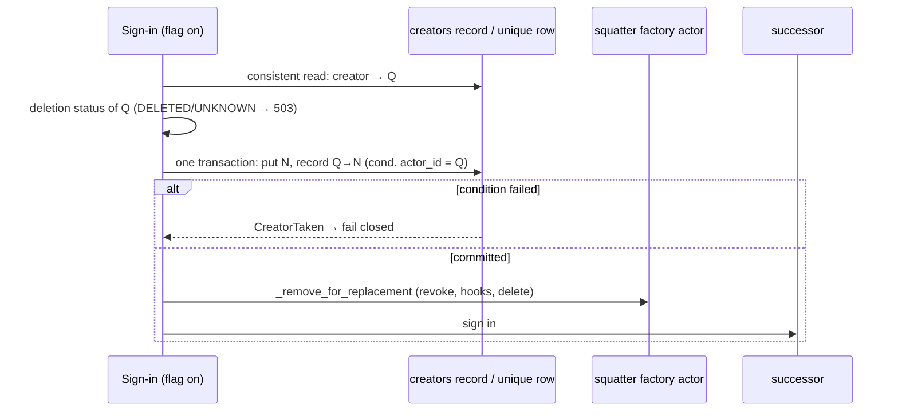

# Implementation Plan: DB-layer fault semantics and opt-in creator uniqueness

**Date:** 2026-10-28
**Research:** thoughts/research/2026-10-28-db-fault-semantics-and-creator-uniqueness.md
**Branches:** two PRs in the 3.16.0 release (owner, 2026-10-28, reverting
the one-PR decision of the same morning):
- **PR 1, Phases 1-2:** `release/3.16.0-db-fault-semantics`, cut from
  `release/3.16.0-oauth-adoption-vouching` once the adoption work is
  committed and its PR is open.
- **PR 2, Phases 3-4:** `release/3.16.0-creator-uniqueness`, cut from PR 1's
  branch once PR 1 is open; rebased onto `master` after PR 1 merges.

Each PR runs the full tier before it opens and carries its own CHANGELOG and
migration-guide entries. 3.16.0 is cut after both merge (and the adoption PR;
spanned list items joins if it lands in time, else 3.17).

Line numbers below are from the uncommitted 3.16 tree of 2026-10-28. Symbol
names are the anchor: re-locate each one after the adoption PR's review edits
before changing it.

## Update Log

- **2026-10-28**: Split back into two PRs (Phases 1-2, Phases 3-4) with the
  docs and changelog work divided per PR. Recorded the exit for the opt-in
  default (flip at the next major, delete the duplicate-handling path then).
  `Attributes` reads become strict by default, with `InternalStore` the one
  folding subclass. Folded four gaps from the pre-implementation review:
  the unique index versus Alembic autogenerate, the three `create()`
  recovery sites that `CreatorTaken` would bypass, `CreatorTaken`'s HTTP
  mapping outside the factory (409, both integrations), and the Flask
  app-level `DbError` handler. Named the deletion wipe as a third root cause
  this plan does not fix. An outside-voice pass over the update added a
  flag-on integration server (nothing in Phases 3-4 could run over HTTP as
  written), the SPA-token auth path to the re-raise sweep, and eleven
  smaller items (Evaluation Notes, "Pre-implementation review"). The final
  check then resolved strict versus expiry: strict only raises,
  `DbAttribute.get_attr` takes `strict=`, `get_attr_strict` alone hides
  expired rows (owner). PR 2 gained its boundary hygiene list.

## Overview

The 3.16 adoption work needed a workaround at every step because two things
underneath it are missing:
- the DB layer answers a fault with the same value as a real answer;
- nothing in the database enforces one actor per creator.

This plan fixes both at the source:
- **Phases 1-2:** decision reads raise `DbError` by default, writes confirm
  themselves, and the 11 callers that act on a folded answer fail closed.
- **Phases 3-4:** `with_unique_creator()` becomes a guarantee the database
  enforces.

It also closes the eighth verification's BR, BS, BU, BV and BW on the default
(non-enforced) adoption path.

## Decisions Made

- **Fault contract**: strict by default on the reads that drive decisions, and
  confirmed writes and deletes. `strict=False` stays for display callers.
  - This fixes B1-B11 at the source and reuses the `strict=` pattern from
    3.16, without the blast radius of raising everywhere (about 50 methods).
  - Owner, 2026-10-28.
- **Fault type**: `actingweb.db.exceptions.DbError`, which already exists.
  - Every strict path wraps the backend exception as
    `raise DbError(op) from e`. PostgreSQL's bare re-raise and `RuntimeError`
    leak stop.
  - The HTTP body never carries `str(e)`, because the message can name an
    actor id.
- **Strict single-attribute reads** [Updated 2026-10-28]: `strict` means
  only "raise on a fault"; it never filters.
  - `DbAttribute.get_attr` gains `*, strict: bool = True` like every other
    single-row get: a fault raises `DbError`, absence is `None`, and expired
    rows are returned as today. The earlier "`get_attr` keeps its signature"
    wording is withdrawn (owner): without it the wrapper's strict
    single-token reads would have had to load whole buckets.
  - `get_attr_strict` stays the **one** read that hides expired rows, and
    changes from a bare `Exception` to `DbError`. It exists for decision
    reads that must not act on a stale token.
  - `get_bucket(strict=True)` returns expired rows as today, so a sweep that
    reads a bucket to find what to delete still finds it.
- **Strict is not consistent**: `strict` means "raise on a fault".
  - DynamoDB's per-row consistent re-read moves to its own `consistent=` kwarg
    on `get_by_creator`.
  - Non-adoption callers no longer pay N consistent reads.
- **Delete contract**:
  - A delete on a loaded handle answers True when the row is gone after the
    call. A row that was already absent counts. A fault raises `DbError`.
  - Handle-less deletes keep their False.
  - `delete_attr_conditional` and every `*_conditional` method are exempt.
    They answer True only when **this** call removed the row, because
    single-use consumption depends on it (`oauth_session.py:214`,
    `oauth_state_store.py:176`).
  - Confirmation comes from the absence of an exception, plus `rowcount` on
    PostgreSQL. There is never a read-back.
- **Adoption faults**: a `DbError` during sign-in adoption fails the sign-in
  closed as a 503, not as a generic failed login.
  - `adopt_existing_actor`'s `except Exception` (`oauth2.py:1975`) re-raises
    `DbError` and `CreatorTaken`.
- **Callers to fix**: all of B1-B11, each with an explicit decision and a
  regression test (owner).
- **Uniqueness is opt-in**: `with_unique_creator()` becomes enforcing, and the
  default stays off (owner).
  - The 3.16 ranking and sweep stay for the default path.
- **Exemptions**: `lower(creator) IN ('trustee', 'creator', '')`.
  - This matches auth's `creator.lower() == "trustee"` and the empty creator
    `DbActor.create` writes when none is given.
  - `system` and `oauth2-system` are enforced; there is one each per
    deployment.
  - Non-exempt values compare on the stored value. The application lowercases
    values containing `@`; provider ids compare exactly (owner).
  - The same rule applies in the PostgreSQL index predicate, the DynamoDB
    write path and `report`.
- **Create for a taken creator**: refused (owner).
  - The backend raises `CreatorTaken` (new, in `db/exceptions.py`).
    `Actor.create` re-raises it, and only `factory.py` turns it into a 403.
  - The passphrase-match "return the existing actor" is removed. This is
    **Breaking** for opted-in consumers, and it also removes a
    passphrase-guess oracle.
- **The sign-in swap is atomic** (owner, after evaluation). When a sign-in
  replaces a squatter's `factory` actor, the backend moves the creator to the
  successor in one step:
  - DynamoDB: one `TransactWrite` puts the successor actor and updates
    `creators.actor_id` from the squatter's id to the successor's.
  - PostgreSQL: one transaction renames the squatter's creator to its `#dup-`
    value and inserts the successor.
  - `_remove_for_replacement` then removes the squatter as today.
  - There is no "look up again" retry. A lost condition fails closed.
- **DynamoDB mechanism**: a separate `creators` table (hash key `creator`,
  attribute `actor_id`), written in the same `TransactWriteItems` as the actor
  create, creator change and delete. Actor scans stay clean (owner).
- **PostgreSQL mechanism**: no Alembic migration (owner).
  - `enable` builds `ux_actors_creator` `CONCURRENTLY` on `(creator)
    WHERE lower(creator) NOT IN ('trustee','creator','')`.
  - `ix_actors_creator` stays: a parameterised `creator = %s` cannot prove the
    partial predicate.
  - `UniqueViolation` on that index maps to `CreatorTaken` whether the flag is
    on or off, so a rolled-back flag never fails silently.
- **Startup check** (owner; the fault rule was refined in evaluation):
  - With the flag on, the app refuses to start when it finds definite
    absence: the DynamoDB `creators` table or its backfill-complete item is
    missing, or the PostgreSQL index is missing or `indisvalid = false`. The
    message names the command.
  - A fault in the probe logs a WARNING and continues; writes still enforce
    or fail closed.
  - It runs once per process, on both backends, from `integrate_flask`,
    `integrate_fastapi` and a public `ActingWebApp.check_ready()` for apps
    that use neither.
- **Duplicates**: one command, `actingweb-unique-creators`, with `report`,
  `resolve`, `enable` and `disable`. It follows the existing tools: dry run by
  default (`--apply` writes), `key=value` summary lines, and exit codes
  0 = clean, 1 = duplicates or orphans found, 2 = store unreadable.
- **Keep rule** (owner, refined in evaluation):
  - Rank by `classify_marker`: vouched, then unvouched, then `replace`. Then
    oldest created, then lowest id.
  - A group with an unreadable marker is skipped and reported.
  - `resolve --keep <id>` overrides the rule.
  - The others are renamed to `{creator}#dup-{sha256(id)[:8]}` through
    `Actor.modify(creator=)`, and their `store.email` is cleared, so the
    `force_email_prop_as_creator` rewrite cannot undo the rename. No user data
    is deleted.
  - `#dup-` is reserved: the factory and `PUT /trust/trustee` reject it.
- **Case-only duplicates**: `report` lists emails that differ only by case.
  `resolve` treats them as one group, because the backend lowercases `@`
  values on the next write anyway, and `enable` refuses while one remains.
  Provider ids never go through `lower()`.
- **Sequencing** [Updated 2026-10-28]: **two PRs**, faults first (Phases 1-2),
  then uniqueness (Phases 3-4), see the branches above. The owner reverted
  the one-PR decision: the fault flip touches every handler and is where the
  full tier is most likely to surprise, and the release needs several PRs
  anyway (adoption, faults, uniqueness, possibly spanned items). The 3.16
  scaffolding stays for the default path in 3.16; with enforcement on, the
  adoption path takes a direct single-actor branch.
- **Exit for the opt-in default** [Added 2026-10-28] (owner): `unique_creator`
  defaults to **on at the next major**, and the duplicate-handling code the
  research's §6 lists (`_candidate_rank`, the ranking in `get_from_creator`,
  `factory_sibling_ids`, `_factory_siblings`, `_sweep_factory_actors`,
  `SWEEP_LIMIT`, the successor step's `remaining` logic, the recursive
  hand-off and `carried`) is deleted then. Both known consumers already run
  the flag on, so in 3.16 the most complex path is the least exercised; the
  exit makes that transitional. Phase 3 files the todo.
- **`Attributes` reads are strict by default** [Added 2026-10-28] (owner).
  `Attributes.get_bucket()` and `get_attr()` raise `DbError` unless called
  with `strict=False`; `InternalStore` is the one folding wrapper (it
  composes an `Attributes`, `attribute.py:9-20`; the change is
  `_ensure_loaded()` passing `strict=False`), so `actor.store.x` never
  raises and `loaded` stays its signal. Reason: after the DB-layer flip the
  wrapper most callers use would still have folded, and a future caller
  acting on absence through it would repeat B7/B11 with only a docstring in
  the way. 21 modules construct `Attributes` and 51 sites read through it
  outside `actingweb/db/`; Phase 1 greps them all.
  - **One TTL rule:** strict never filters. `Attributes.get_attr(strict=True)`
    calls `DbAttribute.get_attr(strict=True)` on its miss path
    (`attribute.py:229-231`) and the cached bucket otherwise, so
    `get_attr(name)` and `get_bucket()[name]` agree on an expired row (both
    return it). Only `get_attr_strict` hides expired rows. A caller that
    must not act on a stale row uses `get_attr_strict`, as the token paths
    do today.
  - **Catch-all policy at fault-aware sites:** an `except Exception` that
    today folds a bucket read (`token_manager.py:680-684, 1643-1647`)
    becomes `except DbError`; a programming error is not an availability
    fault.
- **`CreatorTaken` outside the factory** [Added 2026-10-28]: every creator-change
  entry answers **409** on it (`PUT /<id>/trust/trustee`, and consumer
  routes through the app-level handlers of both integrations). The factory
  keeps its existing 403 "Creator already exists". `map_db_error` tests
  `CreatorTaken` before `DbError`, so a conflict is never a 503.
- **`CreatorTaken` at the fixed-id creates** [Added 2026-10-28]: the three
  sites that today recover from `create()` returning False by loading the
  actor another process made (`oauth2_server/system_actor.py`,
  `trust_type_registry.py`, `handlers/mcp.py` `_race_winner`) catch
  `CreatorTaken` and take the same load path. With `system` and
  `oauth2-system` enforced, a concurrent bootstrap hits the creator
  condition, and the registry's catch-all would otherwise log and return no
  system actor for that worker. Two apps sharing one table can no longer
  both bootstrap with the flag on; the migration guide says so.
- **The unique index and Alembic** [Added 2026-10-28]: `env.py` autogenerates
  from `Base.metadata` with no `include_object` filter, and `schema.py`
  declares the actor's creator column with `index=True` only. An index
  built by `enable` and absent from the metadata would be proposed as a
  drop by the next `alembic revision --autogenerate`. `env.py` gains an
  `include_object` filter that ignores `ux_actors_creator` (with a comment
  naming the command that owns it); the index stays out of the metadata so
  non-opted-in deployments are not offered a create either.

## What We're NOT Doing

- **Raising on every DB method.** The owner chose strict defaults on decision reads; display reads keep folding.
- **Removing the 3.16 ranking, the sibling sweep and `SWEEP_LIMIT`.** With opt-in uniqueness the default path can still hold duplicates.
- **An Alembic migration for the unique index.** It would fail on every deployment that has duplicates, including ones that never opted in.
- **Lowercasing provider-id creators.** Their case is significant to the provider, and a data migration could cause collisions.
- **Deleting duplicate actors automatically.** They hold user data, so `resolve` renames them instead.
- **Fixing `actingweb_mcp/scripts/restore_actor.py`.** It is a consumer script; the migration guide names it, and `report` finds what it leaves behind.
- **Flipping the `unique_creator` default in 3.16.** It is a forced migration for every deployment with duplicates; the flip is recorded for the next major instead.
- **The deletion wipe as a root cause.** `Actor.delete` is a multi-step wipe behind a tombstone, and the adoption todo's H, I, J, K and AW all come from it. It is named here so the next verification does not rediscover it; a resumable, idempotent deletion job is its own plan.
- **Renaming the adoption branch's iteration-numbered test files.** `tests/test_adoption_{fourth,fifth,sixth}_iteration.py` should be named by behaviour, but that is the adoption PR's review, not this plan.
- **The spanned-list-items work.** It has its own plan and PR (owner).
- **BK-BQ in `thoughts/todo/adoption-fault-and-hygiene-followups.md`.** They are unrelated to the two root causes and stay filed.
- **Flask `GET /?format=json` reflecting `Origin` with credentials** (`factory.py:134-141`). It is older than 3.16, low impact, and not a fault or uniqueness issue; filed with BK-BQ.

## What Already Exists

- **`actingweb/db/exceptions.py` `DbError`.** It is reused as the fault type. Its message stays log-only.
- **`get_attr_strict`** (`protocols.py:1077`, both backends). It is reused as the strict single-attribute read and changed to raise `DbError`.
- **`strict=` on list fetches and `get_by_creator`.** The pattern is kept; only the default flips.
- **`single_use.delete_confirmed`, `consume_once`, `StoreFault`.** These stay. `delete_confirmed` is the only "gone either way" helper for conditional rows.
- **`InternalStore.set_confirmed` and `loaded`.** They stay. The read-back still covers PostgreSQL's lost acknowledgement. `loaded` stays the fail-closed point for `InternalStore`, which reads with `strict=False`, so `actor.store.x` never raises.
- **`classify_marker`, `_candidate_rank`, `_factory_siblings`, `_sweep_factory_actors`, `SWEEP_LIMIT`.** They stay for the default path. BR and BS are fixed in place.
- **`Actor.creator_change_pinned`, `modify_creator_unvouched`.** They are reused. Every creator change goes through `DbActor.modify`, which moves the record.
- **The `_check_lookup_backfill_needed` and `_prewarm_dynamodb_tables` precedent** (`app.py:1410-1520`). The new check follows their call sites, not their fault-swallowing.
- **`db/verify_tables.py` `required_models`.** It gains a `unique_creator` argument, and the CLI gains `--unique-creator`.
- **`postgresql/connection.py:44` `get_schema_name()`.** It is reused for the index DDL, built with `psycopg.sql.Identifier`.
- **`tests/test_adoption_write_faults.py:52` `backend_fault`, and the helpers in `tests/test_adoption_backend_faults.py`.** They move into `tests/_adoption_helpers.py` and are reused for every fault test.
- **The `maintenance/` tool conventions** (`mark_actors_vouched.py`, `verify_orphans.py`). They are reused for the new command's shape.

## Phase 1: The fault contract

### Changes

- **`actingweb/interface/integrations/_errors.py`** (new): `map_db_error(response, exc)`.
  - A `DbError` answers 503 with `Retry-After: 5` and a fixed body: "Service temporarily unavailable". The JSON shape is the token-grant 503's. The exception text goes to the log only.
  - Each message-text guess calls it first: `flask_integration.py:740, 1690` and `fastapi_integration.py:1568, 2575`.
  - So does every handler-level `except Exception` in both integrations that sits on a request path. The implementer lists them in the phase notes.
  - Both integrations register an app-level handler for `DbError` (FastAPI `add_exception_handler`, Flask `register_error_handler`), so consumer routes calling `ActorInterface` get 503 too. The handler tests `CreatorTaken` first and answers 409 for it. `CreatorTaken(DbError)` is defined in `db/exceptions.py` **here**, as an empty subclass nothing raises yet, so `_errors.py` is finished in PR 1 and PR 2 never touches it.
  - The SPA-token auth path is on the sweep too, although it is not an integration: `auth.py:417-419`, `flask_integration.py:1520-1521` and `fastapi_integration.py:369-370` catch everything at debug level and answer 401, so a throttle on the token bucket would log every SPA user out. They re-raise `DbError` (`handlers/mcp.py:2376-2379` is the existing pattern); `oauth_session.py:145, 523, 668, 710` are the reads beneath them.
- **`actingweb/db/protocols.py`**: one rule in the docstrings.
  - Absence is `None`/`[]`/`False`, and a fault raises `DbError`.
  - `strict=False` restores the folded answer.
  - Conditional deletes keep "True only if this call removed it".
  - Fix the four texts that match neither backend: `DbPeerTrustee.get` ("False on error"), `fetch_timestamps`, the `DbTrust.create` kwargs, and the `DbPropertyLookup.delete` signature.
  - Every `fetch` in the protocol declares `*, strict: bool = True`.
- **Both backends, strict by default (`strict: bool = True`):**
  - Single-row `get`: actor, trust, peer trustee, subscription, subscription diff, and `DbAttribute.get_attr` (raise-only, expired rows still returned; `get_attr_strict` is the expiry-hiding read). `DbSubscriptionDiff.get`'s `DoesNotExist` becomes `None`.
  - `get_bucket`.
  - The list fetches: `DbActorList.fetch`, `get_by_creator` (plus `consistent=`), trust, peer-trustee, subscription and diff.
  - `get_actor_id_from_property`, `DbPropertyLookup.get` and `get_v1`.
  - On DynamoDB, the `try` moves around the iteration, not around the lazy `query()` call.
- **Both backends, confirmed writes:** per the delete contract above.
  - DynamoDB `delete_attr` and `set_attr(data=falsy)` stop answering True on a swallowed fault.
  - PostgreSQL `modify`/`delete` raise on a fault instead of returning False.
  - PostgreSQL `DbProperty.set` (`:372-399`) and `DbPropertyList.delete` (`:963-966`) roll back and raise instead of committing after a caught error.
- **`actingweb/attribute.py`:**
  - `Attributes.get_bucket`/`get_attr` gain `strict: bool = True`: a fault raises `DbError`, absence answers `{}`/`None`, and `loaded` is then always True after a strict read.
  - `InternalStore` reads with `strict=False` and keeps `loaded` as its fail-closed signal; it is the one folding subclass, so `actor.store.x` never raises.
  - **Grep step:** every `Attributes(` construction outside `actingweb/db/` (21 modules; the token manager and session manager hold 39 of them) and every `.get_bucket()`/`.get_attr(` read through it (51 sites). Each is classified: decision read (keep strict), display read (`strict=False`, listed below), or fault-aware. **Fault-aware means the read sits inside a `try`** (`token_manager.py:681-690, 1644-1652`), which stays. A `.loaded` check **after** a bare `get_bucket()` is not fault-aware: after the flip the read raises first, so `oauth_session.py:918-920, 938-940` and `oauth2.py:1718-1720` pass `strict=False` or wrap, and the docstrings at `oauth_session.py:879-883` and `oauth2.py` `_actor_client_ids` are rewritten. The classification goes in the phase notes.
  - `Attributes.loaded` stays for `strict=False` callers.
  - **`attribute_list.py`** joins the raising API: `len()`, `[]` and iteration on `property_lists` raise `DbError` instead of reading a PostgreSQL fault as an empty list (`:105-114`, `:217-221`). Its `except Exception` re-wraps at `:367-375` and `:382` re-raise `DbError`. The migration guide names the list container among the public APIs that now raise.
- **Display callers pass `strict=False` explicitly:**
  - `callback_processor.py:547`;
  - `handlers/callbacks.py:1015`;
  - `actor.py:1610-1629, 2559-2561, 3048-3052`;
  - `client_registry.py:617`;
  - the `actor_adopted` summaries (`oauth2.py:2076-2077, 2165-2168`);
  - `maintenance/migrate_property_lists.py:192`;
  - `handlers/devtest.py:140-143, 166-169` (diagnostic reads; a 503 there would hide what the operator came to look at);
  - the four sites `thoughts/todo/db-layer-get-bucket-or-empty.md` lists beyond `client_registry.py`: `attribute_list_store.py:60`, `remote_storage.py:200, :297`, and `callback_processor.py:547` above; each is classified by the grep step, and the todo is deleted at the PR 1 boundary.
  - **Not** `oauth_session.py:409-412`: that cleanup deletes expired sessions, so it stays strict and the scheduled run logs the fault instead of reporting "0 cleaned".
- **Before flipping, grep two sets of callers:**
  - callers that branch on a delete's `False`, to confirm none relies on False meaning absent;
  - callers that pass positional arguments to a changed `fetch`.
- **Existing tests that assert folding, rewritten to the new contract:**
  - `test_actor_deletion_tombstone.py:262-263, 297-302`;
  - `test_pg_delete_diagnostics.py:250-255`;
  - `test_property_lookup_v2.py:205-208`;
  - `test_adoption_backend_faults.py:52-88`. Its helpers raise `DbError` by default and pass `**kw` through.
  - Mocks with fixed signatures (`test_remote_storage.py:107`) take `**kw`.

### New Tests, both unit and integration tests

- **Per method above, both backends** (`backend_fault` helper):
  - an injected fault raises `DbError`;
  - `strict=False` folds as before;
  - absence still answers `None`/`[]`.
- **Expiry:** an expired row reads as absent through `get_attr_strict` and is still returned by `get_attr(strict=True)` and `get_bucket(strict=True)` on both backends; the session cleanup at `oauth_session.py:409-424` still removes it.
- **Deletes:**
  - deleting an absent row through a loaded handle answers True on both backends;
  - a delete fault raises;
  - **replay:** the second `delete_attr_conditional` of a session and a state ticket answers False on both backends.
- **DynamoDB:** a fault while iterating `get_bucket` raises. Today it escapes the `try`.
- **HTTP:**
  - Flask and FastAPI: a handler hitting `DbError` answers 503 with `Retry-After: 5` and the fixed body, with no actor id and no traceback.
  - A consumer FastAPI route that raises `DbError` answers 503.
- **PostgreSQL rollback:** a caught error inside `DbProperty.set` leaves no partial row and raises.

### Failure Scenarios

- **The default flip on a hot read.** DynamoDB throttling that used to fold to 401/404 now answers 503. Covered by the mapping and its tests. `Retry-After: 5` keeps retrying clients from hammering the table.
- **A custom backend without `strict`.** `TypeError` at the first call. Covered by the migration-guide checklist. The protocol's typed signatures make pyright flag it.
- **A display caller missed in the list.** A page that used to render empty now answers 503. Covered by the full tier on both backends and the grep step. A loud failure, not a silent one.
- **A conditional delete swept into "absent counts".** Token replay. Covered by the explicit exemption and the replay tests.

### Verification

- [ ] Run the contract's `### Checks` fast tier verbatim
- [ ] Full tier on both backends (the default flip touches every handler)

### Implementation Status: Not Started

---

## Phase 2: Callers B1-B11, and BR/BS/BU/BV/BW on the default adoption path

### Changes

Each row re-raises `DbError` ahead of any `except Exception` on its path. These
catch-alls would otherwise swallow the fault again, for example
`trust_permissions.py:510-512` and `fanout.py:270-271, 292-293`.

| # | Site | On `DbError` |
|---|---|---|
| B1 | `interface/trust_manager.py:476` `create_or_update_oauth_trust` | propagate (503); no new secret, no upsert |
| B2 | `handlers/trust.py:756-775, 1113-1131` | propagate (503); no override write, no peer notification |
| B3 | `trust_permissions.py:493-512` | nothing is cached; propagate |
| B4 | `actor.py:419-427` | propagate; the create is refused |
| B5 | `actor.py:338-340` `get_from_creator` and its callers (`oauth2.py:1024→1046`, `oauth_email.py:469`, `factory.py:260`) | propagate; no new actor |
| B6 | `actor.py:854-956` `get_peer_trustee` | propagate; no POST to the peer factory |
| B7 | `callback_processor.py:112-250` | skip the callback, leave the queue and state untouched, answer 503 so the peer retries |
| B8 | `actor.py:686-716` `Actor.delete` | the strict reads (`trusts.fetch`, `subs.fetch`) move ahead of the first destructive step. On a fault, nothing is deleted and the tombstone is not written |
| B9 | `actor.py:2063-2113` `delete_subscription` | propagate; the bucket is not deleted |
| B10 | `handlers/callbacks.py:242-266` | propagate (503); no initial sync |
| B11 | `fanout.py:256, 285` | leave the breaker state as stored, and skip this delivery attempt |

Adoption path with the flag off (3.16 code that stays):

- **BR**, `actor.py:305-318` `_candidate_rank`:
  - an unreadable marker (`classify_marker(...) is None`) raises, so the lookup fails closed. Today `.get(... or "", 1)` ranks it 1.
  - In the successor step (`oauth2.py:2100-2151`), `remaining` is classified strictly, and nothing is created while any row is not `replace`.
- **BS**, `actor.py:356-375` and `oauth2.py:1810-1858`:
  - a new `get_by_creator(..., ids_only=True)` answers from the creator index (DynamoDB) or `SELECT id` (PostgreSQL), with no per-row get.
  - The ids are sorted, and consistent gets run only for the ranked prefix up to the first vouched actor, plus at most `SWEEP_LIMIT` sweep targets.
  - One sign-in lists once and passes the ids down. Today it lists three times.
  - `_factory_siblings` requires readability only for the ids it will touch.
- **BW**, `CHANGELOG.rst`: "the replaced actor and at most 10 beside it".
- **BV**, `CHANGELOG.rst`: a squatter's `factory` actor causes the same 409 before any click. Point at `with_open_factory(False)`.
  (BV and BW are a sentence each; if the adoption PR takes them before it opens, they drop out here.)

**PR 1 boundary.** This phase ends PR 1. Its docs (moved here from Phase 4):

- **`CHANGELOG.rst`**, under `Unreleased`:
  - **Breaking**, under CHANGED: strict defaults on the protocol reads and on `Attributes`, `DbError` → 503 with `Retry-After: 5`, confirmed deletes on loaded handles, and the custom-backend `strict` requirement.
  - FIXED entries for B1-B11, BR and BS.
- **`docs/migration/v3.16.rst`**: a "Fault contract" section: the public `ActorInterface` methods that now raise `DbError`, the app-level handlers, and the custom-backend checklist for faults (accept `strict`, raise `DbError`, keep the conditional-delete semantics, live inside `actingweb.db`). The uniqueness checklist is PR 2's.
- **`docs/reference/`**: the protocol docstring rule, once, where the backends are documented.
- **Todos:** delete `thoughts/todo/db-layer-get-bucket-or-empty.md` and its `INDEX.md` row; trim `thoughts/todo/adoption-fault-and-hygiene-followups.md` to the items PR 1 did not take (BK-BQ and the hygiene list), since B/BR/BS/BU land here.

### New Tests, both unit and integration tests

- **One regression test per B row, B1-B11, each failing before its change.** An injected read fault must leave:
  - the stored row byte-identical (B1, B2, B7, B9, B11);
  - nothing created (B4, B5, B6);
  - nothing deleted and no tombstone (B8).
  The handler answers 503.
- **B3:** after the fault, the cache is still empty, and the next read returns the stored override.
- **B10:** after the fault, no initial sync runs.
- **BR:** `get_from_creator` with a faulting marker on the vouched V and an unvouched sibling A fails closed. V is never stranded.
- **BU**, with `SWEEP_LIMIT` patched to 2:
  - leftovers plus an unvouched owner: the owner's actor is cleaned, never stranded;
  - leftovers and no owner: exactly one successor, never a factory actor;
  - a leftover whose `classify_marker` faults: the sign-in fails closed and nothing is created.
- **BS**, N=50 factory actors:
  - the number of `Actor.get` calls per sign-in is at most the ranked prefix plus `SWEEP_LIMIT` plus a constant;
  - a fault on a sibling beyond the cap does not block the sweep.

### Failure Scenarios

- **B7 skip.** The peer never retries, so the callback is lost. Covered: the 503 asks for a retry, which is the protocol's normal path. The queue is untouched, so the next callback's gap detection still works.
- **B8 reorder.** A read succeeds, then a later destructive step faults. The partial delete is the tombstone path's existing job. The tombstone is written only after the reads pass, and is tested.
- **BS ids-only listing.** The DynamoDB index lags behind a just-created actor. That actor is not ranked this sign-in, which is the same as today. The AZ rule (the victim must be listed) still fails closed.

### Verification

- [ ] Run the contract's `### Checks` fast tier verbatim
- [ ] Each regression test fails with its fix disabled (record both runs)
- [ ] Full tier on both backends, then open PR 1

### Implementation Status: Not Started

---

## Phase 3: Opt-in uniqueness, the command and the startup check

### Changes

- **`actingweb/db/__init__.py`:** `get_actor(config)` passes `unique_creator=config.unique_creator` to the backend constructor.
  - `protocols.py` documents the keyword-only constructor argument and says a custom backend must enforce uniqueness when it is set.
  - A backend that does not accept the argument fails at construction, never silently.
- **`actingweb/db/exceptions.py`:** `CreatorTaken(DbError)` already exists from Phase 1; this phase is the first to raise it.
- **`actingweb/db/dynamodb/creator.py`** (new): the `Creator` model (hash key `creator`, attribute `actor_id`; the usual table prefix).
  - The backfill-complete item uses the key `#meta#backfill`. Creators beginning with `#` are reserved: the factory and `PUT /trust/trustee` reject them, together with `#dup-` inside a value.
  - `required_models(use_lookup_table, unique_creator)` includes it.
  - `DbActor.__init__` calls `ensure_table(Creator)` when the flag is on.
- **`actingweb/db/dynamodb/actor.py`**, with the flag on (exempt values skip the record):
  - **`create`:** one `TransactWrite`. It puts the actor (`id` not existing) and puts the record (`creator` not existing).
  - **`modify(creator=)`:** one `TransactWrite` that updates the actor (conditioned on the old creator) and puts the new record when the new value is not exempt. Then, as a **separate** conditional `DeleteItem`, it removes the old record only if it names this actor. `ConditionalCheckFailed` there means "not mine, leave it". A transaction that includes that condition would cancel the whole rename whenever the record names another actor, which is the state of every pre-enable duplicate after `enable`.
  - **`delete`:** deletes the actor row, then, as a separate conditional `DeleteItem`, the record only if `actor_id = id`. `ConditionalCheckFailed` leaves it alone. A pre-enable duplicate, a stale handle, or a squatter after the swap therefore never frees, or blocks on, another actor's record.
  - Transactions are used only where they buy atomicity: `create` (actor plus new record), the actor-plus-new-record half of `modify`, and `replace_creator_holder`.
  - **`replace_creator_holder(old_id, new_actor)`** (new, for the swap): puts the successor and updates the record's `actor_id` from `old_id`, in one transaction.
  - **Errors:**
    - `ConditionalCheckFailed` on the record item, found by index in `cancellation_reasons`, becomes `CreatorTaken`.
    - `TransactionConflict` is retried at most twice, with jitter and the same `client_request_token`.
    - Throttles are left to PynamoDB's own retry, then raised as `DbError`.
    - The `Connection` is built lazily from `Actor.Meta` host and region.
- **`actingweb/db/postgresql/actor.py`:**
  - `create`/`modify` map `UniqueViolation` on `ux_actors_creator` to `CreatorTaken`, whatever the flag says.
  - `replace_creator_holder` renames the old row's creator to its `#dup-` value and inserts the successor in one transaction.
- **`actingweb/db/postgresql/migrations/env.py`:** an `include_object` filter (both the offline and online `context.configure` calls) that returns False only for `type_ == "index"`, `reflected`, `object.table.name == "actors"` and the name `ux_actors_creator`, with a comment that `actingweb-unique-creators enable` owns it; a name-only filter would hide unrelated drift. Without it, the next `alembic revision --autogenerate` proposes dropping the index (the metadata declares only `ix_actors_creator`, through `index=True` on the column).
- **The three fixed-id creates catch `CreatorTaken`** and load the actor instead, as they do for a False return today: `oauth2_server/system_actor.py` `ensure_oauth2_system_actor`, `trust_type_registry.py` `_get_system_actor` (its `except Exception` would otherwise swallow the conflict and return None), and `handlers/mcp.py` `_get_or_create_actor_cached` through `_race_winner`.
- **`actingweb/handlers/trust.py` `PUT /<id>/trust/trustee`:** `except CreatorTaken` answers 409 with the house JSON body and applies nothing else from the request, as the 3.16 refusal paths do. `ActorInterface.modify_creator` lets it propagate; the app-level handlers from Phase 1 map it to 409 for consumer routes.
- **`thoughts/todo/unique-creator-default-on-next-major.md`** (new, plus its `INDEX.md` row under "Blocked or waiting on someone else"): the default flip and the list of code to delete, from the Decisions. A unit test pins `Config.unique_creator` and `ActingWebApp`'s default to False and names the todo in its docstring, so the flip cannot happen without the deletion being considered.
- **A flag-on integration substrate.** Every harness today runs `.with_unique_creator(enable=False)` (`tests/integration/test_harness.py:60`, `test_mcp_resource_regression.py:79`), and `tests/test_demo_example.py` only imports the demo and inspects hook registries, so nothing in Phases 3-4 could run over HTTP as first written. `create_test_app` gains a `unique_creator` flag; `tests/integration/conftest.py` starts one extra server on a worker port with it on (the pattern at `conftest.py:552, :630`) and runs `enable --apply` in that server's schema step on both backends; the `creators` table joins the per-worker cleanup. The Phase 3 and Phase 4 HTTP tests point at that server.
- **`actingweb/actor.py`:**
  - With the flag on, `Actor.create` drops the check-then-insert and the passphrase match (`:419-453`), and re-raises `CreatorTaken`.
  - `delete=True` (`ActorInterface.create(delete_existing=True)`) becomes: delete each existing actor through `Actor.delete`, then create. It is documented as non-atomic, and the caller asked for it.
  - The `DEFAULT_CREATOR` rewrite (`:436-445`) and the `force_email_prop_as_creator` rewrite in `Actor.get` (`:277-280`) catch `CreatorTaken`, log a WARNING and leave the creator unchanged.
  - A keyword-only `replace_holder: str | None = None` is threaded from `_create_actor_for_identifier` through `ActorInterface.create` and `Actor.create` to `DbActor.create`. When it is set, the backend uses `replace_creator_holder(replace_holder, …)` instead of a plain create. `Actor.create` still writes the marker, clears the tombstone and fires `actor_created`.
  - Every creator change goes through `DbActor.modify`: `modify_creator_unvouched`, `creator_change_pinned`, `PUT /trust/trustee` and `ActorInterface.modify_creator`.
- **`actingweb/handlers/factory.py`:**
  - `except CreatorTaken` answers 403 "Creator already exists", whatever the flag says (PostgreSQL maps the index violation even with it off). The re-read at `:282-284` and the passphrase-match 201 are gone;
  - the reserved prefixes are rejected with 400;
  - the form path for an existing creator (`:258-269`) redirects to `/login`, not to `/{id}/www`, whatever the flag says. A caller no longer learns the actor id.
- **`actingweb/maintenance/unique_creators.py`** (new), plus the `pyproject.toml` entry `actingweb-unique-creators`, a `scripts/` wrapper and the `maintenance/__init__.py` listing. It builds its own `Config` with `unique_creator=True`.
  - **`report [--creator X]`:** groups duplicates without `DbActorList.fetch`.
    - PostgreSQL: `GROUP BY creator HAVING count(*) > 1` and a `lower(creator)` variant for `@` values.
    - DynamoDB: a paged, projected scan (`id`, `creator`) holding only `creator → ids`, with `--rate-limit` and an opt-in `--consistent`.
    - Lists exact and case-only groups, `#dup-` actors, and (DynamoDB) records whose actor is missing or whose creator differs.
  - **`resolve [--apply] [--keep <id>]`:** applies the keep rule. Renames by `Actor.modify(creator=)` after checking the target value is free, and clears `store.email` on the renamed actors. Repairs orphaned DynamoDB records. Prints every decision, including when two actors are vouched and age decided.
  - **`enable [--apply]`:** refuses while duplicates remain.
    - DynamoDB: creates the table and puts each record with `attribute_not_exists`. A collision with the same `actor_id` counts as done; any other collision stops the run. Then it writes `#meta#backfill`. Re-running it is safe, and the rollout runs it twice (see Phase 4).
    - PostgreSQL: on an autocommit connection outside the pool, it sets `statement_timeout = 0` and a `lock_timeout`. It drops an INVALID `ux_actors_creator` from an earlier failed run, runs `CREATE UNIQUE INDEX CONCURRENTLY` through `psycopg.sql`, honouring `get_schema_name()` and `PG_DB_PREFIX`, then checks `indisvalid`.
  - **`disable [--apply]`:** the rollback. PostgreSQL drops the index; DynamoDB deletes `#meta#backfill`, and the table can be dropped by hand. The flag must be off first.
- **`actingweb/interface/app.py`:**
  - `_check_unique_creator_ready()`, per the startup-check decision;
  - `check_ready()` (public);
  - `_prewarm_dynamodb_tables` passes the flag to `required_models`.
- **`actingweb/db/verify_tables.py`:** the `unique_creator` argument and the `--unique-creator` CLI flag.
- **`tests/integration/conftest.py`, `tests/integration/test_harness.py`:**
  - the test schema runs `enable --apply` for apps that turn the flag on (the demo app does);
  - the `creators` table joins the per-worker cleanup and `reset_ensure_cache`.

### New Tests, both unit and integration tests

- **Creates, both backends:**
  - a second create for the same creator raises `CreatorTaken`;
  - of two concurrent creates, exactly one wins;
  - `Trustee`, `creator` and `''` each accept many.
- **Changes and deletes:**
  - a change moves the record;
  - a change to a taken creator is refused and leaves both actors unchanged;
  - exempt → non-exempt, non-exempt → exempt, and a missing record each behave per the conditions above;
  - deleting a pre-enable duplicate leaves the kept actor's record intact;
  - deleting the squatter after a swap removes the squatter's row and leaves the successor's record intact;
  - renaming a pre-enable duplicate after `enable` succeeds, and leaves the kept actor's record intact;
  - a delete frees the creator.
- **Swap:**
  - `replace_creator_holder` with a stale `old_id` raises `CreatorTaken` and writes nothing;
  - DynamoDB: a mocked `TransactionConflict` is retried with the same token, then raises `DbError`. DynamoDB Local never raises it.
- **Flag off:** a PostgreSQL `UniqueViolation` with the flag off becomes `CreatorTaken` (a 403), not a silent False.
- **Command:**
  - `report` finds exact duplicates, case-only duplicates and orphaned records, and exits 1;
  - `resolve` without `--apply` writes nothing;
  - `--apply` keeps per the rule (an unmarked old owner beats a newer factory squatter; an unreadable group is skipped) and honours `--keep`;
  - after a rename, `Actor.get` with `force_email_prop_as_creator` on leaves the creator renamed;
  - `enable` refuses with duplicates, succeeds after `resolve`, and a second run is a no-op;
  - an interrupted DynamoDB `enable` can be re-run;
  - `disable` reverses it.
- **Factory:** rejects `#dup-` and `#…` with 400. The form path redirects to `/login` with no id.
- **Fixed-id creates:** with the flag on, two concurrent system-actor bootstraps both end with the actor loaded (one creates, the other catches `CreatorTaken`); the same for two MCP bridge requests on one id. **Cross-id:** an MCP bridge create for an email another actor already holds gets `CreatorTaken`, `_race_winner` answers False, and the request fails with a log line, never loading the other actor.
- **`PUT /trust/trustee`** to a taken creator answers 409, not 503, and leaves both actors unchanged; a consumer FastAPI and Flask route that raises `CreatorTaken` answers 409.
- **Alembic:** on the PostgreSQL container after `enable --apply`, `alembic.autogenerate.compare_metadata(context, Base.metadata)` is empty (not `revision --autogenerate`, which writes a file into `migrations/versions/` on every run).
- **Default pin:** the test that pins `unique_creator` to False fails if the default is flipped.
- **Startup:**
  - flag on with the index missing, INVALID, or `#meta#backfill` absent raises with the command name;
  - a probe fault logs and continues;
  - flag off never checks.

### Failure Scenarios

- **An orphaned record** (an old process deletes an actor during a rolling deploy; a manual delete). The address is blocked. Covered: `report` lists it with exit 1, `resolve --apply` repairs it, and the migration guide says to run `report` after the rollout.
- **Actors created during `enable` by old processes** get no record. Covered: the rollout order runs `enable` again after the deploy, and re-running is safe.
- **A failed `CONCURRENTLY` build** leaves an INVALID index that still enforces. Covered: the startup check treats INVALID as missing, and `enable` drops and rebuilds.
- **A transaction conflict storm.** Covered: bounded retries with an idempotency token, then 503.
- **A flag rollback with the index in place.** Covered: `CreatorTaken` is mapped with the flag off, and `disable` is the documented rollback.

### Verification

- [ ] Run the contract's `### Checks` fast tier verbatim
- [ ] `actingweb-unique-creators report|resolve|enable|disable` by hand against
  DynamoDB Local and the PostgreSQL test container, with seeded duplicates

### Implementation Status: Not Started

---

## Phase 4: The enforced adoption branch, docs and release notes

### Changes

- **`actingweb/oauth2.py`.** With the flag on, the adoption path skips ranking and the sibling sweep:
  - **The lookup:** under the flag, the actor is resolved by a consistent `GetItem` on the `creators` table (DynamoDB) or by the unique row (PostgreSQL), not through the lagging index.
  - **The deletion check:** `get_deletion_status` runs on the found actor. DELETED or UNKNOWN fails closed with a 503.
  - **The branches:** vouched → sign in; unvouched → clean in place.
  - **`factory`:** the successor is created with `replace_holder=squatter_id`, so `replace_creator_holder` runs first, then `_remove_for_replacement(squatter)`. If it raises `CreatorTaken` (the record no longer names the squatter), the sign-in fails closed.
- **`CHANGELOG.rst`** (PR 2's entries; the fault entries are PR 1's, Phase 2).
  - **Breaking:** under CHANGED:
    - the passphrase match is gone: keep the id and URL from the first 201 and use basic auth on `/{id}`, or sign in through OAuth;
    - the startup check;
    - `with_unique_creator()` enforces, and `CreatorTaken` answers 409 on a creator change (403 on the factory, as before);
    - the form path's redirect goes to `/login`;
    - `#…` and `#dup-` creators are reserved;
    - two apps sharing one table cannot both bootstrap their system actors with the flag on.
  - A note that the default flips at the next major, pointing at the migration guide's "Creator uniqueness" section (never at a `thoughts/` file: the todo is deleted when the flip lands).
- **`docs/migration/v3.16.rst`** (the "Creator uniqueness" section; the fault section is PR 1's).
  - **Step 0 for opted-in deployments** (both `actingweb_mcp` and the demo), in order:
    1. `report`;
    2. `resolve`, then `resolve --apply`;
    3. `enable --apply`;
    4. deploy;
    5. `enable --apply` again;
    6. `report`.
    Optionally close the factory with `with_open_factory(False)` during the window.
  - Name `restore_actor.py`: it writes through `DbActor`, so either create through `Actor.create` or run `resolve --apply` afterwards.
  - The cost with the flag on: on DynamoDB a create, a delete and a creator change each cost about 4-6 WCU instead of 1. Only opted-in tables pay this.
  - Renamed actors lose basic-auth and OAuth access, because the creator no longer matches. Swap which actor is kept with `resolve --keep` before `enable`, or with `modify(creator=)` after.
  - **Custom backends:** the uniqueness half of the checklist. Accept `unique_creator`, raise `CreatorTaken`, implement `replace_creator_holder`. (The fault half is in PR 1's section.)
  - **Consumer code:** `CreatorTaken` from `ActorInterface.create` and `modify_creator`, and the 409 the app-level handlers answer.
- **PR 2 boundary hygiene** (the mirror of Phase 2's):
  - delete `thoughts/todo/creator-uniqueness-not-enforced.md` and its `INDEX.md` row; the new next-major todo takes its place;
  - trim `thoughts/todo/adoption-fault-and-hygiene-followups.md` of the items the enforced path closes: BK (stale index), BL (double hooks for one sibling), BO (check-then-insert under `unique_creator`), each with a sentence saying it still holds with the flag off, or drop it if it does not;
  - rewrite the CHANGELOG known limitation "two concurrent first sign-ins may both run the rule" to say it holds only with the flag off;
  - update the two in-code references to the deleted todo in `oauth2.py` (the `_adopt_actor` comment and the `lookup_or_create_actor_by_identifier` docstring) to point at the migration guide.
- `/verify_implementation` runs at both PR boundaries, so Phase 2's and Phase 4's verification boxes each produce a verification document.
- **`docs/quickstart/configuration.rst`, `docs/reference/security.rst`, `docs/guides/authentication.rst`:** `with_unique_creator()` is now enforced, and the command is documented.

### New Tests, both unit and integration tests

- **Flag on, factory squatter:** the owner's sign-in replaces the squatter's factory actor, leaves exactly one actor, and moves the record to the successor.
- **Flag on, races:**
  - a factory POST racing between the read and the transaction gets `CreatorTaken`, and the sign-in still wins;
  - a `PUT /trust/trustee` rename of the squatter in the gap makes the transaction fail, and the sign-in fails closed. It never adopts the renamed actor.
- **Flag on, deletion:** with the found actor mid-deletion, the sign-in answers 503.
- **Flag on, factory:** a matching passphrase answers 403.
- **Demo:** `tests/test_demo_example.py` passes with the enabled schema.

### Failure Scenarios

- **The swap commits, then `_remove_for_replacement` faults.** The squatter's actor is left without its record (on PostgreSQL its creator is already `#dup-`), and `report` lists it. Covered by the existing replace-path fault handling and a test.
- **The `creators` read faults at sign-in.** 503, nothing written. Covered by a test.

### Verification

- [ ] Run the contract's `### Checks` full tier verbatim, then open PR 2
- [ ] Benchmarks alone on a quiet machine (`-m benchmark`): actor create and
  delete with the flag on and off, p50 and p99

### Implementation Status: Not Started

---

## Evaluation Notes

### Architecture
- **The backends never saw the flag.** Folded: a constructor kwarg from `get_actor(config)`.
- **`CreatorTaken` folded to False, and `adopt_existing_actor` swallowed everything.** Folded: it re-raises, and only the factory maps it.
- **The factory change sat in Phase 4 while Phase 3 removed what it relied on.** Folded: moved into Phase 3, and `delete=True` and the `DEFAULT_CREATOR` rewrite are defined.
- **strict was conflated with consistency on DynamoDB, and strict paths leaked raw exceptions.** Folded: a separate `consistent=` kwarg, and `DbError` wrapping.
- **A strict `get_attr` would duplicate `get_attr_strict`.** Folded: reuse it.
- **The startup check copied a DynamoDB-only precedent that swallows faults; `required_models` had no flag; the marker location was unspecified.** Folded.
- **The message-text guesses are spread across many sites.** Folded: a shared helper, and a site list in the phase notes.
- **The `TransactWrite` connection.** Feasible from `Actor.Meta`. Folded.
- **"Custom backend" means a module inside `actingweb.db`.** Documented.

### Security
- **H1, conditional deletes and token replay.** Folded: an explicit exemption, plus replay tests.
- **H2, the delete-then-create gap, through the factory or `PUT /trust/trustee`.** The owner chose the atomic handover.
- **M1, the keep rule ignored the factory-last tier.** Folded: `classify_marker` tiers, unreadable groups skipped.
- **M2, actor-id exposure.** Folded: the 503 body is fixed text, and the form redirect goes to `/login`.
- **L1, pre-planted `#dup-` values.** Folded: reserved prefixes, and the target is checked before renaming.
- **L2, case-sensitive exemptions.** The owner chose `lower()` exemptions.
- **Things that already hold, recorded:**
  - the index DDL through `psycopg.sql` and `get_schema_name()`;
  - removing the passphrase match removes a guess oracle;
  - the auth paths still deny on a fault (503 instead of 401).

### Scalability
- **The BS fix still read every row.** Folded: the `ids_only` listing, one listing per sign-in, and a test that counts `Actor.get` calls.
- **The startup check could fail every cold start on a throttle.** Folded: it raises only on definite absence.
- **Transaction retries were not idempotent and stacked on PynamoDB's own.** Folded.
- **The WCU table left out delete.** Folded.
- **The maintenance scans held the whole table in memory.** Folded: `GROUP BY` on PostgreSQL, a paged projected scan on DynamoDB, consistent reads opt-in.
- **Actors created during `enable`.** Folded: a re-runnable `enable` and the rollout order.
- **The `CONCURRENTLY` details.** Folded: an autocommit connection, timeouts, the `indisvalid` check, and `ix_actors_creator` kept.
- **`Retry-After`.** Folded: 5 seconds.

### Usability
- **No rollout order.** Folded: the six-step order.
- **The startup check's coverage and message.** Folded, including `check_ready()`.
- **CLI conventions:** dry run by default with `--apply`, as in `migrate_property_lists`, plus exit codes 0/1/2 and `key=value` lines. Folded.
- **The passphrase-match replacement and the HTML path.** Folded into the CHANGELOG and the factory change.
- **Consumer routes and custom backends.** Folded: the FastAPI handler and the checklist.
- **No way back for renamed actors.** Folded: `--keep`, and `report` lists `#dup-` actors.
- **`delete=True` and the 503 shape.** Folded.

### Tests and code quality
- **Callers re-swallowing faults** (`trust_permissions.py:510`, `fanout.py:270, 292`). Folded into the Phase 2 preamble.
- **B8's order.** Folded: the reads move ahead of the first destructive step.
- **The `force_email_prop_as_creator` rewrite undoing renames.** Folded: clear the email, catch `CreatorTaken`, add a test.
- **A non-idempotent `enable`.** Folded.
- **Record conditions for exempt changes, missing records and pre-enable duplicates.** Folded, with tests.
- **The retry read the lagging index.** Superseded by the atomic swap; the lookup is a consistent read of the record.
- **B3 and B10 had no tests, and BR needed its own.** Folded.
- **`InternalStore`'s fate when `get_bucket` raises.** Folded: it reads with `strict=False` and keeps `loaded`.
- **Reuse:** `get_attr_strict`, `delete_confirmed` and the `backend_fault` helper. Folded.
- **Case-only duplicates had no outcome.** Folded.
- **Existing tests that assert folding.** Listed in Phase 1.

### Outside voice
Codex (`codex exec -s read-only`, unsandboxed) and a fresh-context Claude. Findings:
- **A `#dup-{id}` collision after lowercasing.** Folded: a hex digest suffix.
- **"An absent row counts as deleted" cannot hold for handle-less deletes.** Folded: the contract is scoped to loaded handles.
- **Orphaned `creators` records, and no reaper or off switch.** Folded: `report` and `resolve` find and repair them, and `disable` is added.
- **The PostgreSQL index enforcing silently after a flag rollback.** Folded: `UniqueViolation` is mapped whatever the flag says.
- **The expiry rule for strict reads.** Folded: expired rows are absent.
- **Signing in to an actor that is mid-deletion.** Folded: a deletion-status check on the enforced lookup.
- **Split the release.** The owner kept one PR, after a detailed trade-off; reverted to two PRs on 2026-10-28 (Update Log).
- **Line numbers come from uncommitted files.** Folded: symbol names are the anchor.
- **Shared creators beyond the exemptions** (`''`, `system`). Folded: `''` is exempt, and the `system*` creators are enforced as one per deployment.

### Final self-review
- **A DynamoDB `delete` or `modify` that put its record condition inside the actor's transaction cancelled itself after the swap**, and for every pre-enable duplicate. Folded: the record cleanup is a separate conditional `DeleteItem`, with tests.
- **The factory's 403 was scoped to the flag, which contradicted the PostgreSQL mapping that applies with the flag off.** Fixed.
- **The plan did not say how the swap reaches `DbActor` through `Actor.create`.** Folded: the `replace_holder` kwarg.

### Pre-implementation review, 2026-10-28
A read of the plan against the uncommitted tree before `/implement_plan`, after the eighth adoption verification. Findings and where they went:
- **Alembic autogenerate would drop the unique index** (`env.py:41` `target_metadata = Base.metadata`, no `include_object`; `schema.py` `creator = Column(..., index=True)`). Folded: the `env.py` filter and a test, Phase 3.
- **`CreatorTaken` bypasses three `create()` recoveries** (`system_actor.py:60-71`, `trust_type_registry.py:126-150` with its `except Exception`, `mcp.py:2444-2459`). Folded: Decisions and Phase 3, with the shared-table consequence in the migration guide.
- **`CreatorTaken` subclasses `DbError`, so `PUT /trust/trustee` and consumer routes would answer 503 for a conflict.** Folded: 409 at every creator-change entry, and `map_db_error` ordering, Phases 1 and 3.
- **Only FastAPI had an app-level `DbError` handler.** Folded: Flask too, Phase 1.
- **The default path keeps every workaround and no known consumer runs it.** Folded: the next-major exit, Decisions and the Phase 3 todo.
- **`Attributes` would still fold by default after the DB flip.** Owner chose strict by default with `InternalStore` folding; the 21-module/51-site grep is in Phase 1.
- **A third root cause, the deletion wipe,** behind the adoption todo's H, I, J, K and AW. Named under "What We're NOT Doing".
- **Process:** nothing was committed; the adoption work (about 2,600 changed lines plus new files) must be committed and its PR opened before PR 1's branch is cut. BV and BW can go into that PR.
- **Outside voice on the update** (Codex `codex exec -s read-only`, unsandboxed, plus a fresh-context Claude), fifteen findings, all folded, none changing a decision:
  - the enforced path had no integration substrate (every harness runs the flag off): a flag-on server in the integration conftest, Phase 3;
  - `Attributes.get_attr(strict=True)` had no backend method and the two candidates disagreed on expired rows: first folded as "strict filters expired rows", which the final check showed would blind the strict session cleanup; the owner then chose `strict=` on `DbAttribute.get_attr` (raise-only) with `get_attr_strict` the one expiry-hiding read, withdrawing the "keeps its signature" wording;
  - the SPA-token auth path re-swallows at debug level and answers 401: added to the Phase 1 sweep;
  - a `.loaded` check after a bare `get_bucket()` is not fault-aware after the flip: the grep step says so, two docstrings rewritten;
  - `thoughts/todo/db-layer-get-bucket-or-empty.md` is this work and lists four more sites: folded and deleted at the PR 1 boundary, with the adoption todo trimmed;
  - the MCP bridge's cross-id `CreatorTaken` case, the list-container protocol (`attribute_list.py`) joining the raising API, the CHANGELOG pointing at a todo, the autogenerate test littering `migrations/versions/`, `InternalStore` being a wrapper not a subclass, the `oauth_session.py:409-412` cleanup not being a display read, `devtest.py` missing from the display list, the name-only `include_object` filter, the catch-all policy at fault-aware sites, the next-major exit lacking a pin, and `CreatorTaken` being referenced in PR 1 but defined in PR 2.
  - Unverified by the reviewers: whether the refresh-token grace classification (`single_use.classify_reuse`) reads an expiring row through a path the TTL rule changes; whether `actingweb_mcp` catches `RuntimeError`/`IndexError` from list properties. Both are checked in Phase 1's grep step.
- Smaller, recorded: the two-step record move on a DynamoDB rename leaves a window in which the freed old creator still answers `CreatorTaken` until the separate conditional delete runs (default path unaffected; add to Phase 3's failure scenarios when implementing). BS's "rank until the first vouched" reads every row when the owner's actor has the highest id (default path only, bounded by the exit decision).

### Unverified notes
- A creator containing `#` might break a route or template that puts the creator in a URL. The reserved prefixes reduce the exposure, but templates were not checked.
- A user who deletes their account and signs up again at once is refused while the wipe runs, because the record is freed only when the actor row goes. On a large actor that can take a while.
- Records edited by hand in the console that point at the wrong actor id can be found only by `report`'s orphan pass.
