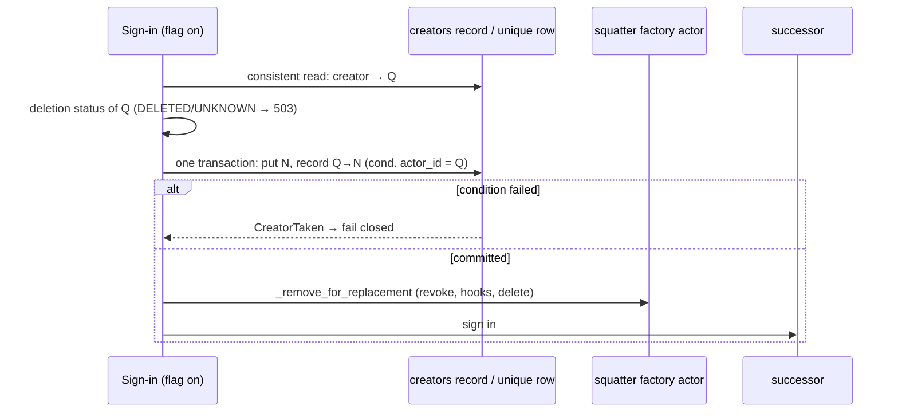

# Implementation Plan: DB-layer fault semantics and opt-in creator uniqueness

**Date:** 2026-10-28
**Research:** thoughts/research/2026-10-28-db-fault-semantics-and-creator-uniqueness.md
**Branches:** two PRs in the 3.16.0 release (owner, 2026-10-28, reverting
the one-PR decision of the same morning):
- **PR 1, Phases 1-2:** `release/3.16.0-db-fault-semantics`, cut from
  `release/3.16.0-oauth-adoption-vouching` once the adoption work is
  committed and its PR is open.
- **PR 2, Phases 3-4:** `release/3.16.0-creator-uniqueness`, cut from PR 1's
  branch once PR 1 is open; rebased onto `master` after PR 1 merges.

Each PR runs the full tier before it opens and carries its own CHANGELOG and
migration-guide entries. 3.16.0 is cut after both merge (and the adoption PR;
spanned list items joins if it lands in time, else 3.17).

Line numbers below are from the uncommitted 3.16 tree of 2026-10-28. Symbol
names are the anchor: re-locate each one after the adoption PR's review edits
before changing it.

## Update Log

- **2026-10-29**: Iterations 42-43 after verification 6: the resume path's
  permanent and lost-answer faults, the refused fallback diff, the logout
  cookie, and filings.
- **2026-10-29**: Iterations 37-41 after verification 5: the subscription
  resume, the creator-change restore, the fault answer's redirect and cookies,
  DynamoDB's conditional diff write and order, and smaller items.
- **2026-10-29**: Iterations 30-36 after verification 4: the startup
  permission fault, the list wrappers' folds, spec-conformant sequence
  numbers on the publisher side, the in-route CORS, two post-commit folds,
  and the restored and new todos. PR #159 merged; the branch now sits on
  `85a4deb`.
- **2026-10-29**: Phases 1-2 (PR 1) implemented on
  `release/3.16.0-db-fault-semantics`, cut from the adoption PR (#159). Full
  tier green on both backends. Phases 3-4 (PR 2) not started; the plan stays
  `active` for them.
- **2026-10-28**: Split back into two PRs (Phases 1-2, Phases 3-4) with the
  docs and changelog work divided per PR. Recorded the exit for the opt-in
  default (flip at the next major, delete the duplicate-handling path then).
  `Attributes` reads become strict by default, with `InternalStore` the one
  folding subclass. Folded four gaps from the pre-implementation review:
  the unique index versus Alembic autogenerate, the three `create()`
  recovery sites that `CreatorTaken` would bypass, `CreatorTaken`'s HTTP
  mapping outside the factory (409, both integrations), and the Flask
  app-level `DbError` handler. Named the deletion wipe as a third root cause
  this plan does not fix. An outside-voice pass over the update added a
  flag-on integration server (nothing in Phases 3-4 could run over HTTP as
  written), the SPA-token auth path to the re-raise sweep, and eleven
  smaller items (Evaluation Notes, "Pre-implementation review"). The final
  check then resolved strict versus expiry: strict only raises,
  `DbAttribute.get_attr` takes `strict=`, `get_attr_strict` alone hides
  expired rows (owner). PR 2 gained its boundary hygiene list.

## Overview

The 3.16 adoption work needed a workaround at every step because two things
underneath it are missing:
- the DB layer answers a fault with the same value as a real answer;
- nothing in the database enforces one actor per creator.

This plan fixes both at the source:
- **Phases 1-2:** decision reads raise `DbError` by default, writes confirm
  themselves, and the 11 callers that act on a folded answer fail closed.
- **Phases 3-4:** `with_unique_creator()` becomes a guarantee the database
  enforces.

It also closes the eighth verification's BR, BS, BU, BV and BW on the default
(non-enforced) adoption path.

## Decisions Made

- **Fault contract**: strict by default on the reads that drive decisions, and
  confirmed writes and deletes. `strict=False` stays for display callers.
  - This fixes B1-B11 at the source and reuses the `strict=` pattern from
    3.16, without the blast radius of raising everywhere (about 50 methods).
  - Owner, 2026-10-28.
- **Fault type**: `actingweb.db.exceptions.DbError`, which already exists.
  - Every strict path wraps the backend exception as
    `raise DbError(op) from e`. PostgreSQL's bare re-raise and `RuntimeError`
    leak stop.
  - The HTTP body never carries `str(e)`, because the message can name an
    actor id.
- **Strict single-attribute reads** [Updated 2026-10-28]: `strict` means
  only "raise on a fault"; it never filters.
  - `DbAttribute.get_attr` gains `*, strict: bool = True` like every other
    single-row get: a fault raises `DbError`, absence is `None`, and expired
    rows are returned as today. The earlier "`get_attr` keeps its signature"
    wording is withdrawn (owner): without it the wrapper's strict
    single-token reads would have had to load whole buckets.
  - `get_attr_strict` stays the **one** read that hides expired rows, and
    changes from a bare `Exception` to `DbError`. It exists for decision
    reads that must not act on a stale token.
  - `get_bucket(strict=True)` returns expired rows as today, so a sweep that
    reads a bucket to find what to delete still finds it.
- **Strict is not consistent**: `strict` means "raise on a fault".
  - DynamoDB's per-row consistent re-read moves to its own `consistent=` kwarg
    on `get_by_creator`.
  - Non-adoption callers no longer pay N consistent reads.
- **Delete contract**:
  - A delete on a loaded handle answers True when the row is gone after the
    call. A row that was already absent counts. A fault raises `DbError`.
  - Handle-less deletes keep their False.
  - `delete_attr_conditional` and every `*_conditional` method are exempt.
    They answer True only when **this** call removed the row, because
    single-use consumption depends on it (`oauth_session.py:214`,
    `oauth_state_store.py:176`).
  - Confirmation comes from the absence of an exception, plus `rowcount` on
    PostgreSQL. There is never a read-back.
- **Adoption faults**: a `DbError` during sign-in adoption fails the sign-in
  closed as a 503, not as a generic failed login.
  - `adopt_existing_actor`'s `except Exception` (`oauth2.py:1975`) re-raises
    `DbError` and `CreatorTaken`.
- **Callers to fix**: all of B1-B11, each with an explicit decision and a
  regression test (owner).
- **Uniqueness is opt-in**: `with_unique_creator()` becomes enforcing, and the
  default stays off (owner).
  - The 3.16 ranking and sweep stay for the default path.
- **Exemptions**: `lower(creator) IN ('trustee', 'creator', '')`.
  - This matches auth's `creator.lower() == "trustee"` and the empty creator
    `DbActor.create` writes when none is given.
  - `system` and `oauth2-system` are enforced; there is one each per
    deployment.
  - Non-exempt values compare on the stored value. The application lowercases
    values containing `@`; provider ids compare exactly (owner).
  - The same rule applies in the PostgreSQL index predicate, the DynamoDB
    write path and `report`.
- **Create for a taken creator**: refused (owner).
  - The backend raises `CreatorTaken` (new, in `db/exceptions.py`).
    `Actor.create` re-raises it, and only `factory.py` turns it into a 403.
  - The passphrase-match "return the existing actor" is removed. This is
    **Breaking** for opted-in consumers, and it also removes a
    passphrase-guess oracle.
- **The sign-in swap is atomic** (owner, after evaluation). When a sign-in
  replaces a squatter's `factory` actor, the backend moves the creator to the
  successor in one step:
  - DynamoDB: one `TransactWrite` puts the successor actor and updates
    `creators.actor_id` from the squatter's id to the successor's.
  - PostgreSQL: one transaction renames the squatter's creator to its `#dup-`
    value and inserts the successor.
  - `_remove_for_replacement` then removes the squatter as today.
  - There is no "look up again" retry. A lost condition fails closed.
- **DynamoDB mechanism**: a separate `creators` table (hash key `creator`,
  attribute `actor_id`), written in the same `TransactWriteItems` as the actor
  create, creator change and delete. Actor scans stay clean (owner).
- **PostgreSQL mechanism**: no Alembic migration (owner).
  - `enable` builds `ux_actors_creator` `CONCURRENTLY` on `(creator)
    WHERE lower(creator) NOT IN ('trustee','creator','')`.
  - `ix_actors_creator` stays: a parameterised `creator = %s` cannot prove the
    partial predicate.
  - `UniqueViolation` on that index maps to `CreatorTaken` whether the flag is
    on or off, so a rolled-back flag never fails silently.
- **Startup check** (owner; the fault rule was refined in evaluation):
  - With the flag on, the app refuses to start when it finds definite
    absence: the DynamoDB `creators` table or its backfill-complete item is
    missing, or the PostgreSQL index is missing or `indisvalid = false`. The
    message names the command.
  - A fault in the probe logs a WARNING and continues; writes still enforce
    or fail closed.
  - It runs once per process, on both backends, from `integrate_flask`,
    `integrate_fastapi` and a public `ActingWebApp.check_ready()` for apps
    that use neither.
- **Duplicates**: one command, `actingweb-unique-creators`, with `report`,
  `resolve`, `enable` and `disable`. It follows the existing tools: dry run by
  default (`--apply` writes), `key=value` summary lines, and exit codes
  0 = clean, 1 = duplicates or orphans found, 2 = store unreadable.
- **Keep rule** (owner, refined in evaluation):
  - Rank by `classify_marker`: vouched, then unvouched, then `replace`. Then
    oldest created, then lowest id.
  - A group with an unreadable marker is skipped and reported.
  - `resolve --keep <id>` overrides the rule.
  - The others are renamed to `{creator}#dup-{sha256(id)[:8]}` through
    `Actor.modify(creator=)`, and their `store.email` is cleared, so the
    `force_email_prop_as_creator` rewrite cannot undo the rename. No user data
    is deleted.
  - `#dup-` is reserved: the factory and `PUT /trust/trustee` reject it.
- **Case-only duplicates**: `report` lists emails that differ only by case.
  `resolve` treats them as one group, because the backend lowercases `@`
  values on the next write anyway, and `enable` refuses while one remains.
  Provider ids never go through `lower()`.
- **Subscription delivery follows the protocol spec** [Updated 2026-10-29]:
  on the publisher side the library meets the spec's MUST: every change gets
  its own sequence number (an atomic backend increment), a number whose diff
  is not stored stays a gap, and a subscriber skipped on a store fault gets a
  deliberate gap. The subscriber keeps its behaviour (at-most-once, gap
  detection, resync); its hardening beyond the spec's minimum is a todo.
  This replaces entry 12's rollback. (Owner, after verification 4.)
- **Sequencing** [Updated 2026-10-28]: **two PRs**, faults first (Phases 1-2),
  then uniqueness (Phases 3-4), see the branches above. The owner reverted
  the one-PR decision: the fault flip touches every handler and is where the
  full tier is most likely to surprise, and the release needs several PRs
  anyway (adoption, faults, uniqueness, possibly spanned items). The 3.16
  scaffolding stays for the default path in 3.16; with enforcement on, the
  adoption path takes a direct single-actor branch.
- **Exit for the opt-in default** [Added 2026-10-28] (owner): `unique_creator`
  defaults to **on at the next major**, and the duplicate-handling code the
  research's §6 lists (`_candidate_rank`, the ranking in `get_from_creator`,
  `factory_sibling_ids`, `_factory_siblings`, `_sweep_factory_actors`,
  `SWEEP_LIMIT`, the successor step's `remaining` logic, the recursive
  hand-off and `carried`) is deleted then. Both known consumers already run
  the flag on, so in 3.16 the most complex path is the least exercised; the
  exit makes that transitional. Phase 3 files the todo.
- **`Attributes` reads are strict by default** [Added 2026-10-28] (owner).
  `Attributes.get_bucket()` and `get_attr()` raise `DbError` unless called
  with `strict=False`; `InternalStore` is the one folding wrapper (it
  composes an `Attributes`, `attribute.py:9-20`; the change is
  `_ensure_loaded()` passing `strict=False`), so `actor.store.x` never
  raises and `loaded` stays its signal. Reason: after the DB-layer flip the
  wrapper most callers use would still have folded, and a future caller
  acting on absence through it would repeat B7/B11 with only a docstring in
  the way. 21 modules construct `Attributes` and 51 sites read through it
  outside `actingweb/db/`; Phase 1 greps them all.
  - **One TTL rule:** strict never filters. `Attributes.get_attr(strict=True)`
    calls `DbAttribute.get_attr(strict=True)` on its miss path
    (`attribute.py:229-231`) and the cached bucket otherwise, so
    `get_attr(name)` and `get_bucket()[name]` agree on an expired row (both
    return it). Only `get_attr_strict` hides expired rows. A caller that
    must not act on a stale row uses `get_attr_strict`, as the token paths
    do today.
  - **Catch-all policy at fault-aware sites:** an `except Exception` that
    today folds a bucket read (`token_manager.py:680-684, 1643-1647`)
    becomes `except DbError`; a programming error is not an availability
    fault.
- **`CreatorTaken` outside the factory** [Added 2026-10-28]: every creator-change
  entry answers **409** on it (`PUT /<id>/trust/trustee`, and consumer
  routes through the app-level handlers of both integrations). The factory
  keeps its existing 403 "Creator already exists". `map_db_error` tests
  `CreatorTaken` before `DbError`, so a conflict is never a 503.
- **`CreatorTaken` at the fixed-id creates** [Added 2026-10-28]: the three
  sites that today recover from `create()` returning False by loading the
  actor another process made (`oauth2_server/system_actor.py`,
  `trust_type_registry.py`, `handlers/mcp.py` `_race_winner`) catch
  `CreatorTaken` and take the same load path. With `system` and
  `oauth2-system` enforced, a concurrent bootstrap hits the creator
  condition, and the registry's catch-all would otherwise log and return no
  system actor for that worker. Two apps sharing one table can no longer
  both bootstrap with the flag on; the migration guide says so.
- **The unique index and Alembic** [Added 2026-10-28]: `env.py` autogenerates
  from `Base.metadata` with no `include_object` filter, and `schema.py`
  declares the actor's creator column with `index=True` only. An index
  built by `enable` and absent from the metadata would be proposed as a
  drop by the next `alembic revision --autogenerate`. `env.py` gains an
  `include_object` filter that ignores `ux_actors_creator` (with a comment
  naming the command that owns it); the index stays out of the metadata so
  non-opted-in deployments are not offered a create either.

## What We're NOT Doing

- **Raising on every DB method.** The owner chose strict defaults on decision reads; display reads keep folding.
- **Removing the 3.16 ranking, the sibling sweep and `SWEEP_LIMIT`.** With opt-in uniqueness the default path can still hold duplicates.
- **An Alembic migration for the unique index.** It would fail on every deployment that has duplicates, including ones that never opted in.
- **Lowercasing provider-id creators.** Their case is significant to the provider, and a data migration could cause collisions.
- **Deleting duplicate actors automatically.** They hold user data, so `resolve` renames them instead.
- **Fixing `actingweb_mcp/scripts/restore_actor.py`.** It is a consumer script; the migration guide names it, and `report` finds what it leaves behind.
- **Flipping the `unique_creator` default in 3.16.** It is a forced migration for every deployment with duplicates; the flip is recorded for the next major instead.
- **The deletion wipe as a root cause.** `Actor.delete` is a multi-step wipe behind a tombstone, and the adoption todo's H, I, J, K and AW all come from it. It is named here so the next verification does not rediscover it; a resumable, idempotent deletion job is its own plan.
- **Renaming the adoption branch's iteration-numbered test files.** `tests/test_adoption_{fourth,fifth,sixth}_iteration.py` should be named by behaviour, but that is the adoption PR's review, not this plan.
- **The spanned-list-items work.** It has its own plan and PR (owner).
- **BK-BQ in `thoughts/todo/adoption-fault-and-hygiene-followups.md`.** They are unrelated to the two root causes and stay filed.
- **Flask `GET /?format=json` reflecting `Origin` with credentials** (`factory.py:134-141`). It is older than 3.16, low impact, and not a fault or uniqueness issue; filed with BK-BQ.

## What Already Exists

- **`actingweb/db/exceptions.py` `DbError`.** It is reused as the fault type. Its message stays log-only.
- **`get_attr_strict`** (`protocols.py:1077`, both backends). It is reused as the strict single-attribute read and changed to raise `DbError`.
- **`strict=` on list fetches and `get_by_creator`.** The pattern is kept; only the default flips.
- **`single_use.delete_confirmed`, `consume_once`, `StoreFault`.** These stay. `delete_confirmed` is the only "gone either way" helper for conditional rows.
- **`InternalStore.set_confirmed` and `loaded`.** They stay. The read-back still covers PostgreSQL's lost acknowledgement. `loaded` stays the fail-closed point for `InternalStore`, which reads with `strict=False`, so `actor.store.x` never raises.
- **`classify_marker`, `_candidate_rank`, `_factory_siblings`, `_sweep_factory_actors`, `SWEEP_LIMIT`.** They stay for the default path. BR and BS are fixed in place.
- **`Actor.creator_change_pinned`, `modify_creator_unvouched`.** They are reused. Every creator change goes through `DbActor.modify`, which moves the record.
- **The `_check_lookup_backfill_needed` and `_prewarm_dynamodb_tables` precedent** (`app.py:1410-1520`). The new check follows their call sites, not their fault-swallowing.
- **`db/verify_tables.py` `required_models`.** It gains a `unique_creator` argument, and the CLI gains `--unique-creator`.
- **`postgresql/connection.py:44` `get_schema_name()`.** It is reused for the index DDL, built with `psycopg.sql.Identifier`.
- **`tests/test_adoption_write_faults.py:52` `backend_fault`, and the helpers in `tests/test_adoption_backend_faults.py`.** They move into `tests/_adoption_helpers.py` and are reused for every fault test.
- **The `maintenance/` tool conventions** (`mark_actors_vouched.py`, `verify_orphans.py`). They are reused for the new command's shape.

## Phase 1: The fault contract

### Changes

- **`actingweb/interface/integrations/_errors.py`** (new): `map_db_error(response, exc)`.
  - A `DbError` answers 503 with `Retry-After: 5` and a fixed body: "Service temporarily unavailable". The JSON shape is the token-grant 503's. The exception text goes to the log only.
  - Each message-text guess calls it first: `flask_integration.py:740, 1690` and `fastapi_integration.py:1568, 2575`.
  - So does every handler-level `except Exception` in both integrations that sits on a request path. The implementer lists them in the phase notes.
  - Both integrations register an app-level handler for `DbError` (FastAPI `add_exception_handler`, Flask `register_error_handler`), so consumer routes calling `ActorInterface` get 503 too. The handler tests `CreatorTaken` first and answers 409 for it. `CreatorTaken(DbError)` is defined in `db/exceptions.py` **here**, as an empty subclass nothing raises yet, so `_errors.py` is finished in PR 1 and PR 2 never touches it.
  - The SPA-token auth path is on the sweep too, although it is not an integration: `auth.py:417-419`, `flask_integration.py:1520-1521` and `fastapi_integration.py:369-370` catch everything at debug level and answer 401, so a throttle on the token bucket would log every SPA user out. They re-raise `DbError` (`handlers/mcp.py:2376-2379` is the existing pattern); `oauth_session.py:145, 523, 668, 710` are the reads beneath them.
- **`actingweb/db/protocols.py`**: one rule in the docstrings.
  - Absence is `None`/`[]`/`False`, and a fault raises `DbError`.
  - `strict=False` restores the folded answer.
  - Conditional deletes keep "True only if this call removed it".
  - Fix the four texts that match neither backend: `DbPeerTrustee.get` ("False on error"), `fetch_timestamps`, the `DbTrust.create` kwargs, and the `DbPropertyLookup.delete` signature.
  - Every `fetch` in the protocol declares `*, strict: bool = True`.
- **Both backends, strict by default (`strict: bool = True`):**
  - Single-row `get`: actor, trust, peer trustee, subscription, subscription diff, and `DbAttribute.get_attr` (raise-only, expired rows still returned; `get_attr_strict` is the expiry-hiding read). `DbSubscriptionDiff.get`'s `DoesNotExist` becomes `None`.
  - `get_bucket`.
  - The list fetches: `DbActorList.fetch`, `get_by_creator` (plus `consistent=`), trust, peer-trustee, subscription and diff.
  - `get_actor_id_from_property`, `DbPropertyLookup.get` and `get_v1`.
  - On DynamoDB, the `try` moves around the iteration, not around the lazy `query()` call.
- **Both backends, confirmed writes:** per the delete contract above.
  - DynamoDB `delete_attr` and `set_attr(data=falsy)` stop answering True on a swallowed fault.
  - PostgreSQL `modify`/`delete` raise on a fault instead of returning False.
  - PostgreSQL `DbProperty.set` (`:372-399`) and `DbPropertyList.delete` (`:963-966`) roll back and raise instead of committing after a caught error.
- **`actingweb/attribute.py`:**
  - `Attributes.get_bucket`/`get_attr` gain `strict: bool = True`: a fault raises `DbError`, absence answers `{}`/`None`, and `loaded` is then always True after a strict read.
  - `InternalStore` reads with `strict=False` and keeps `loaded` as its fail-closed signal; it is the one folding subclass, so `actor.store.x` never raises.
  - **Grep step:** every `Attributes(` construction outside `actingweb/db/` (21 modules; the token manager and session manager hold 39 of them) and every `.get_bucket()`/`.get_attr(` read through it (51 sites). Each is classified: decision read (keep strict), display read (`strict=False`, listed below), or fault-aware. **Fault-aware means the read sits inside a `try`** (`token_manager.py:681-690, 1644-1652`), which stays. A `.loaded` check **after** a bare `get_bucket()` is not fault-aware: after the flip the read raises first, so `oauth_session.py:918-920, 938-940` and `oauth2.py:1718-1720` pass `strict=False` or wrap, and the docstrings at `oauth_session.py:879-883` and `oauth2.py` `_actor_client_ids` are rewritten. The classification goes in the phase notes.
  - `Attributes.loaded` stays for `strict=False` callers.
  - **`attribute_list.py`** joins the raising API: `len()`, `[]` and iteration on `property_lists` raise `DbError` instead of reading a PostgreSQL fault as an empty list (`:105-114`, `:217-221`). Its `except Exception` re-wraps at `:367-375` and `:382` re-raise `DbError`. The migration guide names the list container among the public APIs that now raise.
- **Display callers pass `strict=False` explicitly:**
  - `callback_processor.py:547`;
  - `handlers/callbacks.py:1015`;
  - `actor.py:1610-1629, 2559-2561, 3048-3052`;
  - `client_registry.py:617`;
  - the `actor_adopted` summaries (`oauth2.py:2076-2077, 2165-2168`);
  - `maintenance/migrate_property_lists.py:192`;
  - `handlers/devtest.py:140-143, 166-169` (diagnostic reads; a 503 there would hide what the operator came to look at);
  - the four sites `thoughts/todo/db-layer-get-bucket-or-empty.md` lists beyond `client_registry.py`: `attribute_list_store.py:60`, `remote_storage.py:200, :297`, and `callback_processor.py:547` above; each is classified by the grep step, and the todo is deleted at the PR 1 boundary.
  - **Not** `oauth_session.py:409-412`: that cleanup deletes expired sessions, so it stays strict and the scheduled run logs the fault instead of reporting "0 cleaned".
- **Before flipping, grep two sets of callers:**
  - callers that branch on a delete's `False`, to confirm none relies on False meaning absent;
  - callers that pass positional arguments to a changed `fetch`.
- **Existing tests that assert folding, rewritten to the new contract:**
  - `test_actor_deletion_tombstone.py:262-263, 297-302`;
  - `test_pg_delete_diagnostics.py:250-255`;
  - `test_property_lookup_v2.py:205-208`;
  - `test_adoption_backend_faults.py:52-88`. Its helpers raise `DbError` by default and pass `**kw` through.
  - Mocks with fixed signatures (`test_remote_storage.py:107`) take `**kw`.

### New Tests, both unit and integration tests

- **Per method above, both backends** (`backend_fault` helper):
  - an injected fault raises `DbError`;
  - `strict=False` folds as before;
  - absence still answers `None`/`[]`.
- **Expiry:** an expired row reads as absent through `get_attr_strict` and is still returned by `get_attr(strict=True)` and `get_bucket(strict=True)` on both backends; the session cleanup at `oauth_session.py:409-424` still removes it.
- **Deletes:**
  - deleting an absent row through a loaded handle answers True on both backends;
  - a delete fault raises;
  - **replay:** the second `delete_attr_conditional` of a session and a state ticket answers False on both backends.
- **DynamoDB:** a fault while iterating `get_bucket` raises. Today it escapes the `try`.
- **HTTP:**
  - Flask and FastAPI: a handler hitting `DbError` answers 503 with `Retry-After: 5` and the fixed body, with no actor id and no traceback.
  - A consumer FastAPI route that raises `DbError` answers 503.
- **PostgreSQL rollback:** a caught error inside `DbProperty.set` leaves no partial row and raises.

### Failure Scenarios

- **The default flip on a hot read.** DynamoDB throttling that used to fold to 401/404 now answers 503. Covered by the mapping and its tests. `Retry-After: 5` keeps retrying clients from hammering the table.
- **A custom backend without `strict`.** `TypeError` at the first call. Covered by the migration-guide checklist. The protocol's typed signatures make pyright flag it.
- **A display caller missed in the list.** A page that used to render empty now answers 503. Covered by the full tier on both backends and the grep step. A loud failure, not a silent one.
- **A conditional delete swept into "absent counts".** Token replay. Covered by the explicit exemption and the replay tests.

### Verification

- [x] Run the contract's `### Checks` fast tier verbatim
- [x] Full tier on both backends (the default flip touches every handler):
  DynamoDB integration 979 passed, 8 skipped; PostgreSQL unit and
  integration 4020 passed, 142 skipped; `verify_groups.py` 50 groups; docs
  build clean. The full tier runs again at the PR 1 boundary.

### Implementation Status: Complete

### Implementation notes (2026-10-29)

**Release class.** Every changed signature is an additive keyword-only
`strict`/`consistent` with a default, but the defaults flip what a fault does
(raise instead of fold) and `CreatorTaken` is a new public exception. That is
consumer-visible: the release is the 3.16 minor already planned.

**Backends.** Both follow the contract the protocol's module docstring now
states. Beyond the plan's list:
- Writes raise too: PostgreSQL `create`/`modify`/`set_attr` (data or delete)
  and the trust, peer-trustee, subscription and diff `create`/`modify` raise
  `DbError` on a fault instead of answering False; DynamoDB's raw PynamoDB
  errors on the same calls are wrapped. PostgreSQL `DbActor.create` answers
  False only for a primary-key `UniqueViolation`.
- `fetch` on every list class takes `strict` (property lists, bucket lists and
  `fetch_timestamps` included), per "every `fetch` in the protocol".
- DynamoDB `get_by_creator` without `consistent` returns the index projection
  with no per-row get. The three callers that relied on the old per-row
  consistent read pass `consistent=True`: `Actor.get_from_creator`,
  `Actor.create`'s unique check (B4) and `oauth2._creator_rows`. Phase 2's BS
  work replaces the first.
- `is_missing_resource()` (DynamoDB lookup module) keeps the v1-table and
  legacy-GSI fallbacks answering None for a missing table or index. It
  matches PynamoDB's response code and, because the existing tests simulate
  it so, the message text.
- `DbPropertyLookup` has no protocol class, so its `delete` signature
  difference has nowhere to be fixed in `protocols.py`; noted, not changed.
- `delete_by_chain` keeps raising the backend's own exception (documented as
  `Exception`); the conditional methods are unchanged.

**Integrations.** `_errors.py` adds `db_error_answer`, `map_db_error` and
`find_db_error` (follows `__cause__`/`__context__`, so a handler that wraps a
fault still answers 503). App-level handlers: Flask `register_error_handler`,
FastAPI `add_exception_handler`. Except sites, by file:
- Flask: the two message-text guesses (factory handler, actor-endpoint
  handler) call `map_db_error`; re-raise `DbError` ahead of the catch-alls at
  the MCP-callback probe, the factory OAuth-cookie check, the factory POST
  (OAuth redirect, the handler-level 500, standard creation) and the SPA and
  provider token checks of the auth path.
- FastAPI: the same two guesses call `map_db_error`; re-raise at the bearer
  authentication helper, both cookie validations, the MCP-callback probe, the
  factory cookie check, the factory POST (OAuth redirect, the 500, standard
  creation) and SPA session retrieval.
- Template-rendering fallbacks and the discovery endpoint are left alone (no
  DB read).
- `auth.py`'s SPA-token check re-raises; the trust-usage metadata write
  logs a `DbError` as it did a PynamoDB write error.

**Grep classification** (every `Attributes` read outside `actingweb/db/`):
- *Decision, strict:* `trust_permissions` get/list and `peer_permissions`
  get/list (re-raise ahead of their catch-alls, B3); `oauth_state_store` nonce
  and ticket; `oauth2_replay`; every `oauth_session` token and session read
  including the expired-session cleanup and token cleanup; `oauth2`
  `_actor_client_ids` (now raises `DbError` directly); `remote_storage.get_value`;
  `callback_processor` state, pending and sequence reads (B7);
  `fanout` single-breaker read (B11); `attribute_list` metadata and items;
  `attribute_list_store.exists` (re-raise); `client_registry` global-index
  read (re-raise); `oauth_email` token index.
- *Display, `strict=False`:* `callback_processor.clear_all_state_for_peer`;
  `remote_storage.list_all_scalars` and `get_storage_stats`;
  `attribute_list_store.list_all`; `devtest` attribute reads;
  `client_registry.list_clients_for_actor`; the peer-capabilities and
  peer-profile caches (a fault re-fetches from the peer or shows nothing);
  the two `actor_adopted` summaries (through new `strict` on `Trusts.fetch`,
  `Subscriptions.fetch` and `Properties.fetch`); `Actor.get_subscriptions`
  gains `strict` for the resync and diff-registration callers and the trust
  deletion's subscription list.
- *`.loaded` after a bare read:* `oauth_session` revoke-all (both buckets)
  takes `strict=False` and keeps its failures list; `oauth2._actor_client_ids`
  goes strict instead.
- *Fault-aware:* `token_manager` bucket and index reads now catch `DbError`
  only and keep their `loaded` checks (a backend that folds still reads as
  unreadable); its best-effort `_remove_*` paths are unchanged.
- *Already folding:* `PropertyListStore.list_all` (so
  `migrate_property_lists.py:192` and `handlers/callbacks.py:1015` need no
  change), `client_registry._delete_client_trust_relationship`.
- `InternalStore` reads its bucket with `strict=False`; `Attributes` folds in
  the wrapper rather than passing `strict` to the backend, so a fold is never
  cached as absence and test doubles need no new keyword. A write or delete
  that raises unloads the bucket. `attribute_list` re-raises `DbError` ahead
  of its six `RuntimeError` re-wraps.

**Pre-flip greps.** No caller relies on a delete's False meaning absent (the
three that branch on it treat False as failure). No call passes positional
arguments past the ones that already existed, so the keyword-only additions
break nothing.

**Tests.** New: `tests/test_db_fault_contract.py` (PostgreSQL and DynamoDB
fault injection at the lowest seam, `strict=False` folding, absence, deletes
of absent rows, conditional-delete replay, expiry, the wrapper) and
`tests/test_db_fault_http.py` (503/`Retry-After`/fixed body on Flask and
FastAPI, library and consumer routes, 409 for `CreatorTaken`). Rewritten:
the tombstone tests' lenient-read and actor-read assertions, the PostgreSQL
diagnostics test's False, the adoption fault helpers (now in
`tests/_adoption_helpers.py`, raising `DbError`), the in-memory token double
(raises `DbError`), the mocks in `test_callback_processor.py` and
`test_remote_storage.py` (take `**kw`), and the `set_confirmed` load-fault
test (the fold now lets the write confirm itself).

---

## Phase 2: Callers B1-B11, and BR/BS/BU/BV/BW on the default adoption path

### Changes

Each row re-raises `DbError` ahead of any `except Exception` on its path. These
catch-alls would otherwise swallow the fault again, for example
`trust_permissions.py:510-512` and `fanout.py:270-271, 292-293`.

| # | Site | On `DbError` |
|---|---|---|
| B1 | `interface/trust_manager.py:476` `create_or_update_oauth_trust` | propagate (503); no new secret, no upsert |
| B2 | `handlers/trust.py:756-775, 1113-1131` | propagate (503); no override write, no peer notification |
| B3 | `trust_permissions.py:493-512` | nothing is cached; propagate |
| B4 | `actor.py:419-427` | propagate; the create is refused |
| B5 | `actor.py:338-340` `get_from_creator` and its callers (`oauth2.py:1024→1046`, `oauth_email.py:469`, `factory.py:260`) | propagate; no new actor |
| B6 | `actor.py:854-956` `get_peer_trustee` | propagate; no POST to the peer factory |
| B7 | `callback_processor.py:112-250` | skip the callback, leave the queue and state untouched, answer 503 so the peer retries |
| B8 | `actor.py:686-716` `Actor.delete` | the strict reads (`trusts.fetch`, `subs.fetch`) move ahead of the first destructive step. On a fault, nothing is deleted and the tombstone is not written |
| B9 | `actor.py:2063-2113` `delete_subscription` | propagate; the bucket is not deleted |
| B10 | `handlers/callbacks.py:242-266` | propagate (503); no initial sync |
| B11 | `fanout.py:256, 285` | leave the breaker state as stored, and skip this delivery attempt |

Adoption path with the flag off (3.16 code that stays):

- **BR**, `actor.py:305-318` `_candidate_rank`:
  - an unreadable marker (`classify_marker(...) is None`) raises, so the lookup fails closed. Today `.get(... or "", 1)` ranks it 1.
  - In the successor step (`oauth2.py:2100-2151`), `remaining` is classified strictly, and nothing is created while any row is not `replace`.
- **BS**, `actor.py:356-375` and `oauth2.py:1810-1858`:
  - a new `get_by_creator(..., ids_only=True)` answers from the creator index (DynamoDB) or `SELECT id` (PostgreSQL), with no per-row get.
  - The ids are sorted, and consistent gets run only for the ranked prefix up to the first vouched actor, plus at most `SWEEP_LIMIT` sweep targets.
  - One sign-in lists once and passes the ids down. Today it lists three times.
  - `_factory_siblings` requires readability only for the ids it will touch.
- **BW**, `CHANGELOG.rst`: "the replaced actor and at most 10 beside it".
- **BV**, `CHANGELOG.rst`: a squatter's `factory` actor causes the same 409 before any click. Point at `with_open_factory(False)`.
  (BV and BW are a sentence each; if the adoption PR takes them before it opens, they drop out here.)

**PR 1 boundary.** This phase ends PR 1. Its docs (moved here from Phase 4):

- **`CHANGELOG.rst`**, under `Unreleased`:
  - **Breaking**, under CHANGED: strict defaults on the protocol reads and on `Attributes`, `DbError` → 503 with `Retry-After: 5`, confirmed deletes on loaded handles, and the custom-backend `strict` requirement.
  - FIXED entries for B1-B11, BR and BS.
- **`docs/migration/v3.16.rst`**: a "Fault contract" section: the public `ActorInterface` methods that now raise `DbError`, the app-level handlers, and the custom-backend checklist for faults (accept `strict`, raise `DbError`, keep the conditional-delete semantics, live inside `actingweb.db`). The uniqueness checklist is PR 2's.
- **`docs/reference/`**: the protocol docstring rule, once, where the backends are documented.
- **Todos:** delete `thoughts/todo/db-layer-get-bucket-or-empty.md` and its `INDEX.md` row; trim `thoughts/todo/adoption-fault-and-hygiene-followups.md` to the items PR 1 did not take (BK-BQ and the hygiene list), since B/BR/BS/BU land here.

### New Tests, both unit and integration tests

- **One regression test per B row, B1-B11, each failing before its change.** An injected read fault must leave:
  - the stored row byte-identical (B1, B2, B7, B9, B11);
  - nothing created (B4, B5, B6);
  - nothing deleted and no tombstone (B8).
  The handler answers 503.
- **B3:** after the fault, the cache is still empty, and the next read returns the stored override.
- **B10:** after the fault, no initial sync runs.
- **BR:** `get_from_creator` with a faulting marker on the vouched V and an unvouched sibling A fails closed. V is never stranded.
- **BU**, with `SWEEP_LIMIT` patched to 2:
  - leftovers plus an unvouched owner: the owner's actor is cleaned, never stranded;
  - leftovers and no owner: exactly one successor, never a factory actor;
  - a leftover whose `classify_marker` faults: the sign-in fails closed and nothing is created.
- **BS**, N=50 factory actors:
  - the number of `Actor.get` calls per sign-in is at most the ranked prefix plus `SWEEP_LIMIT` plus a constant;
  - a fault on a sibling beyond the cap does not block the sweep.

### Failure Scenarios

- **B7 skip.** The peer never retries, so the callback is lost. Covered: the 503 asks for a retry, which is the protocol's normal path. The queue is untouched, so the next callback's gap detection still works.
- **B8 reorder.** A read succeeds, then a later destructive step faults. The partial delete is the tombstone path's existing job. The tombstone is written only after the reads pass, and is tested.
- **BS ids-only listing.** The DynamoDB index lags behind a just-created actor. That actor is not ranked this sign-in, which is the same as today. The AZ rule (the victim must be listed) still fails closed.

### Verification

- [x] Run the contract's `### Checks` fast tier verbatim: ruff, ruff format
  (428 files) and pyright clean; 3170 passed, 23 skipped.
- [x] Each regression test fails with its fix disabled. The new tests were
  copied into a worktree at `8e8b4df` (the tree before this plan) and run
  against its code: all eleven B rows fail there, as do BR and the BS
  read-count test (61 actor reads and 81 marker reads against a bound of 21
  and 41). They pass here. BU's three cases and the BS fault-past-the-cap case
  also pass at `8e8b4df`: they cover behaviour that already held (BU was
  "untested", not broken) and now pin it.
- [x] Full tier on both backends (2026-10-29): ruff, format, pyright clean;
  `verify_groups.py` 50 groups; DynamoDB 4166 passed, 31 skipped; PostgreSQL
  4055 passed, 142 skipped; docs build clean.
- [ ] Open PR 1: waits for `/verify_implementation` and `/commit`.

### Implementation Status: Complete

### Implementation notes (2026-10-29)

**B1-B11.** Each read now raises `DbError`; the catch-alls on each path
re-raise it:
- B1: `oauth2.create_oauth2_trust_relationship` and
  `client_registry._create_client_trust_relationship`.
- B2: both handler sites in `handlers/trust.py`.
- B3: `TrustPermissionStore` and `PeerPermissionStore` get and list, and the
  four `permission_evaluator` catch-alls (they denied on a fault, which was
  safe but answered 403 for an outage).
- B5: both catch-alls in `lookup_or_create_actor_by_identifier`, and
  `adopt_actor`'s (per the adoption-faults decision; its docstring no longer
  says "never raises").
- B7, B10: `handlers/callbacks.py`, at the subscription-processing and
  permission-callback catch-alls.
- B8: `Actor.delete` reads both lists before the tombstone. The HTTP
  `DELETE /<id>` handler writes its own tombstone (and fires `actor_deleted`)
  before calling it, so on that path a list fault still leaves a tombstone on
  a live actor. That is Issue AW, already in
  `thoughts/todo/adoption-fault-and-hygiene-followups.md`; the handler now
  answers 503 instead of 204.
- B9: `delete_subscription`'s cleanup check.
- B11: `fanout` skips the delivery with `error="breaker_state_unreadable"`.
  The bulk breaker load at construction still folds, deliberately: an
  unloaded breaker is read again per peer, and that read now raises instead of
  starting a fresh closed one.
- B4 and B6 need no caller change; the strict default raises before the
  create or the POST.
- The regression tests (`tests/test_db_fault_callers.py`) inject at each
  backend's lowest seam (`seam_fault` in `tests/_adoption_helpers.py`:
  PynamoDB raises, or PostgreSQL's `get_connection`), so they run on either
  backend and exercise the backend's own fault handling. B2's test covers
  the permissions handler; the trust-peer handler site has the same re-raise.

**BR.** `Actor.get_from_creator` raises `DbError` for an unreadable marker in
the ranked prefix. The successor step creates a successor only when every
remaining actor is `replace`; an unreadable one fails the sign-in.
`_candidate_rank` is gone (the ranking lives in the loop).

**BS.** `get_by_creator(ids_only=True)` on both backends (DynamoDB projects
`id` from the index; PostgreSQL selects it).
- `get_from_creator` lists ids once and reads in id order. Each actor in the
  prefix is loaded (None now means truly gone, so ghosts drop out) and
  classified, up to the first vouched one. After it, at most `SWEEP_LIMIT`
  markers are read, unreadable ones skipped.
- It exposes `creator_ids` and `creator_classes` alongside
  `factory_sibling_ids`. `_factory_siblings` takes them and loads only the
  ids it will touch, before anything is removed. That keeps "fails closed
  before any removal" (`test_unreadable_listed_row_fails_closed_before_any_removal`).
- Measured with N=50 and the owner at the lowest id: 12 actor reads and 42
  marker reads, against 61 and 81 at `8e8b4df`. The marker reads are about
  four per removed actor (two in the sweep, one load, one during its wipe),
  so they are linear in the cap.

**Deviations.**
- The successor step keeps one ids-only re-list after the removals instead
  of reusing the first listing. It is the concurrent-create check the step's
  comment describes, and it costs one index query and no per-row read. Actors
  the first listing classified keep their class; new ones are loaded and
  classified strictly.
- The class map can go stale between the listing and the create decision (a
  concurrent sign-in vouching a leftover). The sweep's re-read covers the
  deletes. The create side is the existing "two concurrent first sign-ins"
  known limitation, so no third classification pass was added.
- BV and BW landed in the adoption PR (its entry 50), so they drop out here.

**Phase 1 notes revisited.** `get_from_creator` no longer needs
`consistent=True`: the per-row strict load replaces it. `Actor.create`'s B4
check and `_creator_rows` changed too: the first keeps `consistent=True`, and
the second is ids-only now.

**Unverified notes from the pre-implementation review, checked.**
- `single_use.classify_reuse` is a pure function of the token row's
  `used_at`. That row is read through `get_attr`, which still returns expired
  rows, so the TTL rule changes nothing for refresh grace.
- `actingweb_mcp` catches `IndexError` (and `ValueError`) around its own
  property-list reads. `DbError` passes through those, so the consumer sees
  a 503 rather than a silently empty list.

**Tests rewritten for Phase 2.** The adoption fault tests that simulated a
fault as `None` now raise `DbError`: `TestSweepReadFaults` (both, BM) and
the AZ test (now a real marker fault on the owner). The mock creator-lookup
test patches `classify_marker`, because a mock config has no readable marker.

**Docs and todos (the PR 1 boundary).**
- `CHANGELOG.rst`: one **Breaking** CHANGED entry, and FIXED entries for
  B1-B11, BR and BS. The adoption SECURITY entry's sentence about
  PostgreSQL folding was rewritten for the new contract.
- `docs/migration/v3.16.rst`: a start-here item 11, a "Fault contract"
  section, and the custom-backend checklist (it said `strict=False` was the
  default).
- `docs/reference/database-backends.rst`: a "Fault Contract" section.
- `thoughts/todo/db-layer-get-bucket-or-empty.md` and its `INDEX.md` row are
  deleted; all six of its sites are handled.
- `thoughts/todo/adoption-fault-and-hygiene-followups.md` is trimmed. I, H,
  BM, BO, the repeated reads of BP, and three hygiene items closed here. The
  rest stays.

---

## Phase 3: Opt-in uniqueness, the command and the startup check

### Changes

- **`actingweb/db/__init__.py`:** `get_actor(config)` passes `unique_creator=config.unique_creator` to the backend constructor.
  - `protocols.py` documents the keyword-only constructor argument and says a custom backend must enforce uniqueness when it is set.
  - A backend that does not accept the argument fails at construction, never silently.
- **`actingweb/db/exceptions.py`:** `CreatorTaken(DbError)` already exists from Phase 1; this phase is the first to raise it.
- **`actingweb/db/dynamodb/creator.py`** (new): the `Creator` model (hash key `creator`, attribute `actor_id`; the usual table prefix).
  - The backfill-complete item uses the key `#meta#backfill`. Creators beginning with `#` are reserved: the factory and `PUT /trust/trustee` reject them, together with `#dup-` inside a value.
  - `required_models(use_lookup_table, unique_creator)` includes it.
  - `DbActor.__init__` calls `ensure_table(Creator)` when the flag is on.
- **`actingweb/db/dynamodb/actor.py`**, with the flag on (exempt values skip the record):
  - **`create`:** one `TransactWrite`. It puts the actor (`id` not existing) and puts the record (`creator` not existing).
  - **`modify(creator=)`:** one `TransactWrite` that updates the actor (conditioned on the old creator) and puts the new record when the new value is not exempt. Then, as a **separate** conditional `DeleteItem`, it removes the old record only if it names this actor. `ConditionalCheckFailed` there means "not mine, leave it". A transaction that includes that condition would cancel the whole rename whenever the record names another actor, which is the state of every pre-enable duplicate after `enable`.
  - **`delete`:** deletes the actor row, then, as a separate conditional `DeleteItem`, the record only if `actor_id = id`. `ConditionalCheckFailed` leaves it alone. A pre-enable duplicate, a stale handle, or a squatter after the swap therefore never frees, or blocks on, another actor's record.
  - Transactions are used only where they buy atomicity: `create` (actor plus new record), the actor-plus-new-record half of `modify`, and `replace_creator_holder`.
  - **`replace_creator_holder(old_id, new_actor)`** (new, for the swap): puts the successor and updates the record's `actor_id` from `old_id`, in one transaction.
  - **Errors:**
    - `ConditionalCheckFailed` on the record item, found by index in `cancellation_reasons`, becomes `CreatorTaken`.
    - `TransactionConflict` is retried at most twice, with jitter and the same `client_request_token`.
    - Throttles are left to PynamoDB's own retry, then raised as `DbError`.
    - The `Connection` is built lazily from `Actor.Meta` host and region.
- **`actingweb/db/postgresql/actor.py`:**
  - `create`/`modify` map `UniqueViolation` on `ux_actors_creator` to `CreatorTaken`, whatever the flag says.
  - `replace_creator_holder` renames the old row's creator to its `#dup-` value and inserts the successor in one transaction.
- **`actingweb/db/postgresql/migrations/env.py`:** an `include_object` filter (both the offline and online `context.configure` calls) that returns False only for `type_ == "index"`, `reflected`, `object.table.name == "actors"` and the name `ux_actors_creator`, with a comment that `actingweb-unique-creators enable` owns it; a name-only filter would hide unrelated drift. Without it, the next `alembic revision --autogenerate` proposes dropping the index (the metadata declares only `ix_actors_creator`, through `index=True` on the column).
- **The three fixed-id creates catch `CreatorTaken`** and load the actor instead, as they do for a False return today: `oauth2_server/system_actor.py` `ensure_oauth2_system_actor`, `trust_type_registry.py` `_get_system_actor` (its `except Exception` would otherwise swallow the conflict and return None), and `handlers/mcp.py` `_get_or_create_actor_cached` through `_race_winner`.
- **`actingweb/handlers/trust.py` `PUT /<id>/trust/trustee`:** `except CreatorTaken` answers 409 with the house JSON body and applies nothing else from the request, as the 3.16 refusal paths do. `ActorInterface.modify_creator` lets it propagate; the app-level handlers from Phase 1 map it to 409 for consumer routes.
- **`thoughts/todo/unique-creator-default-on-next-major.md`** (new, plus its `INDEX.md` row under "Blocked or waiting on someone else"): the default flip and the list of code to delete, from the Decisions. A unit test pins `Config.unique_creator` and `ActingWebApp`'s default to False and names the todo in its docstring, so the flip cannot happen without the deletion being considered.
- **A flag-on integration substrate.** Every harness today runs `.with_unique_creator(enable=False)` (`tests/integration/test_harness.py:60`, `test_mcp_resource_regression.py:79`), and `tests/test_demo_example.py` only imports the demo and inspects hook registries, so nothing in Phases 3-4 could run over HTTP as first written. `create_test_app` gains a `unique_creator` flag; `tests/integration/conftest.py` starts one extra server on a worker port with it on (the pattern at `conftest.py:552, :630`) and runs `enable --apply` in that server's schema step on both backends; the `creators` table joins the per-worker cleanup. The Phase 3 and Phase 4 HTTP tests point at that server.
- **`actingweb/actor.py`:**
  - With the flag on, `Actor.create` drops the check-then-insert and the passphrase match (`:419-453`), and re-raises `CreatorTaken`.
  - `delete=True` (`ActorInterface.create(delete_existing=True)`) becomes: delete each existing actor through `Actor.delete`, then create. It is documented as non-atomic, and the caller asked for it.
  - The `DEFAULT_CREATOR` rewrite (`:436-445`) and the `force_email_prop_as_creator` rewrite in `Actor.get` (`:277-280`) catch `CreatorTaken`, log a WARNING and leave the creator unchanged.
  - A keyword-only `replace_holder: str | None = None` is threaded from `_create_actor_for_identifier` through `ActorInterface.create` and `Actor.create` to `DbActor.create`. When it is set, the backend uses `replace_creator_holder(replace_holder, …)` instead of a plain create. `Actor.create` still writes the marker, clears the tombstone and fires `actor_created`.
  - Every creator change goes through `DbActor.modify`: `modify_creator_unvouched`, `creator_change_pinned`, `PUT /trust/trustee` and `ActorInterface.modify_creator`.
- **`actingweb/handlers/factory.py`:**
  - `except CreatorTaken` answers 403 "Creator already exists", whatever the flag says (PostgreSQL maps the index violation even with it off). The re-read at `:282-284` and the passphrase-match 201 are gone;
  - the reserved prefixes are rejected with 400;
  - the form path for an existing creator (`:258-269`) redirects to `/login`, not to `/{id}/www`, whatever the flag says. A caller no longer learns the actor id.
- **`actingweb/maintenance/unique_creators.py`** (new), plus the `pyproject.toml` entry `actingweb-unique-creators`, a `scripts/` wrapper and the `maintenance/__init__.py` listing. It builds its own `Config` with `unique_creator=True`.
  - **`report [--creator X]`:** groups duplicates without `DbActorList.fetch`.
    - PostgreSQL: `GROUP BY creator HAVING count(*) > 1` and a `lower(creator)` variant for `@` values.
    - DynamoDB: a paged, projected scan (`id`, `creator`) holding only `creator → ids`, with `--rate-limit` and an opt-in `--consistent`.
    - Lists exact and case-only groups, `#dup-` actors, and (DynamoDB) records whose actor is missing or whose creator differs.
  - **`resolve [--apply] [--keep <id>]`:** applies the keep rule. Renames by `Actor.modify(creator=)` after checking the target value is free, and clears `store.email` on the renamed actors. Repairs orphaned DynamoDB records. Prints every decision, including when two actors are vouched and age decided.
  - **`enable [--apply]`:** refuses while duplicates remain.
    - DynamoDB: creates the table and puts each record with `attribute_not_exists`. A collision with the same `actor_id` counts as done; any other collision stops the run. Then it writes `#meta#backfill`. Re-running it is safe, and the rollout runs it twice (see Phase 4).
    - PostgreSQL: on an autocommit connection outside the pool, it sets `statement_timeout = 0` and a `lock_timeout`. It drops an INVALID `ux_actors_creator` from an earlier failed run, runs `CREATE UNIQUE INDEX CONCURRENTLY` through `psycopg.sql`, honouring `get_schema_name()` and `PG_DB_PREFIX`, then checks `indisvalid`.
  - **`disable [--apply]`:** the rollback. PostgreSQL drops the index; DynamoDB deletes `#meta#backfill`, and the table can be dropped by hand. The flag must be off first.
- **`actingweb/interface/app.py`:**
  - `_check_unique_creator_ready()`, per the startup-check decision;
  - `check_ready()` (public);
  - `_prewarm_dynamodb_tables` passes the flag to `required_models`.
- **`actingweb/db/verify_tables.py`:** the `unique_creator` argument and the `--unique-creator` CLI flag.
- **`tests/integration/conftest.py`, `tests/integration/test_harness.py`:**
  - the test schema runs `enable --apply` for apps that turn the flag on (the demo app does);
  - the `creators` table joins the per-worker cleanup and `reset_ensure_cache`.

### New Tests, both unit and integration tests

- **Creates, both backends:**
  - a second create for the same creator raises `CreatorTaken`;
  - of two concurrent creates, exactly one wins;
  - `Trustee`, `creator` and `''` each accept many.
- **Changes and deletes:**
  - a change moves the record;
  - a change to a taken creator is refused and leaves both actors unchanged;
  - exempt → non-exempt, non-exempt → exempt, and a missing record each behave per the conditions above;
  - deleting a pre-enable duplicate leaves the kept actor's record intact;
  - deleting the squatter after a swap removes the squatter's row and leaves the successor's record intact;
  - renaming a pre-enable duplicate after `enable` succeeds, and leaves the kept actor's record intact;
  - a delete frees the creator.
- **Swap:**
  - `replace_creator_holder` with a stale `old_id` raises `CreatorTaken` and writes nothing;
  - DynamoDB: a mocked `TransactionConflict` is retried with the same token, then raises `DbError`. DynamoDB Local never raises it.
- **Flag off:** a PostgreSQL `UniqueViolation` with the flag off becomes `CreatorTaken` (a 403), not a silent False.
- **Command:**
  - `report` finds exact duplicates, case-only duplicates and orphaned records, and exits 1;
  - `resolve` without `--apply` writes nothing;
  - `--apply` keeps per the rule (an unmarked old owner beats a newer factory squatter; an unreadable group is skipped) and honours `--keep`;
  - after a rename, `Actor.get` with `force_email_prop_as_creator` on leaves the creator renamed;
  - `enable` refuses with duplicates, succeeds after `resolve`, and a second run is a no-op;
  - an interrupted DynamoDB `enable` can be re-run;
  - `disable` reverses it.
- **Factory:** rejects `#dup-` and `#…` with 400. The form path redirects to `/login` with no id.
- **Fixed-id creates:** with the flag on, two concurrent system-actor bootstraps both end with the actor loaded (one creates, the other catches `CreatorTaken`); the same for two MCP bridge requests on one id. **Cross-id:** an MCP bridge create for an email another actor already holds gets `CreatorTaken`, `_race_winner` answers False, and the request fails with a log line, never loading the other actor.
- **`PUT /trust/trustee`** to a taken creator answers 409, not 503, and leaves both actors unchanged; a consumer FastAPI and Flask route that raises `CreatorTaken` answers 409.
- **Alembic:** on the PostgreSQL container after `enable --apply`, `alembic.autogenerate.compare_metadata(context, Base.metadata)` is empty (not `revision --autogenerate`, which writes a file into `migrations/versions/` on every run).
- **Default pin:** the test that pins `unique_creator` to False fails if the default is flipped.
- **Startup:**
  - flag on with the index missing, INVALID, or `#meta#backfill` absent raises with the command name;
  - a probe fault logs and continues;
  - flag off never checks.

### Failure Scenarios

- **An orphaned record** (an old process deletes an actor during a rolling deploy; a manual delete). The address is blocked. Covered: `report` lists it with exit 1, `resolve --apply` repairs it, and the migration guide says to run `report` after the rollout.
- **Actors created during `enable` by old processes** get no record. Covered: the rollout order runs `enable` again after the deploy, and re-running is safe.
- **A failed `CONCURRENTLY` build** leaves an INVALID index that still enforces. Covered: the startup check treats INVALID as missing, and `enable` drops and rebuilds.
- **A transaction conflict storm.** Covered: bounded retries with an idempotency token, then 503.
- **A flag rollback with the index in place.** Covered: `CreatorTaken` is mapped with the flag off, and `disable` is the documented rollback.

### Verification

- [ ] Run the contract's `### Checks` fast tier verbatim
- [ ] `actingweb-unique-creators report|resolve|enable|disable` by hand against
  DynamoDB Local and the PostgreSQL test container, with seeded duplicates

### Implementation Status: Not Started

---

## Phase 4: The enforced adoption branch, docs and release notes

### Changes

- **`actingweb/oauth2.py`.** With the flag on, the adoption path skips ranking and the sibling sweep:
  - **The lookup:** under the flag, the actor is resolved by a consistent `GetItem` on the `creators` table (DynamoDB) or by the unique row (PostgreSQL), not through the lagging index.
  - **The deletion check:** `get_deletion_status` runs on the found actor. DELETED or UNKNOWN fails closed with a 503.
  - **The branches:** vouched → sign in; unvouched → clean in place.
  - **`factory`:** the successor is created with `replace_holder=squatter_id`, so `replace_creator_holder` runs first, then `_remove_for_replacement(squatter)`. If it raises `CreatorTaken` (the record no longer names the squatter), the sign-in fails closed.
- **`CHANGELOG.rst`** (PR 2's entries; the fault entries are PR 1's, Phase 2).
  - **Breaking:** under CHANGED:
    - the passphrase match is gone: keep the id and URL from the first 201 and use basic auth on `/{id}`, or sign in through OAuth;
    - the startup check;
    - `with_unique_creator()` enforces, and `CreatorTaken` answers 409 on a creator change (403 on the factory, as before);
    - the form path's redirect goes to `/login`;
    - `#…` and `#dup-` creators are reserved;
    - two apps sharing one table cannot both bootstrap their system actors with the flag on.
  - A note that the default flips at the next major, pointing at the migration guide's "Creator uniqueness" section (never at a `thoughts/` file: the todo is deleted when the flip lands).
- **`docs/migration/v3.16.rst`** (the "Creator uniqueness" section; the fault section is PR 1's).
  - **Step 0 for opted-in deployments** (both `actingweb_mcp` and the demo), in order:
    1. `report`;
    2. `resolve`, then `resolve --apply`;
    3. `enable --apply`;
    4. deploy;
    5. `enable --apply` again;
    6. `report`.
    Optionally close the factory with `with_open_factory(False)` during the window.
  - Name `restore_actor.py`: it writes through `DbActor`, so either create through `Actor.create` or run `resolve --apply` afterwards.
  - The cost with the flag on: on DynamoDB a create, a delete and a creator change each cost about 4-6 WCU instead of 1. Only opted-in tables pay this.
  - Renamed actors lose basic-auth and OAuth access, because the creator no longer matches. Swap which actor is kept with `resolve --keep` before `enable`, or with `modify(creator=)` after.
  - **Custom backends:** the uniqueness half of the checklist. Accept `unique_creator`, raise `CreatorTaken`, implement `replace_creator_holder`. (The fault half is in PR 1's section.)
  - **Consumer code:** `CreatorTaken` from `ActorInterface.create` and `modify_creator`, and the 409 the app-level handlers answer.
- **PR 2 boundary hygiene** (the mirror of Phase 2's):
  - delete `thoughts/todo/creator-uniqueness-not-enforced.md` and its `INDEX.md` row; the new next-major todo takes its place;
  - trim `thoughts/todo/adoption-fault-and-hygiene-followups.md` of the items the enforced path closes: BK (stale index), BL (double hooks for one sibling), BO (check-then-insert under `unique_creator`), each with a sentence saying it still holds with the flag off, or drop it if it does not;
  - rewrite the CHANGELOG known limitation "two concurrent first sign-ins may both run the rule" to say it holds only with the flag off;
  - update the two in-code references to the deleted todo in `oauth2.py` (the `_adopt_actor` comment and the `lookup_or_create_actor_by_identifier` docstring) to point at the migration guide.
- `/verify_implementation` runs at both PR boundaries, so Phase 2's and Phase 4's verification boxes each produce a verification document.
- **`docs/quickstart/configuration.rst`, `docs/reference/security.rst`, `docs/guides/authentication.rst`:** `with_unique_creator()` is now enforced, and the command is documented.

### New Tests, both unit and integration tests

- **Flag on, factory squatter:** the owner's sign-in replaces the squatter's factory actor, leaves exactly one actor, and moves the record to the successor.
- **Flag on, races:**
  - a factory POST racing between the read and the transaction gets `CreatorTaken`, and the sign-in still wins;
  - a `PUT /trust/trustee` rename of the squatter in the gap makes the transaction fail, and the sign-in fails closed. It never adopts the renamed actor.
- **Flag on, deletion:** with the found actor mid-deletion, the sign-in answers 503.
- **Flag on, factory:** a matching passphrase answers 403.
- **Demo:** `tests/test_demo_example.py` passes with the enabled schema.

### Failure Scenarios

- **The swap commits, then `_remove_for_replacement` faults.** The squatter's actor is left without its record (on PostgreSQL its creator is already `#dup-`), and `report` lists it. Covered by the existing replace-path fault handling and a test.
- **The `creators` read faults at sign-in.** 503, nothing written. Covered by a test.

### Verification

- [ ] Run the contract's `### Checks` full tier verbatim, then open PR 2
- [ ] Benchmarks alone on a quiet machine (`-m benchmark`): actor create and
  delete with the flag on and off, p50 and p99

### Implementation Status: Not Started

---

## Iterations

### 2026-10-29, after verification thoughts/verifications/2026-10-29-db-fault-semantics-and-creator-uniqueness.md

The verification reviewed Phases 1-2 only; the plan stays `active` for
Phases 3-4. Entries are numbered from 1.

#### 1. A permission-store fault no longer falls back to the legacy grant (Issue A)

**Category**: Verification fix (security regression)

**What changed**: every caller of the permission evaluator now re-raises
`DbError` ahead of its catch-all, so a store fault answers 503 instead of
falling back to the legacy access list (which grants a `friend` peer
`properties`, `methods` and `actions`, overriding an explicit DENY) or
allowing outright.

**Files affected**:
- `actingweb/handlers/properties.py` — the three `_check_property_permission`
  methods and the two bulk evaluations.
- `actingweb/handlers/methods.py`, `actingweb/handlers/actions.py` — the
  permission check and the listing filter ("return all on error").
- `actingweb/interface/hooks.py` — `_check_hook_permission` ("allow on
  errors").
- `actingweb/handlers/mcp.py`, `actingweb/handlers/async_mcp.py` — the three
  list filters (fail-open, Issue B) and the single-item gates.
- `actingweb/interface/authenticated_views.py`, `actingweb/actor.py` — the
  remaining evaluator callers with catch-alls. The calls in
  `permission_integration.py` and `handlers/trust.py` sit outside any `try`
  and already propagate.
- `tests/test_db_fault_permissions.py` (new) — the five handler checks and the
  hook check raise `DbError` and never call `check_authorisation`; the
  evaluator raises on a store fault.

**Rationale**: Phase 2 (B3) made the evaluator raise where it used to deny,
and checked only its own catch-alls. With the handler and hook files
stashed, six of the seven new tests fail; they pass with the change.

#### 2. Auth and sign-in wrappers stop folding a fault into 401 or a failed login (Issues C-G)

**Category**: Verification fix

**What changed**:
- C: `auth.py` `_check_oauth2_token` (sync and async) re-raises `DbError`.
  The SPA check's re-raise was caught one frame up, so a partial outage
  still answered 401 and signed SPA users out.
- D: the MCP bearer path (`handlers/mcp.py` `authenticate_and_get_actor_cached`)
  turns a `DbError` into `TokenStoreUnavailable`, which its callers already
  answer with an MCP-shaped 503. `_lookup_mcp_trust_relationship` re-raises,
  so a fault is no longer cached as "no trust" for 10 s.
- E, F: `handlers/oauth2_callback.py` re-raises `DbError` from the
  state-selected adoption, which used to fall through to a second lookup on
  half-changed state, and from the trust creation ("don't fail the OAuth
  flow"), which used to complete the login without the trust.
- G: `oauth_session.complete_claimed_session` re-raises instead of returning
  None.

**Files affected**:
- `actingweb/auth.py`, `actingweb/handlers/mcp.py`,
  `actingweb/handlers/oauth2_callback.py`, `actingweb/oauth_session.py`.
- `tests/test_db_fault_auth_paths.py` (new): C, D (both sites) and G.

**Rationale**: the Phase 1 sweep covered the integrations' own catch-alls,
not the auth wrappers one frame in. With the C, D and G re-raises removed,
all four new tests fail; they pass with them. E and F have no handler-level
test: the callback needs a full provider exchange to reach them, and each is
a two-line re-raise ahead of an existing catch-all.

#### 3. A faulted diff write rolls the sequence back (Issue H)

**Category**: Verification fix

**What changed**: `Subscription.add_diff` treats a `DbError` from
`increase_seq` or `diff.create` as a failed write. It rolls the sequence back
(best effort, logged when the rollback faults too) and returns False, so
`register_diffs` logs it and goes on to the next subscriber. That matches the
`strict=False` read that feeds it.

**Files affected**: `actingweb/subscription.py`;
`tests/test_db_fault_partial_state.py` (`TestHDiffSequence`).

**Rationale**: the rollback ran only on a False, which neither backend
returns for a fault any more. The subscriber saw a sequence gap, and a write
that had already committed answered 503.

#### 4. The unique-creator passphrase match binds the matched row (Issue I)

**Category**: Verification fix

**What changed**: `Actor.create` loads the matched actor
(`in_db.get(actor_id=...)`) before binding the handle.

**Files affected**: `actingweb/actor.py`;
`tests/test_db_fault_partial_state.py` (`TestIUniqueCreatorMatch`).

**Rationale**: the consistent listing (Phase 1) reads through the model, not
`self.get()`, so on DynamoDB the handle held no row and a later
`delete()`/`modify()` answered False. Phase 3 removes this path when the
flag is on.

#### 5. Drained callbacks leave pending only after the state write (Issue K)

**Category**: Verification fix

**What changed**: both drain loops in `CallbackProcessor` collect the
consecutive sequences from one pending read. They remove them from pending
only after `_set_state` succeeds.

**Files affected**: `actingweb/callback_processor.py`;
`tests/test_db_fault_partial_state.py` (`TestKCallbackDrain`).

**Rationale**: removing them first lost a buffered callback when the state
write faulted, and also when it lost the optimistic lock and retried (that
part predates 3.16).

#### 6. A replacement reads the lists before its tombstone and hook (Issue L)

**Category**: Verification fix

**What changed**: `_remove_for_replacement` reads the victim's trust and
subscription lists strictly before `mark_actor_deleted` and `actor_deleted`.

**Files affected**: `actingweb/oauth2.py`;
`tests/test_db_fault_partial_state.py` (`TestLReplacementOrder`).

**Rationale**: `Actor.delete`'s new first step (B8) came after the hook on
this path, so a fault left the hook fired and the tombstone set with nothing
deleted. The HTTP DELETE has the same shape; that is AW, still in the todo.

#### 7. A faulted trustee_root write removes the new actor (Issue M)

**Category**: Verification fix

**What changed**: `Actor.create` removes the new row and unbinds when the
`trustee_root` write raises, then re-raises (503), as it already does for a
lost marker.

**Files affected**: `actingweb/actor.py`;
`tests/test_db_fault_partial_state.py` (`TestMTrusteeRootWrite`).

**Rationale**: the actor existed without `trustee_root` and without
`actor_created`, and a client retry created a second one.

Entries 3-7: with their source edits reversed, all five tests fail; they
pass with them.

#### 8. Handler catch-alls that answer 5xx let `DbError` through (Issue J)

**Category**: Verification fix

**What changed**: an `except DbError: raise` ahead of each `except Exception`
in `actingweb/handlers/` whose body sets a 5xx status. The integrations then
answer 503 with the fixed body.

**Files affected**:
- `handlers/mcp.py` (1), `oauth2_callback.py` (2);
- `oauth2_endpoints.py` (6: registration, authorize, token, callback, logout);
- `oauth2_spa.py` (3), `permissions.py` (1), `properties.py` (4),
  `trust.py` (3), `www.py` (5).

**Rationale**: these turned a fault into a 500 without `Retry-After`, and
`www.py` put the `DbError` text, which can name an actor, in the status line.
This is a mechanical sweep. It has no new test per site; the full tier
covers regressions. Catch-alls that answer 4xx or fold deliberately (best
effort) are unchanged.

#### 9. Type hints on the DynamoDB list helpers (Issue P)

**Category**: Verification fix

**What changed**: `_fetch(self, actor_id: str) -> list[dict[str, Any]]` in
`actingweb/db/dynamodb/trust.py` and `subscription.py`.

**Rationale**: `CLAUDE.md` requires type hints on all functions.

**Not changed in this batch**:
- N (cleanup reads fold) is filed in
  `thoughts/todo/adoption-fault-and-hygiene-followups.md`. Both reads log at
  ERROR through the `Attributes` fold. A real fix needs the revocation
  cleanup to run before the new permissions are stored, because a 503 retry
  then detects no revocation.
- O (the BS bound holds only after a vouched actor) is accepted, as recorded
  in the pre-implementation review.
- The rest of P is filed: the three read-then-classify loops, the
  `handler(cb)` and owner-sweep folds, and `find_db_error` following
  `__context__`.

### 2026-10-29, after verification thoughts/verifications/2026-10-29-db-fault-semantics-and-creator-uniqueness-2.md

This batch follows the owner's choice, after advice from a second model, of
a guarded exhaustive sweep over a further per-site round. A syntax-tree test
enumerates every broad `except` in the library; each one is classified once;
the targeted defects (F2, G2, H2, C2, E2, D2, N2) are fixed; and J2 goes
through `/fix_bug`.

#### 10. A racing duplicate create answers False on PostgreSQL (F2)

**Category**: Verification fix

**What changed**: PostgreSQL `DbSubscription.create` and
`DbPeerTrustee.create` map `psycopg.errors.UniqueViolation` to False, as
`DbActor.create` does, instead of wrapping it as `DbError`.

**Files affected**: `actingweb/db/postgresql/subscription.py`,
`actingweb/db/postgresql/peertrustee.py`.

**Rationale**: a retried or racing create answered 503, and every retry
answered 503 again.

#### 11. Permanent backend errors answer 500, not 503 (G2)

**Category**: Verification fix

**What changed**: `_errors.is_permanent()` walks the `DbError` cause chain.
These answer **500** with `{"error": "internal_error"}` and no
`Retry-After`:
- DynamoDB `ValidationException`, `SerializationException` and
  `ItemCollectionSizeLimitExceededException`;
- psycopg `DataError`, `IntegrityError`, `ProgrammingError` and
  `NotSupportedError`.

Everything else stays 503. The log line names the status.

**Files affected**: `actingweb/interface/integrations/_errors.py`;
`CHANGELOG.rst` and `docs/reference/database-backends.rst` (one sentence
each).

**Rationale**: an oversized item or a value too long for an index told a
well-behaved client to retry a request that can never succeed.

#### 12. The diff sequence stays equal to storage on a fault (E2)

**Category**: Verification fix

**What changed**:
- `Subscription.increase_seq` and `decrease_seq` restore the cached
  sequence when `modify` raises or answers False.
- `decrease_seq` re-reads the stored sequence and rolls back only its own
  increment. If a concurrent `add_diff` moved it on, it leaves the gap, which
  makes the subscriber resync.

**Files affected**: `actingweb/subscription.py`.

**Rationale**: a drifted cache skipped a number. An absolute rollback over a
concurrent increment reused a `seqnr`, which collides with the diff primary
key on PostgreSQL and wedges the subscription, and overwrites a diff on
DynamoDB. The protocol has no conditional write, so a narrow re-read window
remains; that is in the todo.

#### 13. `CreatorTaken` wording matches the code (N2)

**Category**: Verification fix

**What changed**: the CHANGELOG, the backends reference and the exception's
docstring say nothing raises `CreatorTaken` until creator uniqueness is
enforced (PR 2). The docstring no longer says the factory answers it with
403.

#### 14. A fault reading the OAuth2 state key no longer replaces the key (J2)

**Category**: Bug fix

**What changed**: `_get_or_create_encryption_key` re-raises `DbError` at the
key read, the key store and the outer system-actor catch. It used to
generate and store a new key, or return an in-memory one.

**Files affected**: `actingweb/oauth2_server/state_manager.py`;
`tests/test_oauth2_state_key_read_fault.py` (new; 2 of 3 fail before the
fix, and all pass after it on both backends); a FIXED entry in
`CHANGELOG.rst`.

**Rationale**: this is a released bug of the same fault class. See
`thoughts/research/2026-10-29-oauth2-state-key-overwritten-on-read-fault.md`.

#### 15. A guard test enumerates every broad `except` (the method change)

**Category**: Decision changed

**What changed**: `tests/test_db_fault_guard.py` (new) parses every module
under `actingweb/` except `actingweb/db/`, and fails on any broad handler
(`except:`, `Exception`, `BaseException`, or a tuple containing one) unless
it:
- comes after an `except DbError`/`CreatorTaken` clause of the same `try`;
- always re-raises (a bare `raise`, `raise e`, or a raise of `DbError`,
  `TokenStoreUnavailable` or `StoreFault`); or
- carries `# folds DbError: <reason>` on its `except` line.

Raising any other type counts as a fold: `register_client`'s `ValueError`
had turned a fault into a 400. `contextlib.suppress(Exception)` needs the
marker too.

**Rationale**: two verification rounds each found the next swallowing
handler one frame further up. The guard turns "find them" into "classify
the list". On its first run it reported 396 sites.

#### 16. Every broad handler in the library is classified

**Category**: Verification fix (A2, B2 and the class behind them)

**What changed**: the 396 sites, split by file group and classified by one
rule:
- re-raise when the result could be read as absent, success or allowed, or
  gates a decision;
- otherwise mark the fold with its reason: no database access, or
  best-effort work after the write committed.

Six file groups, done in parallel, each re-read here:
- `actor.py`, `oauth2.py`, the trust manager and smaller modules: 34
  re-raised, 34 marked.
- The hook runners, subscription manager, interface and service client: 39
  re-raised, 29 marked. All hook runners re-raise (A2).
- MCP, callbacks, fan-out and remote storage: 43 re-raised, 21 marked. The
  MCP POST and resource-read dispatchers answer
  `_token_store_unavailable_response`, a 503 with no exception text (B2).
  `_update_last_seq` raises.
- The integrations and OAuth handlers: 16 re-raised, 50 marked.
- The OAuth2 server, token manager and permission stores: 34 re-raised, 28
  marked. The trust-type registry re-raises (K2).
- Peer caches, `www`, `meta`, the maintenance tools and smaller handlers: 22
  re-raised, 37 marked.
- Here: the last 12 (`attribute_list.py`'s six `isinstance` re-raises became
  `except DbError` clauses; `register_client` re-raises; four markers).

The guard now passes with 0 violations.

Two corrections made here to the groups' choices:
- `oauth2._fire_lifecycle` re-raises only for `actor_deleted`, which fires
  before the wipe. It logs a fault from `actor_adopted` and
  `actor_deleted_complete`, which fire after the work committed.
- The HTTP DELETE handler (`handlers/root.py`) logs a fault from
  `actor_deleted_complete` instead of answering 503 for a delete that
  completed.
- `PropertyListStore.list_all_with_rows` keeps its documented `([], {})` on
  error, which is the deliberate asymmetry with `list_prefix_with_rows`
  that `test_list_all_with_rows_still_swallows` pins. It is marked as a fold
  rather than re-raised.
- The sign-in wipe test (`TestWipeConfirmationReadFault`) now expects the
  `DbError` to propagate, as the sign-in answers 503.

**Checks after this batch**: fast tier 3202 passed; full tier: DynamoDB
4198 passed, 31 skipped; PostgreSQL 4087 passed, 142 skipped;
`verify_groups.py` 50 groups; docs clean; the guard reports 0 violations.

**Files affected**: about 60 modules under `actingweb/` (the guard's list);
`CHANGELOG.rst` (the hook-runner **Behavior change**);
`docs/migration/v3.16.rst` ("Hooks", and a consumer-checklist line).

**Rationale**: the advisor's point that the two options differed only in
completeness. A2 (an `oauth_success` gate accepted on a fault) and B2 (actor
ids in MCP bodies) were the two blocking findings.

#### 17. A 503 on an SPA route carries the SPA CORS headers (H2)

**Category**: Verification fix

**What changed**: both integrations' app-level `DbError` handlers add
`spa_cors_headers` on `/oauth/spa/*` and `/oauth/logout`
(`_errors.is_spa_path`). The Flask handler became a bound method and the
FastAPI one a closure over the app, to reach the config.

**Files affected**: `actingweb/interface/integrations/_errors.py`,
`flask_integration.py`, `fastapi_integration.py`.

#### 18. One subscriber's fault no longer stops `register_diffs` (C2)

**Category**: Verification fix

**What changed**: each subscriber's diff registration runs inside
`try`/`except DbError` that logs it and continues.

**Files affected**: `actingweb/actor.py`.

#### 19. Drained callbacks leave pending only after the sequence is recorded (D2)

**Category**: Verification fix

**What changed**: the drain loops prune pending once, through a new
`_prune_pending` that drops everything at or below the recorded sequence.
The prune runs after `_update_last_seq` succeeds, instead of one
read-modify-write per entry after `_set_state`. `_remove_pending` is gone.

**Files affected**: `actingweb/callback_processor.py`.

#### 20. Regression tests for entries 16-19 and 10-13

**Category**: Verification fix

**What changed**: `tests/test_db_fault_third_pass.py` (new, 12 tests). It
covers:
- the hook runners raise (A2), with post-commit notifications folding;
- MCP dispatch answers 503 without the fault text (B2);
- `register_diffs` continues (C2);
- the drain keeps callbacks on a faulted sequence write (D2);
- the sequence cache and the guarded rollback (E2);
- a PostgreSQL duplicate create answers False (F2);
- a validation error answers 500 and a throttle 503 (G2);
- SPA CORS on a 503, on both integrations (H2).

With those fixes stripped, 10 of the 12 fail; the two that pass are the
throttle-still-503 and F2 checks. All 12 pass with them.

**Learning**: the strip run's backup used an unquoted list in zsh, which
does not word-split, so nothing was backed up. The stripped edits were
restored by hand: the guard listed the 25 removed re-raises exactly, and the
other six edits were re-applied from the strip script. Afterwards the guard
reports 0, these tests and the earlier permission tests pass, and the
re-raise counts match the groups' reports (23 in `hooks.py`). Run a
multi-file loop under `bash -c`, or with an array.

#### 21. Filed, not fixed

**Category**: Verification fix (deferral)

**What changed**: the verification's L2, M2, O2, the non-conditional
callback version check, and the groups' findings are in
`thoughts/todo/adoption-fault-and-hygiene-followups.md` under "Fault-contract
follow-ups from the guarded sweep". The groups' findings are: the registry
singleton set before the defaults register; two maintenance tools exiting 0
on an unreadable store; three post-commit folds that lose a side effect;
UNKNOWN tombstones proceeding; and a suspected `AwProxy` `KeyError` in
`modify_trust_and_notify_async`.

### 2026-10-29, after verification thoughts/verifications/2026-10-29-db-fault-semantics-and-creator-uniqueness-3.md

The owner approved the proposed batch: the callback and diff path (A3, B3,
D3, E3), the follow-ons (C3, F3, G3, H3, I3), and the five bundling
candidates from the triage of the same day.

#### 22. The callback processor: storage faults propagate, delivery stays at-most-once (A3, D3, E3)

**Category**: Verification fix (Decision changed for D2)

**What changed**, in both drain loops of `actingweb/callback_processor.py`:
- **A3:** a `DbError` from the handler call is re-raised. That handler
  includes the library's auto-storage write, and the fold had marked it
  "consumer handler, at-most-once" while the sequence had not moved. The
  publisher now redelivers. The application hooks inside the handler
  (`handlers/callbacks.py`) still fold their own errors.
- **D3:** once the handlers have run, a `DbError` from `_update_last_seq` is
  logged and the callback answers PROCESSED. The drained entries are pruned
  (best effort). Entry 19 had let it raise, which made the publisher
  redeliver and the handlers run twice. The next callback sees a gap, and the
  gap timeout resyncs.
- **E3:** pending reads inside the loop, and `_add_pending`'s back-pressure
  count, skip entries at or below `last_seq`.

**Files affected**: `actingweb/callback_processor.py`;
`tests/test_db_fault_third_pass.py` (`TestD2CallbackDrain`, three tests
replacing one).

**Rationale**: the third verification. A3 lost a mirrored diff silently; D3
broke the at-most-once guarantee the markers state; E3 let processed
leftovers fill the queue and reject a real gap callback.

#### 23. A faulted diff write keeps its sequence (B3)

**Category**: Verification fix (Decision changed for entries 3 and 12)

**What changed**: `Subscription.add_diff` no longer rolls the sequence back
when `diff.create` raises `DbError`. It logs and returns False, keeping the
sequence.

**Files affected**: `actingweb/subscription.py`;
`tests/test_db_fault_partial_state.py` (`TestHDiffSequence`, rewritten: the
sequence is kept and the next diff gets the next number; it passes on both
backends).

**Rationale**: a fault on the diff write is ambiguous, since the commit may
have landed with its reply lost. A rollback then reuses the seqnr. On
PostgreSQL the reuse collides on the diff primary key, raises, and rolls back
again, which wedges the subscription for good; on DynamoDB it overwrites the
diff. Keeping the sequence is consistent if the diff landed, and leaves a gap
(the subscriber resyncs) if it did not. The guarded rollback from entry 12
remains for the explicit-False path only.

#### 24. Fault answers carry the CORS headers their route sends (C3)

**Category**: Verification fix

**What changed**: `_errors.error_cors_headers(path, origin, config)`
replaces the prefix check in both app-level handlers.
- The SPA allowlist headers apply on `/oauth/spa/*`, `/oauth/logout`,
  `/oauth/session`, `/oauth/revoke`, `/oauth/config` and `/oauth/email`.
- The wildcard set, with `Retry-After` exposed, applies on the other
  `/oauth/` endpoints.
- Other routes get none.

**Files affected**: `actingweb/interface/integrations/_errors.py`,
`flask_integration.py`, `fastapi_integration.py`.

#### 25. MCP answers a fault through the shared mapping (F3)

**Category**: Verification fix

**What changed**: the MCP POST and resource-read dispatchers (sync and
async) call a new `MCPHandler._db_fault_response`. It takes its status and
headers from `_errors.db_error_answer`: 503 with `Retry-After`, or 500 for a
permanent error. It logs the cause through `log_db_error` and answers a
JSON-RPC error with the fixed message. `_token_store_unavailable_response`
stays for the authentication path.

**Files affected**: `actingweb/handlers/mcp.py`, `async_mcp.py`.

#### 26. The guard checks `except DbError` clauses too (H3)

**Category**: Verification fix (the method)

**What changed**: an `except DbError` clause that does not re-raise needs
the `# folds DbError:` marker, like any fold. The 23 existing ones got
markers with their reasons; the guard reports 0.

**Files affected**: `tests/test_db_fault_guard.py`; markers in `actor.py`,
`attribute.py`, `auth.py`, `callback_processor.py`, `fanout.py`, `mcp.py`,
`async_mcp.py`, `root.py`, `token_manager.py`, `property.py`,
`property_list.py`, `subscription.py` and `trust.py`.

#### 27. A marker-write fault answers 503; a provider-bookkeeping fault does not block a sign-in (G3, I3)

**Category**: Verification fix

**What changed**:
- G3: `InternalStore.set_confirmed` gains a keyword-only `raise_on_fault`.
  `Actor.create` uses it, so a store fault on the `auth_method` marker rolls
  the row back and re-raises (503), as a `trustee_root` fault does. A
  mismatch is still the False refusal.
- I3: a vouched sign-in logs a fault on the `oauth_provider` bookkeeping
  write instead of failing.

**Files affected**: `actingweb/attribute.py`, `actingweb/actor.py`,
`actingweb/oauth2.py`.

#### 28. Five bundled follow-ups from the fault class

**Category**: Verification fix (bundled, approved by the owner)

**What changed**:
- **Maintenance exit codes:** `migrate_property_lists` and
  `verify_property_lists` exit **2** when the actor list cannot be read,
  whether it raised or a backend answered False. They used to exit 0 with
  "No actors found".
- **Trust-type registry:** `initialize_registry` and `get_registry` publish
  the singleton only after the default types register. A fault raises, and
  the next call registers them again, so the defaults no longer go missing
  (NOT_FOUND, then the legacy fallback).
- **`InternalStore.__setattr__`** writes before caching, so a faulted write
  no longer leaves the value in memory (M2).
- **`Actor.get_from_creator`** passes over a pick deleted between the
  ranking and its load, to the next ranked candidate (tail ones included,
  L2).
- **The OAuth2 state manager** no longer logs a generated key.

**Files affected**: `actingweb/maintenance/migrate_property_lists.py`,
`verify_property_lists.py`, `actingweb/trust_type_registry.py`,
`actingweb/attribute.py`, `actingweb/actor.py`,
`actingweb/oauth2_server/state_manager.py`; `CHANGELOG.rst`.

**Tests for entries 22-28**: `tests/test_db_fault_fourth_pass.py` (new, 14
tests), the rewritten `TestD2CallbackDrain` (3) and `TestHDiffSequence` (1).
With this batch's source edits stripped, from a verified backup, 15 of the
18 fail and pass when restored. The three that pass either way:
- the "no headers elsewhere" control;
- `TestHDiffSequence`, whose sequence-keeping fails when the rollback is
  restored, as shown in entry 3's run;
- the D3 test, because the strip's pattern missed a line the formatter had
  joined. Stripped on its own, it fails; restored, it passes.

#### 29. Test isolation: the session replay test survives a parallel cleanup

**Category**: Bug fix (test)

**What changed**: `TestConditionalDeleteReplay` writes its session row with
a current `created_at`.

**Rationale**: in the parallel full tier, another test's
`clear_expired_sessions` read the row (no `created_at`, so age since 1970)
as expired and deleted it before the first conditional delete. It passed
3/3 alone.

**Checks after entries 22-29**:
- fast tier 3218 passed;
- full tier: DynamoDB 4214 passed, 31 skipped (after the entry 29 fix);
  PostgreSQL 4103 passed, 142 skipped;
- `verify_groups.py` 50 groups; docs clean; the guard reports 0 violations.

### 2026-10-29, after verification thoughts/verifications/2026-10-29-db-fault-semantics-and-creator-uniqueness-4.md

The owner chose to bring the publisher side of subscription delivery into
line with the protocol spec here ("Callback Delivery Semantics" and
"Sequence Number Handling During Back-Pressure" in
`docs/protocol/actingweb-spec.rst`), to correct the subscriber-side comments
without changing that behaviour, and to file the subscriber hardening. The
same batch fixes A4, B4, H4, I4 and J4.

#### 30. A startup fault no longer leaves property checks on the legacy grant (A4)

**Category**: Verification fix

**What changed**:
- `initialize_permission_system` runs all three steps and re-raises the
  first `DbError` only after them. The store and the evaluator need no
  database to build.
- `get_trust_permission_store` builds the store when it is missing, as
  `get_permission_evaluator` already did, instead of raising `RuntimeError`.
- The app's startup fold reason now says what is true: the registry, store
  and evaluator build lazily on first use. The evaluator's constructor reads
  the registry, so a registry that still faults answers 503 at the first
  request; no path reaches the legacy grant through a database fault.

**Files affected**:
- `actingweb/permission_initialization.py`, `actingweb/trust_permissions.py`,
  `actingweb/interface/app.py`
- `tests/test_db_fault_fifth_pass.py` (`TestA4StartupFault`)

**Rationale**: entry 16 made step 1 re-raise, which skipped step 2. Every
later evaluator build raised `RuntimeError`, which the property handlers
answer from the legacy grant, ignoring DENY overrides (Issue A reopened).
Both tests fail with the fix stripped.

**Deferred**: the handlers still fall back to the legacy grant on a
non-`DbError` exception from the evaluator. That predates 3.16 and is now
unreachable through a database fault; making it deny is filed in the
follow-ups todo.

#### 31. `strict=False` on `Trusts`, `Subscriptions` and `Properties` now folds (B4)

**Category**: Verification fix

**What changed**:
- The three constructors still fetch (consumers read `.trusts`,
  `.subscriptions` and `.props` after construction), but a fault there
  caches nothing and raises nothing. The caller's own `fetch(strict=...)`
  re-reads and decides.
- Each `delete()` strict-fetches when nothing is loaded. This is defensive:
  the backend lists record the actor id before the read, so a delete after
  a folded construction already worked; the test passes with or without it.

**Files affected**:
- `actingweb/trust.py`, `actingweb/subscription.py`, `actingweb/property.py`
- `tests/test_db_fault_fifth_pass.py` (`TestB4ListWrappersFold`)

**Rationale**: the strict constructor read raised before any caller's
`strict=False` ran, so every display fold Phase 1 put on these lists was
unreachable: `register_diffs` answered 503 after a committed property write,
the trust deletion's subscription list and the adoption summaries failed
instead of folding. The fold and `register_diffs` tests fail with the fix
stripped.

#### 32. The publisher allocates sequence numbers atomically and keeps every gap (D4, G4)

**Category**: Verification fix (decision changed)

**What changed**:
- New backend method `DbSubscription.increment_seq(actor_id=None,
  peerid=None, subid=None)` on both backends: a DynamoDB `UpdateItem` with
  `ADD` and a PostgreSQL `UPDATE ... SET seqnr = seqnr + 1 ... RETURNING`.
  It works on the loaded handle, or on the row the keys name without reading
  it. It is in the protocol and required of custom backends.
- `Subscription.increase_seq` uses it and caches the number it returns, never
  `previous + 1`. On a fault it raises and leaves the cache alone.
- `add_diff` no longer rolls the number back. A diff that is not stored,
  faulted or refused, leaves a gap. An increment fault now raises out of
  `add_diff`, so the caller can try for a gap; every later failure still
  answers False. `decrease_seq` is removed: nothing called it, no doc named
  it, and it was the read-compare-write this entry retires (its E2 test went
  with it).
- `register_diffs`: a subscriber skipped on a fault before its diff was
  registered gets a deliberate gap through `_leave_sequence_gap` (a keyed
  `increment_seq`). A fault after the diff was registered (the callback)
  adds no gap, because the diff is there to poll.
- PostgreSQL `subscription_diff.create` maps `UniqueViolation` to False, a
  definite "not written".
- The resync path (`_increment_subscription_sequence`) goes through
  `increase_seq` and so through the atomic increment too.
- Comments now say what is true: when the sequence row itself cannot be
  reached (the increment faults, or the subscription list read in
  `register_diffs` faults), no gap can be made and the change is lost to the
  subscriber until a periodic poll or resync.

**Files affected**:
- `actingweb/db/dynamodb/subscription.py`, `actingweb/db/postgresql/subscription.py`,
  `actingweb/db/postgresql/subscription_diff.py`, `actingweb/db/protocols.py`
- `actingweb/subscription.py`, `actingweb/actor.py`
- `docs/migration/v3.16.rst` ("Custom database backends", "Subscription
  sequence numbers"), `docs/reference/database-backends.rst`, `CHANGELOG.rst`
- `tests/test_db_fault_fifth_pass.py` (`TestG4AtomicSequence`,
  `TestD4DeliberateGap`); `tests/test_subscription_core.py` and
  `tests/test_db_fault_third_pass.py` now mock `increment_seq` (the E2
  rollback test is removed with `decrease_seq`)

**Rationale**: the spec (`docs/protocol/actingweb-spec.rst`, "Callback
Delivery Semantics" and "Sequence Number Handling During Back-Pressure")
makes delivery at-most-once with recovery by the subscriber, and requires the
sender to "continue incrementing sequence numbers for each change". The old
read-then-write let two changes share a number (PostgreSQL then rejected one
diff without a gap, DynamoDB overwrote one), and the rollback handed a
number out again. The race test fails on both backends against the old
increment (with a delay forcing the interleave) and passes with the fix; the
gap and no-rollback tests fail with those parts stripped. This supersedes the
rollback half of entry 12 and the "peers detect the gap" comments of entry 18.

#### 33. Subscriber comments and marker reasons say what happens (C4, F4)

**Category**: Verification fix

**What changed**: no subscriber behaviour changed.
- `callback_processor.py` (sync and async twins): the 503 on a handler
  storage fault leaves the diff uncleared on the publisher, which does not
  retry; it comes back through a poll or a gap resync, which runs the handler
  again. The D3 fold says the stale sequence makes the next callback look
  like a gap and that a quiet subscription waits.
- `handlers/callbacks.py`: the two consumer data-hook markers no longer claim
  the sequence already advanced; the ack marker says the publisher keeps the
  diff for the next poll, not that it resends.
- `subscription.py`: the callback-state cleanup marker no longer claims the
  delete committed (the row is deleted next).
- The migration guide and the CHANGELOG no longer say the publisher
  redelivers.

**Files affected**: `actingweb/callback_processor.py`,
`actingweb/handlers/callbacks.py`, `actingweb/subscription.py`,
`docs/migration/v3.16.rst`, `CHANGELOG.rst`

**Rationale**: A3's and D3's comments assumed a publisher retry the protocol
forbids by default. The subscriber hardening (idempotent re-application,
recording `last_seq` for callbacks that finished before a fault, a backup
poll for a quiet subscription, one error rule for legacy and consumer hooks)
goes beyond the spec's minimum and is filed in
`thoughts/todo/subscription-subscriber-fault-hardening.md`.

#### 34. The deferred follow-ups are tracked again (H4), and the subscriber hardening is filed

**Category**: Verification fix (record-keeping)

**What changed**:
- `thoughts/todo/adoption-fault-and-hygiene-followups.md` regains
  "Fault-contract follow-ups from the guarded sweep", recovered from this
  session's transcript, not rewritten. The items entries 28 and 32 fixed are
  gone (creator fallback, `InternalStore` order, registry retry, maintenance
  exit codes, sequence rollback). Added: the A4 legacy fallback on a
  non-`DbError` (entry 30), DynamoDB's whole-item `modify` save, and the K4
  leftovers not fixed in this batch.
- New `thoughts/todo/subscription-subscriber-fault-hardening.md` with its
  `INDEX.md` row: idempotent re-application, `last_seq` per completed
  callback, a backup poll for a quiet subscription, the resync handlers' D3
  shape, and one error rule for the two hook kinds.

**Files affected**: `thoughts/todo/adoption-fault-and-hygiene-followups.md`,
`thoughts/todo/subscription-subscriber-fault-hardening.md`,
`thoughts/todo/INDEX.md`

**Rationale**: entry 28's trim deleted the section that entry 21 said held
these items, so six of them had no record.

#### 35. A fault mapped inside a route carries that route's CORS headers (I4)

**Category**: Verification fix

**What changed**:
- `map_db_error` takes the CORS headers to add, and its four in-route
  callers (Flask and FastAPI, the factory and the generic OAuth2 endpoint
  dispatchers) pass `error_cors_headers` for the request, as the app-level
  handlers already did.
- `error_cors_headers` covers `/` with the set `RootFactoryHandler` sends
  with its JSON, plus `Access-Control-Expose-Headers: Retry-After`. It
  reflects the origin with credentials like the factory does; the fault body
  is fixed, so that exposes nothing. (The factory's own reflection is the
  separate Low todo.)

**Files affected**: `actingweb/interface/integrations/_errors.py`,
`flask_integration.py`, `fastapi_integration.py`, `CHANGELOG.rst`,
`tests/test_db_fault_fifth_pass.py` (`TestI4FactoryFaultCors`)

**Rationale**: entry 24 covered faults that reach the app-level handler; a
route that maps the fault itself returned before that, so a cross-origin
`POST /` saw a network error instead of the 503. Both tests fail with the
fix stripped.

#### 36. Post-commit and non-critical writes no longer fail the request (J4)

**Category**: Verification fix

**What changed**:
- `TrustManager.approve_relationship`: after the approval committed, a fault
  reading the updated trust or in the `trust_approved` hook is logged, and
  the call answers True. `trust_deleted` still raises, since it fires before
  anything is removed.
- MCP `_mark_client_peer_approved` and `_update_trust_with_client_info` fold
  a `DbError` like their other errors; `peer_approved` stays False, so the
  next authentication retries.
- The CHANGELOG and the migration guide list `trust_approved` among the
  notifications that log a fault after the work committed.

**Files affected**: `actingweb/interface/trust_manager.py`,
`actingweb/handlers/mcp.py`, `CHANGELOG.rst`, `docs/migration/v3.16.rst`,
`tests/test_db_fault_fifth_pass.py` (`TestJ4PostCommitFolds`)

**Rationale**: a 503 after a committed approval makes the client retry and
the hook run twice; the MCP bookkeeping turned an authenticated request into
`TokenStoreUnavailable`. The three fold tests fail with the fix stripped; the
`trust_deleted` test pins the unchanged order.

The B8 sentence of the CHANGELOG now says the strict pre-reads hold for
`Actor.delete`, and that the `DELETE /<id>` route writes its own tombstone
and fires `actor_deleted` first (K4).

**Checks after entries 30-36**:
- fast tier 3237 passed, 23 skipped; the guard reports 0 violations;
- full tier: DynamoDB 4233 passed, 31 skipped; PostgreSQL 4122 passed, 142
  skipped; no failures or reruns on either;
- `verify_groups.py` 50 groups; ruff, ruff format and pyright clean; docs
  build clean;
- after removing `decrease_seq` and its test (an unused method): fast tier
  3236 passed, 23 skipped; ruff, format and pyright clean.

### 2026-10-29, after verification thoughts/verifications/2026-10-29-db-fault-semantics-and-creator-uniqueness-5.md

The owner asked for the verification's findings to be fixed in the same
run. E5 belongs to PR 2 and is filed there.

#### 37. A fault while resuming subscriptions keeps the suspension (A5)

**Category**: Verification fix

**What changed**:
- `resume_subscriptions` reads the subscribers strictly before
  `db.resume()` removes the marker, so a list fault answers 503 with the
  suspension in place.
- `_send_resync_callbacks` takes the list and the suspension store, gives
  every subscriber its attempt, and if any faulted puts the suspension back
  and raises the first fault, so a retry resends to all.

**Files affected**: `actingweb/actor.py`, `CHANGELOG.rst`,
`docs/migration/v3.16.rst`, `tests/test_db_fault_sixth_pass.py`
(`TestA5ResumeFault`)

**Rationale**: changes made while suspended store no diff and move no
sequence, so the resync is their only recovery. Entry 31 made the
display-grade fold here real: a fault then answered 0, a retry found
nothing suspended, and the window was lost. Both fault tests fail with the
fix stripped.

#### 38. A creator-change fault puts the marker back before raising (B5)

**Category**: Verification fix

**What changed**: `modify_creator_unvouched` holds a `DbError` from
`modify`, runs the guarded restore (re-read; restore only when the stored
creator is unchanged; a faulting re-read leaves `creator_changed`), then
raises it. The `except Exception` branch for other errors stays, as the
existing tests pin.

**Files affected**: `actingweb/actor.py`, `tests/test_db_fault_sixth_pass.py`
(`TestB5CreatorChangeFault`)

**Rationale**: the re-raise skipped the restore, so a throttle left a
vouched actor unvouched with its creator unchanged and the owner's next
sign-in cleaned it in place. The test fails with the fix stripped.

#### 39. A fault answer drops a queued redirect and cookies (C5)

**Category**: Verification fix

**What changed**: `map_db_error` clears `response.redirect` and
`response.cookies`, so neither integration turns the fault into a 302 or
sends a session cookie set before the fault.

**Files affected**: `actingweb/interface/integrations/_errors.py`,
`CHANGELOG.rst`, `tests/test_db_fault_sixth_pass.py`

**Rationale**: no reviewer found a handler that sets either and then
faults, but the in-route mapping would have sent them. The test fails with
the fix stripped.

#### 40. DynamoDB refuses a taken diff number and lists diffs in order (D5, H5)

**Category**: Verification fix

**What changed**:
- `db/dynamodb/subscription_diff.py` `create` saves with
  `subid_seqnr.does_not_exist()`; a condition failure answers False, as
  PostgreSQL's primary key does since entry 32.
- `DbSubscriptionDiffList.fetch` sorts by sequence (the old `sorted(...)`
  discarded its result, so past 9 the order was 1, 10, 2).
- The migration guide and the CHANGELOG say to upgrade every worker before
  3.16 ones publish diffs.

**Files affected**: `actingweb/db/dynamodb/subscription_diff.py`,
`CHANGELOG.rst`, `docs/migration/v3.16.rst`,
`tests/test_db_fault_sixth_pass.py` (`TestD5H5DiffStorage`, run on both
backends)

**Rationale**: a 3.15 worker writing `previous + 1` can move the counter
back under a 3.16 `ADD`; DynamoDB then overwrote a delivered diff that the
subscriber dropped as a duplicate. Both tests fail on DynamoDB with the
fixes stripped.

#### 41. Smaller items (F5, G5, I5, J5, K5) and E5 filed

**Category**: Verification fix

**What changed**:
- F5: `register_diffs` says a gap may reach a subscriber that would have
  got no diff (a needless, safe resync).
- G5: CHANGELOG REMOVED entry for `Subscription.decrease_seq()` and a
  **Breaking:** CHANGED entry for `increment_seq` on custom backends.
- I5: `_fire_lifecycle` and the replacement's comment say the tombstone is
  already written when `actor_deleted` faults, and that the next sign-in
  finishes it.
- J5: the callback-processor comment says the consumer data hooks fold and
  a legacy callback hook's `DbError` aborts the batch.
- K5: `_errors.reason_phrase` is the one reason table; MCP uses it, so a
  409 is "Conflict" (`TestK5McpConflictLabel`).
- E5: the 409 CORS question is on `thoughts/todo/creator-uniqueness-not-enforced.md`
  for PR 2.

**Files affected**: `actingweb/actor.py`, `actingweb/oauth2.py`,
`actingweb/callback_processor.py`, `actingweb/handlers/mcp.py`,
`actingweb/interface/integrations/_errors.py`, `CHANGELOG.rst`,
`thoughts/todo/creator-uniqueness-not-enforced.md`,
`tests/test_db_fault_sixth_pass.py`

**Rationale**: wording that claimed more than the code does, two drifted
copies of one table, and public API changes without their changelog lead.

**Checks after entries 37-41**:
- fast tier 3244 passed, 23 skipped; the guard reports 0 violations;
- full tier: DynamoDB 4240 passed, 31 skipped; PostgreSQL 4129 passed, 142
  skipped; no failures or reruns on either;
- `verify_groups.py` 50 groups; ruff, ruff format and pyright clean (437
  files); docs build clean.

### 2026-10-29, after verification thoughts/verifications/2026-10-29-db-fault-semantics-and-creator-uniqueness-6.md

The owner said to continue, the same loop as the batch before.

#### 42. The resume path: permanent faults, a lost resume answer, a refused fallback diff (A6, B6, C6)

**Category**: Verification fix (corrects entry 37)

**What changed**:
- `_send_resync_callbacks` puts the suspension back only for a transient
  fault. A permanent one (`is_permanent`: a validation or size error) is
  logged as that subscriber's miss, so one subscriber over DynamoDB's item
  limit no longer keeps the target suspended for good.
- `resume_subscriptions` puts the suspension back when `db.resume()` itself
  raises (the delete may have landed with its answer lost). Both paths use
  the new `_restore_suspension`, whose log no longer claims the changes are
  lost when it cannot confirm the restore.
- `_store_subscription_diff` returns "" when `create` answers False (since
  entry 40 a taken number), and `_callback_subscription_resync` then sends
  nothing instead of the URL of another change's diff.
- The docstring, the CHANGELOG and the migration guide say a returned count
  below the number of subscribers means some missed the resync (an HTTP
  failure, or a permanent store error).

**Files affected**: `actingweb/actor.py`, `CHANGELOG.rst`,
`docs/migration/v3.16.rst`, `tests/test_db_fault_sixth_pass.py`
(`TestA6C6ResumeEdges`, `TestB6FallbackDiffRefused`)

**Rationale**: entry 37 treated every fault as retryable. The three tests
fail with their fixes stripped (the strip also broke three neighbouring
tests, which pass again restored).

#### 43. Cookies, a test for the B5 property, wording and filings (D6, E6, F6, G6, H6)

**Category**: Verification fix

**What changed**:
- F6: `map_db_error` keeps a queued cookie whose `max_age` is an int at or
  below 0, so a logout's session-clearing cookie still goes out with a
  fault; a cookie without `max_age` is still dropped.
- E6: `TestE6CreatorChangeLanded` pins that a creator change that landed
  and then raised keeps `creator_changed` (the code was already correct, so
  it passes either way).
- G6: the callback processor's prune comment no longer says a later read
  skips drained entries in every case; the double-fault case is on the
  subscriber hardening todo.
- H6: a **Behavior change:** sentence on DynamoDB `get_by_creator`'s default
  (index rows, not a consistent re-read per row).
- D6: the lost-window case for an HTTP resync failure is filed in the
  follow-ups todo.

**Files affected**: `actingweb/interface/integrations/_errors.py`,
`actingweb/callback_processor.py`, `CHANGELOG.rst`,
`thoughts/todo/subscription-subscriber-fault-hardening.md`,
`thoughts/todo/adoption-fault-and-hygiene-followups.md`,
`tests/test_db_fault_sixth_pass.py`

**Rationale**: the cookie wipe of entry 39 was wider than its reason; the
rest is wording and record-keeping.

**Checks after entries 42-43**:
- full tier: ruff, ruff format, pyright clean (437 files); `verify_groups.py`
  50 groups; docs clean. The parallel runs had DynamoDB 4243 passed, 2
  failed, 31 skipped, and PostgreSQL 4133 passed, 1 failed, 142 skipped.
  One failure on each was the guard: ruff had wrapped entry 42's marker line
  off the `except`, so it was shortened. The other, on DynamoDB, was
  `TestB3PermissionCache` failing in its setup (`actor.create` answered
  False under parallel load); it passes alone 3/3 and the whole file passes
  sequentially on both backends (11/11).
- after the marker fix: fast tier 3249 passed, 23 skipped; guard 0
  violations.

## Evaluation Notes

### Architecture
- **The backends never saw the flag.** Folded: a constructor kwarg from `get_actor(config)`.
- **`CreatorTaken` folded to False, and `adopt_existing_actor` swallowed everything.** Folded: it re-raises, and only the factory maps it.
- **The factory change sat in Phase 4 while Phase 3 removed what it relied on.** Folded: moved into Phase 3, and `delete=True` and the `DEFAULT_CREATOR` rewrite are defined.
- **strict was conflated with consistency on DynamoDB, and strict paths leaked raw exceptions.** Folded: a separate `consistent=` kwarg, and `DbError` wrapping.
- **A strict `get_attr` would duplicate `get_attr_strict`.** Folded: reuse it.
- **The startup check copied a DynamoDB-only precedent that swallows faults; `required_models` had no flag; the marker location was unspecified.** Folded.
- **The message-text guesses are spread across many sites.** Folded: a shared helper, and a site list in the phase notes.
- **The `TransactWrite` connection.** Feasible from `Actor.Meta`. Folded.
- **"Custom backend" means a module inside `actingweb.db`.** Documented.

### Security
- **H1, conditional deletes and token replay.** Folded: an explicit exemption, plus replay tests.
- **H2, the delete-then-create gap, through the factory or `PUT /trust/trustee`.** The owner chose the atomic handover.
- **M1, the keep rule ignored the factory-last tier.** Folded: `classify_marker` tiers, unreadable groups skipped.
- **M2, actor-id exposure.** Folded: the 503 body is fixed text, and the form redirect goes to `/login`.
- **L1, pre-planted `#dup-` values.** Folded: reserved prefixes, and the target is checked before renaming.
- **L2, case-sensitive exemptions.** The owner chose `lower()` exemptions.
- **Things that already hold, recorded:**
  - the index DDL through `psycopg.sql` and `get_schema_name()`;
  - removing the passphrase match removes a guess oracle;
  - the auth paths still deny on a fault (503 instead of 401).

### Scalability
- **The BS fix still read every row.** Folded: the `ids_only` listing, one listing per sign-in, and a test that counts `Actor.get` calls.
- **The startup check could fail every cold start on a throttle.** Folded: it raises only on definite absence.
- **Transaction retries were not idempotent and stacked on PynamoDB's own.** Folded.
- **The WCU table left out delete.** Folded.
- **The maintenance scans held the whole table in memory.** Folded: `GROUP BY` on PostgreSQL, a paged projected scan on DynamoDB, consistent reads opt-in.
- **Actors created during `enable`.** Folded: a re-runnable `enable` and the rollout order.
- **The `CONCURRENTLY` details.** Folded: an autocommit connection, timeouts, the `indisvalid` check, and `ix_actors_creator` kept.
- **`Retry-After`.** Folded: 5 seconds.

### Usability
- **No rollout order.** Folded: the six-step order.
- **The startup check's coverage and message.** Folded, including `check_ready()`.
- **CLI conventions:** dry run by default with `--apply`, as in `migrate_property_lists`, plus exit codes 0/1/2 and `key=value` lines. Folded.
- **The passphrase-match replacement and the HTML path.** Folded into the CHANGELOG and the factory change.
- **Consumer routes and custom backends.** Folded: the FastAPI handler and the checklist.
- **No way back for renamed actors.** Folded: `--keep`, and `report` lists `#dup-` actors.
- **`delete=True` and the 503 shape.** Folded.

### Tests and code quality
- **Callers re-swallowing faults** (`trust_permissions.py:510`, `fanout.py:270, 292`). Folded into the Phase 2 preamble.
- **B8's order.** Folded: the reads move ahead of the first destructive step.
- **The `force_email_prop_as_creator` rewrite undoing renames.** Folded: clear the email, catch `CreatorTaken`, add a test.
- **A non-idempotent `enable`.** Folded.
- **Record conditions for exempt changes, missing records and pre-enable duplicates.** Folded, with tests.
- **The retry read the lagging index.** Superseded by the atomic swap; the lookup is a consistent read of the record.
- **B3 and B10 had no tests, and BR needed its own.** Folded.
- **`InternalStore`'s fate when `get_bucket` raises.** Folded: it reads with `strict=False` and keeps `loaded`.
- **Reuse:** `get_attr_strict`, `delete_confirmed` and the `backend_fault` helper. Folded.
- **Case-only duplicates had no outcome.** Folded.
- **Existing tests that assert folding.** Listed in Phase 1.

### Outside voice
Codex (`codex exec -s read-only`, unsandboxed) and a fresh-context Claude. Findings:
- **A `#dup-{id}` collision after lowercasing.** Folded: a hex digest suffix.
- **"An absent row counts as deleted" cannot hold for handle-less deletes.** Folded: the contract is scoped to loaded handles.
- **Orphaned `creators` records, and no reaper or off switch.** Folded: `report` and `resolve` find and repair them, and `disable` is added.
- **The PostgreSQL index enforcing silently after a flag rollback.** Folded: `UniqueViolation` is mapped whatever the flag says.
- **The expiry rule for strict reads.** Folded: expired rows are absent.
- **Signing in to an actor that is mid-deletion.** Folded: a deletion-status check on the enforced lookup.
- **Split the release.** The owner kept one PR, after a detailed trade-off; reverted to two PRs on 2026-10-28 (Update Log).
- **Line numbers come from uncommitted files.** Folded: symbol names are the anchor.
- **Shared creators beyond the exemptions** (`''`, `system`). Folded: `''` is exempt, and the `system*` creators are enforced as one per deployment.

### Final self-review
- **A DynamoDB `delete` or `modify` that put its record condition inside the actor's transaction cancelled itself after the swap**, and for every pre-enable duplicate. Folded: the record cleanup is a separate conditional `DeleteItem`, with tests.
- **The factory's 403 was scoped to the flag, which contradicted the PostgreSQL mapping that applies with the flag off.** Fixed.
- **The plan did not say how the swap reaches `DbActor` through `Actor.create`.** Folded: the `replace_holder` kwarg.

### Pre-implementation review, 2026-10-28
A read of the plan against the uncommitted tree before `/implement_plan`, after the eighth adoption verification. Findings and where they went:
- **Alembic autogenerate would drop the unique index** (`env.py:41` `target_metadata = Base.metadata`, no `include_object`; `schema.py` `creator = Column(..., index=True)`). Folded: the `env.py` filter and a test, Phase 3.
- **`CreatorTaken` bypasses three `create()` recoveries** (`system_actor.py:60-71`, `trust_type_registry.py:126-150` with its `except Exception`, `mcp.py:2444-2459`). Folded: Decisions and Phase 3, with the shared-table consequence in the migration guide.
- **`CreatorTaken` subclasses `DbError`, so `PUT /trust/trustee` and consumer routes would answer 503 for a conflict.** Folded: 409 at every creator-change entry, and `map_db_error` ordering, Phases 1 and 3.
- **Only FastAPI had an app-level `DbError` handler.** Folded: Flask too, Phase 1.
- **The default path keeps every workaround and no known consumer runs it.** Folded: the next-major exit, Decisions and the Phase 3 todo.
- **`Attributes` would still fold by default after the DB flip.** Owner chose strict by default with `InternalStore` folding; the 21-module/51-site grep is in Phase 1.
- **A third root cause, the deletion wipe,** behind the adoption todo's H, I, J, K and AW. Named under "What We're NOT Doing".
- **Process:** nothing was committed; the adoption work (about 2,600 changed lines plus new files) must be committed and its PR opened before PR 1's branch is cut. BV and BW can go into that PR.
- **Outside voice on the update** (Codex `codex exec -s read-only`, unsandboxed, plus a fresh-context Claude), fifteen findings, all folded, none changing a decision:
  - the enforced path had no integration substrate (every harness runs the flag off): a flag-on server in the integration conftest, Phase 3;
  - `Attributes.get_attr(strict=True)` had no backend method and the two candidates disagreed on expired rows: first folded as "strict filters expired rows", which the final check showed would blind the strict session cleanup; the owner then chose `strict=` on `DbAttribute.get_attr` (raise-only) with `get_attr_strict` the one expiry-hiding read, withdrawing the "keeps its signature" wording;
  - the SPA-token auth path re-swallows at debug level and answers 401: added to the Phase 1 sweep;
  - a `.loaded` check after a bare `get_bucket()` is not fault-aware after the flip: the grep step says so, two docstrings rewritten;
  - `thoughts/todo/db-layer-get-bucket-or-empty.md` is this work and lists four more sites: folded and deleted at the PR 1 boundary, with the adoption todo trimmed;
  - the MCP bridge's cross-id `CreatorTaken` case, the list-container protocol (`attribute_list.py`) joining the raising API, the CHANGELOG pointing at a todo, the autogenerate test littering `migrations/versions/`, `InternalStore` being a wrapper not a subclass, the `oauth_session.py:409-412` cleanup not being a display read, `devtest.py` missing from the display list, the name-only `include_object` filter, the catch-all policy at fault-aware sites, the next-major exit lacking a pin, and `CreatorTaken` being referenced in PR 1 but defined in PR 2.
  - Unverified by the reviewers: whether the refresh-token grace classification (`single_use.classify_reuse`) reads an expiring row through a path the TTL rule changes; whether `actingweb_mcp` catches `RuntimeError`/`IndexError` from list properties. Both are checked in Phase 1's grep step.
- Smaller, recorded: the two-step record move on a DynamoDB rename leaves a window in which the freed old creator still answers `CreatorTaken` until the separate conditional delete runs (default path unaffected; add to Phase 3's failure scenarios when implementing). BS's "rank until the first vouched" reads every row when the owner's actor has the highest id (default path only, bounded by the exit decision).

### Unverified notes
- A creator containing `#` might break a route or template that puts the creator in a URL. The reserved prefixes reduce the exposure, but templates were not checked.
- A user who deletes their account and signs up again at once is refused while the wipe runs, because the record is freed only when the actor row goes. On a large actor that can take a while.
- Records edited by hand in the console that point at the wrong actor id can be found only by `report`'s orphan pass.
