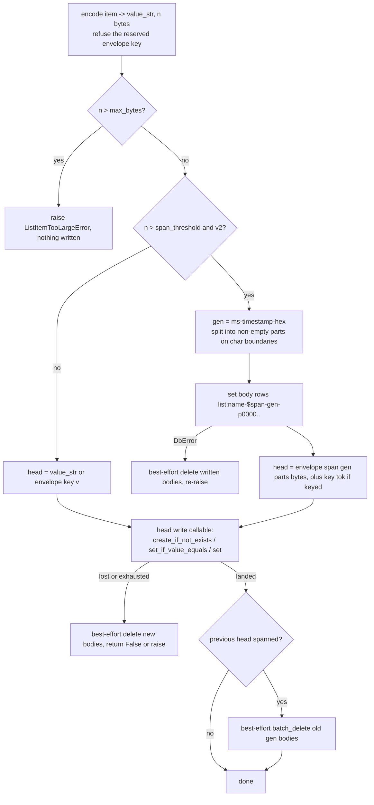
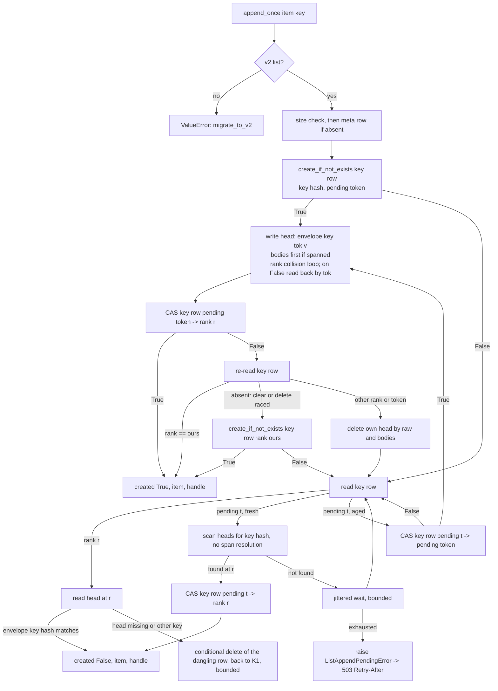

# Implementation Plan: Spanned list items, idempotent appends, and the `://` permission branch

**Date:** 2026-10-30
**Research:** thoughts/research/2026-10-26-v3.16-scope-oauth-adoption-vouching-and-spanned-list-items.md
(Part 2), with the triage in
thoughts/research/2026-10-26-inbound-triage-factory-squat-list-item-size-spa-prompt.md
(Report 2) and the three todos this plan retires:
`thoughts/todo/spanned-list-items.md`,
`thoughts/todo/idempotent-list-item-create.md`,
`thoughts/todo/permission-uri-prefix-branch.md`.
**Branch:** `master` at `56b6e19` (PR #161 merged). Two PRs (owner,
2026-10-30):
- **PR 1, Phases 1-2:** `release/3.16.0-spanned-list-items`, cut from
  `master`. Phase 1 lands as its own commit inside it.
- **PR 2, Phase 3:** `release/3.16.0-idempotent-append`, cut from PR 1's
  branch once PR 1 is open; rebased onto `master` after PR 1 merges.

Each PR runs the full tier before it opens and carries its own CHANGELOG and
migration-guide entries. 3.16.0 is cut after both merge (the adoption, fault
and uniqueness PRs are already on `master`). If PR 2 slips, 3.16.0 ships
with PR 1 and `append_once` becomes 3.17; PR 1 never waits for PR 2.

## Update Log

- **2026-10-30**: the owner made the eight deferred decisions (`append_once`
  as a new method; key rows die with their item; 390,000 / 4 MiB with
  `with_list_item_limits`, the ceiling argued from the library's own
  per-item cost and never from a particular deployment's payload limits;
  413; opt-in span enumeration; `$` refused in new names; two PRs, not
  three; a fresh gen per head `compact()` rewrites). Deployment-specific
  reasoning (Lambda, API Gateway) removed from the ceiling, the pending
  wait budget and the claim gate; ingress limits stated generically.

Line numbers below are from `master` at `56b6e19`. Symbol names are the
anchor.

## Overview

A property-list item is one storage row, so on DynamoDB an item cannot
exceed about 400 KB, an oversized write surfaces as an untyped
`DbError("property write")`, and the consumer (Emm AI) refuses documents
over 380,000 bytes with its own error. This plan makes a v2 item that
exceeds a threshold **span** several rows behind the existing conditional
write primitives, raises a typed `ListItemTooLargeError` before any write
on both backends, and gives `append` an idempotent form,
`append_once(item, key=...)`, so a client whose answer was lost (a gateway
or proxy timeout while the server finishes the write) can repeat the create without
making a second copy. It also folds the redundant `://` prefix branch of
`_matches_pattern()` into the glob path and makes the three MCP `*/list`
filters fail closed, the last two items of the 3.14.4 security review's
todo.

The headline measures: a 1 MiB item round-trips through `append` and
`to_list()` on both backends with every existing DynamoDB row unchanged in
shape; and for a list whose rows are never deleted or rebalanced,
`append_once` with one key yields one item however many times it is called,
and every call after the first returns that item once the first has
landed. The two windows where that guarantee is weaker (a repeat arriving
while the first request is still running, and an operator's `compact()`
dropping an abandoned reservation) are named in the docs, not hidden.

## Decisions Made

The plan was drafted autonomously on 2026-10-30 inside the owner's earlier
frame (2026-10-26: ship spanned items in 3.16 as far as a minor allows,
3.17 if it slips, never holding the auth work; 2026-10-29: the keyed
append rides with spanned items). The eight decisions the draft had
deferred were put to the owner the same day and are marked **[Owner,
2026-10-30]** below; the rest follow from them or from the code.

- **One envelope for both features.** A v2 item's raw stored value is
  either the item's JSON (every row that exists today) or an envelope, a
  JSON object whose first key is `"__aw_env": 1`, with optional `key` (the
  sha256 hex of the idempotency key), `tok` (the writer's token), `span`
  (`{"gen", "parts", "bytes"}`) and `v` (the item, absent when `span` is
  present). One decoder, `_unwrap(raw, *, rank, resolve=True)`, serves
  every reader (the rank is threaded through so the decoder can re-read
  the head, below); `_envelope_info(raw)` is the non-resolving form for
  callers that must not read bodies. A rewrite of a head
  (`update_by_handle`, `_v2_setitem`, `update_where`) carries every
  envelope field other than `span` and `v` across unchanged, so a field a
  later phase adds (Phase 3's `key` and `tok`) survives a rewrite without
  Phase 2 knowing its name. Encoding refuses a user item that is a dict
  carrying `__aw_env` **and** an encoded string that starts with
  `{"__aw_env"` (the `str(item)` fallback), with a `ValueError` naming the
  reserved key, the way `#` is refused in list names. An envelope with a
  malformed `span` (`parts` not an `int >= 1`, `gen` not matching the gen
  shape, `bytes` not an `int`) or with neither `v` nor `span` raises
  `ListItemSpanError` before any read.
- **Body rows are gen-keyed, in a region no existing reader touches.**
  `list:{name}-$span-{gen}-p{part:04d}`, where `gen` is
  `{unix_ms:013d}-{16 hex}`. `$` (0x24) sorts after the v2 range's
  inclusive upper bound `list:{name}-$` (`property_list.py:481`), before
  the v1 range (`-0`, 0x30), and under the `list:` prefix plain reads
  exclude. Rank rebalancing (`_v2_compact`) rewrites heads only; the gen's
  millisecond timestamp is what the orphan sweep age-gates on. The part
  token is `p0000`, not `0000`: a v1 sibling list's rows end in `-{digits}`
  and must never match the part shape. Shape filters
  (`_SPAN_ROW_RE = ^\d{13}-[0-9a-f]{16}-p\d{4}\Z`,
  `_KEY_ROW_RE = ^[0-9a-f]{64}\Z`) are applied by every enumeration, as
  `_v2_is_rank()` and `_V1_INDEX_RE` are today, **and** `$` joins `#` as a
  character refused in new list names (`property_list.py:625`), the
  repo's standard of name ban plus shape filter **[Owner, 2026-10-30]**.
  Existing lists with `$` in their name keep working; the changelog
  carries the **Behavior change** sentence.
- **Write order: bodies, then head through the existing conditional write,
  then the previous gen's bodies.** No reader mixes generations; the head's
  raw value (the envelope) is what a handle carries, so "the raw value
  changed" still means "the item changed since you read it". The
  bodies-then-head-then-cleanup wrapper is one helper taking the head-write
  callable, used by every spanning mutator; bodies are written once per
  call, not once per rank-collision retry. Every part is non-empty and at
  most `_SPAN_PART_BYTES` (an empty part would be a silent delete in
  `DbProperty.set`, `dynamodb/property.py:386`); the splitter raises on an
  off-by-one rather than storing nothing.
- **A reader re-reads the head and the bodies strongly before calling a
  span broken.** A concurrent `update_by_handle` deletes the old gen after
  swapping the head, so a reader holding the old envelope from a range
  read (or an eventually consistent dump) can find the old gen short; an
  eventually consistent body read can also miss parts that landed a
  moment ago. `_unwrap` then re-reads the head strongly and, if its gen is
  unchanged, the bodies strongly; a changed gen is resolved instead; only
  a head that still names a gen whose strong read is short, or a head that
  is gone, raises `ListItemSpanError`. "Short" means the part set is not
  exactly `p0000..p{parts-1}` (a prefix read returns every row under the
  prefix, so a count is not enough). That error subclasses
  `ListCorruptionError`, so the handlers' 409 applies, with its own
  message (list, rank, parts expected and found) and its own remedy text;
  never a partial item.
- **The orphan sweep is age-gated and opt-in.** **[Owner, 2026-10-30]**
  on the opt-in. A body gen with no head is
  deleted only by `compact(sweep_span_orphans=True)` (the script's
  `--repair --sweep-spans`) and only when the gen's timestamp is older
  than `_SPAN_ORPHAN_MIN_AGE_SECONDS` (3600), so an append that has
  written bodies and not yet its head is never swept. The same sweep
  removes a head whose gen is absent (a broken span) and counts it; that
  is the repair path the 409 names. Opt-in because enumerating `$span-`
  rows costs every body byte on DynamoDB (a keys-only projection saves no
  capacity, `db/protocols.py:340-346`); the default `verify()` reports
  what the heads say (`spanned_items`, `span_bytes`) and `verify(spans=True)`
  pays for the enumeration.
- **Thresholds.** `Config.list_item_span_threshold` default **390,000**
  bytes of the encoded value; `Config.list_item_max_bytes` default
  **4 MiB** (4,194,304). The encoded value is `json.dumps(item)` with the
  default `ensure_ascii=True`, so it is ASCII and non-ASCII text costs up
  to six bytes per character (`\uXXXX`); the size measured is
  `len(value_str.encode("utf-8"))`, which equals `len(value_str)` on that
  path. On the `str(item)` fallback the backend sanitises the string
  before storing it (`db/utils.py:106-114` replaces lone surrogates), so
  `_encode_item` applies the same sanitisation first and measures and
  splits the sanitised value; otherwise a lone surrogate would raise
  `UnicodeEncodeError` in the size check or store fewer bytes than the
  envelope claims. DynamoDB counts
  attribute names plus values against 409,600 bytes; `id` (actor id, 32) +
  `name` (`list:` + list name + `-#` + rank up to 180) + the three
  attribute names leave more than 19 KB of headroom at 390,000 for any
  list name under about 19,000 characters. So by default **no DynamoDB
  row that works today changes shape**, and the consumer's 380,000-byte
  rows stay single-row. Body parts are cut at `_SPAN_PART_BYTES`
  (390,000) on character boundaries. Builder:
  `with_list_item_limits(*, span_threshold=None, max_bytes=None)`;
  validation (`0 < span_threshold <= 390_000`, `max_bytes >=
  span_threshold`, each against the effective other value) lives on the
  `Config` properties so a `Config(**kwargs)` assignment is checked too,
  the `refresh_token_grace_period` precedent at `config.py:413`. Defaults
  are module constants; `ListProperty._limits()` accepts a config value
  only when it is a positive `int` (unit tests pass a `Mock()` config).
  **[Owner, 2026-10-30]** on the defaults and the builder name, with the
  rationale that it must hold for any deployment (Kubernetes, a plain
  server, serverless alike): the span threshold is fixed by DynamoDB's row
  cap, and the ceiling is derived from what the library itself does per
  item, never from a particular platform's payload limit. At 4 MiB one
  item is about 11 body rows, about 4,300 write units to append, about
  1,056 strongly consistent read units over 6 Query pages to resolve, and
  roughly four copies of the value in memory while a request handles it
  (the value, its parts, the envelope, the decoded item); a list read
  resolves every spanned item in sequence, so n such items cost n paged
  reads. A deployment that wants a tighter bound lowers it.
  `list_item_max_bytes` is a **storage** bound: the request-size limit at
  the deployment's edge is the ingress guard (Flask `MAX_CONTENT_LENGTH`,
  an ASGI body-limit middleware, an nginx or Kubernetes ingress body-size
  setting, a gateway's payload limit), sized consistently with
  `max_bytes` plus JSON overhead; the docs say so and the demo app sets
  the framework one.
- **`ListItemTooLargeError` is raised before any write, on both backends
  and both formats, at `max_bytes` only.** On v2 a value between the span
  threshold and `max_bytes` spans; on v1 it is written as one row as
  today (so on DynamoDB it still fails as `DbError("property write")`,
  and `migrate_to_v2()` is the path, stated in the docs). The check runs
  **before** `_v2_create_meta_row()` in the three creating mutators
  (today `property_list.py:1667-1670` creates the meta row first). The
  error subclasses `ValueError`; its `__str__` is list name, bytes, limit
  and reason only; handlers map it to **413** **[Owner, 2026-10-30]** with
  the structured body
  (`error`, `list`, `bytes`, `limit`, `detail`, `remedy`) and the
  `except` arm sits before every generic `except ValueError`. Exported
  from `actingweb/__init__.py` beside `ListMetadataContentionError`.
- **Both backends run the same path.** PostgreSQL has no row cap, but one
  code path under both CI backends is how this repo catches divergence.
  **On PostgreSQL this is a behaviour change at the defaults**: an item
  over 4 MiB that 3.15 stored now answers 413, and a v2 item over 390,000
  bytes is stored as a head plus body rows. A v1 item over the threshold
  that PostgreSQL already holds migrates (`migrate_to_v2` step 4 writes
  raw values) into an unspanned head, which is legal there; its next
  rewrite spans it.
- **A list-item diff whose blob would exceed the span threshold carries
  a reference, not values.** The `SubscriptionDiff` row has the same 400 KB
  cap, and an `update` diff carries two values, so the rule applies to the
  encoded **blob**: when `len(json.dumps(diff))` exceeds
  `span_threshold`, the value-carrying fields (`item`, `old_item`,
  `value`, `items`) are **removed** and the top-level fields
  `"spanned": true, "bytes": n` (the values' total encoded size) are
  added; the helper asserts the result is under the threshold. The values
  are removed rather than replaced by a marker dict because a pre-3.16
  receiver applies `append`/`insert`/`update` whenever `"item" in data`
  (`remote_storage.py:401-403`) and `extend` whenever `"items" in data`:
  a marker inside those fields would be stored as a real item on every
  older peer. With the fields absent, an older receiver falls through to
  its `unknown operation` answer, and the top-level keys are the
  library's own, so a user item cannot be mistaken for a reference. One
  helper, `property_list.diff_reference(diff, config)`, serves all
  **three** emitters: `handlers/properties.py`,
  `NotifyingListProperty._register_diff`, and the subscription full-state
  fallback (`actor.py:3220-3227` stores
  `_get_full_state_for_subscription`'s `{"operation": "extend", "items":
  items}` as a diff; one spanned item would make it exceed the row cap and
  the fallback would answer False, so a non-resync peer never got the
  re-read). The library's own receiver (`remote_storage._apply_list_operation`)
  does not apply a reference: it logs at WARNING ("this replica is now out
  of sync", the wording at `remote_storage.py:437-453`; as there, the
  WARNING is the only signal, callers discard the result dict) and
  returns `{"operation": ..., "success": false, "spanned": true}`; a
  subscriber re-reads the list, since a value-addressed diff carries
  nothing else to fetch by, and a non-resync peer cannot receive full
  state for a list whose items exceed the threshold. Not a regression:
  such items cannot exist today. The blob rule also covers an `extend` of
  many small items whose blob exceeds the cap (today a silently lost
  diff); the bulk-POST properties blob at `handlers/properties.py:1616`
  is not a list-item diff and is out of scope (below).
- **`append_once(item, *, key)` is a new method, v2 only, returning
  `AppendOnceResult(created, item, handle)`.** **[Owner, 2026-10-30]**,
  over a `key` keyword on `append()` with a mixed return type. `append()` keeps its
  signature and `None` return. The key (a client-minted, unguessable
  string; validated as a non-empty `str` of at most 512 characters with
  no control characters) is never stored or logged in clear: its sha256
  hex is the key row's name suffix, the envelope's `key`, and the handle's
  `key_hash`. The key row `list:{name}-$key-{hash}` holds `{"key": hash,
  "pending": token}` during a create and `{"key": hash, "rank": r}` after;
  the token is in gen format (`{ms}-{hex}`) and is also written into the
  item's envelope as `tok`, so "my own write" and "my own head" are
  writer-specific. The key row's `create_if_not_exists` is the arbiter.
  After an ambiguous `False` from the rank create (the SDK-retry case in
  `thoughts/todo/conditional-write-ambiguous-after-sdk-retry.md`) the
  writer reads the candidate rank back and a row whose `tok` is its own is
  its landed write; that closes the SDK-retry duplicate for keyed appends
  and leaves it open for unkeyed ones (the todo is narrowed, not
  deleted). A `False` on the final key-row swap is answered the same way:
  re-read the key row, and `rank == ours` is success; only a key row that
  names another rank or another token means the writer lost to an aged
  claimant, and only then does it delete its own head and return the
  claimant's item. A key row that is **absent** on that re-read (a
  `clear()` or `delete()` raced the create and removed the reservation)
  is recreated with `{"key", "rank": ours}` by `create_if_not_exists`: the
  head landed on the emptied list exactly as an unkeyed append racing
  `clear()` does today, and the key must follow it; if that create loses
  too, the writer goes back to reading the key row. The reservation is
  written **after** `_v2_create_meta_row()` (and after the size check),
  so no `pending` row can exist for a list that was never created. The
  contract is that of an idempotency key: a repeat returns the item the
  first call stored **whatever payload the repeat sends**; a caller that
  wants to detect a changed payload compares `result.item` itself.
- **A fresh `pending` reservation is awaited, not stolen.** A repeat that
  finds a `pending` key row younger than `_APPEND_ONCE_PENDING_MAX_AGE_SECONDS`
  (120: longer than the synchronous request timeout any ordinary web
  deployment runs, so a first request still writing is never claimed
  from under; a deployment with longer request timeouts raises the
  module constant) scans the heads (no span resolution) for an envelope
  with its key hash; if one is there it finishes the key row and returns
  the item; if not it waits and re-reads with jittered backoff for a
  total budget of `_APPEND_ONCE_WAIT_SECONDS` (10: a repeat cannot wait
  out the claim gate inside its own request timeout), then raises
  `ListAppendPendingError` (a `ListMetadataContentionError` subclass, so
  the handlers' 503 with `Retry-After: 5` applies). The client loop is
  "repeat with the same key until a result"; the first request usually
  finishes within seconds of the client's timeout, so a repeat sees at
  most one or two 503s. Only a reservation older than the gate is
  claimed. That removes the write-lose-delete ping-pong two overlapping
  writers would otherwise run.
- **Key rows die with their item.** **[Owner, 2026-10-30]**, over a key
  spent forever. Every delete path has the envelope
  in hand (`delete_by_handle` from the handle, `_v2_pop`/`_v2_remove`/
  `_v2_delitem` from the row they read), so each deletes the key row of a
  keyed item; `clear()` and `delete()` remove every `$key-` row; a
  rewrite (`update_by_handle`, `_v2_setitem`, `update_where`) carries
  `key` and `tok` across. So a repeat after a deletion creates again, the
  number of key rows is bounded by the number of items, and nothing
  "spent" has to be explained. `compact()` remaps key rows between
  writing new heads and deleting old ones (a CAS that fails is re-read
  once and remapped if the rank is in the old set), finishes an aged
  `pending` row whose key a head carries, drops an aged `pending` row no
  head carries, and removes a head whose `tok` differs from the one the
  key row's rank carries (the loser's copy, if its own delete failed).
- **`compact()` gives a rewritten spanned head a fresh gen.** **[Owner,
  2026-10-30]**, over sharing the gen between the old and new head. The
  shared gen made the documented manual recovery after a crash mid-compact
  ("delete the stale copies") destructive, since deleting either duplicate
  would cascade the bodies both reference. A rebalance of a list with many
  spanned items is a bulk copy; `compact()` is an operator action. Details
  in Phase 2.
- **`extend()`, `insert()` and the REST handlers do not take keys in
  3.16.** The consumer's need is a single create through the library API.
- **The `://` branch is redundant, not a hole.** `notes://*` compiles to
  `^notes://.*\Z` under DOTALL and accepts `notes://../../security/key`
  exactly as `startswith` does; the control-character guard runs before
  either. So a pattern ending in `://` **and containing no `*` or `?`** is
  folded into `pattern + "*"` through the glob path: one code path, no
  change for any pattern a shipped or documented configuration can hold.
  A pattern such as `*://` already takes the glob path today and is left
  alone. The docs gain one sentence where they teach the prefix form
  (`access-control.rst:304-305`, prose, and `security.rst`): `..` segments
  are not normalised; a resource reader that maps URIs to storage
  validates its own path.
- **The three MCP `*/list` filters fail closed.** An evaluator that cannot
  be constructed yields an empty list; an evaluator that raises on an item
  skips the item; `DbError` keeps propagating to the 503. The `if peer_id
  and evaluator:` guards go, so a future `None` cannot skip the loop.
- **Two PRs: Phases 1-2, then Phase 3.** **[Owner, 2026-10-30]**, over
  the outside voice's three-PR suggestion. Phase 1 is a separate commit
  inside the spanning PR; the keyed append builds on the envelope and `$`
  region audit and needs no second audit; PR 2 can ship later without
  holding PR 1.

The eight owner decisions, for the record (each is argued in its bullet
above): `append_once` as a new method; key rows die with their item;
390,000 / 4 MiB through `with_list_item_limits`, argued
deployment-agnostically; 413; span enumeration opt-in; `$` refused in new
list names; two PRs; a fresh gen per head `compact()` rewrites.

## What We're NOT Doing

- **Raising the 1 MB per-partition Query page ceiling.** Spanning takes
  spanned items' bodies out of the v2 item range reads (`get_range` on
  `list:{name}-#`..`-$`), not out of a whole-partition or prefix dump,
  which now include body and key rows; the ceiling stays with
  `thoughts/todo/prop-list-key-prefix-scheme.md`, which Phase 2 amends.
- **A lazy or attachment-style API** (`items_with_handles(resolve=False)`,
  `get_body(handle)`). Transparent spanning needs no consumer change and
  the handle's `spanned`/`bytes` fields give most of the benefit; an
  explicit API can be layered over the same rows later.
- **`TransactWriteItems`.** 100-item/4 MB limit, no PostgreSQL equivalent
  in the current layer, and the `$` rows would still need the enumeration
  work. Gen-stamping and the key-row arbiter give the reader-visible
  properties without it.
- **Spanning on v1 lists.** A v1 list never spans; `migrate_to_v2()` is
  the path. Keeps the v1 paths untouched.
- **Making `_v2_setitem`/`_v2_delitem` conditional writes.** They gain one
  point read of the head (to learn the old gen and key) and stay
  unconditional; closing their documented overwrite race is a separate
  change. Stated as "positional writes gain one item read".
- **Keys on `extend()`/`insert()`, a REST `key` field, a `get_by_key()`
  reader.** Not needed by the consumer's create path; each is additive
  later.
- **Fetching the item on the receiving side of a spanned diff.** The
  receiver has no proxy to the publisher in `remote_storage`; the
  subscriber's own re-read is the contract. Noted in the subscriptions
  guide.
- **The bulk-POST properties diff blob that can already exceed 400 KB**
  (`handlers/properties.py:1616` registers the whole body as a
  `properties` diff, not a list-item diff). Pre-existing; `add_diff` logs
  the lost diff and the sequence gap is visible to the subscriber. Phase
  2's blob rule covers every list-item diff emitter and stops there.
- **Closing the SDK-retry duplicate for unkeyed `append()`.** A read-back
  of the candidate rank cannot distinguish our write from a concurrent
  byte-identical one without a token; the todo stays, narrowed, with a
  strict `xfail` test pinning it.
- **Normalising resource URIs (`..`, percent-encoding) in the permission
  evaluator.** The URI is the application's namespace. Documented instead.
- **The REST handlers' legacy-authorization fallback on an evaluator
  error** (`handlers/properties.py:167-174`, `:1835-1842`, `:2020-2027`):
  the REST counterpart of the MCP fail-open this plan closes, pre-existing
  and outside the todo's scope. Filed as a todo in Phase 1.
- **The `uri_pattern` metadata question** named in the todo
  (`handlers/mcp.py:1887`): already `re.fullmatch` since 3.14.4; nothing
  left to decide with.

## What Already Exists

- `actingweb/db/dynamodb/property.py:585-660` and
  `actingweb/db/postgresql/property.py:618-760`: `create_if_not_exists`,
  `delete_if_value_equals`, `set_if_value_equals`, `get_prefix`,
  `batch_delete`. Every write and read this plan adds goes through these;
  no new backend primitive. Both return `False` on a failed condition and
  raise `DbError` on a fault (verified by the architecture pass).
- `property_list.py:255-283` `ListItemHandle` (frozen dataclass, rank +
  exact raw value): the CAS contract spans and keys preserve. Gains
  `spanned` and `bytes` fields with defaults (Phase 3 adds `key_hash`); no positional
  construction exists.
- `property_list.py:1623-1681` `_v2_append` collision loop and
  `property_list.py:1545-1621` `_v2_create_meta_row`'s write-order
  diagram: the shape `append_once`'s crash matrix follows.
- `property_list.py:1809-1823`, `:1842-1856` `_v2_item_names_in_range` /
  `_v1_item_names_in_range`: read-filter-return, generalised into one
  `_names_matching(...)` the aux enumerator also uses.
- `property_list.py:2738-2842` `_v2_verify` and `:3002-3107` `_v2_compact`:
  extended, not rebuilt.
- `property_list.py:190-230` `ListMetadataContentionError` and its 503
  mapping: `ListAppendPendingError` subclasses it.
- `property.py:10-64` `rows_for`: the one place `interface/` rows are
  attributed by shape; learns the `$` region.
- `handlers/properties.py:52-103` `_write_list_corrupted_response` and
  `_write_list_metadata_contention_response`: collapsed into one
  `_write_list_error(response, status, reason, body)` the 413 also uses.
- `permission_evaluator.py:685-706` `_matches_pattern`/`_glob_to_regex`
  with the bounded pattern cache: the fold is three lines.
- `handlers/mcp.py:1189-1197`, `:1295-1316`, `:1445-1454`, `:1470-1491`,
  `:1524-1533`, `:1546-1567`: the six places the list filters fail open.
  The factory `get_permission_evaluator` never returns `None`
  (`permission_evaluator.py:843-846`); the client-type block is a
  visibility filter, not authorization.
- `tests/test_property_list_integrity.py:31` `FakePropertyDb` (shared by
  nine unit files; has no `get_prefix` today) and
  `tests/test_v2_list_mutation_committed.py:131`, `:153` (fault-injecting
  and interleaving subclasses): the deterministic harness for every race
  and fault test below. `tests/test_bulk_list_update_handles.py:28-33`
  `_require_dynamodb` (autouse fixture reading `DATABASE_BACKEND`) and
  `:75`, `:268` `_post_bulk`/`_run_handler` (module-private, imported
  cross-file as `tests/test_v2_handle_mutators.py:14` does).
- `tests/test_permission_pattern_matching.py:58`,
  `tests/test_mcp_fail_closed_authorization.py:248-281`, `:503`: the tests
  the Phase 1 tests extend.
- `tests/integration/test_property_list_v2.py`,
  `tests/integration/test_property_list_handle_mutators.py`,
  `tests/integration/test_property_list_repair.py`,
  `tests/integration/test_verify_property_lists_script.py:27`
  (`_seed_v1_list`), `tests/integration/test_migrate_property_lists_script.py`:
  fixtures and shapes the Phase 2 and 3 integration tests reuse. There
  are **no** thread-based list tests to copy; races are interleaved in the
  fake.
- `tests/performance/test_backend_performance.py:211` benchmarks
  `DbPropertyList.fetch` over plain properties; there is no `to_list()`
  benchmark, so Phase 1 adds one and takes the baseline on `master`.
- `actingweb/maintenance/migrate_property_lists.py:344-408`
  `downgrade_to_v1`: gains a refusal. `verify_property_lists.py:222`
  `if report["healthy"]: continue` precedes the repair gate, so the sweep
  needs its own path.
- `docs/migration/v3.16.rst` ("Start here" numbered list at `:24-85`)
  and the `Unreleased` section of `CHANGELOG.rst`: both exist; this plan
  adds items and sections.

## Phase 1: Typed size error, limits, the `://` fold, fail-closed list filters, baseline

Small, self-contained, and the foundation Phase 2 builds on: the two
config fields, the error class and its HTTP mapping, the wording fixes,
the two permission items from the todo, and the list benchmark whose
baseline Phase 2 is measured against.

### Changes

- `actingweb/config.py` — `list_item_span_threshold` and
  `list_item_max_bytes` as validating properties (defaults imported from
  `property_list` constants; `ValueError` on an invalid value wherever it
  is set), with their backing attributes assigned **before** the
  `**kwargs` loop at `:292` so `Config(list_item_span_threshold=2000)`
  works.
- `actingweb/interface/app.py` — `with_list_item_limits(*,
  span_threshold: int | None = None, max_bytes: int | None = None)`,
  docstring in the `with_open_factory` style stating the storage-bound
  versus ingress-limit distinction; stored as builder state and applied
  in `_apply_runtime_changes_to_config()` only when given (the
  `open_factory` pattern at `:224`).
- `actingweb/property_list.py` — constants `_SPAN_THRESHOLD_DEFAULT`
  (390,000), `_SPAN_PART_BYTES` (390,000), `_ITEM_MAX_BYTES_DEFAULT`
  (4 MiB); `ListItemTooLargeError(ValueError)` with `list_name`,
  `bytes`, `limit`, `__str__` limited to those; `_limits()` (positive
  `int` or default); `_encoded_size(value_str)`; the `max_bytes` check at
  the top of every item write (`_v2_append`, `_v2_extend` over the whole
  batch before its first write, `_v2_insert`, `_v2_setitem`,
  `update_by_handle`, and the v1 branches of `append`, `insert`,
  `__setitem__`) **before `_v2_create_meta_row()` and before any row**.
  Module docstring line 5: the module stores one item per row and
  bypasses the row limit per list, not per item (Phase 2 adds "an item
  larger than one row spans"). `get_metadata()` docstring: `chunk_size`
  is a legacy field always `1`.
- `actingweb/__init__.py` — export `ListItemTooLargeError`.
- `actingweb/handlers/properties.py` — `_write_list_error(response,
  status, reason, body)` replacing the two hand-rolled writers; 413 body
  `{"error": "list_item_too_large", "list", "bytes", "limit", "detail",
  "remedy": "split the item or raise list_item_max_bytes"}`; `except
  ListItemTooLargeError` **before** the generic `except (ValueError,
  IndexError)` at `:821-824` in `PropertiesHandler.put`, and in `.post`
  (bulk, via `_finish_bulk_list_update`'s callers) and
  `PropertyListItemsHandler.post` (add and update). (`:927-931` is the
  plain-property name arm and is not involved.)
- `actingweb/permission_evaluator.py:685-687` — replace the `startswith`
  branch with: a pattern ending in `://` and containing neither `*` nor
  `?` is rewritten to `pattern + "*"` before the cache lookup; docstring
  updated.
- `actingweb/handlers/mcp.py` — `tools/list`, `resources/list`,
  `prompts/list`: an evaluator construction failure other than `DbError`
  returns the empty list (`:1193-1197`, `:1448-1454`, `:1527-1533`); a
  per-item evaluation exception other than `DbError` skips the item with
  an ERROR log and `exc_info` (`:1312-1316`, `:1487-1491`, `:1563-1567`);
  the `if peer_id and evaluator:` guards (`:1301`, `:1472`, `:1548`)
  become unconditional; the "fail-open" comments go.
- `tests/performance/test_backend_performance.py` —
  `test_list_property_performance`: `to_list()`, `items_with_handles()`,
  `append()`, `remove()` on a 1,000-item v2 list (plain), marked
  `benchmark`; run on `master` first and the numbers recorded in this
  phase's implementation notes.
- `examples/demo/application.py` — the framework request-size limit set
  to `max_bytes` plus overhead (Flask `MAX_CONTENT_LENGTH`; the FastAPI
  variant documented).
- `docs/quickstart/configuration.rst` — Runtime Switches rows for the
  two limits (storage bound; ingress limit is the framework's; "raises
  `ValueError` wherever it is set"); line 591 reworded.
- `docs/guides/access-control.rst:304-305` and `docs/reference/security.rst`
  — `notes://` is matched as `notes://*`; `..` is not normalised; a
  resource reader validates its own path. (`access-control-simple.rst:135`
  is a code comment and keeps its example.)
- `docs/guides/property-lists.rst` — `ListItemTooLargeError` (import
  path, 413 body) under the REST API section; the "A `ValueError` is not
  covered by that sentence" paragraph at `:188-191` gains "except
  `ListItemTooLargeError`, which is raised before any write".
- `CHANGELOG.rst` `Unreleased` — ADDED (`ListItemTooLargeError`,
  `with_list_item_limits`), CHANGED (MCP list filters answer an empty
  list on an evaluator error, **Behavior change**; on PostgreSQL an item
  over 4 MiB now answers 413 where 3.15 stored it, **Behavior change**),
  FIXED (a v2 item over `list_item_max_bytes` on DynamoDB surfaced as the
  untyped `DbError("property write")`; a v1 item over the row cap still
  does, named as such; the two wording fixes; the `://` fold stated as no
  behaviour change).
- `thoughts/todo/permission-uri-prefix-branch.md` deleted with its
  `INDEX.md` row; a new todo `rest-permission-legacy-fallback.md` (the
  REST evaluator-error fallback) with an `INDEX.md` row.

### New Tests, both unit and integration tests

- `tests/test_list_item_limits.py` (unit, `FakePropertyDb` from
  `tests/test_property_list_integrity.py`, config built as
  `Config(database="dynamodb")` with the attribute set directly): an item
  over `max_bytes` raises `ListItemTooLargeError` from `append`, `extend`
  (oversized item in position 3), `insert`, `__setitem__`,
  `update_by_handle` on a v2 list and from `append`/`insert`/
  `__setitem__` on a v1 list **with no row written**, including on a
  never-created list (`_read_meta_row()` is `(None, None)` after the
  raise); the `Config` properties reject `span_threshold=400_001`,
  `span_threshold=0`, `max_bytes < span_threshold` from kwargs and from
  assignment; `_limits()` ignores a `Mock()` config; `str(error)` carries
  no item content; the error is importable from `actingweb`.
- `tests/test_actingweb_app.py`: the builder validates against the
  effective other value and a Config value survives until the builder is
  called.
- `tests/test_list_item_limits.py`: 413 for PUT index, POST items add and
  update, and the bulk POST, through `_run_handler`/`_post_bulk` imported
  from `tests.test_bulk_list_update_handles`; the body shape asserted.
- `tests/test_permission_pattern_matching.py`: `notes://` matches
  `notes://work/x` and `notes://` (existing assertions keep passing);
  target `notes://\nx` is denied; target `notes:/` does not match pattern
  `notes://` (arguments in `(target, pattern)` order); pattern `*://`
  still compiles to `^.*://\Z`; the cache holds the rewritten key.
- `tests/test_mcp_fail_closed_authorization.py`: for each of the three
  list methods, an evaluator whose construction raises `RuntimeError`
  yields an empty list (fails on today's code), and an evaluator whose
  `evaluate_permission` raises on one item lists the others and not that
  one; a `DbError` still surfaces as the 503.
- `tests/integration/test_property_list_http_contract.py`: PUT of an item
  over `max_bytes` answers 413 with the JSON body on both backends.
- `tests/performance/test_backend_performance.py`: the new benchmark
  runs alone (`-m benchmark`).

### Failure Scenarios

- The size check runs after the meta row or a body row was written —
  covered by the never-created-list assertion; the check precedes
  `_v2_create_meta_row()`.
- A consumer sets `span_threshold` above the row cap through
  `Config(**kwargs)`, bypassing the builder — covered by the property
  validation and its test.
- The MCP list filter hides every tool on a transient evaluator error and
  the client sees an empty server — the error is logged at ERROR with
  `exc_info`; a `DbError` still answers 503 so the client distinguishes
  outage from denial. Covered by the tests.
- `ListItemTooLargeError` reaches a generic `except ValueError` first and
  becomes a 400 — covered by the handler tests over every item-writing
  route; wrong status, not silent.

### Verification

- [ ] Run the contract's `### Checks` fast tier verbatim (unsandboxed; the
      sandbox cannot reach DynamoDB Local)
- [ ] `grep -n "fail-open\|Fail-open\|and evaluator" actingweb/handlers/mcp.py`
      returns nothing
- [ ] `grep -n "startswith(pattern)" actingweb/permission_evaluator.py`
      returns nothing
- [ ] Baseline: `poetry run pytest tests/performance -m benchmark --no-cov
      -q -k list_property` on `master` and on the branch, numbers recorded

### Implementation Status: Not Started

---

## Phase 2: Spanned items

The envelope, the `$` region and its enumeration audit, the span write,
read and cascade paths, diffs by reference, verify and compact, the
scripts, docs and the DynamoDB test path. Ends PR 1.

Readers: `_unwrap(raw)` sees `span`, validates its shape, issues
`get_prefix("list:{name}-$span-{gen}-")` with the **caller's**
`consistent` (bodies are immutable per gen), joins the parts in name
order, checks `len == parts` and the byte count, and decodes. A short or
missing gen triggers one strong re-read of the head: a new gen is resolved
instead; an unchanged or absent head raises `ListItemSpanError`. Only
spanned items pay the extra read, and it is paged: a 1 MiB item is about
288 strongly consistent read units over 2 pages, a 4 MiB item about 1,056
over 6, sequential, per spanned item, on every resolving read. Value scans
(`remove`, `index`, `count`, `find` when the sought value is a dict
compared by equality) skip resolution when the sought value's encoded size
is at or under the span threshold, since it cannot equal a spanned item.

### Changes

- `actingweb/property_list.py`:
  - Names: `$` refused beside `#` for new lists (`:625-631`).
  - Envelope: `_ENVELOPE_MARKER`, `_encode_item` refusals (dict key and
    encoded prefix), `_wrap(item, *, key=None, tok=None, span=None) ->
    str` (marker first), `_unwrap(raw, *, resolve=True, consistent=True)
    -> tuple[Any, _ItemInfo]` and `_envelope_info(raw) -> _ItemInfo`
    (`spanned`, `bytes`, `gen`, `parts`, plus `extra`: every other
    envelope field, unparsed, for the preservation rule below); envelope
    shape validation; `_decode_item` becomes `_unwrap(...)[0]` and every
    reader goes through one of the two forms: resolving in `_v2_to_list`,
    `_v2_getitem`, `_v2_pop` (it returns the item), `_v2_items_with_handles`,
    `to_list_from_rows`, `_identity_of` (so `verify(identity_key=...)`
    resolves every spanned item; the cost is stated); non-resolving in
    `_v2_remove`'s scan (resolve only when the sought value could match),
    `NotifyingListProperty`'s handle mutators, and the Phase 3 pending
    scan.
  - Region: `_AUX_SPAN`, `_AUX_KEY`, `_SPAN_ROW_RE`, `_KEY_ROW_RE`,
    `_names_matching(prefix_or_bounds, regex)` replacing the two
    `_*_item_names_in_range` bodies and serving `_aux_row_names(kind)`;
    `_span_part_names(gen, parts)` (derived, no read).
  - `ListItemHandle`: `spanned: bool = False`, `bytes: int | None =
    None`.
  - `ListItemSpanError(ListCorruptionError)` with `list_name`, `rank`,
    `expected_parts`, `found_parts`; `__str__` from those only; the 409
    writer takes `remedy` from the error (`"run
    actingweb-verify-property-lists --repair --sweep-spans, or remove the
    item with delete_by_handle()"`); the rank becomes REST-visible for
    the first time, stated in the docs.
  - Spanned write: `_new_gen()`, `_split_parts(value_str)` (non-empty,
    each at most `_SPAN_PART_BYTES`, raises on an empty part),
    `_write_spanning(value_str, head_write, *, key=None, tok=None) ->
    bool` (the wrapper in the diagram, used by `_v2_append`, `_v2_extend`,
    `_v2_insert`, `_v2_setitem`, `update_by_handle`; bodies once per
    call), `_span_delete_bodies(gen)` (best-effort `batch_delete`, logs
    on `DbError`). The Phase 1 size check gains the `span_threshold`
    branch on v2.
  - Envelope preservation: `update_by_handle`, `_v2_setitem` and (through
    them) `update_where` carry every envelope field other than `span` and
    `v` from the old envelope into the new head, without naming any; the
    fields Phase 3 adds ride on that rule.
  - Cascade on delete: `delete_by_handle` (envelope from the handle),
    `_v2_pop` and `_v2_remove` (from the row they read), `_v2_delitem` and
    `_v2_setitem` (one point read of the head before the unconditional
    write: positional writes gain one item read). Every cascade is
    best-effort after the head write committed, so a mutator that returns
    has committed (the class docstring's contract holds); a cascade that
    fails logs a WARNING naming the list and the gen, which is the only
    signal (the docs say so). A concurrent `update_by_handle` between the
    point read and the unconditional write leaves the other writer's gen
    as an orphan, never a broken span.
  - `clear()`: body gens derived from the head envelopes it deletes (one
    range read with values, no `$span-` enumeration); the `$key-` rows
    enumerated (small). `delete()`: both aux regions enumerated and
    deleted (the only way orphan gens leave with the list; cost stated).
  - `sweep_foreign_format_rows()`: `stored is None` (list gone) and the
    v1 branch (which only runs when `format_ever_changed` is not `False`)
    also sweep both aux regions; the v2 branch does not.
  - `_v2_verify(spans=False)`: from heads, `spanned_items`, `span_bytes`;
    with `spans=True`, one `$span-` enumeration (cost stated) giving
    `span_body_rows`, `orphan_span_gens`, `broken_spans` (heads whose
    part count disagrees with the envelope; a byte check needs body
    bytes and is not made here), and `healthy` False on `broken_spans`.
    `verify(spans=False)` passes it through; the v1 branch counts aux
    rows into `foreign_format_rows`.
  - `_v2_compact(sweep_span_orphans=False)`: a rewritten **spanned** head
    gets a fresh gen, its bodies copied (read strongly, written through
    `_write_spanning`) before the new head is written, and the old head's
    delete cascades its own gen. Sharing the gen between the old and new
    head looked cheaper but made the documented manual recovery
    (`property_list.py:3022-3030`: "delete the stale copies") destructive:
    `delete_by_handle` on either duplicate would cascade the shared gen
    and break the survivor, and `--sweep-spans` would then remove it. With
    a gen per head every duplicate is independently consistent and the
    existing recovery holds. With the flag, one `$span-` enumeration
    (reused, not two) deletes orphan gens older than
    `_SPAN_ORPHAN_MIN_AGE_SECONDS` and heads whose gen is absent
    (`broken_spans_removed`). Docstring: a `compact()` racing a spanned
    `update_by_handle` turns today's silent lost update into a 409 for
    that item (the quiesce advice applies); costs stated (reads: two
    item ranges plus every spanned item's bodies plus, with the flag,
    every body byte; writes: n heads plus every spanned item's parts plus
    deletes: a rebalance of a list with many spanned items is a bulk
    copy).
  - `migrate_to_v2()` step 3: aux rows under a v1 list are residue and
    are cleared with the v2 scratch rows.
  - `prime_from_rows()`: unchanged. `to_list_from_rows()`: a spanned head
    resolves from `rows` when the exact part set `p0000..p{parts-1}` is
    there and the joined byte count matches the envelope, else through
    `_unwrap` (one strong read). The dump already paid for every body
    byte (`fetch_all_including_lists` is the whole partition), so
    resolving again would read them twice; the fallback covers a
    paginated or eventually consistent dump that holds a head but not all
    its parts. `sizes_from_rows(rows) -> list[int]`: the encoded size of
    each item from heads alone (`bytes` from a spanned envelope, the raw
    length otherwise), for the metadata GET.
  - Class and module docstrings: the envelope, the region, the cost rule
    (read: one paged query per spanned item per resolving read, with the
    unit arithmetic above; write: parts plus head, a spanned-to-spanned
    update about twice, a lost CAS wastes the new gen; bodies are
    excluded from v2 item range reads but not from partition or prefix
    dumps; enumerating `$span-` rows costs every body byte on DynamoDB).
- `actingweb/property.py`: `rows_for` gains the two `$` branches with the
  shape filters; the `list_all_with_rows`/`list_prefix_with_rows`
  docstrings (`:121-125`, `:169-230`) state that dumps include body and
  key rows and that the span threshold does not reduce them.
- `actingweb/maintenance/migrate_property_lists.py` `downgrade_to_v1`:
  refuse with `reason="envelopes"` when any head is an envelope; the
  `not_v2` sweep covers aux rows. `verify_property_lists.py`: `--spans`
  passes `spans=True`; `--sweep-spans` (with `--repair`) runs
  `compact(sweep_span_orphans=True)` on a path **before** the `healthy`
  short-circuit at `:222`; the new keys printed.
- `actingweb/interface/property_store.py` `NotifyingListProperty`:
  `_register_diff` passes the assembled `diff_info` through
  `diff_reference(diff_info, config)`; `delete_by_handle` and
  `update_by_handle` take the old item through `_envelope_info` (a
  spanned old item becomes a reference without a read).
- `actingweb/handlers/properties.py`: the single-item diffs at `:798-802`,
  `:2159-2167`, `:2233-2238` go through `diff_reference`; GET
  `format=metadata` uses `sizes_from_rows` instead of resolving every
  item (`:598-603`); the `format=full` loop at `:617-618` skips a list
  that raises `ListItemSpanError` with an error marker, the way
  `actor.py:3330` skips a corrupted list, instead of 409-ing the whole
  response; GET of a list or an index resolves spans and a single broken
  item lands on the 409 with the new remedy; in
  `PropertyListItemsHandler.post` the `update` and `delete` actions gain
  `except ListItemSpanError` **ahead of** the inner `except IndexError`
  arms at `:2227` and `:2281` (the error subclasses `IndexError` through
  its parent, and the comment at `:2302-2305` "no action above reads item
  rows" stops being true with the point read).
- `actingweb/actor.py:3220-3227`, `_store_subscription_diff` of the
  full-state fallback: the blob goes through `diff_reference`.
- `actingweb/remote_storage.py` `_apply_list_operation`: a diff carrying
  `spanned: true` is not applied; WARNING; returns the not-applied result;
  checked before the per-operation `"item" in data` tests.
- `tests/test_property_list_integrity.py` `FakePropertyDb`: `get_prefix`
  (keys-only and full), so every existing unit test over `clear`/
  `delete`/`verify`/`compact` keeps running.
- `docs/guides/property-lists.rst`: new section "Items larger than one
  row" (threshold, ceiling, builder, encoding note, cost rule with the
  unit arithmetic, "a list read resolves every spanned item; keep large
  items in their own list and read by index or handle", the orphan sweep
  and its age gate, `verify(spans=True)`, `compact(sweep_span_orphans=True)`,
  `ListItemSpanError` → 409 and its remedy, the handle fields, the
  PostgreSQL behaviour change, the `$` name ban); the 409 paragraph at
  `:705-712` amended (a v2 list can answer 409 for a broken span);
  "Reading Many Lists Cheaply" gains the dumps sentence; "What a returned
  mutation guarantees" gains the cascade sentence and the `extend`
  exception (an oversized batch writes nothing); the SDK-retry sentence
  unchanged until Phase 3.
- `docs/guides/subscriptions.rst`: the reference shape, that a receiver
  re-reads the list, and the closed-vocabulary paragraph at `:392-395`
  amended (a reference is the one diff an older peer does not understand;
  it answers `unknown operation`).
- `docs/migration/v3.16.rst`: a numbered "Start here" item and a
  "Spanned list items" section: nothing changes shape on DynamoDB by
  default; the PostgreSQL behaviour change; the consumer drops its own
  380,000-byte rule and catches `ListItemTooLargeError` ahead of generic
  `ValueError` handling; diffs over the threshold carry a reference; the
  rolling-deploy caveat (a pre-3.16 reader sees an envelope dict for any
  spanned or, after Phase 3, keyed item; a pre-3.16 `clear()`/`delete()`
  leaves a spanned item's bodies behind for the aged sweep; the sweep
  tooling ships in the same release as the writer, so: deploy 3.16
  everywhere before raising any client's size limit or using keys);
  `downgrade_to_v1` refuses; the ingress limit; the three lifecycles side
  by side (a list `delete()` reaps its own aux rows; an actor delete reaps
  everything in the partition, `dynamodb/property.py:846-857`,
  `postgresql/property.py:975-981`; everything else waits for the opt-in,
  age-gated sweep, and the default `verify()` does not count leaked
  bodies).
- `CHANGELOG.rst` `Unreleased`: ADDED (spanned items), CHANGED
  (**Breaking:** a list-item diff whose blob exceeds the span threshold
  carries references; `downgrade_to_v1` refuses lists with envelopes;
  `$` refused in new list names, **Behavior change**; on PostgreSQL a v2
  item over 390,000 bytes is stored across rows, **Behavior change**).
- `thoughts/todo/spanned-list-items.md` deleted with its `INDEX.md` row;
  `thoughts/todo/prop-list-key-prefix-scheme.md` amended (the lever moves
  `to_list()`-class range reads only; dumps and the ceiling stay).

### New Tests, both unit and integration tests

Unit tests (`tests/test_property_list_spans.py`, `FakePropertyDb`, a low
threshold via `Config` attributes, `span_threshold=2000`,
`max_bytes=20000`) so every path runs on small data:

- Round trip: `append` of an item over the threshold reads back equal
  through `to_list()`, `__getitem__`, iteration, `items_with_handles()`,
  `find()`, `to_list_from_rows()`.
- Row shape: head at `list:{name}-#{rank}` holds an envelope with the
  marker first; exactly `parts` body rows at
  `list:{name}-$span-{gen}-p{0000..}`; `_v2_load_full` returns no body
  row; a plain `fetch()` returns none; `rows_for` attributes them; a v1
  sibling list named `{name}-$span-{13 digits}-{16 hex}` with rows
  `-1000..` is never enumerated as bodies.
- Boundary: an item of exactly `span_threshold` bytes is one row; one
  byte more spans; a non-ASCII item's size is its escaped JSON size; an
  object with a non-ASCII `__str__` (the fallback path) is split on
  character boundaries; one whose `__str__` carries a lone surrogate is
  sanitised before it is measured and reads back equal to what the
  backend stores; no part is empty; the splitter raises on a contrived
  empty part; a gen with an extra row `p0003` beside `p0000..p0002`
  (parts 3) is short, not complete.
- Envelope: appending `{"__aw_env": 1}` and an object whose `__str__` is
  `{"__aw_env": ...}` raise `ValueError` before any write; hand-written
  heads with `parts: 0`, `parts: "3"`, `gen: "../x"`, missing `bytes`,
  and neither `v` nor `span` raise `ListItemSpanError` without a read.
- Cascade: `update_by_handle` (spanned → spanned, spanned → plain, plain
  → spanned) leaves exactly the new gen's bodies and carries an unknown
  envelope field across; `delete_by_handle`, `pop`, `remove`, `del
  lst[i]`, `lst[i] = x`,
  `remove_where`, `update_where` leave no bodies for the removed item;
  `clear()` leaves no body of a deleted head and no `$key-` row;
  `delete()` leaves no `$` row at all.
- Conditional-write failure: `update_by_handle` with a stale handle
  returns False and leaves no new bodies.
- Reader race: a fake whose `get_prefix` deletes the old gen on first
  call (the `_ItemFaultPropertyDb` shape) after the head was swapped:
  `to_list()` returns the new value, no raise; the same with
  `consistent=False`; a fake whose eventual `get_prefix` returns one part
  short and whose strong one is complete: no raise, one strong re-read.
- `compact()` on a list with spanned items gives each rewritten head a
  fresh gen; after a simulated crash between the write and cleanup loops
  (two heads for one item), `delete_by_handle` on either copy leaves the
  other readable.
- Point-read race: an `update_by_handle` interleaved between
  `_v2_setitem`'s point read and its write leaves an orphan gen that
  `verify(spans=True)` reports, never a broken span.
- Orphans: a body gen with no head and a fresh timestamp survives
  `compact(sweep_span_orphans=True)`; one older than the age gate is
  removed; `verify()` without `spans` issues no `$span-` read (call
  count on the fake), `verify(spans=True)` reports `orphan_span_gens`.
- Broken span: deleting one body row makes `verify(spans=True)` report
  `broken_spans` with `healthy: False`; `to_list()` raises
  `ListItemSpanError` whose message carries list, rank and part counts
  and no item content; `compact(sweep_span_orphans=True)` removes the
  head and reports it; the handler answers 409 with the new remedy.
- `compact()` keeps spanned items readable (heads rebalanced, bodies
  untouched, old heads gone) and does not enumerate `$span-` without the
  flag.
- `sweep_foreign_format_rows()` on a deleted list removes aux rows; on a
  v1 list seeded without `format_ever_changed` (the `_seed_v1_list`
  shape) removes them as residue; on a v2 list leaves them.
- `downgrade_to_v1` refuses a list with a spanned item and writes
  nothing.
- Partial `extend`: exhausted rank retries after two items landed leave
  the un-landed items' bodies deleted and the landed ones intact.
- Value scans: `remove(small)` and `index(small)` on a list with spanned
  items issue no `$span-` read; `verify(identity_key=...)` resolves each
  spanned item (call count).
- Diffs: `NotifyingListProperty.append/insert/update_by_handle/
  delete_by_handle/extend` with a spanned item register a reference (no
  `item`/`old_item`/`items`; top-level `spanned`, `bytes`); two 300 KB
  items through `update_by_handle` at the default threshold yield a
  reference blob under the threshold; an `extend` of many small items
  over the threshold yields one reference; a plain item still carries the
  value; a user item `{"spanned": true, "bytes": 5}` is appended as an
  item; `remote_storage._apply_list_operation` returns the not-applied
  result and logs WARNING; the same reference fed to the receiver with
  the `spanned` check removed (simulating a pre-3.16 receiver) answers
  `unknown operation` and appends nothing; the full-state fallback for a
  list with a spanned item stores a reference blob and returns a diff
  URL.
- v1: nothing spans; a v1 item between the threshold and `max_bytes` is
  written as one row.

Integration tests (both backends):

- `tests/integration/test_property_list_spans.py`: the round trip and
  cascade suite at the **default** thresholds with an item of about 1 MiB
  encoded (sized by encoded bytes); over HTTP, `PUT /properties/{name}`
  with `index`, `POST /properties/{name}/items` (add, update and delete
  actions), `GET` of the list, of the index and `format=metadata` return
  the whole item or the envelope's byte count; a broken span answers 409
  on the items `update` action, not 400; the diff registered for a
  subscriber is a reference; a PUT over `max_bytes` answers 413.
- DynamoDB-only (the `_require_dynamodb` fixture shape): a 450 KB item
  lands as one head plus two bodies, each body row under 400 KB; and a
  direct `DbProperty.set` of a 450 KB value is attempted and the outcome
  recorded in the test's docstring. Whether DynamoDB Local enforces the
  cap is unverified today (docker is unreachable from the planning
  sandbox); the row-shape assertion is the test either way.
- PostgreSQL-only (the same fixture, inverted): a seeded v1 item over
  the threshold migrates to an unspanned head, reads back, and spans on
  its next `update_by_handle`.
- `tests/integration/test_verify_property_lists_script.py` and
  `test_migrate_property_lists_script.py`: `--spans` prints the keys;
  `--repair --sweep-spans` removes an aged orphan gen on a list
  `verify()` reports healthy; `--downgrade` refuses.
- Benchmarks (`tests/performance/`, run alone, DynamoDB): the Phase 1
  benchmark on a list with no spanned items within 5% of the `master`
  baseline; a variant with 20 of 1,000 items spanned recorded, not
  gated.

### Failure Scenarios

- Body write faults mid-batch — `DbError` propagates after a best-effort
  delete of the written parts; nothing references the gen; covered by a
  fault-injection unit test (fake `set` raising on part 2).
- Head write lost after bodies landed (rank collision storm, CAS lost) —
  bodies deleted best-effort, the existing `RuntimeError`/`False`
  surfaces; a crash between the two leaves an orphan gen that
  `verify(spans=True)` reports and an aged sweep removes; covered by the
  orphan tests.
- A concurrent sweep under an in-flight append — the age gate prevents
  it; covered by the fresh-orphan test; the operator docs keep the
  quiesce advice.
- A reader holding a stale head after a concurrent update — the strong
  head re-read resolves the new gen; covered by the reader-race tests.
- A head whose bodies are really gone (an operator deleting rows, a
  crash inside `compact`'s own window) — `ListItemSpanError` → 409 with
  a remedy that works (`--sweep-spans` or `delete_by_handle`), never a
  partial item, and a list-wide GET skips the one broken list; covered
  by the broken-span tests.
- A diff blob over the row cap — the blob rule replaces values with
  references at the span threshold; covered by the two-300-KB test.
- A reference diff reaches a pre-3.16 subscriber — the value fields are
  absent, so `"item" in data`/`"items" in data` fail and it answers
  `unknown operation` with nothing stored; covered by the simulated
  old-receiver test; the migration guide says so.
- The full-state fallback for a list with a spanned item exceeds the
  diff row cap and answers False, so a non-resync peer never gets its
  re-read — the fallback goes through `diff_reference`; covered by the
  fallback test; the subscriptions guide says such a peer cannot receive
  full state for that list.
- A 3.16 writer spans an item and a pre-3.16 reader (rolling deploy)
  reads the list — the old reader decodes the envelope as a dict item.
  Visible, not silent, and only for items that could not have existed
  before 3.16 (keyed items are the Phase 3 exception); stated in the
  migration guide.
- `clear()` racing an in-flight spanned append — the append's bodies
  survive `clear()` (only gens of deleted heads go), and its head lands
  on the emptied list: the same outcome as today's race; no broken span.

### Verification

- [ ] Run the contract's `### Checks` fast tier verbatim (unsandboxed)
- [ ] Enumeration audit: every caller of `get_range`, `get_prefix`,
      `batch_delete`, `fetch_all_including_lists` and
      `list_prefix_with_rows` in `actingweb/` and `actingweb/maintenance/`
      is listed in the implementation notes with "learns `$`" or "does
      not need to" and a reason
- [ ] Run the benchmarks alone: `poetry run pytest tests/performance -m
      benchmark --no-cov -q` (DynamoDB Local up), numbers recorded against
      the Phase 1 baseline
- [ ] Full tier before PR 1 opens; `thoughts/todo/INDEX.md` has no row for
      `spanned-list-items.md`

### Implementation Status: Not Started

---

## Phase 3: Idempotent append

`append_once(item, *, key)` on v2 lists, built on Phase 2's envelope and
`$key-` region. Its own PR.

Crash matrix (every exit converges on a later call):

| Crash after | State left | Next `append_once` with the key |
| --- | --- | --- |
| key row created (`pending`) | key row only | fresh: waits, then 503; aged: claims it, writes, finishes |
| item written, key row still `pending` | item + pending row | scans, finds the item by its key hash, finishes the key row, `created=False` |
| key row finished | complete | `created=False` with the item |
| never repeated | a `pending` row (and perhaps an item) | inert; `verify()` counts it; `compact()` finishes it when a head carries the key, drops it otherwise, after the age gate |

Concurrent repeats: the key row's `create_if_not_exists` is the arbiter.
A repeat that arrives while the first request is still running sees a
fresh `pending` row and waits for the item (or answers 503 and the client
retries); it never writes a second copy. Only a reservation older than the
gate is claimed, and a first request that lands after that deletes its own
head when the key row names another rank. Two items can then be visible
for the length of that delete; `compact()` removes a survivor whose `tok`
differs from the key row's. An ambiguous `False` on any of the three
conditional writes (key row create, rank create, key row swap) is resolved
by reading the row back and recognising the writer's own token.

### Changes

- `actingweb/property_list.py`:
  - `AppendOnceResult` dataclass `(created: bool, item: Any, handle:
    ListItemHandle | None)`; `ListAppendPendingError(ListMetadataContentionError)`;
    `ListItemHandle.key_hash: str | None = None` and `_ItemInfo.key_hash`/
    `.tok` parsed out of the envelope (Phase 2 carried them as unparsed
    extra fields).
  - `append_once(item, *, key: str) -> AppendOnceResult`: key validation,
    `_key_hash(key)`, `_key_row_name(hash)`, the protocol above with
    `_V2_MAX_RANK_RETRIES` bounding every loop and
    `_APPEND_ONCE_PENDING_MAX_AGE_SECONDS` (120) as the claim gate;
    `_dispatch_and_stash` and `_v2_create_meta_row` as the other creating
    mutators (after the size check); the metadata touch only on
    `created=True`. Logs name the first 8 hex of the hash, never the key.
  - `_v2_write_item_at_new_rank(value_str, *, tok=None)`: the collision
    loop from `_v2_append` extracted; `_v2_append`, `_v2_extend` (per
    item) and `_v2_insert` call it; with `tok`, an ambiguous `False` reads
    the candidate rank back and a row whose `tok` is ours is treated as
    landed.
  - Key rows die with the item: `delete_by_handle`, `_v2_pop`,
    `_v2_remove`, `_v2_delitem` delete the key row of a keyed item after
    the head; `clear()`/`delete()` already remove the region (Phase 2).
  - `_v2_compact()`: after heads are written and before old heads are
    deleted, rewrite every `$key-` row whose rank moved
    (`set_if_value_equals`; a failed CAS is re-read once and remapped if
    its rank is in the old set); finish or drop aged `pending` rows as
    decided; remove a head whose `tok` differs from the one at the key
    row's rank. Cost stated (n key-row CAS writes on a full rebalance).
  - `_v2_verify()`: `key_rows`, `dangling_key_rows`, `pending_key_rows`
    (one `$key-` enumeration, small rows; always on).
- `actingweb/interface/property_store.py` `NotifyingListProperty.append_once`:
  registers an `append` diff with the unwrapped item only when `created`
  (blob rule applies). `authenticated_views.py` `_PermissionEnforcingListView.append_once`
  with `_check("write")`.
- `actingweb/__init__.py`: export `AppendOnceResult`,
  `ListAppendPendingError`.
- `docs/guides/property-lists.rst`: "Idempotent appends" section (keys
  are unguessable and client-minted; a key is bound to its item and freed
  by its deletion; what each result means; the pending window and the
  503; `compact()` and keys; v2 only; `verify()` keys; keys are visible
  as hashes to list readers; the rolling-deploy caveat applies to every
  keyed item); "What a returned mutation guarantees": the SDK-retry
  sentence narrowed to unkeyed appends.
- `docs/migration/v3.16.rst`: "Idempotent appends" section with the
  consumer's usage (mint a key with the first attempt, keep it with the
  draft, repeat with it, treat a 503 as "try again shortly") and the
  **Behavior change** that the first `append_once` makes the list
  unreadable by pre-3.16 readers and un-downgradeable.
- `CHANGELOG.rst` `Unreleased`: ADDED (`append_once`, `AppendOnceResult`,
  `ListAppendPendingError`), with the **Behavior change** sentence above.
- `thoughts/todo/idempotent-list-item-create.md` deleted with its
  `INDEX.md` row; `thoughts/todo/conditional-write-ambiguous-after-sdk-retry.md`
  narrowed to unkeyed `append()`/`extend()`/`insert()` and `_v2_pop()`,
  citing the strict `xfail` test, with its `INDEX.md` row updated.

### New Tests, both unit and integration tests

Unit (`tests/test_property_list_append_once.py`, `FakePropertyDb` and the
interleaving subclass shape from `tests/test_v2_list_mutation_committed.py:153`):

- First call `created=True` with a handle; the item reads back through
  `to_list()` unwrapped; `items_with_handles()` handles carry
  `key_hash`; the key row holds the hash and rank, never the key.
- Repeat with the same key: `created=False`, same item, same rank; one
  item; `count_hint` is 1.
- A different key appends a second item.
- Key validation: empty, over 512 characters, a control character,
  non-`str` raise before any write; no log line carries the key.
- Fresh pending: a `pending` row with a fresh token and no item makes
  `append_once` wait (the fake's clock advanced, no real sleep beyond the
  budget) and raise `ListAppendPendingError`; with an item carrying the
  hash present, it finishes the row and returns the item; the handler
  maps the error to 503 with `Retry-After`.
- Absent key row on the final swap (a `clear()` interleaved after the
  reservation): the head stays, the key row is recreated with the rank,
  and a repeat returns `created=False` with the item.
- Same key, different payload: the repeat returns the first call's item,
  `created=False`, and stores nothing.
- Reservation after meta row: a size-check failure or a fault in
  `_v2_create_meta_row` leaves no `$key-` row.
- Aged pending: a `pending` row older than the gate is claimed and the
  item written; the row ends `rank`.
- Loser deletes its own item: interleave a claimant between the item
  write and the final swap (aged reservation); the list ends with one
  item and the result is the claimant's.
- Ambiguous `False` on each of the three conditional writes (fake writes
  then returns `False` once): one item, `created=True`.
- Companion on plain `append()` with the same fake, `xfail(strict=True)`
  naming the narrowed todo: pins the duplicate today.
- Spanned and keyed: an item over the span threshold with a key spans
  and is found by its hash on repeat; the pending scan issues no
  `$span-` read.
- `compact()` remaps: `append_once`, `compact()`, repeat →
  `created=False`, same item; a key-row CAS that fails once is remapped
  on the re-read.
- Rewrite keeps the key: `append_once`, `update_by_handle`, repeat →
  `created=False` with the new value.
- Deletion frees the key: `append_once`, `delete_by_handle`, repeat →
  `created=True`; no `$key-` row remains after the delete; same for
  `pop`, `remove`, `del lst[i]`.
- Dangling row (hand-written key row naming a missing rank): the next
  `append_once` removes it and creates; `verify()` reported it first.
- `clear()`/`delete()` remove key rows; a recreated list under the same
  name starts with none.
- v1 list: `ValueError` naming `migrate_to_v2()`.
- `NotifyingListProperty.append_once`: one `append` diff on create with
  the unwrapped item, none on repeat; the view wrapper requires write.

Integration (both backends):

- `tests/integration/test_property_list_append_once.py`: the first-call,
  repeat, compact and deletion cases against the live backends; a 503
  with `Retry-After` over HTTP is not reachable (no REST key) and is not
  tested there.

### Failure Scenarios

- The first request's item lands after an aged claimant finished — its
  final swap fails, it re-reads the key row, sees another rank, deletes
  its own head and bodies and returns the claimant's item; covered by the
  loser test.
- A crash between the item write and the final swap — a repeat scans and
  finishes; covered. No repeat ever comes — a `pending` row plus an item
  `to_list()` serves normally; `compact()` finishes it; covered by the
  compact test with a hand-written pending row.
- The key row's rank goes stale under `compact()` — remapped inside
  compact; a crash between new heads and the remap leaves the old rank
  present (old heads are deleted last); covered by the compact test.
- The loser's own delete returns False (its head already moved by a
  concurrent compact) — the copy survives as a duplicate until the next
  `compact()`, which removes the head whose `tok` is not the key row's;
  logged at WARNING; covered by the compact token test.
- A repeat arrives days later for a deleted item — it creates again; the
  docs say a key is bound to its item.

### Verification

- [ ] Run the contract's `### Checks` fast tier verbatim (unsandboxed)
- [ ] Full tier before PR 2 opens
- [ ] `grep -l "^status: active" thoughts/plans/*.md` lists only this plan
      while PR 2 is in flight; `thoughts/todo/INDEX.md` has no row for
      `idempotent-list-item-create.md`

### Implementation Status: Not Started

---

## Evaluation Notes

Five evaluators reviewed the first draft against the codebase on
2026-10-30; every finding below quoted a line. The draft was rewritten
rather than patched; this section records what each pass changed.

### Architecture
Two High findings rewrote the Phase 3 protocol: a `False` on the final
key-row swap must be answered by re-reading the key row (an SDK-retried
swap that landed would otherwise make the writer delete its own committed
item), and a fresh `pending` reservation must be awaited, not claimed
(two overlapping writers would otherwise write, lose, delete and re-claim
in lockstep). The writer token now lives in the envelope so "own write"
is writer-specific. Medium: head rewrites must carry the envelope key
(else a repeat after `update_by_handle` answers nothing); a broken span
needed a repair path and a correct remedy, and the list-wide GET must skip
one broken list; `clear()` deleting every `$span-` row raced an in-flight
append (now only gens of deleted heads); `compact()` racing a spanned
update is documented as the 409 it becomes. Low: `compact()` finishes an
aged pending row a head carries; `$` is refused in new names beside the
shape filter; three false anchors (keys-only byte check, thread tests,
"one query") corrected; receiver logs WARNING. The region bounds, write
order and backend semantics were checked and pass.

### Security
The part token became `p0000` so a v1 sibling list's `-{digits}` rows can
never match the body shape (with the name ban as second line). The key is
stored and logged only as its sha256; keys must be unguessable; the create
diff carries the unwrapped item. `list_item_max_bytes` is stated as a
storage bound with the framework's request-size limit as the ingress
guard, set in the demo. The `://` fold applies only to patterns without
`*`/`?` (for `*://` it would widen the match). The `and evaluator` guards
go. Both new errors constrain `__str__` since the 409/413 bodies carry it.
The envelope refusal also checks the encoded prefix (the `str(item)`
fallback). Forgery, cross-list reads and amplification were checked and
closed.

### Scalability
High: a keys-only enumeration of `$span-` rows pays every body byte on
DynamoDB, so `verify()`/`compact()` enumeration is opt-in, `clear()`
derives gens from heads, and the cost rule says so; the diff rule moved
from the value to the blob (an `update` diff carries two values). Medium:
the strong head re-read on a short gen (eventual reads); the paged read
cost arithmetic and the caller's `consistent` for bodies; value scans
skip resolution for small sought values; the aggregate-read bound stated
in the docs (the ceiling's rationale is the library's own per-item cost,
not a platform's payload limit, by the owner's decision); key rows now die with
their item (unbounded growth otherwise); positional writes stated as
gaining one item read; the benchmark exists only after Phase 1 adds it.
Low: write cost and compact cost lines; a failed key-row CAS in compact
is re-read; the pending token carries a timestamp; the dump docstrings
and the todo amendment say the threshold does not reduce dumps.

### Usability
High: the headline guarantee is now worded exactly, with its two windows
named; `ListItemSpanError` has its own message and remedy and the 409
paragraph in the guide is amended; the PostgreSQL behaviour change at the
defaults is a **Behavior change** with a "Start here" item; the
rolling-deploy caveat covers keyed items. Medium: the `item=None` result
disappeared with the key-lifetime change; the reference carries the
reserved key and the receiver re-reads the list; the closed-vocabulary
paragraph is amended and the receiver logs WARNING; the `except` ordering
and the guide's `ValueError` paragraph; the encoding is stated as
escaped JSON; the verify key-row keys moved to Phase 3; `Config`
validates on every write. Low: doc placements, the view class name
(`_PermissionEnforcingListView`), the maintenance guide has no verify
section, the 413 body carries `remedy`, the no-change FIXED entry has no
bold symptom and is worded as such.

### Tests and code quality
High: the reader race (old gen deleted after the head swap) is handled
and tested; `FakePropertyDb` gains `get_prefix` so nine unit files keep
running; the size check moves above `_v2_create_meta_row()` and the test
asserts on a never-created list. Medium: the script's sweep path sits
before the `healthy` short-circuit; fixture names corrected (no thread
tests, `_require_dynamodb`, module-private helpers imported, the
benchmark added in Phase 1); a strict `xfail` on plain `append()` pins the
duplicate the narrowed todo cites; the v1 check is at `max_bytes` only and
a PostgreSQL-only test covers an oversized v1 item through migration; the
multi-byte tests target the fallback path and sizes are by encoded bytes;
part invariants and envelope validation; `_unwrap` has a non-resolving
form. Low: the 413 writer, the enumerator and the span-write wrapper are
single helpers; untested branches added (partial `extend`, the point-read
race, the ambiguous key-row create, the v1 sweep seeded without the flag);
`to_list_from_rows` keeps one path; the pattern test's argument order.

### Outside voice
Providers: codex (`codex exec -s read-only`, unsandboxed, completed) and
the fresh-context reviewer. Folded in, from the fresh-context pass: the
subscription full-state fallback is a third diff emitter the blob rule
now covers (one spanned item would otherwise make it fail and a
non-resync peer never got its re-read); a reference carried inside `item`
would be **stored as an item** by a pre-3.16 receiver, so the reference
now removes the value fields and sits at the top level, and the
old-receiver behaviour is tested; `compact()` sharing a gen between old
and new heads made the documented manual duplicate cleanup destructive,
so a rewritten spanned head gets a fresh gen (recorded under Decisions
Deferred because of its cost); the absent-key-row branch after a raced
`clear()`; the reservation is written after the meta row; the pending
wait has a stated budget and client loop; the `str(item)` fallback is
sanitised before it is measured; dump-served reads resolve from the dump
when complete (the single-path choice would have read every body twice);
`except ListItemSpanError` ahead of the items handler's inner
`IndexError` arms; the dead `:930-933` anchor; the old-writer rolling
caveat; `sizes_from_rows` for the metadata GET. From codex: bodies are
re-read strongly, not only the head, before a span is called broken;
`_unwrap` takes the rank it needs for that; the same-key-different-payload
contract is stated; the FIXED entry is scoped to v2 over `max_bytes`; the
part set must be exact, not a count; the reference rule asserts its
result; envelope fields are carried across rewrites generically so Phase
2 ships nothing named for Phase 3; the deploy-order sentence; a failed
cascade logs a WARNING naming the gen; the three reaping lifecycles are
documented together. Its suggestion to land Phase 1 as its own PR was put
to the owner, who kept two PRs.
Codex's dissent, "typed rejection plus consumer-side blob storage instead
of transparent spanning", is the alternative the owner's 2026-10-26
decision already set aside. Both providers answered "yes" to whether this
is the right thing to build.

### Unverified notes
- Whether PynamoDB's query iterator in `get_prefix` retries a
  mid-pagination throttle or raises part-way (a partial body set would
  look like a short gen; the strong re-read covers a transient miss, a
  raise surfaces as `DbError`).
- Whether the consumer's deployment edge accepts a 4 MiB request body;
  the library sets the ingress limit only in the demo and documents the
  rest.
- Whether the consumer wraps positional reads in `except IndexError`, in
  which case a broken span would be swallowed as out-of-range on its side
  (pre-existing for `ListCorruptionError`).
- Whether DynamoDB Local enforces the 400 KB item cap (docker unreachable
  from the planning sandbox); the Phase 2 integration test asserts row
  shape either way and records the outcome.
- Whether PostgreSQL's psycopg3 path has an equivalent of the SDK-retry
  ambiguity (the narrowed todo keeps the question).
- `docs/quickstart/deployment.rst` states no request-size limits for any
  deployment; the Phase 1 docs add the generic sentence rather than
  platform figures.
- Clock skew across containers against the 3600 s age gate and the 120 s
  claim gate: NTP skew is milliseconds; only skew over an hour (or two
  minutes for the claim gate) would bite.
- Whether any pre-3.16 row holds a dict item whose first key is
  `__aw_env`; by construction nothing in the library writes one, and the
  changelog names the key as reserved.
- Whether a receiver whose own `max_bytes` is lower than the publisher's
  raises `ListItemTooLargeError` inside `remote_storage` and what catches
  it; the implementer checks `_apply_list_operation`'s `except` arms.
- Whether PostgreSQL serves `starts_with(name, %s)` from the primary-key
  index; each spanned resolution there may be a per-actor row scan.
