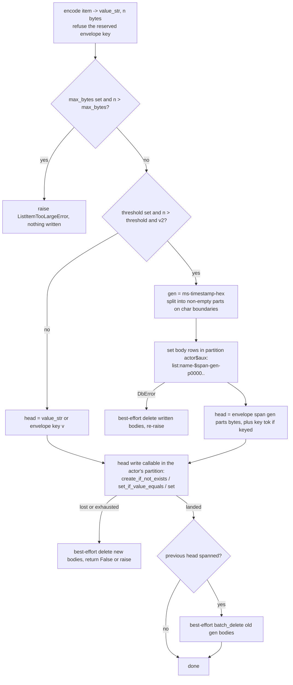
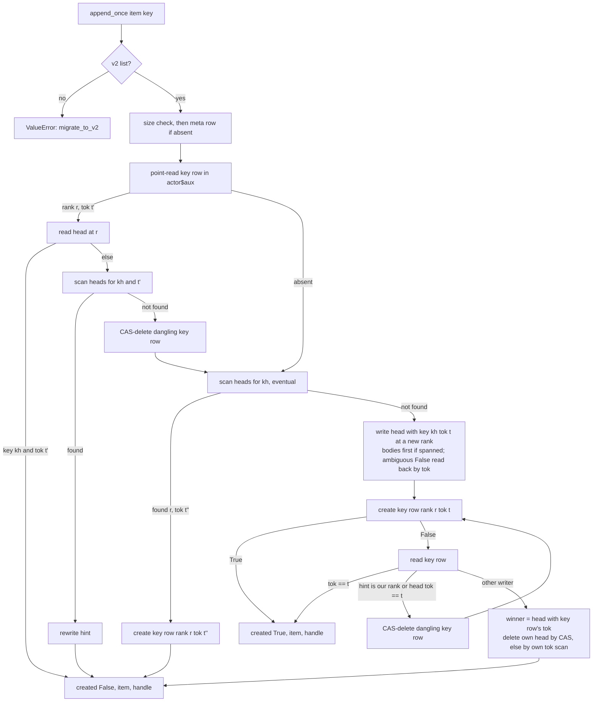

# Implementation Plan: Spanned list items, idempotent appends, and the `://` permission branch

**Date:** 2026-10-30
**Research:** thoughts/research/2026-10-26-v3.16-scope-oauth-adoption-vouching-and-spanned-list-items.md
(Part 2), with the triage in
thoughts/research/2026-10-26-inbound-triage-factory-squat-list-item-size-spa-prompt.md
(Report 2) and the three todos this plan retires:
`thoughts/todo/spanned-list-items.md`,
`thoughts/todo/idempotent-list-item-create.md`,
`thoughts/todo/permission-uri-prefix-branch.md`.
**Branch:** `master` at `56b6e19` (PR #161 merged). Two PRs (owner,
2026-10-30):
- **PR 1, Phases 1-2:** `release/3.16.0-spanned-list-items`, cut from
  `master`. Phase 1 lands as its own commit inside it.
- **PR 2, Phase 3:** `release/3.16.0-idempotent-append`, cut from PR 1's
  branch once PR 1 is open; rebased onto `master` after PR 1 merges.

Each PR runs the full tier before it opens and carries its own CHANGELOG and
migration-guide entries. 3.16.0 is cut after both merge (the adoption, fault
and uniqueness PRs are already on `master`). If PR 2 slips, 3.16.0 ships
with PR 1 and `append_once` becomes 3.17; PR 1 never waits for PR 2.

## Update Log

- **2026-10-30**: the owner made the eight deferred decisions (`append_once`
  as a new method; key rows die with their item; 390,000 / 4 MiB with
  `with_list_item_limits`, the ceiling argued from the library's own
  per-item cost and never from a particular deployment's payload limits;
  413; opt-in span enumeration; `$` refused in new names; two PRs, not
  three; a fresh gen per head `compact()` rewrites). Deployment-specific
  reasoning (Lambda, API Gateway) removed from the ceiling, the pending
  wait budget and the claim gate; ingress limits stated generically.
- **2026-10-30 (staff review)**: a design, scalability, security and
  maintainability review of the plan put seven further decisions to the
  owner, all taken the same day and marked **[Owner, 2026-10-30, review]**
  below: body and key rows live in a derived **side partition**, not the
  actor's; readers can skip body resolution (`resolve=False`, `item_at`);
  `append_once` is **item-first** with a head scan, no pending state, claim
  gate or in-request wait, and the key row's rank is a validated hint;
  size defaults are **backend-aware** (PostgreSQL never spans and has no
  ceiling unless configured); the envelope codec is a pure module; the key
  hash is an HMAC keyed by the actor id; the gen re-resolve is bounded and
  write amplification on rewrite is recorded as a future lever. The
  re-evaluation that followed (five evaluators and codex) changed the
  protocol and the remedies further; its findings are under Evaluation
  Notes, "Staff review and re-evaluation". Phases 1-3 rewritten; nothing
  had started.

Line numbers below are from `master` at `56b6e19`. Symbol names are the
anchor.

## Overview

A property-list item is one storage row, so on DynamoDB an item cannot
exceed about 400 KB, an oversized write surfaces as an untyped
`DbError("property write")`, and the consumer (Emm AI) refuses documents
over 380,000 bytes with its own error. This plan makes a v2 item that
exceeds a threshold **span** several rows behind the existing conditional
write primitives, with the body rows in a **side partition** the actor's
own partition dumps never read; raises a typed `ListItemTooLargeError`
before any write on a backend that has a row cap; lets a reader skip body
resolution (`items_with_handles(resolve=False)`, `item_at(handle)`); and
gives `append` an idempotent form, `append_once(item, key=...)`, so a client
whose answer was lost (a gateway or proxy timeout while the server finishes
the write) can repeat the create without making a second copy. It also
folds the redundant `://` prefix branch of `_matches_pattern()` into the
glob path and makes the three MCP `*/list` filters fail closed, the last two
items of the 3.14.4 security review's todo.

The headline measures: a 1 MiB item round-trips through `append` and
`to_list()` on DynamoDB with every existing row in the actor's partition
unchanged in shape and no body byte in a partition dump; and for a list
whose rows are never deleted, `append_once` with one key yields one item
however many times it is called, and every call after the first returns
that item once the first has landed. The two windows where that guarantee
is weaker (two repeats overlapping inside one request's duration, and a
loser whose own cleanup faults) are named in the docs, not hidden, and
`compact()` closes the second.

## Decisions Made

The plan was drafted autonomously on 2026-10-30 inside the owner's earlier
frame (2026-10-26: ship spanned items in 3.16 as far as a minor allows,
3.17 if it slips, never holding the auth work; 2026-10-29: the keyed
append rides with spanned items). The eight decisions the draft had
deferred were put to the owner the same day and are marked **[Owner,
2026-10-30]**; the seven the staff review raised are marked **[Owner,
2026-10-30, review]**; the rest follow from them or from the code.

- **One envelope for both features.** A v2 item's raw stored value is
  either the item's JSON (every row that exists today) or an envelope, a
  JSON object whose **first** key is `"__aw_env": 1`, with optional `key`
  (the keyed-append hash), `tok` (the writer's token), `span`
  (`{"gen", "parts", "bytes"}`) and `v` (the item, absent when `span` is
  present). **[Updated 2026-10-30]** The codec is a pure module,
  `actingweb/property_list_span.py` (no `db` import, list-agnostic: row-name
  prefixes are arguments, so plain properties, which share the row cap, can
  reuse it later): `parse(raw) -> Envelope | None` (`None` is a plain
  item; a malformed envelope, `parts` not an `int >= 1`, `gen` not matching
  the gen shape, `bytes` not an `int`, neither `v` nor `span`, or the
  marker not first, raises `EnvelopeError`, which the list layer maps to
  `ListItemSpanError` before any read), `wrap(...)`, `encode_item(item)`
  (the sanitisation and refusal rules), `split_parts`, `new_gen`,
  `part_names`, the two shape regexes and `aux_partition(actor_id)`.
  `ListProperty._resolve(raw, *, rank, consistent)` does the reads. A
  rewrite of a head (`update_by_handle`, `_v2_setitem`, `update_where`)
  carries every envelope field other than `span` and `v` across unchanged
  through `Envelope.extra`, so a field a later phase adds survives a
  rewrite without Phase 2 knowing its name. Encoding refuses a user item
  that is a dict carrying `__aw_env` **and** an encoded string that starts
  with `{"__aw_env"` (the `str(item)` fallback), with a `ValueError`
  naming the reserved key, the way `#` is refused in list names; the same
  refusal runs in `migrate_to_v2()` step 4, which copies raw v1 values and
  would otherwise promote a pre-3.16 dict item whose first key is
  `__aw_env` into something the parser reads as an envelope (the list is
  reported unmigratable with `reason="envelope-shaped item"`, the
  `downgrade_to_v1` refusal mirrored).
- **Body and key rows live in a derived side partition, in a region no
  existing reader touches.** **[Owner, 2026-10-30, review]**, over the
  actor's own partition. Partition key `aux_partition(actor_id) =
  f"{actor_id}$aux"`; row names `list:{name}-$span-{gen}-p{part:04d}` and
  `list:{name}-$key-{hash}`, where `gen` is `{unix_ms:013d}-{16 hex}`.
  Every per-actor read the library makes (`fetch`, `fetch_all_including_lists`,
  the v1 and v2 item ranges, `get_last_in_range`) is scoped to the actor's
  own partition, so **the actor's partition gains no new row shape at
  all**: `list_all_with_rows()`, `list_prefix_with_rows()`, `rows_for`,
  `prime_from_rows()` and the 1 MB Query page ceiling never see a body
  byte. That is the consumer's hot path (its Outputs page is one
  whole-partition dump, measured at 1,361 RCU over 11 pages,
  `thoughts/research/2026-08-29-bulk-list-reads-from-a-consumer.md`), and
  the todo `prop-list-key-prefix-scheme.md` names out-of-band per-item
  payload as a layout requirement; body rows are brand-new rows, so the
  choice costs nothing now and would be a migration later. Within the side
  partition the row names keep the `$` region so per-list prefix
  enumeration works and the shape filters (`SPAN_ROW_RE =
  ^\d{13}-[0-9a-f]{16}-p\d{4}\Z`, `KEY_ROW_RE = ^[0-9a-f]{64}\Z`) are
  applied by every enumeration, as `_v2_is_rank()` and `_V1_INDEX_RE` are
  today, **and** `$` joins `#` as a character refused in new list names
  (`property_list.py:625`) **[Owner, 2026-10-30]**. The part token is
  `p0000`, not `0000`, so a v1 sibling list's `-{digits}` rows can never
  match the part shape. Existing lists with `$` in their name keep working;
  the changelog carries the **Behavior change** sentence. The sites that
  learn the side partition are exactly: the list's own `clear()`,
  `delete()`, `sweep_foreign_format_rows()`, `_v2_verify(spans=True)`,
  `_v2_compact(sweep_span_orphans=True)`; the actor-level property wipe
  (`property.Properties.delete()`, called from `actor.py:1000`, which
  after `DbPropertyList.delete()` runs `get_prefix(aux, "list:",
  keys_only=True)` plus `batch_delete(aux, ...)` and repeats until the
  prefix is empty, at most three passes, so `db/` stays ignorant of lists
  and the aux rule has one owner); and `verify_orphans.classify_rows`,
  which strips a trailing `$aux` for the actor-membership test only and
  reports the raw partition key. `aux_partition()` raises `ValueError` on
  an actor id containing `$`, and `Actor.create(actor_id=...)` refuses a
  caller-supplied id containing `$` or longer than 251 characters
  (PostgreSQL `properties.id` is `VARCHAR(255)`); minted ids are 32 hex
  and never affected. **[Owner, 2026-10-30, review]** on refusing at
  `Actor.create` rather than only at the first spanning or keyed write; a
  **Behavior change** entry names it.
- **Write order: bodies, then head through the existing conditional write,
  then the previous gen's bodies.** No reader mixes generations; the head's
  raw value (the envelope) is what a handle carries, so "the raw value
  changed" still means "the item changed since you read it". The
  bodies-then-head-then-cleanup wrapper is one helper taking the head-write
  callable, used by every spanning mutator; bodies are written once per
  call, not once per rank-collision retry. Every part is non-empty and at
  most `_SPAN_PART_BYTES` (an empty part would be a silent delete in
  `DbProperty.set`, `dynamodb/property.py:386`); the splitter raises on an
  off-by-one rather than storing nothing. **[Updated 2026-10-31]** A failed
  head write is ambiguous, so the new bodies are deleted only when the head
  is known not to have landed: a raise keeps them (an orphan for the aged
  sweep if the head did not land), and a `False` from a conditional write
  is checked by reading the head back (a spanned head's bytes are unique to
  the call). Iteration 1.
- **A reader re-reads the head and the bodies strongly before calling a
  span broken, at most twice.** **[Updated 2026-10-30]** A concurrent
  `update_by_handle` deletes the old gen after swapping the head, so a
  reader holding the old envelope from a range read (or an eventually
  consistent dump) can find the old gen short; an eventually consistent
  body read can also miss parts that landed a moment ago. `_resolve` reads
  the bodies with the **caller's** consistency first (bodies are immutable
  per gen, so the dump's own consistency is enough for the common path);
  on a short set it re-reads the head strongly and, if its gen is
  unchanged, the bodies strongly; a changed gen is resolved instead, **at
  most two hops** (two concurrent updates can otherwise chain), then
  `ListItemSpanError`; only a head that still names a gen whose strong
  read is short raises. **[Updated 2026-10-31]** A head that is gone on the
  strong re-read is a concurrent delete, not damage: whole-list reads drop
  the item and point reads raise a plain `IndexError` (iteration 2). "Short" means the part
  set is not exactly `p0000..p{parts-1}` (a prefix read returns every row
  under the prefix, so a count is not enough). That error subclasses
  `ListCorruptionError`, so the handlers' 409 applies, with its own
  message (list, rank, parts expected and found) and its own remedy text;
  never a partial item.
- **Readers can skip resolution.** **[Owner, 2026-10-30, review]**, the
  smallest piece of the attachment API the research set aside, over the
  same rows. `items_with_handles(*, resolve=True)` and
  `to_list_from_rows(rows, *, resolve=True)`: with `resolve=False` a
  spanned item's slot holds the module sentinel `UNRESOLVED` (exported from
  `actingweb`) and its handle carries `spanned=True, bytes=n`; plain items
  are decoded as today. `item_at(handle) -> tuple[ListItemHandle, Any]`
  strongly reads the head at `handle.rank`, resolves whatever is there now
  and returns a fresh handle with it, raising `IndexError` if the rank is
  gone; a caller that needs "unchanged since I read it" compares the fresh
  handle's `raw_value` to its own, and the docstring states the rank-reuse
  hazard `ListItemHandle` already documents. Without this the handle's
  `spanned`/`bytes` fields would be informational only, since every reader
  resolved. `handlers/www.py:967` and `:1017` use `items_with_handles()`
  only for a bounds check and a handle to write through and pass
  `resolve=False`. The consumer's listing benefits only if its item shape
  keeps title and metadata outside the body; the guide says so.
- **The orphan sweep is age-gated and opt-in.** **[Owner, 2026-10-30]**
  on the opt-in. A body gen with no head is
  deleted only by `compact(sweep_span_orphans=True)` (the script's
  `--repair --sweep-spans`) and only when the gen's timestamp is older
  than `_SPAN_ORPHAN_MIN_AGE_SECONDS` (3600), so an append that has
  written bodies and not yet its head is never swept. The same sweep
  removes a head whose gen is absent (a broken span) and counts it; that
  is the repair path the 409 names. Opt-in because enumerating `$span-`
  rows costs every body byte on DynamoDB (a keys-only projection saves no
  capacity, `db/protocols.py:340-346`); the default `verify()` reports
  what the heads say (`spanned_items`, `span_bytes`) and `verify(spans=True)`
  pays for the enumeration. The age gate stays a module constant: it is
  an operator sweep, not a request path.
- **Thresholds are backend-aware.** **[Owner, 2026-10-30, review]**, over
  one default for both backends. Each backend's `DbProperty` class carries
  `MAX_ROW_BYTES: int | None` (DynamoDB `409_600`, PostgreSQL `None`).
  `Config.__init__` loads the backend's `property` module (today at
  `config.py:336`; it moves up to follow `self.database` at `:77`) and
  sets the two limits from it as concrete `int | None` values before the
  `**kwargs` loop at `:292` can override them:
  `list_item_span_threshold` **390,000** bytes of the encoded value and
  `list_item_max_bytes` **4 MiB** (4,194,304) where a row cap exists;
  `None` (never span) and `None` (unlimited) where none does, which is
  also what a custom backend without the attribute gets. No sentinel in
  `Config`; the `with_open_factory` "only when given" pattern lives in the
  builder alone: `with_list_item_limits(*, span_threshold=_UNSET,
  max_bytes=_UNSET)`, where an explicit `None` turns spanning off or
  removes the ceiling and an omitted argument keeps the backend default.
  Validation: each `Config` property checks its own range on every write
  (`0 < span_threshold <= 390_000`, `max_bytes > 0`), the
  `refresh_token_grace_period` precedent at `config.py:413`; the pair
  rule `max_bytes >= span_threshold` (when both are set) is checked once
  at the end of `Config.__init__` and again in the builder against the
  effective other value, never per setter, so two kwargs can be given in
  either order. `ListProperty._limits()` reads the two config values
  and accepts each only when it is `None` or a positive `int` (unit tests
  pass a `Mock()` config, which therefore never spans unless the test sets
  the attributes). The encoded value is `json.dumps(item)` with the
  default `ensure_ascii=True`, so it is ASCII and non-ASCII text costs up
  to six bytes per character (`\uXXXX`); the size measured is
  `len(value_str.encode("utf-8"))`, which equals `len(value_str)` on that
  path. On the `str(item)` fallback the backend sanitises the string
  before storing it (`db/utils.py:106-114` replaces lone surrogates), so
  `encode_item` applies the same sanitisation first and measures and
  splits the sanitised value. DynamoDB counts attribute names plus values
  against 409,600 bytes; `id` (actor id, 32) + `name` (`list:` + list name
  + `-#` + rank up to 180) + the three attribute names leave more than
  19 KB of headroom at 390,000 for any list name under about 19,000
  characters. So **no DynamoDB row that works today changes shape**, the
  consumer's 380,000-byte rows stay single-row, and **PostgreSQL is
  unchanged at the defaults**: a deployment that wants a storage bound
  there sets `max_bytes` explicitly, and a consumer that runs PostgreSQL
  locally and DynamoDB in production sees spanning only in production
  unless it sets both limits in the app (the docs recommend that for
  parity). **[Owner, 2026-10-30]** on 390,000 / 4 MiB and the builder
  name, with the rationale that the span threshold is fixed by DynamoDB's
  row cap and the ceiling is derived from what the library itself does per
  item, never from a particular platform's payload limit. At 4 MiB one
  item is about 11 body rows, about 4,300 write units to append, about
  1,056 strongly consistent read units over 6 Query pages to resolve, and
  roughly four copies of the value in memory while a request handles it;
  a list read resolves every spanned item in sequence, so n such items
  cost n paged reads. `list_item_max_bytes` is a **storage** bound: the
  request-size limit at the deployment's edge is the ingress guard (Flask
  `MAX_CONTENT_LENGTH`, an ASGI body-limit middleware, an nginx or
  Kubernetes ingress body-size setting, a gateway's payload limit), sized
  consistently with `max_bytes` plus JSON overhead; the docs say so and
  the demo app sets the framework one.
- **`ListItemTooLargeError` is raised before any write, on both formats,
  wherever a limit applies.** **[Updated 2026-10-30]** On v2 a value
  between the span threshold and `max_bytes` spans; above `max_bytes` it
  is refused. On v1 a value over the span threshold is refused on a
  backend with a row cap (it would fail at the backend anyway, today as
  the untyped `DbError("property write")`), and `migrate_to_v2()` is the
  path to store it, stated in the docs; on PostgreSQL only an explicit
  `max_bytes` applies to v1. The check runs **before**
  `_v2_create_meta_row()` in the three creating mutators (today
  `property_list.py:1667-1670` creates the meta row first). The error
  subclasses `ValueError`; its `__str__` is list name, bytes, limit and
  reason only; handlers map it to **413** **[Owner, 2026-10-30]** with the
  structured body (`error`, `list`, `bytes`, `limit`, `detail`, `remedy`)
  and the `except` arm sits before every generic `except ValueError`.
  Exported from `actingweb/__init__.py` beside `ListMetadataContentionError`.
- **Both backends run the same code path; CI exercises it on both.**
  **[Updated 2026-10-30]** PostgreSQL has no row cap and never spans at
  its defaults, so the integration harness (`tests/integration/test_harness.py`
  `create_test_app`) applies `with_list_item_limits(span_threshold=390_000,
  max_bytes=4 * 2**20)` explicitly for both backends; every span and 413
  test then runs under both CI backends, and a PostgreSQL-only test
  constructs a `Config()` directly to assert the defaults are off. A v1
  item over the threshold that PostgreSQL already holds migrates
  (`migrate_to_v2` step 4 writes raw values) into an unspanned head, which
  is legal there; its next rewrite spans it only if the deployment set a
  threshold.
- **A list-item diff whose blob would exceed the span threshold carries
  a reference, not values.** The `SubscriptionDiff` row has the same 400 KB
  cap, and an `update` diff carries two values, so the rule applies to the
  encoded **blob**: when a span threshold is set and `len(json.dumps(diff))`
  exceeds it, the value-carrying fields (`item`, `old_item`, `value`,
  `items`) are **removed** and the top-level fields `"spanned": true,
  "bytes": n` (the values' total encoded size) are added; the helper
  asserts the result is under the threshold. With the threshold `None`
  (PostgreSQL at its defaults) diffs carry their values as today: the row
  cap the rule protects is DynamoDB's, so PostgreSQL stays unchanged at
  the defaults here too. The values are removed rather than replaced by a
  marker dict because a pre-3.16 receiver applies `append`/`insert`/`update`
  whenever `"item" in data` (`remote_storage.py:401-403`) and `extend`
  whenever `"items" in data`: a marker inside those fields would be stored
  as a real item on every older peer. With the fields absent, an older
  receiver falls through to its `unknown operation` answer, and the
  top-level keys are the library's own, so a user item cannot be mistaken
  for a reference. One helper, `property_list.diff_reference(diff, config)`,
  serves all **three** emitters: `handlers/properties.py`,
  `NotifyingListProperty._register_diff`, and the subscription full-state
  fallback (`actor.py:3220-3227` stores
  `_get_full_state_for_subscription`'s `{"operation": "extend", "items":
  items}` as a diff; one spanned item would make it exceed the row cap and
  the fallback would answer False, so a non-resync peer never got the
  re-read). The library's own receiver (`remote_storage._apply_list_operation`)
  does not apply a reference: it logs at WARNING ("this replica is now out
  of sync", the wording at `remote_storage.py:437-453`) and returns
  `{"operation": ..., "success": false, "spanned": true}`; a subscriber
  re-reads the list, since a value-addressed diff carries nothing else to
  fetch by, and a non-resync peer cannot receive full state for a list
  whose items exceed the threshold. Not a regression: such items cannot
  exist today. The blob rule also covers an `extend` of many small items
  whose blob exceeds the cap (today a silently lost diff); the bulk-POST
  properties blob at `handlers/properties.py:1616` is not a list-item diff
  and is out of scope (below).
- **`append_once(item, *, key)` is a new method, v2 only, returning
  `AppendOnceResult(created, item, handle)`.** **[Owner, 2026-10-30]**,
  over a `key` keyword on `append()` with a mixed return type. `append()`
  keeps its signature and `None` return. The key (a client-minted,
  unguessable string; validated as a non-empty `str` of at most 512
  characters with no control characters) is never stored or logged in
  clear: `kh = hmac.new(actor_id.encode(), key.encode(), sha256).hexdigest()`
  is the key row's name suffix, the envelope's `key`, and the handle's
  `key_hash` **[Owner, 2026-10-30, review]** on the HMAC (domain
  separation across actors and exports; the actor id is public, so
  unguessability is still the key's own job, stated in the docstring and
  docs, and `verify()` reports key-row **counts and ranks, never hashes**).
  The contract is that of an idempotency key: a repeat returns the item
  the first call stored **whatever payload the repeat sends**; a caller
  that wants to detect a changed payload compares `result.item` itself.
- **`append_once` is item-first; the key row is the authority and its
  rank a hint.** **[Owner, 2026-10-30, review]**, over the key-first
  protocol with a `pending` reservation, a 120 s claim gate and a 10 s
  jittered wait inside the request. The key row `list:{name}-$key-{kh}` in
  the side partition holds `{"rank": r, "tok": t}`; the head's envelope
  carries `key: kh, tok: t`. Protocol (bounded by one outer budget,
  `_APPEND_ONCE_MAX_ATTEMPTS = 3`, around the rank loop's own
  `_V2_MAX_RANK_RETRIES`; bodies are written once per head-write attempt
  and a loser deletes its own gen):
  1. v2 check; key validation; `encode_item`; size check;
     `_v2_create_meta_row()` if no row.
  2. **Point-read the key row** (about 1 RCU). Present with `(r, t')`:
     read the head at `r`; if its envelope has `key == kh` and `tok == t'`
     return it (`created=False`). Otherwise the hint is stale: scan heads
     (one `_v2_load_full`, envelopes parsed, no body resolution) for
     `key == kh and tok == t'`; found: rewrite the hint
     (`set_if_value_equals`) and return it; not found: the key row is
     **dangling** (its item was deleted without the key row):
     `delete_if_value_equals(keyrow, raw)` and continue as absent.
  3. **Absent: scan heads** for `key == kh` (the crash hole: a head that
     landed whose key row was never written; eventually consistent, the
     write it looks for is at least a request old and concurrent repeats
     are arbitrated by the key-row CAS, not the scan). Two or more heads
     carrying `kh` with no key row (a loser's faulted delete followed by
     the winner's deletion): the one with the newest `tok` timestamp is
     the item and the others are cascaded first. Found at `r` with
     `tok t''`: `create_if_not_exists(keyrow, {"rank": r, "tok": t''})`;
     True or `False` with the row now naming `(r, t'')`: return it
     (`created=False`); `False` naming anything else: back to step 2.
  4. Write the head at a new rank through `_v2_write_item_at_new_rank(value,
     tok=t)` (bodies first if spanned). An ambiguous `False` reads the
     candidate rank back; a head whose `tok == t` is ours.
  5. `create_if_not_exists(keyrow, {"rank": r, "tok": t})`. True:
     `created=True`. `False`: read the key row. `tok == t` (an SDK retry
     of a create that landed): `created=True`. **Hint names our own rank
     or a head whose `tok == t`**: the dangling case that step 2 missed
     (a deleted trailing rank is reissued to the next append,
     `property_list.py:263-272`), never "another writer": CAS-delete the
     key row and back to step 5. Otherwise another writer owns the key:
     the winner is the head whose `tok` equals the key row's (located by
     the hint, else by scan); if neither finds one (the winner's item was
     deleted with its key-row delete still in flight) the row is dangling:
     CAS-delete it and back to step 5. Otherwise delete our own head by
     `delete_if_value_equals` on our raw envelope (cascading our gen); if
     that CAS fails (a concurrent `compact()` moved our head) scan heads
     for our `tok` and delete that row; a `DbError` propagates and the
     duplicate it leaves is `compact()`'s to remove. Return the winner's
     item, `created=False`.
  6. Metadata touch only on `created=True`.
  Two overlapping repeats both write; one loses step 5 and deletes its own
  head; two items are visible for the length of that delete. Nothing is
  left that a later call does not converge, and nothing sleeps inside a
  request. Cost: a first call pays one point read plus one head range read
  (`_v2_load_full`, eventually consistent: 200 items x 10 KB is about 250
  RCU over 2 pages; heads of unspanned items cost their full size); a
  repeat pays two point reads. The consumer's create path already pays an
  equivalent scan (its duplicate guard). After an ambiguous `False` from
  the rank create the writer reads the candidate rank back and a row whose
  `tok` is its own is its landed write; that closes the SDK-retry duplicate
  for keyed appends and leaves it open for unkeyed ones (the todo is
  narrowed, not deleted).
- **Key rows die with their item.** **[Owner, 2026-10-30]**, over a key
  spent forever. Every delete path has the envelope in hand
  (`delete_by_handle` from the handle, `_v2_pop`/`_v2_remove`/`_v2_delitem`
  from the row they read), so each deletes the key row of a keyed item
  after the head; `clear()` and `delete()` remove every `$key-` row; a
  rewrite carries `key` and `tok` across. So a repeat after a deletion
  creates again (a late retry after a user's delete resurrects the item;
  the docs say a key is bound to its item), the number of key rows is
  bounded by the number of items, and nothing "spent" has to be
  explained. **[Updated 2026-10-30]** `compact()` does **not** remap key
  rows (hints go stale and a repeat repairs its own); from the heads it
  already reads plus the one `$key-` enumeration `verify()` pays it keeps,
  for a key with two heads, the head whose `tok` equals the key row's and
  cascades the other (`duplicate_keyed_items_removed`), and `verify()`
  reports `dangling_key_rows` and `duplicate_keyed_items` as counts and
  ranks.
- **`compact()` gives a rewritten spanned head a fresh gen.** **[Owner,
  2026-10-30]**, over sharing the gen between the old and new head. The
  shared gen made the documented manual recovery after a crash mid-compact
  ("delete the stale copies") destructive, since deleting either duplicate
  would cascade the bodies both reference. A rebalance of a list with many
  spanned items is a bulk copy (O(total spanned bytes) per run);
  `compact()` is an operator action. Details in Phase 2.
- **`extend()`, `insert()` and the REST handlers do not take keys in
  3.16.** The consumer's need is a single create through the library API.
- **The `://` branch is redundant, not a hole.** `notes://*` compiles to
  `^notes://.*\Z` under DOTALL and accepts `notes://../../security/key`
  exactly as `startswith` does; the control-character guard runs before
  either. So a pattern ending in `://` **and containing no `*` or `?`** is
  folded into `pattern + "*"` through the glob path: one code path, no
  change for any pattern a shipped or documented configuration can hold.
  A pattern such as `*://` already takes the glob path today and is left
  alone. The docs gain one sentence where they teach the prefix form
  (`access-control.rst:304-305`, prose, and `security.rst`): `..` segments
  are not normalised; a resource reader that maps URIs to storage
  validates its own path.
- **The three MCP `*/list` filters fail closed.** An evaluator that cannot
  be constructed yields an empty list; an evaluator that raises on an item
  skips the item; `DbError` keeps propagating to the 503. The `if peer_id
  and evaluator:` guards go, so a future `None` cannot skip the loop.
- **Two PRs: Phases 1-2, then Phase 3.** **[Owner, 2026-10-30]**, over
  the outside voice's three-PR suggestion. Phase 1 is a separate commit
  inside the spanning PR; the keyed append builds on the envelope and the
  side partition and needs no second audit; PR 2 can ship later without
  holding PR 1. Phase 1's two security items are independently shippable
  if PR 1 stalls.

The fifteen owner decisions, for the record: `append_once` as a new
method; key rows die with their item; 390,000 / 4 MiB through
`with_list_item_limits`, argued deployment-agnostically; 413; span
enumeration opt-in; `$` refused in new list names; two PRs; a fresh gen per
head `compact()` rewrites; **(review)** a derived side partition for body
and key rows; `resolve=False` and `item_at`; item-first `append_once` with
the key row's rank as a hint; backend-aware defaults; a pure codec module;
an HMAC key hash; the bounded re-resolve and the write-amplification note.

## What We're NOT Doing

- **Raising the 1 MB per-partition Query page ceiling.** Spanning now
  takes spanned items' bodies out of the actor's partition altogether, so
  dumps and range reads never pay for them; the ceiling itself (plain
  properties plus every head and unspanned item in one partition) stays
  with `thoughts/todo/prop-list-key-prefix-scheme.md`, which Phase 2
  amends to record the side partition as the out-of-band payload answer.
- **A full attachment API** (`append(item, body=...)`, `get_body(handle)`).
  `resolve=False` and `item_at` are the read half over the same rows; a
  write-side split of metadata from body is the consumer's own item
  shape, not a library layout.
- **`TransactWriteItems`.** 100-item/4 MB limit, no PostgreSQL equivalent
  in the current layer. Gen-stamping and the key-row arbiter give the
  reader-visible properties without it.
- **Spanning on v1 lists.** A v1 list never spans; `migrate_to_v2()` is
  the path. Keeps the v1 paths untouched.
- **Making `_v2_setitem`/`_v2_delitem` conditional writes.** They gain one
  point read of the head (to learn the old gen and key) and stay
  unconditional; closing their documented overwrite race is a separate
  change. Stated as "positional writes gain one item read".
- **Keys on `extend()`/`insert()`, a REST `key` field, a `get_by_key()`
  reader.** Not needed by the consumer's create path; each is additive
  later.
- **Content-addressed body parts shared across gens.** Every rewrite of a
  spanned item writes every body and deletes the old gen: a one-line edit
  to a 2 MiB item is about 2,100 write units plus the cascade. Sharing
  unchanged parts needs refcounting across gens; recorded as the future
  lever, not for 3.16.
- **A repair flag on `verify_orphans`.** The module is report-only by
  design (`verify_orphans.py:21-27`, enforced by
  `tests/test_verify_orphans.py:285-309`); a leaked side partition is
  reported under its raw key like any orphan property row and removed by
  the operator path `docs/reference/actor-deletion.rst` already documents.
- **Fetching the item on the receiving side of a spanned diff.** The
  receiver has no proxy to the publisher in `remote_storage`; the
  subscriber's own re-read is the contract. Noted in the subscriptions
  guide.
- **The bulk-POST properties diff blob that can already exceed 400 KB**
  (`handlers/properties.py:1616` registers the whole body as a
  `properties` diff, not a list-item diff). Pre-existing; `add_diff` logs
  the lost diff and the sequence gap is visible to the subscriber.
- **Closing the SDK-retry duplicate for unkeyed `append()`.** A read-back
  of the candidate rank cannot distinguish our write from a concurrent
  byte-identical one without a token; the todo stays, narrowed, with a
  strict `xfail` test pinning it.
- **Normalising resource URIs (`..`, percent-encoding) in the permission
  evaluator.** The URI is the application's namespace. Documented instead.
- **The REST handlers' legacy-authorization fallback on an evaluator
  error** (`handlers/properties.py:167-174`, `:1835-1842`, `:2020-2027`):
  the REST counterpart of the MCP fail-open this plan closes, pre-existing
  and outside the todo's scope. Filed as a todo in Phase 1. **[Updated
  2026-10-31]** The owner folded it in (iteration 27).
- **The `uri_pattern` metadata question** named in the todo
  (`handlers/mcp.py:1887`): already `re.fullmatch` since 3.14.4; nothing
  left to decide with.
- **A general actor-id character policy.** Only `$` and the 251-character
  bound are refused, because the side partition needs exactly those; a
  wider policy is a separate decision.

## What Already Exists

- `actingweb/db/dynamodb/property.py:585-660` and
  `actingweb/db/postgresql/property.py:618-760`: `create_if_not_exists`,
  `delete_if_value_equals`, `set_if_value_equals`, `get_prefix`,
  `batch_delete`. Every write and read this plan adds goes through these;
  no new backend primitive, and every one takes the partition key as its
  `actor_id` argument, which is what makes a side partition free. Both
  return `False` on a failed condition and raise `DbError` on a fault.
- `actingweb/property.py:458-500` `Properties.delete()` → `DbPropertyList.delete()`
  (`dynamodb/property.py:834-860`, one `Property.query(actor_id)` plus a
  batch write; `postgresql/property.py:939-997`, one transaction): the
  only actor-level property wipe (`actor.py:1000`; the demo's `/nuke`
  calls `Actor.delete()`); learns the side partition in the list layer.
- `actingweb/maintenance/verify_orphans.py:182-206` `classify_rows`: pure,
  classifies by `actor_id not in actor_ids` after the reserved-prefix
  test; learns the `$aux` suffix.
- `actingweb/config.py:328-339`: `Config.__init__` imports the backend's
  `property` module; the two limits are set right after it.
- `property_list.py:255-283` `ListItemHandle` (frozen dataclass, rank +
  exact raw value): the CAS contract spans and keys preserve. Gains
  `spanned` and `bytes` fields with defaults (Phase 3 adds `key_hash`); no
  positional construction exists.
- `property_list.py:1623-1681` `_v2_append` collision loop and
  `property_list.py:1545-1621` `_v2_create_meta_row`'s write-order
  diagram: the shape `append_once`'s crash matrix follows.
- `property_list.py:1809-1823`, `:1842-1856` `_v2_item_names_in_range` /
  `_v1_item_names_in_range`: read-filter-return, generalised into one
  `_names_matching(...)` the aux enumerator also uses.
- `property_list.py:2738-2842` `_v2_verify` and `:3002-3107` `_v2_compact`:
  extended, not rebuilt.
- `property_list.py:190-230` `ListMetadataContentionError` and its 503
  mapping: unchanged (no new subclass after the review).
- `property.py:10-64` `rows_for`: unchanged (no new row shape in the
  actor's partition).
- `handlers/properties.py:52-103` `_write_list_corrupted_response` and
  `_write_list_metadata_contention_response`: collapsed into one
  `_write_list_error(response, status, reason, body)` the 413 also uses.
- `handlers/www.py:967`, `:1017`: `items_with_handles()` for a bounds
  check and a handle; the first `resolve=False` callers.
- `permission_evaluator.py:685-706` `_matches_pattern`/`_glob_to_regex`
  with the bounded pattern cache: the fold is three lines.
- `handlers/mcp.py:1189-1197`, `:1295-1316`, `:1445-1454`, `:1470-1491`,
  `:1524-1533`, `:1546-1567`: the six places the list filters fail open.
  The factory `get_permission_evaluator` never returns `None`
  (`permission_evaluator.py:843-846`); the client-type block is a
  visibility filter, not authorization.
- `tests/test_property_list_integrity.py:31` `FakePropertyDb` (shared by
  nine unit files; keys rows by `(actor_id, name)`, so a side partition
  needs no change to it; has no `get_prefix` today) and
  `tests/test_v2_list_mutation_committed.py:131`, `:153` (fault-injecting
  and interleaving subclasses): the deterministic harness for every race
  and fault test below. `tests/test_bulk_list_update_handles.py:28-33`
  `_require_dynamodb` (autouse fixture reading `DATABASE_BACKEND`) and
  `:75`, `:268` `_post_bulk`/`_run_handler` (module-private, imported
  cross-file as `tests/test_v2_handle_mutators.py:14` does).
  `tests/test_verify_orphans.py:23-90`: the pure `classify_rows` tests.
- `tests/integration/conftest.py:466` `test_app` (session-scoped,
  `create_test_app`): where the harness sets the explicit limits.
- `tests/test_permission_pattern_matching.py:58`,
  `tests/test_mcp_fail_closed_authorization.py:248-281`, `:503`: the tests
  the Phase 1 tests extend.
- `tests/integration/test_property_list_v2.py`,
  `tests/integration/test_property_list_handle_mutators.py`,
  `tests/integration/test_property_list_repair.py`,
  `tests/integration/test_verify_property_lists_script.py:27`
  (`_seed_v1_list`), `tests/integration/test_migrate_property_lists_script.py`:
  fixtures and shapes the Phase 2 and 3 integration tests reuse. There
  are **no** thread-based list tests to copy; races are interleaved in the
  fake.
- `tests/performance/test_backend_performance.py:211` benchmarks
  `DbPropertyList.fetch` over plain properties; there is no `to_list()`
  benchmark, so Phase 1 adds one and takes the baseline on `master`.
- `actingweb/maintenance/migrate_property_lists.py:344-408`
  `downgrade_to_v1`: gains a refusal. `verify_property_lists.py:222`
  `if report["healthy"]: continue` precedes the repair gate, so the sweep
  needs its own path.
- `docs/migration/v3.16.rst` ("Start here" numbered list at `:24-85`),
  `docs/reference/actor-deletion.rst` ("Finding orphaned rows", `:248`),
  `docs/guides/database-maintenance.rst` ("Orphaned Row Scan", `:715`) and
  the `Unreleased` section of `CHANGELOG.rst`: all exist; this plan adds
  items and sections.

## Phase 1: Typed size error, backend-aware limits, the `://` fold, fail-closed list filters, baseline

Small, self-contained, and the foundation Phase 2 builds on: the row-cap
capability and the two config fields, the error class and its HTTP mapping,
the wording fixes, the two permission items from the todo, and the list
benchmark whose baseline Phase 2 is measured against.

### Changes

- `actingweb/db/dynamodb/property.py`, `actingweb/db/postgresql/property.py`
  — `DbProperty.MAX_ROW_BYTES: int | None` class attribute (`409_600`,
  `None`), with a docstring sentence in `db/protocols.py` naming it as an
  optional capability a custom backend may declare (`None` when absent).
- `actingweb/config.py` — `list_item_span_threshold` and
  `list_item_max_bytes` as validating properties (`int | None`;
  `ValueError` on an out-of-range value wherever it is set). The
  `property` backend module import moves up from `:336` to right after
  `self.database` is set at `:77`, the two defaults are set there from
  `getattr(<module>.DbProperty, "MAX_ROW_BYTES", None)` (an `int` gives
  `(390_000, 4 * 2**20)`, anything else `(None, None)`), and the
  `**kwargs` loop at `:292` then overrides them as it does every other
  field, so `Config(list_item_span_threshold=2000)` works. Each setter
  checks only its own range (`0 < span_threshold <= 390_000`,
  `max_bytes > 0`); the pair rule `max_bytes >= span_threshold` is
  checked once after the kwargs loop and again in the builder, never per
  setter, so `Config(list_item_max_bytes=100_000,
  list_item_span_threshold=50_000)` does not fail on its first kwarg
  against the default of the second. Defaults are module constants in
  `property_list_span.py` (pure; `config.py` imports nothing from
  `property_list`, which imports `actingweb.db`).
- `actingweb/interface/app.py` — `with_list_item_limits(*,
  span_threshold: int | None = _UNSET, max_bytes: int | None = _UNSET)`,
  docstring in the `with_open_factory` style: an omitted argument keeps
  the backend default (DynamoDB 390,000 and 4 MiB; PostgreSQL off and
  unlimited), an explicit `None` turns spanning off or removes the
  ceiling, and the storage-bound versus ingress-limit distinction; stored
  as builder state and applied in `_apply_runtime_changes_to_config()`
  only when given (the `open_factory` pattern at `:224`).
- `actingweb/property_list_span.py` (new, pure) — `SPAN_THRESHOLD_DEFAULT`
  (390,000), `SPAN_PART_BYTES` (390,000), `ITEM_MAX_BYTES_DEFAULT` (4 MiB),
  `encoded_size(value_str)`; the rest of the codec arrives in Phase 2.
- `actingweb/property_list.py` — `ListItemTooLargeError(ValueError)` with
  `list_name`, `bytes`, `limit`, `__str__` limited to those; `_limits()`
  (each value `None` or a positive `int`, else treated as `None`); the
  size check at the top of every item write (`_v2_append`, `_v2_extend`
  over the whole batch before its first write, `_v2_insert`,
  `_v2_setitem`, `update_by_handle`, and the v1 branches of `append`,
  `insert`, `__setitem__`, where the v1 limit is the span threshold when a
  row cap exists, else `max_bytes`) **before `_v2_create_meta_row()` and
  before any row**. Module docstring line 5: the module stores one item
  per row and bypasses the row limit per list, not per item (Phase 2 adds
  "an item larger than one row spans"). `get_metadata()` docstring:
  `chunk_size` is a legacy field always `1`.
- `actingweb/__init__.py` — export `ListItemTooLargeError`.
- `actingweb/handlers/properties.py` — `_write_list_error(response,
  status, reason, body)` replacing the two hand-rolled writers; 413 body
  `{"error": "list_item_too_large", "list", "bytes", "limit", "detail",
  "remedy": "split the item or raise list_item_max_bytes"}`; `except
  ListItemTooLargeError` **before** the generic `except (ValueError,
  IndexError)` at `:821-824` in `PropertiesHandler.put`, and in `.post`
  (bulk, via `_finish_bulk_list_update`'s callers) and
  `PropertyListItemsHandler.post` (add and update). (`:927-931` is the
  plain-property name arm and is not involved.)
- `actingweb/permission_evaluator.py:685-687` — replace the `startswith`
  branch with: a pattern ending in `://` and containing neither `*` nor
  `?` is rewritten to `pattern + "*"` before the cache lookup; docstring
  updated.
- `actingweb/handlers/mcp.py` — `tools/list`, `resources/list`,
  `prompts/list`: an evaluator construction failure other than `DbError`
  returns the empty list (`:1193-1197`, `:1448-1454`, `:1527-1533`); a
  per-item evaluation exception other than `DbError` skips the item with
  an ERROR log and `exc_info` (`:1312-1316`, `:1487-1491`, `:1563-1567`);
  the `if peer_id and evaluator:` guards (`:1301`, `:1472`, `:1548`)
  become unconditional; the "fail-open" comments go.
- `tests/integration/test_harness.py` `create_test_app` —
  `.with_list_item_limits(span_threshold=390_000, max_bytes=4 * 2**20)`
  for both backends, with a comment saying why (PostgreSQL never spans at
  its defaults; CI must run the same path on both).
- `tests/performance/test_backend_performance.py` —
  `test_list_property_performance`: `to_list()`, `items_with_handles()`,
  `append()`, `remove()` on a 1,000-item v2 list (plain), marked
  `benchmark`; run on `master` first and the numbers recorded in this
  phase's implementation notes.
- `examples/demo/application.py` — the framework request-size limit set
  to `max_bytes` plus overhead (Flask `MAX_CONTENT_LENGTH`; the FastAPI
  variant documented), and the two limits set explicitly so the demo
  behaves the same on both backends.
- `docs/quickstart/configuration.rst` — Runtime Switches rows for the
  two limits (backend defaults in a two-row table; storage bound; ingress
  limit is the framework's; "raises `ValueError` wherever it is set"; set
  both explicitly for parity across a PostgreSQL development and DynamoDB
  production pair); line 591 reworded.
- `docs/guides/access-control.rst:304-305` and `docs/reference/security.rst`
  — `notes://` is matched as `notes://*`; `..` is not normalised; a
  resource reader validates its own path. (`access-control-simple.rst:135`
  is a code comment and keeps its example.)
- `docs/guides/property-lists.rst` — `ListItemTooLargeError` (import
  path, 413 body) under the REST API section; the "A `ValueError` is not
  covered by that sentence" paragraph at `:188-191` gains "except
  `ListItemTooLargeError`, which is raised before any write".
- `CHANGELOG.rst` `Unreleased` — ADDED (`ListItemTooLargeError`,
  `with_list_item_limits`, the backend defaults), CHANGED (MCP list
  filters answer an empty list on an evaluator error, **Behavior
  change**), FIXED (a v2 item over the row cap on DynamoDB surfaced as the
  untyped `DbError("property write")`; a v1 item over it now raises the
  typed error before any write; the two wording fixes; the `://` fold
  stated as no behaviour change).
- `thoughts/todo/permission-uri-prefix-branch.md` deleted with its
  `INDEX.md` row; a new todo `rest-permission-legacy-fallback.md` (the
  REST evaluator-error fallback) with an `INDEX.md` row.

### New Tests, both unit and integration tests

- `tests/test_list_item_limits.py` (unit, `FakePropertyDb` from
  `tests/test_property_list_integrity.py`, config built as
  `Config(database="dynamodb")`): the defaults resolve to
  `(390_000, 4 MiB)` for `database="dynamodb"` and `(None, None)` for
  `database="postgresql"` and for a backend module whose `DbProperty`
  lacks `MAX_ROW_BYTES` (monkeypatched); an item over `max_bytes` raises
  `ListItemTooLargeError` from `append`, `extend` (oversized item in
  position 3), `insert`, `__setitem__`, `update_by_handle` on a v2 list
  and from `append`/`insert`/`__setitem__` on a v1 list **with no row
  written**, including on a never-created list (`_read_meta_row()` is
  `(None, None)` after the raise); a v1 item over 390,000 bytes raises on
  the DynamoDB config and is written as one row on the PostgreSQL config;
  the `Config` properties reject `span_threshold=400_001`,
  `span_threshold=0`, `max_bytes < span_threshold` from kwargs and from
  assignment, and accept `None` for either; `_limits()` ignores a
  `Mock()` config; `str(error)` carries no item content; the error is
  importable from `actingweb`.
- `tests/test_actingweb_app.py`: the builder validates against the
  effective other value; an omitted argument keeps the backend default; an
  explicit `None` turns the limit off; a Config value survives until the
  builder is called.
- `tests/test_list_item_limits.py`: 413 for PUT index, POST items add and
  update, and the bulk POST, through `_run_handler`/`_post_bulk` imported
  from `tests.test_bulk_list_update_handles`; the body shape asserted.
- `tests/test_permission_pattern_matching.py`: `notes://` matches
  `notes://work/x` and `notes://` (existing assertions keep passing);
  target `notes://\nx` is denied; target `notes:/` does not match pattern
  `notes://` (arguments in `(target, pattern)` order); pattern `*://`
  still compiles to `^.*://\Z`; the cache holds the rewritten key.
- `tests/test_mcp_fail_closed_authorization.py`: for each of the three
  list methods, an evaluator whose construction raises `RuntimeError`
  yields an empty list (fails on today's code), and an evaluator whose
  `evaluate_permission` raises on one item lists the others and not that
  one; a `DbError` still surfaces as the 503.
- `tests/integration/test_property_list_http_contract.py`: PUT of an item
  over `max_bytes` answers 413 with the JSON body on both backends (the
  harness sets the limits).
- `tests/integration/test_property_list_spans.py` (PostgreSQL-only, the
  `_require_dynamodb` fixture inverted): a `Config()` built directly
  against the live database has both limits `None`, and a 5 MiB item
  appended through it is one row and reads back.
- `tests/performance/test_backend_performance.py`: the new benchmark
  runs alone (`-m benchmark`).

### Failure Scenarios

- The size check runs after the meta row or a body row was written —
  covered by the never-created-list assertion; the check precedes
  `_v2_create_meta_row()`.
- A consumer sets `span_threshold` above the row cap through
  `Config(**kwargs)`, bypassing the builder — covered by the property
  validation and its test.
- A custom backend without `MAX_ROW_BYTES` silently gets no limit and its
  oversized writes fail untyped as today — the docs name the attribute
  and the explicit builder values; no regression.
- The MCP list filter hides every tool on a transient evaluator error and
  the client sees an empty server — the error is logged at ERROR with
  `exc_info`; a `DbError` still answers 503 so the client distinguishes
  outage from denial. Covered by the tests.
- `ListItemTooLargeError` reaches a generic `except ValueError` first and
  becomes a 400 — covered by the handler tests over every item-writing
  route; wrong status, not silent.
- The PostgreSQL CI run silently stops exercising spans because the
  harness forgot the explicit limits — the span suite asserts a spanned
  row shape on both backends, so it fails loudly there.

### Verification

- [x] Run the contract's `### Checks` fast tier verbatim (unsandboxed; the
      sandbox cannot reach DynamoDB Local)
- [x] `grep -n "fail-open\|Fail-open\|and evaluator" actingweb/handlers/mcp.py`
      returns nothing
- [x] `grep -n "startswith(pattern)" actingweb/permission_evaluator.py`
      returns nothing
- [x] Baseline: `poetry run pytest tests/performance -m benchmark --no-cov
      -q -k list_property` on `master` and on the branch, numbers recorded

### Implementation Status: Complete

#### Implementation notes (2026-10-30)

- **Baseline** (DynamoDB Local, taken before any library change; the
  branch differed from `master` only under `thoughts/`), medians over the
  pytest-benchmark rounds on a plain 1,000-item v2 list:

  | Benchmark | Median | Mean |
  | --- | --- | --- |
  | `to_list()` | 14.88 ms | 16.82 ms |
  | `items_with_handles()` | 15.45 ms | 16.70 ms |
  | `append()` then `remove()` of the same value | 35.74 ms | 34.38 ms |

  The benchmark is `TestListPropertyPerformance` (three tests, one
  module-scoped list); `append` and `remove` are measured as one round so
  the list stays at 1,000 items.
- **Deviation, `Config` defaults:** the plan moved the backend `property`
  import up to follow `self.database`. `Config(database=...)` sets the
  backend through the kwargs loop, which runs after that line, so the
  defaults are resolved against `kwargs.get("database", self.database)`
  instead; the later `self.DbProperty` import is unchanged. The defaults,
  validators and pair rule live in `property_list_span.py`
  (`default_limits`, `validate_span_threshold`, `validate_max_bytes`,
  `validate_limit_pair`) so the builder and `Config` share them.
- **Phase 1 semantics for v2 over the span threshold:** with no spanning
  yet, a v2 item over `list_item_span_threshold` is refused with
  `ListItemTooLargeError` (limit = the threshold) exactly as a v1 item is,
  rather than failing untyped at the backend. Phase 2 turns that branch
  into spanning on v2. The changelog FIXED entry says "390,000 for now";
  Phase 2 rewrites it.
- `v1 extend()` also checks the whole batch before its first `append()`
  (the plan named only the v2 batch); v1 `insert()` checks before its
  shift loop.
- Handlers: one `_write_list_error()` behind the 409, 413 and 503
  writers; `ListItemTooLargeError` arms sit before the generic arms in
  `PropertiesHandler.put` (index branch), the bulk POST (the v1 inner
  `except (IndexError, ValueError)` re-raises it to the outer arm) and
  `PropertyListItemsHandler.post`.
- The bulk-POST 413 test lives in `tests/test_list_item_limits.py`
  (DynamoDB Local, through `_post_bulk`/`_run_handler`), next to the PUT
  and `/items` cases.
- `tests/test_init_docstring.py` pins `__all__`; it gained
  `ListItemTooLargeError`.
- New todo `rest-permission-legacy-fallback.md` with its `INDEX.md` row
  (replacing the deleted `permission-uri-prefix-branch.md` row).
- Release class: new config options and a builder method, so a minor
  (3.16.0 already is one).
- Checks: fast tier green; full tier: docs build, `verify_groups`, lint,
  format, pyright clean; DynamoDB `make test-all-parallel` 4,451 passed,
  39 skipped; PostgreSQL `make test-all-parallel` 4,305 passed, 185
  skipped.

---

## Phase 2: Spanned items

The pure codec, the side partition and its enumeration, the span write,
read and cascade paths, deferred resolution, diffs by reference, verify and
compact, the scripts, docs and the DynamoDB test path. Ends PR 1.

Readers: `_resolve(raw, *, rank, consistent)` parses the envelope; if it
spans, issues `get_prefix(aux_partition(actor_id), "list:{name}-$span-{gen}-")`
with the **caller's** consistency, joins the parts in name order, checks the
exact part set and the byte count, and decodes. A short or missing gen
triggers one strong re-read of the head: a new gen is resolved instead, at
most two hops; an unchanged or absent head raises `ListItemSpanError`. Only
spanned items pay the extra read, and it is paged: a 1 MiB item is about
144 eventually consistent read units (288 strong) over 2 pages, a 4 MiB
item about 528 (1,056 strong) over 6, sequential, per spanned item, on every
resolving read. Value scans (`remove`, `index`, `count`, `find` when the
sought value is a dict compared by equality) skip resolution when the sought
value's encoded size is at or under the span threshold, since it cannot
equal a spanned item. With `resolve=False` nothing is read beyond the heads.

### Changes

- `actingweb/property_list_span.py` (pure; Phase 1 created it with the
  constants):
  - `ENVELOPE_MARKER = "__aw_env"`, `Envelope` frozen dataclass (`key`,
    `tok`, `span: SpanInfo | None` with `gen`, `parts`, `bytes`, `value`,
    `extra: dict`), `EnvelopeError(ValueError)`, `parse(raw) -> Envelope |
    None` (the marker must be the **first** key; the refusal and the
    parser pin the same rule), `wrap(*, value=None, key=None, tok=None,
    span=None, extra=None) -> str` (marker first), `encode_item(item) ->
    str` (sanitise as `db/utils.py:106-114`, refuse the dict key and the
    encoded prefix), `split_parts(value_str, part_bytes) -> list[str]`
    (non-empty, each at most `part_bytes`, character boundaries, raises
    on an empty part), `new_gen()`, `GEN_RE`, `SPAN_ROW_RE`, `KEY_ROW_RE`,
    `span_prefix(list_name, gen)`, `part_names(list_name, gen, parts)`,
    `key_row_name(list_name, hash)`, `aux_partition(actor_id)` (raises
    `ValueError` on `$`), `AUX_SUFFIX = "$aux"`.
- `actingweb/property_list.py`:
  - Names: `$` refused beside `#` for new lists (`:625-631`).
  - `_resolve(raw, *, rank, consistent) -> Any` and `_read_head(rank, *,
    consistent) -> tuple[str | None, Envelope | None]` (the one head
    point read, used by `_resolve`'s re-read, `item_at`, the
    `_v2_setitem`/`_v2_delitem` point read and Phase 3's hint check);
    `_decode_item` becomes `_resolve(...)`, and every reader goes through
    it or through `parse` alone: resolving in `_v2_to_list`,
    `_v2_getitem`, `_v2_pop` (it returns the item), `_v2_items_with_handles`
    (default), `to_list_from_rows` (default), `_identity_of` (so
    `verify(identity_key=...)` resolves every spanned item; the cost is
    stated); non-resolving in `_v2_remove`'s scan (resolve only when the
    sought value could match), `NotifyingListProperty`'s handle mutators,
    `items_with_handles(resolve=False)`, and the Phase 3 head scan.
  - `UNRESOLVED` module sentinel (exported from `actingweb`);
    `items_with_handles(*, resolve: bool = True)`; `to_list_from_rows(rows,
    *, resolve: bool = True)`; `item_at(handle) -> tuple[ListItemHandle,
    Any]` (strong `_read_head`, `IndexError` when the rank is gone, the
    rank-reuse hazard in the docstring).
  - Side partition: `_aux` (cached `aux_partition(self.actor_id)`),
    `_aux_names(kind, *, prefix) -> list[str]` (`_names_matching` over a
    `get_prefix` on the side partition with the matching shape regex;
    serves `clear`, `delete`, `sweep_foreign_format_rows`, `verify`,
    `compact`); `_v2_item_names_in_range`/`_v1_item_names_in_range` bodies
    replaced by `_names_matching(...)`; `_span_part_names(gen, parts)`
    (derived, no read).
  - `ListItemHandle`: `spanned: bool = False`, `bytes: int | None =
    None`.
  - `ListItemSpanError(ListCorruptionError)` with `list_name`, `rank`,
    `expected_parts`, `found_parts`; `__str__` from those only; the 409
    writer takes `remedy` from the error (`"run
    actingweb-verify-property-lists --repair --sweep-spans, or remove the
    item with delete_by_handle()"`); the rank becomes REST-visible for
    the first time, stated in the docs.
  - Spanned write: `_write_spanning(value_str, head_write, *, key=None,
    tok=None) -> bool` (the wrapper in the diagram, used by `_v2_append`,
    `_v2_extend`, `_v2_insert`, `_v2_setitem`, `update_by_handle`; bodies
    once per call, written to the side partition), `_span_delete_bodies(gen)`
    (best-effort `batch_delete` on the side partition, logs on `DbError`).
    The Phase 1 size check gains the `span_threshold` branch on v2.
  - Envelope preservation: `update_by_handle`, `_v2_setitem` and (through
    them) `update_where` carry `Envelope.extra` plus `key` and `tok` from
    the old envelope into the new head; the fields Phase 3 adds ride on
    that rule.
  - Cascade on delete: `delete_by_handle` (envelope from the handle),
    `_v2_pop` and `_v2_remove` (from the row they read), `_v2_delitem` and
    `_v2_setitem` (one `_read_head` before the unconditional write:
    positional writes gain one item read). Every cascade is best-effort
    after the head write committed, so a mutator that returns has
    committed (the class docstring's contract holds); a cascade that fails
    logs a WARNING naming the list and the gen, which is the only signal
    (the docs say so). A concurrent `update_by_handle` between the point
    read and the unconditional write leaves the other writer's gen as an
    orphan, never a broken span.
  - `clear()`: body gens derived from the head envelopes it deletes (one
    range read with values, no `$span-` enumeration); the `$key-` rows
    enumerated on the side partition (small). `delete()`: both aux
    prefixes enumerated on the side partition and deleted (the only way
    orphan gens leave with the list; cost stated).
  - `sweep_foreign_format_rows()`: `stored is None` (list gone) and the
    v1 branch (which only runs when `format_ever_changed` is not `False`)
    also sweep both aux prefixes; the v2 branch does not.
  - `_v2_verify(spans=False)`: from heads, `spanned_items`, `span_bytes`;
    with `spans=True`, one `$span-` enumeration on the side partition
    (cost stated) giving `span_body_rows`, `orphan_span_gens`,
    `broken_spans` (heads whose part count disagrees with the envelope; a
    byte check needs body bytes and is not made here), and `healthy`
    False on `broken_spans`. `verify(spans=False)` passes it through; the
    v1 branch counts aux rows into `foreign_format_rows`.
  - `_v2_compact(sweep_span_orphans=False)`: a rewritten **spanned** head
    gets a fresh gen, its bodies copied (read strongly, written through
    `_write_spanning`) before the new head is written, and the old head's
    delete cascades its own gen. Sharing the gen between the old and new
    head looked cheaper but made the documented manual recovery
    (`property_list.py:3022-3030`: "delete the stale copies") destructive:
    `delete_by_handle` on either duplicate would cascade the shared gen
    and break the survivor, and `--sweep-spans` would then remove it. With
    a gen per head every duplicate is independently consistent and the
    existing recovery holds. With the flag, one `$span-` enumeration
    (reused, not two) deletes orphan gens older than
    `_SPAN_ORPHAN_MIN_AGE_SECONDS` and heads whose gen is absent
    (`broken_spans_removed`). Docstring: a `compact()` racing a spanned
    `update_by_handle` turns today's silent lost update into a 409 for
    that item (the quiesce advice applies); costs stated (reads: two
    item ranges plus every spanned item's bodies plus, with the flag,
    every body byte; writes: n heads plus every spanned item's parts plus
    deletes: a rebalance of a list with many spanned items is a bulk
    copy, O(total spanned bytes)).
  - `migrate_to_v2()` step 4: each raw v1 value is run through the
    encoded-prefix refusal; a hit reports the list unmigratable with
    `reason="envelope-shaped item"` and writes nothing (the
    `downgrade_to_v1` refusal mirrored). Step 3: aux rows under a v1 list
    are residue and are cleared with the v2 scratch rows.
  - `prime_from_rows()`: unchanged. `to_list_from_rows(rows, *, resolve=True)`:
    the dump never holds bodies, so a spanned head resolves through
    `_resolve` with `consistent=False` first (the dump's own consistency;
    the bounded strong re-read covers a miss), one paged query per
    spanned item; with `resolve=False`, `UNRESOLVED`. `sizes_from_rows(rows)
    -> list[int]`: the encoded size of each item from heads alone (`bytes`
    from a spanned envelope, the raw length otherwise), for the metadata
    GET.
  - Class and module docstrings: the envelope, the side partition, the
    cost rule (read: one paged query per spanned item per resolving read,
    with the unit arithmetic above; write: parts plus head, a
    spanned-to-spanned update about twice, a lost CAS wastes the new gen;
    bodies are in no dump or range read of the actor's partition;
    enumerating `$span-` rows costs every body byte on DynamoDB).
- `actingweb/property.py`: `Properties.delete()` sweeps the side
  partition after `DbPropertyList.delete()`: `get_prefix(aux, "list:",
  keys_only=True)` and `batch_delete(aux, names)`, repeated until the
  prefix read is empty, at most three passes, so an in-flight spanned
  write that lands between passes is caught and one that lands after is
  the documented leak; a `DbError` propagates. `rows_for` unchanged; the
  `list_all_with_rows`/`list_prefix_with_rows` docstrings (`:121-125`,
  `:169-230`) state that dumps never include body or key rows and that
  `to_list_from_rows()` pays one query per spanned item.
- `actingweb/actor.py` `Actor.create` (`:638-640`): a caller-supplied
  `actor_id` containing `$` or longer than 251 characters raises
  `ValueError` before any write; `interface/actor_interface.py:97` names
  it. `actingweb/handlers/factory.py` never passes one.
- `actingweb/maintenance/verify_orphans.py` `classify_rows`: an id ending
  in `AUX_SUFFIX` is tested for membership with the suffix stripped, after
  the reserved-prefix test as today, and reported under its **raw**
  partition key so the operator's own tooling targets the right rows; the
  module docstring and `docs/reference/actor-deletion.rst` "Finding
  orphaned rows" gain the sentence.
- `actingweb/maintenance/migrate_property_lists.py` `downgrade_to_v1`:
  refuse with `reason="envelopes"` when any head is an envelope; the
  `not_v2` sweep covers aux rows on the side partition.
  `verify_property_lists.py`: `--spans` passes `spans=True`;
  `--sweep-spans` (with `--repair`) runs `compact(sweep_span_orphans=True)`
  on a path **before** the `healthy` short-circuit at `:222`; the new keys
  printed.
- `actingweb/interface/property_store.py` `NotifyingListProperty` and
  `PropertyListAccessor`: `items_with_handles(resolve=...)`,
  `to_list_from_rows(rows, resolve=...)` and `item_at(handle)` passed
  through; `_register_diff` passes the assembled `diff_info` through
  `diff_reference(diff_info, config)`; `delete_by_handle` and
  `update_by_handle` take the old item through `parse` (a spanned old
  item becomes a reference without a read).
  `actingweb/interface/authenticated_views.py` `_PermissionEnforcingListView`:
  the same three methods on its surface (`TestPermissionProxySurface`
  fails otherwise); reads stay gated by the construction-time check.
- `actingweb/handlers/properties.py`: the single-item diffs at `:798-802`,
  `:2159-2167`, `:2233-2238` go through `diff_reference`; GET
  `format=metadata` uses `sizes_from_rows` instead of resolving every
  item (`:598-603`); the `format=full` loop at `:617-618` skips a list
  that raises `ListItemSpanError` with an error marker, the way
  `actor.py:3330` skips a corrupted list, instead of 409-ing the whole
  response; GET of a list or an index resolves spans and a single broken
  item lands on the 409 with the new remedy; in
  `PropertyListItemsHandler.post` the `update` and `delete` actions gain
  `except ListItemSpanError` **ahead of** the inner `except IndexError`
  arms at `:2227` and `:2281` (the error subclasses `IndexError` through
  its parent, and the comment at `:2302-2305` "no action above reads item
  rows" stops being true with the point read).
- `actingweb/handlers/www.py:967`, `:1017`: `items_with_handles(resolve=False)`.
- `actingweb/actor.py:3220-3227`, `_store_subscription_diff` of the
  full-state fallback: the blob goes through `diff_reference`.
- `actingweb/remote_storage.py` `_apply_list_operation`: a diff carrying
  `spanned: true` is not applied; WARNING; returns the not-applied result;
  checked before the per-operation `"item" in data` tests.
- `tests/test_property_list_integrity.py` `FakePropertyDb`: `get_prefix`
  (keys-only and full), so every existing unit test over `clear`/
  `delete`/`verify`/`compact` keeps running.
- `docs/guides/property-lists.rst`: new section "Items larger than one
  row" (threshold and ceiling per backend, builder, encoding note, the
  side partition in one sentence, cost rule with the unit arithmetic, "a
  list read resolves every spanned item; pass `resolve=False` and
  `item_at()` to read bodies on demand, and keep title and metadata
  outside a large item or in their own list", the orphan sweep and its
  age gate, `verify(spans=True)`, `compact(sweep_span_orphans=True)`,
  `ListItemSpanError` → 409 and its remedy, the handle fields, the `$`
  name ban, the `$` actor-id refusal); the 409 paragraph at `:705-712`
  amended (a v2 list can answer 409 for a broken span); "Reading Many
  Lists Cheaply" gains the dumps sentence (no body bytes; one query per
  spanned item on resolve); "What a returned mutation guarantees" gains
  the cascade sentence and the `extend` exception (an oversized batch
  writes nothing); the SDK-retry sentence unchanged until Phase 3.
- `docs/guides/subscriptions.rst`: the reference shape, that a receiver
  re-reads the list, and the closed-vocabulary paragraph at `:392-395`
  amended (a reference is the one diff an older peer does not understand;
  it answers `unknown operation`).
- `docs/reference/actor-deletion.rst` "What deletion does, in order" and
  "Finding orphaned rows": an actor delete also sweeps the actor's side
  partition; a pre-3.16 delete during a rolling deploy, or a crash between
  the two sweeps, leaves `{actor_id}$aux` rows that `verify_orphans`
  reports under that raw key and the operator removes as any orphan
  property row; actor deletion assumes quiescence as today.
  `docs/guides/database-maintenance.rst` "Orphaned Row Scan": the same
  sentence.
- `docs/migration/v3.16.rst`: a numbered "Start here" item and a
  "Spanned list items" section: nothing changes shape in the actor's
  partition; PostgreSQL is unchanged at the defaults and how to set the
  limits for parity; the consumer drops its own 380,000-byte rule and
  catches `ListItemTooLargeError` ahead of generic `ValueError` handling;
  `resolve=False` and `item_at`; diffs over the threshold carry a
  reference; the rolling-deploy caveat (a pre-3.16 reader sees an
  envelope dict for any spanned or, after Phase 3, keyed item; a pre-3.16
  `clear()`/`delete()` leaves a spanned item's bodies for the aged sweep;
  a pre-3.16 actor delete leaves the side partition for `verify_orphans`
  to report; the sweep tooling ships in the same release as the writer,
  so: deploy 3.16 everywhere before raising any client's size limit or
  using keys); `downgrade_to_v1` refuses; `migrate_to_v2` refuses an
  envelope-shaped v1 item; the `$` actor-id refusal; the ingress limit;
  the three lifecycles side by side (a list `delete()` reaps its own aux
  rows; an actor delete reaps its partition and its side partition;
  everything else waits for the opt-in, age-gated sweep, and the default
  `verify()` does not count leaked bodies).
- `CHANGELOG.rst` `Unreleased`: ADDED (spanned items; `items_with_handles(resolve=False)`,
  `to_list_from_rows(resolve=False)`, `item_at`, `UNRESOLVED`;
  `verify_orphans` reports side partitions), CHANGED (**Breaking:** a
  list-item diff whose blob exceeds the span threshold carries
  references; `downgrade_to_v1` refuses lists with envelopes and
  `migrate_to_v2` refuses an envelope-shaped v1 item; `$` refused in new
  list names, **Behavior change**; `Actor.create` refuses a
  caller-supplied id containing `$` or over 251 characters, **Behavior
  change**; an actor delete also sweeps its side partition).
- `thoughts/todo/spanned-list-items.md` deleted with its `INDEX.md` row;
  `thoughts/todo/prop-list-key-prefix-scheme.md` amended (the side
  partition is the out-of-band payload answer for spanned items; the
  ceiling and the plain-property layout stay).

### New Tests, both unit and integration tests

Pure codec tests (`tests/test_property_list_span_codec.py`, table-driven,
no fake): splitter boundaries (exactly `part_bytes`, plus one, a
multi-byte fallback string split on character boundaries, a lone surrogate
sanitised before measuring, a contrived empty part raises); `parse` errors
(`parts: 0`, `parts: "3"`, `gen: "../x"`, missing `bytes`, neither `v` nor
`span`, marker not first, a plain dict item returns `None`); `wrap`/`parse`
round trip preserving `extra`; `SPAN_ROW_RE` against `p0003`, `0003`,
`1000` and a v1-shaped suffix; `aux_partition` on a hex id and a `$` id.

Unit tests (`tests/test_property_list_spans.py`, `FakePropertyDb`, a low
threshold via `Config` attributes, `span_threshold=2000`,
`max_bytes=20000`) so every path runs on small data:

- Round trip: `append` of an item over the threshold reads back equal
  through `to_list()`, `__getitem__`, iteration, `items_with_handles()`,
  `find()`, `to_list_from_rows()` (bodies read from the side partition,
  eventual first; call order asserted on a recording fake).
- Row shape: head at `(actor, list:{name}-#{rank})` holds an envelope with
  the marker first; exactly `parts` body rows at `({actor}$aux,
  list:{name}-$span-{gen}-p{0000..})`; **no row in the actor's partition
  other than heads and meta**; `_v2_load_full` returns no body row; a
  plain `fetch()` returns none; a v1 sibling list named
  `{name}-$span-{13 digits}-{16 hex}` with rows `-1000..` is never
  enumerated as bodies.
- Deferred resolution: `items_with_handles(resolve=False)` returns
  `UNRESOLVED` with `spanned=True, bytes=n` on the handle for the spanned
  item and decoded plain items, and issues no side-partition read;
  `to_list_from_rows(rows, resolve=False)` the same; `item_at(handle)`
  returns `(fresh_handle, item)`; on a gone rank raises `IndexError`; on a
  rank reissued to a different item returns that item with a handle
  whose `raw_value` differs.
- Boundary: an item of exactly `span_threshold` bytes is one row; one
  byte more spans; a non-ASCII item's size is its escaped JSON size; a
  gen with an extra row `p0003` beside `p0000..p0002` (parts 3) is short,
  not complete.
- Envelope: appending `{"__aw_env": 1}` and an object whose `__str__` is
  `{"__aw_env": ...}` raise `ValueError` before any write; a hand-written
  malformed head raises `ListItemSpanError` without a read;
  `migrate_to_v2()` on a v1 list holding `{"__aw_env": 1}` refuses with
  `reason="envelope-shaped item"` and writes nothing.
- Cascade: `update_by_handle` (spanned → spanned, spanned → plain, plain
  → spanned) leaves exactly the new gen's bodies and carries an unknown
  envelope field across; `delete_by_handle`, `pop`, `remove`, `del
  lst[i]`, `lst[i] = x`, `remove_where`, `update_where` leave no bodies
  for the removed item; `clear()` leaves no body of a deleted head and no
  `$key-` row; `delete()` leaves no row in the side partition for the
  list.
- Actor-level wipe: `Properties(actor_id).delete()` empties both
  partitions; a fake that inserts a side-partition row after the first
  pass sees it removed by the second; a fake that keeps inserting stops
  after three passes with the rows left and no raise (the documented
  leak).
- `verify_orphans.classify_rows` (in `tests/test_verify_orphans.py`): a
  `{live}$aux` row is not reported; a `{gone}$aux` row is reported under
  the raw key `{gone}$aux`; `_actingweb_system$aux` is reserved.
- `Actor.create(actor_id="a$b")` and a 252-character id raise
  `ValueError` with no row written.
- Conditional-write failure: `update_by_handle` with a stale handle
  returns False and leaves no new bodies.
- Reader race: a fake whose `get_prefix` deletes the old gen on first
  call (the `_ItemFaultPropertyDb` shape) after the head was swapped:
  `to_list()` returns the new value, no raise; the same with
  `consistent=False`; a fake whose eventual `get_prefix` returns one part
  short and whose strong one is complete: no raise, one strong re-read;
  a fake whose strong head re-read returns a new gen every time:
  `ListItemSpanError` after two hops (call count asserted).
- `compact()` on a list with spanned items gives each rewritten head a
  fresh gen; after a simulated crash between the write and cleanup loops
  (two heads for one item), `delete_by_handle` on either copy leaves the
  other readable.
- Point-read race: an `update_by_handle` interleaved between
  `_v2_setitem`'s point read and its write leaves an orphan gen that
  `verify(spans=True)` reports, never a broken span.
- Orphans: a body gen with no head and a fresh timestamp survives
  `compact(sweep_span_orphans=True)`; one older than the age gate
  (hand-written gen) is removed; `verify()` without `spans` issues no
  `$span-` read (call count on the fake), `verify(spans=True)` reports
  `orphan_span_gens`.
- Broken span: deleting one body row makes `verify(spans=True)` report
  `broken_spans` with `healthy: False`; `to_list()` raises
  `ListItemSpanError` whose message carries list, rank and part counts
  and no item content; `compact(sweep_span_orphans=True)` removes the
  head and reports it; the handler answers 409 with the new remedy.
- `compact()` keeps spanned items readable (heads rebalanced, bodies
  untouched, old heads gone) and does not enumerate `$span-` without the
  flag.
- `sweep_foreign_format_rows()` on a deleted list removes aux rows; on a
  v1 list seeded without `format_ever_changed` (the `_seed_v1_list`
  shape) removes them as residue; on a v2 list leaves them.
- `downgrade_to_v1` refuses a list with a spanned item and writes
  nothing.
- Partial `extend`: exhausted rank retries after two items landed leave
  the un-landed items' bodies deleted and the landed ones intact.
- Value scans: `remove(small)` and `index(small)` on a list with spanned
  items issue no `$span-` read; `verify(identity_key=...)` resolves each
  spanned item (call count).
- Diffs: `NotifyingListProperty.append/insert/update_by_handle/
  delete_by_handle/extend` with a spanned item register a reference (no
  `item`/`old_item`/`items`; top-level `spanned`, `bytes`); two 300 KB
  items through `update_by_handle` at the default threshold yield a
  reference blob under the threshold; an `extend` of many small items
  over the threshold yields one reference; a plain item still carries the
  value; a user item `{"spanned": true, "bytes": 5}` is appended as an
  item; `remote_storage._apply_list_operation` returns the not-applied
  result and logs WARNING; the same reference fed to the receiver with
  the `spanned` check removed (simulating a pre-3.16 receiver) answers
  `unknown operation` and appends nothing; the full-state fallback for a
  list with a spanned item stores a reference blob and returns a diff
  URL.
- Threshold `None`: on a `Config(database="postgresql")` a 3,000-byte
  item with the test's 2,000 threshold unset is one row, and
  `diff_reference` leaves the diff's values in place.
- v1: nothing spans; a v1 item between the threshold and `max_bytes` on
  PostgreSQL is written as one row.

Integration tests (both backends, harness limits 390,000 / 4 MiB):

- `tests/integration/test_property_list_spans.py`: the round trip and
  cascade suite with an item of about 1 MiB encoded (sized by encoded
  bytes); over HTTP, `PUT /properties/{name}` with `index`, `POST
  /properties/{name}/items` (add, update and delete actions), `GET` of the
  list, of the index and `format=metadata` return the whole item or the
  envelope's byte count; a broken span answers 409 on the items `update`
  action, not 400; the diff registered for a subscriber is a reference; a
  PUT over `max_bytes` answers 413; `list_all_with_rows()` on the actor
  returns no body row and `to_list_from_rows` resolves the item; actor
  delete leaves the side partition empty (direct `get_prefix` on the
  derived key).
- DynamoDB-only (the `_require_dynamodb` fixture shape): a 450 KB item
  lands as one head plus two bodies, each body row under 400 KB; a direct
  `DbProperty.set` of a 450 KB value is attempted and the outcome recorded
  in the test's docstring. Whether DynamoDB Local enforces the cap is
  unverified today; the row-shape assertion is the test either way.
- PostgreSQL-only (the same fixture, inverted): a seeded v1 item over
  the threshold migrates to an unspanned head, reads back, and spans on
  its next `update_by_handle` under the harness limits; a `Config()` built
  directly has both limits `None` (Phase 1's test).
- `tests/integration/test_verify_property_lists_script.py` and
  `test_migrate_property_lists_script.py`: `--spans` prints the keys;
  `--repair --sweep-spans` removes an aged orphan gen on a list
  `verify()` reports healthy; `--downgrade` refuses; `--migrate` refuses
  an envelope-shaped v1 item.
- Benchmarks (`tests/performance/`, run alone, DynamoDB): the Phase 1
  benchmark on a list with no spanned items within 5% of the `master`
  baseline; a variant with 20 of 1,000 items spanned recorded, not gated,
  once with `resolve=True` and once with `resolve=False`.

### Failure Scenarios

- Body write faults mid-batch — `DbError` propagates after a best-effort
  delete of the written parts; nothing references the gen; covered by a
  fault-injection unit test (fake `set` raising on part 2).
- Head write lost after bodies landed (rank collision storm, CAS lost) —
  bodies deleted best-effort, the existing `RuntimeError`/`False`
  surfaces; a crash between the two leaves an orphan gen that
  `verify(spans=True)` reports and an aged sweep removes; covered by the
  orphan tests.
- A concurrent sweep under an in-flight append — the age gate prevents
  it; covered by the fresh-orphan test; the operator docs keep the
  quiesce advice.
- A reader holding a stale head after a concurrent update — the strong
  head re-read resolves the new gen; two concurrent updates chain — the
  two-hop bound raises instead of looping; covered by the reader-race
  tests.
- A head whose bodies are really gone (an operator deleting rows, a
  crash inside `compact`'s own window) — `ListItemSpanError` → 409 with
  a remedy that works (`--sweep-spans` or `delete_by_handle`), never a
  partial item, and a list-wide GET skips the one broken list; covered
  by the broken-span tests.
- An actor delete races an in-flight spanned write — the second and
  third passes catch a landing between passes; a landing after the last
  pass leaves rows in the side partition that `verify_orphans` reports
  under the raw key; actor deletion already assumes quiescence; covered
  by the actor-wipe tests.
- A pre-3.16 process deletes an actor during a rolling deploy — the side
  partition survives, invisible to every reader, reported by
  `verify_orphans`; the migration guide says deploy everywhere first.
- A caller-supplied actor id contains `$` — refused at `Actor.create`;
  an existing actor whose id already holds a `$` (possible only through
  a consumer's own ids) raises `ValueError` from `aux_partition()` on its
  first spanning or keyed write and keeps working for everything else;
  stated in the migration guide.
- A diff blob over the row cap — the blob rule replaces values with
  references at the span threshold; covered by the two-300-KB test.
- A reference diff reaches a pre-3.16 subscriber — the value fields are
  absent, so `"item" in data`/`"items" in data` fail and it answers
  `unknown operation` with nothing stored; covered by the simulated
  old-receiver test; the migration guide says so.
- The full-state fallback for a list with a spanned item exceeds the
  diff row cap and answers False, so a non-resync peer never gets its
  re-read — the fallback goes through `diff_reference`; covered by the
  fallback test.
- A 3.16 writer spans an item and a pre-3.16 reader (rolling deploy)
  reads the list — the old reader decodes the envelope as a dict item.
  Visible, not silent, and only for items that could not have existed
  before 3.16; stated in the migration guide.
- A v1 list holds a pre-3.16 dict item whose first key is `__aw_env` —
  `migrate_to_v2` refuses it instead of promoting it to an envelope;
  covered.
- `clear()` racing an in-flight spanned append — the append's bodies
  survive `clear()` (only gens of deleted heads go), and its head lands
  on the emptied list: the same outcome as today's race; no broken span.

### Verification

- [x] Run the contract's `### Checks` fast tier verbatim (unsandboxed)
- [x] Enumeration audit: every caller of `get_range`, `get_prefix`,
      `batch_delete`, `fetch_all_including_lists`, `list_prefix_with_rows`
      and every `Property.query(actor_id)` / `WHERE id = %s` without a
      range condition in `actingweb/` and `actingweb/maintenance/` is
      listed in the implementation notes with "learns the side partition"
      or "does not need to" and a reason (expected: the list's own five
      methods, `Properties.delete()`, `classify_rows`; nothing else)
- [x] Run the benchmarks alone: `poetry run pytest tests/performance -m
      benchmark --no-cov -q` (DynamoDB Local up), numbers recorded against
      the Phase 1 baseline
- [x] Full tier before PR 1 opens; `thoughts/todo/INDEX.md` has no row for
      `spanned-list-items.md`

### Implementation Status: Complete

#### Implementation notes (2026-10-30)

- **Deviations from the change list:**
  - `resolve=False` is passed at the four handle-only reads in
    `handlers/properties.py` (PUT `?index=N`, the bulk v2 pass, the `/items`
    `update` and `delete` actions) as well as the two in `www.py` the plan
    named: those reads use the handle for a bounds check and a CAS only, and
    resolving there would 409 an update over an unrelated broken item and
    pay every body. Consequence: the `/items` `update` action over a broken
    span writes a new head (a repair) instead of answering 409, so the
    integration test asserts the 409 on `GET` of the list, `?index=0` and
    `/items`, and `format=full`'s error marker, instead. The
    `except ListItemSpanError` arms ahead of the inner `IndexError` stay
    (a malformed head still raises there).
  - `PropertyListAccessor` does not exist in the tree; the passthroughs
    (`items_with_handles(resolve=)`, `to_list_from_rows(rows, resolve=)`,
    `item_at`, `sizes_from_rows`, `verify(spans=)`,
    `compact(sweep_span_orphans=)`) went on `NotifyingListProperty` and
    `_PermissionEnforcingListView`.
  - `verify()` also reports `malformed_heads` (ranks of malformed
    envelopes, from the heads, always; part of `healthy`), since a malformed
    head otherwise surfaced only as a read error.
  - Body parts are at most `min(SPAN_PART_BYTES, span_threshold)`, so a
    lowered threshold also lowers the part size (every row stays under the
    configured threshold).
  - The rank loop is already extracted as `_v2_write_item_at_new_rank(head)`
    (Phase 3 adds `tok`), and `_v2_insert`/`_v2_append` run their rank loops
    as the `head_write` callable of `_write_spanning`.
  - `_v2_setitem` size-checks after the bounds check, as v1 does, so an
    out-of-range oversized write still raises `IndexError`.
  - `spanned_reference()` sits beside `diff_reference()`: the handle
    mutators of `NotifyingListProperty` make a reference from
    `handle.bytes` without reading a spanned old item.
  - The subscription full-state fallback nests the list diff under the
    list name (`{subtarget: {"list", "operation", "items"}}`), so
    `diff_reference` is applied to each nested list diff (found by the
    advisor review before the tests).
  - `--sweep-spans` implies `--spans` and compacts only lists that report
    orphan generations or broken spans (compact also rebalances ranks).
  - The migrate script reports `reason="envelope-shaped item"` as its own
    refusal label instead of falling into "rename required".
  - `count()` on v2 scans heads (one range read, bodies only when the sought
    value could equal a spanned item) instead of iterating resolved items.
  - The plan's HTTP assertion "the diff registered for a subscriber is a
    reference" is covered in unit tests (`TestDiffs`, the handlers'
    `diff_reference` calls) rather than through a live subscription; no
    integration test drives a subscriber here.
- **DynamoDB Local enforces the 400 KB item cap** (a direct 450 KB
  `DbProperty.set` raises `DbError`, observed 2026-10-30); the
  DynamoDB-only test pins that outcome and the head-plus-two-bodies shape.
  This closes the matching "Unverified notes" entry.
- **Enumeration audit.** Every caller of `get_range`, `get_prefix`,
  `batch_delete`, `fetch_all_including_lists`, `list_prefix_with_rows`,
  `Property.query(actor_id)` and an unbounded `WHERE id = %s` on
  `properties`:

  | Caller | Verdict |
  | --- | --- |
  | `ListProperty.clear()`, `delete()`, `sweep_foreign_format_rows()`, `_v2_verify(spans=True)`, `_v2_compact(sweep_span_orphans=True)` (`_sweep_spans`), `migrate_to_v2()` step 3 | learns the side partition |
  | `Properties.delete()` (`property.py`) | learns the side partition (up to three sweeps) |
  | `verify_orphans.classify_rows` | learns the `$aux` suffix (its table scans already see the rows) |
  | `ListProperty` range reads (`_v2_load_full`, rank cache, `_v1_bounds` reads, `get_last_in_range`) | does not need to: scoped to the list's own range in the actor's partition |
  | `PropertyListStore.list_all()`, `list_all_with_rows()`, `list_prefix_with_rows()`; `handlers/properties.py` `listall` dump | does not need to: actor partition only; bodies resolve through `to_list_from_rows()`, sizes through `sizes_from_rows()` |
  | `db/*/property.py` `DbPropertyList.fetch`/`fetch_all_including_lists`/`delete` and the PostgreSQL `WHERE id = %s` statements | does not need to: `db/` stays list-agnostic, the list layer owns the aux rule |
  | `maintenance/unique_creators.py` | not `properties` (the `actors` table) |

- **Benchmarks** (DynamoDB Local, medians, plain 1,000-item list, against
  the Phase 1 baseline): `to_list()` 11.62 ms (14.88), `items_with_handles()`
  15.36 ms (15.45), append + remove 35.46 ms (35.74): within 5%. Variant
  with 20 of 1,000 items spanned (threshold lowered to 5,000 bytes, items
  about 10 KB, two body rows each; recorded, not gated): `to_list()`
  52.08 ms, `items_with_handles()` 63.14 ms, `items_with_handles(resolve=False)`
  16.35 ms.
- New tests: `tests/test_property_list_span_codec.py` (39),
  `tests/test_property_list_spans.py` (58, a recording fake for the call
  order and count assertions), side-partition cases in
  `tests/test_verify_orphans.py`, integration cases in
  `tests/integration/test_property_list_spans.py` and the two script test
  files. `FakePropertyDb` gained `get_prefix`; four existing tests were
  updated for the new report keys, the `resolve` keyword on monkeypatched
  `items_with_handles`, the notifying wrapper's `_unresolved_or_item`, and
  the proxy's new read methods.
- Release class: new methods, keyword parameters, report keys, a response
  shape change for large diffs and two refusals: a minor (3.16.0).
- Checks: fast tier green (unit suite 3,429 passed); full tier: docs
  build, `verify_groups`, lint, format, pyright clean; DynamoDB
  `make test-all-parallel` 4,562 passed, 40 skipped; PostgreSQL 4,416
  passed, 186 skipped.

---

## Phase 3: Idempotent append

`append_once(item, *, key)` on v2 lists, built on Phase 2's envelope and
side partition. Its own PR.

Crash matrix (every exit converges on a later call):

| Crash after | State left | Next `append_once` with the key |
| --- | --- | --- |
| head written, key row not | head carrying `key` and `tok`, no key row | the scan finds it, creates the key row, `created=False` |
| key row created | complete | `created=False` with the item |
| loser's own delete faulted | two heads with one `key`, key row names the winner | `created=False` with the winner; `verify()` reports the duplicate; `compact()` removes the loser |
| never repeated | complete or the first row above | nothing pending; `verify()` reports a head with `key` and no key row as `unkeyed_keyed_items`; `compact()` creates its key row |

Concurrent repeats: the key row's `create_if_not_exists` is the arbiter.
Two repeats that overlap both write a head; the one that loses the key-row
create deletes its own head and returns the winner's item, so two items are
visible for the length of that delete and never longer when the delete
succeeds. An ambiguous `False` on either conditional write is resolved by
reading the row back and recognising the writer's own token. Nothing waits
inside a request and nothing is claimed from another writer.

### Changes

- `actingweb/property_list.py`:
  - `AppendOnceResult` dataclass `(created: bool, item: Any, handle:
    ListItemHandle)`; `ListItemHandle.key_hash: str | None = None`;
    `Envelope.key`/`.tok` parsed (Phase 2 carried them in `extra`).
  - `append_once(item, *, key: str) -> AppendOnceResult`: key validation;
    `_key_hash(key)` (HMAC-SHA256 keyed by the actor id); the protocol in
    the Decisions section with `_APPEND_ONCE_MAX_ATTEMPTS` (3) around the
    arbitration and `_V2_MAX_RANK_RETRIES` inside the rank loop, the total
    work stated in the docstring (at most three head writes, each with
    its bodies, and three scans); `_dispatch_and_stash` and
    `_v2_create_meta_row` as the other creating mutators (after the size
    check); the metadata touch only on `created=True`. Logs name the first
    8 hex of the hash, never the key.
  - `_v2_write_item_at_new_rank(value_str, *, tok=None)`: the collision
    loop from `_v2_append` extracted; `_v2_append`, `_v2_extend` (per
    item) and `_v2_insert` call it; with `tok`, an ambiguous `False` reads
    the candidate rank back and a row whose `tok` is ours is treated as
    landed.
  - `_scan_heads_for_key(kh, *, tok=None, exclude_rank=None, consistent)`:
    one `_v2_load_full`, envelopes parsed, no resolution; shared by the
    three scan sites.
  - Key rows die with the item: `delete_by_handle`, `_v2_pop`,
    `_v2_remove`, `_v2_delitem` delete the key row of a keyed item after
    the head; `clear()`/`delete()` already remove the region (Phase 2).
  - `_v2_compact()`: from the heads it reads plus one `$key-` enumeration
    on the side partition, for each key: two or more heads → keep the one
    whose `tok` equals the key row's and cascade the others
    (`duplicate_keyed_items_removed`); heads with `key` and no key row →
    keep the one with the newest `tok` timestamp, cascade the others, then
    create the key row (`key_rows_created`); a key row with no head
    carrying its `(key, tok)` → delete it (`dangling_key_rows_removed`).
    No rank remapping. Cost stated (one small enumeration; no extra body
    bytes).
  - `_v2_verify()`: `key_rows`, `dangling_key_rows`, `duplicate_keyed_items`,
    `unkeyed_keyed_items`, each a count plus the ranks involved, never a
    hash (one `$key-` enumeration, small rows; always on).
- `actingweb/interface/property_store.py` `NotifyingListProperty.append_once`:
  registers an `append` diff with the unwrapped item only when `created`
  (blob rule applies). `authenticated_views.py` `_PermissionEnforcingListView.append_once`
  with `_check("write")`.
- `actingweb/__init__.py`: export `AppendOnceResult`.
- `docs/guides/property-lists.rst`: "Idempotent appends" section (keys
  are unguessable and client-minted; the hash is an HMAC keyed by the
  actor id, which separates actors and does not make a guessable key
  safe; a key is bound to its item and freed by its deletion, so a late
  retry after a delete recreates; what each result means; the cost of a
  first call versus a repeat; the overlap window and the loser's cleanup;
  `compact()` and `verify()` keys; v2 only; the rolling-deploy caveat
  applies to every keyed item); "What a returned mutation guarantees":
  the SDK-retry sentence narrowed to unkeyed appends.
- `docs/migration/v3.16.rst`: "Idempotent appends" section with the
  consumer's usage (mint a key with the first attempt, keep it with the
  draft, repeat with it; every answer is final, there is no retry status)
  and the **Behavior change** that the first `append_once` makes the list
  unreadable by pre-3.16 readers and un-downgradeable.
- `CHANGELOG.rst` `Unreleased`: ADDED (`append_once`, `AppendOnceResult`,
  the `verify()`/`compact()` key-row keys), with the **Behavior change**
  sentence above.
- `thoughts/todo/idempotent-list-item-create.md` deleted with its
  `INDEX.md` row; `thoughts/todo/conditional-write-ambiguous-after-sdk-retry.md`
  narrowed to unkeyed `append()`/`extend()`/`insert()` and `_v2_pop()`,
  citing the strict `xfail` test, with its `INDEX.md` row updated.

### New Tests, both unit and integration tests

Unit (`tests/test_property_list_append_once.py`, `FakePropertyDb` and the
interleaving subclass shape from `tests/test_v2_list_mutation_committed.py:131-200`;
no clock, no sleep):

- First call `created=True` with a handle; the item reads back through
  `to_list()` unwrapped; `items_with_handles()` handles carry
  `key_hash`; the key row in the side partition holds the hash, rank and
  token, never the key; the hash equals `hmac(actor_id, key)`.
- Repeat with the same key: `created=False`, same item, same rank; one
  item; `count_hint` is 1; the repeat issues two point reads and no
  range read (call order asserted).
- A different key appends a second item; the same key under a different
  actor id hashes differently.
- Key validation: empty, over 512 characters, a control character,
  non-`str` raise before any write; no log line carries the key.
- Crash hole: a head written with `key` and `tok` and no key row (the
  fake stops after the head write); the repeat's scan finds it, creates
  the key row, returns `created=False`.
- Dangling key row: a key row whose hint names a missing rank and no head
  carries its `(key, tok)`: the next `append_once` deletes it and creates
  (`created=True`); `verify()` reported it first.
- Rank reuse: append a keyed item as the last rank, delete it with the
  key-row delete faulted (dangling row whose hint is the reused rank),
  repeat: the new head at the reused rank is **not** deleted, the
  dangling row is replaced, `created=True`, one item (the architecture
  evaluator's sequence).
- Stale hint after `compact()`: `append_once`, `compact()`, repeat →
  `created=False`, same item, hint rewritten to the new rank.
- Same key, different payload: the repeat returns the first call's item,
  `created=False`, and stores nothing.
- Size check and meta row precede every key-row write: a size-check
  failure or a fault in `_v2_create_meta_row` leaves no `$key-` row and no
  head.
- Overlap: interleave a second writer's head and key row between the
  first writer's head write and its key-row create; the first deletes its
  own head and bodies and returns the second's item; one item remains.
- Loser's delete CAS fails because `compact()` moved its head: the loser
  scans for its own `tok`, deletes that row, one item remains. The
  loser's delete raises `DbError`: the error propagates, two heads
  remain, `verify()` reports `duplicate_keyed_items`, `compact()` keeps
  the key row's head and removes the other.
- Ambiguous `False` on the head create and on the key-row create (fake
  writes then returns `False` once): one item, `created=True`.
- Companion on plain `append()` with the same fake, `xfail(strict=True)`
  naming the narrowed todo: pins the duplicate today.
- Spanned and keyed: an item over the span threshold with a key spans
  and is found by its hash on repeat; the scan issues no `$span-` read.
- Rewrite keeps the key: `append_once`, `update_by_handle`, repeat →
  `created=False` with the new value.
- Deletion frees the key: `append_once`, `delete_by_handle`, repeat →
  `created=True`; no `$key-` row remains after the delete; same for
  `pop`, `remove`, `del lst[i]`.
- `clear()`/`delete()` remove key rows; a recreated list under the same
  name starts with none.
- Attempt budget: a fake that makes every key-row create lose to a
  different writer stops after three attempts with `RuntimeError`, every
  written head and gen deleted.
- v1 list: `ValueError` naming `migrate_to_v2()`.
- `NotifyingListProperty.append_once`: one `append` diff on create with
  the unwrapped item, none on repeat; the view wrapper requires write.

Integration (both backends):

- `tests/integration/test_property_list_append_once.py`: the first-call,
  repeat, compact and deletion cases against the live backends, the key
  row read directly from the side partition.

### Failure Scenarios

- Two repeats overlap inside one request's duration — both write, one
  loses the key-row create, deletes its own head and returns the winner's
  item; two items visible for the length of that delete; covered by the
  overlap test.
- The loser's own delete fails — a `False` is followed by a scan for its
  own token; a `DbError` propagates with the duplicate left, which
  `verify()` reports and `compact()` removes, the key row's token as the
  authority; covered by the two loser tests. Stated in the guide as the
  one window `compact()` closes.
- A crash between the head write and the key-row create — the repeat's
  scan finds the head and finishes; covered. No repeat ever comes — the
  item serves normally; `verify()` reports it; `compact()` creates the
  key row; covered.
- A dangling key row's hint points at a rank reissued to the writer's own
  new head — the token comparison classifies it as dangling, never as a
  lost race; covered by the rank-reuse test.
- The key row's rank goes stale under `compact()` — a repeat finds the
  head by scan and rewrites the hint; covered.
- A repeat arrives days later for a deleted item — it creates again; the
  docs say a key is bound to its item.
- Contention exhausts the attempt budget — `RuntimeError` after three
  arbitration attempts with every written head and gen deleted; covered.

### Verification

- [ ] Run the contract's `### Checks` fast tier verbatim (unsandboxed)
- [ ] Full tier before PR 2 opens
- [ ] `grep -n "pending\|claim\|Retry-After" actingweb/property_list.py`
      returns nothing new for `append_once`
- [ ] `grep -l "^status: active" thoughts/plans/*.md` lists only this plan
      while PR 2 is in flight; `thoughts/todo/INDEX.md` has no row for
      `idempotent-list-item-create.md`

### Implementation Status: Not Started

---

## Iterations

### 2026-10-31, after verification thoughts/verifications/2026-10-31-spanned-list-items.md

The plan stays `status: active` (Phase 3 is not built); these entries fix
the verification's High findings and the Mediums it marked as blocking PR 1,
plus the user's request for a test account so the web UI can be verified in
a browser. Its remaining findings, first filed as a todo, are fixed in the
second batch below. Regression tests for 1-7
are in `tests/test_property_list_span_iterations.py` (one class per finding,
each failing before its fix) and `tests/test_list_item_limits.py`.

#### 1. An ambiguous head write no longer deletes the bodies of a head that landed (H1)

**Category**: Bug fix

**What changed**: `_write_spanning` keeps the new bodies when the head write
raises, and on a `False` reads the head back (`head_name`) and treats an
exact match as landed; the append, insert and extend rank loops read a
spanned candidate back after a `False` the same way (`_landed_anyway`), so a
retried create no longer writes a second head; `_v2_extend` keeps the bodies
of the item whose write raised; compact's head writes no longer delete the
copy on a fault.

**Files affected**:
- `actingweb/property_list.py` — `_write_spanning`, `_landed_anyway`,
  `_v2_write_item_at_new_rank`, `_v2_insert`, `_v2_extend`,
  `update_by_handle`, `_v2_compact`

**Rationale**: a timeout after DynamoDB applied a write raises, and a
PynamoDB retry of a committed conditional write returns `False`; deleting
the bodies then broke a committed item (a 409, and the aged sweep later
deleted the only copy). Unkeyed plain heads still cannot be told apart from
a concurrent identical write (`conditional-write-ambiguous-after-sdk-retry.md`).

#### 2. A concurrent delete under a reader is not corruption (H2)

**Category**: Bug fix

**What changed**: `_resolve` raises the internal `_ItemGone` (an
`IndexError`) when the strong head re-read finds no row; `_resolve_pairs`
drops such items from `to_list()`, `to_list_from_rows()` and
`items_with_handles()`; `pop()` re-resolves; value scans treat it as no
match.

**Files affected**:
- `actingweb/property_list.py` — `_ItemGone`, `_resolve`, `_resolve_pairs`,
  `_v2_to_list`, `to_list_from_rows`, `_v2_items_with_handles`, `_v2_pop`,
  `_head_equals`, `_identity_of`

**Rationale**: a reader that loaded a spanned head while another request
deleted it answered 409 "corrupted" for an undamaged list.

#### 3. `compact()` copies spans before writing any head (H3)

**Category**: Bug fix

**What changed**: every spanned head that will move is copied to a fresh
generation before the first head write; a copy that cannot be read raises
with nothing moved and the copies made so far deleted. A head rewritten in
place by a retry cascades its old generation.

**Files affected**:
- `actingweb/property_list.py` — `_v2_compact`

**Rationale**: `_copy_span_head` raising inside the write loop left the
documented crash-window duplicates without a crash.

#### 4. `delete()` keeps a fresh unnamed body generation (M1)

**Category**: Bug fix

**What changed**: `delete()` reads the heads with values and deletes the
generations they name plus unnamed generations older than
`_SPAN_ORPHAN_MIN_AGE_SECONDS`; key rows all go.

**Files affected**:
- `actingweb/property_list.py` — `delete`

**Rationale**: deleting an in-flight append's bodies left its head, landing
a moment later, with none.

#### 5. Malformed heads can be handled and removed (M2)

**Category**: Bug fix

**What changed**: `_handle_for` gives a malformed head a plain handle,
`_unresolved_or_item` returns `UNRESOLVED` for it and `_head_equals` treats it
as no match, so handle mutators and value scans work around it;
`_sweep_spans` removes malformed heads (`malformed_heads_removed`); the
verify script runs the sweep for them and names it in its message.

**Files affected**:
- `actingweb/property_list.py` — `_handle_for`, `_unresolved_or_item`,
  `_head_equals`, `_sweep_spans`
- `actingweb/maintenance/verify_property_lists.py` — sweep trigger, messages

**Rationale**: one malformed head blocked every handle-based mutation and
value scan, and no named remedy reached it.

#### 6. `verify(identity_key=...)` reports a broken span instead of raising (M3)

**Category**: Bug fix

**What changed**: `_identity_of` catches `ListItemSpanError` (and
`_ItemGone`) and excludes the row; `verify(spans=True)` reports it under
`broken_spans`.

**Files affected**:
- `actingweb/property_list.py` — `_identity_of` (landed with entry 2)

**Rationale**: with `--identity-key`, the verify script counted the list as
errored before `--sweep-spans` could repair it.

#### 7. The bulk POST size-checks every entry before writing any (M4)

**Category**: Bug fix

**What changed**: new `ListProperty.check_item_size(item)` (passed through by
`NotifyingListProperty` and `_PermissionEnforcingListView`); both bulk
validation passes call it, so the 413 now means nothing was written.

**Files affected**:
- `actingweb/property_list.py` — `check_item_size`
- `actingweb/interface/property_store.py`,
  `actingweb/interface/authenticated_views.py` — passthroughs
- `actingweb/handlers/properties.py` — the two bulk validation loops
- `tests/test_authenticated_views.py` — the new read method classified

**Rationale**: an oversized later entry answered 413 after earlier entries
had committed, with no diff and the deletes skipped.

#### 8. A local QA account for the demo web UI

**Category**: New functionality (requested 2026-10-31)

**What changed**: `DEMO_QA_BASIC_AUTH=true` starts the demo without OAuth so
the web UI uses the library's basic auth; a throwaway actor made through
`POST /` signs in with its creator and passphrase. Refused unless
`APP_HOST_FQDN` is localhost. `PORT` sets the dev server's port. The
contract's "Test account" and "App" sections describe the flow.

**Files affected**:
- `examples/demo/application.py` — the QA switch, the localhost guard,
  `PORT`
- `examples/demo/README.md`, `examples/demo/.env.example` — "Local QA
  account"
- `CLAUDE.md` — "Test account", "App"

**Rationale**: the verification could not exercise `/<actor_id>/www`,
because sign-in needed a real provider and the contract forbids a real
account. Basic auth is existing library behaviour, so the switch adds no
new login path; the localhost guard keeps it out of `demo.actingweb.io`.
Deduced, not confirmed: the choice of basic auth over a devtest login
shortcut. Learned while setting it up: port 5000 was held by the sibling
`actingweb_mcp` dev server, and a first request meant for the demo created
an actor there; it was deleted with its own credentials (204, then 404).

#### 9. The demo's web form accepts an item up to the configured ceiling

**Category**: Bug fix (found by the browser walk the QA account made
possible)

**What changed**: the demo sets Flask's `MAX_FORM_MEMORY_SIZE` to the same
bound as `MAX_CONTENT_LENGTH` (`list_item_max_bytes` plus 64 KiB).

**Files affected**:
- `examples/demo/application.py` — `MAX_FORM_MEMORY_SIZE`

**Rationale**: Phase 1 set the request-size limit only; Flask also caps one
non-file form field at 500,000 bytes, so editing a 500 KB item through the
web form answered 413 although the library would have stored it. Re-tested
through the same form POST: 302, the item reads back with its 500,000-byte
body. The walk's other findings are fixed in the second batch below.

**Browser walk** (headless Playwright Chromium, local QA account,
`localhost:5055`): `/www`, `/www/properties` and the list page load with no
console errors and fit at 375 px; editing and deleting small items through
the items form persist; bad indexes and a missing action answer 400 with the
data unchanged; special characters and a 200,000-character value round-trip.

### 2026-10-31, the remaining findings of the same verification

The owner asked that nothing found while verifying this plan be filed for
later: the two todos the first batch created
(`spanned-list-items-followups.md`, `demo-www-list-ui-gaps.md`) are fixed
here and deleted with their `INDEX.md` rows. Regression tests are in
`tests/test_property_list_span_iterations.py` and
`tests/test_list_item_limits.py` (`TestHandlerStatusMappings`).

#### 10. Value scans compare with the head's size, not the current threshold (M6)

**Category**: Bug fix

**What changed**: `_head_equals` reads a spanned item's bodies only when the
sought value's encoded size equals the head's `span.bytes`
(`_sought_size` replaces `_sought_value_cannot_span`).

**Files affected**: `actingweb/property_list.py` — `_sought_size`,
`_head_equals`, `_v2_remove`, `index`, `count`

**Rationale**: an item that spanned under a lower threshold was skipped by
`remove()`/`index()`/`count()` after the threshold was raised.

#### 11. `sweep_span_orphans()` sweeps without rebalancing (M7)

**Category**: New functionality

**What changed**: a public `ListProperty.sweep_span_orphans()` (passed
through by both list wrappers; the permission view requires `write`) runs the
sweep alone; `compact(sweep_span_orphans=True)` still sweeps then
rebalances; `--repair --sweep-spans` now calls the sweep and also triggers on
malformed heads.

**Files affected**: `actingweb/property_list.py`,
`actingweb/interface/property_store.py`,
`actingweb/interface/authenticated_views.py`,
`actingweb/maintenance/verify_property_lists.py`,
`tests/test_authenticated_views.py`

**Rationale**: an orphan cleanup copied every moving spanned item's bodies.

#### 12. The subscription full-state fallback fits the diff row (M5)

**Category**: Bug fix

**What changed**: `fit_full_state()` turns each oversized nested list diff
into a reference and then the largest remaining ones until the merged blob
fits; `Actor._list_state_reference()` builds a list's reference from its
heads (`sizes_from_rows`, or handles) without reading spanned bodies, for v2
lists only; the receiver's WARNING no longer promises a resync it cannot
make; the subscriptions guide says the application re-reads.

**Files affected**: `actingweb/property_list.py` — `fit_full_state`;
`actingweb/actor.py` — fallback, `_list_state_reference`;
`actingweb/remote_storage.py` — WARNING text; `docs/guides/subscriptions.rst`

**Rationale**: an all-properties subscription could still store a blob over
the row cap, the fallback read every spanned body only to drop it, and the
log line was false for a peer without resync. Fetching on the receiver
stays out of scope (What We're NOT Doing).

#### 13. An actor delete leaves another actor's `$aux` partition alone (M8) and logs a leak

**Category**: Bug fix

**What changed**: `Properties._delete_side_partition` skips the sweep with an
ERROR when an actor with id `{id}$aux` exists, and logs a WARNING when rows
remain after the last pass; the migration guide gains the `$` id audit.

**Files affected**: `actingweb/property.py`; `docs/migration/v3.16.rst`

**Rationale**: a pre-3.16 caller-supplied id ending in `$aux` would have had
its list rows deleted with another actor; a leak after three passes left no
trace. The actor read happens only when the side partition has rows:
`tests/test_adoption_bounded_reads.py` pins the reads an adoption's deletes
may make, and an unconditional check broke that bound.

#### 14. Limits and preconditions checked before any write (L1)

**Category**: Bug fix

**What changed**: `validate_limit_pair` also requires `max_bytes <=
9999 * span_threshold`; `_check_item_size` checks the side partition key
before a spanning write.

**Files affected**: `actingweb/property_list_span.py`,
`actingweb/property_list.py`, `docs/migration/v3.16.rst`

**Rationale**: an accepted pair, or a `$` actor id, failed with a plain
`ValueError` after the meta row was created.

#### 15. Status mappings: `PUT ?index=`, the www item actions, the metadata GET (L2, L3, browser F-003, F-004)

**Category**: Bug fix

**What changed**: `PUT ?index=` answers a `ListItemSpanError` with the 409;
the www item actions answer `ListItemTooLargeError` with 413 and
`ListItemSpanError` with 409, write every error's reason as a plain-text
body, and refuse an empty `update` value with 400; the metadata GET marks a
list with a malformed head instead of failing.

**Files affected**: `actingweb/handlers/properties.py`,
`actingweb/handlers/www.py` — `_list_action_error`; `CHANGELOG.rst`

**Rationale**: wrong statuses (400 or 500) and blank error pages, and an
empty form field silently blanked an item.

#### 16. A span records its body's SHA-256 (L4)

**Category**: New functionality

**What changed**: `SpanInfo.sha256` is written by `_write_bodies` and checked
by `_read_span` when present; `parse` validates it; envelopes without one
still read.

**Files affected**: `actingweb/property_list_span.py`,
`actingweb/property_list.py`, `tests/test_property_list_span_codec.py`

**Rationale**: a same-length body from the wrong source was returned as the
item. The other two Lows are covered by entry 13 (the leak log) and the
migration guide (pre-3.16 envelope-shaped v2 items).

#### 17. The demo list page shows and edits items (browser F-002, F-005, F-006)

**Category**: UX refinement

**What changed**: the properties page links each name; the property page
shows a list's items (index, a 200-character preview and the size) with an
edit form, a delete form and an add form posting to the items actions; the
type badge reads "list" or "property"; long ids wrap at phone width.

**Files affected**: `examples/demo/templates/aw-actor-www-properties.html`,
`examples/demo/templates/aw-actor-www-property.html`,
`examples/demo/static/style.css`

**Rationale**: the browser walk could reach the item actions only by
hand-built form POSTs.

### 2026-10-31, after verification thoughts/verifications/2026-10-31-spanned-list-items-2.md

Every finding of the second verification, plus the REST permission fallback
the owner folded in from "What We're NOT Doing". No todos. Regression tests
are in `tests/test_property_list_span_iterations.py` (classes named after
the finding; the V1, V2, V3 and V7 classes were run against the previous
library code and failed there) and `tests/test_list_item_limits.py`
(`TestWwwListPageAndActions`, `TestRestPermissionFailsClosed`). Two choices
are deduced, not confirmed: an evaluator error answers 403 (fail closed, as
MCP), and `delete()` sweeps every generation and documents quiescence
rather than keep young ones.

#### 18. Only the library's exact marker makes an envelope (V1)

**Category**: Bug fix

**What changed**: `parse` treats a value as an envelope only when its first
key is `__aw_env` with exactly the int `1` (`carries_library_marker`);
anything else, including invalid JSON after the marker, is a plain item. So
a pre-3.16 user item `{"__aw_env": "x", ...}` reads as itself and the sweep
never removes it; only a library envelope that fails later checks is
malformed.

**Files affected**: `actingweb/property_list_span.py`;
`tests/test_property_list_span_codec.py`; `docs/migration/v3.16.rst`

**Rationale**: the sweep deleted such items and every whole-list read
answered 409 for them.

#### 19. Verify and the sweep check body content (V2)

**Category**: Bug fix

**What changed**: `_span_inventory(check_content=True)` (used by
`verify(spans=True)` and the sweep) also reads each complete generation and
counts a size or digest mismatch as broken; the 409 says "do not match the
size and digest its head records" for that case.

**Files affected**: `actingweb/property_list.py`

**Rationale**: a same-length wrong body was a 409 its remedy could not clear.

#### 20. Known failed writes delete their bodies (V3)

**Category**: Bug fix

**What changed**: head writes go through `_probed_write()`, which marks the
backend call in flight; `_write_spanning` keeps bodies only for a raise
during a write in flight and deletes them otherwise (collision storm, rank
cap, last-rank fault). `_v2_extend` does the same per item, and compact's
write loop deletes the copies of items whose head was never written.

**Files affected**: `actingweb/property_list.py` — `_write_spanning`,
`_probed_write`, `_row_holds`, the append/insert/setitem/update head writes,
`_v2_extend`, `_v2_compact`

**Rationale**: every failed retry of a contended spanned append leaked a
generation.

#### 21. `update_by_handle` reads back a `False` for any head (L5)

**Category**: Bug fix

**What changed**: with `head_name`, a `False` is followed by one read; a row
holding exactly the new head counts as landed, plain or spanned.

**Files affected**: `actingweb/property_list.py` — `_write_spanning`

**Rationale**: a retried CAS that committed answered 503 and orphaned the
old generation.

#### 22. `delete()` sweeps every generation again (V7)

**Category**: Decision changed (reverts iteration 4's age gate)

**What changed**: `delete()` removes every `$span-` and `$key-` row of the
list; its comment and the guide state that, like an actor delete, it
assumes writes are quiesced.

**Files affected**: `actingweb/property_list.py`;
`docs/guides/property-lists.rst`

**Rationale**: kept young generations could not be reached once the list
was gone, and an in-flight append's late head made them a whole item a
recreated list adopted. A head without bodies (the remaining race) is a 409
the sweep removes.

#### 23. Non-ASCII part counts answer 413 (L1)

**Category**: Bug fix

**What changed**: `_check_item_size` counts the parts of a non-ASCII value
before a spanning write and raises `ListItemTooLargeError` past 9,999.

**Files affected**: `actingweb/property_list.py`

#### 24. `fit_full_state` uses the known list names (L2) and a single-list resync reads once (L4)

**Category**: Bug fix

**What changed**: `_get_full_state_for_subscription(..., list_keys)` records
which keys are lists and `fit_full_state(..., list_keys=)` touches only
those; `_list_state_reference` returns the heads it read and the single-list
path resolves from them.

**Files affected**: `actingweb/actor.py`, `actingweb/property_list.py`

#### 25. The web UI's list page reads heads only and edits one item by identity (V4, V5, V6, V8)

**Category**: Bug fix / UX refinement

**What changed**: `WwwHandler._list_page_items` reads `resolve=False` and
passes `list_entries` (rank, digest, size, JSON with key order and
non-ASCII kept), `edit_entry` for `?edit=<rank>`, and `list_error`; the item
actions take `item_rank`/`item_digest` (409 when changed), refuse a
read-only list (403) and invalid JSON from the edit form; both templates
render the entries, the demo hides the forms for a read-only list and shows
`list_error`.

**Files affected**: `actingweb/handlers/www.py`,
`actingweb/templates/aw-actor-www-property.html`,
`examples/demo/templates/aw-actor-www-property.html`,
`examples/demo/templates/aw-actor-www-properties.html`,
`examples/demo/static/style.css`

**Rationale**: forms acted by position, ignored read-only lists, showed a
corrupted list as empty, and the page loaded every item in full.

#### 26. Error pages, cross-site posts and whitespace (V9, L7, L8)

**Category**: Bug fix

**What changed**: `_list_action_error` answers a small HTML page (viewport,
escaped reason, a link back to the list); the item actions refuse an
`Origin` other than the app's own host (403) and a whitespace-only value;
the 500 arm no longer echoes the exception; the demo's properties table
wraps on a phone.

**Files affected**: `actingweb/handlers/www.py`,
`examples/demo/static/style.css`

#### 27. The REST property permission checks fail closed (folded in from What We're NOT Doing)

**Category**: Bug fix (owner decision 2026-10-31 to fold in)

**What changed**: the three `_check_property_permission` methods answer
`False` (403) when the evaluator raises, instead of the legacy `access`
check; `DbError` still propagates; `rest-permission-legacy-fallback.md` and
its `INDEX.md` row are deleted.

**Files affected**: `actingweb/handlers/properties.py`;
`docs/reference/security.rst`, `docs/migration/v3.16.rst`, `CHANGELOG.rst`

#### 28. The demo's request limits allow form encoding, and QA mode binds loopback (V8, L6)

**Category**: Bug fix

**What changed**: `MAX_CONTENT_LENGTH` and `MAX_FORM_MEMORY_SIZE` are three
times `list_item_max_bytes` plus 64 KiB; the QA guard parses
`APP_HOST_FQDN` with `urlsplit`, and in QA mode the dev server binds
`127.0.0.1`.

**Files affected**: `examples/demo/application.py`

#### 29. Typed test doubles (L9)

**Category**: Hygiene

**What changed**: the overrides in the span test files carry type hints
instead of `# type: ignore[no-untyped-def]`.

**Files affected**: `tests/test_property_list_spans.py`,
`tests/test_property_list_span_iterations.py`

#### 30. Browser walk of the rebuilt list page: four follow-ups

**Category**: UX refinement (found by the third browser walk)

**What changed**: on a phone the demo's properties table stacks each row as
a block (name, value, Delete), since three columns at 375 px cannot hold
the button (two CSS attempts that kept the columns failed the re-check: an
inline `min-width` won, then a less specific reset); a list item's
preview takes its own line, and previews isolate bidi overrides; a string
item is edited as its text (`edit_entry.text`, `item_format=text`), not as
quoted JSON; whitespace-only adds and edits say "The item is empty"; error
pages' "Back" returns with the typed text kept (`history.back()`, with the
list as the fallback).

**Files affected**: `actingweb/handlers/www.py`,
`examples/demo/templates/aw-actor-www-properties.html`,
`examples/demo/templates/aw-actor-www-property.html`,
`examples/demo/static/style.css`, `tests/test_list_item_limits.py`

**Browser walk** (headless Playwright, local QA account, `localhost:5055`
bound to loopback): pages load with no console errors; edit by rank keeps
key order and non-ASCII; the 500 KB item edits through its own page; a
stale delete or save answers 409 and changes nothing, and a delete by rank
after a shift removes the right item; 4.5 MiB answers 413 with its reason
and 1.5 MiB of `&` is accepted; markup in items is escaped in preview and
textarea. Re-checks: the stacked table fits its card at 375 px with every
Delete button inside (card body 259/259) and desktop is unchanged; a string
item previews and edits as text; whitespace errors say the item is empty;
"Back" keeps the typed text.

### 2026-10-31, after verification thoughts/verifications/2026-10-31-spanned-list-items-3.md

#### 31. A damaged library envelope is reported, and its bodies kept (W2, W13)

**Category**: Bug fix

**What changed**: `property_list_span._envelope_obj()` decodes a head once.
A value with the envelope prefix that is not valid JSON, or whose marker is
an int other than 1, raises `EnvelopeError`; valid JSON whose marker is not
an int (a bool included) is a plain item. `carries_library_marker()` is true
only for a valid marker of 1. `_sweep_spans` removes only malformed heads
that carry the library marker, and keeps the body generations a malformed
head names (`_gens_named_by`, `GEN_IN_RAW_RE`); `verify(spans=True)` leaves
those generations out of the orphan count.

**Files affected**: `actingweb/property_list_span.py`,
`actingweb/property_list.py`, `tests/test_property_list_span_codec.py`,
`tests/test_property_list_span_iterations.py`
(`TestW2DamagedEnvelopesAreReportedAndTheirBodiesKept`)

**Rationale**: a truncated head read as a plain item, so the sweep counted
its bodies as orphans and deleted the only copy of the item.

#### 32. A read-back fault is an unknown outcome, per thread (W3, W8, W14)

**Category**: Bug fix

**What changed**: the in-flight mark moved to a `threading.local()` behind a
`_head_write_in_flight` property. `_landed_anyway` sets it during its
read-back, so a raise there counts as an unknown outcome and the bodies are
kept. `_write_spanning`'s `False` path reads back through `_landed_anyway`
(spanned heads only), and `_row_holds` is gone, so a lost plain
compare-and-swap stays lost. `_v2_extend` holds the read-back inside
`in_create`.

**Files affected**: `actingweb/property_list.py`,
`tests/test_property_list_span_iterations.py` (`TestW3...`, `TestW8...`,
`TestW14...`)

#### 33. A single-list full-state resync survives damage and deletes (W4)

**Category**: Bug fix

**What changed**: `_list_state_reference` sizes an unresolved item from its
span's `bytes`, else from the raw head. The new
`Actor._resolve_list_heads()` drops an item whose `item_at` raises
`IndexError` (deleted since the head read) and re-raises
`ListCorruptionError`; the single-list full-state path uses it.

**Files affected**: `actingweb/actor.py`,
`tests/test_property_list_span_iterations.py` (`TestW4...`)

#### 34. One cross-site rule for every web UI mutation (W1)

**Category**: Bug fix (security)

**What changed**: `WwwHandler._cross_site_refused()` replaces the item-only
`Origin` check. It trusts `Sec-Fetch-Site` when present (`same-origin` and
`none` pass), else compares `Origin`, then `Referer`, with `config.root` by
scheme, lowercased host and default-filled port, so a base path does not
matter; `Origin: null` is refused, and a request with none of the three
headers passes. It runs at the top of `post()` (every form: properties,
trust, list items, metadata) and before the `GET ?_method=` override, so a
link on another site can no longer delete a property. The property form's
`redirect_to` is limited to the actor's own web UI (it was an open
redirect). A SECURITY changelog entry records it.

**Files affected**: `actingweb/handlers/www.py`, `CHANGELOG.rst`,
`tests/test_list_item_limits.py` (`TestWwwVerification3FollowUps`)

**Rationale**: the old check compared `netloc` with `config.fqdn`, which
holds the base path, so it refused every list edit on a base-path
deployment; and the GET delete, which `SameSite=Lax` cookies ride along
on, had no check at all. Deletion stays a GET with the check rather than
becoming a POST: the shipped templates link to it, and the check closes
the cross-site path.

#### 35. Redirects and back links keep the base path (W10)

**Category**: Bug fix

**What changed**: `_www_path()` builds `/<base>/<actor_id>/www...` from
`config.root`; every web UI redirect (property create, update and delete,
trust, list items) and the error page's back link use it. The error page's
inline `onclick="history.back()"` keeps its `href` to the list, so a
Content Security Policy that blocks inline script still leaves a working
link.

**Files affected**: `actingweb/handlers/www.py`,
`tests/test_list_item_limits.py`

#### 36. One read-only rule, guarded (W9)

**Category**: Bug fix

**What changed**: `_list_is_read_only(myself, name, value=None)` is the one
probe for the property page and the item actions; an action whose probe
raises answers 500 and writes nothing (`DbError` still propagates).

**Files affected**: `actingweb/handlers/www.py`,
`tests/test_list_item_limits.py`

#### 37. Multi-line text survives an unchanged save (W5)

**Category**: Bug fix

**What changed**: an `item_format=text` update turns CRLF into LF (a
textarea posts CRLF), and the demo's edit textareas emit a newline right
after the opening tag, so a value that starts with a newline keeps it (HTML
drops the first one).

**Files affected**: `actingweb/handlers/www.py`,
`examples/demo/templates/aw-actor-www-property.html`,
`tests/test_list_item_limits.py`

#### 38. v1 lists are editable again, with a stale guard (W6)

**Category**: Bug fix

**What changed**: `_list_page_items` gives v1 entries a digest of the item's
JSON and loads `?edit_index=<i>` as `edit_entry`; the template shows an
Edit link and posts `item_index` plus `item_digest` for v1 entries. A v1
update or delete with `item_digest` answers 409 when that position now
holds a different item (`_v1_item_changed`).

**Files affected**: `actingweb/handlers/www.py`,
`examples/demo/templates/aw-actor-www-property.html`,
`tests/test_list_item_limits.py`

#### 39. QA mode fails closed outside a local development server (W11)

**Category**: Bug fix

**What changed**: with `DEMO_QA_BASIC_AUTH=true` the demo requires
`APP_HOST_FQDN` to name `localhost` or `127.0.0.1` explicitly (no default
stands in) and refuses to start unless run as `__main__`, the development
server that binds loopback, so a WSGI import cannot serve it.

**Files affected**: `examples/demo/application.py`,
`tests/test_demo_example.py`

#### 40. The span sweep reads bodies once (W12)

**Category**: Efficiency

**What changed**: `sweep_actor` with `--repair --sweep-spans` runs
`sweep_span_orphans()` first (its own body enumeration) and then one
`verify()`, which reads bodies again only with `--spans`; it was a content
verify, the sweep, and a content verify again. A DynamoDB test pins that
`get_prefix` pages past 1 MB (four 390,000-byte rows), which the content
checks depend on for a large generation.

**Files affected**: `actingweb/maintenance/verify_property_lists.py`,
`tests/test_list_item_limits.py` (`test_prefix_read_pages_past_one_megabyte`)

#### 41. The changelog and web UI docs say what changed (W7)

**Category**: Documentation

**What changed**: the REST fail-closed entry says it fires only when
building the evaluator, or the legacy check, raises (rule evaluation
already denied); the web UI entry says a template that prints `list_items`
shows `UNRESOLVED` and `tojson` raises `TypeError`, and adds the v1
editing, CRLF and base-path changes; `docs/guides/web-ui.rst` documents
`list_entries`, `edit_entry` and `list_error`; `security.rst` matches.

**Files affected**: `CHANGELOG.rst`, `docs/guides/web-ui.rst`,
`docs/reference/security.rst`

#### 42. Fourth browser walk: three follow-ups

**Category**: UX refinement (found by the fourth browser walk)

**What changed**: a list item's preview keeps its line breaks
(`white-space: pre-wrap`); the item error pages carry a small inline style
and say "your text is kept" only for an add or update; the demo's create
form enforces the `[a-z0-9_]+` name its hint promises (native `pattern`).

**Files affected**: `actingweb/handlers/www.py`,
`examples/demo/static/style.css`,
`examples/demo/templates/aw-actor-www-init.html`,
`tests/test_list_item_limits.py`

**Browser walk** (headless Playwright, local QA account, `localhost:5055`
on loopback): an unchanged save keeps `"line one\nline two\n"` and a
leading newline; typed line breaks are stored as `\n`; v1 items edit by
position, and a stale save or delete answers 409 with nothing changed;
`Origin: https://evil.example`, `Origin: null`, `Sec-Fetch-Site:
cross-site` and `same-site` answer 403 on an item post, and a cross-site
`GET ?_method=DELETE` answers 403 with the property kept, while the UI's
own delete works; the 500,000-character spanned item saves unchanged
(same SHA-256); key order and é/ü kept; no console errors; every page fits
at 375 px. Not walked: a base-path deployment (it needs a proxy in front
of the demo; the unit tests cover the Origin comparison and redirects).

### 2026-10-31, after verification thoughts/verifications/2026-10-31-spanned-list-items-4.md

#### 43. No GET changes state from another site, in any handler (X1, X2)

**Category**: Bug fix (security)

**What changed**: `_same_origin`, `_cross_site_refused` and
`_refuse_cross_site` moved from `WwwHandler` to `BaseHandler`, with a
strict mode (`require_evidence`) for a GET that carries `_method`:
`Sec-Fetch-Site` must be `same-origin` (`none`, from a mail-client link, is
refused), else `Origin` then `Referer` must be same-origin; a request with
none of them passes unless it authenticates with the session cookie
(`_session_cookie_auth`). `_refuse_cross_site_override()` runs at the top
of all fourteen GET methods that honour an override: root, properties,
trust (three), subscription (three), actions, methods, async actions, async
methods, callbacks and the web UI property page. Web UI POSTs keep the
lenient rule. The changelog's SECURITY entry, `security.rst` and a new
"Cross-site requests" section in `docs/migration/v3.16.rst` describe it.

**Files affected**: `actingweb/handlers/base_handler.py`, `www.py`,
`root.py`, `properties.py`, `trust.py`, `subscription.py`, `actions.py`,
`methods.py`, `async_actions.py`, `async_methods.py`, `callbacks.py`;
`CHANGELOG.rst`, `docs/reference/security.rst`,
`docs/migration/v3.16.rst`; `tests/test_get_override_cross_site.py` (new),
`tests/test_list_item_limits.py`

**Rationale**: the fourth batch closed the GET delete only in the web UI;
`GET /<id>?_method=DELETE` from a link deleted the whole actor, and the
shipped trust page's GET forms let a link approve an attacker's pending
trust. The protocol requires `_method` support, so header-less clients
(scripts, peers) keep it. A real PUT/POST/DELETE stays unchecked: SPAs call
the API cross-origin with Bearer tokens.

#### 44. Redirects outside the web UI keep the base path (X10, X12)

**Category**: Bug fix

**What changed**: `BaseHandler._www_path()` builds the path from
`config.root` alone (no request comparison, nothing to swallow); the trust
handlers' redirects and the email-verification `redirect_url` use it.

**Files affected**: `actingweb/handlers/base_handler.py`, `trust.py`,
`oauth_email.py`, `tests/test_list_item_limits.py`

#### 45. Web UI edge cases (X7, X8, X9, X11, X13)

**Category**: Bug fix

**What changed**: a v1 action with `item_digest` whose position is now past
the end answers 409; every textarea value (add and update) is stored with
LF; `redirect_to` refuses dot segments and any `%`; `?edit_index=` needs
ASCII digits; the changelog says the v1 guard is best effort and needs
`item_digest`, and that a web UI save rewrites CRLF.

**Files affected**: `actingweb/handlers/www.py`, `CHANGELOG.rst`,
`tests/test_list_item_limits.py`

#### 46. A marker other than 1 is a plain item again (X3)

**Category**: Bug fix

**What changed**: `_envelope_obj` raises only for invalid JSON after the
prefix; a valid object whose marker is anything but the int 1 reads as
itself, as before 3.16 (no other envelope format exists).

**Files affected**: `actingweb/property_list_span.py`,
`tests/test_property_list_span_codec.py`,
`tests/test_property_list_span_iterations.py`

#### 47. The sweep releases what it removes and reports what it leaves (X4, X5, X6, X15)

**Category**: Bug fix

**What changed**: `_sweep_spans` removes malformed heads with the library
marker first (logging rank and size) and protects only the bodies of the
heads it keeps, which it returns as `malformed_heads_kept`.
`sweep_actor` runs the sweep in its own `try` (a fault is counted and the
list still verified) and marks a list unhealthy when the sweep left a
broken span or malformed head in place. The malformed-head warning names
which heads the sweep removes.

**Files affected**: `actingweb/property_list.py`,
`actingweb/maintenance/verify_property_lists.py`, `CHANGELOG.rst`,
`docs/guides/property-lists.rst`,
`tests/test_property_list_span_iterations.py` (`TestX6...`, `TestX4...`)

#### 48. X14 needs no change

**Category**: Verification note

**What changed**: nothing. The fallback path runs the whole full state
through `fit_full_state` (`actor.py:3246`), which turns any list diff over
the threshold into a reference, so a size decision gone stale cannot put
an oversized list inline.

#### 49. Fifth browser walk: the demo's trust page

**Category**: UX refinement (found by the fifth browser walk)

**What changed**: the demo's trust page gets a Delete control per trust
(the GET form with `_method=DELETE` the library template already has); at
phone width the trust table stacks each trust as a block, and the "About"
card's two columns become one; at every width long peer ids and type URNs
wrap while the badges and action buttons stay whole, so the actions sit
inside the card.

**Files affected**: `examples/demo/templates/aw-actor-www-trust.html`,
`examples/demo/static/style.css`

**Browser walk** (headless Playwright, two local QA peers, `localhost:5055`
on loopback): the shipped trust page's Approve answers 302 and the trust is
approved; its Delete answers 302 and the trust is gone; a `?_method=DELETE`
typed into the address bar (`Sec-Fetch-Site: none`) answers 403 on
`/properties/
` and `/www/properties/
` with the property kept;
`GET /<id>?_method=DELETE` with `Sec-Fetch-Site: cross-site` answers 403
and the actor stays; the properties page's own Delete answers 204; list
add, edit and delete from the UI keep LF line breaks and é; no console
errors; 375, 768 and 1280 px fit with the actions inside their cards.

### 2026-10-31, after verification thoughts/verifications/2026-10-31-spanned-list-items-5.md

#### 50. Peer-supplied trust fields cannot become script or links (Y1, Y2, Y3)

**Category**: Bug fix (security)

**What changed**: `actingweb.trust.is_valid_peer_id()` (letters, digits and
`_ . : @ + = -`, at most 255) and `is_valid_peer_baseuri()` (plain
`http(s)`, no user info, query, fragment, whitespace or quotes) are
checked where a peer supplies them: the incoming trust request (400
"Invalid id or baseuri"), `create_reciprocal_trust` and its async twin (the
peer's `/meta` id), and `Actor.create_verified_trust`. The trust page
builds its links through `WwwHandler._trust_uri()`, which quotes the
relationship and id as path segments (dot segments encoded), and sets
`peer_link` only for a valid base URI; the demo links to the peer only
through it (`rel="noopener noreferrer"`). No shipped template puts a value
inside an inline handler any more: the confirm text is a `data-confirm`
attribute in the library's trust, properties and property templates and in
the demo's trust and property templates.

**Files affected**: `actingweb/trust.py`, `actingweb/actor.py`,
`actingweb/handlers/trust.py`, `actingweb/handlers/www.py`,
`actingweb/templates/aw-actor-www-trust.html`,
`aw-actor-www-properties.html`, `aw-actor-www-property.html`,
`examples/demo/templates/aw-actor-www-trust.html`,
`aw-actor-www-property.html`; `CHANGELOG.rst` (a new SECURITY entry),
`docs/reference/security.rst`, `docs/migration/v3.16.rst`;
`tests/test_cross_site_and_peer_inputs.py` (new)

**Rationale**: the trust request is unauthenticated by design, and its
fields reached the owner's same-origin pages, where every request passes
the cross-site check. Validation sits only on peer-supplied ids: the ids
the library makes for OAuth2/MCP trusts (`oauth2:email_at_...:client`)
never come through these paths.

#### 51. Only ambient credentials are checked; one cross-site module (Y4, Y5, Y12)

**Category**: Bug fix (security)

**What changed**: the origin logic is `actingweb/cross_site.py` (pure
functions), used by `BaseHandler` and both integrations. A GET override is
checked only when the request carries the session cookie or basic auth (an
explicit Bearer token cannot be attached by another site, so a
cross-origin SPA works); the cookie counts whatever the Authorization
header says. The integrations map the `oauth_token` cookie to a Bearer
header for a state-changing method only when the browser does not report
another site (`may_use_session_cookie`), so a form on a sibling subdomain
cannot act with the owner's session. The changelog's `Lax` wording is
corrected.

**Files affected**: `actingweb/cross_site.py` (new),
`actingweb/handlers/base_handler.py`,
`actingweb/interface/integrations/flask_integration.py`,
`fastapi_integration.py`; `CHANGELOG.rst`, `docs/reference/security.rst`,
`docs/migration/v3.16.rst`; `tests/test_cross_site_and_peer_inputs.py`,
`tests/test_get_override_cross_site.py`, `tests/test_list_item_limits.py`
(the override tests now carry the session cookie)

**Rationale**: the guard is still called from the fourteen GET methods
(the code review's altitude note): the integrations dispatch to handler
methods by name, and the cookie part, the one a browser adds by itself, is
now enforced once where it is added.

#### 52. One base-path helper (Y6)

**Category**: Bug fix

**What changed**: `Config.actor_path(actor_id, suffix)` (new, additive);
`BaseHandler._www_path()` and the redirects in `root.py`,
`oauth2_callback.py`, `oauth_email.py` and both integrations use it.

**Files affected**: `actingweb/config.py`, `actingweb/handlers/root.py`,
`oauth2_callback.py`, `oauth_email.py`, `base_handler.py`, both
integrations, `CHANGELOG.rst` (ADDED)

#### 53. `redirect_to` refuses whitespace and control characters (Y7)

**Category**: Bug fix

**Files affected**: `actingweb/handlers/www.py`

#### 54. Malformed heads' bodies survive the run that finds them (Y8)

**Category**: Decision changed (reverses part of entry 47)

**What changed**: the sweep keeps the bodies of every malformed head for
that run, removed or not, and the warning for a removed head names the
generations it held; the next sweep reaps them as orphans.

**Files affected**: `actingweb/property_list.py`,
`tests/test_property_list_span_iterations.py`

**Rationale**: both reviewers found that a head damaged in a side field
may have intact bodies; removing both in one pass lost a recoverable item.

#### 55. Sweep accounting (Y9) and the callbacks override (Y10)

**Category**: Bug fix

**What changed**: a list counts once as errored; a broken span the sweep
left in place makes the list unhealthy whatever else it needs, and
"repaired" is logged only without one; the dead `malformed_heads_kept` term
is gone from the health sum. `CallbacksHandler.get` returns after an
override.

**Files affected**: `actingweb/maintenance/verify_property_lists.py`,
`actingweb/handlers/callbacks.py`, `CHANGELOG.rst` (FIXED)

#### 56. The marker stays a plain item; the docstring says so (Y11)

**Category**: Documentation

**What changed**: `parse()`'s docstring no longer says another marker
raises. The outside voice suggested refusing other int markers again (for
a future format read by an older version); the plain-item reading stays,
because no other format exists and a pre-3.16 item `{"__aw_env": 2, ...}`
would otherwise make its whole list unreadable, while a future format will
need its own reader-compatibility plan anyway.

**Files affected**: `actingweb/property_list_span.py`

**Browser walk of this batch** (headless Playwright, an owner and a peer on
`localhost:5055`): a script-bearing peer id and a base URI with
`?_method=DELETE` are refused with 400; the pending trust's Visit Peer link
points at the peer with `rel="noopener noreferrer"` (it now also has an
`aria-label`), Approve answers 302, and Delete's confirm names the peer
from `data-confirm` and deletes on accept; list item and property delete
confirms read their text from `data-confirm`, dismissing keeps the item;
an address-bar `?_method=DELETE` with basic auth answers 403, and one with
only an explicit Bearer token is not refused as cross-site (authentication
answers it); no console errors; the trust page fits at 375 px.

### 2026-10-31, after verification thoughts/verifications/2026-10-31-spanned-list-items-6.md

#### 57. A peer's later base URI is checked too; outbound URLs as well (Z1, Z6, Z9)

**Category**: Bug fix (security)

**What changed**: `TrustPeerHandler.put` answers 400 "Invalid baseuri"
for a base URI that `is_valid_peer_baseuri` refuses (the peer may PUT its
own row); `create_reciprocal_trust` and its async twin refuse such a URL
before fetching it; `is_valid_peer_id` uses `fullmatch` (a trailing
newline passed `$`).

**Files affected**: `actingweb/handlers/trust.py`, `actingweb/actor.py`,
`actingweb/trust.py`, `tests/test_cross_site_and_peer_inputs.py`

#### 58. The root redirect keeps one base path (Z2, a regression from entry 52)

**Category**: Bug fix

**What changed**: `RootHandler.get` prefixes the origin of `config.root`
(scheme and host), not `config.root`, to `actor_path()`, which already
carries the base path.

**Files affected**: `actingweb/handlers/root.py`,
`tests/test_cross_site_and_peer_inputs.py`

#### 59. Cached basic auth on a cross-site state change is dropped (Z3, Z7, Z10, Z13)

**Category**: Bug fix (security)

**What changed**: both integrations drop a `Basic` Authorization header
from a POST/PUT/PATCH/DELETE the browser reports as cross-site (or
same-site), as they already refuse the cookie; they use the framework's
own case-insensitive header lookup, only when needed. The docs say the
protection relies on `Sec-Fetch-Site`, `Origin` and `Referer` reaching
the app, and that a request with the cookie and a Bearer token counts as
ambient.

**Files affected**: `actingweb/cross_site.py`, both integrations,
`CHANGELOG.rst`, `docs/reference/security.rst`,
`docs/migration/v3.16.rst`

#### 60. Library templates encode property names in URLs (Z4)

**Category**: Bug fix (security)

**What changed**: `aw-actor-www-properties.html` and
`aw-actor-www-property.html` put names through `|urlencode` in every
`href` and `action`, so a name with `?` cannot become a same-origin
`?_method=DELETE` link.

**Files affected**: `actingweb/templates/aw-actor-www-properties.html`,
`aw-actor-www-property.html`, `tests/test_cross_site_and_peer_inputs.py`

#### 61. Trust links: no link for a dot-only id; object rows get `peer_link` (Z5, Z11)

**Category**: Bug fix

**What changed**: `_trust_uri` returns "" for a relationship or id that is
only dots (WHATWG parsing treats `%2E` as a dot), and the templates show no
Approve or Delete for it; the object-like trust branch sets `peer_link`.

**Files affected**: `actingweb/handlers/www.py`,
`examples/demo/templates/aw-actor-www-trust.html`

#### 62. Remaining base-path links and the verification page (Z8, Z12)

**Category**: Bug fix

**What changed**: the OAuth2 callback's SPA redirects use `actor_path`;
both integrations set the verification page's `redirect_url` from
`actor_path` when the handler did not (template and fallback), and the
fallback page escapes the message and address. The ADDED entry notes the
`oauth_completed` hook's `redirect_url` now carries the base path.

**Files affected**: `actingweb/handlers/oauth2_callback.py`, both
integrations, `CHANGELOG.rst`; the oauth email and SPA test doubles bind
the real `Config.actor_path`

#### 63. Seventh browser walk: the demo's simple properties can be edited

**Category**: UX refinement (found by the seventh browser walk)

**What changed**: the demo's property page gains a "New value" textarea
and "Save value" for a simple property (a read-only one shows a note); the
www property update stores CRLF as LF; a property value's display keeps
its line breaks. The save lands on the properties list, as the library's
update always has.

**Files affected**: `examples/demo/templates/aw-actor-www-property.html`,
`examples/demo/static/style.css`, `actingweb/handlers/www.py`

**Browser walk** (headless Playwright, an owner and a peer on
`localhost:5055`): `GET /<id>` in a browser answers 302 to exactly
`http://localhost:5055/<id>/www`; with a pending trust the trust page fits
at 375 px with Approve and Delete inside the card, Approve answers 302 and
Delete (confirm names the peer) removes it; a cross-site `POST
/<id>/properties` with basic auth answers 401 and writes nothing, while a
same-origin or header-less one answers 201; a simple property is created,
edited (`v2`, then a two-line value stored with `\n`) and deleted; list
add, multi-line edit and delete work; no console errors.

### 2026-10-31, after verification thoughts/verifications/2026-10-31-spanned-list-items-7.md

#### 64. The Basic drop is for actor routes only (verification 7, High)

**Category**: Bug fix (regression from entry 59)

**What changed**: `cross_site.may_use_basic()` decides whether a Basic
header may authenticate a request: always on `/oauth/*`, `/mcp` and
`/.well-known/*` (after the base path), where it is an OAuth2 client's own
`client_secret_basic`; on actor routes, only when the browser does not
report a cross-site or same-site state change. Both integrations use it
and log a drop at INFO.

**Files affected**: `actingweb/cross_site.py`, both integrations,
`CHANGELOG.rst`, `docs/reference/security.rst`,
`docs/migration/v3.16.rst`, `tests/test_cross_site_and_peer_inputs.py`
(Flask and FastAPI)

**Rationale**: entry 59 dropped the header on every route, so a
browser-hosted OAuth client (MCP Inspector in direct mode) lost its client
authentication on `/oauth/token`. Per the stopping rule recorded in
verification 7, this batch fixes only that High; the Mediums and Lows
verification 7 lists await the owner's scope decision.

## Evaluation Notes

Five evaluators reviewed the first draft against the codebase on
2026-10-30; every finding below quoted a line. The draft was rewritten
rather than patched; this section records what each pass changed. A staff
review and a second evaluation round followed the same day; its record is
the last subsection and supersedes the earlier protocol findings where
they conflict.

### Architecture (first draft)
Two High findings rewrote the Phase 3 protocol: a `False` on the final
key-row swap must be answered by re-reading the key row (an SDK-retried
swap that landed would otherwise make the writer delete its own committed
item), and a fresh `pending` reservation must be awaited, not claimed
(two overlapping writers would otherwise write, lose, delete and re-claim
in lockstep). The writer token now lives in the envelope so "own write"
is writer-specific. Medium: head rewrites must carry the envelope key
(else a repeat after `update_by_handle` answers nothing); a broken span
needed a repair path and a correct remedy, and the list-wide GET must skip
one broken list; `clear()` deleting every `$span-` row raced an in-flight
append (now only gens of deleted heads); `compact()` racing a spanned
update is documented as the 409 it becomes. Low: `compact()` finishes an
aged pending row a head carries; `$` is refused in new names beside the
shape filter; three false anchors (keys-only byte check, thread tests,
"one query") corrected; receiver logs WARNING. The region bounds, write
order and backend semantics were checked and pass.

### Security (first draft)
The part token became `p0000` so a v1 sibling list's `-{digits}` rows can
never match the body shape (with the name ban as second line). The key is
stored and logged only as its hash; keys must be unguessable; the create
diff carries the unwrapped item. `list_item_max_bytes` is stated as a
storage bound with the framework's request-size limit as the ingress
guard, set in the demo. The `://` fold applies only to patterns without
`*`/`?` (for `*://` it would widen the match). The `and evaluator` guards
go. Both new errors constrain `__str__` since the 409/413 bodies carry it.
The envelope refusal also checks the encoded prefix (the `str(item)`
fallback). Forgery, cross-list reads and amplification were checked and
closed.

### Scalability (first draft)
High: a keys-only enumeration of `$span-` rows pays every body byte on
DynamoDB, so `verify()`/`compact()` enumeration is opt-in, `clear()`
derives gens from heads, and the cost rule says so; the diff rule moved
from the value to the blob (an `update` diff carries two values). Medium:
the strong head re-read on a short gen (eventual reads); the paged read
cost arithmetic and the caller's `consistent` for bodies; value scans
skip resolution for small sought values; the aggregate-read bound stated
in the docs; key rows die with their item (unbounded growth otherwise);
positional writes stated as gaining one item read; the benchmark exists
only after Phase 1 adds it. Low: write cost and compact cost lines; the
pending token carries a timestamp; the dump docstrings and the todo
amendment.

### Usability (first draft)
High: the headline guarantee is worded exactly, with its windows named;
`ListItemSpanError` has its own message and remedy and the 409 paragraph
in the guide is amended; the rolling-deploy caveat covers keyed items.
Medium: the `item=None` result disappeared with the key-lifetime change;
the reference carries the reserved key and the receiver re-reads the
list; the closed-vocabulary paragraph is amended and the receiver logs
WARNING; the `except` ordering and the guide's `ValueError` paragraph;
the encoding is stated as escaped JSON; `Config` validates on every
write. Low: doc placements, the view class name
(`_PermissionEnforcingListView`), the 413 body carries `remedy`, the
no-change FIXED entry has no bold symptom and is worded as such.

### Tests and code quality (first draft)
High: the reader race (old gen deleted after the head swap) is handled
and tested; `FakePropertyDb` gains `get_prefix` so nine unit files keep
running; the size check moves above `_v2_create_meta_row()` and the test
asserts on a never-created list. Medium: the script's sweep path sits
before the `healthy` short-circuit; fixture names corrected (no thread
tests, `_require_dynamodb`, module-private helpers imported, the
benchmark added in Phase 1); a strict `xfail` on plain `append()` pins the
duplicate the narrowed todo cites; a PostgreSQL-only test covers an
oversized v1 item through migration; the multi-byte tests target the
fallback path and sizes are by encoded bytes; part invariants and
envelope validation. Low: the 413 writer, the enumerator and the
span-write wrapper are single helpers; untested branches added (partial
`extend`, the point-read race, the v1 sweep seeded without the flag);
`to_list_from_rows` keeps one path; the pattern test's argument order.

### Outside voice (first draft)
Providers: codex (`codex exec -s read-only`, unsandboxed, completed) and
the fresh-context reviewer. Folded in: the subscription full-state
fallback is a third diff emitter the blob rule covers; a reference carried
inside `item` would be **stored as an item** by a pre-3.16 receiver, so
the reference removes the value fields and sits at the top level, and the
old-receiver behaviour is tested; `compact()` sharing a gen between old
and new heads made the documented manual duplicate cleanup destructive,
so a rewritten spanned head gets a fresh gen; the `str(item)` fallback is
sanitised before it is measured; `except ListItemSpanError` ahead of the
items handler's inner `IndexError` arms; `sizes_from_rows` for the
metadata GET; bodies are re-read strongly before a span is called broken;
the same-key-different-payload contract is stated; the part set must be
exact, not a count; envelope fields are carried across rewrites
generically. Codex's dissent, "typed rejection plus consumer-side blob
storage instead of transparent spanning", is the alternative the owner's
2026-10-26 decision already set aside. Both providers answered "yes" to
whether this is the right thing to build.

### Staff review and re-evaluation, 2026-10-30

A staff-engineer review of the first plan (design, scalability, security,
maintainability) found the design sound and raised seven decisions, all
taken by the owner the same day (Update Log). The revised change set was
then re-evaluated by five evaluators and codex; the agent spawner failed
for three evaluators, so scalability, usability and tests ran in the
reviewing session's own context against the same brief, each finding
quoting its line.

**Architecture.** High: the item-first hint branch could delete the
writer's **own** head forever when a dangling key row's hint named a
reissued trailing rank (`property_list.py:263-272` documents the reuse,
`:1655-1660` the deterministic candidate), so step 5 now classifies a hint
naming our rank or a head carrying our token as the dangling case, and the
rank-reuse sequence is a named test. High: the delta named a
`verify_orphans --repair` that the module forbids by design
(`verify_orphans.py:21-27`, `tests/test_verify_orphans.py:285-309`), so the
module stays a reporter, reports the raw `{actor}$aux` key, and removal is
the operator path the actor-deletion reference already documents. Medium:
the side-partition rule had been placed in `db/`, which knows nothing
about lists; it now lives in the list layer (`Properties.delete()` with
`get_prefix` plus `batch_delete`, repeated to empty) and `aux_partition()`
in the pure codec module. Medium: `item_at` returned no handle to compare
and could silently return a reused-rank item; it returns `(handle, item)`
and states the hazard. Medium: duplicate keyed heads after a loser's
failed delete had no repair; `compact()` removes them with the key row's
token as the authority, and the scan prefers that token. Medium:
`FakePropertyDb` lacks `MAX_ROW_BYTES`, so defaults now resolve in
`Config.__init__` from the loaded backend module and the fakes are
unaffected. Low: the per-actor enumeration audit lists exactly the two
actor-delete paths; a caller-supplied actor id can carry `$`
(`actor.py:638-640`), now refused; no sentinel is imported into
`config.py`.

**Security.** Medium: the same `--repair` anchor. Medium: the same
self-delete sequence. Medium: `migrate_to_v2` step 4 copies raw v1 values
(`property_list.py:3463-3470`, `:3503-3508`) with no envelope check, so a
pre-3.16 dict item whose first key is `__aw_env` would become an envelope;
step 4 now refuses it. Low: caller-supplied actor ids are unvalidated and
PostgreSQL `properties.id` is `VARCHAR(255)`, so `$` and ids over 251
characters are refused at `Actor.create`. Low: an HMAC keyed by a public
actor id is domain separation, not secrecy, so unguessability stays the
key's own requirement and `verify()` reports counts and ranks, never
hashes. Checked and clear: the single actor-level property wipe
(`actor.py:1000` → `property.py:482-488`), the tombstone store under
attributes, no FK or cascade on `properties`, lookup cleanup keyed on
indexed names, no plain-property read on a derived id, the permission
view's construction-time read gate (`item_at` added to its surface), and
that PostgreSQL-unlimited is the status quo.

**Scalability (in-context).** Medium: `to_list_from_rows()` resolving
strongly doubled the common-path cost against an eventually consistent
dump (`property.py:194`); it resolves eventually first. Medium: the head
scan per `append_once` is a whole-list read (`_v2_load_full`,
`property_list.py:549`; 200 items × 10 KB is about 250 RCU eventual over
2 pages); the key row is point-read first, the scan runs only when it is
absent and eventually consistent, so repeats cost two point reads. Low:
`handlers/www.py:967`, `:1017` pass `resolve=False`; the consumer's
listing benefits only when title and metadata live outside the body, said
in the guide. Confirmed: a 2 MiB spanned rewrite is about 2,100 write
units plus the cascade; actor delete's second sweep pages and retries
through PynamoDB; `MAX_ROW_BYTES` costs nothing per call.

**Usability (in-context).** Medium: a `BACKEND_DEFAULT` sentinel on
`Config` was unnecessary; `Config.__init__` knows the backend
(`config.py:77`, `:328-339`) and sets concrete `int | None` values, and
only the builder keeps "not given" (`_UNSET`, the `with_open_factory`
pattern at `app.py:224`). Low: parity advice for a PostgreSQL-development,
DynamoDB-production pair; `UNRESOLVED` kept as the sentinel and exported;
`item_at` strong, no `consistent` parameter; the resurrection-after-delete
sentence in the guide and migration guide; the rolling-deploy caveat in
`actor-deletion.rst` and `database-maintenance.rst`; CHANGELOG entries
recomposed (PostgreSQL **Behavior change** entries dropped; the actor-id
refusal gains one).

**Tests and code quality (in-context).** Every new codepath has a named
test with its fixture: the actor-level wipe on both backends,
`classify_rows` with the suffix, `item_at` on a gone and a reused rank,
deferred resolution with call-order assertions, the two-hop bound, the
crash hole, the dangling row, the rank-reuse sequence, the stale hint,
both ambiguous-`False` cases, the loser's two failure modes, the attempt
budget, the PostgreSQL defaults, the DynamoDB v1 typed error, and the
table-driven codec file. Obsolete first-draft Phase 3 tests removed, not
ported: fresh pending wait and 503, aged pending claim, loser versus aged
claimant, compact finishing pending rows, `ListAppendPendingError` and
its `Retry-After` mapping, key-row remapping. The integration server is
session-scoped (`tests/integration/conftest.py:466`), so the harness sets
the limits explicitly for both backends. Single helpers required:
`_read_head`, `_aux_names`, `_scan_heads_for_key`, `_write_spanning`. No
clock in any fake.

**Outside voice (codex, `codex exec -s read-only`, unsandboxed,
completed).** High: the headline "one key, one item" contract was
contradicted by a best-effort loser delete; the delete now retries by
token on a failed CAS, a fault propagates, and `compact()` removes the
duplicate with the key row's token as authority; the Overview names the
window. High: the scan could return the wrong duplicate while ignoring
the authoritative key row; the key row is point-read first and a
scan-found head is accepted only when its token matches, or when no key
row exists and the create of one succeeds. Medium: nested retry bounds
were quadratic in the advertised bound; one outer budget of three wraps
the rank loop and the docstring states the total work. Medium: actor
deletion is not atomic across the two partitions; the side-partition
sweep runs last and repeats to empty, quiescence is documented, and a
landing after the last pass is a reported orphan. Verdict: "transparent
spanning is reasonable, but `append_once` should not ship until its
promised uniqueness contract matches its failure behavior", which the
protocol above now does.

### Unverified notes
- Whether PynamoDB's query iterator in `get_prefix` retries a
  mid-pagination throttle or raises part-way (a partial body set would
  look like a short gen; the strong re-read covers a transient miss, a
  raise surfaces as `DbError`).
- Whether the consumer's deployment edge accepts a 4 MiB request body;
  the library sets the ingress limit only in the demo and documents the
  rest.
- Whether the consumer wraps positional reads in `except IndexError`, in
  which case a broken span would be swallowed as out-of-range on its side
  (pre-existing for `ListCorruptionError`).
- ~~Whether DynamoDB Local enforces the 400 KB item cap~~ Verified in
  Phase 2 (2026-10-30): it does; a direct 450 KB write raises `DbError`.
- Whether PostgreSQL's psycopg3 path has an equivalent of the SDK-retry
  ambiguity (the narrowed todo keeps the question); the DynamoDB path
  returns `False` only for `ConditionalCheckFailedException`
  (`dynamodb/property.py:607-615`), which is the retried-landed case the
  todo traces, while other transport outcomes surface as `DbError`.
- Whether any caller relies on actor deletion synchronously removing
  every property row rather than accepting a reported orphan; the
  deletion reference already assumes quiescence.
- Whether `generate_key_between(last, None)` reissues the identical rank
  in every delete-then-append shape or only the trailing one; the
  rank-reuse test needs only the trailing case the docstring states.
- Whether PostgreSQL serves `starts_with(name, %s)` from the primary-key
  index; each spanned resolution there is bounded by the actor's
  side-partition row count via `id`.
- `docs/quickstart/deployment.rst` states no request-size limits for any
  deployment; the Phase 1 docs add the generic sentence rather than
  platform figures.
- Clock skew across containers against the 3600 s age gate: NTP skew is
  milliseconds; only skew over an hour would bite.
- Whether a receiver whose own `max_bytes` is lower than the publisher's
  raises `ListItemTooLargeError` inside `remote_storage` and what catches
  it; the implementer checks `_apply_list_operation`'s `except` arms
  (`remote_storage.py:388` appears to be the arm, logging at ERROR).
