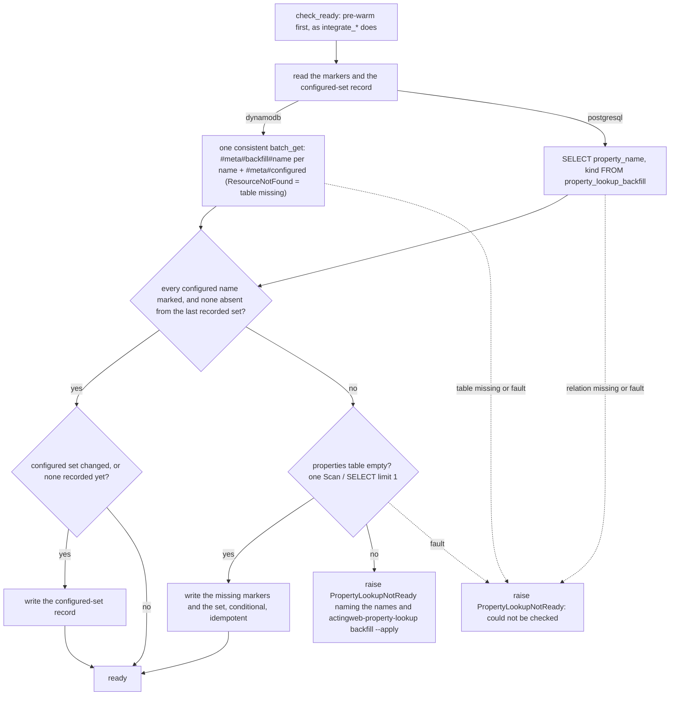
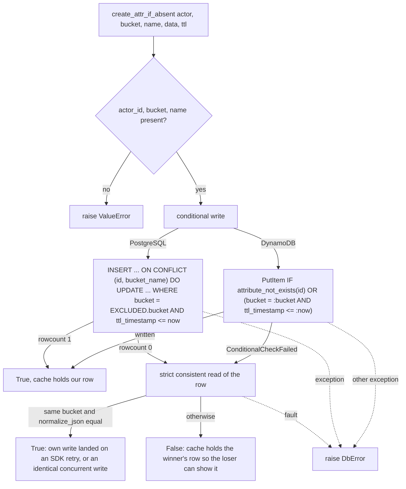

# Implementation Plan: One mode after the 3.16 upgrade, and the two consumer primitives

**Date:** 2026-11-01
**Feature:** thoughts/features/2026-11-01-single-mode-and-consumer-primitives.md
**Research:** thoughts/research/2026-11-01-single-mode-and-consumer-primitives.md
**Branch:** master (the work lands on one `release/3.16.0-single-mode-and-consumer-primitives` branch, one commit per phase, one PR opened after Phase 4; 3.16.0 is held untagged)

## Overview

After 3.16 an operator runs one library with one reverse-lookup mechanism and
creator uniqueness on, and a deployment whose data is not ready for either is
stopped by `check_ready()` with the command that makes it ready. The consumer
gets the two primitives it asked for: a stable error code on every SPA token
answer (`X-ActingWeb-Error` and a `code` body key) and an atomic
`create_attr_if_absent`. The minor-only small items (required auth config, glob
escapes, `-32700`, a truthful `/meta/actingweb/supported`) ride the same
release. Headline measure: zero deployments start with a lookup table or
`creators` table that is not ready; `check_ready()` raises, and a test pins
both refusals.

Registration expiry is **deferred to its own plan** (Decision 5): the research
found the hypothesis does not work as written, and this release keeps only its
free part (the trust-list walk at registration goes). The feature's "Smallest
version" and its success-measure row 2 therefore read against this plan's
Decisions Deferred, not against the feature text; the feature is a dated
snapshot and is not edited.

## Decisions Made

- **D1 PostgreSQL backfill**: a packaged maintenance command,
  `actingweb-property-lookup`, with `report`, `backfill`, `mark-complete` and
  `unmark` on both backends - `scripts/` is not in the wheel
  (`pyproject.toml:26-29`), so a PyPI deployment cannot run
  `scripts/backfill_property_lookup.py`; the refusal must name a command the
  operator has. The script stays as a shim.
- **D2 Lookup readiness rule**: a backfill-complete marker **per indexed
  name** on both backends, plus a record of the configured name set.
  DynamoDB keeps reserved rows `#meta#backfill#<name>` and one
  `#meta#configured` row in the v2 lookup table (its real keys are hex
  digests, so the keys cannot collide); PostgreSQL gets a marker table
  `property_lookup_backfill` through an Alembic revision (a marker row in
  `property_lookup` is impossible: `actor_id` is NOT NULL with an FK,
  `schema.py:91-101`; a per-name `EXISTS` on `properties` has no index to use
  and would scan the table on every cold start). Markers are written by
  `backfill --apply` for each name it completed cleanly, by `mark-complete
  --apply` (guarded, see Phase 1), and by the first start when the properties
  table is empty. The probe refuses when any configured name has no marker,
  or was absent from the last recorded configured set (a name dropped for a
  deploy and restored has unindexed values), and records the configured set
  on a pass when it changed. `check_ready()` runs the probe on both backends
  - today's probe refuses healthy deployments (any property row counts),
  gives them no way out, and never runs on PG. The marker is an operator
  assertion that the backfill ran for that name; D15 is what keeps the table
  consistent afterwards. (Refined from a single marker on 2026-11-01 after
  the failure-scenario pass and the outside-voice review; owner confirmed
  both refinements.)
- **D3 Config injection**: `DbProperty`/`DbPropertyList` require
  `indexed_properties` (no env fallback); table names stay frozen at import.
  The feature's "removes the import-time table-name reads" is **not**
  delivered - that is `thoughts/todo/dynamodb-known-next.md` item 5, a plan
  of its own. The removed surface fails **loudly** at configure time, as the
  feature's edge path asks: `with_legacy_property_index()` stays as a
  tombstone that raises, and `Config` refuses `USE_PROPERTY_LOOKUP_TABLE=false`
  and a `use_lookup_table` kwarg.
- **D4 Uniqueness default**: on, with no auto-enable - every fresh deployment
  runs start → `actingweb-unique-creators enable --apply` → start, as the demo
  does today; `with_unique_creator(False)` is the documented opt-out and the
  duplicate-tolerant code survives with it. Reverses the "next major" text in
  `CHANGELOG.rst:319-320`, `docs/migration/v3.16.rst:526` and the 2026-10-28
  plan, all unreleased. The asymmetry with D2's first-start marker write is
  deliberate: a wrong `AWS_DB_PREFIX` makes uniqueness skip real duplicates in
  the real tables, whereas lookup markers written under a wrong prefix land in
  the wrong, empty tables and the real tables stay unmarked and refused.
- **D5 Registration expiry**: deferred to its own plan (see Decisions
  Deferred). Only the trust-list walk at `client_registry.py:563-577` is
  removed here, and the research's findings are folded into the todo.
- **D6 Where an expired registration is rejected**: deferred with D5.
- **D7/D8 SPA error code**: `X-ActingWeb-Error: <code>` forwarded by name in
  both SPA translators next to `Retry-After`, exposed through CORS; the body
  gains a `code` key beside `error: true` (the `oauth_email.py` precedent);
  OAuth codes where they fit, library codes for the SPA-specific 401s. Every
  `_json_error` site carries one; `code` is a typed `Literal` so pyright
  refuses an unknown or missing code. Scope: the endpoints `OAuth2SPAHandler`
  serves and the fault handler's answers on SPA and `/oauth/*` paths; the
  client's rule is "a 401 that carries the header is the library's and final".
- **D9 `-32700` placement**: before auth, in the branch that already answers
  `-32600` for non-object bodies - the body is parsed before auth in both
  integrations, so "after auth" would mean two rules for malformed bodies.
  **Owner confirmed 2026-11-01; this reverses the feature's edge path and its
  rejected alternative "`-32700` pre-empting the 401"**, which were written on
  the premise that auth came first. An unauthenticated client with a
  well-formed body still gets the 401 challenge.
- **D10 Conditional-write faults**: only the new `create_attr_if_absent`
  raises `DbError` on a fault; `conditional_update_attr` and
  `delete_attr_conditional` keep False-on-fault, because
  `single_use.consume_once` (`single_use.py:158-187`), the shared consume step
  for SPA and MCP refresh tokens and auth codes, relies on it for its
  lost-acknowledgement recovery. The two contracts are documented side by
  side and the older one is **pinned by a fault-injection test** on both
  backends (it is pinned nowhere today).
- **D11 `create_attr_if_absent` semantics**: TTL-aware (an expired-but-present
  row counts as absent and is replaced in the same conditional write), a bucket
  guard (a cross-bucket key collision answers False and overwrites nothing),
  and a strict read-back on a lost condition that answers True when the stored
  row is JSON-equal (sorted keys, the CAS's `normalize_json` rule) to what
  this call wrote, so an SDK-retried create that landed is not reported as
  lost. Consequence, documented and tested: two callers writing identical data
  both win, so a caller that needs exactly one winner puts a per-call nonce in
  `data` (the `consume_id` pattern, `single_use.py:155-158`). On False the
  `Attributes` wrapper drops its cached entry for the name so the loser's
  next `get_attr(name)` reads the winner's row through (the wrapper calls
  only the protocol method, so a custom backend needs nothing beyond it).
- **D12 Glob escapes**: one engine - `glob_to_regex` becomes a scanner that
  honours `\*`, `\?` and `\\`, and the six `fnmatch` sites
  (`peer_permissions.py:210-212`, `handlers/callbacks.py:845,873,989,1026,1043`)
  use the same matcher, so a peer and the evaluator agree. The matcher must be
  **linear-time**: today's `.*` translation backtracks (measured: 12 `*`
  against 40 characters did not finish in 20 s) and the callbacks and
  peer-permission patterns are peer-supplied, so the regex uses atomic
  segments as `fnmatch.translate` does, and the compile cache is an LRU.
- **D13 Auth config**: `config` is a required **keyword-only** argument on
  `check_and_verify_auth`, its async variant and `Auth.__init__` (positional
  after defaulted parameters would be a `SyntaxError`); the
  `redirect_uri`-from-default-`fqdn` footgun at `config.py:214` is fixed in the
  same change. The import-time `Config()` default on `BaseHandler.__init__`
  (`base_handler.py:16`) goes with it (Phase 2, where the flip makes it
  dangerous).
- **D14 Option tags**: full audit against `docs/protocol/actingweb-spec.rst`
  "Option tags". Result (recorded here so Phase 4 has no open question):
  `sessions` out (no route); `onewaytrust` out (every trust creation posts the
  reciprocal, `actor.py:1280`; no one-way mode exists); `listproperties` in;
  `www` only when `config.ui` (`handlers/www.py:282,1021` 404 without it);
  `oauth` only when a provider is configured (`config.oauth_providers` or
  `config.oauth["client_id"]`); `callbacks`, `trust`, `subscriptions`,
  `subscriptionresync`, `subscriptionbatch`, `actions`, `resources`,
  `methods`, `nestedproperties`, `trustpermissions`, `mcp`,
  `permissioncallback`, `permissionquery` stay (implemented; the non-spec
  ones are read by peers); `callbackcompression` stays out (fanout *sends*
  gzip, `fanout.py:482`, but nothing decodes an inbound `Content-Encoding`),
  as do `proxy`, `subscriptionhealth` and `subscriptionstats` (no routes).
  `aw_supported` becomes a computed property so the conditional tags cannot
  go stale (`with_mcp()` at `app.py:576-577` skips the recompute today).
- **D15 Lookup sync fails closed** (added 2026-11-01 from the outside-voice
  review; owner confirmed): an indexed property write and its lookup row
  succeed or fail together on both backends. DynamoDB writes the property and
  the lookup row in one `TransactWrite` for indexed names; PostgreSQL stops
  swallowing the lookup insert's exception so the transaction rolls back. A
  fault raises `DbError` from the property write (the 3.16 fault contract:
  writes raise). A true collision (another actor holds the value) stays a
  logged, non-fatal outcome. Without this the per-name marker certifies a past
  backfill while a throttled PutItem (`dynamodb/property.py:448-476`, "accept
  eventual consistency") leaves a value with no lookup row forever - and the
  legacy GSI tier that masked it for GSI-cohort deployments is gone.
- **D16 Configured-set record** (added 2026-11-01; owner confirmed): the
  probe records the configured indexed-name set when it passes and refuses a
  configured name that was absent from the last recorded set until it is
  re-backfilled; one conditional write, only when the set changed. **No
  recorded set** (a deployment marked by `mark-complete` or by the 3.13
  backfill before this release) is not a refusal: the first passing probe
  records the current set. `backfill --apply` and `mark-complete --apply`
  record the set for the names they marked, so `report` never flags a gap
  the operator did not make.

## Decisions Deferred

- **Registration expiry design (D5) and the authorize/token rejection
  asymmetry (D6)**: deferred by the owner on 2026-11-01 to a plan of its own.
  It blocks the feature's "nothing in the MCP client registry outlives the
  tokens that justify it" outcome and its registry-growth success measure
  (row 2); nothing in this release depends on it. It must be made before the
  registry growth the consumer measured becomes an operational cost, or
  before CIMD support is taken up (which removes the need for most
  registrations). The outside voice also noted that the attribute purge
  covers only token buckets and that DynamoDB TTL enablement is unchecked;
  both belong to that plan.

## What We're NOT Doing

- **Registration expiry** - deferred (above); the free trust-list walk removal
  and a doc correction are the only touches.
- **Deprecation notice now, removal later** (re-argued by Codex as "simpler
  migration") - rejected by the owner in the feature ("the removal rides 3.16
  and the notice is unnecessary"); not reopened.
- **Splitting 3.16.0 into several releases, or one PR per phase** (the
  former re-argued by Codex) - the owner holds one 3.16.0 and chose the phase
  order; the phases are commits on one branch, reviewed locally, with one PR
  at the end (see Release).
- **Moving DynamoDB table names into `Config`** - plan-sized
  (`dynamodb-known-next.md` item 5); touches every model `Meta`, the harness
  freeze and the maintenance CLIs.
- **Auto-enabling uniqueness on an empty store** - rejected by D4; the
  `collect()` wrong-prefix hazard and PG DDL rights at startup.
- **Deleting the duplicate-tolerant adoption code** (ranking, sibling sweep,
  `SWEEP_LIMIT`, the recursive hand-off) - `with_unique_creator(False)`
  survives, so its code does; the feature keeps the opt-out.
- **Raising `DbError` from `conditional_update_attr` /
  `delete_attr_conditional`** - D10; it would rework `consume_once`.
- **Making `delete_expired` raise on a fault, or checking DynamoDB TTL
  enablement at startup** (outside voice) - storage-lifecycle items of the
  deferred registration-expiry plan; no consumer-visible failure today.
- **`X-ActingWeb-Error` on `auth.py`'s own 401s** (basic/Bearer rejections on
  actor routes) and on `/oauth/email` - those are peer/API or email-flow
  answers, not the SPA token endpoints the consumer's `isApi401` guards; the
  email endpoints already carry their own `code` on two sites.
- **Copying all handler headers in the SPA translators** - widens what the
  handler can leak onto SPA routes; forward by name instead.
- **Inbound gzip decoding so `callbackcompression` can be advertised** - no
  peer we serve sends compressed callbacks; advertising without decoding would
  be false, so the tag stays out.
- **Deriving `actions`/`methods`/`resources` from registered hooks** - the spec
  wording is "the path is available", and the paths exist for every app (a
  missing hook answers 404); deriving would mis-advertise an app that
  registers hooks after `integrate_*`.
- **A `/sessions` route and hook** - needs the session-model decision; its
  todo keeps that half.
- **The NFC/NFD half of `glob-backslash-escape.md`** - a normalisation and
  storage-migration question, not an escape rule; it stays as its own todo.
- **MCP batch receive, dual-era, CIMD, RFC 8707, `prop#`/`list#` keys,
  `ListAttribute` port, resumable deletion** - out of scope per the feature.
- **The consumer's halves** - API Gateway exposed headers, `isApi401`, the
  unlock-ask rewrite; they follow the pin.
- **Editing the feature document or the 2026-10-28 plan** - both are dated
  snapshots; this plan records what it reverses (D4, D9) and defers (D5).

## What Already Exists

- `actingweb/interface/app.py:29-31, 1618-1644` - `UniqueCreatorNotReady` and
  `_check_unique_creator_ready`: the once-per-instance, fault-refuses,
  absence-refuses-with-the-command shape. Phase 1 copies it for the lookup
  check and gives both a `StoreNotReady` base.
- `actingweb/maintenance/unique_creators.py:143-160, 274-287, 345-350,
  866-871, 964-984, 992-1015` - the command's own `Config`, the consistent
  marker read, the wrong-prefix refusal, "collisions leave the marker
  unwritten", `missing_enforcement`, and the subparser/`--apply` CLI shape.
  Phase 1's command and probe reuse each pattern.
- `scripts/backfill_property_lookup.py` - the segment scan, rate limiter,
  checkpoint and collision logic. Phase 1 moves it into the package rather
  than rewriting it, and fixes its fault-as-collision classification.
- `actingweb/db/dynamodb/property_lookup.py:97-113` - `is_missing_resource`;
  the probe reuses its `ResourceNotFound` arm (not the `ValidationException`
  arm) instead of `DescribeTable`.
- `actingweb/db/protocols.py:447-472` and `dynamodb/property.py:601-621`,
  `postgresql/property.py:623-654` - `create_if_not_exists`, the
  True/False/`DbError` conditional-create model Phase 3 copies, including the
  `PutError.cause_response_code == "ConditionalCheckFailedException"` check.
- `actingweb/db/dynamodb/attribute.py:322-327` - `normalize_json`, a nested
  closure today; hoisted to module level and reused by the read-back.
- `actingweb/handlers/oauth_email.py:122-127, 600` - the `code` body key
  precedent Phase 3 generalises.
- `actingweb/handlers/oauth2_spa.py:135-174` and
  `interface/integrations/_errors.py:26-39, 78-90, 179-201` -
  `spa_cors_headers`, the string `error` codes of the fault bodies,
  `db_error_answer`, `error_cors_headers`: extended, not duplicated. Both
  `_db_error_response`s already copy the headers `db_error_answer` returns.
- `actingweb/handlers/mcp.py:861-888` - `_reject_non_object_body`, the
  pre-auth 400 branch Phase 4 extends for the parse-error sentinel.
- `actingweb/permission_evaluator.py:669-709` - `_matches_pattern`'s
  shortcuts and compiled cache, kept behind the new module-level matcher.
- `tests/test_demo_example.py:28-39` - the `missing_enforcement` monkeypatch
  Phase 1's conftest fixture generalises.
- `tests/integration/conftest.py:1160-1198` - `unique_creator_store`,
  `fresh_store`, `enforced_store`, `unique_creator_app` on an isolated prefix;
  Phase 2's integration test uses them.
- `tests/integration/test_harness.py:32, 63` - already insulated with an
  explicit `unique_creator=False`.

---

## Phase 1: One reverse-lookup mechanism, a packaged backfill, a definite readiness check

Removes the legacy GSI, the v1 lookup tier, the PostgreSQL scans and the
`use_lookup_table` surface (loudly); makes `indexed_properties` injection
mandatory on the property accessors; makes the lookup-row sync fail closed;
ships the backfill as an installed command on both backends; and turns the
startup log into a `check_ready()` refusal shaped like `UniqueCreatorNotReady`.

**State at this phase's commit:** uniqueness is still off by default, so a
fresh app still starts without `enable --apply`; the Phase 1 tests say
`with_unique_creator(False)` explicitly and name Phase 2 in a comment, so the
Phase 2 commit's diff shows only the flip and the history bisects cleanly.

### Changes

- `actingweb/db/dynamodb/property.py` - delete `PropertyIndex` (`:24-33`) and
  `PropertyLegacy` (`:77-98`); `DbProperty.__init__` (`:141-173`) and
  `DbPropertyList.__init__` (`:737-769`) take `*, indexed_properties: list[str]`
  (keyword-only, required; `TypeError` without it) and lose `use_lookup_table`
  and both env reads; `_should_index_property` (`:187-191`) drops the mode
  gate; `_get_actor_id_from_property` (`:258-366`) keeps only the v2 tier
  (`get_v1`, the name-filtered GSI and the value-only branches go);
  `ensure_table(Property)` always; the list-delete gate goes. **D15:** the
  indexed write path (`set()` → `_update_lookup_entry`, `:442-476`) becomes
  one `TransactWrite` (property put, conditional lookup create, and the old
  lookup row's delete when the value changed) for indexed names; a
  `TransactionCanceledException` whose only failed condition is the lookup
  create (another actor holds the value) falls back to today's sequence -
  delete the actor's old lookup row when the value changed, then the plain
  property write - and logs `LOOKUP_COLLISION` as today; any other failure
  raises `DbError("property set")`. Non-indexed names are unchanged. The
  unchanged-value shortcut (`:452-453`) stays - with the transaction a
  property with a value can no longer lack its row.
- `actingweb/db/dynamodb/property_lookup.py` - delete the v1 `PropertyLookup`
  model (`:74-89`) and `get_v1` (`:169-193`); keep `is_missing_resource`
  (`:97-113`) and split out `is_resource_not_found` (the `ResourceNotFound`
  arm only) for the probe. Add `LOOKUP_BACKFILL_PREFIX = "#meta#backfill#"`,
  `LOOKUP_CONFIGURED_KEY = "#meta#configured"`, and **module-level** (no
  `ensure_table`, so a missing table is reported, not created)
  `read_readiness(names) -> tuple[set[str], set[str] | None]` (one consistent
  `batch_get` of the per-name markers and the configured-set row; the marker
  rows carry `actor_id="#meta"` and the set row carries the names in
  `property_name`; `ResourceNotFound` → `DbError("lookup table missing")`,
  any other fault → `DbError`; needs no `DescribeTable`, so the
  auto-create-off IAM set at `docs/reference/database-backends.rst:377-383`
  gains only `PutItem`/`BatchGetItem` on the v2 table), `mark_backfilled(names)`
  and `unmark(names)` (conditional put / delete per name; a lost condition is
  success - two first starts racing write one row), and
  `record_configured(names)` (unconditional put of the set). `create()`
  (`:247-257`) stops folding a fault into `False`: a
  `ConditionalCheckFailedException` is the collision (`False`), any other
  `PutError` raises `DbError` - the backfill and the D15 path both depend on
  telling the two apart.
- `actingweb/db/postgresql/property_lookup.py` (the class lives here, `:11`,
  not in `property.py`) - the same four module-level functions over the new
  table: `SELECT property_name, kind FROM property_lookup_backfill` (a missing
  relation - migration not run - and any other fault raise `DbError`),
  `INSERT ... ON CONFLICT DO NOTHING`, `DELETE`, and the set row (`kind =
  'configured'`, the names joined), so the probe in `app.py` has one shape.
- `actingweb/db/postgresql/schema.py` and a new Alembic revision after
  `e5f6a7b8c9d0` in `actingweb/db/postgresql/migrations/versions/` - table
  `property_lookup_backfill (property_name VARCHAR(255) NOT NULL, kind
  VARCHAR(16) NOT NULL DEFAULT 'name', completed_at TIMESTAMPTZ NOT NULL,
  PRIMARY KEY (property_name, kind))`; downgrade drops it. The PG test
  fixtures run `alembic upgrade head` per worker
  (`tests/integration/conftest.py:427`), so they pick it up; `_isolated_store`
  wipes it with the other tables.
- `actingweb/db/postgresql/property.py` - same constructor change (`:54-80`,
  `:804-832`); gate (`:94-98`); delete the `(name, value)` scan (`:198-226`)
  and the value-only branch (`:257-283`); list-delete gate (`:965`). **D15:**
  the `except` at `:413-419` that logs `LOOKUP_TABLE_SYNC_FAILED` and lets
  `set()` commit the property goes; the exception propagates, the transaction
  rolls back, and `set()` raises `DbError`. The `rowcount == 0` collision
  warning (`:404-411`) stays non-fatal. Confirm at implementation that the
  property insert and the lookup insert run on one connection inside one
  transaction (`:330-353`, helper `:367-419`); if they do not, make them.
- `actingweb/config.py` - delete `use_lookup_table` (`:101-109`) and its env
  override (`:337-340`); before the blind kwargs loop (`:320-321`), refuse:
  `USE_PROPERTY_LOOKUP_TABLE` set to a false value or a `use_lookup_table`
  kwarg of `False` raises `RuntimeError` naming `docs/migration/v3.16.rst`
  "One reverse-lookup mechanism" and `actingweb-property-lookup`; a true value
  or `use_lookup_table=True` logs a `DeprecationWarning` and is ignored
  (`CLAUDE.md` told operators to set it). `indexed_properties` and
  `INDEXED_PROPERTIES` stay (the config-level env read is the one supported
  source).
- `actingweb/db/__init__.py` - `get_property`/`get_property_list` pass
  `indexed_properties=config.indexed_properties` only (`:88-91, 112-115`).
- `actingweb/interface/app.py` - delete `_use_lookup_table` (`:105-111,
  219-227, 1458-1465`); `with_legacy_property_index()` (`:473-495`) becomes a
  tombstone that raises the same `RuntimeError` as `Config` (removed at the
  next major, said in its docstring); pre-warm calls
  `required_models(bool(config.unique_creator))` (`:1527-1529`); replace
  `_check_lookup_backfill_needed` (`:1545-1599`) with
  `_check_property_lookup_ready()` (the flow above; once per instance like
  `_unique_creator_checked`; an empty `indexed_properties` passes without any
  read; the properties-empty test is `Property.scan(limit=1)` /
  `SELECT 1 FROM properties LIMIT 1` and runs only on the refusing branch).
  `check_ready()` runs `_prewarm_dynamodb_tables()` first (today only
  `integrate_*` does, so a standalone `check_ready()` on a fresh store hit
  `ResourceNotFound`), then **both** probes, and raises one exception: the
  specific subclass when one refuses, `StoreNotReady` listing both messages
  when both do, so an operator runs both commands in one deploy window.
  `integrate_flask`/`integrate_fastapi` call `check_ready()`. Add
  `class StoreNotReady(RuntimeError)` with `UniqueCreatorNotReady(StoreNotReady)`
  (unchanged name, so existing `except` clauses keep working) and
  `PropertyLookupNotReady(StoreNotReady)`; the lookup message lists the
  unmarked or dropped names, `actingweb-property-lookup report` and
  `backfill --apply`, the migration guide section, and the escape hatch
  `with_indexed_properties([])` for a deployment that never uses reverse
  lookup; the "could not be checked" variant names the table or relation and
  the connection or permission to fix. The uniqueness message, when the actor
  table is empty, says "no actors yet: run 'actingweb-unique-creators enable
  --apply' and start again" instead of the three-command sequence.
- `actingweb/interface/__init__.py` - export `StoreNotReady` and
  `PropertyLookupNotReady` (`:15, 46`).
- `actingweb/db/verify_tables.py` - delete `lookup_mode_enabled` (`:43-53`),
  the mode parameter (`:56-107`; `PropertyLookupV2` always required),
  `--lookup-table`/`--legacy` (`:162-175`) and the mode print (`:207-213`).
  `tests/test_cold_start_budget.py:169` keeps `len(models) == 9` (lookup mode
  already counted `PropertyLookupV2`); state it in the test's comment.
- `actingweb/maintenance/property_lookup.py` (new) - `main(argv=None)` with
  `prog="actingweb-property-lookup"` and subcommands, dry-run by default with
  `--apply` on every writer (the `unique_creators.py:992-1015` shape):
  - `report`: per configured name, whether property rows with that name
    exist, how many lookup rows exist (excluding `#meta` rows), the marker
    state and the recorded set; exit 1 when the probe would refuse. On
    DynamoDB the property-row count is a rate-limited scan (an operator tool,
    not a startup probe).
  - `backfill [--apply] [--properties] [--rps] [--read-rcu] [--segments]
    [--checkpoint-file]`: DynamoDB - the segment scan, write rate limit,
    checkpoint and collision logic moved from `scripts/backfill_property_lookup.py`,
    plus `scan(rate_limit=--read-rcu)` (today the scan is unthrottled; `--rps`
    bounds writes only, `:159-172`), and a `PutError` that is not a
    conditional failure is a **fault** - the page is not checkpointed and the
    segment retries - not a collision (`:177-183` folds both into
    `stats.collision`, which then checkpoints the segment "done" and the row
    is never rewritten). PostgreSQL - keyset batches on `id` (the leading PK
    column, `schema.py:73`, so each batch is index-bounded) of `INSERT INTO
    property_lookup (property_name, value, actor_id) SELECT p.name, p.value,
    p.id FROM properties p JOIN actors a ON a.id = p.id WHERE p.name = ANY(%s)
    AND p.id > %s ORDER BY p.id LIMIT %s ON CONFLICT DO NOTHING` (the JOIN
    skips orphaned property rows, which would otherwise fail the FK and abort
    the statement), one commit per batch, then one collision `SELECT ... JOIN`
    for the rows `ON CONFLICT` skipped whose stored actor differs. Markers:
    each name is marked only when its pass completed with no fault and no
    collision; the configured set is recorded after the last name.
  - `mark-complete [--apply] [--properties] [--force]`: writes the markers
    without a backfill, for deployments that already ran the 3.13 backfill.
    **Guarded:** it runs `report`'s per-name check first and refuses a name
    that has property rows and zero lookup rows unless `--force` (marking by
    hand is the one misconfiguration that would make `check_ready()` pass
    while lookups miss).
  - `unmark [--apply] [--properties]`: removes a name's marker (the rollback
    and the step before dropping a name from the indexed set).
  Indexed names come from `Config().indexed_properties` (so
  `INDEXED_PROPERTIES` applies) or `--properties`. Backend from
  `DATABASE_BACKEND`, as `unique_creators.make_config` does (`:143-160`).
  Refuses to run when the actor or properties table does not exist (wrong
  prefix must not read as empty, the `collect()` rule at
  `unique_creators.py:345-350`).
- `pyproject.toml` - `actingweb-property-lookup =
  "actingweb.maintenance.property_lookup:main"`; regenerate
  `docs/requirements.txt` in the same commit (CLAUDE.md rule).
- `scripts/backfill_property_lookup.py` - becomes a shim: prints a one-line
  pointer and calls `property_lookup.main(["backfill", ...])`, mapping the
  script's opt-in `--dry-run` (`:197`) to the command's default and its
  absence to `--apply`, and the segment/rate/checkpoint flags one to one, so
  documented invocations keep working.
- `examples/demo/application.py:85-87` - remove `.with_legacy_property_index(...)`.
- `CLAUDE.md` "Property Reverse Lookup" - rewrite: one mechanism, no
  `USE_PROPERTY_LOOKUP_TABLE`/`with_legacy_property_index`, the readiness
  refusal and the command.
- `tests/conftest.py` - an autouse fixture for the shared `test` prefix that
  marks the default indexed names and records the set once per session (or
  stubs `_check_property_lookup_ready`), because the shared tables hold
  properties from earlier runs and would otherwise refuse every `integrate_*`
  in the ten unit-test files that call it (`test_demo_example.py`,
  `test_email_verification_legacy_route.py`, `test_mcp_quickstart.py`,
  `test_spa_token_retry_after.py`, `test_flask_factory_fallback.py`,
  `test_db_fault_http.py`, `test_fastapi_template_response.py`,
  `test_db_fault_fifth_pass.py`, `test_db_fault_third_pass.py`,
  `test_oauth2_logout_mcp_tokens.py`). Phase 2 extends the same fixture.
- Docs: `docs/quickstart/configuration.rst:455-493, 557-579` (one mode; the
  refusal; the command; the configure-time refusal of the old flag);
  `docs/reference/database-backends.rst:410-478` (both backends; the per-name
  marker rows, the configured-set record and the PG marker table; the marker
  is an operator assertion - data copied into a store by a tool, not written
  through the library, needs `backfill --apply` after the copy; `PutItem`/
  `BatchGetItem` on the v2 table next to the uniqueness IAM note at
  `:377-383`; the D15 transaction cost: an indexed property write is one
  `TransactWriteItems` of up to three items, so about 2x the write units of a
  plain put, on indexed names only); `docs/guides/database-maintenance.rst:69`
  (v1 table can be dropped; the new command; run `backfill` off-peak on a
  large PostgreSQL table); `docs/contributing/architecture.rst:490-494`
  ("Avoid Direct Instantiation" names `indexed_properties`);
  `docs/migration/v3.16.rst` new section "One reverse-lookup mechanism" (what
  was removed, the configure-time refusal, the startup refusal text,
  `report`/`backfill --apply`/`mark-complete --apply`/`unmark`, dropping the
  `property-index` GSI and the v1 table, the PG migration and backfill, the
  D15 behaviour change, the constructor change under "Custom database
  backends"); `docs/migration/index.rst` 3.16 row summary.
- `CHANGELOG.rst` Unreleased - REMOVED: legacy reverse lookup, the v1 table
  tier, `USE_PROPERTY_LOOKUP_TABLE`, the `--legacy` flag;
  `with_legacy_property_index()` now raises; CHANGED **Breaking:**
  `DbProperty`/`DbPropertyList` require `indexed_properties` (custom backends
  and direct constructors); **Breaking:** custom `DbPropertyLookup` backends
  gain the four readiness functions; **Behavior change:** an indexed property
  write whose lookup row cannot be written fails with `DbError` (503) instead
  of succeeding with a logged error; **Behavior change:** `check_ready()` and
  `integrate_*` raise `PropertyLookupNotReady`, and `check_ready()` pre-warms
  and reports both refusals at once as `StoreNotReady` - an application that
  catches only `UniqueCreatorNotReady` today should catch `StoreNotReady`,
  or the combined refusal escapes it; ADDED: `actingweb-property-lookup`,
  `StoreNotReady`, `PropertyLookupNotReady`.
- Tests touched: the 69 direct `DbProperty(`/`DbPropertyList(` constructions
  in 13 files get `indexed_properties=` (`DbPropertyLookup()` takes no
  argument and is unchanged): `tests/test_property_lookup.py` (21, and the
  legacy-mode cases removed), `tests/test_v2_cost_plain_property_partition.py`
  (15), `tests/performance/test_backend_performance.py` (8),
  `tests/test_property_lookup_v2.py` (7; `TestV1Fallback` removed),
  `tests/test_db_fault_contract.py` (5), `tests/test_scan_to_query.py` (5),
  `tests/test_db_property_get_prefix.py` (2), `tests/test_db_protocols.py:62,68`
  (the protocol-compliance construction), `tests/test_v2_consistent_read.py:201`,
  `tests/test_property_list_integrity.py`, `tests/integration/test_db_property_handle.py:14`,
  `tests/integration/_isolated_store.py:40-54`; `tests/test_lookup_migration.py`
  (`TestV1CohortFallback`, `TestGsiCohortFallback`, `TestStartupCheck`,
  `TestDefaultFlip` removed; `TestBackfillScript` becomes `TestBackfillCommand`
  against the maintenance module, keeping `main(argv=None)` so the
  `sys.argv`-driven cases at `:156-159` still work);
  `tests/test_verify_tables.py`; `tests/test_conditional_gsi_schema.py`
  (legacy-shape cases removed); `tests/test_billing_mode.py`;
  `tests/test_cold_start_budget.py`.
- Thoughts: delete `thoughts/todo/legacy-property-gsi-removal.md` and its
  `INDEX.md` row; the `prop-list-key-prefix-scheme.md` row drops "Sequence
  after the legacy-GSI removal"; `dynamodb-known-next.md` item 5 stays and
  its item "lookup-table write amplification" gains the D15 transaction.

### New Tests, both unit and integration tests

- Unit, both backends: `DbProperty()` / `DbPropertyList()` without
  `indexed_properties` raise `TypeError` naming the argument;
  `USE_PROPERTY_LOOKUP_TABLE=false` makes `Config()` raise `RuntimeError`
  with the migration pointer, `=true` warns and is ignored;
  `Config(use_lookup_table=False)` raises; `with_legacy_property_index(True)`
  and `(False)` raise the same; `Config` has no `use_lookup_table` attribute.
- Unit, D15 (both backends): an indexed property write whose lookup write is
  made to fault (DynamoDB: `transact_write_items` raising a non-cancellation
  error; PostgreSQL: the lookup insert raising) raises `DbError` and leaves
  **no property row** (DynamoDB: the transaction did not commit; PostgreSQL:
  rolled back); a collision (another actor holds the value) still writes the
  property and logs `LOOKUP_COLLISION`; a non-indexed write is a plain put
  (spy: no transaction); the value-unchanged shortcut still skips the sync.
- Unit, DynamoDB: a reverse lookup with no v2 row answers `None` and makes
  exactly one `GetItem` (spy on `PropertyLookupV2.get`; no `Property.scan` or
  `query`).
- Unit, readiness (both backends, parametrised): `check_ready()` raises
  `PropertyLookupNotReady` when properties exist and a configured name has no
  marker, and the message lists that name, the command and
  `with_indexed_properties([])`; passes when every configured name is marked
  and records the set (a second start with the same set writes nothing -
  spy); markers present but no recorded set (the `mark-complete` or 3.13
  state) passes and records the set; passes on an empty properties table
  **and** writes the missing
  markers and the set; adding a name after the markers exist refuses until
  that name is marked; a name marked, dropped from the configured set for one
  passing start, and restored refuses until re-marked (D16);
  `with_indexed_properties([])` passes without reading the store (spy); a
  missing v2 table (DynamoDB `ResourceNotFound`) or a missing
  `property_lookup_backfill` relation raises "could not be checked" naming
  it, with auto-create **off** in the test so nothing creates the table
  underneath; a read fault raises the same; two concurrent first starts both
  pass; it runs once per instance; an app missing both lookup markers and
  uniqueness enforcement (with the flag on) raises `StoreNotReady` whose
  message carries both refusals, and `except UniqueCreatorNotReady` still
  catches the single-refusal case; a standalone `check_ready()` on a fresh
  store with auto-create on passes (it pre-warms).
- Unit, command (both backends): `report` exits 1 and lists unmarked or
  dropped names and excludes `#meta` rows from counts; `backfill` dry-run
  writes neither rows nor markers; `backfill --apply` writes the rows, then
  the marker per name, then the set; a collision on one name leaves that
  name unmarked and exits 1 while the others are marked; a DynamoDB throttle
  during a page is retried and reported as a fault, never as a collision, and
  the page is not checkpointed; a second run is idempotent; the PostgreSQL
  insert skips orphaned property rows (no actor) and reports them; batches
  commit independently (a fault in batch 3 leaves batches 1-2 committed and
  the name unmarked); `mark-complete --apply` refuses a name with property
  rows and zero lookup rows, marks it with `--force`, and is idempotent;
  `unmark --apply` removes a marker and the next probe refuses;
  `--properties` restricts every subcommand; a missing actor/properties table
  refuses (wrong prefix); the shim maps `--dry-run`/absence to the command's
  dry-run/`--apply`.
- Integration (both backends through the harness, with the explicit
  `unique_creator=False` the harness already defaults to, comment naming
  Phase 2): an app on a fresh isolated prefix starts twice without refusal;
  an app whose store has indexed properties but no lookup rows (seeded
  directly) refuses with `PropertyLookupNotReady`, `backfill --apply` runs
  through `maintenance.property_lookup.main`, the app starts and
  `ActorInterface.get_by_property` resolves every seeded value.
- `tests/test_verify_tables.py`: `required_models(unique_creator)` always
  lists `PropertyLookupV2`; the CLI no longer accepts `--legacy`.

### Failure Scenarios

- Probe read on DynamoDB - the role lacks `BatchGetItem` on the v2 table, or
  the table is missing with auto-create off - `DbError` →
  `PropertyLookupNotReady` "could not be checked" naming the table; covered
  by the missing-table and read-fault tests. Loud, not silent.
- First-start marker write - two processes start on an empty store at once -
  one conditional put wins, the other's lost condition is treated as success;
  covered. A `PutItem` permission failure raises "could not be checked"
  (test).
- Wrong `AWS_DB_PREFIX` with auto-create on - the pre-warm creates empty
  tables under the wrong prefix and the probe marks them; the real tables
  stay unmarked and are refused when the prefix is fixed. Accepted in D4's
  text; the migration guide says so.
- Operator adds an indexed name after the markers exist - that name's values
  have no lookup rows - the probe refuses naming the name; covered. Operator
  drops a name for a deploy and restores it - D16 refuses it; covered.
- Lookup-row write throttled during a property write (D15) - the property
  write fails with `DbError`, the caller answers 503 and retries; covered by
  the fault-injection test. Before D15 this was a permanent silent miss.
- Backfill crashes mid-run on DynamoDB - the checkpoint resumes, a page with
  a fault is not checkpointed, the marker is written only on a clean
  completion; covered by the throttle and collision tests. On PostgreSQL each
  batch commits alone and the name is marked only after the last batch; a
  crash leaves the name unmarked and the next run redoes it idempotently.
- Backfill run with a stale `INDEXED_PROPERTIES` or wrong `AWS_DB_PREFIX` -
  the wrong-prefix case refuses (missing table); a stale name list marks
  only the names it ran for, and the app's probe refuses on the rest (test:
  `--properties` subset leaves the others unmarked).
- `mark-complete` on a name whose values were never backfilled - refused
  unless `--force`; covered. `--force` is the operator's explicit assertion.
- Data copied into a store by a tool after the markers exist - not
  detectable at startup; the guide says to run `backfill --apply` after the
  copy, and `report` shows the per-name drift.
- PostgreSQL migration not run before deploy - the probe's `SELECT` hits a
  missing relation → "could not be checked" naming
  `property_lookup_backfill` and `alembic upgrade head`; covered.
- A large PostgreSQL `properties` table - each batch is PK-bounded and
  commits alone, so `DbProperty.set()`'s own `ON CONFLICT` inserts and actor
  deletes wait at most one batch; the guide says to run it off-peak.
- A direct `DbProperty()` constructor in an application - `TypeError` at the
  call site naming `indexed_properties`; covered.
- `scripts/backfill_property_lookup.py` run from an old runbook - the shim
  delegates and prints the new command; covered.

### Verification

- [ ] Run the contract's `### Checks` fast tier verbatim
- [ ] `grep -rn "PropertyLegacy\|PropertyIndex\|get_v1\|use_lookup_table\|USE_PROPERTY_LOOKUP_TABLE\|LOOKUP_TABLE_SYNC_FAILED" actingweb tests docs examples CLAUDE.md` shows only the tombstone checks in `config.py`/`app.py`, their tests, `CHANGELOG.rst` and the historical `docs/migration/v3.13.rst`
- [ ] `poetry run actingweb-property-lookup --help` lists the four subcommands; `poetry run python scripts/backfill_property_lookup.py --dry-run` delegates
- [ ] `cd actingweb/db/postgresql/migrations && poetry run alembic upgrade head && poetry run alembic downgrade -1 && poetry run alembic upgrade head` against the test container succeeds
- [ ] Manual: the demo in local QA mode (CLAUDE.md "App") starts on a fresh prefix without a lookup refusal; seeding a property with an indexed name directly and running `unmark --apply` for that name makes the next start refuse with the command named

### Implementation Status: Not Started

---

## Phase 2: Creator uniqueness on by default

Flips the default, keeps the opt-out, moves every test that relied on the
default off to say so, removes the `DescribeTable` the readiness check would
otherwise add to every cold start, and makes every first-run path tell the
operator the enable step.

**State at this phase's commit:** a fresh app refuses its first start until
`enable --apply` runs; Phase 1's "starts twice" tests already carry the
explicit opt-out.

### Changes

- `actingweb/config.py:89` - `self.unique_creator = True`.
- `actingweb/interface/app.py:84` - `self._unique_creator = True`;
  `with_unique_creator()` docstring (`:537-541`) and `check_ready()` docstring
  say the default is on and `with_unique_creator(False)` is the opt-out.
- `actingweb/maintenance/unique_creators.py` - `make_config()` (`:143-160`)
  unchanged (already pins `False` with the reason; its docstring gains "now
  that the library default is on"). `backfill_complete()` (`:274-287`) and
  `missing_enforcement()` (`:964-984`) stop calling `Creator.exists()`
  (`DescribeTable`, twice per cold start once the default is on - the cost
  class `tests/test_cold_start_budget.py` guards against) and classify
  `ResourceNotFound` on the consistent `GetItem` of `#meta#backfill` as
  "table missing" (the Phase 1 pattern), so the IAM sentence at
  `docs/quickstart/configuration.rst:239-241` ("with auto-create off both can
  be dropped") stays true for a default deployment.
- `actingweb/handlers/base_handler.py:16` - the import-time default
  `config: Config = Config()` becomes `config: Config | None = None` with a
  `ValueError` when missing: with the flip, that default would build an
  **enforced** handler that never ran `check_ready()`
  (`DbActor(unique_creator=True)` auto-creates an empty `creators` table,
  `dynamodb/actor.py:575-576`, and an enforced create then claims a creator
  an existing actor holds). Every library construction passes a config
  (`flask_integration.py`, `fastapi_integration.py`; verify by grep); the
  tests that relied on the default pass one.
- `actingweb/db/verify_tables.py:176-183` - `--unique-creator` becomes the
  default with `--no-unique-creator` as the opt-out, so the operator CLI lists
  `<prefix>_creators` for a default deployment.
- `examples/p2p_quickstart.py` and `examples/mcp_quickstart.py` - module
  docstrings gain the first-run sequence (start → `actingweb-unique-creators
  enable --apply` → start) and the opt-out line.
- `examples/demo/README.md:68-73` - unchanged sequence; the comment says it is
  the sequence for every fresh deployment, not only the demo.
- Docs: `docs/guides/p2p-quickstart.rst:109-115` and
  `docs/guides/mcp-quickstart.rst:67` "Run It" blocks (they `literalinclude`
  code sections, not the docstrings, so the sequence must be in the page
  text); `docs/quickstart/getting-started.rst:186, 205` (explicit call stays
  as an example of the opt-out; a "First run" paragraph with the sequence);
  `docs/quickstart/configuration.rst:43` (default `True`), `:238-241` (the
  IAM set including `<prefix>_creators` and `ConditionCheckItem` is the
  default set; the opt-out needs neither; `DescribeTable` still droppable);
  `docs/reference/security.rst:89-90` (on by default; the limitations clause
  becomes the opt-out case); `docs/guides/authentication.rst:1039-1047, 1340`
  (examples drop the redundant call or keep it with a comment);
  `docs/reference/database-backends.rst:190-215` "Cost Analysis" (one
  sentence: an actor create, delete or creator change costs about 4-6 write
  units by default) and `:546-573` (default, not "under
  `with_unique_creator()`"); `docs/migration/index.rst:49` and
  `docs/migration/v3.16.rst:526` ("The flag stays off by default" → "on by
  default; Step 0 applies to every deployment with existing actors;
  `with_unique_creator(False)` keeps the duplicate-tolerant path"); Step 0
  gains the fresh-deployment two-start note and the shorter "no actors yet"
  refusal.
- `CHANGELOG.rst:319-320` - rewrite the "stays off by default … next major"
  sentence; a new CHANGED entry: **Behavior change:** `unique_creator`
  defaults to on - a deployment with duplicate creators refuses to start with
  `UniqueCreatorNotReady` until `report`/`resolve --apply`/`enable --apply`
  run, or it opts out; a fresh deployment needs `enable --apply` after its
  first start; the consumer-visible shifts listed in the research (403 on a
  held creator at `POST /`, 409 on `PUT /trust/trustee`, 503 on `UNKNOWN`,
  the IAM and WCU costs) move from "with the flag on" to the default;
  **Breaking:** `BaseHandler` requires `config`; `verify_tables` assumes
  uniqueness unless `--no-unique-creator`.
- Tests: `tests/test_unique_creator_default.py:14-20` pins `True` on both
  and names this plan; `tests/test_config.py:29`, `tests/test_actingweb_app.py:49`
  flip; `tests/_adoption_helpers.py:30-40` `make_config()` passes
  `unique_creator=False` explicitly (the adoption suite tests the opt-out
  path and says so in a comment) - the 25 importing files are unchanged;
  `tests/integration/test_factory_squat_adoption.py:26` likewise;
  `tests/integration/test_harness.py:32` keeps its explicit default
  (comment: the shared `test_w0_` tables hold deliberate duplicates). The
  Phase 1 conftest fixture gains a `missing_enforcement` stub (the
  `test_demo_example.py:28-39` shape) for the ten `integrate_*` files, which
  test neither readiness nor enforcement; the files that test the enforced
  path (`test_demo_example.py`) keep their own. **Direct `Config(` tests with
  fixed creators** on the shared, never-wiped `test` prefix
  (`tests/conftest.py:22`) get an explicit `unique_creator=False` - the
  default would make them race across xdist workers or fail on the *second*
  run with `CreatorTaken` (`"system"` is not exempt, `creator_rules.py:22`,
  and two of these files never delete): `test_bulk_list_update_handles.py`,
  `test_list_item_limits.py`, `test_property_list_batch_delete.py`,
  `test_v2_cost_library_callers.py` (`tester@example.com`),
  `test_conditional_update_attr.py`, `test_trust_registry_integration.py`,
  `test_trust_type_registry.py`, `test_adoption_fourth_iteration.py`
  (`system`); then the suite is run **twice** against one prefix as the
  audit of the remaining `Config(` sites.
- Thoughts: delete `thoughts/todo/unique-creator-default-on-next-major.md`
  and its `INDEX.md` row (section 3). Its "what is deleted with it" list does
  not apply (the opt-out survives); `unique-creator-small-followups.md` is
  unchanged.

### New Tests, both unit and integration tests

- `Config().unique_creator is True`; `ActingWebApp(...).get_config().unique_creator
  is True`; `with_unique_creator(False)` turns it off and `check_ready()` then
  does nothing for uniqueness (no store access, asserted with a spy on
  `missing_enforcement`).
- With the default and `missing_enforcement` monkeypatched to report absence,
  `integrate_fastapi` and `integrate_flask` raise `UniqueCreatorNotReady`
  whose message names `report`, `resolve --apply`, `enable --apply` and the
  opt-out; with an empty actor table the message is the short "no actors
  yet" form.
- `missing_enforcement()` and `backfill_complete()` make no `DescribeTable`
  call (extend `tests/test_cold_start_budget.py`'s control-plane spy); a
  missing `creators` table is still reported as absence.
- `BaseHandler(...)` without `config` raises `ValueError` naming it.
- Both quickstart examples import and build their app (without integrating
  against a store) - a smoke test that the default does not break
  construction.
- Integration (both backends) with the existing `fresh_store` fixture
  (`tests/integration/conftest.py:1180`): a harness app built with the
  **default** on that prefix refuses its first start, `enable --apply` runs
  through `maintenance.unique_creators.main(["enable", "--apply"])`, and the
  second start serves a `POST /` and refuses a second `POST /` for the same
  creator with 403 (the consumer-visible default behaviour, pinned once).
- `tests/test_demo_example.py` still passes (the demo already sets the flag).

### Failure Scenarios

- A deployment upgrades with the flag unset and duplicate creators - refuses
  with `UniqueCreatorNotReady` naming `report`/`resolve --apply`/`enable
  --apply` and the opt-out; covered by the existing readiness tests and the
  new default-on integration test. Downtime until resolved, never a second
  actor.
- A deployment upgrades with no duplicates but no `creators` table or
  index - refuses "not backfilled"; `enable --apply` fixes it; covered by
  the migration guide's Step 0 and the integration test.
- A Lambda deployment that never ran `enable --apply` - every cold start
  raises; loud; the same as a flag-on deployment today.
- A direct `Config()` user (no `integrate_*`, no `check_ready()`) creates
  actors under the default - `DbActor` auto-creates an empty `creators` table
  and the first create for an existing creator wins the record; the
  `BaseHandler` default is removed so the library itself never does this, and
  the migration guide tells direct users to call `check_ready()` (as it
  already tells flag-on users). Not testable for third parties; covered for
  the library by the `BaseHandler` test.
- The maintenance command itself under the new default - `make_config()`
  pins `False`; a regression here would make `resolve`'s renames fail under
  enforcement; covered by the existing `unique_creators` tests (unchanged).
- A test in the suite that creates two actors with one creator against the
  shared prefix without opting out - fails loudly with `CreatorTaken`/
  `UniqueCreatorNotReady`, never silently; the twice-run suite is the audit,
  and the known fixed-creator files are opted out by name.
- A consumer that relied on duplicate-tolerant `POST /` (201 for a held
  creator) - now 403; a wire change, so a **Breaking**/**Behavior change**
  entry; no test can observe a third party, the changelog is the mitigation.

### Verification

- [ ] Run the contract's `### Checks` fast tier verbatim, **twice in a row**
      against the same `test` prefix (the second run is the shared-state
      audit)
- [ ] `grep -rn "stays off by default\|next major" CHANGELOG.rst docs/migration/v3.16.rst docs/migration/index.rst` shows no uniqueness reference
- [ ] Manual: `examples/demo/README.md` local QA sequence still works; `python examples/mcp_quickstart.py` against a fresh DynamoDB Local prefix stops with `UniqueCreatorNotReady` in its short "no actors yet" form, and starts after `actingweb-unique-creators enable --apply`

### Implementation Status: Not Started

---

## Phase 3: The two consumer primitives

`create_attr_if_absent` on the attribute protocol, both backends and
`Attributes`; and a stable error code on every SPA token-endpoint answer,
carried in `X-ActingWeb-Error` and the body's `code`.

### Changes

- `actingweb/db/protocols.py` - `DbAttributeProtocol.create_attr_if_absent(
  actor_id, bucket, name, data, timestamp=None, ttl_seconds=None) -> bool`
  after `conditional_update_attr` (`:1350-1380`), docstring: True when this
  call created the row or replaced an expired one (the caller does not need
  to tell them apart: both mean "you won"); False when a live row exists (a
  normal outcome) or another bucket owns the key; `DbError` on a fault;
  `ValueError` for a missing `actor_id`, `bucket` or `name` (a False there
  would read as "lost"); the read-back rule and the nonce requirement; a
  warning that it must not be used on names an untrusted party chooses in a
  bucket where an expired row still carries meaning (a consumed marker under
  `consumed_ttl`, `single_use.py:158`); and that a caller who then reads the
  row must use `get_attr_strict` to see the same expiry rule (`get_attr`
  returns expired rows). The module docstring (`:25-27`) adds:
  "`create_attr_if_absent` raises on a fault; `delete_attr_conditional` and
  `conditional_update_attr` answer False on one (callers tell the two apart
  with `get_attr_strict`)". The two older docstrings (`:1345-1347`,
  `:1377-1378`) say the same in one sentence each.
- `actingweb/db/dynamodb/attribute.py` - hoist `normalize_json` (`:322-327`)
  to module level; implement after `conditional_update_attr` (`:280-367`):
  `Attribute(actor_id, bucket_name, bucket=bucket, name=name,
  data=sanitized, timestamp=..., ttl_timestamp=ttl_deadline(ttl) if
  given).save(condition=Attribute.id.does_not_exist() | ((Attribute.bucket ==
  bucket) & (Attribute.ttl_timestamp <= now)))` (`name` is a non-null column,
  `:55`; the condition syntax was verified against PynamoDB 6.1);
  `PutError` with `cause_response_code == "ConditionalCheckFailedException"`
  (the `property.py:613-616` classification) → consistent `Attribute.get`
  and the read-back compare (`normalize_json`, bucket must match); any other
  exception → `raise DbError("attribute create") from e`.
- `actingweb/db/postgresql/attribute.py` - after `conditional_update_attr`
  (`:529-607`): one statement, `INSERT INTO attributes (id, bucket_name,
  bucket, name, data, timestamp, ttl_timestamp) VALUES (...) ON CONFLICT (id,
  bucket_name) DO UPDATE SET bucket = EXCLUDED.bucket, name = EXCLUDED.name,
  data = EXCLUDED.data, timestamp = EXCLUDED.timestamp, ttl_timestamp =
  EXCLUDED.ttl_timestamp WHERE attributes.bucket = EXCLUDED.bucket AND
  attributes.ttl_timestamp IS NOT NULL AND attributes.ttl_timestamp <= %s`;
  `rowcount == 1` → True; 0 → read-back `SELECT data FROM attributes WHERE
  id=%s AND bucket_name=%s AND bucket=%s` and JSONB-equal compare; exception
  → `raise DbError(...) from e` (not the `logger.error; return False` shape of
  `:603-607`).
- `actingweb/attribute.py` - `Attributes.create_attr_if_absent(name, data,
  timestamp=None, ttl_seconds=None) -> bool` after `conditional_update_attr`
  (`:335-390`): `ValueError` for a missing name or an unloadable store (not
  the `return False` of `:365-368`), calls the backend, on True caches our
  row exactly as `:374-388` does, on False pops `self.data[name]` (and
  clears `_bucket_loaded`, the `:330-333` shape) so the next `get_attr(name)`
  reads the winner's row through instead of a cached miss
  (`attribute.py:223-225, 259`), lets `DbError` propagate. It calls only the
  protocol method. No `actingweb/interface/` wrapper exposes
  `conditional_update_attr` today (verified), so none gains the new method.
- `actingweb/handlers/oauth2_spa.py` - `_json_error(status_code, message,
  code: SpaErrorCode)` (`:1834-1844`): third argument required and typed as a
  `Literal[...]` alias `SpaErrorCode`, so pyright (fast tier, 0 errors)
  refuses a missing or unknown code at every one of the 56 call sites; sets
  `self.response.headers["X-ActingWeb-Error"] = code` and adds `"code":
  code` to the body. Assignment rule: a 503 → `temporarily_unavailable`
  (`_store_unavailable`, `:1823-1831`); a 500 → `server_error`; a 404 →
  `not_found`; a 403 → `access_denied`; a 400 that rejects the body or a
  parameter → `invalid_request`, an unknown `grant_type` (`:640`) →
  `unsupported_grant_type`, an unknown provider (`:459, :887, :1284`) and a
  bad `redirect_uri` (`:468`) → `invalid_request`; a 401 that rejects a
  presented credential → `invalid_grant` (`:697`, `:703`, `:935`, `:947`,
  `:963`, `:966`, `:1309`, `:1374`, `:1386`, `:1395`, `:1471`), the
  past-window reuse at `:769` → `invalid_grant` (the code treats it as
  expired), the in-window reuse with chain revocation at `:808` →
  `refresh_token_reused` (same client decision - sign out - different user
  message); an expired or invalid mobile ticket (`:1344`) → `invalid_grant`.
  The passphrase grant's 404/401 split (`:1464`/`:1471`) pre-exists and is
  `devtest`-gated (`:1441`); the vocabulary table says so.
  `spa_cors_headers()` (`:172`): `"Retry-After, X-ActingWeb-Error"`.
- `actingweb/interface/integrations/flask_integration.py:1463-1466` and
  `fastapi_integration.py:2338-2340` - forward `X-ActingWeb-Error` the way
  `Retry-After` is forwarded. FastAPI inline `GET /oauth/spa/session/{id}`
  (`:2361-2440`) sets the header and `code` on its own error answers.
- `actingweb/interface/integrations/_errors.py` - `db_error_answer()`
  (`:78-90`) adds `X-ActingWeb-Error: <body error>` to the headers for all
  three bodies (`temporarily_unavailable`, `conflict`, `internal_error` -
  the fault handler's 500 keeps its existing `internal_error`, a storage
  fault, distinct from the SPA handler's `server_error`, a configuration
  fault; the table lists both); the two Expose-Headers literals (`:193`,
  `:200`) add the header.
- Docs: `docs/sdk/attributes-buckets.rst:52-112` ("Atomic Operations": fix
  "How It Works" - False also means a fault for the two CAS methods - and
  add "Create if absent" with the TTL, bucket, read-back and nonce rules, the
  `get_attr_strict` note, and the consumer's unlock-ask example with a
  request id in `data`); `docs/reference/database-backends.rst:523-525`
  (custom-backend contract gains the method and the two fault rules);
  `docs/migration/v3.16.rst:457-480` ("Custom database backends" list gains
  the method; the fault-contract text at `:471-472` says the two older
  methods keep False-on-fault) and a **new section "SPA error codes"** (the
  header, the `code` key, the Expose-Headers change, rule 7, the consumer's
  gateway half); `docs/guides/spa-authentication.rst:846-851` (rule 7
  rewritten: "a 401 on refresh that carries `X-ActingWeb-Error` is the
  library's and final - sign out; one without it is not the library's - keep
  the session. Codes today: `invalid_grant` (expired, unknown, or reuse past
  the window - show 'session expired'), `refresh_token_reused` (chain
  revoked - show 'signed out for security')"), `:1017-1019` (both exposed
  headers), `:1535-1541` (503 body with `code`), `:1702-1734` (`code` on
  every error the SPA token endpoints answer; the email endpoints keep their
  own; the vocabulary table lives here), `:1771-1773, 1811-1812` (the theft
  401's code); `docs/guides/troubleshooting.rst:158-161` (rule 7 reference).
- `CHANGELOG.rst` Unreleased - ADDED: `create_attr_if_absent` (protocol,
  both backends, `Attributes`); CHANGED **Breaking:** a custom
  `DbAttribute` backend must implement it (the fourth custom-backend entry;
  the migration guide's count updated); **Breaking:** every SPA token-endpoint
  error body gains `code` and the header `X-ActingWeb-Error`, exposed through
  CORS, and `Access-Control-Expose-Headers` on the SPA and `/oauth/*` fault
  answers now lists both headers; **Behavior change:** the SPA guide's rule 7.
- Thoughts: delete `thoughts/todo/attribute-create-if-absent.md` and
  `thoughts/todo/spa-401-api-marker-header.md` with their `INDEX.md` rows.

### New Tests, both unit and integration tests

- `create_attr_if_absent`, both backends (DynamoDB Local and PostgreSQL):
  first call True and the row readable with `name` set; second call False
  and the row unchanged; an expired row (`ttl_timestamp` in the past, seeded
  directly) → True, replaced, and the new TTL stored; a live TTL row →
  False; a permanent row (no `ttl_timestamp`) → False; a row under another
  bucket with the same `bucket_name` → False and that row untouched;
  `ttl_seconds` stores `now + ttl + skew`; `timestamp` honoured; the local
  `Attributes` cache holds our data after True, and after False
  `get_attr(name)` on the same instance returns the winner's row (a
  read-through, not a cached miss); a missing name →
  `ValueError`; a fault (connection refused / `put_item` raising a
  non-conditional error) → `DbError`, not False; read-back: a conditional
  failure whose stored row is JSON-equal to our data → True (DynamoDB:
  monkeypatch `save` to write then raise the conditional error; PostgreSQL:
  pre-insert the identical row and assert True); a conditional failure whose
  stored row differs → False; two threads racing on one key with a nonce in
  `data` → exactly one True on each backend; two threads with identical
  `data` → both True (the documented consequence, pinned so it is a decision,
  not an accident).
- D10 pinned (both backends): `conditional_update_attr` and
  `delete_attr_conditional` answer **False**, not `DbError`, under an
  injected fault (nothing pins this today; `consume_once` depends on it).
- `tests/test_db_protocols.py` - the protocol lists the method and both
  backends implement it with the same signature.
- SPA error code, Flask and FastAPI (parity test per site class): the
  refresh grant with an unknown token → 401, `X-ActingWeb-Error: invalid_grant`,
  body `code == "invalid_grant"`, `error is True` unchanged,
  `Access-Control-Expose-Headers` contains both headers; the in-window reuse
  path → `refresh_token_reused` and the chain revoked (extend the existing
  theft test); the past-window reuse → `invalid_grant`; `grant_type=bogus` →
  400 `unsupported_grant_type`; invalid JSON → 400 `invalid_request`; the
  token-store fault → 503 `temporarily_unavailable` with both headers (extend
  `tests/test_spa_token_retry_after.py`); a `DbError` on an SPA path through
  the fault handler → 503 with `X-ActingWeb-Error: temporarily_unavailable`
  and the header exposed; the same on `/oauth/token`; the FastAPI session
  retrieve 404 carries `not_found`; the passphrase grant with a wrong
  passphrase → 401 `invalid_grant`.
- CORS: with `with_spa_cors_origins([...])`, the error answer's
  `Access-Control-Expose-Headers` still lists both.
- (No AST guard: the typed required parameter makes pyright the guard.)

### Failure Scenarios

- `create_attr_if_absent` write lands but the SDK retries and reports a lost
  condition - the read-back finds our data and answers True; covered by the
  read-back test on both backends.
- Two concurrent callers with identical `data` - both True; the docstring and
  guide require a nonce for exactly-one-winner semantics; covered by the
  identical-data and nonce tests.
- Read-back itself faults after a lost condition - `DbError`; the caller
  cannot know whether its write landed and answers 503, as every other write
  fault does; covered by the fault test.
- An expired row that `get_attr_strict` would still hide for up to an hour
  (the skew buffer) - the condition uses the stored `ttl_timestamp`, the same
  rule, so the two agree; `get_attr` still returns it, which the docstring
  says; covered by the expired-row test with a past `ttl_timestamp`.
- Cross-bucket key collision - False, the other bucket's row untouched;
  covered. The caller sees "exists" for a row it cannot read, which is the
  pre-existing composite-key hazard the `prop#`/`list#` todo owns.
- A `_json_error` site shipped without a code - pyright fails the fast tier;
  a client then treats such a 401 as not the library's and keeps the session
  (fails toward an extra refresh, not a sign-out).
- A gateway strips `X-ActingWeb-Error` on the way to the browser - the client
  reads the library's 401 as a gateway's and keeps the session; the body
  `code` still arrives, and the consumer adds the header to API Gateway's
  exposed headers (its half, out of scope here). Documented in the SPA guide.
- The fault handler answers a `DbError` on an SPA path without the header -
  covered by the fault-handler test on an SPA path and on `/oauth/token`.

### Verification

- [ ] Run the contract's `### Checks` fast tier verbatim (pyright is the
      guard that every `_json_error` call carries a known code)
- [ ] Manual: against the demo in local QA mode, `curl -i -X POST /oauth/spa/token -d '{"grant_type":"refresh_token","refresh_token":"x"}'` shows `X-ActingWeb-Error: invalid_grant` and `"code": "invalid_grant"`

### Implementation Status: Not Started

---

## Phase 4: The small minor-only items

Required auth config, one linear-time glob engine with escapes, `-32700`
before auth, a truthful `/meta/actingweb/supported`, the registration walk,
and the todo housekeeping each closes.

### Changes

- `actingweb/auth.py` - `Auth.__init__(self, actor_id, auth_type="basic", *,
  config)` (`:83-85`; keyword-only required, no `Config()` fallback; all
  three library callers and 17 test sites pass it by keyword, verified);
  `check_and_verify_auth(appreq=None, actor_id=None, *, config)` (`:848-849`)
  and the async variant (`:928-929`) take `config` keyword-only and required
  (a required positional after the defaulted parameters is a `SyntaxError`;
  the documented examples at `docs/guides/authentication.rst:543-546` already
  pass keywords); Python's `TypeError: ... missing 1 required keyword-only
  argument: 'config'` names the argument, as the feature asks; docstrings
  drop "if None a default Config is created".
- `actingweb/config.py:214` - `redirect_uri` is derived after the kwargs loop
  has applied `proto`/`fqdn` (and only when the caller did not pass `oauth=`
  with its own).
- `actingweb/permission_evaluator.py:711-723` - a module-level
  `glob_to_regex(pattern)` scanner: `\\` → literal backslash, `\*` → literal
  `*`, `\?` → literal `?`, a trailing lone `\` → literal backslash, unescaped
  `*` → an **atomic** lazy segment as `fnmatch.translate` emits
  (`(?>.*?<next literal run>)`, Python ≥ 3.11, the project's floor), `?` →
  `.`, everything else `re.escape`d; anchored `^…\Z` with `re.DOTALL` as
  today. A module-level `glob_match(target, pattern) -> bool` with the `"*"`
  shortcut, the equality shortcut **only for patterns without a backslash**
  (otherwise `a\*b` would match the literal string `a\*b` as well as `a*b`),
  and the `://` prefix rule counting only *unescaped* wildcards; the compile
  step is `functools.lru_cache(maxsize=_PATTERN_CACHE_MAX_ENTRIES)` (an LRU,
  thread-safe, no clear-all; today's dict clears wholesale at
  `:699-700` and has a check-then-read race at `:696-697`, and routing
  peer-supplied patterns through a clear-all cache would let a peer flush
  the authorization hot set). `_matches_pattern` delegates; `_glob_to_regex`
  stays as a thin instance method for the existing tests, re-pinned to the
  new regex form; `_pattern_cache` goes and its tests read `cache_info()`.
- `actingweb/peer_permissions.py:195-212` - `_glob_match` calls
  `permission_evaluator.glob_match` (drops `fnmatch`'s `[seq]` classes and
  its `os.path.normcase` case folding, both unintended for identifiers).
- `actingweb/handlers/callbacks.py:845, 873, 989, 1026, 1043` - the same
  matcher; the injected `fnmatch_func` parameter at `:964` stays and receives
  `glob_match`.
- `actingweb/handlers/mcp.py` - a module-level sentinel `UNPARSEABLE_BODY`
  (an instance of a private marker class) that both integrations pass when
  `json.loads` fails **or the body is empty**; `_reject_non_object_body`
  (`:861-888`) answers the sentinel with HTTP 400, JSON-RPC `-32700 "Parse
  error"`, `id: null` (the log line names the kind, never body bytes);
  `post()` (`:903-904`) and `async_mcp.py:60-62` already route non-dicts
  there. Only the two MCP body-parse sites change - `flask_integration.py:1546-1557`
  and `fastapi_integration.py:2484-2493` - not the shared
  `_normalize_request` form-body branch (`:674-678`), which every handler
  uses.
- `actingweb/config.py:393-415, 509-534` - `base_supported` and the
  add/discard logic in `update_supported_options()` are replaced by one
  builder, `_supported_options() -> list[str]`, computed from the config
  every time: always `callbacks, trust, subscriptions, subscriptionresync,
  subscriptionbatch, actions, resources, methods, nestedproperties,
  listproperties`; `www` when `self.ui`; `oauth` when `self.oauth_providers`
  or `self.oauth["client_id"]`; `trustpermissions` when
  `_check_trust_permissions_available()` (three imports, `sys.modules` hits
  after the first); `mcp` when `self.mcp`; `permissioncallback` and
  `permissionquery` when `peer_permissions_caching`. `sessions` and
  `onewaytrust` are gone. **`aw_supported` becomes a read-only `@property`**
  returning the sorted join, so `handlers/meta.py:75` and `with_mcp()`
  (`app.py:576-577`, which skips the recompute today) cannot serve a stale
  string; `update_supported_options()` stays as a no-op for the caller at
  `app.py:267` and is removed with it. Nothing else writes `aw_supported`
  (verified; `peer_capabilities.py` and `trust.py` read peers' values).
- `actingweb/oauth2_server/client_registry.py:563-577` - delete the trust-list
  walk (it built a log string; the peer id is already known); keep the
  success log line.
- Docs: `docs/guides/authentication.rst:499, 755` (signatures with
  keyword-only `config`); `docs/guides/access-control.rst` new "Pattern
  syntax" section (wildcards, escapes, the `://` prefix form, case
  sensitivity, no character classes) and `:743-750` example list;
  `docs/guides/access-control-simple.rst:461-468` example list;
  `docs/protocol/actingweb-spec.rst:2241` (escape rule) and its changelog
  block; `docs/guides/mcp-quickstart.rst:102-104` (`-32700` for non-JSON or
  empty, before the 401); `docs/reference/routing-overview.rst:247-248`
  (`/mcp` answers 400); `docs/guides/oauth2-setup.rst:236-276` (index bucket
  is `_client_index`, and the system-actor trust row written at registration
  is listed - the doc errors the research found).
- `CHANGELOG.rst` Unreleased - CHANGED **Breaking:** `check_and_verify_auth`,
  its async variant and `Auth()` require `config` as a keyword argument
  (`TypeError` otherwise); **Breaking:** `/meta/actingweb/supported` drops
  `sessions` and `onewaytrust`, adds `listproperties`, and lists `www` and
  `oauth` only when they are enabled; `Config.aw_supported` is read-only;
  **Breaking:** a backslash in a permission pattern is an escape (`\*`, `\?`,
  `\\`), so a pattern that contains one changes meaning, and peer-permission
  and callback property filters use the evaluator's matcher (no `[seq]`
  classes, case-sensitive); **Breaking:** `POST /mcp` with a body that is not
  JSON, or is empty, answers 400 with JSON-RPC `-32700` before
  authentication; FIXED: `Config(fqdn=...)` without `oauth=` no longer
  composes `redirect_uri` from the default host; the registration path no
  longer lists the actor's trust relationships; a glob with many `*` no
  longer backtracks exponentially (SECURITY, since the callbacks and
  peer-permission patterns are peer-supplied - today's sites use `fnmatch`,
  which is linear, so the fix is to the evaluator's own engine).
- `docs/migration/v3.16.rst` - sections for each of the four Breaking
  entries ("Direct `check_and_verify_auth()` callers", "Advertised option
  tags", "Permission pattern escapes", "`POST /mcp` parse errors").
- Thoughts: delete `thoughts/todo/auth-per-request-config.md` and
  `thoughts/todo/mcp-post-parse-error.md` with their rows; trim
  `thoughts/todo/glob-backslash-escape.md` to its Unicode-normalisation
  section, rename it `unicode-normalisation-of-names.md`, update its row;
  trim `thoughts/todo/sessions-endpoint-and-advertised-options.md` to the
  `/sessions` route item (the tag table and options 2/3 go; option 1 stays),
  update its row; rewrite
  `thoughts/todo/dcr-registrations-and-client-trust-rows-never-expire.md`
  with the research's findings (the two trust rows and which one user-token
  auth reads, no trust TTL on either backend, rotation writes nothing keyed
  by client, PG purge bucket lists, `delete_expired` answering 0 on a fault,
  DynamoDB TTL enablement unchecked, the `/authorize`-lenient
  `/token`-strict asymmetry and the external evidence, CIMD) and drop its
  walk paragraph; its row says the walk is gone and the retention design is
  the whole item.

### New Tests, both unit and integration tests

- `check_and_verify_auth(appreq, actor_id)` and the async variant without
  `config` → `TypeError` naming the argument; `Auth("id")` → `TypeError`;
  `tests/test_auth.py:101-115` rewritten to construct with a config.
  `Config(fqdn="x.example", proto="https://").oauth["redirect_uri"]` is
  `https://x.example/oauth`; a caller's `oauth={"redirect_uri": ...}` wins.
- Glob (`tests/test_permission_pattern_matching.py:53, 60-66, 97, 100`
  re-pinned to the new regex form and `cache_info()`): `a\*b` matches `a*b`
  only (and not the literal `a\*b`); `a\?b` matches `a?b` only; `a\\b`
  matches `a\b`; `a\` matches `a\`; `\\*` matches a backslash followed by
  anything; the empty pattern matches only the empty target; `*`, `?` and
  the `://` prefix form unchanged; `a\*://` is **not** treated as having a
  wildcard, so it gets the prefix `*`; `[abc]` matches the literal string
  `[abc]` only; a newline still matched by `*`; the equality shortcut still
  answers True for a backslash-free pattern equal to its target.
  **Performance:** `'*' * 40 + 'a'` against a 4000-character target with no
  `a` completes in under 50 ms at each of the three entry points
  (evaluator, `PeerPermissions._glob_match`, the callbacks filter). The LRU:
  1025 distinct patterns evict the oldest, not everything; two threads
  matching concurrently raise nothing. `tests/test_trust_permissions_unit.py:26-76`
  and `tests/test_permission_revocation_integration.py:317-340`, which call
  `fnmatch.fnmatch` directly, are rewritten against the library matcher.
- MCP, Flask and FastAPI: `POST /mcp` with `not json` → 400, `error.code ==
  -32700`, `id is None`, no `WWW-Authenticate`; an empty body → the same; a
  valid JSON array still → 400 `-32600`; an authenticated non-JSON body →
  400 `-32700`; a valid unauthenticated `tools/list` still → 401 with the
  challenge; a form-encoded body on a non-MCP route is unaffected.
  `tests/integration/test_mcp_tools.py:292-304` tightened from "200 or 400" to
  400/`-32700`.
- Option tags: the default config advertises the recorded list exactly
  (sorted); `with_web_ui(False)` drops `www`; no provider drops `oauth` and
  `with_oauth(...)` adds it; `with_mcp(True)` adds `mcp` **without** any
  recompute call (the property); assigning `config.ui = False` after
  construction is reflected; `sessions` and `onewaytrust` are never present;
  `listproperties` always is; `tests/test_trustpermissions_feature_tag.py:39`
  still passes; the two docs example lists match the test's expected default
  string (a doc-pin test reading both `.rst` lines).
- Registration: `register_client` writes the record, the index and the trust
  row with no call to `trust.relationships` (spy); the existing registration
  tests pass.

### Failure Scenarios

- A direct caller passes `Auth(actor_id, "basic", config)` positionally -
  `TypeError` ("takes from 2 to 3 positional arguments but 4 were given",
  which does not name `config`); loud at the call; the changelog entry says
  the argument is keyword-only.
- An MCP client probes discovery with an empty `POST /mcp` - it now gets 400
  `-32700` instead of the 401 challenge (D9, owner-accepted); covered by the
  empty-body test, and the valid-request 401 test pins that discovery still
  works for a well-formed request.
- A peer sends a pattern of many `*` through a permission callback - today
  `fnmatch` is linear; after the switch the evaluator's engine must be too,
  or the switch is a DoS regression; covered by the performance test at all
  three entry points.
- A permission rule that already contains a backslash changes meaning - no
  shipped, demo, docs or consumer rule does (research); the Breaking entry
  tells a third party to re-read theirs; covered by the escape tests.
- A property name containing `[` under the callbacks filter - `fnmatch` read
  it as a character class, the new matcher reads it literally; covered by the
  `[abc]` test over all three entry points.
- A peer that keyed on `sessions` or `onewaytrust` - none known (no peer
  reads either, `peer_capabilities.py:114-148`); Breaking entry.
- An application that assigned `config.aw_supported = ...` - `AttributeError`
  on the read-only property; nothing in the library or the consumer does
  (verified); Breaking entry.
- `redirect_uri` fix changes a value a caller read before - only when they
  passed `fqdn` without `oauth=`, in which case the old value was the demo
  host, so the old value was wrong; covered by the new test.
- Dropping the registration trust-list walk - it had no side effect (research);
  the spy test pins that registration still writes all three rows.

### Verification

- [ ] Run the contract's `### Checks` fast tier verbatim
- [ ] `grep -rn "fnmatch" actingweb` is empty
- [ ] `grep -rn "sessions\|onewaytrust" actingweb/config.py docs/guides/access-control*.rst` shows no tag
- [ ] Manual: `curl -s localhost:5055/<id>/meta/actingweb/supported` on the demo lists `listproperties`, `www`, `oauth` and not `sessions`

### Implementation Status: Not Started

---

## Release

A minor: 3.16.0, held untagged. **One branch,
`release/3.16.0-single-mode-and-consumer-primitives`, one commit per phase,
one PR opened only after Phase 4** (owner's call, 2026-11-01): nothing ships
between phases while 3.16.0 is held, and Phases 1 and 2 share `config.py`,
`interface/app.py`, the changelog, the migration guide and
`tests/conftest.py`, so separate PRs would only add rebases over the same
hunks. Each phase's commit carries its own changelog and migration-guide
text, and the "State at this phase's commit" notes above keep the history
bisectable.

Review happens **locally, per phase**, not in the PR: after each phase the
Full tier passes on both backends, `/verify_implementation` runs against that
phase's commit range, and the second opinion for diffs (`use codex`, CLAUDE.md
"Tools") reviews the same range; findings are fixed inside the plan
(`/iterate_plan`) before the next phase starts. The PR, when opened, gets the
CI matrix and the one Claude code review on open over the whole diff; both
backends must be green before merge.

The version bump and the `Unreleased` → `v3.16.0` rename happen in the
release PR after the merge, per CLAUDE.md "Release". The release that removes
the fallback is the one that ships the packaged backfill (the sequencing
constraint `legacy-property-gsi-removal.md` recorded, now met on both
backends).

## Evaluation Notes

Five evaluators reviewed the draft against the code on 2026-11-01; the
outside voice ran as two providers (below). Every finding quoted a line.

### Architecture
- Ten unit-test files call `integrate_*` against the shared `test` prefix and
  would all refuse under Phase 1 (`tests/conftest.py:22`); folded as the
  autouse conftest fixture Phase 1 adds and Phase 2 extends, with one file
  list.
- `create_attr_if_absent` omitted the non-null `name` column on both
  backends (`dynamodb/attribute.py:55`; PG `schema.py`); folded.
- PG `DbPropertyLookup` lives in `postgresql/property_lookup.py:11`; folded.
- The first-start marker write vs D4's wrong-prefix reasoning; `check_ready()`
  did not pre-warm while `integrate_*` does; folded: D4 states why the
  asymmetry is accepted, `check_ready()` pre-warms.
- PG backfill `INSERT … SELECT` aborts on orphaned property rows (FK); folded
  as the `JOIN actors`.
- `normalize_json` is a nested closure (`:322-327`); hoisted.
- `aw_supported` as a stored string goes stale (`with_mcp()` skips the
  recompute, `app.py:576-577`); folded as a computed property.
- Smaller: `verify_tables.py:207-213` added to the removal; the unreachable
  `get()` reserved-prefix guard dropped; no interface wrapper exposes
  `conditional_update_attr`; `is_missing_resource` folds `ValidationException`
  (the probe uses the `ResourceNotFound` arm only); `verify_tables
  --unique-creator` flips its default; the Flask form-body branch is shared
  (sentinel only at the two MCP sites); the `a\*b` test vs the equality
  shortcut (shortcut now only for backslash-free patterns). Verified by the
  evaluator: PynamoDB's `does_not_exist() | (...)` syntax, Alembic head
  `e5f6a7b8c9d0`, marker rows fit `PropertyLookupV2`, both translators forward
  only `Retry-After`, `redirect_uri` ordering, the walk is log-only.

### Security
- The one-engine glob was a DoS regression: today's `.*` translation
  backtracks (12 `*` vs 40 chars > 20 s, measured) and the callbacks and
  peer-permission patterns are peer-supplied, while `fnmatch.translate` is
  atomic; folded as the atomic-segment requirement, the LRU and the
  performance test at all three entry points (D12 text updated).
- Read-back "data equals ours ⇒ True" makes identical concurrent creates both
  winners; folded as the nonce requirement in D11, the docstring, the guide
  and two tests.
- `mark-complete` without a scan was the one misconfiguration that marks a
  store ready while lookups miss; folded as the guarded command with
  `--force`.
- First-start marker write vs D4 (consistency); folded into D4's text and
  the "data copied by a tool" doc line.
- The default flip reaches direct `Config()` users without `check_ready()`;
  `base_handler.py:16`'s import-time `Config()` default would become an
  enforced handler; folded: the default is removed (Phase 2), the guide
  tells direct users to call `check_ready()`.
- Passphrase grant 404/401 split pre-exists and is `devtest`-gated; noted in
  the vocabulary table. Required `config` strengthens (the fallback defaulted
  to `devtest=True`); `-32700` adds no surface, the log line never echoes
  body bytes; the TTL-aware create must not be used on untrusted-chosen names
  where an expired row carries meaning - in the protocol docstring.

### Scalability
- The default flip would add two `DescribeTable` calls per cold start
  (`Creator.exists()` at `unique_creators.py:280, 977`) and falsify the IAM
  sentence at `configuration.rst:239-241`; folded: `ResourceNotFound` on the
  consistent `GetItem` instead, in Phase 2.
- PG backfill per name scanned `properties` 2N times with no usable index
  (`schema.py:73`) in one long transaction; folded as keyset batches on `id`
  with `name = ANY`, a commit per batch, one collision JOIN, and an off-peak
  note.
- Shared clear-all glob cache could be flushed by a peer, and had a
  check-then-read race (`permission_evaluator.py:696-700`); folded as the
  LRU.
- The DynamoDB backfill's `--rps` throttles writes only
  (`scripts/backfill_property_lookup.py:159-172`); folded as `--read-rcu` →
  `scan(rate_limit=)`.
- Probe: one `batch_get` round trip instead of N `GetItem`s; folded.
  `Scan(limit=1)` is constant and only on the refusing branch (verified).
- `database-backends.rst:190-215` Cost Analysis lacks the 4-6 WCU multiplier;
  folded into Phase 2's doc list.
- Verified no-concern: the Phase 3 read-back is necessary (PynamoDB 6.1
  `save()` has no `return_values_on_condition_check_failure`) and bounded;
  the Phase 4 builder runs only from builder methods.

### Usability
- The removed lookup surface failed silently (`AttributeError`, the blind
  kwargs `setattr` at `config.py:320-321`) against the feature's
  configure-time refusal; folded as the tombstones in D3.
- Phase 3's SPA Breaking had no migration-guide section; folded ("SPA error
  codes").
- The two-start first run was not in `docs/guides/p2p-quickstart.rst:109-115`
  or `mcp-quickstart.rst:67` "Run It" (they `literalinclude` code, not
  docstrings); folded, plus the shorter "no actors yet" refusal.
- `check_and_verify_auth(appreq, actor_id, config)` positional-required after
  defaults is a `SyntaxError`; folded as keyword-only (D13).
- Rule 7's predicate should be "carries the header", what the consumer
  implements and the success measure observes; folded, with the two codes
  as user-message guidance and the scope sentence (token endpoints; email
  endpoints keep their own).
- `check_ready()` reported one owed migration per start; folded: both probes
  run, one `StoreNotReady` lists both; the lookup message gains the
  `with_indexed_properties([])` escape hatch.
- `create_attr_if_absent` "same argument checks" would return False on a
  missing name; folded as `ValueError`.
- `mark-complete` lacked `--apply`; nothing unmarked; folded (`--apply`,
  `unmark`).

### Tests and code quality
- "Run the suite" could not see shared-store state: fixed-creator tests on
  the never-wiped `test` prefix fail on the *second* run or across workers
  (`"system"` is not exempt, `creator_rules.py:22`); folded: eight files
  named and opted out, the suite run twice.
- False-on-fault for the two CAS methods was pinned nowhere; folded as D10's
  fault-injection tests.
- The AST guard duplicated pyright; folded: `code` is a typed `Literal`, no
  AST test. The 500 vocabulary split (`internal_error` in `_errors.py:36-39`
  vs `server_error`) is kept deliberately and documented as two conditions.
- Direct constructions are 69 in 13 files (the research's 116 included 49
  unchanged `DbPropertyLookup()` calls); six missed files named;
  `test_actingweb_app.py`/`test_config.py` have no `use_lookup_table` pin
  (mention removed).
- Glob tests reach `_pattern_cache`/`_glob_to_regex` (`:53, 60-66, 97, 100`);
  the `://` rule must agree with escapes; two suites test `fnmatch` directly;
  all folded.
- Probe: `DbPropertyLookup.__init__` auto-creates the table (so the probe is
  module-level); the `get()` guard dropped; `ResourceNotFound` only;
  once-per-instance stated; the vacuous spy test replaced; the shim's
  `--dry-run` mapping corrected; `main(argv=None)` kept.
- "Byte-equal" vs `normalize_json`; D11 now says JSON-equal.
- Phase 2's integration test reuses `fresh_store`/`enforced_store`.

### Outside voice
Providers: Codex CLI (`codex exec -s read-only`, run by the lead outside the
sandbox per `.claude/workflow/outside-voice.md`) and the fresh-context Claude
reviewer. Both independently found the same high finding.
- **Lookup sync is best-effort on DynamoDB** (`dynamodb/property.py:448-476`;
  `property_lookup.py:251-257` folds a fault into `False`), so the marker
  certified a past backfill while the table could drift; the legacy GSI tier
  masked it for GSI-cohort deployments. Put to the owner; **D15** makes the
  sync fail closed on both backends (Codex, fresh-context).
- **A name dropped from the indexed set and restored keeps its marker**; put
  to the owner; **D16** records the configured set (fresh-context).
- The packaged backfill reported a write fault as a collision and checkpointed
  the page "done" (`scripts/backfill_property_lookup.py:177-183, 151-154`);
  folded (fresh-context).
- A lost create left the `Attributes` cache unable to show the winner's row
  (`attribute.py:223-225, 259`); folded: the loser caches the winner's row
  (fresh-context).
- D9 reversed the feature's edge path without recording it; folded into D9
  (fresh-context).
- The deferral of registration expiry contradicts the feature's "Smallest
  version"; recorded in the Overview and Decisions Deferred; the feature is a
  snapshot and not edited (fresh-context).
- Phase 1's "starts twice" tests assume uniqueness off; folded as the
  explicit opt-out and the intermediate-state notes (fresh-context, Codex).
- The marker cannot represent destructive drift (restore of `properties`
  alone, tool-copied data); folded as the "operator assertion" wording,
  `report`'s per-name compare and the doc line (Codex).
- `delete_expired` answers 0 on a fault on both backends, the purge covers
  only token buckets, and DynamoDB TTL enablement is unchecked (Codex) -
  storage-lifecycle items of the deferred registration-expiry plan; recorded
  in that todo and in "What We're NOT Doing".
- Expired-row semantics are split between `get_attr` and `get_attr_strict`
  (Codex); folded as the `get_attr_strict` guidance in the protocol
  docstring.
- "Keep dual reads for one release" and "split the release" (Codex) re-argue
  decisions the owner recorded in the feature and in this session; recorded
  under "What We're NOT Doing", not reopened.

### Unverified notes
- Whether a peer can set its own `patterns` through the trust-permissions
  API, which would make the evaluator's existing backtracking peer-reachable
  today, before Phase 4 (security). The Phase 4 fix covers it either way.
- The `:now` in the TTL-aware condition is the host clock; a host hours ahead
  treats live rows as expired (shared with `get_attr_strict`).
- No maintenance tool scans the v2 lookup table today, so `#meta` rows are
  invisible to existing tooling; only the new `report` must exclude them.
- `Scan(limit=1)` is eventually consistent; a property written moments
  before a first start could be missed by the "empty" check (architecture).
  With D15 the row would carry its lookup entry anyway.
- Lambda per-`GetItem` latency and the RCU arithmetic for a 400 KB item come
  from AWS pricing rules, not the repo (scalability).
- Whether the PG unit-test fixtures build the schema through Alembic (so the
  marker table appears) or `create_all`, and whether `_isolated_store.wipe_store`
  clears it (tests). The integration fixtures run `alembic upgrade head`
  (`tests/integration/conftest.py:427`).
- Direct `Config()` tests on PostgreSQL enforce nothing without the index
  Alembic omits (`schema.py:42-46`) - a backend asymmetry in the Phase 2
  audit (tests).
- `report`'s exit codes vs `unique_creators`'s 0/1/2 convention (usability).
