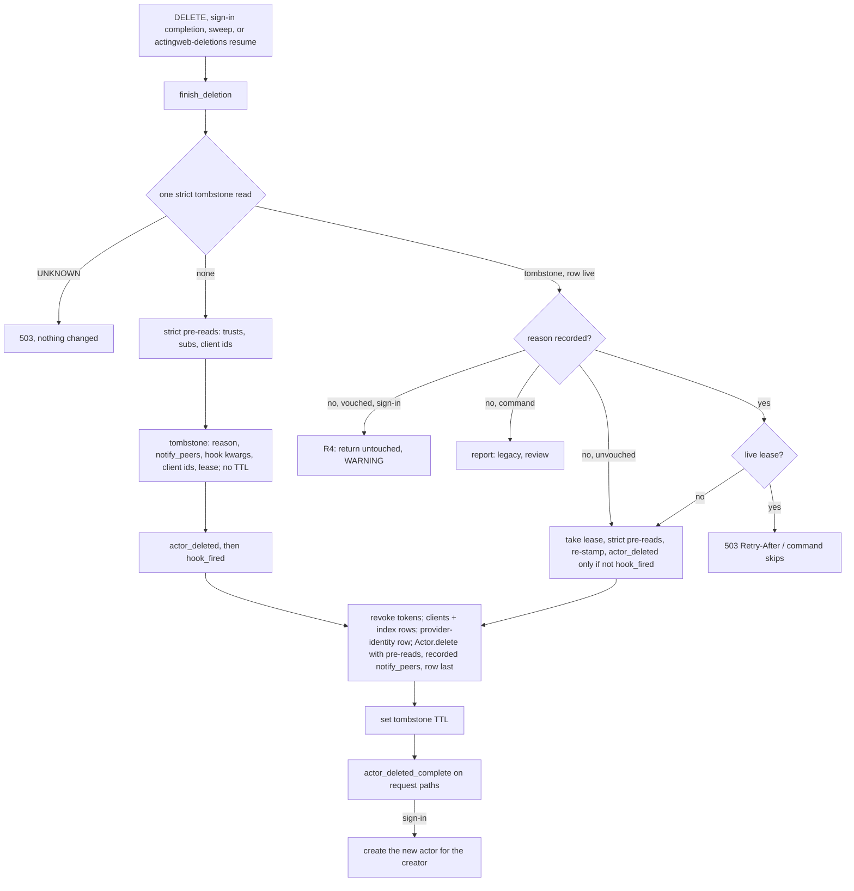

# Implementation Plan: 3.16 adoption, deletion and fault-contract follow-ups

**Date:** 2026-11-02
**Research:** `thoughts/todo/adoption-fault-and-hygiene-followups.md`, `thoughts/todo/resumable-actor-deletion.md` and `thoughts/todo/oauth-email-verified-claim-unchecked.md` (the todos are the provenance; no research document of their own). The owner decided the adoption and fault items on 2026-11-02; they were recorded first in `thoughts/plans/2026-11-02-3-16-owner-decided-followups.md`, which keeps the first block.
**Branch:** `release/3.16.0-adoption-fault-followups`, cut from `master` at `b7c5c94` (after PR #168). One PR, a commit per phase, no version bump.

## Update Log

- **2026-11-02**: Phases written by `/update_plan`. The owner added two todos to the block: resumable actor deletion (with the clean's token window) and the unchecked `email_verified` claim, and chose an approach for each (R1-R4, E1). Four phases, owner-confirmed. Code anchors mapped against `b7c5c94`; three facts in the original decisions corrected (`_race_winner` is in `handlers/mcp.py`; PostgreSQL `DbSubscription.modify` already writes only the given fields; there is no generic OIDC provider).
- **2026-11-02**: Evaluation pass (five evaluators, then the outside voice). The owner changed three decisions on its findings: R3 stamps the generation on credentials at issue time; BG binds the session to the browser that submitted the form; a tombstone without a recorded reason keeps today's sign-in behaviour. Mechanical findings folded in (see Evaluation Notes): one `finish_deletion` for every path, a tombstone that records why it was written, E1 applied to every writer of `store.email`, AW3 only at sign-in completions, BQ reusing `lookup_or_create_actor_by_identifier`, the classify bound failing closed, the operator command's `Config` and its `clear` subcommand, O2a moved into Phase 1.
- **2026-11-03**: Outside voice (codex hung for an hour and was stopped; a fresh-context Claude reviewed instead, no second-model coverage). Nineteen findings folded (see Evaluation Notes, Outside voice). The owner replaced BG2 with BG3 after asking for industry practice: the link verifies only and never issues a session; the session the form submission issued survives the click; a later sign-in with the same provider account finds the verified actor. The owner kept four phases; BQ and the `delete_client` keyword moved into Phase 1, which needs them.

## Overview

The last planned block of 3.16. It makes the actor wipe resumable and safe to run twice, so a wipe that stalls behind its tombstone is finished by the next `DELETE`, the next sign-in or an operator command; it closes the token window the clean in place leaves within one process; it refuses a provider address the provider did not verify, on every path that stores one; and it finishes the adoption and fault-contract follow-ups the owner decided. One **Breaking** change: `SubscriptionManager.is_suspended()` raises `DbError` on a fault. 3.16 is already a minor; this block adds one operator command (`actingweb-deletions`), a `POST` on the existing `/oauth/email` verification route (BG3), and no new route, hook, hook kwarg or config option.

## Decisions Made

### Owner, 2026-11-02 (adoption and fault contract)

- **AW (a tombstone on a live vouched actor):** detect first, then finish. Three steps, in order:
  1. Confirm the tombstone clear on a fixed-id create (`get_attr_strict`). A fault fails the create.
  2. A repeated `DELETE /<id>` finishes the wipe without firing `actor_deleted` again. [Updated 2026-11-02: "again" means once it has completed; a hook that raised is fired by the retry, see T1.]
  3. Only then may a sign-in on a tombstoned live actor finish the wipe.

  Sequenced with resumable deletion: both are Phase 1.
- **BG (the session at the verification click):** the click issues the web session or the SPA token, as the OAuth callback would. The form-replaces-factory alternative (BV) is not taken. [Updated 2026-11-03 by the owner: superseded by BG3; the click issues no session, the submitter's session survives it instead.]
- **The `force_email_prop_as_creator` rewrite at load:** `Actor.get` does not rewrite the creator of an unvouched actor; adoption decides.
- **The lost successor mapping:** write the old-to-new mapping into the successor's `_internal` before creating it. The next sign-in that completes the adoption fires `actor_adopted` with the right old id.
- **The summary reads:** on a fault, the `actor_adopted` summary reports the counts as unknown (`None`), not 0, and the log says so. The adoption still proceeds.
- **`purge_relationships`:** read trusts and subscriptions once each, and pass them down.
- **The redundant replace-path cleanup:** when the actor is already deleted, `delete_client` removes only the global client index row.
- **BN:** a nested hand-off merges the incoming `carried`. Add a two-step hand-off test.
- **BK** (flag off): the strict `get_by_creator` and the sibling sweep drop rows whose normalised creator differs from the query.
- **BL** (flag off): the sweep skips a sibling that is already tombstoned. [Updated 2026-11-03: "skips" while another finisher holds the tombstone's lease (T2); otherwise the sibling is finished through `finish_deletion` with no second `actor_deleted`.]
- **BP:** a replacement scans the SPA token buckets once, for the victim and its siblings together (`_revoke_spa_tokens` already takes a list, `oauth2.py:1838`).
- **BQ:** both SPA completion paths and the web callback call one shared resolve-adopt-or-create helper. [Updated 2026-11-02: that helper exists, `OAuth2Authenticator.lookup_or_create_actor_by_identifier` (`oauth2.py:1057-1119`, with both `CreatorTaken` reloads); the SPA paths call it, and the callback's state-selected path passes its loaded actor through a new keyword-only `existing=`.]
- **The revocation cleanup after a fault:** the permission callback deletes the revoked peer data first, with strict reads, and stores the new permissions after. A fault answers 503, so the retried callback still sees the revocation.
- **`clear_all_state_for_peer`:** strict read. A fault raises `DbError`, so the trust deletion answers 503 and is retried.
- **One read-and-classify helper** for `Actor.get_from_creator`, `oauth2._factory_siblings` and the successor step. It returns the pick and the siblings from one read.
- **The deliberate folds** (`callback_processor` `handler(cb)` at-most-once, and the owner's factory sweep) are documented in the hooks reference and the fault-contract docs.
- **O2 ordering windows**, all three reordered, each with a fault test:
  - the replacement's pre-reads run before its token revoke;
  - `Actor.delete` reads its lists once, before `actor_deleted`;
  - the OAuth callback and the email-form completion validate before writing.
- **The post-commit folds:** diff registration only. A fault after the property write raises `DbError`; the write stays. The caller sees 503, so the subscriber's gap is not silent.
- **`DeletionStatus.UNKNOWN`:** fail closed in `handlers/mcp.py` `_race_winner`, answering 503. That is the same rule as K. [Updated 2026-11-02: `_race_winner` is in `handlers/mcp.py:2465`, not `oauth2.py`.]
- **DynamoDB `DbSubscription.modify`:** an `UpdateItem` of only the given fields, so it never writes back a stale `seqnr`. [Updated 2026-11-02: PostgreSQL already updates only the given columns, `db/postgresql/subscription.py:189-288`; it gets a test, not a change.]
- **The resync failure:** keep a per-cycle record of which subscribers were resynced. A retry of `resume_subscriptions` re-sends only to the ones that missed, and their suspension window stays until they succeed.
- **The K4 leftovers, all four chosen:**
  - **The three remaining `oauth_provider` bookkeeping writes** (`oauth2.py:2501`, `oauth2.py:2624`, `oauth_session.py:377`): a failure is logged and folded, so it does not fail the sign-in, as plan entry 27 did for the first one (`oauth2.py:2322-2327`).
  - **`SubscriptionManager.is_suspended()`:** it raises `DbError` on a fault. **Breaking**, so it needs a CHANGED entry and a migration-guide line.
  - **The create rollback:** it also deletes the actor's `_internal` bucket.
  - **A replacement with no vouched actor:** read the victim's lists once, and bound the ranked creator prefix. [Updated 2026-11-03 by the owner: the bound is not taken. Failing closed at the bound lets a factory flood lock an address's owner out, and picking within it strands a vouched actor past it; the reads stay unbounded (flag-off only; uniqueness, the default, makes it moot).]
- **`fanout.py`'s breaker:** correct the comment (per process), and say so in the deployment guide. Shared breaker state is not taken.

### Owner, 2026-11-02 (added by this update)

- **R1, who resumes a stalled wipe:** a repeated `DELETE /<id>` (AW2), a sign-in on a tombstoned live actor (AW3), and an operator command that lists tombstones whose actor row still exists and finishes them. Every step of the wipe is idempotent and the row is removed last. No automatic sweep at startup.
- **R2, re-sign-up under `unique_creator`:** a sign-in for a creator whose actor is tombstoned finishes that wipe (which releases the creators record with the row) and then creates the new actor in the same request. A wipe that is still running elsewhere answers 503 with `Retry-After` instead. The record is not released at tombstone time.
- **R3, the clean's token window (D12)** [Updated 2026-11-02 by the owner after the evaluation]: a session generation in the actor's `_internal`, **stamped on credentials when they are issued**. The clean writes a new generation before it rotates the passphrase. Every authorization code, MCP refresh-token row, SPA refresh-token row and MCP client registration records the generation at issue (the registration for the client-credentials grant, folded from the evaluation). The code exchange, the MCP refresh and the SPA refresh compare that stamp with a strict read of the current generation after writing the new token; a mismatch revokes what was just written and fails the grant. A row issued before 3.16 has no stamp and matches only an actor whose generation was never written (never cleaned). Access tokens are not stamped: the clean's two revokes remove them, and other worker processes keep a cached access token until its cache TTL (5 minutes, `handlers/mcp.py:118`); the changelog says so rather than claiming the window is closed. A per-use check was offered and not taken (one extra read per authenticated request).
- **R4, a tombstone without a recorded reason** (owner, after the evaluation; scope made exact by the outside voice): a tombstone with no `reason` field on a live **vouched** actor keeps today's behaviour at sign-in. On an **unvouched** actor a reason-less tombstone keeps today's behaviour too, which is to finish it (`oauth2.py:2376-2378`), now with `notify_peers=False`, since such a tombstone is most likely a stalled replacement of a squatter's actor. For a vouched actor: the actor is returned untouched, a WARNING names it, and `actingweb-deletions report` lists it as `legacy, review`. The operator chooses `clear` or `resume`. Only a tombstone that carries a `reason` field (T1) is finished at sign-in. The rule is keyed on the field, not on a version: 3.16 is untagged and consumers pin by version, so every tombstone in production today has no `reason`, which is why R4 is the safe default and how the migration guide says it.
- **E1, `email_verified`:** a provider's `email` is an identity or stored address only when the provider vouches for it. Google: `verified_email` (web userinfo, v2) or `email_verified` (id_token) must be `True` or `"true"`. Apple: `email_verified` from the signed id_token must be `True` or `"true"`; the address in the unsigned form_post `user` payload is never verified. GitHub: the `/user` `email` must be in the per-token verified list (one cached `/user/emails` call); a failed call counts as unverified. An absent claim counts as unverified everywhere. An unverified address falls through to the provider's verified-email fallback or the email form (`require_email`), or to the provider-id identifier.
- **BG3, email verification** (owner, 2026-11-03, replacing BG2 after asking for industry practice: Auth0, Firebase, Cognito and Okta verify by link without signing in; OWASP: single-use, expiring, no session; mail scanners click GET links):
  1. **The link never issues a session.** `GET /oauth/email?verify=<token>` answers a landing page (or, for JSON, a description) with a Confirm button; the `POST` verifies. A scanner's GET changes nothing.
  2. [Updated 2026-11-03 by the owner, after implementation traced it: not taken. The email form's credential is the provider's own token, which authenticates as the provider identity, not the typed address, so it never signed in as the actor; the owner chose no session at the click, the user signs in again and point 3 resolves them.] ~~**The submitter's session survives the click.**~~ The form submission already issues a credential to the browser or SPA that submitted it (`oauth_email.py:683-723`). Its digest is stored with the verification state, and the clean in place at the confirm keeps exactly that credential and its mapping; every other token of the actor is revoked as today. The submitter's next request sees `email_verified` true. Web and SPA behave alike, on any device the link is opened on.
  3. [Updated 2026-11-03 by the owner, after the Phase 2 codex review: not taken. Linking the provider account at the confirm let an attacker sign in with their own provider account, type a victim's address, and get the victim's verified actor once the victim clicked Confirm on the unsolicited mail. The confirm verifies only; nothing is linked.] ~~**Signing in again works.**~~ The confirm writes the provider identity of the claimed session (the provider name and its stable id, `oauth_sub` or `oauth_github_id`, `oauth2.py:272-348`) into a system index (`provider_identity_index`, provider id → actor id, no TTL). A later sign-in with that provider account and no verified address resolves to the verified actor through the index before the email form is shown, so the user neither sees the form nor gets the 409. The index row goes with the actor (`finish_deletion`) and on a clean or rename that changes the provider identity.
  4. **The token is consumed after the verification lands,** keeping the order the handler documents (`oauth_email.py:247-249`: confirmed first, so a fault leaves the link usable), with `delete_attr_conditional` on the index row (the single-use primitive the mobile tickets use), not `replace_if_equal` (which turns a fault into "already consumed").
  5. [Updated 2026-11-03, at Phase 4: not taken. The hook runner passes every kwarg to every hook, so a hook written with the documented fixed signature would raise `TypeError` and its email would never be sent; with the link dropped, naming the account guards nothing.] ~~**The verification email names who asked:**~~ `email_verification_required` gains the keyword-only kwargs `provider` and `provider_account` (additive), and the docs tell applications to say "the GitHub account @x asked to link this address; confirm only if this was you", the one defence against a victim confirming an attacker's claim.

### Folded from the evaluation (mechanical; not owner decisions)

- **T1, the tombstone records why:** `mark_actor_deleted(..., reason=, notify_peers=, hook_kwargs=, client_ids=)` writes `reason` (`deleted` for `DELETE /<id>`, `replaced_at_adoption` for a replacement and for a swept sibling, so the hook kwarg keeps its documented value), `notify_peers`, the `actor_deleted` kwargs (`replaced_by_identifier` and the like, so a resumed hook gets what the first one would have), the actor's MCP client ids (read before any bucket goes, so a resume can still delete their global index rows), and `hook_fired` (set after `actor_deleted` returns). A resume uses the recorded `notify_peers`, also when the application re-calls `Actor.delete()` (it reads the tombstone it re-stamps and uses `notify_peers and recorded`), and fires `actor_deleted` only when `hook_fired` is not set. The guarantee is stated exactly: `actor_deleted` runs at least once per registered hook; a retry after a `DbError` runs every hook again (`interface/hooks.py:779-787` runs them in turn), and a hook that raised anything else counts as having run. A programmatic `Actor.delete()` with no tombstone writes one with `hook_fired=True` (it fires no hooks, `actor_interface.py:405-410`) and its own `notify_peers`.
- **T2, the lease and the TTL** (replacing the age test D-a first had): a finisher claims the tombstone with a conditional write of `claimed_until = now + DELETION_LEASE` (120 s) and renews it between steps; a second finisher that meets a live lease answers 503 with `Retry-After` = the lease's remainder (rounded up, at least 1), and the operator command skips it. A lease that lapsed (a crashed finisher) is taken over. This replaces the race-past-grace caveats: one finisher at a time, so `actor_deleted` and `actor_deleted_complete` do not double in the common race. The tombstone is written **without** a TTL while the wipe is unfinished; `finish_deletion` sets `DELETION_TOMBSTONE_TTL` once the row delete is confirmed, so a stalled wipe never disappears from `report` after 30 days.
- **F1, one finisher:** `deletion.finish_deletion(actor, *, hooks, pre_reads=None, origin)` in `actingweb/deletion.py` (a new `actingweb/deletion_finish.py` if the import graph needs it) is the only code that runs a wipe: root `DELETE`, `_remove_for_replacement`, the sweep, AW3 and the operator command call it. It reads the deletion status and the tombstone in one strict read, takes the lease (T2), runs the strict pre-reads, writes or re-stamps the tombstone, fires the hooks by T1, revokes the actor's MCP and SPA tokens (`_revoke_all_actor_tokens`, for every origin, after the pre-reads as O2a orders it; today only the replacement revokes), deletes the client registrations and their global index rows from the ids T1 recorded (`_delete_actor_clients(..., actor_deleted=True)`, its `RuntimeError` mapped to `DbError` so the wipe stops and the next finisher retries), removes the BG3 provider-identity index row, calls `Actor.delete` with the pre-read lists (the row last), sets the tombstone's TTL, and fires `actor_deleted_complete` on request paths. `Actor.delete`'s public signature is unchanged; the pre-read lists go through a private keyword (`_pre_reads`), and a re-call of `Actor.delete()` or `ActorInterface.delete()` is itself the resume (no `resume=` flag).
- **AW3 scope:** only the sign-in completions finish a wipe: the web callback, both SPA completions, the MCP OAuth callback and the email-form completion, through `lookup_or_create_actor_by_identifier(..., finish_stalled_deletion=True)`. Bearer-token authentication (`oauth2.py:1181`), the root GET with a cookie (`flask_integration.py:733`) and the other per-request lookups keep returning the actor untouched (with `DeletionInProgress` never raised there).
- **UNKNOWN at a vouched sign-in:** the AW3 read is the K rule: UNKNOWN answers 503 (a **Behavior change** for a vouched sign-in during a tombstone-store fault, in the changelog). With no provider (the email link) a tombstoned actor is not finished; the link answers as it does for the unvouched twin (`oauth2.py:2370-2375`).

### Deduced while writing the phases (not confirmed)

- **D-a, "still running elsewhere" (R2):** decided by T2's lease, `DELETION_LEASE` = 120 s (a new constant; deliberately not configurable, documented). [Updated 2026-11-03: the tombstone-age test is replaced by the lease.] With `unique_creator` off, two sign-ins that each meet a finished wipe can still each create an actor for the creator, which is today's flag-off behaviour (`oauth2.py:2448-2450`); tested and stated.
- **D-b, hooks on a finished wipe:** request paths fire `actor_deleted_complete` when they finish a wipe; `actor_deleted` fires by T1. The operator command fires no hooks and prints the finished actor ids as their own list, so the operator can run the application's cleanup.
- **D-c, the fourth `oauth_provider` write** (`oauth2.py:1807`, on create) stays strict: a create that fails there is rolled back and retried.
- **D-d, the generation's fault answer:** a read fault after the token write revokes the token just written and raises; the MCP token endpoint answers 503 `temporarily_unavailable` (the guard raises `TokenStoreUnavailable` inside `token_manager`, which `oauth2_server.py` maps; the mapping is checked and fixed if it answers `server_error`), the SPA refresh 503. A failed revoke there is logged at ERROR with the token's chain id.
- **D-e, the per-cycle resync record:** one attribute per `(target, subtarget)` suspension on the publisher (`resync_pending`), holding the list of subscription ids that have not yet answered 2xx and the suspension's start. It is read before the `if not resumed` early return (`actor.py:2959-2960`), written once after the sends with the ids that missed, and deleted when empty. A retry re-sends only to those ids, and drops an id whose subscription no longer exists.

## What We're NOT Doing

- **The post-commit folds for the verification email and the logout provider-token clear:** the owner kept them as they are (2026-11-02). They stay folded and logged.
- **BV (the free-text form replacing a factory actor):** not chosen; the 409 stays as documented.
- **A shared, cross-process fan-out breaker:** not chosen; the comment and the deployment guide say it is per process.
- **An automatic sweep of stalled wipes at startup or in `check_ready()`** (R1): a destructive pass on every boot; the operator command covers it.
- **Releasing the creators record at tombstone time** (R2): two actors would hold one creator for the wipe's duration.
- **Checking the generation on every token use** (R3): one extra consistent read per authenticated request; the owner took the issue-time stamp instead.
- **Cross-process invalidation of cached access tokens:** `mcp-cache-lifecycle-and-revocation.md` keeps it.
- **A transaction across the actor row and `_internal`:** needs a new backend API; `vouched-rename-one-transaction.md` keeps it.
- **A session generation on the deletion path:** a deleted actor's row goes last and every token fails at use once it is gone; the tombstone already suppresses late writes.
- **A generic OIDC provider:** none exists (`oauth2.py:1427` falls back to `GoogleOAuth2Provider` for an unknown name, with Google's fixed endpoints), so E1 is per built-in provider.
- **A paged attribute-bucket API for the tombstone listing:** the command reads `get_bucket` on the tombstone store once, filters expired rows itself, and states its cost; a paged API is a backend protocol change for an operator command (revisit if a deployment's 30-day deletion count makes the read too large).
- **An emailed one-time code instead of (or beside) the link** (BG3): offered and not taken; the link with a confirm page is the common practice and keeps the hook's payload.
- **Finding actors affected by E1 from stored data:** the verified flag was never stored; they are found at sign-in by the WARNING E1 logs.

## What Already Exists

- `actingweb/deletion.py` - tombstone write, clear and the tri-state read; extended (reason fields, one strict read returning the row, `finish_deletion`).
- `actingweb/actor.py:1014-1062` `Actor.delete` - strict pre-reads, tombstone, then the wipe with the row last; kept, with a private `_pre_reads`.
- `actingweb/oauth2.py:1916-1969` `_remove_for_replacement` - the "next sign-in finishes the replacement" rule; becomes a caller of `finish_deletion`.
- `actingweb/oauth2.py:1057-1119` `lookup_or_create_actor_by_identifier` - the resolve-adopt-or-create helper BQ asked for, already with both `CreatorTaken` reloads.
- `actingweb/oauth2.py:1838` `_revoke_spa_tokens(config, actor_ids)` - already takes a list (BP).
- `actingweb/oauth2.py:2368-2391, 2534-2539` - the K rule (UNKNOWN raises `DbError`), reused.
- `actingweb/maintenance/unique_creators.py`, `property_lookup.py` - the operator-command shape (`report`, `--apply`, 0/1/2 exit codes).
- `actingweb/interface/integrations/_errors.py:86, 228-230` - the `CreatorTaken` branches `DeletionInProgress` follows.
- `actingweb/oauth2.py:359-381` GitHub per-token `/user/emails` memo - reused for E1.
- `actingweb/attribute.py:130, 157` `set_if_absent`, `replace_if_equal` - the conditional writes the generation uses.
- `actingweb/db/dynamodb/subscription.py:131-156` `increment_seq` - the `UpdateItem` pattern `modify` follows.
- `tests/test_adoption_bounded_reads.py:184` `_counting` - moved to `tests/_adoption_helpers.py` and reused for every counted-read test.

## Phase 1: Resumable deletion, AW, the session generation

### Changes

- `actingweb/deletion.py`:
  - `mark_actor_deleted(..., reason: str, notify_peers: bool, hook_kwargs: dict, client_ids: list[str])` writes T1's fields with no TTL (T2); `mark_hook_fired(actor_id, config)` sets `hook_fired`.
  - `claim_lease(actor_id, config, row) -> bool` and `renew_lease(...)` (T2): a conditional write of `claimed_until` on the row as read; a fault raises.
  - `read_tombstone(actor_id, config) -> tuple[DeletionStatus, dict | None]`, one strict `get_attr_strict`; `get_deletion_status` delegates to it. A tombstone with a TTL whose expiry has passed counts as absent on both backends (PostgreSQL works out expiry as `deleted_at + DELETION_TOMBSTONE_TTL`, or the row's own `ttl_seconds` when it recorded one).
  - `restamp(actor_id, config, notify_peers)`: `Actor.delete`'s own write (`actor.py:1043`, the deliberate second write the owner kept) becomes a conditional update of `deleted_at` only, on a row that exists; on none it writes a fresh tombstone with `reason="deleted"`, `hook_fired=True` and the call's `notify_peers` (a programmatic delete fires no hooks, `actor_interface.py:405-410`). It never replaces `reason`, `notify_peers`, `hook_kwargs`, `client_ids` or `hook_fired`, and returns the recorded `notify_peers` so `Actor.delete` uses `notify_peers and recorded`.
  - `set_tombstone_ttl(actor_id, config)` after the row delete is confirmed.
  - `clear_actor_tombstone(..., strict: bool = False)`: strict deletes and re-reads with `get_attr_strict`, raising `DbError` on a fault or a tombstone still present (the folding `except` at 176 is bypassed, and its comment says when it applies).
  - `finish_deletion(...)` (F1) and `DeletionInProgress(DbError)` with `retry_after: int` (exported from `actingweb/db/exceptions.py` beside `CreatorTaken`).
  - `actingweb/constants.py`: `DELETION_LEASE = 120`.
- `actingweb/actor.py` `Actor.delete` (1014-1062) - private `_pre_reads: tuple[Trusts, Subscriptions] | None` (the fetched wrapper objects, so `trusts.delete()`/`subs.delete()` do not fetch again, `trust.py:436-437`, `subscription.py:284-285`); the tombstone write becomes `deletion.restamp`. With no handle it does a strict row read: a row already gone answers True (the resume case), a missing handle on a live row answers False as today. Docstring: a re-call is the resume, and the recorded `notify_peers` wins.
- `actingweb/actor.py` `Actor.create` (751-752, rollbacks 782-830, 852-853) - AW1 for a caller-supplied `actor_id` only: `clear_actor_tombstone(strict=True)`; a fault fails the create and rolls back, except when `replace_holder` is set (the swap's row is kept, as the marker rollback at 794-798 does). K4: a generated-id rollback also deletes the `_internal` bucket; a fixed-id rollback deletes it only if this create wrote it.
- `actingweb/handlers/mcp.py`:
  - the bridge's fixed-id create (2511-2531) refuses an id whose tombstone reads DELETED (401, as an unknown actor), so a token cached on another worker cannot bring a deleted actor back; UNKNOWN answers 503. Only an explicit `Actor.create(actor_id=...)` clears a tombstone.
  - `_race_winner` (2465-2478) - UNKNOWN raises `DbError`, reaching `_db_fault_response` through `_get_or_create_actor_cached` (2533-2544).
- `actingweb/handlers/root.py` `delete` (87-147) - a falsy id answers as today before any status read; otherwise `finish_deletion(myself, origin="delete")`, whose lease applies to a retry too (a client that times out during a slow `actor_deleted` gets 503 `Retry-After`, not a second wipe).
- `actingweb/oauth2.py`:
  - the vouched branch of `_adopt_actor` (2316-2352) and the unvouched `unfinished_wipe` branch (2368-2378) both go through one check before `is_vouched_actor`, by the flowchart: `finish_stalled_deletion` set and the tombstone finishable → `finish_deletion`, then fall through to create (R2); a live lease → `DeletionInProgress`; a reason-less tombstone on a vouched actor → R4; UNKNOWN → `DbError`. The comment at 2350-2351 goes. After a finish the caller uses the new actor, never an id it held from before (the callback's state-selected path included).
  - `_remove_for_replacement` (1916-1969) and `_sweep_factory_actors` (2044-2114) call `finish_deletion` with `reason="replaced_at_adoption"`, `notify_peers=False` and the hook kwargs (BL: a sibling under a live lease is skipped, otherwise finished without a second `actor_deleted`). O2a: the pre-reads run before the token revoke and are passed down (O2b).
  - `lookup_or_create_actor_by_identifier(..., finish_stalled_deletion: bool = False, existing: Actor | None = None)`, threaded into `adopt_actor`. BQ lands here (moved from Phase 2, since AW3 needs every completion on this helper): `handlers/oauth2_spa.py:1080-1099` and `1260-1274` call it, and `handlers/oauth2_callback.py:544-552` passes its loaded actor as `existing=`. The completions that set `finish_stalled_deletion`: the web callback, both SPA completions, the MCP OAuth callback and the email-form completion. Bearer-token authentication (`oauth2.py:1181`), the cookie GET (`flask_integration.py:733`) and the other per-request lookups leave it False.
  - `_delete_actor_clients(config, actor_id, client_ids, *, actor_deleted: bool = False)` (1846-1875) and `oauth2_server/client_registry.py` `delete_client(..., actor_deleted: bool = False)` (288-387): True removes only the global index row; `finish_deletion` passes True with the ids T1 recorded, the clean passes False (its actor is live). Moved from Phase 2.
  - the clean in place (2534-2572): `session_generation.bump(existing)` before `existing.modify(passphrase=...)` (2547).
- `actingweb/interface/integrations/_errors.py` - a `DeletionInProgress` branch before the generic `DbError` in `db_error_answer` and `log_db_error` (its `Retry-After`, an INFO log). The handlers that write their own 503 (`handlers/oauth2_spa.py:1963`, `handlers/mcp.py:2991`) take `retry_after` from it.
- `actingweb/session_generation.py` (new; named apart from the MCP cache's `generation_at_read`):
  - `current(actor_id, config) -> str | None` via `get_attribute(config).get_attr_strict(actor_id=..., bucket="_internal", name="session_generation")` (no `InternalStore`, so no bucket load);
  - `bump(actor_id, config)` writes a fresh random value with the backend's conditional write on the value read (`set_if_absent` when there is none) through `get_attribute(config)` directly, then reads it back strictly and raises `DbError` unless the read shows the value it wrote (the conditional writes never raise, `attribute.py:130-136`, `db/dynamodb/attribute.py:379-381`, `db/postgresql/attribute.py:603-607`, so a fault would otherwise look like a lost race); a lost race is fine (any new value invalidates older stamps) and is accepted once the read-back shows a value other than the one read before;
  - `check(actor_id, config, stamped, revoke)` after the write.
- `actingweb/oauth2_server/token_manager.py` - the authorization-code row, the refresh-token row and the client registration are stamped at issue; `exchange_authorization_code` (137), `refresh_access_token` (308) and the client-credentials grant (1430) compare the stamp after writing, as R3 says. A row without a stamp (issued before 3.16) matches only an actor with no generation.
- `actingweb/oauth_session.py` (`create_refresh_token` 590) and `actingweb/handlers/oauth2_spa.py` `_handle_refresh_token` (745) - the SPA refresh row stamped and checked. `_handle_passphrase_exchange` (1590, devtest only) mints from a passphrase and is checked against the generation read with the actor. Mint paths that start from a fresh provider assertion (the callback, SPA authorization code, JWT bearer, mobile ticket) are out of R3's rule, and a comment at the helper says so.
- `actingweb/maintenance/deletions.py` (new) and `pyproject.toml` `actingweb-deletions = "actingweb.maintenance.deletions:main"` (`docs/requirements.txt` regenerated in the same commit):
  - `Config` built from the deployment's own environment (`unique_creator`, `INDEXED_PROPERTIES`, the database prefix, `fqdn`) as the application's would be, not the `unique_creators` command's flag-off `Config` (`unique_creators.py:179-183`); actors loaded with `rewrite_email=False`.
  - `report [<actor_id>]`: tombstones whose actor row still exists, and unfinished tombstones (no TTL) whose row is gone but whose client index rows remain, as `stalled`, `in progress` (live lease) or `legacy, review`; exit 0 when nothing is stalled or legacy, 1 otherwise, 2 when the tombstone store cannot be read.
  - `resume [<actor_id>] [--apply]`: dry run without `--apply` (exit 1 "would finish N"); with it, `finish_deletion(origin="operator")` per stalled actor, a legacy one only when named, no hooks, the finished ids printed as their own list. `--apply` also purges expired rows from the tombstone and email-verification index buckets on PostgreSQL (`delete_expired`; DynamoDB reaps them with its native TTL), since nothing else does (`oauth_session.py:1252-1253` and `token_manager.py:1834-1842` purge only the token buckets).
  - `clear <actor_id> [--apply]`: `clear_actor_tombstone(strict=True)` for a tombstone on a live actor the operator judges stray.
  - The cost per backend (one bucket read of every tombstone, which on PostgreSQL includes expired ones until purged; one actor-row read per tombstone without a live lease) is stated in its docstring and docs.

### New Tests, both unit and integration tests

- `tests/test_deletion_finish.py` (new):
  - a wipe that raised after the property delete is finished by a re-call: trusts, subscriptions, buckets, client registrations and their index rows, the provider-identity row and the row gone; tokens revoked; a second call answers True with nothing left; a wipe that stalled after `buckets.delete()` still deletes the client index rows from the tombstone's `client_ids`;
  - `_pre_reads` given: no list `.fetch()` again (counted with the shared `_counting`; the backend delete's own query is not counted, and the test says so);
  - T1: a resume of a `replaced_at_adoption` tombstone sends no peer DELETE, including a victim whose wipe stalled after `Actor.delete`'s re-stamp, and an application re-call of `Actor.delete()` on it; the resumed `actor_deleted` gets the recorded kwargs; `hook_fired` absent fires it on the retry, set does not; a programmatic `Actor.delete()` that stalls is resumed by a `DELETE` without firing `actor_deleted`; with two hooks and a `DbError` from the second, the retry runs both (the documented at-least-once);
  - T2: a live lease raises `DeletionInProgress` with `retry_after` rounded up; a lapsed lease (through a `now=` seam) is taken over; two finishers at once: one runs, the other gets 503; the TTL is absent until the row is gone and set after;
  - an expired tombstone counts as absent on both backends;
  - a resume fault from `clear_all_state_for_peer` (made strict in Phase 3) is finished by the next call (added in Phase 3).
- `tests/test_actor_deletion_tombstone.py` - AW1 for a fixed id: a clear fault fails the create with no row and no `_internal` bucket; a clear that leaves the tombstone fails the same way; `replace_holder` keeps the row; a generated id makes no strict read; the generated-id rollback removes `_internal`, the fixed-id one keeps a bucket that predates the create.
- `tests/test_root_delete_retry.py` (new): a wipe that raised answers 503; a retry under a live lease answers 503 `Retry-After`; after it 204 with `actor_deleted` once in total and `actor_deleted_complete` once; UNKNOWN answers 503 and writes nothing; a pre-read fault answers 503 before any tombstone; a falsy id behaves as today; the actor's MCP and SPA tokens are revoked.
- `tests/test_adoption_tombstoned_vouched.py` (new):
  - vouched and unvouched actors with a tombstone that carries a reason: a sign-in completion finishes the wipe, `actor_deleted` not fired again, `actor_deleted_complete` fired, a new actor created and used; under a live lease 503 `Retry-After`; UNKNOWN 503; a reason-less tombstone returns a vouched actor untouched with a WARNING, and finishes an unvouched one with no peer DELETE (R4);
  - bearer-token authentication and the cookie GET on the same actor return it untouched;
  - under `unique_creator` the new actor is created (record released); with the flag off the double create is asserted as stated;
  - BL: two sign-ins meeting a tombstoned factory sibling fire `actor_deleted` once per sibling;
  - the callback's state-selected path after a finish redirects to the new actor.
  - Replaces, with the new expectations: `tests/test_adoption_owner_actor_and_sweep_faults.py:276-294` (`test_sign_in_returns_a_tombstoned_vouched_actor_untouched`) and `tests/integration/test_unique_creator_adoption.py:198` (`test_a_vouched_actor_with_a_tombstone_still_signs_in_untouched`), which become the R4 cases with a reason-less tombstone and new cases with a reasoned one; `tests/test_oauth2_adoption.py:510-528` and `tests/integration/test_unique_creator_adoption.py:165-177` gain an "`actor_deleted` once" assertion.
- `tests/test_oauth2_resolve_helper.py` (new, moved from Phase 2): both SPA paths go through `lookup_or_create_actor_by_identifier` and get the `CreatorTaken` reload; the callback's `existing=` path keeps its creator check.
- `tests/test_adoption_unknown_and_revoke.py` - `delete_client(actor_deleted=True)` touches only the index row; the clean still deletes the client row and its trust (moved from Phase 2).
- `tests/test_db_fault_auth_paths.py` - `_race_winner` UNKNOWN reached through `_get_or_create_actor_cached` answers 503 (fails on today's code); the bridge create refuses a DELETED id (fails on today's code, which recreates it).
- `tests/test_db_fault_partial_state.py` - O2a: a pre-read fault leaves the victim's tokens unrevoked.
- `tests/test_session_generation.py` (new):
  - a code issued before the clean and exchanged after it, an MCP refresh row, an SPA refresh row and a client registration issued before it and used after it, and a refresh that consumed its row before the first revoke but wrote after the second (the straddle): each revokes what it wrote and fails;
  - a credential issued after the clean works; an unstamped row works on an actor never cleaned and fails on a cleaned one;
  - a fault on the post-write read revokes the token written and answers 503;
  - `bump` with a faulting conditional write raises (fails on a version that trusts the write's False); two concurrent bumps both invalidate older stamps; the clean bumps before rotating the passphrase (call order);
  - `current()` is one `get_attr_strict` and no `get_bucket` (counted).
- `tests/test_errors_deletion_in_progress.py` (new): each sign-in entry point (web callback, both SPA completions, MCP OAuth callback) answers `DeletionInProgress` with its `Retry-After` and logs at INFO.
- `tests/test_deletions_command.py` (new): `report` lists stalled, in-progress and legacy rows, and a finished-row tombstone with leftover index rows, and not a finished one; exit codes per subcommand and outcome; `resume` dry run changes nothing; `--apply` finishes and prints the ids, and purges expired rows on PostgreSQL; under `unique_creator` the record is released; a legacy tombstone is resumed only when named; `clear --apply` removes one; an unreadable store exits 2.
- `tests/integration/test_deletion_resume_http.py` (new, both backends; its xdist group in `tests/integration/XDIST_GROUPS.md`): a stalled `DELETE` finished by a retry over HTTP (the retry still authenticates); a re-sign-up under `unique_creator` after a stalled wipe; the operator command against a real store.

### Failure Scenarios

- Two finishers at once - handled by T2's lease (one runs, one gets 503); a finisher that crashes holding the lease is taken over when it lapses; tested.
- `actor_deleted` raises - the retry runs the hooks again (at least once per hook on `DbError`, documented); tested.
- A hook in `actor_deleted` creates a trust after the pre-read - no peer notification for it - `trusts.delete()` removes it locally; documented under the hook; tested.
- A replacement victim resumed by a `DELETE`, a re-call or the command - DELETE requests to peer URLs a squatter chose - handled by T1's recorded `notify_peers=False`, which a re-call cannot override; tested.
- A wipe stalled after the buckets went - client index rows orphaned - handled by T1's `client_ids` and `report`'s leftover-index listing; tested.
- A stalled wipe outliving 30 days - handled: no TTL until the row delete is confirmed (T2).
- A pre-3.16 tombstone on a live actor - handled by R4; the migration guide tells operators to run `actingweb-deletions report` after the upgrade.
- A deleted actor's token cached on another worker reaches the MCP bridge - handled: the bridge refuses a DELETED id; tested.
- The generation write or read faults - handled: `bump` reads back and raises; the post-write check revokes and raises (D-d); tested.

### Verification

- [ ] Fast tier verbatim
- [ ] Full tier, both backends, before the phase commit
- [ ] `poetry run actingweb-deletions report` against DynamoDB Local with one stalled, one in-progress and one legacy tombstone

### Implementation Status: Complete

**Deviations and notes (implementation, 2026-11-03):**

- `finish_deletion` lives in `actingweb/deletion_finish.py` (the plan allowed it); it returns the tokens revoked, or None when the row removal was not confirmed, so the replacement keeps its `actor_adopted` count.
- The first tombstone write is a conditional create (`deletion.create_leased_tombstone`) that carries the lease, so two first `DELETE`s cannot both run; a lease is released by its `lease_id` after a fresh read (the re-stamp changes the row under the lease).
- `Actor.delete` returns False for an object with no id (loading an id whose row is gone leaves none), and confirms a backend `False` row delete with a strict read, so a repeated call on the same object answers True.
- A legacy (reason-less) tombstone met by `finish_deletion` counts as `hook_fired` (the common case is that `actor_deleted` ran right after it).
- AW3's gate (`finish_stalled_deletion`) applies to vouched actors only; the unvouched tombstoned path keeps finishing on any adoption, as before (a bearer-token lookup already adopts unvouched actors today).
- `DELETE /<id>` now revokes the actor's MCP and SPA tokens (through `finish_deletion`) and answers 503 when the backend does not confirm the row removal (it answered 204 before); both go in the changelog as **Behavior change**.
- `actingweb-deletions report` also lists `unfinished` tombstones (row gone, no `finished_at`), and `resume` removes their recorded client index rows; it builds its `Config` with `unique_creator` on unless `--no-unique-creator` (there is no environment variable for the setting).
- Not done: the devtest-only `_handle_passphrase_exchange` (`oauth2_spa.py:1590`) is not checked against the generation. `with_devtest` must be off in production, and the passphrase the clean rotates is checked against the actor as loaded; recorded as accepted.
- Tests the change broke and that were updated: the attribute test doubles gained `get_attr_strict` (eleven files); `tests/test_oauth2_adoption.py::TestBypassSites` now asserts the one resolve path; `tests/test_oauth2_clear_pending_verification.py` asserts the state-selected actor goes through it as `existing=`; `tests/test_oauth_session.py` asserts `finish_stalled_deletion=True`. The two "tombstoned vouched actor signs in untouched" tests still hold unchanged: they write a reason-less tombstone, which is R4's case.
- Codex review of the phase diff (`codex exec -s read-only`, unsandboxed, it ran this time): five findings. Fixed: the lease is renewed after `actor_deleted` and the renewal fences a finisher whose lease was taken over (`DeletionInProgress`); `mark_finished` reads the row afresh and only the lease holder announces `actor_deleted_complete`; `report`/`clear` of one actor see a finished tombstone on a live row (as `legacy, review`). Accepted: an actor wrapper already cached in another worker's MCP cache is served until its TTL (the cross-process cache item under NOT doing); `restamp` ignoring a `False` from `mark_actor_deleted` (that answer means missing arguments only; a fault raises).
- Two integration tests (`tests/integration/test_oauth2_security.py`) fed the callback a mocked authenticator whose lookup returned a mock actor with a mock `Config`; with BQ the state path goes through that lookup, and the system actor's bootstrap under a mock `Config` met AW1's strict clear. The mocks now hand back the real actor (`existing=`) and a real `Config`.
- New tests: `tests/test_deletion_finish.py`, `tests/test_adoption_tombstoned_vouched.py`, `tests/test_session_generation.py`, `tests/test_deletions_command.py`, `tests/test_deletion_in_progress_answers.py`, `tests/integration/test_deletion_resume_http.py`, and the O2a case in `tests/test_db_fault_partial_state.py`. The bridge refusal and the strict `_race_winner` tests fail with the `handlers/mcp.py` change reverted.

---

## Phase 2: Sign-in and adoption

### Changes

- `actingweb/oauth2.py` - E1:
  - `OAuth2Provider.email_is_verified(user_info, access_token) -> bool`, default False; Google and Apple require `in (True, "true")` (never `bool(x)`); GitHub checks the per-token verified list. The `/user/emails` memo moves from the per-request provider instance to a module-level per-token map (64 entries, 30 s, `oauth2.py:312, 354` today), so bearer-validated requests do not each make the call; the added round trip and its timeout bound are stated in the docs.
  - Verification is decided once, where `user_info` is built, and nowhere else: an unverified `email` is moved out of `user_info` (kept under `unverified_email` for logging only). The build sites are `OAuth2Authenticator.validate_token_and_get_user_info` and its async twin (`oauth2.py:787-890`, which have the access token for GitHub's list), `OAuth2Provider.extract_user_info_from_token_response` (the Google and Apple id_token paths), and the callback's Apple form_post merge (`handlers/oauth2_callback.py:889-891`, which adds the posted address as `unverified_email`, never as `email`). Every consumer downstream, `get_email_from_user_info` (892-946, unchanged in shape), `_proven_email` (2262, feeding `_seed_missing_email` 2284-2288 and the clean's `resets["email"]` 2595), the create's `store.email` write (1811-1813), bearer-token authentication (`auth.py:316-322`, `oauth2.py:1171-1178`) and the Flask and FastAPI cookie paths, then only ever sees a verified address; no caller changes its arguments. Any other place that builds a `user_info` dict is found by grep at implementation and routed through the same `_drop_unverified_email(provider, user_info, access_token)`.
  - A WARNING names the provider, a redacted address and the creator-matched actor id when an unverified address is dropped for a sign-in that would have matched an existing actor.
  - `handlers/mcp.py:2741` `validate_google_token_and_check_actor_email` has no callers and is deleted (its deny-list at 2792 lets an absent claim through).
- BG3: `handlers/oauth_email.py`, `oauth_session.py`, `oauth2.py`:
  - the form submission stores, beside `email_verification_token`, a digest of the credential it issues (`oauth_email.py:683-723`) and the claimed session's provider identity (provider name and stable id);
  - `GET /oauth/email?verify=<token>` answers the landing page (template `aw-email-verify-confirm`, or a JSON description) with a Confirm form; `POST /oauth/email` with `verify=<token>` runs `_handle_email_verification` (144-303) unchanged in order (adopt, `set_confirmed("email_verified","true")`, then the token consumed with `delete_attr_conditional` on the index row, `oauth_email.py:254-260`). The legacy route (`tests/test_email_verification_legacy_route.py`) gets the same split. The click issues no session and no token, in either flow;
  - the clean in place at the confirm (`oauth2.py:2534-2600`) keeps exactly the credential whose digest was stored (its `oauth_token` fields and its token mapping are left out of the revoke and of `resets`), and revokes every other token of the actor; Phase 2 starts by tracing how that credential resolves to the actor on the submitter's next request (the `oauth_token` cookie and the SPA `access_token`), and the plan is corrected here if it resolves through something the clean resets;
  - the confirm writes `provider_identity_index` (a system-actor bucket, provider id → actor id, no TTL); the email-form gate (`oauth2_callback.py`, where `require_email` finds no verified address and would redirect to the form, and the SPA twins) looks the provider id up first and, when it maps to a live vouched actor whose stored provider id matches, signs in to it. `finish_deletion` (Phase 1) removes the row, and the clean removes it when the provider identity changes;
  - `email_verification_required` gains the keyword-only kwargs `provider` and `provider_account`.
- O2c: `handlers/oauth2_callback.py` runs the creator check and the `oauth_success` rejection before `adopt_actor` (546) and the token writes (584-593); `handlers/oauth_email.py` and `oauth_session.py:305-377` run the `create_only` recheck and the hook rejection before the token and `oauth_provider` writes (369-377).
- `actingweb/actor.py` `Actor.get` (400-418) - the rewrite runs only for a vouched actor.
- `actingweb/oauth2.py` - `_classify_creator_rows(config, creator, *, bound)` used by `Actor.get_from_creator` (`actor.py:534-584`), `_factory_siblings` (1986-2036) and the successor step (2457-2479): one listing, rows read in id order, a row whose `normalise_creator(row.creator)` differs from the query dropped (BK), `classify_marker(..., creator)` everywhere, the `exclude not in listed` check kept (2012-2017). The bound (`SWEEP_LIMIT`) caps the rows read; when it is reached with no vouched actor found, the pick fails closed (`DbError`, "next sign-in retries"), never an unvouched pick (K4).
- `actingweb/oauth2.py` - BN (2507-2521) merges the incoming `carried`; BP: one `_revoke_spa_tokens(config, [actor_id, *siblings])`, then `spa_revoked=True`; the successor mapping written into the successor's `_internal` before its marker, and the next completing sign-in fires `actor_adopted` with it; summary reads (2151-2156, 2427-2432, 2552-2554) give `None` and a WARNING on a fault; the flag-off replacement reads the victim's lists once (Phase 1 passes them on).
- `actingweb/actor.py` `purge_relationships` (2122-2216) - trusts and subscriptions read once each and passed down; the post-wipe confirmation reads stay.
- K4 folds: `oauth2.py:2501`, `oauth2.py:2624`, `oauth_session.py:377` log and fold a `DbError`.

### New Tests, both unit and integration tests

- `tests/test_oauth2_email_verified_claim.py` (new): per provider, verified, `"true"`, explicitly false, absent, and a truthy non-boolean (`"yes"`, rejected); `require_email` on and off; GitHub in, not in, list failing, and one call across two requests with the same token; the Apple form_post address never verified; regression tests that an unverified address is not the identity (sign-in and bearer authentication), is not seeded into `store.email` (`_seed_missing_email`), is not written by the create (1811) and is not the clean's `resets["email"]`; `oauth_success` receives the address under `unverified_email`; the WARNING.
- `tests/test_oauth_email_verify_link.py`:
  - a GET changes nothing and answers the confirm page (a scanner's prefetch); the POST verifies;
  - the submitter's credential still works after the confirm and sees `email_verified` true, for the web cookie and the SPA `access_token`; any other token of the actor is revoked;
  - no session or token is issued by the confirm, in either flow, and the JSON body carries none;
  - a fault in the adoption or `set_confirmed` leaves the link usable (token not consumed); two concurrent confirms: one consumes, the other answers already verified;
  - a later sign-in with the same provider account and no verified address lands in the verified actor without the form (web and SPA); a different provider account still gets the form;
  - `email_verification_required` receives `provider` and `provider_account`.
- `tests/test_email_verification_legacy_route.py` - the same GET/POST split.
- `tests/test_oauth2_validate_before_write.py` (new): a rejecting `oauth_success` hook and a failing creator check leave no token and no adoption; the email form's `create_only` refusal leaves no token or `oauth_provider` write.
- `tests/test_trust_creator_rename.py` - an unvouched actor with a differing `store.email` is not rewritten at load; a vouched one still is.
- `tests/test_adoption_bounded_reads.py` - one listing; a mismatched-creator row dropped (BK, DynamoDB); the bound reached with no vouched actor fails closed.
- `tests/test_adoption_siblings_and_clean.py` - BN two-step hand-off keeps both levels' `replaced_ids`; summary fault gives `None`; the successor mapping survives a create that raised.
- `tests/test_adoption_unknown_and_revoke.py` - BP one SPA scan.
- `tests/test_actor_purge_relationships.py` - counted reads.
- `tests/test_actor_oauth_provider_property.py` - each of the three folds keeps the sign-in.
- Integration (both backends): `tests/integration/test_oauth2_unverified_email.py` (new), a Google sign-in with `verified_email: false` reaches the email form under `force_email_prop_as_creator` and does not adopt the address's actor; `tests/integration/test_email_verification_flow.py` (new), form submit → confirm over HTTP → the submitter's next request succeeds → a fresh sign-in with the same provider account lands in the actor.

### Failure Scenarios

- E1 changes the identity of an existing user whose provider address was never verified - they get a new provider-id actor or the email form, and their bearer-token API access no longer resolves to the address's actor - accepted, stated as a **Behavior change** in what the user sees; found by the WARNING; the migration guide gives the remedy (`modify_creator` to re-link).
- GitHub `/user/emails` fails or times out - the address counts as unverified - tested; the docs state the latency.
- A victim confirms a link an attacker's provider account asked for - the attacker's account then signs in to the victim's address - the inherent risk of link verification; mitigated by the email naming the provider account (BG3 point 5) and documented in the security reference.
- The submitter's session resolves through a field the clean resets - the session dies at the confirm, the original BG symptom - checked first in Phase 2 by tracing, and covered by the HTTP test.
- The classify bound cuts off a vouched actor - fails closed, logged - tested.

### Verification

- [ ] Fast tier verbatim
- [ ] Full tier, both backends, before the phase commit

### Implementation Status: Complete

**Deviations and notes (implementation, 2026-11-03):**

- E1: verified addresses are marked at the build sites (`drop_unverified_email`: `validate_token_and_get_user_info` and its async twin, the id-token paths in the callback, the SPA grants and the MCP server, the Apple form_post merge); the consumers (`get_email_from_user_info`, `_proven_email`, the create's `store.email` write) check the provider's rule or the mark (`verified_email_of`). Callers did not need to pass the token: a GitHub address verified at the build site carries the mark. The async validation's GitHub check is a sync `/user/emails` call (memoised per token for 30 s); accepted. The test doubles that fed unmarked id-token claims (`tests/test_oauth2_spa_jwt_bearer.py`, `test_oauth2_spa_apple_ticket.py`) and GitHub `/user` (`test_mobile_oauth2.py`) now carry what the real providers send; `tests/test_oauth2_github_emails_once.py::test_a_public_email_is_checked_once` replaces "asks GitHub nothing" (E1 asks once), and the per-process memo is cleared per test in `tests/conftest.py`.
- BG3 (as implemented, after the owner dropped point 3): the link's GET answers a Confirm page (template `aw-verify-email.html` gains a `confirm` state; both integrations' fallbacks render a form); the POST verifies; no session or token is issued. `email_verification_required` gains `provider` and `provider_account` so the email can name the account that asked; no provider account is linked to the actor. The verification tests now POST the token.
- O2c: in both callback flows the provider tokens (and, on the web flow, the trust relationship) are written after `oauth_success` accepts; the email form calls `complete_claimed_session(write_tokens=False)` and `store_session_tokens` after its refusals and the hook. Adoption itself still precedes the hook, which needs the actor.
- The read-and-classify helper is `row_holds_creator` (BK) used at the three listing sites, not one function returning pick and siblings: the three loops differ in what they rank and when they stop, and a merged function would have had three modes. The bound is not taken (owner, above).
- The lost successor mapping lives in a system record keyed by the creator (`_pending_adoptions`, seven-day TTL), not in the successor's `_internal`: a create that raises persists nothing. The sign-in that creates the actor for that creator fires `actor_adopted` with the old id and the counts `None`.
- Summary reads: the enforced replacement and the clean's property list report `None` (unknown) on a fault; the flag-off replacement reads the victim's lists once and strictly (K4), so a fault there fails the sign-in before anything changes, and the same read is the wipe's pre-read.
- `purge_relationships` reads through the wrappers it then deletes with (two reads before, the confirmation reads after).
- Not done: the HTTP-level integration tests the plan listed for E1 and BG3; the unit tests drive the handlers and the authenticator directly. The one `test_property_lookup_readiness` failure seen under the parallel unit run passes alone (an isolation flake).
- Codex review of the phase diff (unsandboxed, it ran): four findings. The provider link's takeover (above) went to the owner, who dropped the link. Fixed: the SPA authorization-code and native completions (`oauth2_spa.py`) wrote the provider tokens before `oauth_success` (O2c now covers them); the pending-adoption record is claimed with a conditional update against the row as read, so a newer replacement's record is never consumed by an older announcement. Declined: the base `OAuth2Provider.email_is_verified` accepting a true OpenID `email_verified` claim is the OIDC rule (absent or false is unverified), and every built-in provider overrides it.
- The four `tests/integration/test_oauth2_security.py` callbacks feed a `MagicMock` `user_info`; `drop_unverified_email` now leaves anything that is not a dict as it is.
- New tests: `tests/test_oauth2_email_verified_claim.py`, `tests/test_email_verification_bg3.py`, `tests/test_adoption_summary_and_handoff.py`, the O2c cases in `tests/test_oauth_email_handler.py` and `tests/test_oauth2_clear_pending_verification.py`.

---

## Phase 3: Fault contract and subscriptions

### Changes

- `actingweb/handlers/callbacks.py` (253-277, 1063-1117) - the revoked peer data deleted first, then `store_permissions`; both folds (1103, 1116) become `except DbError: raise`. The listing is strict too: `AttributeListStore.list_all(strict: bool = False)` (`attribute_list_store.py:63`) and `RemotePeerStore.list_all_lists(strict=...)`, with `strict=True` used only here (the other callers, `property_store.py:621`, `authenticated_views.py:551`, keep today's behaviour).
- `actingweb/callback_processor.py:785` `clear_all_state_for_peer` - strict `get_bucket`; its fixture in `tests/test_callback_processor.py:961-1004` is updated.
- `actingweb/interface/property_store.py` (88-102, 211, 328-335), `actingweb/interface/subscription_manager.py:480` and `actingweb/actor.py:3675-3681` (`register_diffs`' subscription read strict) - a `DbError` after the write raises; the write stays. This reaches every caller of `register_diffs`, including `handlers/properties.py` (about 13 sites, e.g. 981) and `www`, which now answer 503 after a committed write; the changelog entry says so.
- `actingweb/actor.py:2845-2902`, `actingweb/interface/subscription_manager.py:818-828`, `actingweb/db/protocols.py:1573-1581` - `is_suspended()` raises `DbError` on a fault (**Breaking**); a non-`DbError` exception keeps today's logged fold; both docstrings gain "Raises: DbError", and a custom backend's method must raise it.
- `actingweb/db/dynamodb/subscription.py:92-129` - `modify` issues `handle.update(actions=[...], condition=Subscription.id.exists())` for the given fields only, returning early with nothing to set.
- `actingweb/actor.py:2928-3045` - D-e's `resync_pending` record.
- `actingweb/fanout.py` (6, 96, 203, 233) - per process; persistence only seeds a new manager. `docs/quickstart/deployment.rst` Kubernetes section (93-117) says so.

### New Tests, both unit and integration tests

- `tests/test_permission_revocation_integration.py` - a listing fault and a list-delete fault each answer 503 and leave the old permissions stored; the retry deletes and stores; order asserted.
- `tests/test_callback_processor.py` - `clear_all_state_for_peer` raises on a bucket fault; the trust deletion answers 503.
- `tests/test_db_fault_fifth_pass.py:115` `test_register_diffs_does_not_fail_a_committed_write` inverted (the regression test for `actor.py:3679-3681`); `tests/test_property_store_notifications.py`, `tests/test_property_list_notifications.py` and one handler-level test (`PUT /<id>/properties/<name>`) - 503 with the value written.
- `tests/test_subscription_suspension.py` - `is_suspended()` raises on a `DbError` (`:420`'s raw `TableDoesNotExist` case keeps its fold and is renamed for it); a resync failing over HTTP for one of three subscribers and one failing with `DbError`: the retry sends only to the missed one; the record empties on success; a retry after the marker is gone still reads the record.
- `tests/test_dynamodb_subscription_modify.py` (new): a handle loaded before an `increment_seq`, then `modify` of another field, keeps the newer `seqnr` (fails on today's whole-item save); no fields is a no-op; a deleted row is not recreated. A PostgreSQL twin in `tests/integration/`.

### Failure Scenarios

- An application calling `is_suspended()` in a request now sees `DbError` - 503 through the integrations; **Breaking:** CHANGED entry and migration-guide **Check:** line.
- The `resync_pending` write faults - restore the suspension and raise, as a transient fault does today - tested.
- A permission callback retried after a partial delete - idempotent - tested.

### Verification

- [ ] Fast tier verbatim
- [ ] Full tier, both backends, before the phase commit

### Implementation Status: Complete

**Deviations and notes (implementation, 2026-11-03):**

- The revocation: `_delete_revoked_peer_data` runs before `store_permissions`; its listing is strict (`AttributeListStore.list_all(strict=)`, `RemotePeerStore.list_all_lists(strict=)`, both defaulting to the old fold for their other callers) and both folds became `except DbError: raise`.
- `is_suspended()`: both backends now raise `DbError` on a read fault (DynamoDB let the raw PynamoDB error escape, PostgreSQL answered False); the actor method re-raises it and keeps the logged fold only for a non-`DbError` exception. `db/protocols.py`, `Actor` and `SubscriptionManager` docstrings say so.
- Diff registration: `register_diffs` reads the subscribers strictly and `PropertyStore`/`ListProperty` wrappers re-raise `DbError`; `tests/test_db_fault_fifth_pass.py::test_register_diffs_raises_after_a_committed_write` replaces the test that pinned the fold.
- DynamoDB `DbSubscription.modify` is a conditioned `UpdateItem` of the given fields; it answers False for a row that is gone (it recreated it before).
- The resync record (D-e) is one `_resync_pending` attribute per `(target, subtarget)` holding the missed subscription ids, read before the suspension check, rewritten after a re-send and removed when nobody missed; written only when someone missed, so a clean resume costs one extra point read.
- The breaker comments in `fanout.py` and a paragraph in `docs/quickstart/deployment.rst` say the breaker is per process.
- Codex review of the phase diff (unsandboxed, it ran): five findings. Fixed: the resync record keys a subscriber by peer and subscription id (ids are unique per peer); a non-`DbError` failure deleting revoked data now propagates too (the permissions are not stored, so the retry still sees the revocation); `register_diffs` raises after its loop when a subscriber got neither a diff nor a gap (`_leave_sequence_gap` reports its own fault), so that change is not silently lost. Accepted: a retried list append after the 503 writes twice (the changelog names the non-idempotent routes, as planned); `modify` answering False for a deleted subscription is ignored by the callback's sequence update, which has nothing to persist once the subscription is gone (PostgreSQL's `modify` answers True for a missing row; both are recorded, neither changes an outcome).
- New tests: `tests/test_fault_contract_followups.py`.

---

## Phase 4: Docs, changelog, migration guide, todos

### Changes

- `CHANGELOG.rst` `Unreleased`, each entry exactly true:
  - SECURITY: E1 (**Behavior change:** what the user sees); R3 (the window closed for codes and refresh tokens within the issuing process, access tokens still served from other workers' caches for up to 5 minutes); BG3 (the link verifies only; the submitter's session survives it; a sign-in with the same provider account finds the verified actor).
  - CHANGED: **Breaking:** `is_suspended()`; the tombstoned sign-in (**Behavior change:**, including the 503 during a tombstone-store fault and R4); the `DELETE` retry and its lease; E1 at bearer-token authentication; the `oauth_success` hook's `user_info` carrying an unverified address under `unverified_email`; `email_verification_required`'s new `provider` and `provider_account` kwargs; the verification link answering a confirm page (GET) and verifying on POST; the revocation callback order; diff registration raising after a committed write (naming the non-idempotent routes, a list append and `POST /<id>/properties`, where a client retry after the 503 writes twice).
  - ADDED: `actingweb-deletions`; `DeletionInProgress`.
  - FIXED: AW1, BK, BL, BN, BP, BQ, O2a-c, the load rewrite, UNKNOWN in `_race_winner`, `DbSubscription.modify`, the resync record, the K4 items.
- `docs/migration/v3.16.rst` - `is_suspended()` in "Public APIs that raise" (402-415) with a **Check:** line; `DeletionInProgress` in the `DbError` subclasses paragraph (423-425), noting its `Retry-After` differs from the fixed 5 s at 419; the `email_verified` rule, its remedy and the WARNING to grep for; running `actingweb-deletions report` before or right after the upgrade; the two deliberate folds in the fault-contract section (382-437); the custom-backend note (613) for `is_suspended`.
- `docs/reference/hooks-reference.rst` - a new "Faults and hooks" section with a table, one row per path (first `DELETE`, `DELETE` retry, sign-in finish, sign-in under a live lease, sweep, programmatic delete, operator command) and columns `actor_deleted`, `actor_deleted_complete`, `reason`; `actor_deleted` runs at least once per hook (a retry after a `DbError` runs every hook again); handlers must be idempotent; `handler(cb)` at-most-once; the owner's factory sweep.
- `docs/reference/database-backends.rst` (520-567) - the deliberate folds. `docs/guides/database-maintenance.rst` - `actingweb-deletions` with its exit codes and cost. `docs/reference/actor-deletion.rst` (or the deletion section that exists; checked at implementation) - the resumable wipe, the lease, the re-stamp and the TTL set at the end, who finishes, T1's fields.
- `thoughts/todo/` - delete `adoption-fault-and-hygiene-followups.md`, `resumable-actor-deletion.md`, `oauth-email-verified-claim-unchecked.md` and their `INDEX.md` rows; anything deferred during implementation gets its own todo and row.

### New Tests, both unit and integration tests

- None beyond the docs build.

### Failure Scenarios

- A changelog claim that over-states a guarantee - each entry checked against the code; the verification reads them against the tree.

### Verification

- [ ] Docs build (`sphinx-build -W`)
- [ ] Full tier before the phase commit

### Implementation Status: Complete

**Notes (implementation, 2026-11-03):**

- `CHANGELOG.rst`: four SECURITY entries (E1, R3, the confirmed link, the bridge), six CHANGED (the Breaking `is_suspended`, stalled deletions, the revocation order, diff registration, the resync record, `DbSubscription.modify`), two ADDED (`actingweb-deletions`, `DeletionInProgress`), five FIXED; five existing `Unreleased` passages corrected where this block made them inexact (the vouched-tombstone limitation, the clean's straddle, the hooks firing twice, B8's `DELETE` order, the no-gap case).
- The `email_verification_required` kwargs (BG3 point 5) were removed again before the docs: see the decision above.
- Docs: `docs/migration/v3.16.rst` ("Verified provider addresses", "Stalled deletions", `is_suspended` and `DeletionInProgress` in the fault contract, the deliberate folds, the custom-backend line); `docs/reference/hooks-reference.rst` ("Faults and hooks" table, `unverified_email`, `None` summary counts); `docs/reference/actor-deletion.rst` (the order and "Resuming a stalled wipe"); `docs/guides/database-maintenance.rst` ("Stalled Deletions"); `docs/reference/database-backends.rst` (the deliberate folds).
- Todos: `adoption-fault-and-hygiene-followups.md`, `resumable-actor-deletion.md` and `oauth-email-verified-claim-unchecked.md` deleted with their `INDEX.md` rows; `email-form-user-sign-in-after-verification.md` filed for what BG leaves open.

---

## Evaluation Notes

### Pass 1 (self-check)

- Minimum change set: the shared helpers already exist for BQ (`lookup_or_create_actor_by_identifier`), BP (`_revoke_spa_tokens`) and the conditional writes (`replace_if_equal`, `set_if_absent`); the plan reuses them. New code is `finish_deletion`, `session_generation.py` and the operator command.
- Every new codepath has a failure scenario and a test above. Every NOT-doing item has a reason.

### Architecture

Twelve findings, all folded: R3 stamped at issue (owner decision); BQ reuses the existing helper; the classify bound fails closed; the operator command builds the deployment's `Config` and loads with `rewrite_email=False`; one `finish_deletion` for every path, including the unvouched tombstone branch and the client index; the lease (first a grace) on the `DELETE` retry; `DeletionInProgress` in `_errors.py` and the hand-written 503s; AW1 only for a supplied id and the `replace_holder` exception; the generation read without `InternalStore` and a random bump; UNKNOWN at a vouched sign-in stated; no paged API (NOT doing); O2a moved into Phase 1 (it edits the same lines as O2b).

### Security

Ten findings: E1 applied to every writer of `store.email` and the Apple form_post merge, with strict claim comparison and the dead `validate_google_token_and_check_actor_email` removed; R3's straddle and the extra mint paths (passphrase exchange in, fresh-assertion paths explicitly out, the cross-process cache stated); AW3 restricted to sign-in completions; T1 (reason, `notify_peers`, `hook_fired`) and R4 for reason-less tombstones (owner decision); BG2, later BG3 (owner decisions); the command's `clear`, single-actor selector and recorded `notify_peers`; the flag-off double create stated and tested.

### Scalability

Seven findings: the generation read is one `get_attr_strict` (no bucket load); status and age in one read; the GitHub memo per token and its latency stated; the tombstone read's cost stated and expired rows skipped; the resync record is one attribute per suspension; the classify bound caps rows read. Accepted: one extra consistent read per refresh and code exchange (R3), one per sign-in completion (AW3).

### Usability

Eleven findings: no public `resume=` flag (a re-call is the resume) and private pre-reads; `ActorInterface.delete()` re-call documented as the resume; the `clear` subcommand; `Retry-After` computed and its difference from the fixed 5 s documented; the command's finished ids printed for the application's cleanup; exit codes per subcommand; a hooks table; the `is_suspended` **Check:** line and docstrings; the E1 WARNING and remedy; the lease (first a grace) documented as not configurable.

### Tests and code quality

Twenty-seven findings, folded: the existing tests the new behaviour breaks are named per phase; regression tests that fail on today's code for `_race_winner`, `DbSubscription.modify`, the revocation listing, diff registration and E1's writers; a clock seam for the lease; the wrappers passed so the lists are not fetched again; the no-handle and falsy-id cases; the `if not resumed` early return and the per-suspension key; `UpdateItem` with no fields and on a deleted row; one session-issuing helper; `_counting` shared.

### Outside voice

Codex (`codex exec -s read-only`, unsandboxed) was started and wrote no session for an hour; it was stopped. A fresh-context Claude reviewed the plan instead (no second-model coverage for this plan). Nineteen findings, all folded:

1. R4 would have stopped finishing reason-less tombstones on unvouched actors: R4 is vouched-only, unvouched keeps today's finish with `notify_peers=False`.
2. `bump` could not fail closed (the conditional writes never raise): strict read-back.
3. BG2's SPA code could not work (`sessionStorage` per tab, a Lax cookie on a cross-site response): the owner asked for industry practice and chose BG3.
4. Consuming the token first undid the documented order (`oauth_email.py:247-249`): consumed after the verification, with `delete_attr_conditional`.
5. A resumed wipe could not find the client index rows (the ids live in a bucket the wipe drops): T1 records `client_ids`; `report` lists leftover index rows.
6. A re-call of `Actor.delete()` ignored the recorded `notify_peers`: the re-stamp returns it and wins.
7. The re-stamp would make a programmatic delete fire hooks on resume: a fresh re-stamp sets `hook_fired`.
8. `hook_fired` is not "never twice" with several hooks: the guarantee is stated as at least once per hook.
9. A resumed `actor_deleted` lost its kwargs: T1 stores them; sweeps keep `reason="replaced_at_adoption"`.
10. Phase 1 needed BQ and `delete_client(actor_deleted=)` from Phase 2: both moved into Phase 1.
11. PostgreSQL never purges the tombstone and email-index buckets: `resume --apply` purges them; expiry computed from `deleted_at`.
12. A stalled wipe vanished after 30 days: no TTL until the row is gone.
13. `DELETE` and the command revoked no tokens: `finish_deletion` revokes for every origin.
14. The MCP bridge's fixed-id create could bring a deleted actor back: it refuses a DELETED id.
15. E1 at the shared build site also changes bearer authentication and costs a GitHub call per request: stated as a **Behavior change**, the memo made module-level, the hook payload change in the changelog.
16. Diff registration raising duplicates non-idempotent writes on retry: the routes are named in the changelog.
17. `resync_pending` never emptied for a deleted subscription: dropped on retry.
18. A slow `actor_deleted` let a second finisher in after the grace: the grace is replaced by a lease (T2).
19. `_delete_actor_clients` raising `RuntimeError` after the row: the cleanup runs before the row, and the error maps to `DbError`.

Not taken: replacing the R3 generation with a re-read of the consumed refresh row (it leaves codes and client registrations to stamp anyway); moving R3 to its own phase (the owner kept four phases).

### Unverified notes

- Whether `revoke_all_tokens_for_actors` also covers the web `oauth_token` session row (`oauth2_callback.py:809`); both use `store_access_token`, which suggests it does. Checked in Phase 1.
- Whether `docs/reference/actor-deletion.rst` exists; Phase 4 edits the deletion page that does.
- Whether a `DELETE` retry can still authenticate after the wipe removed token buckets (basic auth uses the row's passphrase, which stays until the row goes); checked in Phase 1's HTTP test.

## Implementation Summary

**Completed:** 2026-11-03
**All phases:** Complete (commits `d408f9d`, `7bf6148`, `0ac10fa`, and the Phase 4 commit)
**Test status:** Full tier green on both backends at every phase commit

### Deviations from Plan

- BG3 shrank twice on the owner's decisions: no session at the click (the form's credential never authenticated as the actor) and no provider link (a takeover path); the confirm page and the consume-after-verify stayed. The hook kwargs were dropped at Phase 4.
- K4's bound on the ranked creator prefix was not taken (owner): both bounded behaviours fail (a lock-out or a stranded actor).
- The read-and-classify helper is `row_holds_creator`, shared by the three listing sites, not one function.
- The lost successor mapping lives in a creator-keyed system record, not the successor's `_internal`.
- R3 does not cover the devtest-only passphrase exchange.
- The HTTP-level integration tests planned for E1 and BG3 were not added; the handlers and authenticator are tested directly.
- `tests/test_oauth2_adoption.py::TestBypassSites` pins the one resolve path by counting `adopt_actor(` and `lookup_or_create_actor_by_identifier(` in the handler sources; a comment naming either would trip it.

### Learnings

- A lease plus a reason-recording tombstone made the wipe resumable without a new store: the tombstone row was already the one place every path reads.
- Every review round after Phase 1 found its issues in what the folded-in fixes added (the link, the hook kwargs, the lease release), not in the original decisions: a design added during review needs its own review.
- The test doubles that build `user_info` or attribute backends by hand are where a contract change shows first; eleven of them needed `get_attr_strict`, and the id-token fixtures lacked the claims real providers send.
