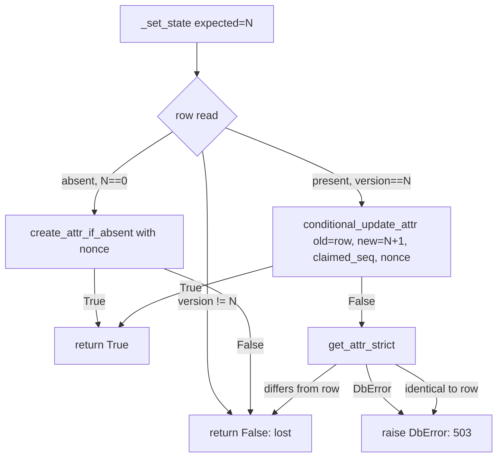

# Implementation Plan: 3.16 follow-ups the owner decided (first block)

**Date:** 2026-11-02
**Research:** the todo files named per item, re-pinned against `8659cd8` on 2026-11-02:
`thoughts/todo/unique-creator-small-followups.md`,
`thoughts/todo/github-emails-api-called-twice.md`,
`thoughts/todo/property-lookup-stale-owner-and-races.md`,
`thoughts/todo/adoption-fault-and-hygiene-followups.md` (J, K, the callback version check, `find_db_error`, the CORS headers),
and the Phase 3 learning of `thoughts/plans/2026-11-02-3-16-small-followups.md` (the DynamoDB empty-id `fetch`).
**Branch:** `release/3.16.0-owner-decided-followups`. It also carries the PR 167 review fixes (`15d0320`) and the housekeeping commit (`8659cd8`). One PR after the last phase, one commit per phase, no version bump; 3.16.0 stays untagged.

## Overview

The owner chose an approach for each item below on 2026-11-02. This plan takes the first block: the uniqueness, sign-in, reverse-lookup, CORS, `find_db_error` and callback items. The adoption and fault-contract block is its own plan, `thoughts/plans/2026-11-02-3-16-adoption-fault-followups.md`.

**Changelog rule for this plan.** 3.16.0 is unreleased, so an item that changes behaviour 3.16 introduced edits that item's existing `Unreleased` entry and `docs/migration/v3.16.rst` section in place; it gets no new FIXED or CHANGED entry. Only a change against 3.15.1 behaviour gets its own entry and **Behavior change:** sentence:
- **Changes against 3.15.1** (new entries): D10 (`v3.15.1:actingweb/handlers/factory.py:140` sent credentials), D5 (the sweep exists in `v3.15.1:actingweb/actor.py:365-366`), D2 (one `/user/emails` request), D13 (the handler ran twice), D14 (the takeover), D1 (DynamoDB `fetch`).
- **Edits of 3.16 entries in place:** D9 (`_errors.py` is new in 3.16), D11 (the 3.16 fail-closed SECURITY entry), D15 (the 3.16 indexed-write entry, `CHANGELOG.rst:328`), D3, D4, D8, D12 (all 3.16 uniqueness and adoption code).

## Decisions Made

Owner, 2026-11-02, unless marked otherwise. Evaluation changes are marked `[Eval]`.

- **D1. DynamoDB list `fetch` with an empty `actor_id`** (trust, subscription, subscription diff): return `[]`, matching PostgreSQL and `db/protocols.py:834,1086,1182`. Today it returns `None` (`db/dynamodb/trust.py:471-480`, `subscription.py:233-242`, `subscription_diff.py:163-176`). Every caller treats `None` and `[]` alike (traced 2026-11-02).
- **D2. GitHub `/user/emails` once per sign-in.** `[Eval]` The typed list cannot give the primary: `_get_github_verified_emails` keeps lowercased strings only (`oauth2.py:1333-1338`), and the primary rule needs the raw `primary` and `verified` flags (`:1279-1290`, "to prevent account-linking attacks via unverified primary emails").
  - A module helper `_fetch_github_emails(access_token) -> list[dict] | None` does the one request. `_get_github_primary_email` and `_get_github_verified_emails` become pure derivations over its rows, keeping today's rules: primary means verified **and** flagged primary, else the first verified.
  - A private authenticator method, `OAuth2Authenticator._email_answers(access_token) -> tuple[str | None, list[str]] | None`, returns `(primary, verified)` from one fetch, or `None` when the fetch failed. The default for a provider without `/user/emails` calls the two provider methods (no request on Google).
  - The two callback sites in `handlers/oauth2_callback.py` (web `:388-419`, SPA `:1083-1110`) call it only where today's code would reach `get_primary_email` (no `email` in `user_info`, `require_email`), and derive both answers from it. `None` is the failed fetch, reused: one timeout, then the existing 502 (web) or `identifier_failed` redirect (SPA).
  - Nothing public changes; `get_email_from_user_info` and the provider methods keep their contracts.
  - `[Outside voice]` Calling `_email_answers` from the callback would copy `get_email_from_user_info`'s public-email branch (`oauth2.py:887-896`) and bypass a consumer override. Instead the **per-request** authenticator memoises the one fetch (`_fetch_github_emails` result, success or `None`) for its access token; both provider calls through that authenticator read the memo. The authenticator is built per request (`handlers/oauth2_callback.py:153,280,1416`, SPA `:1083-1101`), so nothing straddles requests; the long-lived one (`oauth2_server/oauth2_server.py:65`) calls only `get_primary_email`. `[Updated 2026-11-02, owner]` This replaces the callback-site fetch above; `_email_answers` is not added.
- **D3. The successor's store seeding.** `[Updated 2026-11-02, owner]` The recorded case ("fire `actor_created` from the clean-in-place step when there is no marker") does not occur on a library path: the OAuth successor has a generated id (`oauth2.py:2130-2132`), whose marker is written before the row (`actor.py:680-706`); and "no marker" matches every pre-3.16 actor created by `POST /`, which would get `actor_created` a second time. The reachable gap is the seeding after `actor_created` (`oauth2.py:1768-1792`). Approach: a vouched sign-in seeds `store.email` when it is absent, by the clean path's `proven_email` rule (`oauth2.py:2520-2527`: the creator when it contains `@`, else the provider's email), and never overwrites one. It reuses the store the vouch check already loaded and writes only when `email` is missing; a fault there is logged and folded. `created_at` is not seeded (a first sign-in time is not a creation time), `oauth_provider` is already written on every vouched sign-in (`:2257`), and `actor_created` is not fired again.
- **D4. The force-email rewrite under the flag** (`actor.py:382-395`): with `unique_creator` on, read `get_actor(config).get_creator_holder(email)` (`db/protocols.py:175-185`) first. When another actor holds the email, skip the rewrite (DEBUG, no write). A holder equal to this actor, or no holder, rewrites as today. A `DbError` from the read propagates, as the rewrite's own does. This is one consistent read per load of such an actor, replacing a cancelled transaction; `report` lists these actors.
- **D5. The default-creator sweep** (`actor.py:654-668`) moves to `actingweb-unique-creators`. **Behavior change:** a create no longer cleans leftover default-creator actors.
  - `[Eval]` The command builds its `Config` with `unique_creator=False, force_email_prop_as_creator=False` (`maintenance/unique_creators.py:157-161`), so it cannot see the flag. Instead:
    - `report` lists a `default_creator` group: actors whose creator is `creator` and whose `store.email` is set. It is informational and not part of `Report.clean`, since the command cannot know whether the deployment pins email.
    - `resolve --apply --default-creator-to-email` renames each one to its stored email. The rename uses the same holder check and record write that `enable`'s settle step uses (`_settle_record`, `:531`), so a held email is reported and left alone. It prints `default-creator: <id> -> <email> renamed | held by <id>`.
  - `docs/migration/v3.16.rst`'s operator steps (`:778-783`) gain this step for deployments with `force_email_prop_as_creator`.
  - `[Outside voice]` Neither helper fits: `_settle_record` skips a row that does not hold the key yet (`unique_creators.py:561-562`), and `_rename` clears the stored email (`:491-493`). D5 gets its own record-aware rename: the `unique_creator` rename transaction (`db/dynamodb/actor.py:216`, `_modify_unique`; PostgreSQL's unique index) through a `Config` with `unique_creator=True`, keeping `store.email`. A held email answers `CreatorTaken` and is reported.
- **D6. `unique_creator=` on custom backends:** keep passing it always. Closed, no change.
- **D7. `#…` creators:** keep refusing every creator that starts with `#`. Closed, no change.
- **D8. The SDK rename's binding window** (`interface/actor_interface.py:410-460`). `[Updated 2026-11-02, owner]` Writing `vouched_creator` first leaves a window for provider-id creators, and a failed restore makes the actor read unvouched, so the owner's next sign-in cleans it in place (`oauth2.py:1714`, `:2466-2492`). Approach: `modify_creator` writes `vouched_creator_pending` (the new address, `normalise_creator`), renames, then promotes it to `vouched_creator` and deletes the pending value. `is_vouched_store` accepts a creator equal to either. No window for either creator type and no restore step. A raising or refused rename leaves the pending value, which only ever names an address this actor's application chose; the next `modify_creator` overwrites it. A fault writing the pending value refuses the rename. A pre-3.16 actor without `vouched_creator` is renamed as today (nothing to bind).
- **D9. `find_db_error` and `is_permanent`** (`interface/integrations/_errors.py:109-122` and `:57-76`): follow `__cause__` only. A bug raised while handling a `DbError`, inside `except DbError` or a broader `except Exception`, answers 500. Library code is held to `from` by ruff's B904, so the change reaches consumer wrappers only. `[Eval]` A backend error reached only through `__context__` no longer decides "permanent"; such a `DbError` answers 503.
- **D10. `GET /?format=json` CORS** (`handlers/factory.py:134-142`; both integrations copy the handler's headers): drop `Access-Control-Allow-Credentials`. `[Eval]` Without credentials a reflected origin is the same as `*`, so send `Access-Control-Allow-Origin: *` and no `Vary` question arises. The entry is scoped to `/?format=json`; the SPA and email endpoints keep their configured CORS.
  - `[Outside voice]` A cross-origin client that sends credentials on this fetch (axios `withCredentials`, `credentials: 'include'`) is refused by the browser once the answer carries `*`. The CHANGED entry tells consumers to drop credentials on this one request, and `docs/guides/spa-authentication.rst:1881-1887` is corrected.
- **D11. Issue K, an UNKNOWN tombstone read** (`oauth2.py:2298-2310`): fail closed. `[Eval, deduced, not confirmed]` "Marker absent" is widened to every actor that reaches the clean-in-place branch: marked-unvouched actors (`UNVOUCHED_AUTH_METHODS`, `email_verified == "false"`, a stale `vouched_creator`) are cleaned in the same way and carry the same risk. With the status UNKNOWN, `_adopt_actor` raises `DbError("actor deletion status", actor_id)` before `existing.modify(passphrase=...)` (`:2466`), as the enforced branch does at `:2318-2323`. A vouched actor returns at `:2283`, before the status read, and is not affected.
- **D12. Issue J** (`oauth2.py:2475-2492`): call `_revoke_all_actor_tokens` again after `_delete_actor_clients`. A fault in the second call raises, as the first does. `tokens_revoked` in `actor_adopted` adds both counts. `_remove_for_replacement` needs nothing: its actor is deleted, so a late token has no actor. **Known limit:** a token exchange that read its grant before the second revoke and writes after it survives; closing that needs the mint path to re-check the actor, which is `todo/resumable-actor-deletion.md`'s ground.
- **D13. The callback version check** (`callback_processor.py:178-209`) becomes a compare-and-swap that also **claims** the sequence. `[Eval]` A CAS alone does not stop a second run: the loser's retry (`:422-426`) re-reads version N+1 and the unchanged `last_seq` (moved only after the handler, `:452-456`), wins, and runs the handler again.
  - The state row gains `claimed_seq` and a per-write `nonce` (uuid4). The nonce is needed because `create_attr_if_absent` lets two identical writes both win (`attribute.py:405-407`).
  - The duplicate check (`:329` and the sync twin) treats `sequence <= max(last_seq, claimed_seq)` as already handled (DUPLICATE).
  - With a stored row: `conditional_update_attr(old_data=<the row read>, new_data=<state with version+1, claimed_seq, nonce>)`. With no row and `expected_version == 0`: `create_attr_if_absent`.
  - On False, re-read with the backend's `get_attr_strict` (`db.dbprop.get_attr_strict`; `Attributes` has none). A row that differs from the one read is a lost race and returns False. A fault raises `DbError`. A row identical to the one read means the update neither applied nor lost, which is a fault; raise.
  - The resync reset (`:505-512`, `:842`) writes `version = current + 1`, never back to 0, so the version only grows (no ABA). `claimed_seq` resets with `last_seq`.
  - The gap-timeout write (`:353`, `:683`) that ignores the result: a lost CAS there skips the `last_seq` reset (the winner did it).
  - `[Outside voice]` Further rules:
    - `claimed_seq` is the batch's last sequence (`callbacks_to_process[-1].sequence`, built from the pending queue at `:401-418`), not only the incoming one.
    - A `DbError` from the handler releases the claim (a CAS back to `last_seq`) before re-raising, so the documented redelivery (`:428-441`) still runs the handler. Only a non-`DbError` handler error keeps the at-most-once fold.
    - A re-read equal to `new_data` with this call's nonce means this call won (an SDK retry that landed, `db/dynamodb/attribute.py:371-381`).
    - The CAS compares against an unmodified copy of the row read, with `None` for absent (`_get_state` defaults and mutates, `:137`, `:206`).
    - A lost gap-timeout CAS re-enters the loop and re-reads instead of assuming what the winner did; the gap-timeout reset clears `claimed_seq` with `last_seq`.
    - The resync path takes the same claim; a poll that meets an in-flight claim (`subscription_manager.py:1112`, baseline when `auto_storage`) is the named recovery and gets a test.
- **D14. Reverse-lookup item 1, a stale owner.** On a lookup conflict, check whether the owner still holds the value and, when it does not, take the row over conditionally. This covers the runtime write, the unchanged-value heal path (`_heal_lookup`, `db/dynamodb/property.py:318-319`; PostgreSQL `:333-341`), and `backfill` on both backends. `[Eval]` changes:
  - One method per backend, `DbPropertyLookup.take_over(name, value, *, owner, new_owner, release=None) -> bool`. It is called from all four places, not written four times.
  - **DynamoDB:** one transaction. A condition check that the owner's `Property` is absent or holds another value, or that the owner `Actor` is absent. The lookup save conditioned `does_not_exist() | actor_id == owner` (a row released meanwhile is claimed). This actor's conditioned `Property` save. The release of this actor's old lookup row (`own_or_absent`) when `release` is given. Cancellation codes are read by item key, not by position: pynamodb orders a transaction as checks, deletes, puts, updates (`pynamodb/connection/base.py:973-984`).
  - **PostgreSQL:** `pg_advisory_xact_lock(hashtextextended(name || chr(0) || value, 0))` on every path that inserts or takes over a lookup row: the runtime write, the heal, the takeover and the backfill. Under READ COMMITTED a `NOT EXISTS` sees a snapshot and takes no lock, so without the advisory lock an owner's in-flight re-write and a takeover can both commit. The takeover checks `NOT EXISTS (SELECT 1 FROM properties p JOIN actors a ON a.id = p.id WHERE p.id = <owner> AND p.name = %s AND p.value = %s)`.
  - **Backfill:** a stale row is taken over only when exactly one actor holds the value now. With two or more current holders it stays a collision, reported, and the name stays unmarked. One name in both runs: `taken_over` in the apply summary, "would take over" counted as `taken_over` in the dry run.
  - **Logs:** `LOOKUP_TAKEOVER` at WARNING, with the property name, the value's digest (never the value, as `LOOKUP_COLLISION` does), the previous and the new owner. The runtime and backfill paths both log it.
  - `[Outside voice]` Corrections:
    - **DynamoDB:** transaction conditions are ANDed, so "property moved OR actor gone" is decided by a consistent pre-read, and the transaction checks only that one fact.
    - **PostgreSQL:** `chr(0)` is rejected by PostgreSQL. **Deduced, to verify in Phase 4:** drop the advisory lock. The takeover first runs `SELECT 1 FROM properties WHERE id = <owner> AND name = %s FOR SHARE`, which waits for the owner's in-flight write (D15 holds it `FOR UPDATE`) and then sees the committed value. Deadlocks (40P01) are retried with the transaction. If that proves insufficient, the two-key form `pg_advisory_xact_lock(hashtext(name), hashtext(value))` with both keys locked in sorted order.
    - **Backfill, PostgreSQL:** the takeover is a per-row pass over the existing post-pass query (`maintenance/property_lookup.py:756-767`), one row per transaction, not inside the set-based batch.
    - **Backfill, DynamoDB:** the scan streams (`:539-590`) and cannot know "exactly one current holder". Rule: a stale row is taken over by the first current holder the scan meets; a later holder is a collision. The one-holder rule is PostgreSQL-only, and the DynamoDB test asserts first-come.
    - **Heal path:** stays best effort. A fault on the takeover there is logged, not raised, because the property is already committed.
- **D15. Reverse-lookup item 2, the stale-handle race:** the indexed property write is conditional on the value it read.
  - `[Eval]` **DynamoDB:** for an indexed name, `set()` reads the stored value with a consistent read (never a long-lived `handle.value`, `:264-265`) and conditions the `Property` save on it (`Property.value == old`, or `does_not_exist()`), on the changed path, the collision fallback (`:422-427`) and the unchanged path (`:286-292`).
  - `[Eval]` **PostgreSQL:** read `old_value` inside the transaction with `SELECT value ... FOR UPDATE`, which serialises writers on an existing row. For no row, `INSERT ... ON CONFLICT (id, name) DO NOTHING`; `rowcount == 0` means a concurrent first insert won, so re-select `FOR UPDATE` and continue as the changed path.
  - **Retry:** one loop in `set()`, three attempts in all, shared with D14's takeover and replacing `_write_indexed`'s own `range(2)` (`:372`). Each attempt re-reads. A re-read equal to the new value goes through the unchanged path. After three, `PROPERTY_WRITE_RACE_EXHAUSTED` at ERROR and `DbError("property write: lost 3 races")`.
  - `set()` keeps its "last writer wins" meaning, and the losing value's lookup row is released by the retry.

### Owner's answers to the evaluation (2026-11-02)

1. **D3:** seed `store.email` on a vouched sign-in (option a).
2. **D8:** the `vouched_creator_pending` attribute (option a).
3. **Phases 3-4 stay in this plan and PR** (option b): one PR, four phases.
4. **D2:** memoise the fetch on the per-request authenticator (option a).

## What We're NOT Doing

- **The adoption and fault-contract block** (AW, BG, BK-BQ, O2, the K4 leftovers and the rest): its own plan and PR, `thoughts/plans/2026-11-02-3-16-adoption-fault-followups.md`, because it touches the sign-in and deletion paths throughout and carries a Breaking change.
  - `[Outside voice]` Corrections:
    - `delete()` and `set("")` get the same contract: delete conditioned on the value read, and the lookup row cleaned by that value, not the handle's (`db/dynamodb/property.py:247-249,458-471`; PostgreSQL `:236-239,380-425`).
    - The consistent read is `Property.get(..., consistent_read=True)` or `refresh(consistent_read=True)`; `self.get()` with a handle uses `refresh()`, which is not consistent (`:142-144`).
    - **PostgreSQL** needs no lost-race loop on an existing row; it retries the transaction on 40P01/40001 only, plus the first-insert case.
    - `_write_indexed`'s structural `include_delete` retry (`:446-448`) stays outside the race budget.
- **D6 and D7:** the owner chose no change.
- **A provider-level `/user/emails` cache:** it would straddle requests (`todo/github-emails-api-called-twice.md`).
- **Changing `get_primary_email()`'s base-class contract:** every provider would change for a GitHub-only cost.
- **Comparing the stored value on reverse lookup** (the todo's alternative for item 2): the owner chose the conditional write.
- **Checking `email_verified` in `get_email_from_user_info`** (`oauth2.py:888-890`, found by the security pass): older than 3.16 and not widened here; a todo row is added in Phase 4.
- **Closing D12's mint-path window:** belongs to `todo/resumable-actor-deletion.md`.

## What Already Exists

- `db/protocols.py` `get_creator_holder` (both backends): D4 reuses it.
- `maintenance/unique_creators.py` `_settle_record` (`:531`): D5's rename reuses its holder check and record write.
- `attribute.py` `conditional_update_attr` and `create_attr_if_absent`, and the backends' `get_attr_strict`: D13 reuses them.
- `db/dynamodb/property.py` `_heal_lookup` (`:300-346`): the transaction shape (Actor check, `Property.value` condition) that D14's DynamoDB `take_over` follows.
- `db/dynamodb/actor.py` `_run_transaction` (`:533-569`): returns the cancellation codes D14 and D15 read.
- `interface/integrations/_errors.py` `map_db_error`: D9 changes only the walk.

## Phase 1: Contract fixes (fetch, `find_db_error`, CORS, `/user/emails`)

### Changes

- `actingweb/db/dynamodb/trust.py`, `subscription.py`, `subscription_diff.py`: D1, `return []`, annotations narrowed to the protocol's.
- `actingweb/interface/integrations/_errors.py`: D9 in `find_db_error` and `is_permanent`; docstrings.
- `actingweb/handlers/factory.py` `_get_json_config`: D10.
- `actingweb/oauth2.py`: D2's `_fetch_github_emails`, the two derivations, and the per-authenticator memo keyed by access token (the GitHub provider methods read it through the authenticator that owns them).
- `actingweb/handlers/oauth2_callback.py`: unchanged; both sites already call through the per-request authenticator.
- `CHANGELOG.rst`: new FIXED entries for D1 and D2; a CHANGED entry with **Behavior change:** for D10; the 3.16 fault-mapping entry edited for D9.
- `docs/migration/v3.16.rst`: one line for D10; the fault-mapping section for D9.

### New Tests, both unit and integration tests

- `tests/test_dynamodb_empty_actor_fetch.py` (new, skipped unless the backend is DynamoDB): each of the three `fetch` methods with `""` and `None` returns `[]`. The regression: `None` today.
- `tests/test_db_fault_http.py`:
  - `raise RuntimeError(...)` (`# noqa: B904`) inside `except DbError`, and inside `except Exception` around a `DbError`, answers 500 on Flask and FastAPI. The regression: 503 today.
  - `raise ... from e` still answers 503 (`test_a_wrapped_fault_is_still_found` stays).
  - A `DbError` raised without `from` inside `except psycopg.errors.DataError` answers 503, not 500 (`is_permanent` no longer reads `__context__`).
- `tests/test_flask_factory_fallback.py` and `tests/test_fastapi_factory_json_cors.py` (new): `GET /?format=json` with an `Origin` answers `Access-Control-Allow-Origin: *` and no `Access-Control-Allow-Credentials`. The regression: the reflected origin and `true` today.
- `tests/test_oauth2_github_emails_once.py` (new; a real `OAuth2Authenticator` with `GitHubOAuth2Provider`, `requests.get` counted; the existing file mocks the authenticator, `tests/test_oauth2_callback_email_required.py:39-52`):
  - web and SPA, no public email, `require_email`: one `/user/emails` request. The regression: two today.
  - the primary rule: a verified primary that is not first in the list is picked; an unverified primary is skipped for the first verified.
  - the fetch fails: one request, then the 502 (web) or `identifier_failed` (SPA).
  - a public `email` in `user_info`: zero requests.
  - Google: zero requests.
- The existing `tests/test_oauth2_provider_verified_emails.py` stays green against the derivations.

### Failure Scenarios

- **A consumer wrapper raises without `from` and now answers 500:** the 3.16 entry's **Check:** sentence names it; the test pins the rule.
- **A browser client relied on credentialed CORS for `/?format=json`:** the content is public configuration and needs no cookie. The CHANGED entry says so.
- **GitHub answers 200 with no verified email:** `(None, [])`, the email form, as today. Covered by the existing `test_empty_list_redirects_to_email_form` and the new file.
- **GitHub times out:** one timeout, then the error; covered by the failed-fetch test.

### Verification

- [ ] Fast tier
- [ ] Each regression fails with its fix stashed
- [ ] Full tier before commit

### Implementation Status: Complete

- **Regressions:** with the fixes stashed, 13 of the new tests fail: the six DynamoDB `fetch` cases, the `find_db_error` context test, both CORS tests, and the provider-memo and callback one-request tests.
- **Guards, not regressions:** the two consumer-route 500 tests and the `is_permanent` test pass on the old code too. The app-level handler matches on the `DbError` type, and `is_permanent` starts at `__cause__`. Only library routes, through `map_db_error`, followed `__context__`.
- **Deviation, D2:** the memo lives on the GitHub provider instance as a single slot (the token, a monotonic time and the answer), bounded to 30 seconds. Each authenticator builds its own provider (`create_oauth2_authenticator`), so it is per request in the callback, and the long-lived MCP server authenticator never reuses an answer past the bound. `test_github_delegates_to_module_level_helper` now patches `_fetch_github_emails`.
- **Deviation, D10:** `docs/guides/spa-authentication.rst`'s "CORS error" section names `/?format=json` as the one endpoint fetched without credentials.

---

## Phase 2: Sign-in and uniqueness (K, J, the seeding, the rewrite, the sweep, the rename)

### Changes

- `actingweb/oauth2.py`:
  - D11 in `_adopt_actor`: UNKNOWN raises before the clean starts; the comment at `:2298-2299` says why.
  - D12: the second revoke, and `tokens_revoked` summed.
  - D3: the vouched return path seeds a missing `store.email` (`proven_email` rule).
- `actingweb/actor.py`: D4 in `get`; D5 removes `:654-668`.
- `actingweb/maintenance/unique_creators.py`: D5's `default_creator` group, `print_report`, the `--default-creator-to-email` `resolve` step.
- `actingweb/interface/actor_interface.py` and `oauth2.is_vouched_store`: D8's pending attribute (`VOUCHED_CREATOR_PENDING` beside `VOUCHED_CREATOR`).
- Docs:
  - `docs/reference/hooks-reference.rst`: when `actor_created` fires on a replacement (D3).
  - `docs/migration/v3.16.rst`: D5's operator step, D8, D11.
  - `docs/guides/database-maintenance.rst`: the new report group and flag.
- `CHANGELOG.rst`: a CHANGED entry with **Behavior change:** for D5; the 3.16 entries edited for D3, D4, D8, D11, D12.

### New Tests, both unit and integration tests

- `tests/test_adoption_unknown_and_revoke.py` (new):
  - D11: an unmarked actor with `unique_creator` off and `get_deletion_status` patched to UNKNOWN: `adopt_actor` raises `DbError`; passphrase, trusts and `_internal` are unchanged. The regression: today it cleans. (The existing `test_an_unknown_status_answers_503_and_writes_nothing`, `tests/integration/test_unique_creator_adoption.py:179`, covers only the enforced branch.)
  - D11: a marked-unvouched actor (`email_verified == "false"`) with UNKNOWN: the same 503.
  - D12: a token minted by a side effect inside `purge_relationships` is revoked by the end of the clean; `tokens_revoked` counts it. The regression: it survives today.
  - D12: a fault in the second revoke raises; the sign-in fails closed.
- `tests/integration/test_unique_creator_states.py` (both backends where the class allows; a spy, not a transaction count):
  - D4: the email held by another actor: `Actor.modify` is not called and no WARNING is logged. The regression: a refused rewrite and a WARNING on every load today.
  - D4: no holder, and a holder equal to this actor: the rewrite happens.
  - D4: the holder read faults: `DbError` propagates.
- `tests/integration/test_unique_creators_command.py`:
  - D5: `report` lists a default-creator actor with a stored email and still exits 0 when nothing else is wrong; `resolve --apply --default-creator-to-email` renames it; a held email (DynamoDB, after `enable`) is reported and left; no duplicate record is written.
  - D5: `Actor.create` with the default creator does not call `get_by_creator` (patched spy).
- D3 (`tests/integration/test_unique_creator_adoption.py`): a successor whose `store.email` write faulted gets `email` on the next sign-in, `actor_created` fired once over both; an email creator with no `store.email`, whose provider reports another email, is seeded with its own creator address; an already-seeded actor issues no write.
- D8 (`tests/test_trust_creator_rename.py`): with the rename paused, sign-ins for the old and the new address both pass, for an email creator and a provider-id creator; a raising rename leaves the pending value and the old creator vouched; a fault writing the pending value refuses the rename; the next `modify_creator` overwrites a leftover pending value; an actor without `vouched_creator` renames as today.

### Failure Scenarios

- **K's 503 repeats while the tombstone read keeps faulting:** 503 with `Retry-After`, never a silent wipe; it clears when the store recovers.
- **J's second revoke faults after the purge:** the clean is not finished and the sign-in fails closed; the next sign-in repeats it (the actor is still not vouched).
- **D4's read faults:** `DbError`, 503, as the rewrite's own write does today.
- **D5: an operator relied on the sweep:** the CHANGED entry and the migration guide name `report` and the `resolve` flag.
- **D3's seeding write faults:** logged and folded on the vouched path (a store hiccup must not block a vouched user); the next sign-in retries.

### Verification

- [ ] Fast tier
- [ ] Each regression fails with its fix stashed
- [ ] Full tier before commit

### Implementation Status: Not Started

---

## Phase 3: The callback version check as a compare-and-swap with a claim

### Changes

- `actingweb/callback_processor.py`: D13 in `_set_state`, the duplicate checks (async and sync), the resync reset and the gap-timeout writes.
- `CHANGELOG.rst`: FIXED, "two concurrent in-order deliveries of one callback can no longer both run the handler".

### New Tests, both unit and integration tests

- `tests/test_callback_processor.py`, with the `mock_attributes` fixture (`:83-121`) extended to back `conditional_update_attr`, `create_attr_if_absent` and `dbprop.get_attr_strict` with an in-memory dict (today they return truthy `MagicMock`s):
  - Two `process_callback` calls for one sequence, the winner's handler blocked on an event while the loser retries: the handler runs once and the loser answers DUPLICATE. The regression: twice today.
  - No state row: two first deliveries with identical payloads; one creates, the other loses (the nonce).
  - A False CAS with a faulting re-read raises `DbError`; with an identical re-read it raises too.
  - A resync reset stores a larger version; a CAS that read before the reset loses.
  - A lost gap-timeout CAS does not reset `last_seq`.
- `tests/integration/test_callback_processor_concurrency.py` (new, own `xdist_group` `callback_processor_cas`, row in `tests/integration/XDIST_GROUPS.md`): two threads, each with its own event loop, deliver the same in-order callback against the real store on both backends; the handler runs once.

### Failure Scenarios

- **`conditional_update_attr` folds a fault into False:** the strict re-read tells it from a lost race.
- **The winner crashes after the CAS, before the handler finishes:** `claimed_seq` is ahead of `last_seq`, and the next delivery of that sequence is a DUPLICATE. That is the at-most-once rule the processor already documents for `handler(cb)` errors; the resync path (gap timeout) recovers the subscription. Covered by a test that raises inside the handler after the claim.
- **A resync races a CAS:** the version only grows, so the stale CAS loses.

### Verification

- [ ] Fast tier
- [ ] The concurrency regression fails with the fix stashed
- [ ] `python tests/integration/verify_groups.py`
- [ ] Full tier before commit

### Implementation Status: Not Started

---

## Phase 4: Reverse lookup, a stale owner and the stale-handle race

### Changes

D15 lands first inside the phase, with the fast tier green, then D14.

- `actingweb/db/dynamodb/property_lookup.py` and `actingweb/db/postgresql/property_lookup.py`: `DbPropertyLookup.take_over` (D14).
- `actingweb/db/dynamodb/property.py`: D15's consistent pre-read and conditioned saves on all three paths; the retry loop in `set()`; D14 on the collision (`_write_indexed`) and in `_heal_lookup`. Codes are read by item key.
- `actingweb/db/postgresql/property.py`: D15's in-transaction `FOR UPDATE` read and the first-insert case; the advisory lock in `_update_lookup_entry_in_transaction`; D14 on `rowcount == 0` and in the unchanged branch.
- `actingweb/maintenance/property_lookup.py`: D14 in DynamoDB `_put_lookup_row` and the PostgreSQL `--apply` pass (the advisory lock, the one-holder rule, the lowest id never needed since two holders stay a collision); `BackfillStats.taken_over`; the dry run's "would take over"; the summary line. The module docstring's "OAuth sign-in by email" (`:3`) is corrected: sign-in resolves by creator.
- Docs: `docs/quickstart/configuration.rst` (reverse lookup: a stale row is taken over, the identity warning at `actor.py:406-408`), `docs/guides/database-maintenance.rst` (the backfill output).
- `CHANGELOG.rst`: a FIXED entry with **Behavior change:** for D14 (a takeover moves the reverse mapping; consumers using `get_by_property` as an identity should read the warning); the 3.16 indexed-write entry edited for D15.
- `thoughts/todo/`: a row for the `email_verified` check (see What We're NOT Doing).

### New Tests, both unit and integration tests

- `tests/test_property_lookup_sync.py` (both backends through the existing fixtures unless marked):
  - D14: A held `x`; A's property changed and its lookup row was left by hand; B sets `x` and is indexed; lookup by `x` finds B; `LOOKUP_TAKEOVER` logged with a digest, not the value. The regression: a logged collision today.
  - D14, heal path: B is a collision loser holding `x`; A moves away without releasing the row; B sets `x` again (unchanged) and is indexed.
  - D14: A still holds `x`: a collision, as today (the existing `test_a_collision_still_writes_the_property_and_logs` stays).
  - D14, DynamoDB only: A's actor is gone with its lookup row left; B takes it over. (PostgreSQL cascades the lookup row with the actor, `migrations/versions/70d60420526_add_property_lookup_table.py:28-32`, so the state cannot exist.)
  - D14, DynamoDB only: A re-sets `x` between B's read and B's transaction (a patched read): the condition fails, B is a collision, A keeps the row.
  - D14, PostgreSQL only, two real connections: A's re-write of `x` holds the advisory lock uncommitted; B's takeover waits, then finds A holding `x` and is a collision.
  - D14: the takeover releases B's old lookup row (B moved from `y` to `x`: lookup by `y` finds nothing).
  - D15: two handles read `x`; the first sets `y`, the second `z`: the property is `z`, lookup by `z` finds the actor, lookup by `y` finds nothing. The regression: `y`'s row stays today.
  - D15: a write followed at once by a second `set()` on the same handle succeeds on its first attempt (the consistent pre-read).
  - D15: a stale handle holding `x` with `z` stored, then `set(x)`: `z`'s lookup row is released.
  - D15: three lost races raise `DbError` and log `PROPERTY_WRITE_RACE_EXHAUSTED`.
  - D15, PostgreSQL: two concurrent first inserts of different values; one wins, the other retries as a change; one lookup row remains.
- `tests/test_property_lookup_command.py`:
  - D14: `backfill --apply` with a stale holder and one current holder takes the row over, counts `taken_over`, marks the name. The regression: a collision and an unmarked name today.
  - D14: two current holders and a stale owner: a collision, the name unmarked.
  - D14: the dry run counts the stale holder as "would take over", exit 0 when there are no real collisions.

### Failure Scenarios

- **The owner re-acquires the value during a takeover:** DynamoDB's condition check, or PostgreSQL's advisory lock plus `NOT EXISTS`, refuses it; a collision, never two owners. Covered by the DynamoDB patched-read test and the PostgreSQL two-connection test.
- **The owner's property read faults:** `DbError`, the write fails (503), as a lookup fault does today. Covered by a fault test per backend.
- **A hot property keeps losing:** three attempts, then `DbError` with `PROPERTY_WRITE_RACE_EXHAUSTED`, never a silent last write.
- **Many real collisions in a backfill:** about two reads per collision; the summary's counts show it, and real collisions are not retried.

### Verification

- [ ] Fast tier
- [ ] Each regression fails with its fix stashed
- [ ] `pytest tests/performance -m benchmark -p no:rerunfailures` alone (the property write path changes)
- [ ] Full tier before commit

### Implementation Status: Not Started

---

## Evaluation Notes

### Pass 1 (self-check)
- D3's recorded case is unreachable on library paths (`oauth2.py:2130-2132`, `actor.py:680-706`) and "no marker" over-matches pre-3.16 actors; taken to the owner.

### Architecture
- The CAS loser re-runs the handler through its retry (`callback_processor.py:422-426, 452-456`): D13 gains the claim.
- `create_attr_if_absent` lets identical writes both win (`attribute.py:405-407`): the nonce.
- The resync reset re-uses version numbers (`:505-512`): the version only grows.
- PostgreSQL D15's `FOR UPDATE` locks nothing on a missing row; the first-insert case uses `DO NOTHING` and a re-select.
- PostgreSQL D14's `NOT EXISTS` under READ COMMITTED can lose an in-flight owner write: the advisory lock.
- DynamoDB D14 must release this actor's old row, and codes are ordered by item type (`pynamodb/connection/base.py:973-984`): read by key.
- An orphan property row on PostgreSQL blocked the takeover: the `JOIN actors`.
- One `take_over` method instead of four copies; one retry budget.
- Rejected: "D3's seeding goes through Phase 4's write path". `store.email` is an `_internal` attribute (`InternalStore`), not a property, so no indexed write is involved.

### Security
- Sign-in never reads the reverse-lookup table (`oauth2.py:1952`, `:2145`), so D14 cannot take over a library sign-in; it can change what a consumer's `get_by_property` returns. The CHANGELOG says so.
- PostgreSQL D14 race (as Architecture): the advisory lock and a two-connection test.
- Several current holders: a takeover only with exactly one.
- D2's primary must stay "verified and primary": the raw-entry fetch.
- D8's provider-id window can wipe an actor: taken to the owner with the pending-attribute option.
- D3's seeded `email` follows the `proven_email` rule and never overwrites.
- `LOOKUP_TAKEOVER` logs a digest, never the value; the backfill docstring's sign-in claim is corrected.
- D11 widened to every clean-in-place actor; the raise goes before the passphrase rotation.
- D10: `*` instead of a reflected origin.
- D12's residual mint-path window is recorded as a known limit.

### Scalability
- DynamoDB D15 must condition on a consistent read, not `handle.value`: a stale read would fail the condition with no race.
- PostgreSQL D15 reads inside the transaction (one round trip fewer).
- D14's extra reads share D15's budget; a real collision is not retried.
- D4 replaces a cancelled transaction with one consistent read per load (cheaper); D5 removes a per-create cost; D13 costs the same on a win.

### Usability
- The changelog rule (edit 3.16 entries in place; new entries only against 3.15.1).
- D2's kwarg replaced by a private method; nothing public changes.
- Named log tokens and one name, `taken_over`, in both backfill runs.
- D5's group and flag, and the operator step in the migration guide.
- D10 gets a migration-guide line.

### Tests and code quality
- The D13, D2, D5 and D14 test designs above, each changed to fail before the fix.
- D5's command could not see the flag and would bypass the record check (`unique_creators.py:157-161`): the explicit flag and `_settle_record`.
- Two D14 tests cannot exist on PostgreSQL: marked DynamoDB-only, with a two-connection PostgreSQL test.
- D3's first seeding is not folded (`oauth2.py:1768-1792`, caught at `:2138`); seeding `created_at` later would be wrong; `oauth_provider` is already written (`:2257`).
- The D2 tests need real objects; the D13 fixture needs real backing; the new integration test needs an xdist group.
- Rejected: D1's "latent `TypeError`" claim: `get_diffs` already maps `None` to `[]` (`interface/subscription_manager.py:105-108`). Dropped.

### Outside voice
Providers: codex (`codex exec -s read-only`, unsandboxed) and a fresh-context Claude. Folded as the `[Outside voice]` sub-bullets of D2, D5, D10, D13, D14, D15. Taken to the owner: D2's memo (question 4) and the split of Phases 3-4 into their own plan (question 3), because they carry all the concurrency risk and share no files with Phases 1-2. Its other points:
- D4 keeps `except CreatorTaken` for the race between the holder read and `modify`.
- The D13 integration test uses a barrier at the read-to-CAS window, or it will not reproduce the race.
- D15 lands before D14 inside Phase 4, with the checks green between them, so a takeover failure is not confused with a write-path regression.

### Unverified notes
- D5: the command's record walk should page for large stores (scalability, unverified).
- The `/?format=json` body carries an `auth_url` with a fresh `state`; CSRF protection is a server-side single-use nonce (`flask_integration.py:1123`), so `*` exposes nothing new (security, unverified).
