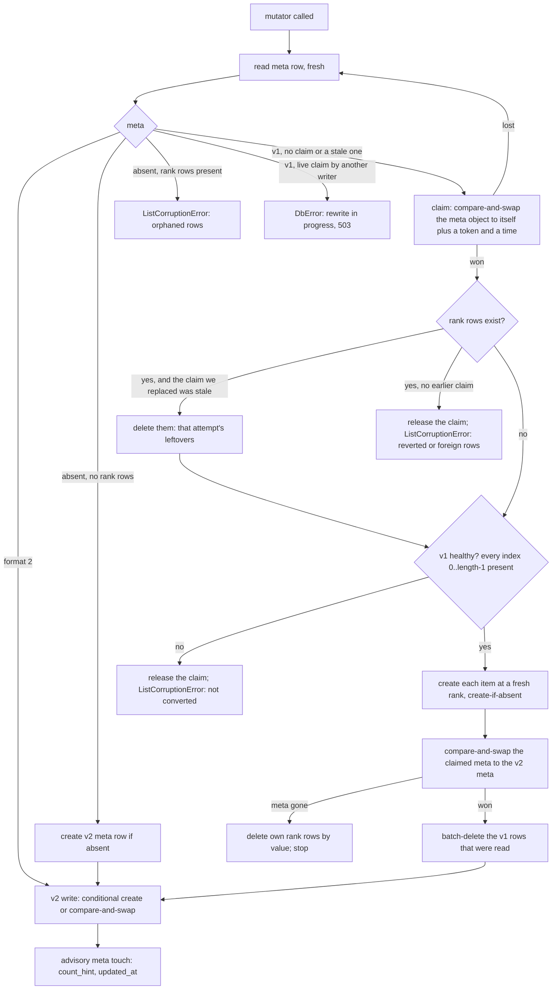

# Implementation Plan: `ListAttribute` on the v2 rank format, and list diffs that reach a replica

**Date:** 2026-11-06
**Research:** thoughts/research/2026-11-05-attribute-list-v2-port.md
**Branch:** docs/3-16-rollup-records (written here; implement on `release/3.16.0-attribute-list-v2-port`, one PR, one commit per phase)

## Update Log

- **2026-11-10, from `2026-11-10-grant-enforcement-per-route.md` Phase 1
  (owner)**: the subscriber's replica replaces a property with what a
  resource-level diff carries (`remote_storage.apply_callback_data` calls
  `set_value` for the top-level key; it never merges), so a write to
  `/properties/settings/theme` reaches a subscriber as
  `{"settings": {"theme": ...}}` and its copy of `settings` loses every
  other key until the next whole write or resync. Existing behaviour
  (recorded by the grant plan's `WG7` before and after its Phase 1); the
  3.16 migration guide states it as a known limit. This plan rewrites the
  replica store, so it takes the fix: merge a resource-level diff into the
  stored property at its depth (a diff carries the subtarget and resource),
  with tests for two- and three-segment writes and deletes, and a re-record
  of the rows that show it.

- **2026-11-10, from `2026-11-10-grant-enforcement-per-route.md` (owner)**:
  this plan's Phase 4 takes over audit item A8, the receiver's opt-in
  cleanup after a revocation (`auto_delete_on_revocation`), to be built on
  the rewritten replica store and worked into Phase 4 at the next draft
  (`/update_plan`). What it has to deliver, from
  `research/2026-11-10-grant-enforcement-per-route.md` ("A8") and that
  plan's outside voice:
  - the deletion is computed from the stored grant (delete what
    `has_property_access(name, "read") is not True`), not from a diff of
    pattern strings; `excluded_patterns` added and `read` dropped are
    revocations; scalars are deleted as well as lists; a grant in a shape
    the subscriber cannot evaluate (`allowed`/`denied`, `properties: None`,
    an override-only copy) deletes nothing and says so;
  - every writer of the stored copy runs it
    (`interface/subscription_manager.py:2528`, `:2613`, `:2925`,
    `remote_storage.py:677`, `maintenance/peer_state.py:380`), not only the
    callback and its reconcile; the `has_revocations` gate at
    `handlers/callbacks.py:453` goes, and the restore after a losing
    callback becomes name-keyed (`_still_granted`, `callbacks.py:67-74`);
  - replica keys are property names only for a whole-target `properties`
    subscription (`remote_storage.py:350-376`, one bucket per peer, `:52`):
    either the replica records the target with each key or the cleanup is
    limited to such peers; a replica list is deleted by key prefix, not by
    its meta row's length (`attribute_list.py:461-470`); an object replica
    holding an excluded descendant is rewritten without it, with the path
    rule that plan adds to the evaluator (`path_excluded`,
    `drop_excluded`), mirrored in `peer_permissions.has_property_access`;
  - one strict bucket read feeds both name sets; the flag stays off by
    default; `permission_changes` keeps `granted_patterns` and
    `revoked_patterns` (Emm reads them) and gains keys only additively.
  That plan also changes code this one references:
  `Actor.filter_subscription_blob` (`actor.py:3874` on) is the one filter
  for push and pull and gains the any-depth exclusion walk and a grant
  snapshot parameter; `evaluate_property_with_exclusions` is removed. This
  plan's Phase 4 ("the permission filter ahead of the store") rebases on
  those, and its line references into `actor.py` and `callbacks.py` are
  refreshed at the next draft.

- **2026-11-06**: The Implementation Order was still a four-plan order with
  the security-first PR "not yet decided". It is decided, and a sixth plan,
  the wire baseline (`2026-11-06-subscription-wire-baseline.md`), lands
  before this one (owner); the section now matches the other plans. Each
  phase names the recordings it re-records and the ones it must leave
  identical. Phase 2 gains the older-writer fixtures a one-version suite
  cannot otherwise cover. Line references into `tests/integration/` are by
  test and fixture name once the baseline plan has rewritten those files.
  The baseline's research contradicts three statements here, for the next
  draft: an overlapping `append` is applied once today and twice only after
  this plan's Phase 4; the unfiltered stored diff reaches a subscriber
  through the gap resync a filtered diff causes, without any poll of its
  own; and a list's `DELETE` already reaches a target-level subscriber as
  `{name: ""}`. The outside voice's findings on this plan are still not
  folded into the phases; that is the next draft, not this update.

- **2026-11-06**: The review of the baseline plan found mismatches between this
  plan's "Wire rows" lists and that plan's rows, and rows it needs that do
  not exist yet. They are recorded in
  `2026-11-06-subscription-wire-baseline.md`, Evaluation Notes, "Second
  review", and are settled when that plan's row set is redrafted; the
  lists here are not corrected until then.
- **2026-11-06**: The order, the dependencies between the six plans and
  the gates between them moved to one copy in `thoughts/todo/INDEX.md`
  (owner); the copy here is a pointer. "This plan" corrected: the security
  plan is not a dependency, no phase here uses anything it adds. Phase 5's
  verification gains the Emm run (owner).
- **2026-11-07, from the wire baseline's redraft (owner)**:
  `tests/integration/wire/rows.toml` is now the only copy of which phase may
  change which recording (owners as `plan:phase`, checked by
  `verify_groups.py` against a commit's `Wire-Phase` trailer); this plan's
  "Re-recorded" and "Identical" lists are superseded by it and are dropped
  at its next draft. Rows owned here: Phase 4 owns `WS1.subtarget`,
  `WS2.subtarget`, `WS3`/`WS5`/`WS9` below target level, `WL1`-`WL8`,
  `WL10`, `WL11.subtarget`, `WL13`-`WL17`, `WD9`, `WD15`; Phase 2 owns
  `WL12`; `WC5` is run by hand in Phase 3 and owned by no phase. The
  `remote:<peer>$aux` side bucket must be added to `actingweb-peer-state`'s
  whitelist (security plan, Phase 4). Reserved ids: `WD21`-`WD29`,
  `WL18`-`WL29`.
- **2026-11-11, from the wire baseline's recordings**
  (`subscription-wire-baseline`, Phase 1; `tests/integration/wire/rows.toml`
  is the list of rows and owners): since the security PRs `WS2.subtarget`
  is identical to `WS1.subtarget` (a subtarget diff is judged once by its
  name, so no key is filtered and no sequence spent), and `WD9`'s poll is
  answered filtered: `denied` never reaches B; what remains is the
  sequence spent on it and the gap. `WL12`: from the first falsy append B's
  replica list cannot be read at all. `WL15`: `PUT /properties/list:x`
  answers 500, so no `list:` scalar can be made over REST. `WL16` sends only
  the subtarget's value (no exposure). `WL7` shows no threshold at 25 items.
  `WL10`: the `/www` deletes send `{name: ""}`. Phase 2 of the baseline
  retired `test_list_diff_peer_replica.py` (cover `WL11.target`,
  `WL13.target`) and the integration `test_property_list_notifications.py`
  (cover `WL1` to `WL8`): references to them here are to those rows now.

## Overview

`ListAttribute`, the class every subscription replica is stored in, moves from
integer-indexed rows and a shift loop to the fractional-rank format
`ListProperty` v2 uses, so an interrupted `insert` or `delete` diff can no
longer leave holes, an inflated length or a silent duplicate. The attribute
storage layer gains the primitives the format needs on both backends. The
publisher side is brought to the list-diff format on the REST and web-UI
paths, where edits today reach a replica as scalars or not at all, and the
receiver learns to apply a diff addressed to a subtarget. Lands in 3.16
(minor, tag held). Five phases rather than the usual three or four: the
surface chosen (spanned items, keyed appends, `compact()`, an operator tool)
is a phase of its own.

The specification text for the wire behaviour this plan settles is written by
`thoughts/plans/2026-11-06-spec-1-5.md`, which lands after it.

## Implementation Order

The order of the six 3.16 plans, what depends on what between them and the
gates between them are kept in one place: `thoughts/todo/INDEX.md`, "Planned
for 3.16: order, dependencies and gates". One PR per plan, one commit per
phase, phases in the order written. What this plan uses from the others is
below.

**Readiness, 2026-11-06.** This plan is not ready to approve as written. It
has been through review and an outside voice; the outside voice's findings
are recorded in its Evaluation Notes and not yet folded into the phases, two
of them critical, with a simpler conversion design. It needs another draft.

**This plan: fourth.** It needs the baseline plan merged for the recordings
Phase 4 here re-records and Phases 1 to 3 must leave identical. It follows
the security plan in the order but uses nothing that plan adds: its receiver
changes assume an authenticated peer on the callback path, and no phase
calls code from that plan. It needs nothing from the `subs_list` plan. What follows it: the
specification plan's path-addressed list items register the diffs Phase 4
defines; its delete diffs and concurrent sender change `register_diffs` after
Phase 4 puts the permission filter ahead of the store; its overlap rule
extends the receiver Phase 4 rewrites. Both this plan and the email plan add
required methods for custom backends and a `check_ready()` probe; they do not
touch the same ones.

## Decisions Made

- **Sequencing**: port now, with `compact()` and the documented window
  `ListProperty` ships (a crash leaves both copies: duplicates, visible to
  `verify()`), not after `whole-list-rewrite-atomicity.md`.
- **Code shape**: a purpose-built v2 `ListAttribute`. `property_list.py` is
  not refactored; the pure definitions both classes need move to a small
  shared module.
- **Storage primitives**: the full set, with property semantics (a fault
  raises `DbError`; a create answers `True` only when this call created the
  row). PostgreSQL widens `attributes.bucket_name` and `name` to `TEXT` and
  gains an index on `(id, bucket, name COLLATE "C")` in the same revision, so
  range reads do not scan every attribute row the actor has.
- **Existing v1 lists**: converted on first write, on by default. The
  migration guide carries the rollout rule: deploy 3.16 to every process
  before replicas are written; a mixed fleet can leave a replica reported as
  damaged until its next resync, never silently emptied.
- **A failed list operation on the callback path**: semantics unchanged, and
  the port adds no new swallowed failure. Contention (a lost conditional
  write that retries cannot settle, a rewrite in progress) raises a
  `DbError`, so the callback answers 503 and the diff is delivered again; the
  rank cap never fails a diff because the list compacts itself at rank
  length 140. Marking a replica for resync stays with
  `subscription-subscriber-fault-hardening.md`.
- **Surface**: handles, item encoding, `verify()`, `compact()`, an operator
  tool, **`append_once`** and **spanned items**.
- **Ride-alongs**: `pop` with a negative index on the receiver; the wrong
  subscription documentation; a non-resync peer's full state replacing the
  replica; and **REST and web-UI list edits emitting list diffs**.

Deduced from those, and from the review; confirm at approval:

- **Row naming**: the meta row keeps its name, `list:{name}:meta` (the
  consumer keys `exists()` on it). v2 item rows are `list:{name}:#{rank}`;
  every range read applies the rank shape filter.
- **Item rows hold strings; the meta row stays an object.** Each v2 item is
  the JSON string `encode_item` produces, so a compare-and-swap is byte-exact
  and a falsy item is stored. The v2 meta row stays a JSON object with
  `format: 2`: a pre-3.16 reader rewrites any non-object meta row as an empty
  v1 default on read (`attribute_list.py:121-125`), which is how the first
  draft lost data in a rolling deploy.
- **Whole-list rewrites are single-writer.** Conversion and `compact()` claim
  the list in its meta row before writing, write new rows with
  create-if-absent, and never delete a rank row they did not write. Rank rows
  under a v1 meta row that carries no claim are a reverted or foreign state:
  reported as damaged, not deleted. The price: while a rewrite holds the
  claim, other writes to that list answer 503 (the diff is delivered again),
  and a writer that dies holding it leaves that one list answering 503 for up
  to **600 seconds** before the next writer takes over. That is a new, visible
  failure on one list, chosen over a silent one.
- **Side bucket**: span bodies and `append_once` key rows live in
  `{bucket}$aux`. `delete_all()` deletes the side bucket first, then the main
  one.
- **Which half of spanned items**: storage. A replica can hold an item over
  the row limit when it receives the value (a baseline or resync). A spanned
  diff reference is still not resolved by the receiver.
- **Peer input is untrusted.** The receiver validates list names, refuses a
  scalar whose key starts with `list:`, stores an envelope-shaped item wrapped
  rather than refusing it, and enforces `list_item_max_bytes`.
- **Stored diffs are permission-filtered.** The filter that runs when a
  callback is sent runs before a diff is stored, because this plan puts item
  values into diffs that today carry a summary, and a poll returns the stored
  diff.
- **Non-resync full state**: a `clear` for each list that the following
  `extend` actually carries items for, then the full state, as two diffs with
  two sequence numbers and two callbacks.
- **A large bulk edit is announced as a resync**, not as hundreds of diffs.

## What We're NOT Doing

- **Resolving spanned diff references on the receiver** - a recorded decision
  (`remote_storage.py:399-413`, `docs/migration/v3.16.rst:1082-1085`).
- **Crash-atomic whole-list rewrites** -
  `thoughts/todo/whole-list-rewrite-atomicity.md` keeps it; this plan records
  that the window is now reachable from the callback path.
- **Idempotent re-application of diffs, and requesting a resync when a diff
  cannot be applied** - `thoughts/todo/subscription-subscriber-fault-hardening.md`.
- **One callback per change across overlapping subscriptions** - two
  subscriptions from one peer that cover the same list both deliver, and an
  `append` is applied twice. A receiver-side rule in
  `thoughts/plans/2026-11-06-spec-1-5.md` (sweep row C1).
- **`find`, `find_all`, `remove_where`, `update_where`, `repair_keys` on
  `ListAttribute`** - nothing calls them on a replica, and each costs a test
  class to keep honest. The receiver's value-addressed branches are built on
  `items_with_handles()`.
- **Extracting a shared list core from `ListProperty`** - decided above.
- **A delimiter that cannot appear in a bucket or a name** -
  `thoughts/todo/prop-list-key-prefix-scheme.md` (next major).
- **Removing v1 reads** - third-party v1 lists nobody writes stay readable.
  The removal condition (the tool reports no v1 list) is recorded as a todo
  in Phase 5.
- **A receiver-side cap on callback body size** - left to the deployment's
  edge, as `interface/app.py:650-654` records; the migration guide names it.
- **The specification** - `thoughts/plans/2026-11-06-spec-1-5.md`.

## What Already Exists

- `fractional_indexing` (dependency), `property_list._v2_is_rank`
  (`property_list.py:236-246`), the rank constants (`:105-112`),
  `ListItemHandle` (`:521-557`), `AppendOnceResult` (`:560-583`), the list
  exceptions (`:249-361`) - moved to the shared module and re-exported.
- `actingweb/property_list_span.py` - envelope codec, `encode_item`, `wrap`,
  `split_parts`, `new_gen`, `part_names`, `key_row_name`. Reused as it is,
  inside the side bucket.
- `property_list.diff_reference`, `spanned_reference`, `fit_full_state`
  (`:386-494`) - reused by the shared diff builder.
- `actingweb/interface/property_store.py:256-343` - `_register_diff`, the one
  place that builds a list diff. Its body becomes the shared builder.
- `actingweb/actor.py:2636-2644`, `:2880-2930`
  (`_filter_subscription_data_by_permissions`) - the permission filter; moved
  ahead of the store, not rewritten.
- `actingweb/actor.py:2960-3110` - `suspend_subscriptions` and
  `resume_subscriptions`; the bulk path above the threshold uses them.
- `actingweb/db/dynamodb/property.py:619-828`,
  `actingweb/db/postgresql/property.py:532-824` - the property primitives the
  attribute ones are modelled on.
- `actingweb/db/postgresql/migrations/versions/e5f6a7b8c9d0_widen_properties_name_to_text.py`
  - the precedent for widening a primary-key column.
- `actingweb/interface/app.py:1557-1690` (`check_ready()`) - already probes
  PostgreSQL schema objects and names `alembic upgrade head`
  (`:1570-1572`, `:1617-1619`).
- `actingweb/maintenance/property_lookup.py`, `deletions.py` - the
  subcommand-plus-`--apply` shape and the 0/1/2 exit codes the new tool
  follows; `verify_property_lists.py` - rate limiting and the checkpoint file.
- `tests/mcp_token_double.py:59-190` - an in-memory attribute backend with
  fault hooks (`cas_hook`, `cas_fault`, `write_faults`, …). Its backend class
  moves to module level and grows the new primitives; there is one double,
  not two.
- `tests/_adoption_helpers.py:145` (`seam_fault`) and the conditional-failure
  construction in `tests/test_create_attr_if_absent.py:213-216` - the fault
  seams for both backends.
- `tests/integration/_isolated_store.py:93` - an isolated PostgreSQL schema,
  for the migration test.
- `tests/integration/test_wire_list_properties.py` and
  `tests/integration/wire/` (the baseline plan) - a publisher and a real
  replica in two topologies, one recording per flow: `WL1` to `WL10` for
  REST and web-UI edits (no list reaches a replica today), `WL11` to `WL13`
  for interface-layer edits. It replaced `test_list_diff_peer_replica.py`.

## Phase 1: attribute storage primitives on both backends

### Changes

- `actingweb/db/protocols.py` (`DbAttributeProtocol`, after `:1473`) - seven
  methods and one constant. Shared contract: a fault raises `DbError`;
  `False` means the condition did not hold; rows of another bucket that share
  the composite key are never read, matched or deleted; a row's TTL is
  ignored (list rows have none).
  - `get_attr_range(actor_id, bucket, lower, upper, *, keys_only=False) ->
    dict[str, dict[str, Any]]` - names in `[lower, upper]` in byte order,
    following every page. No ordering promised.
  - `get_first_attr_in_range(...)`, `get_last_attr_in_range(...) ->
    tuple[str, dict] | None` - the least and greatest name, with the row.
  - `create_attr_if_not_exists(actor_id, bucket, name, data, timestamp=None)
    -> bool` - `True` only when this call created the row; an existing row,
    equal or expired, is `False`. The docstring states what the name says
    against `create_attr_if_absent`, and that a write retried by the driver
    can answer `False` for a row that landed (the property primitive has the
    same property).
  - `set_attr_if_data_equals(actor_id, bucket, name, expected, data,
    timestamp=None) -> bool` - `expected` is the value as read back. Exact
    for strings; for an object, DynamoDB compares the serialised text and
    PostgreSQL compares JSONB.
  - `delete_attr_if_data_equals(actor_id, bucket, name, expected) -> bool`.
  - `delete_attrs(actor_id, bucket, names) -> None` - batch delete. Callers
    pass only names a bucket-filtered read returned.
  - `MAX_ROW_BYTES: int | None`, optional as on `DbPropertyProtocol`
    (`:261-268`); absent means no spanning.
- `actingweb/db/dynamodb/attribute.py` - `bucket_name.between(...)` with
  `consistent_read=True` and the exact `bucket` filter; forward and reverse
  queries with a page loop past rows the filter rejects, projecting `bucket`;
  `save(condition=id.does_not_exist())`; `update` and `delete` with
  `condition=(data == expected) & (bucket == bucket)`; `batch_write()` with
  its unprocessed-item retry. `MAX_ROW_BYTES = 409_600`.
- `actingweb/db/postgresql/attribute.py` - `WHERE id = %s AND bucket = %s AND
  name COLLATE "C" BETWEEN %s AND %s`; `ORDER BY name COLLATE "C" [DESC]
  LIMIT 1`; `INSERT … ON CONFLICT DO NOTHING` with `rowcount`; `UPDATE` and
  `DELETE` with `AND bucket = %s AND data = %s::jsonb`; `DELETE … WHERE id =
  %s AND bucket_name = ANY(%s) AND bucket = %s` (the primary key).
  `MAX_ROW_BYTES = None`.
- `actingweb/db/postgresql/migrations/versions/` - one revision after
  `f6a7b8c9d0e1`: one `ALTER TABLE attributes` with both `TYPE TEXT` clauses,
  under `SET lock_timeout`; `CREATE INDEX CONCURRENTLY
  ix_attributes_bucket_name_c ON attributes (id, bucket, name COLLATE "C")`
  in an autocommit block. Downgrade drops the index and restores
  `VARCHAR(255)`; its docstring says it rewrites the table and fails on a
  longer row (compact or delete the replica first).
- `actingweb/db/postgresql/schema.py:214-243` - `Text` for `bucket_name` and
  `name`, and the index.
- `actingweb/interface/app.py` (`check_ready()`) - on PostgreSQL, a probe for
  the two column types and the index; a `StoreNotReady` subclass naming
  `alembic upgrade head` and the revision.
- `actingweb/attribute.py` (`Attributes`, `:210-583`) - wrapper methods. Each
  bypasses the per-instance bucket cache for its read and drops the affected
  names from it after a write.
- `tests/mcp_token_double.py` - `MockDbAttribute` moves to module level and
  implements the seven; a crash-after-N counter and a stale-read hook join
  the existing fault hooks.
- `tests/test_db_protocols.py:139-165` - signature pins for the seven.

### Wire rows

None re-recorded. The primitives are additions; every recording is
byte-identical after the commit on both backends.

### New Tests, both unit and integration tests

- Integration, both backends, per primitive: success; row missing; value
  differs; an existing row with equal data (create answers `False`); an
  expired row present; empty input and `lower > upper`; a neighbouring bucket
  whose name shares the prefix (`remote` against `remote:x`), including the
  case where the greatest key in the range belongs to the other bucket, and
  the conditional write and delete against a colliding key; names that sort
  differently under a locale collation than in byte order; batch delete of 0,
  1 and more than 25 names, and an unprocessed-item retry on DynamoDB; a
  range whose rows exceed 1 MB (pages followed); an object `expected` read
  back and swapped.
- A name longer than 255 characters round-trips on PostgreSQL.
- Unit: each primitive raises `DbError` when the driver call raises
  (`seam_fault`), and a conditional failure is told from another error with
  the same exception class (the `ConditionalCheckFailedException`
  construction).
- Unit: the wrapper invalidates its cache after each conditional write.
- A new PostgreSQL-only test in an isolated schema runs the revision up and
  down, checks the downgrade fails on a long row, and compares the two
  columns and the index against `schema.py`.
- `check_ready()` refuses a PostgreSQL store without the revision, naming it.
- `EXPLAIN` on a seeded multi-bucket actor shows the range and last-in-range
  reads using the new index (recorded in the verification, not asserted on
  plan text).

### Failure Scenarios

- Range read or conditional write touches another bucket's row through the
  `:` collision - the exact `bucket` filter on reads and the `bucket`
  condition on writes. Covered.
- PostgreSQL sorts names by a locale collation - `COLLATE "C"` everywhere.
  Covered.
- A conditional write faults and reads as a lost race - the primitives raise.
  Covered.
- An operator runs 3.16 on PostgreSQL without the revision - `check_ready()`
  refuses at start with the remedy, instead of a 503 weeks later when a name
  first passes 255 characters. Covered.
- The `ALTER` waits behind a long transaction and queues every attribute
  query - `lock_timeout` makes it fail fast; the guide says to retry.
- Index build on a large table - `CONCURRENTLY`, outside a transaction.

### Verification

- [ ] Run the contract's `### Checks` fast tier verbatim
- [ ] Run the contract's `### Checks` full tier before the phase commit, one
      run at a time (the PostgreSQL run included: a backend difference here
      is real)

### Implementation Status: Not Started

---

## Phase 2: the v2 format, conversion, and handles

`clear()` and `delete()` do not take this path on a v1 list: they remove the
list's v1 rows by range and its rank rows, whatever its health, and write or
remove the meta row. That is what lets `set_list` repair a damaged list.

### Changes

- `actingweb/list_format.py` (new) - the rank constants, `is_rank`,
  `ListItemHandle`, `AppendOnceResult` and the list exception classes, moved
  from `property_list.py`, which re-exports them under their current names.
  Import lines only change there.
- `actingweb/attribute_list.py` - rewritten around the dispatch above.
  - **Layout.** Meta `list:{name}:meta`, an object: `format: 2`, `count_hint`,
    `format_ever_changed`, `created_at`, `updated_at`, `description`,
    `explanation`, `item_type`, `chunk_size`, `version`; no `length`. Items
    `list:{name}:#{rank}`, each a JSON string. Range `list:{name}:#` to
    `list:{name}:$`; a name is a row of this list only if its suffix passes
    `is_rank` **and** its data is a string. Anything else in the range is
    skipped with a WARNING and reported by `verify()`, never re-serialised.
  - **Reads.** `__len__` counts a keys-only range read. `get_metadata()` keeps
    its keys, serves `length` from `count_hint` (falling back to a count when
    the hint is missing), and reports the format through
    `storage_format()`. `to_list`, `slice`, `__iter__`, `index`, `count`: one
    range read with values. v1 lists keep the point-read paths for reads.
  - **Mutators (v2).** `append` (last-in-range, conditional create, up to 8
    attempts on a rank collision); `extend` (one last-in-range, n creates,
    one touch); `insert`, `__setitem__`, `__delitem__` (keys-only range read
    to resolve the index, except index 0 and the last index, which use
    first- and last-in-range); `pop()` and `pop(0)` (edge read, point read,
    conditional delete); `remove` (range read with values, conditional
    delete, re-read on a lost race, up to 8); `clear`; `delete` (rows, then
    meta); `set_description`, `set_explanation` (named fields merged into a
    fresh read). `clear()` on an absent list creates its meta row, as today.
  - **Bounds.** Every retry loop is bounded; exhausting one raises a
    `DbError` subclass (`ListContentionError`), not a value the caller can
    mistake for success. An item over `config.list_item_max_bytes` raises
    `ListItemTooLargeError` before any write.
  - **Meta.** Created with `create_attr_if_not_exists` on the first mutation,
    before the item. The advisory touch is a bounded
    `set_attr_if_data_equals` (3 attempts); a lost touch or a fault in it is
    logged at WARNING and not raised, because the item write has committed
    and raising would have the diff delivered and applied again. (The one
    place a fault is not raised; marked `# folds DbError:` as the fault guard
    test requires.)
  - **Handles.** `items_with_handles()`, `item_at()`, `delete_by_handle()`,
    `update_by_handle()`: single-shot, no retry. On a v1 list
    `items_with_handles()` converts first, so the receiver needs no separate
    step.
  - **Conversion** as in the diagram. The claim is `{"rewriting": {"token":
    …, "since": …}}` in the meta object; it is stale after 600 seconds. The
    v1 health check reads the list's rows with one range read filtered to
    `^\d+$` suffixes, stops at the first hole, and refuses a `length` over
    the rows found. An item whose JSON carries the reserved envelope key is
    stored wrapped (`property_list_span.wrap(value=…)`), not refused.
  - **Removed.** The v1 shift loops, v1 `append` and `extend`, the module
    docstring's performance note.
- `actingweb/attribute_list_store.py` - `exists()` and `list_all()` unchanged;
  a new `get(name)` returns the `ListAttribute` without attribute lookup, for
  callers that take the name from outside.
- `tests/test_attribute_list.py`, `tests/test_attribute_list_store.py`,
  `tests/integration/conftest.py:1049-1093` - the layout assertions
  (`:27`, `:49`, `:60-62`, `:80-95`, `:108-111`, `:129`, `:211-214`,
  `:234-245`, `:257-260` in the first) move to v2 or to the conversion tests.

### Wire rows

A row is one recording under `tests/integration/wire/`
(`thoughts/plans/2026-11-06-subscription-wire-baseline.md`). "Re-recorded"
means the file changes in this phase's commit and the diff is read in review;
every other recording is byte-identical after the commit, and `git show
--stat HEAD -- tests/integration/wire` lists only the rows named here. The
expectations are from reading; that plan's "Recorded outcomes" overrides
them.

Re-recorded:

- `WL12.target` - the falsy items are in the replica, in order.

Identical, and the ones to watch: `WL11.target`, `WD10`, `WD12` and `WD20`.
The same diffs and the same baseline, applied to a replica now stored in the
rank format, end in the same lists. The recording holds the replica's
contents, not its rows, so a change here is the format change altering what
an application reads.

### New Tests, both unit and integration tests

On the in-memory backend unless marked.

- Older writers, as fixtures that plant what pre-3.16 code writes (one suite
  runs one version, so the mixed fleet is simulated at the row level): on a
  v2 list, an `append` as `attribute_list.py:219-223`, `:410-425` performs
  it today (reads `length` as 0, writes `list:{name}:0`, saves the meta with
  `length: 1`), a `clear()`, and a read. For each, the next 3.16 read and
  the next 3.16 mutation: the outcome is stated by the next draft (the
  outside voice found the `append` loses the item silently) and asserted
  here, and it is never a silently shorter list.

- Every public method, including falsy items (`0`, `""`, `[]`, `{}`, `False`,
  `None`) round-tripping in order.
- Crash injection after every write of `insert`, `__delitem__`, `pop`: the
  list is the list before or the list after. For `extend` and `clear`: a
  prefix landed or a prefix remains, and the test pins that state and what a
  second delivery of the same diff then does.
- A fault in the meta touch after a committed item write does not raise and
  does not lose the item; a fault before the item write raises.
- First mutation of an absent list: write order (meta before item), a lost
  meta create, a fault at each step.
- Rank collision: two appends that read the same last rank both land.
- Concurrent delete and update of one item through handles: one wins.
- Sibling names: `a` and `a:b`; a name containing `#`; a non-string row
  planted inside the rank range is skipped and reported, and the list still
  reads.
- Conversion: each mutator converts a healthy v1 list; crash after each step,
  then a second mutation, yields the right list with no residue; two
  concurrent first mutations (one claims, the other gets
  `ListContentionError`, then succeeds on v2); a v2 list whose meta row was
  rewritten as an empty v1 default by an old reader is reported damaged and
  loses no row; a stale claim is taken over and its leftovers removed; the
  meta row vanishing mid-conversion leaves no rank rows; a v1 list with a
  hole, and one with a wrong `length`, are not converted and still read as
  before; `clear()` and `set_list` on a damaged v1 list produce a healthy v2
  list.
- A range read that faults inside `clear`, `insert` or `remove` raises and
  changes nothing.
- Metadata: keys unchanged; `updated_at` moves; description and explanation
  survive conversion; a cached meta object is never written back; a missing
  `count_hint` falls back to a count.
- Cost (counting double): `append` issues no range read; `pop()`, `pop(0)`,
  `insert(0, …)` and `del lst[0]` issue none; `insert` in the middle issues
  one keys-only read; iterating n items issues one.
- Integration, both backends
  (`tests/integration/test_attribute_lists_advanced.py`): the existing cases
  on v2; 1,000 items with inserts at the front, middle and end; a v1 list
  seeded through the raw attribute API converts on its first mutation; a
  list whose rows exceed 1 MB reads whole.
- `tests/performance/` - a `TestListAttributePerformance` class (`to_list`,
  `items_with_handles`, insert at the front of a 500-item list), run alone.

### Failure Scenarios

- Process dies mid-`insert` - one conditional create landed or did not.
  Covered.
- Two processes convert at once - the claim admits one. Covered. (The first
  draft let the loser delete the winner's later writes.)
- A pre-3.16 process reads or clears a v2 list during a rolling deploy - a
  read sees an object and writes nothing; a `clear()` by old code resets the
  meta to a v1 default, and the next 3.16 mutation finds rank rows with no
  claim and reports damage instead of deleting them. Covered; the rollout
  rule is in the guide.
- Conversion or a later rewrite outlives the 60-second callback claim
  (`callback_processor.py:74-78`; about 52 s for 10,000 items at 5 ms a
  write) - the second delivery meets the list's own claim and answers 503.
  Covered by the contention test.
- A converter dies holding the claim - writes to that list answer 503 for up
  to 600 seconds, then the next writer takes over. Covered.
- Meta deleted while converting - own rows removed, nothing recreated.
  Covered.
- Damaged v1 list receives a diff - `ListCorruptionError` naming the list,
  the kind of damage and the remedy (a resync, or the tool). Not converted
  into a shorter list. Covered.
- A peer plants a row in the rank range through the scalar path - Phase 4
  refuses the key; a row already there is skipped and reported. Covered.

### Verification

- [ ] Run the contract's `### Checks` fast tier verbatim
- [ ] Run the contract's `### Checks` full tier before the phase commit, one
      run at a time
- [ ] Run the benchmarks alone (`-m benchmark`), as the checks require for a
      change to list storage
- [ ] `grep -n "Shift all items" actingweb/attribute_list.py` returns nothing

### Implementation Status: Not Started

---

## Phase 3: spanned items, keyed appends, `verify()`, `compact()` and the operator tool

### Changes

- `actingweb/attribute_list.py`
  - **Side bucket.** `{bucket}$aux`. Building its name raises for a bucket
    that already contains `$`; cleanup paths skip the side bucket for such a
    bucket, as `property_list._aux_or_none` does.
  - **Spanned items.** An item whose encoded size exceeds
    `config.list_item_span_threshold` (and is within `list_item_max_bytes`)
    is an envelope head plus body rows in the side bucket: bodies first, then
    the head; a lost or ambiguous head write is read back; reads resolve with
    up to two re-reads on a short body set; replacing or deleting removes the
    old bodies after the commit, best effort. A head that only changes rank
    keeps its body generation (body names carry no rank). The span error
    names the attribute tool and a resync as remedies.
  - **`append_once(item, *, key)`**: item first, then a conditional create of
    the key row in the side bucket; the loser deletes its own head by value.
    Converts a v1 list first.
  - **`verify(identity_key=None, spans=False)`**: `length`,
    `max_rank_length`, `needs_rebalance`, `adjacent_duplicates`,
    `foreign_format_rows`, non-string rows in the rank range,
    `count_hint_drift`, `meta_row_present`, a claim and its age,
    `malformed_heads`, span and key-row findings, `healthy`. On a v1 list:
    holes, orphans, `convertible`.
  - **`compact()`**: claims the list as conversion does; writes each survivor
    at its target rank with create-if-absent, bisecting when the target is
    held by a row not yet moved; retires each old row with a conditional
    delete; writes `count_hint` as counted; releases the claim. The docstring
    states the window (a crash leaves both copies; for a replica the next
    resync clears them).
  - **Self-compaction.** `append`, `extend` and `insert` call `compact()` and
    regenerate when the rank about to be written is 140 characters or longer.
    A `compact()` that cannot run (a live claim, a broken span) raises its
    `DbError` or `ListCorruptionError`; it is never swallowed.
  - `sweep_span_orphans()`; `clear()` and `delete()` remove the list's
    side-bucket rows.
- `actingweb/remote_storage.py:294-301` - `delete_all()` deletes the side
  bucket, then the main bucket.
- `actingweb/handlers/callbacks.py:1089` - `_delete_revoked_peer_data` builds
  its store with `validate_peer_id=False`, as every other site does, so a
  trust-valid peer id that is not 32 hex characters has its revoked data
  deleted.
- `actingweb/maintenance/attribute_lists.py` (new), `pyproject.toml:36-43`,
  `scripts/` - `actingweb-attribute-lists` with subcommands, dry-run unless
  `--apply`, exit codes 0 clean, 1 unhealthy or errors, 2 store unreadable:
  - `report` - walks actors (skipping system actors), each actor's
    `remote:{peer}` buckets taken from its trust list (`--bucket` adds
    others), each bucket's lists found with a keys-only range read of
    `list:` names; prints findings by actor, bucket and list name, never an
    item value or raw row.
  - `repair [--apply]` - compact where `needs_rebalance`, sweep
    foreign-format rows, release a stale claim, and remove scalars named
    `index` or `value` or after a list (what pre-3.16 REST diffs left).
  - `convert [--apply]` - convert healthy v1 lists.
  - `reset [--apply]` - delete a damaged list so the next baseline rebuilds
    it.
  - Common: `--actor`, `--rps` (a read budget), `--checkpoint-file`,
    `--identity-key`, `--spans`, `--sweep-spans`.

### Wire rows

None re-recorded. The driver's snapshot gains the side bucket's row names
when it has any; it has none in an existing recording. One row is added:
`WD21`, a resync whose baseline holds an item over the DynamoDB row limit,
ending with the item in the replica and its bodies in the side bucket; and
`WC3`, `WC5` and `WC6` are run once more after it, by hand, to see that no
side-bucket row outlives the subscription, the trust or the publisher.

### New Tests, both unit and integration tests

- Spans: round trip; a crash between bodies and head; a crash after the head;
  replacing a spanned item removes the old generation; a missing body raises
  the span error with the attribute remedy; a whole-bucket read of the main
  bucket returns no body row; an item over `list_item_max_bytes` is refused
  before any write; a damaged envelope is reported and its bodies kept.
- `append_once`: one key, two calls, one item; a write that landed and
  answered `False` is found by the read-back; a v1 list converts first.
- `verify()`: each finding produced by direct row edits; a live and a stale
  claim.
- `compact()`: order preserved, ranks short; crash after each write leaves
  adjacent duplicates and nothing lost; a concurrent append during a compact
  is neither overwritten nor lost; spanned heads keep their generation;
  `compact()` on a list with a broken span raises.
- Self-compaction: 1,200 inserts at index 1 never raise and end in order with
  `max_rank_length` under 140; a crash during a self-compaction followed by
  the same diff again; a handler that runs past the callback claim meets the
  list claim.
- Sibling names in the side bucket: a list named `a-$span-x` beside `a`
  cannot be created (the name is refused, Phase 4), and a direct construction
  with such a name does not touch `a`'s bodies.
- Teardown: `delete_all()`, `delete()`, trust deletion, the last outbound
  subscription's deletion, revocation (with a spanned list, a list with no
  meta row, and a non-hex peer id) and actor deletion each leave no row in
  either bucket; a fault on the side bucket leaves the main bucket in place.
- Tool, integration on both backends: `report` on a mixed set; each
  subcommand dry-run and with `--apply`; a fault mid-sweep; a partially
  repaired actor is not checkpointed; resume from a checkpoint; exit codes;
  the output contains no item value.

### Failure Scenarios

- Self-compaction interrupted - duplicates remain, `verify()` and the tool
  report them, the next `set_list` clears them. Covered.
- Self-compaction cannot run - the diff's write raises; a `DbError` answers
  503, a corruption error is logged with its remedy. Not silent. Covered.
- A peer forces rewrites with repeated inserts into one gap - one rewrite per
  roughly 800 such diffs, each n creates and n conditional deletes, bodies
  not copied. Bounded by the publisher's own list reaching the same cap.
- Side bucket outliving its list - side first, then main, on every teardown
  path. Covered.
- The tool reading secrets - it reads `remote:` buckets by name and never
  loads other buckets' values. Covered by the output test.

### Verification

- [ ] Run the contract's `### Checks` fast tier verbatim
- [ ] Run the contract's `### Checks` full tier before the phase commit, one
      run at a time
- [ ] Run the benchmarks alone
- [ ] `poetry run actingweb-attribute-lists --help` exits 0

### Implementation Status: Not Started

---

## Phase 4: the receiver on handles, and publishers that emit list diffs

What each site registers today and after this phase (`list`, `operation` and
`length` on every diff after):

| Site | Today | After |
| --- | --- | --- |
| `PUT /properties/{list}?index=N` (`handlers/properties.py:857-889`) | `{"index", "value"}` | `append` when `index` equals the length; otherwise `update` with `item`, `index`, and `old_item` on the handle path |
| items `add` (`:2269-2282`) | `{"action": "add", …}` | `append`, `item`, `index` |
| items `update` (`:2352-2361`) | `{"action": "update", …}` | `update`, `item`, `index`, `old_item` on the handle path |
| items `delete` (`:2386-2419`) | `{"action": "delete", "index"}` | `remove` with `item` on the handle path; `delete` with `index` on v1, and for a spanned item whose value was not read |
| metadata `PUT` (`:2052-2056`) | `{"action": "metadata_update", …}` | `metadata` |
| list `DELETE` (`:1806`, `handlers/www.py:479-481`) | `""` | `delete_all`, `length: 0` |
| bulk `POST /properties` with `items` (`:282-284`, `:1292-1481`, `:1722`) | a text summary under the list's key | up to 25 changes: one `append`, `update` or `remove` per item, in order, on `subtarget={list}`. More than 25: the list's subscriptions are suspended for the batch and resumed, which sends a resync |
| `POST /properties` creating an empty list (`:1229-1233`) | a text marker | `extend` with `items: []`, `length: 0` |
| web-UI item add, update, delete (`handlers/www.py:1151`, `:1238`, `:1259`, `:1309`, `:1328`) | nothing | `append`, `update`, `remove` or `delete`, as the REST rows |
| web-UI list create and metadata edit (`:1416-1434`, `:1057-1059`) | nothing | empty `extend`; `metadata` |
| web-UI simple property create and update (`:1498`) | nothing | the property diff the REST PUT registers |

HTTP response bodies do not change. On the bulk path the response and the
diff are one variable today (`:1717-1724`); they are separated, and a POST
that touched only lists still answers with its summary and registers no empty
target-level diff.

### Changes

- `actingweb/property_list.py` - module-level `build_list_diff(list_name,
  operation, *, length, config, item=UNSET, index=None, items=None,
  old_item=UNSET, spanned_bytes=None) -> dict`, lifted from
  `interface/property_store.py:300-331`.
- `actingweb/interface/property_store.py:256-343` - `_register_diff` calls it.
- `actingweb/handlers/properties.py`, `actingweb/handlers/www.py` - each row
  of the table. A value read with `resolve=False` that is unresolved is never
  serialised: that item's diff is index-addressed or a reference. A bulk
  batch its post hook rejects registers the diffs of what was written
  (today's code writes and then returns without reverting, `:276-280`).
- `actingweb/actor.py`
  - `register_diffs` (`:3916-4059`): the diff for each subscription is passed
    through `_filter_subscription_data_by_permissions` before `add_diff`
    (`:4040`), treating a list diff as one unit under the list's name. A diff
    filtered to nothing takes no sequence number.
  - `_callback_subscription_resync` fallback (`:3493-3530`) and
    `_get_full_state_for_subscription` (`:3549-3660`): after
    `fit_full_state`, build a `clear` (`length: 0`) for every list whose
    entry still carries `items`; store it under one sequence number and the
    full state (each list an `extend` with `length`) under the next; send two
    low-granularity callbacks in order. Both diffs pass the permission
    filter. A list whose entry became a reference gets no `clear`.
- `actingweb/remote_storage.py`
  - `apply_callback_data` (`:328-393`) takes the subscription's subtarget and
    resource (passed by `handlers/callbacks.py:516`, `:649`, `:677` and
    `interface/subscription_manager.py:1070`, `:1082`): a diff for a
    subtarget-level subscription is one list operation or one scalar under
    that name, not a set of top-level keys.
  - A scalar key that starts with `list:` is refused with an error result, in
    `apply_callback_data` and `apply_resync_data`.
  - List names are validated on entry to `_apply_list_operation` and
    `set_list`: a non-empty string, no control characters, no `#` or `$`, no
    leading `_`, within a byte cap that keeps the longest row key under
    DynamoDB's 1,024-byte sort key. A refused name answers an error result
    and a WARNING written with `%r`. The lookup is
    `AttributeListStore.get(name)`, not `getattr`.
  - `_apply_list_operation` (`:395-522`): positional branches (`insert`,
    `update` by index, `delete`, `pop`) and value branches (`update` by
    `old_item`, `remove`) take one handles read (or an edge read for the
    first and last index) and one handle write; the `len()` guards at `:471`,
    `:486`, `:493-496` use that read. Value branches re-read and retry a lost
    handle write, up to 8 times; positional branches do not retry.
  - Every miss logs a WARNING naming the actor, peer, list and operation and
    saying the replica is out of step until its next resync: index out of
    range, item not found, pop on an empty list, a lost positional write.
    Today only the ambiguous value-addressed update does (`:461-469`).
  - `pop`: any negative index is normalised against the length.
  - `set_list` (`:156-182`): encode and size-check every item, then `clear()`,
    then `extend()`.
  - `get_list` (`:145-154`): one `to_list()`.
- `tests/test_remote_storage.py` - `MockListAttr` and `MockListStore`
  (`:183-290`) are deleted; the same test bodies run against a real
  `ListAttribute` on the in-memory backend. `:1131` expects two bucket
  deletes.
- `tests/test_property_list_spans.py:982-996`,
  `tests/test_v2_cost_library_callers.py:220-224` - the full state is two
  diffs with two sequence numbers, and `extend` carries `length`.
- [Updated 2026-11-06] `tests/integration/test_property_list_notifications.py`
  no longer exists: the baseline plan replaced its placeholders with the
  recordings `WL1` to `WL8`.
- `docs/guides/subscriptions.rst:347-350`, `:556-566`, `:696`,
  `docs/contributing/testing.rst:512-543` - the three wrong samples.

### Wire rows

A row is one recording under `tests/integration/wire/`
(`thoughts/plans/2026-11-06-subscription-wire-baseline.md`). "Re-recorded"
means the file changes in this phase's commit and the diff is read in review;
every other recording is byte-identical after the commit, and `git show
--stat HEAD -- tests/integration/wire` lists only the rows named here. The
expectations are from reading; that plan's "Recorded outcomes" overrides
them.

This is the phase that re-records the most rows. Each diff is the visible
form of the `**Breaking:**` changelog entry, and is read as such.

Re-recorded:

- `WL1` to `WL8`, `.target` and `.subtarget` - the stored diff and the
  callback carry the list diff of the table above, and the replica holds the
  list. The scalars named after the list, or `action`, `index`, `value`, are
  gone from the replica; the 400 a subtarget-level subscriber answered for a
  text summary is gone.
- `WL6` - a deleted list reaches the replica as `delete_all`, where today a
  target-level subscriber deletes a scalar and keeps the list.
- `WL7.target` at 26 changes - one resync callback, no per-item diff.
- `WL10.target` - each web-UI form route registers the diff of its REST twin.
- `WL11.subtarget` - a list at the subscriber, no scalars named `list`,
  `operation`, `item`, `index`.
- `WL14.target` - the `pop(-2)` is applied; `WL11.target` itself is
  identical.
- `WS1.subtarget`, `WS2.subtarget` - one scalar under the subtarget's name
  instead of one per key; a string no longer answers 400.
- `WD9` - nothing of `denied` in the stored diffs or either poll; no
  sequence number spent on it, so `allowed` arrives in sequence and is
  applied at once. The held callback, the resync and `denied` reaching the
  replica are gone from the recording.
- `WD12` - a `clear` and an `extend` with consecutive sequence numbers; the
  list once in the replica.
- `WD15` - **the item is in the replica twice.** Today the subtarget-level
  copy is stored as scalars, so an overlapping subscriber holds it once;
  teaching the receiver the subtarget-level form is what doubles it, until
  the specification plan's overlap rule. The diff of this recording is that
  regression, taken knowingly; the 3.16 tag is held past the plan that fixes
  it.

Identical, and the ones to watch: `WS1.target`, `WS3` to `WS8` (scalar diffs
are not touched; `WS5.target`'s `{p: ""}` passes the filter as an allowed
name), `WD6`, `WD8`, `WD10`, `WD13`, `WD14`, `WD16` to `WD20`, and every
`WQ`, `WC`, `WA` and `WP` row.

### New Tests, both unit and integration tests

- `build_list_diff`: every operation's field set; `None` as a legal `item`
  and `old_item`; a diff over the threshold becomes a reference.
- One handler test per row of the table asserting the registered diff, and
  per row again with a spanned item (never an unresolved value). The bulk
  path: order of diffs; an append inside a batch; exactly 25 and 26 changes;
  a list-only POST answers its summary; a hook-rejected batch;
  `tests/test_v2_cost_library_callers.py:283` (one range read) still holds.
- Permission filter: a target-level subscription whose permission excludes
  list L; a bulk POST, an item delete and a full state touching L; the stored
  diffs and both poll endpoints carry nothing of L, and no sequence number
  was spent on an empty diff.
- Receiver: every `_apply_list_operation` branch against the real class,
  including `pop(-2)`, an `update` whose `old_item` matches two rows, a
  `remove` that misses, each rejected list name, a scalar key starting with
  `list:`, an envelope-shaped item, an item over the size limit in a diff and
  in a `set_list` (the replica keeps its previous contents), and a diff for a
  subtarget-level subscription (a list and a scalar).
- Cost: one range read for `insert` in the middle, `update` by index,
  `delete` and `pop(-2)` on a 500-item replica; none for `append`, `pop()`,
  `pop(0)`, `insert(0, …)`.
- Integration, both backends, in
  `tests/integration/test_wire_list_properties.py` (the edited rows above
  carry most of this; what they do not is added there), for a target-level
  and for a subtarget-level subscription: after each of append, insert at front,
  update, delete, pop, remove, clear, list delete and empty-list creation
  done over HTTP, and again through the web-UI form routes, the replica
  equals the publisher's list (asserted on the replica; both apps run in the
  test process and callbacks are sent synchronously there); the same through
  the interface layer; a bulk POST of 10 and of 30 changes; and no scalar
  named `index`, `value`, `list`, `operation`, or named after the list, is in
  the replica bucket afterwards.
- Integration: a subscriber whose trust row says it lacks
  `subscriptionresync` (written through the library, with a fresh
  `capabilities_fetched_at`), already holding the list, receives a full state
  and ends with the publisher's list once; the two diffs carry consecutive
  sequence numbers and both are fetched.
- Integration: a resync whose baseline contains an item over the DynamoDB row
  limit succeeds and the item reads back.

### Failure Scenarios

- A handler registers a diff the receiver cannot apply - the vocabulary is
  closed; the handler tests assert membership and the integration test the
  replica.
- A subscriber without read permission on a list reads its items from a
  stored diff - filtered before the store. Covered. Without this the phase
  would widen an existing exposure.
- Full-state `clear` delivered, `extend` lost, list then quiet - the replica
  is empty until the next change or resume arrives and shows the gap
  (`callback_processor.py:849`, `:990-992`). Accepted and documented: the
  same class as any lost callback, and the alternative is the doubled replica
  of today.
- A 500-item bulk edit - one resync per subscriber instead of 500 callbacks.
  Covered at the threshold.
- A peer names a list `exists`, `__dict__` or `a-$span-x` - refused. Covered.
- A resync containing one unstorable item - nothing is cleared. Covered.
- A handle write lost on the callback path - value branches retry; a
  positional miss is logged with its remedy. Covered.

### Verification

- [ ] Run the contract's `### Checks` fast tier verbatim
- [ ] Run the contract's `### Checks` full tier before the phase commit, one
      run at a time; `tests/integration/verify_groups.py` passes with any new
      `xdist_group` documented
- [ ] `grep -n '"action":' actingweb/handlers/properties.py` shows no
      `register_diffs` blob
- [ ] `grep -c "register_diffs" actingweb/handlers/www.py` is at least 9
- [ ] `git show --stat HEAD -- tests/integration/wire` lists only the rows
      named under "Wire rows"

### Implementation Status: Not Started

---

## Phase 5: documentation, changelog and records

### Changes

- `CHANGELOG.rst`, `Unreleased`:
  - `SECURITY` - a subscription diff was stored before the publisher's
    permission filter ran, so a peer polling its subscription could read
    values a callback would have withheld.
  - `CHANGED` - **Breaking:** list edits made over REST or the web UI send
    list diffs. A subtarget-level subscriber no longer receives top-level
    `index` and `value` keys; a target-level subscriber no longer receives a
    text value under the list's name; every list edit arrives as an object
    with `list` and `operation`. Request bodies are unchanged. **Check:**
    callback hooks that branch on the diff's shape, and scalars named `index`,
    `value` or after a list in replica buckets
    (`actingweb-attribute-lists repair`).
  - `CHANGED` - **Breaking:** a custom database backend implements seven
    attribute methods; `MAX_ROW_BYTES` is optional.
  - `CHANGED` - **Behavior change:** replica lists are stored in a new
    format; a list converts on its first change. PostgreSQL needs the new
    Alembic revision before start. **Check:** deploy to every process before
    replicas are written; `actingweb-attribute-lists report`.
  - `CHANGED` - **Behavior change:** web-UI edits notify subscribers.
  - `CHANGED` - **Behavior change:** a bulk list update of more than 25 items
    is announced to subscribers as a resync.
  - `CHANGED` - **Behavior change:** a bulk list update that a hook rejects
    after its items were written (the request answers 403 and the writes are
    not reverted) notifies subscribers of what was written, so a replica
    matches the stored list.
  - `CHANGED` - **Behavior change:** a peer without resync support receives a
    full state as a `clear` followed by an `extend`.
  - `CHANGED` - **Behavior change:** the receiver refuses list names with
    control characters, `#`, `$` or a leading underscore, and scalar keys
    that start with `list:`.
  - `ADDED` - `ListAttribute` handles, `append_once`, `verify()`, `compact()`,
    `storage_format()`; `actingweb-attribute-lists`; the seven attribute
    primitives; `AttributeListStore.get()`.
  - `FIXED` - one entry each: an interrupted `insert` or `delete` diff
    damaging a replica; a falsy list item not stored; a resync with an item
    over the DynamoDB row limit failing; `pop` with a negative index; a full
    state doubling a replica; list edits over REST reaching a replica as
    scalars; a diff for a subtarget-level subscription stored as scalars;
    revoked data kept for a peer id that is not 32 hex characters.
- `docs/migration/v3.16.rst` - item 19 under "Start here" and a subsection
  "Replica lists and list diffs" after "Idempotent appends": the Alembic
  revision and the start-up check, the rollout rule, what converts when and
  that it is unconditional (unlike property lists), the tool, the diff shapes,
  the bulk threshold, the two-diff full state, the edge limit on callback
  bodies; the seven methods under "Custom database backends" (`:698`).
- `docs/guides/subscriptions.rst:364-446` - `delete_all` and `metadata` in the
  operation table; a subsection "How a replica is stored" (format,
  conversion, what an operator sees when a diff cannot be applied, the tool);
  `:429-431` corrected (no application sees the receiver's answer; the log
  line is the signal).
- `docs/guides/property-lists.rst:1036-1049` - a pointer to the attribute
  tool.
- `docs/sdk/attributes-buckets.rst:219-261` - rows for `remote:{peer_id}` and
  `remote:{peer_id}$aux` in the per-actor bucket table, with what deletes
  them.
- `thoughts/todo/attribute-list-shift-design.md` - delete, with its row in
  `thoughts/todo/INDEX.md`.
- `thoughts/todo/whole-list-rewrite-atomicity.md` - `compact()` is no longer
  operator-only for attribute lists; the bound (replicas, duplicates only,
  cleared by the next resync); the sequencing line removed.
- `thoughts/todo/subscription-subscriber-fault-hardening.md` -
  `ListAttribute.append_once()` exists; keys are derived by the subscriber
  (subscription id and sequence), never taken from the peer.
- `thoughts/todo/prop-list-key-prefix-scheme.md:107-114` - the `$aux` bucket
  and the `#` marker.
- `thoughts/todo/attribute-list-v1-read-removal.md` (new, with an INDEX row) -
  v1 reads stay until the tool reports no v1 list in a deployment.
- A note to the consumer (`../actingweb_mcp/thoughts/inbound/` if it has one,
  otherwise in the PR description): its test double of `Attributes`
  (`tests/share_fakes.py:58-114`) lacks the new methods, its orphan sweep
  treats two bucket names as deletable (`scripts/verify_integrity.py:111`),
  and its callback hook's branch on `"list" in value` now takes REST edits
  too (`hooks/actingweb/callback_hooks.py:94`).

### New Tests, both unit and integration tests

- None beyond the docs build in the full tier.

### Failure Scenarios

- A doc sample that does not run - the corrected samples are checked against
  the signatures; the docs build runs with `-W`.

### Verification

- [ ] Run the contract's `### Checks` full tier verbatim (docs build included)
- [ ] `thoughts/todo/INDEX.md` has no row for a file that no longer exists
- [ ] `grep -rn "apply_list_operation(\|RESYNC_REQUIRED" docs/guides docs/contributing`
      returns nothing
- [ ] Emm's suite on this branch, before the PR opens, run as
      `thoughts/todo/emm-suite-against-master.md` describes: no failure the
      run on `master` did not have, and the result recorded in this plan's
      verification document

### Implementation Status: Not Started

---

## Evaluation Notes

### Architecture

Two critical findings, both taken. (1) Conversion as first drafted deleted
"leftover" rank rows before winning anything, so a second converter could
delete the winner's later writes; the property code re-checks the format
before its first destructive write for exactly this reason
(`property_list.py:5718-5724`). Rewrites are now single-writer under a claim.
(2) Storing the v2 meta row as a string made today's reader rewrite it as an
empty v1 list (`attribute_list.py:121-125`), after which conversion deleted
the data; the meta row stays an object and unclaimed rank rows are never
deleted. Also taken: a bucket condition on the DynamoDB conditional writes; an
explicit branch for "meta absent, rank rows present"; `compact()` with
create-if-absent and the bisect on a held target; refusing scalar keys in a
list's range; applying a subtarget-level diff (today it is stored as scalars
named `list`, `operation`, …); the full-state `clear` built after
`fit_full_state` with its own sequence number and callback; the bulk path's
appends, unresolved spanned values and shared response variable; `set_list`
encoding before it clears; `clear()` and `delete()` bypassing conversion.

### Security

Taken: stored diffs are filtered before the store (an existing exposure this
phase would have widened, sweep row S8b); the non-resync full state passes the
same filter; list names from a peer are validated and looked up without
`getattr` (a `clear` on a list named `__dict__` emptied the store object);
scalar keys starting with `list:` are refused; `list_item_max_bytes` is
enforced so spans do not let a peer store without bound; envelope-shaped items
are wrapped, and encoding happens before `clear()`; the side-bucket name
refuses `$`; the tool reads `remote:` buckets only and prints no values; the
side bucket is deleted first; revocation no longer validates the peer id
format. Recorded for the subscriber-hardening todo: `append_once` keys are
derived, never peer-supplied.

### Scalability

Taken: the PostgreSQL range read could not use the primary key and would have
scanned every attribute row of the actor on each positional diff and each
append; the owner chose an index in the same revision. First- and
last-in-range reads keep `pop()`, `pop(0)` and front inserts off the
whole-list read; the receiver's `len()` guards use the one read; the bulk
path above 25 changes sends a resync instead of one callback per item;
conversion and self-compaction can outlive the callback claim and are made
safe by the list's own claim rather than capped; the tool does not load every
attribute of every actor; `delete_attrs` uses the primary key. Where v2 costs
more on DynamoDB (an `update` by index and an `insert` near the tail go from
one or two point operations to one whole-list key read; `append` adds two
small reads) is stated in the migration guide.

### Usability

Taken: the damaged-list and span errors name the attribute tool and a resync,
not the property tool; every miss on the callback path logs a WARNING with
actor, peer, list and remedy (the draft claimed an out-of-range index is
logged today; it is not); the tool follows the newer tools' subcommands,
`--apply` and exit codes, separates `convert` from `repair`, and can `reset` a
damaged replica; a start-up check for the PostgreSQL revision (the draft
wrongly said no revision has one); `storage_format()`; the web-UI item edits
the draft's table missed; `append` in the `PUT ?index` and bulk rows; a
concrete "Check" in the Breaking entry; stale scalars from old REST diffs
reported and removable; "Start here" gets an item; the bucket table gains the
replica buckets. Nothing in the consumer breaks on the stored shape.

### Tests and code quality

Taken: the `MockListAttr` tests could not "stay" (Phase 4 calls methods the
mock lacks) and are replaced by the real class on the in-memory backend; the
"existing migration test" did not exist, so one is written in an isolated
schema; nothing pins today's handler diffs, so every handler test is new; two
existing tests break on the two-diff full state and one on the side-bucket
delete, now listed; the crash matrix is corrected for `extend` and `clear`
(a prefix, not before-or-after); one test double instead of two; the property
suites' scenario classes that apply are ported (range-read faults, a meta row
vanishing, first-mutation write order, count-hint drift, checkpoint cases);
the pure helpers move to a shared module; `find`, `find_all`, `remove_where`,
`update_where` and `repair_keys` are dropped as uncalled; a benchmark class,
and the benchmark run the checks require for list storage, are added.

### Outside voice

Codex (gpt-5.6-sol, run outside the command sandbox) and a fresh-context
reviewer, 2026-11-06. **Not yet folded into the phases above. Two are
critical and several change the design: the plan needs another draft before
approval.**

- **Critical: the 600-second takeover is not fenced.** A slow but live
  converter keeps writing after another writer has taken the claim; the
  compare-and-swap guards only the meta row, and with deterministic target
  ranks its cleanup by value also matches the new converter's rows.
- **Critical: a pre-3.16 `append` on a v2 list loses the item silently.** Old
  code reads `length` as 0 from the v2 meta, writes `list:{name}:0` (outside
  the rank range) and saves the meta with `length: 1`; `format: 2` survives,
  and nothing reports damage (`attribute_list.py:219-223`, `:410-425`). The
  plan's "never silently emptied" covers only an old `clear()`.
- **A simpler conversion removes the claim for conversion altogether:** write
  item i at the i-th rank of `generate_n_keys_between(None, None, n)` with
  create-if-absent. Two converters then write identical rows, an interrupted
  attempt is resumed instead of restarted, and the meta compare-and-swap alone
  picks the winner: no claim, no takeover, no 600-second lockout for
  conversion. The claim would remain for `compact()` only. As drafted, a v1
  list that takes longer to convert than a function timeout restarts from
  zero every 600 seconds and blocks its diffs indefinitely.
- **"503, and the diff is delivered again" is not what happens.** The
  publisher does not retry (`callback_processor.py:961-964`, at-most-once); a
  refused diff comes back only through a poll or a gap resync, and the sender
  gives up after 10 seconds while a conversion can run 52. A diff refused on
  a list that then goes quiet is never applied.
- **`clear()`, `delete()` and `set_list` bypass the claim**, and a gap resync
  is exactly what follows a 503: `set_list` racing a live converter lets the
  converter's later creates repopulate the cleared list. The compare-and-swap
  at the end of conversion has no "lost, meta still present" branch.
- **`compact()` keeping the body generation is what the original rejected**
  (`property_list.py:5081-5083`): after a crash leaves duplicate heads, an
  ordinary `remove` on one deletes the survivor's bodies.
- **The permission filter cannot treat a bare list diff as one unit as it
  stands** (`actor.py:2908-2926` checks each top-level key as
  `subtarget/key`), and the plan says both "moved, not rewritten" and "as one
  unit". For the full state, the path each of the two diffs is checked under
  is unstated; the subscription's subtarget would evaluate `L/L` and filter a
  permitted state to nothing. A resource-level subscription named `item` or
  `operation` would receive a field of the diff.
- **Moving the fail-closed filter ahead of the store turns filter errors into
  undetectable losses**: a non-JSON value or a delete fails `json.loads`
  (`actor.py:2941-2943`), and with "a diff filtered to nothing takes no
  sequence number" the subscriber gets no diff and no gap. A JSON scalar or
  array blob is returned unfiltered (`:2904-2906`), so "stored diffs are
  filtered" does not hold either. Three outcomes are needed: allowed; denied,
  no sequence; error, with a gap left.
- **The bulk path's suspend and resume**: a request that dies in between
  leaves the list suspended with no expiry
  (`db/dynamodb/subscription_suspension.py:119`), and every later diff is
  dropped at DEBUG; two overlapping bulk requests share one marker, so the
  second's resume lifts the first's; and the resync above 25 changes goes to
  subscribers who may not read the list (`actor.py:3168-3170`).
- **The receiver's subtarget rule misreads two shapes** a publisher sends to a
  subtarget-level subscription: the full state, which is keyed by the list
  name (`actor.py:3598-3604`), and a write below the subtarget
  (`:3984-3985`), which would replace the replica's whole value.
- **One replacing diff would be simpler than `clear` then `extend`**: an
  `extend` carrying a replace flag removes the ordering dependence, the
  empty-replica window and the second sequence number; an old receiver
  degrades to today's doubling. To be decided before the specification plan
  writes the two-diff form down.
- **A damaged list on the callback path is invisible to the publisher**: the
  callback answers 204 and the sequence advances, so "not silent" holds for
  the log only. Phase 2 adds two ways to reach that state.
- **Cross-plan:** the specification plan sends resync callbacks concurrently
  through the same sender that here needs two callbacks to one subscriber in
  order; its row S5 changes what the REST PUT registers, which this plan's
  web-UI row copies; `register_diffs` is edited by three plans.
- **Scope:** `append_once` has no caller here while `repair_keys`, its repair,
  is dropped as uncalled; the operator tool and self-compaction exist largely
  to service the claim and would shrink with the simpler conversion. An
  alternative that contradicts a recorded decision, for the owner to confirm
  it was weighed: since every attribute list is a replica, treat diffs as
  invalidations and replace from a baseline, which removes conversion, claims
  and compaction.

### Unverified notes

- That PynamoDB serialises a Python string in a `JSONAttribute` the same way
  every time, which the byte-exact compare on DynamoDB rests on; and that an
  `update` with a condition on an absent item fails rather than creates.
- That `VARCHAR(255)` to `TEXT` on a primary-key column keeps the index
  without a rebuild; the migration test times it on a seeded table.
- Whether `DELETE /properties` (which clears every property,
  `handlers/properties.py:1769-1770`) removes lists, and what a replica then
  holds; if it does, the Phase 4 table needs a row.
- Whether the span threshold's headroom, computed for property rows, holds
  for attribute rows, whose keys are longer.
- The wall-time figures for conversion and compaction assume 5 ms per write.
- How often a peer id generated for an OAuth2 trust (`oauth2:<email>:<client>`)
  gets a `RemotePeerStore` bucket, and whether such an id can contain `$`.
