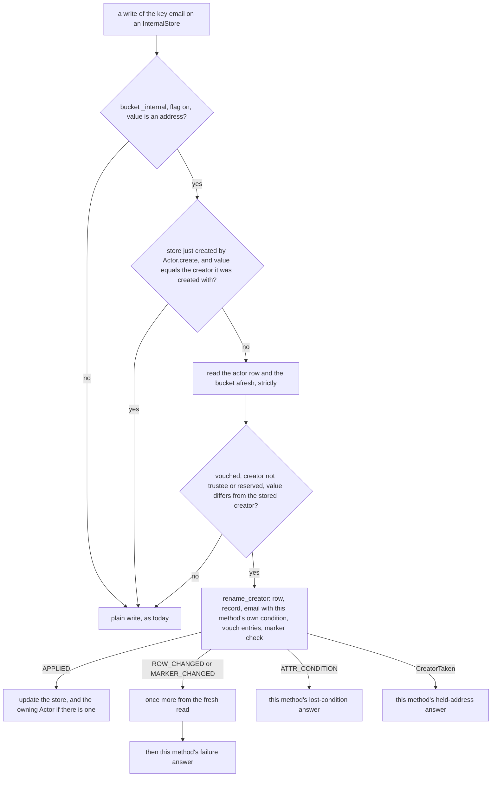

# Implementation Plan: "creator equals stored email" enforced where the email is written

**Date:** 2026-11-06
**Research:** thoughts/research/2026-11-06-actor-load-cost-and-email-as-creator.md
**Branch:** `release/3.16.0-email-as-creator-at-write-time`, one PR, one commit per phase (the plan was written on `docs/3-16-rollup-records`)

Second draft, refreshed on 2026-11-15 against `master` at `6f4a7a4`. The
first draft's review found three critical problems and a security hole in one
of its own additions; all are folded in below and the Evaluation Notes say
how.

## Update Log

- **2026-11-12, from the `subs_list` plan's redraft** (owner): that plan
  adds no `rewrite_email` keyword to `Actor.__init__`; its MCP loads pass the
  one `Actor.get` already has, through `_load_actor`. This plan removes the
  keyword from `get` and the argument from that helper; the order between
  the two plans is no longer hard. "This plan", Decisions and the Phase's
  `actor.py` item say so; nothing else here is redrafted.
- **2026-11-06**: Six plans, not five: the wire baseline
  (`2026-11-06-subscription-wire-baseline.md`) lands between the security
  plan and the `subs_list` plan (owner). This plan re-records no wire
  recording in any phase.
- **2026-11-06**: The order, the dependencies between the six plans and
  the gates between them moved to one copy in `thoughts/todo/INDEX.md`
  (owner); the copy here is a pointer. Phase 4's verification gains the Emm
  run (owner).
- **2026-11-07, from the wire baseline's redraft (owner)**:
  `tests/integration/wire/rows.toml` is now the only copy of which phase may
  change which recording (owners as `plan:phase`, checked by
  `verify_groups.py` against a commit's `Wire-Phase` trailer); this plan's
  "Re-recorded" and "Identical" lists are superseded by it and are dropped
  at its next draft. No row is owned here; every recording must stay
  identical. Reserved ids: `WE1`-`WE9`.
- **2026-11-11, from the wire baseline** (`subscription-wire-baseline`):
  no recorded outcome contradicts this plan and none of the test files it
  cites was retired. Its soft dependency is met: the recordings exist, and
  a commit that changes one names its phase in a `Wire-Phase:` trailer
  (`tests/integration/wire/rows.toml`).

- **2026-11-15, refresh against `master` at `6f4a7a4`** (after #171 to
  #176 merged; this plan is the next of the two left):
  - Every `file:line` reference was re-checked; about fifty moved and are
    corrected in place.
  - **A spike on DynamoDB Local settled the transaction** (PynamoDB 6.1.0;
    Evaluation Notes, "Spike"). One `TransactWriteItems` over the three
    tables commits or cancels as a whole. Two things in Phase 1 were wrong
    and are corrected: the cancellation codes are not in the order the code
    adds the items, and one row cannot be both written and checked.
  - **`attribute-list-v2-port` conditioned every attribute write on its
    bucket.** The rename's `_internal` writes carry the same condition on
    both backends; Phase 1 says how a key held by another bucket is told
    from a lost condition.
  - **`check_ready()` has three checks now, and a probe for a missing
    backend method** (`_check_attribute_schema_ready`). Phase 3's check is
    the fourth and follows that probe.
  - **Three tests `subs-list-cache-lifetime` added depend on the load-time
    rewrite** (`tests/test_mcp_per_request_actor.py`); Phase 2 lists them.
    Phase 4 lists the two sentences that plan added to the changelog and
    the migration guide.
  - The todo index edits that record #176's merge ride with this plan's PR
    (owner, 2026-11-15).
  - **The outside voice ran** (codex and a fresh-context reviewer;
    Evaluation Notes, "Outside voice") and its findings are folded in. Two
    went to the owner: the readiness marker now means only "the sweep has
    completed once" and a flag-off start writes nothing; a direct
    `Actor.modify(creator=X)` on an actor vouched before 3.16 keeps its
    vouch, documented.

## Overview

With `with_email_as_creator(True)`, every actor load reads the whole
`_internal` bucket to check that the creator equals the stored email, and
rewrites the creator if not (`actingweb/actor.py:888-913`). For
`actingweb_mcp` that is one strongly consistent Query on every SPA request,
issued only for the check. This plan moves the rule to the write: under the
flag, a write of the stored email of a vouched actor renames the creator in
the same atomic backend operation, so a load is one read. The vouched SDK
rename, which today is up to four writes that rely on the next load to finish
(`actingweb/interface/actor_interface.py:470-598`), becomes that same
operation. Existing mismatches are moved once by an operator command, and the
application refuses to start under the flag until it has run. Lands in 3.16
(minor, tag held).

## Implementation Order

The order of the seven 3.16 plans, what depends on what between them and the
gates between them are kept in one place: `thoughts/todo/INDEX.md`, "Planned
for 3.16: order, dependencies and gates". One PR per plan, one commit per
phase, phases in the order written. What this plan uses from the others is
below.

**Wire rows, all four phases.** None is re-recorded. This plan touches the
creator, the stored email and the actor load, not what travels between a
publisher and a subscriber; the wire apps run with `with_email_as_creator`
off, as the harness does (`tests/integration/test_harness.py:85`). Every
recording under `tests/integration/wire/` is byte-identical after each phase
on both backends, and `git show --stat HEAD -- tests/integration/wire` is
empty for each commit; a changed recording in this plan's PR is a regression
to explain.

**This plan: sixth of seven, and the next to start** (the five before it
have merged). It follows the `subs_list` plan, whose MCP loads pass
`rewrite_email=False` to `Actor.get` through one helper
(`handlers/mcp.py`, `_load_actor`); this plan removes the keyword from `get`
and the argument from that helper. [Updated 2026-11-12: that plan no longer
adds the keyword to `Actor.__init__`, so the dependency is a shared call
site, not a hard order.] From the
`ListAttribute` plan it takes two things: the bucket condition every
attribute write now carries (Phase 1), and the shape of `check_ready()`
(Phase 3). Nothing in the specification plan depends on it.

## Decisions Made

Owner decisions:

- **Enforce at the write of `_internal.email`**, by intercepting the write in
  `InternalStore`. An application keeps writing
  `actor.core_actor.store.email`; the creator moves at the write instead of
  at the next load.
- **Plan it for 3.16**, with a sweep subcommand and a readiness marker.

Deduced from those and from the review; confirm at approval:

- **One backend operation, with a condition per attribute.**
  `DbActor.rename_creator` updates the actor row (conditioned on the creator
  it read), claims the new uniqueness record, checks the vouch marker, and
  applies a list of `_internal` writes, each unconditional, only-if-absent or
  only-if-equals. Any failed condition cancels all of it, and the caller is
  told which one failed. [Updated 2026-11-15] Every attribute write also
  carries the bucket condition all attribute writes have since #176; a key
  another bucket holds raises `AttributeKeyCollision`. It is built by extending the existing rename
  (`_modify_unique`, `db/dynamodb/actor.py:252-316`; the conditional `UPDATE`,
  `db/postgresql/actor.py:388-459`), not as a second transaction builder.
- **What "all or nothing" covers:** the row, the new record and the
  attributes. The old uniqueness record is released after the commit, as
  today and on purpose (`db/dynamodb/actor.py:259-261`, `:314-315`); a fault
  there is logged, `report` lists the leftover and the sign-in lookup repairs
  it (`actor.py:996-1009`).
- **Only two callers move the creator through it:** a write of the stored
  email, and `ActorInterface.modify_creator` (the vouched SDK rename).
  `Actor.modify(creator=…)` does **not** move the stored email. The first
  draft made it do so; a reviewer showed that would leave the actor vouched
  for an address nobody proved (`oauth2.py:1873-1874`).
- **The link applies when all of these hold:** the bucket is `_internal`; the
  flag is on; the value is an address; the actor is vouched in the
  marker-only form the load uses today (`actor.py:903`,
  `oauth2.py:1854-1863`); and the stored creator is not `trustee` or a
  reserved value. Otherwise the write is the plain write it is today. A
  `None` email is a plain delete. An email equal to the stored creator is a
  plain write.
- **The default creator stays in scope.** A vouched actor whose creator is
  `creator` or empty is moved to its stored email by the write and by the
  sweep, as the load moves it today (`actor.py:1177-1180`). Only `trustee` is
  left alone, because that is the handoff.
- **No vouching path sets the creator from the stored email.** That would
  hand an actor to an address someone planted while it was unvouched. The
  table under Phase 2 lists every path that vouches an actor and what it
  leaves.
- **The readiness marker is an attribute row under an id that is never an
  actor** (`_actingweb_readiness`), so it needs no table, no migration and no
  uniqueness, and no actor deletion can wipe it. [Updated 2026-11-15, owner]
  **The marker means "the sweep has completed once", and nothing more.** A
  start with the flag on reads it once and is refused without it; a start
  with the flag off writes nothing. The second draft had a flag-off start
  downgrade the marker, to catch a period with the flag off. The outside
  voice showed that cannot be kept: a flag-off process that started before
  the sweep never downgrades it, and one flag-off start anywhere on the same
  tables would refuse every later flag-on cold start. What covers a period
  with the flag off, and writers the library does not own, is the documented
  sweep after the deploy and after any such period; the dry run reports
  mismatches at any time, and `unmark` withdraws the marker.
- **The sweep is `actingweb-unique-creators creator-to-email`**: the wording
  of the existing `resolve --default-creator-to-email`, which says the
  direction. It prints actor ids, not addresses, unless asked.
- **`rewrite_email` is removed** from `Actor.get` and from the MCP load
  helper `_load_actor` (the `subs_list` plan's; [Updated 2026-11-12] it adds
  nothing to `Actor.__init__`). Neither keyword is released or documented.

## What We're NOT Doing

- **Moving the stored email when the creator is changed directly** -
  `Actor.modify(creator=X)` under the flag leaves creator `X` and the old
  email. The actor then reads as unvouched for `X` (the recorded address and
  the stored email both name the old one, `oauth2.py:1864-1874`), so a
  sign-in for `X` cleans it in place rather than adopting it. That is the
  safe reading, and nothing undoes the change any more. [Updated 2026-11-15,
  owner] It does not hold for an actor vouched before 3.16, which has no
  recorded address and is judged by its marker alone (`oauth2.py:1866-1867`):
  that actor stays vouched for `X`, and a sign-in proving `X` adopts it as
  it is. Accepted and documented, with no code: the call is the
  application's own, and `modify_creator_unvouched` is the call that
  unvouches. An application that
  wants both moved calls `modify_creator`.
- **Linking the property named `email` to the creator** - it has not been the
  source of truth since 2017 (`CHANGELOG.rst:7477-7480`); the two pages that
  still say "email property" are corrected.
- **Carrying the email on the actor row** - a schema change on both backends
  for what the atomic write gives.
- **Removing the old uniqueness record inside the transaction** - a recorded
  decision (`db/dynamodb/actor.py:259-261`): a pre-enable duplicate's old
  creator is held by the kept actor, and a condition on it would cancel the
  rename.
- **Serialising concurrent renames beyond the row condition** - the loser
  answers `False`, as `Actor.modify` does today.
- **Recording a period with the flag off** [2026-11-15, owner] - no start
  can do it reliably (see the marker decision); the operator runs the sweep
  after one.
- **Healing writes the library does not own** - devtest
  (`handlers/devtest.py:53-55`), a custom backend write, the consumer's
  `scripts/restore_actor.py --full`. The sweep's dry run reports them at any
  time.
- **Changing the pin** - `creator_change_pinned` and
  `modify_creator_unvouched` (`actor.py:1417-1521`) keep their rules; only
  their comments about the next load change.

## What Already Exists

- `actingweb/db/dynamodb/actor.py:252-316` (`_modify_unique`) - the
  transaction over the actor row and the new `creators` record, conditioned on
  the old creator, with the old record released afterwards. Extended with
  attribute actions and a marker check.
- `actingweb/db/dynamodb/actor.py:577-628` (`_run_transaction`) - one
  `TransactWriteItems` with a client request token reused across its conflict
  retries, returning the cancellation code of each item in order. The order
  is what tells a lost row condition from a held address from a failed
  attribute condition.
- `actingweb/db/dynamodb/property.py:455` - an existing transaction that
  spans two tables (`creators="none"`), the precedent for adding the
  attributes table.
- `actingweb/db/postgresql/actor.py:388-459` - the conditional `UPDATE`, the
  `_require_creator_index` gate (`:65-83`, `:429-430`) and the mapping of a
  unique violation on `ux_actors_creator` to `CreatorTaken` (`:85-92`,
  `:451-454`).
- `actingweb/db/postgresql/attribute.py:470-508` - the upsert, its
  `sanitize_json_data` step and, since #176, its bucket condition (`WHERE
  attributes.bucket = EXCLUDED.bucket`, `:493`; no row changed means
  `AttributeKeyCollision`, `:506-512`). The SQL is repeated inside the
  rename's transaction because `set_attr` opens and commits its own
  connection. `actingweb/db/dynamodb/attribute.py:282-287` is the same
  condition on DynamoDB (`does_not_exist() | (bucket == bucket)`).
- `actingweb/attribute.py:72-208` - the four ways a key is written
  (`set_confirmed`, `replace_if_equal`, `set_if_absent`, `__setattr__`) and
  their contracts, which the interception keeps.
- `actingweb/interface/actor_interface.py:470-674` - `_rename_vouched`,
  `_rename_pinned`, `_restore_email`. The docstring at `:471-502` is the
  statement of what a rename must leave behind.
- `actingweb/oauth2.py:1854-1875` (`is_vouched_store`), `VOUCHED_CREATOR`
  (`:1838`), `VOUCHED_CREATOR_PENDING` (`:1843`).
- `actingweb/maintenance/unique_creators.py:835-889`
  (`move_default_creator`) - the config switch that makes a rename move its
  record once uniqueness is enforced, and the holder check for both states.
  The sweep is this function generalised.
- `actingweb/maintenance/mark_actors_vouched.py:150-165` - the consistent
  actor scan with `--rate-limit` and `--start-after`.
- `actingweb/maintenance/property_lookup.py:144-164` (`settle`) - the
  precedent for a start-up probe that records what it saw and marks an empty
  store ready. `actingweb/db/dynamodb/_backfill_probe.py:54-60` - the
  precedent for remembering a positive answer per process.
- `actingweb/maintenance/verify_orphans.py:80` - ids with the `_actingweb_`
  prefix are exempt from the orphan report, so the marker's id is not flagged.
- `tests/_lookup_probe.py` - a session stub and a `real_*` fixture for each
  of four probes (property lookup `:46`/`:55`, unique creator `:73`/`:88`,
  the PostgreSQL creator index `:112`/`:130`, the DynamoDB backfill
  `:152`/`:172`). The attribute schema check has none; its tests call it
  directly.
- `actingweb/interface/app.py:1710-1729` (`_check_attribute_schema_ready`) -
  the precedent for refusing a start when the configured backend lacks a
  method, naming "Custom database backends".
- `tests/_adoption_helpers.py` (`make_config`, `create_core_actor`,
  `seam_fault`, `istore`) - `make_config` leaves the flag on (the `Config`
  default, `config.py:125`), which is why several existing tests change.

## Phase 1: one atomic rename on both backends

### Changes

- `actingweb/db/protocols.py` (`DbActorProtocol`, after `modify` at `:134`):

  ```python
  class AttrWrite(NamedTuple):
      name: str
      value: Any | None          # None deletes
      when: Literal["always", "absent", "equals"] = "always"
      expected: Any | None = None  # for "equals"

  class RenameOutcome(Enum):
      APPLIED = "applied"
      ROW_CHANGED = "row-changed"        # the stored creator was not `expected`
      MARKER_CHANGED = "marker-changed"  # auth_method was not `marker`
      ATTR_CONDITION = "attr-condition"  # an "absent" or "equals" write lost

  def rename_creator(
      self, actor_id: str, *, expected: str | None, creator: str,
      internal: Sequence[AttrWrite] = (), marker: str | None = None,
  ) -> RenameOutcome: ...
  ```

  `creator` may equal `expected`: the operation is then the attribute writes
  under the row and marker conditions, with no record moved. With `marker`
  given, the operation is cancelled unless the `_internal` attribute
  `auth_method` holds exactly that value. Raises `CreatorTaken` when another
  actor holds `creator`, and `DbError` on a fault. After a `DbError` nothing
  is known; the caller reads the row back strictly.
- `actingweb/db/dynamodb/actor.py`
  - `_modify_unique` takes the attribute writes and the marker. Its
    transaction holds: the actor `update` (creator only, condition
    `Actor.id.exists() & creator_is(expected)`, as `modify` has at `:225`:
    with `expected=None` the bare condition holds on a deleted actor and the
    update would create a stub row); the `creators` put, when uniqueness is on and
    the creator is not exempt (`:288-300`); one put or delete per `AttrWrite`
    on the attributes table (key `bucket_name = "_internal:" + name`); one
    condition check on `_internal:auth_method` when `marker` is given. At
    most six items.
  - [Updated 2026-11-15] Each attribute item's condition includes the bucket,
    as every attribute write does since #176
    (`db/dynamodb/attribute.py:282-287`): `always` is `does_not_exist() |
    (bucket == "_internal")`; `absent` is the condition
    `create_attr_if_absent` uses (`:464-465`: absent, or this bucket's row
    past its TTL), so `set_if_absent` keeps its contract; `equals` is
    `(bucket == "_internal") & (data == expected)`; a delete is conditioned
    on `does_not_exist() | (bucket == "_internal")`. `equals` takes a string
    or `None` only (`ValueError` otherwise): the comparison is exact for a
    string (spike), and a dict's key order would differ between the
    backends. The email and the vouch entries are strings.
  - [Updated 2026-11-15] DynamoDB refuses a transaction that names one row
    twice (`ValidationException`, spike). `rename_creator` therefore raises
    `ValueError` before any call when `internal` names a key twice, or names
    `auth_method` while `marker` is given. No caller in this plan does
    either.
  - [Updated 2026-11-15] **Which condition failed.** The codes come back in
    the order PynamoDB sends the items, which is by kind and not the order
    the code adds them: condition checks, deletes, puts, updates
    (`pynamodb/transactions.py:133-136`; spike). The method builds the list of items
    first, as data, and derives each item's position from its kind in one
    helper; `build` only replays that list, because `_run_transaction` calls
    it once per attempt (`:600-605`) and anything it recorded would
    accumulate across conflict retries. The existing comment
    at `:540-543` says DynamoDB Local reports every failure on the first
    item; the spike shows the current Local reports each failed item at its
    own position, and that comment is corrected. Several conditions can fail
    in one cancellation; the outcome is the first that failed in this order:
    the actor row (`ROW_CHANGED`), the record (`CreatorTaken`, confirmed by
    `_record_names_other` as today, `:303-304`), the marker check
    (`MARKER_CHANGED`), an attribute item. Only `ConditionalCheckFailed` counts as a failed
    condition: on the last attempt the codes can also carry
    `TransactionConflict` (`:617-620`), which says that item was not
    evaluated. If the codes do not have one entry per item, or no item in
    the list above carries `ConditionalCheckFailed`, the method raises
    `DbError` and the caller reads back strictly, as after any fault.
  - [Updated 2026-11-15] A failed attribute item is `ATTR_CONDITION`, except
    for a collision: every attribute item asks for the stored row on a
    failed condition (`return_values=ALL_OLD`), and DynamoDB returns it
    inside the cancellation (`raw_item`, second spike). A returned row whose
    `bucket` is not `_internal` raises `AttributeKeyCollision` (a `DbError`,
    `db/exceptions.py:61`). An `always` write can fail no other way. No
    second read: `get_attr_strict` could not see such a row anyway
    (`db/dynamodb/attribute.py:212`, `db/postgresql/attribute.py:377` filter
    on the bucket), and a read after the cancellation would race.
  - `rename_creator` calls it for every configuration. With uniqueness off or
    an exempt target it runs the same transaction without the record
    (`creators="none"`), where `modify` today uses a whole-row conditional
    `save` (`:215-250`). The `save` needs a passphrase condition because it
    writes the whole row (`:225-236`); the transaction updates the creator
    attribute only, so a passphrase rotated since the load is not written
    back. That is the same guarantee by a different means, and a test pins
    it.
  - `modify` is unchanged for its existing callers.
  - The old record is released after the commit, as at `:314-315`.
- `actingweb/db/postgresql/actor.py` - `rename_creator` on one connection and
  one transaction: `_require_creator_index` first when uniqueness is on and
  the target is not exempt; [Updated 2026-11-15] one locking read (`SELECT …
  FOR UPDATE … ORDER BY bucket_name`) of every `_internal` key the call
  names, the marker's included, so the rows are locked in one order and a
  multi-row delete of the bucket (`attribute.py:1046-1050`, and actor
  deletion) cannot close a cycle with it; the marker is compared from that
  read; the conditional `UPDATE actors … WHERE id
  = %s AND creator IS NOT DISTINCT FROM %s` (`rowcount`); then each attribute
  write (`INSERT … ON CONFLICT DO NOTHING` for `absent`, `UPDATE … WHERE
  bucket = '_internal' AND data = %s::jsonb` for `equals`, the upsert of
  `attribute.py:476-500` with its `WHERE attributes.bucket = EXCLUDED.bucket`
  for `always`, `DELETE … AND bucket = '_internal'` for `None`), each value
  through `sanitize_json_data`. [Updated 2026-11-15] The locking read
  returns each row's `bucket`: a named key held by another bucket rolls back
  and raises `AttributeKeyCollision` before any write; `absent` uses the
  expired-row rule of `create_attr_if_absent` (`:719-720`). The same
  `ValueError`s as on DynamoDB. A `deadlock_detected` (two renames crossing
  on `ux_actors_creator`) rolls back and is retried once, then `DbError`.
  The first step that does not hold rolls back and answers its outcome; a
  unique violation on `ux_actors_creator` rolls back and raises
  `CreatorTaken`; every other exception rolls back explicitly and raises
  `DbError`.
- `docs/migration/v3.16.rst:759` ("Custom database backends") - the method,
  the two types and the contract.
- `tests/test_db_protocols.py` - a signature pin.

### New Tests, both unit and integration tests

- Integration, both backends: the three effects land together; a wrong
  `expected` is `ROW_CHANGED` and changes nothing; a taken creator raises and
  changes nothing, attributes included; a wrong `marker` is `MARKER_CHANGED`;
  an `absent` write on an existing key and an `equals` write on a different
  value are `ATTR_CONDITION` and change nothing, the row included; a `None`
  value deletes; an exempt target moves no record; uniqueness off; `creator
  == expected` with attribute writes only; the same call twice.
- A passphrase rotated between the load and the rename survives it, with
  uniqueness on and off.
- Fault injection at each backend seam (`seam_fault`): after a raise, every
  effect is visible or none is. On DynamoDB a cancellation for any other
  reason than a failed condition raises `DbError`.
- DynamoDB: a `TransactionConflict` on the first attempt is retried with the
  same request token and answers `APPLIED`. (That is the only retry the token
  covers; a lost acknowledgement surfaces as `DbError`,
  `db/dynamodb/actor.py:623-625`, and is the caller's strict read-back.)
- The old record's release faulting after a commit leaves `APPLIED`, the new
  record in place, and a leftover that `report` lists.
- PostgreSQL: a concurrent unvouch blocks behind the locking read and lands
  after the rename.
- [Added 2026-11-15] DynamoDB: one test per item kind that fails only that
  item and asserts the outcome, and one that fails the row and the marker
  together and asserts `ROW_CHANGED`. These pin PynamoDB's item order: a
  library version that reorders the items fails them.
- [Added 2026-11-15] Both backends: an `_internal` key held by a row of
  another bucket raises `AttributeKeyCollision` for an `always`, an `absent`
  and an `equals` write, and changes nothing. A key named twice, and
  `auth_method` with a marker, raise `ValueError` with no backend call.
- [Added 2026-11-15] A missing `auth_method` row with `marker` given is
  `MARKER_CHANGED` on both backends.
- [Added 2026-11-15] A deleted actor with `expected=None` is `ROW_CHANGED`
  and creates no row, record or attribute, on both backends.
- [Added 2026-11-15] DynamoDB: a `TransactionConflict` on the first attempt
  followed by a failed condition on the second answers that condition's
  outcome; a last attempt whose codes carry only `TransactionConflict` on
  the deciding item raises `DbError`.
- [Added 2026-11-15] An `absent` write over this bucket's expired row
  applies; an `equals` write with a dict raises `ValueError`.
- [Added 2026-11-15] PostgreSQL: a rename racing a delete of the whole
  `_internal` bucket ends with one of the two orders and no deadlock; two
  renames crossing on each other's creator end with one applied and one
  `CreatorTaken` or `ROW_CHANGED`.

### Failure Scenarios

- The transaction fails part-way - there is no part-way for the row, the new
  record and the attributes; the fault-injection tests pin it. The old record
  is the stated exception.
- A sign-in seeds `email := old` after a rename wrote `email := new` - the
  seed's write is only-if-absent, so the operation is cancelled with
  `ATTR_CONDITION` and the creator stays. Covered. This is the race the first
  draft would have reopened.
- An unvouch or a clean-in-place lands between the caller's read and the
  commit - `MARKER_CHANGED`. Covered.
- A lost acknowledgement - `DbError`, then the caller's strict read of the
  row and the email decides. Covered in Phase 2.
- A PostgreSQL connection returned to the pool after an exception with a
  transaction open - the method rolls back explicitly before it raises, and
  does not rely on the pool.
- [Added 2026-11-15] A PynamoDB upgrade changes the order it sends items in -
  the outcome would be read off the wrong code. The per-kind tests fail on
  it. The positions cannot be checked against AWS itself here; the order is
  the client library's, the server answers in request order.
- [Added 2026-11-15] A peer name or a custom bucket whose composite key
  equals `_internal:email` - the rename raises `AttributeKeyCollision` and
  nothing moves, as `set_attr` does since #176. Covered.

### Verification

- [x] Run the contract's `### Checks` fast tier verbatim (5,960 passed)
- [x] Run the contract's `### Checks` full tier before the phase commit, one
      run at a time, both backends (a difference here is real)
- [x] Codex review of the phase's diff (`### Tools`: second opinion for diffs)

### Implementation Status: Complete

**Deviations and learnings (2026-11-15):**

- **The types live in `actingweb/db/creator_rename.py`**, not in
  `protocols.py`: `AttrWrite`, `RenameOutcome`, `validate_rename_writes`
  and the constants are shared by both backends and the protocol imports
  them. `validate_rename_writes` also refuses a conditional delete, more
  than 97 writes (a DynamoDB transaction holds 100 items, three are the
  row, the record and the marker), and an `equals` without a string.
- **`equals` takes a string only**, not "a string or `None`": an equality
  with `None` has no meaning a missing attribute does not already have.
- **A rename to an exempt creator releases the old record.** The first
  version released it only when it claimed a new one; the integration test
  for an exempt target caught it (the old record stayed with the actor).
- **DynamoDB:** `_run_transaction` became a wrapper over
  `_run_transaction_reasons`, which returns whole cancellation reasons, so
  the rename reads the stored row a failed attribute put returns
  (`ALL_OLD`) to tell a collision from a lost condition. A delete in the
  transaction cannot ask for the row, so a delete is unconditional in the
  operation (`ValueError` otherwise) and its failure is always a
  collision. The comment above `_actor_exists` is corrected.
- **PostgreSQL, from the codex review of this diff:**
  - The `absent` and `equals` conditions are in the SQL statements, not
    checked in Python after the locking read: that read cannot lock a key
    with no row, so a sign-in's seed committed between the read and the
    write was overwritten. A test that seeds the key right after the lock
    pins it (`test_an_absent_key_written_after_the_lock_is_a_lost_condition`).
  - A collision is raised only after the row and the marker are decided,
    the order DynamoDB decides them in; two tests pin the precedence on
    both backends.
  - One TTL rule on both backends: only `absent` consults a row's TTL; the
    marker and `equals` do not (DynamoDB's conditions have no TTL term).
  - `delete_bucket` and the whole-actor attribute delete
    (`DbAttributeBucketList.delete`) now lock their rows in key order
    before deleting, the order the rename locks in. A plain `DELETE` locks
    in scan order, which could deadlock against the rename.
  - A fault test fails the attribute write after the actor row was
    updated inside the transaction, so the explicit rollback is what
    passes it.
- **Tests not as planned:** the plan's "a concurrent unvouch blocks behind
  the locking read and lands after the rename" cannot be ordered from a
  test without a hook inside the rename. The test holds the marker row in
  an unvouch first; the rename waits for it and answers `MARKER_CHANGED`.
  The DynamoDB item order is pinned by capturing the request the real
  `TransactWrite` and `Connection` build.
- **Isolated stores create the attributes table on first use:** the
  rename's transaction writes to it, so the test helpers touch it first.
  A deployment always has it.

---

## Phase 2: the writers, the rename, and the load



What each `InternalStore` method answers for the key `email` when the link
applies. For every other key, and whenever the link does not apply, nothing
changes.

| Method (`attribute.py`) | Email write's condition | Applied | Lost condition | Address held by another actor | Row or marker changed twice | Fault |
| --- | --- | --- | --- | --- | --- | --- |
| `store.email = v` (`:186-200`) | always | the value is set | not applicable | raises `CreatorTaken` | raises `DbError` | raises `DbError` |
| `set_confirmed` (`:72-113`) | always, then its strict read-back | `True` | not applicable | `False`, logged at ERROR naming the flag and the actor; raises with `raise_on_fault=True` | `False` | `False`; raises with `raise_on_fault=True` |
| `replace_if_equal` (`:131-156`) | equals `expected` | `True` | `False`, and the key is re-read as today | `False`, logged | `False` | `False`; never raises |
| `set_if_absent` (`:158-178`) | absent | `True` | `True` if the stored value equals `v`, else `False`, after its strict re-read as today | raises `CreatorTaken` (a `DbError`, which its caller already handles, `oauth2.py:2455-2458`) | raises `DbError` | raises `DbError` |

### Changes

- `actingweb/creator_sync.py` (new) - `write_stored_email(store, name_write:
  AttrWrite) -> RenameOutcome | None`, following the diagram. It returns
  `None` when the write is plain, so the calling method runs its existing
  code. It is imported lazily inside the four methods: `attribute.py` is
  imported through `actor`, and `oauth2` imports `interface.actor_interface`
  at module level (`oauth2.py:28`), so a module-level import would cycle.
  - The fresh read is the actor row through a new `get_actor(config)` handle
    and the bucket through a new `InternalStore`; the rename runs on that
    handle, so `expected` is the creator just read. [Updated 2026-11-15] The
    store's load is not strict (`_ensure_loaded` reads with `strict=False`
    and a fault leaves every attribute `None`), so the helper raises
    `DbError` when `not store.loaded`, as `_rename_vouched` does today.
    Without that a store fault reads as "unvouched", the email lands as a
    plain write and the creator never follows.
  - [Added 2026-11-15] "Equal" and "differs" compare
    `normalise_creator(value)` with the stored creator, as the load compares
    `em.lower()` today (`actor.py:901`): a mixed-case spelling of the
    creator is a plain write. "Is an address" is the test the load's gate
    uses; the sweep's scope uses the same two rules.
  - The vouch entries: `VOUCHED_CREATOR := the new address` when the actor has
    a recorded address, and `VOUCHED_CREATOR_PENDING` deleted when present.
  - `marker` is the `auth_method` value just read.
  - A log line at WARNING names the actor id and `with_email_as_creator` when
    the address is held.
- `actingweb/attribute.py` (`InternalStore`)
  - An optional owner, set where `Actor` builds the store (`actor.py:616` in `__init__`, `:884`
    in `get`, `:1201` and `:1301` in `create`), held as a weak reference. After an applied
    rename the helper sets the owner's `creator`, its row copy, and its
    backend handle to the handle the rename ran on, as `_rename_pinned` does
    today at `actor_interface.py:642-645`. Without it a later `modify` on the
    same instance is conditioned on a stale creator and answers `False`
    (`db/dynamodb/actor.py:225`, `db/postgresql/actor.py:438-439`). A store
    built without an owner (`InternalStore(actor_id=…, config=…)`) updates
    only itself.
  - `mark_empty()` (`:63-70`) records that the store was created with its
    actor, which is what the diagram's second test reads.
  - After an applied rename the store's own copy holds every attribute the
    operation wrote, and the underlying `Attributes` cache drops those names.
  - The four methods call the helper first for the key `email` and follow the
    table.
- `actingweb/actor.py`
  - `get()` (`:862-913`): the email check and `_email_held_elsewhere`
    (`:844-860`) are removed, with the `rewrite_email` keyword here. A load
    is the row read.
  - `get_from_creator`: the call at `:1010` loses its argument. The enforced
    branch still reads the row at `:995` and again inside `get()`; that is
    left as it is.
  - `creator_change_pinned` (`:1417-1434`), `modify_creator_unvouched`
    (`:1436-1521`) and the comment at `:1177-1180`: the wording about the next
    load.
- `actingweb/interface/actor_interface.py:470-674` - `_rename_vouched` reads
  the bucket and the row afresh as today (`:507-528`), refuses what it
  refuses today (an unreadable bucket; under the pin, a target that is not an
  address, `:557-562`), and makes one `rename_creator` call:
  - under the flag with an address target, `internal` is the email
    (`always`), `VOUCHED_CREATOR` (when recorded) and the deletion of
    `VOUCHED_CREATOR_PENDING` (when present);
  - otherwise only the vouch entries;
  - `marker` is the marker read.

  `APPLIED` answers `True`; `ROW_CHANGED` and `MARKER_CHANGED` answer `False`
  with nothing moved; `CreatorTaken` and `DbError` raise with nothing moved,
  and after a `DbError` a strict read of the row says whether it landed.
  `_rename_pinned` and `_restore_email` are deleted. Step 0 of the old
  protocol (`:529-548`) is no longer needed: the vouch moves with the
  creator. `vouched_creator_pending` is never written again; a value an
  earlier version left still vouches (`oauth2.py:1870-1872`) and is removed
  by the next rename or clean.
- `actingweb/attribute.py:115-129` - `read_strict` loses its last callers
  with the two deleted methods. It stays: it is part of the store's public
  surface and the helper's read-back uses it.
- `actingweb/handlers/mcp.py` - `_load_actor` (`:171-185`) drops
  `rewrite_email=False` from its `get` call (`:184`) and the sentence about
  it from its docstring (`:175`). It is the only call site; `_race_winner`
  (`:2493`) loads through it.
- Tests rewritten or removed:
  - `tests/test_rename_pending_vouch.py` - rewritten whole. It tests the
    protocol being deleted throughout: it patches `Actor.modify` to observe
    the pending window (`:55`), injects faults on the pending write
    (`:74-113`), covers `_restore_email` and `_rename_pinned` (`:159-263`,
    `:361-415`), asserts a pending value after a rename (`:330-334`), and
    asserts a seed loses to a held email (`:425`). The new file is organised
    by the outcome table above.
  - `tests/test_adoption_summary_and_handoff.py:436-453` (`TestLoadRewrite`)
    - becomes a write-time test.
  - `tests/test_adoption_unknown_and_revoke.py:144-225`
    (`TestSeedMissingEmail`) - its config has the flag on; `:179` writes an
    email to a vouched `google:` actor, which now renames it; `:197-221`
    patch seams the linked write no longer passes through. Rewritten with the
    flag stated per case.
  - `tests/integration/test_unique_creator_states.py:753-809`
    (`TestForceEmailRewriteHeld`) - deleted; its write-time counterpart is
    the held-address test below. `:154-167` stays.
  - `tests/integration/test_unique_creators_command.py:177-183` - a plain
    assertion.
  - [Added 2026-11-15] `tests/test_mcp_per_request_actor.py` (from
    `subs-list-cache-lifetime`): three tests set the flag and write a
    differing email on a vouched actor to show the MCP load does not rename
    (`:128-159`, `:496-512`, `:520-531`). The write itself now renames.
    `:496-512` and `:520-531` are deleted, since no load renames; `:128-159`
    keeps its read count with the mismatch set up through the backend
    (`get_attribute(config).set_attr`), not the store.
  - [Added 2026-11-15] `tests/test_mcp_trust_cache_key.py:74` - the fake
    `Actor.get` loses the `rewrite_email` keyword.
  - `tests/test_adoption_siblings_and_clean.py:127-128` (comment),
    `tests/test_adoption_strict_listing_and_rollback.py:266-286` (gains an
    assertion on the creator), `tests/test_trust_creator_rename.py:122-157`
    (rechecked with the flag on).

### What each vouching path leaves

| Path | Where | What it does to a mismatch |
| --- | --- | --- |
| A create with a vouching marker | `Actor._write_marker`, `actor.py:758-769` | None can exist: the actor has no stored email yet. The OAuth create then writes `email := identifier`, equal to the creator (`oauth2.py:1950-1952`), a plain write. [Added 2026-11-15] The branch at `:1941-1945` writes an address that differs from a provider-id creator; under the flag it is not reached, because the callers refuse a sign-in without an address (`handlers/oauth2_callback.py:483-493`, `handlers/oauth2_spa.py:1154-1172`) |
| Restoring a marker after a failed creator change | `Actor._restore_marker`, `actor.py:771-822` | Leaves the creator and the email as they were before the change |
| Clean in place | `oauth2.py:3103-3128` | Writes `email := the proven address` while the actor is unvouched (a plain write), then the marker. For an address creator the two are equal. For a provider-id creator they differ, but that case is not reachable with the flag on: a sign-in that yields no address is refused (`handlers/oauth2_callback.py:483-493`) |
| The replacement create at adoption | `oauth2.py:2970` and the create above | A new actor: equal |
| The emailed verification link | `handlers/oauth_email.py:601-620` | Runs adoption first, which resets the email to the creator |
| `actingweb-mark-actors-vouched` | `maintenance/mark_actors_vouched.py:112-114` | Vouches the row's creator and never renames. See Phase 3 for what it does about a stored email that differs |
| The emailed link confirming an address | `oauth2.py:1776`, `set_confirmed("email_verified", None)` | [Added 2026-11-15] Turns the actor vouched without touching `auth_method`. The creator is the address the link was sent to and the stored email is that address: equal |
| An application writing `auth_method` | `actor.core_actor.store.auth_method = …` | Nothing; a path the library does not own |

The state "vouched, provider-id creator, a stored address" therefore arises
only from a period with the flag off. The readiness marker catches that
period, and the sweep moves such an actor to its stored email, which is what
a load does to it today.

### New Tests, both unit and integration tests

- A load under the flag issues one read and no `_internal` read: `{GetItem:
  1}` on DynamoDB, one connection on PostgreSQL, for a vouched actor with and
  without a mismatch.
- The outcome table, cell by cell, for each of the four methods.
- The plain cases issue no row read and no transaction: flag off; another
  bucket; a `None` value; a value that is not an address; the OAuth create's
  `store.email = identifier` (asserted with the operation counter: one
  `PutItem`). An unvouched actor, a `trustee` creator and an equal email
  issue the fresh read and then a plain write.
- A linked write moves the creator, the record, the vouch and the email in
  one step, for an address creator, the default creator, and a provider-id
  creator.
- The seed race: a rename to `new`, then a sign-in's `set_if_absent("email",
  old)` from an instance loaded before it; the creator stays `new`.
- A fault in the linked write: everything or nothing, and the store's copy
  matches storage afterwards.
- The owner: after `actor.store.email = x` the same instance's `creator` is
  `x`, and a following `actor.modify(passphrase=…)` succeeds. A store built
  without an owner renames and updates only itself.
- `Actor.modify(creator=X)` on a vouched actor under the flag: the email is
  unchanged, a later load leaves the creator at `X`, and
  `is_vouched_store(store, X)` is false for an actor with a recorded
  address and true for one vouched before 3.16 (no recorded address).
- The SDK rename: applied; row changed; marker changed; address held; a fault
  with the commit landed and with it lost; an actor carrying a pending value
  from 3.15; an actor vouched before 3.16 with no recorded address; a rename
  racing a sign-in's clean-in-place. No consistent snapshot shows the actor
  vouched under neither address.
- A sign-in that reads the row before a rename commits and the bucket after
  it: the passphrase rotation's creator condition refuses it on DynamoDB
  (`oauth2.py:3046`, `db/dynamodb/actor.py:225`). On PostgreSQL a
  passphrase-only modify has no creator condition
  (`db/postgresql/actor.py:434`); the test records what happens there. This
  straddle exists today.
- The trustee handoff under the flag: `PUT trust/trustee {"creator":
  "trustee"}`, several loads, the creator stays `trustee` and the trustee
  token authenticates; then the handback `PUT {"creator": <stored email>}`
  by the trustee, before and after the owner has signed in again (the second
  is refused with 409, as today).
- Request authentication after a linked email write: basic auth with the new
  address, and a provider token for it, succeed on the first request.
- The MCP loads issue no `_internal` read.

### Failure Scenarios

- An application writes `store.email` to an address another actor holds -
  `CreatorTaken` at the write, where today the write succeeds and every later
  load logs a refusal. Visible, and named in the changelog.
- The row or the marker changes twice during one write - the method's failure
  answer; nothing is written. Covered.
- A handoff to a trustee under the flag now persists. Today the next load of
  a vouched actor moves the creator back to the stored email and the
  trustee's token stops working. Who can start it: the creator, a trustee and
  an admin peer (`config.py:332-335`, `handlers/trust.py:276`). The way back
  is the trustee's own `PUT {"creator": <stored email>}`, which the pin
  allows (`actor.py:1430-1434`), and which meets `CreatorTaken` if the owner
  has meanwhile signed in to a new actor (`db/dynamodb/actor.py:300-304`).
  Stated in the guide and the changelog; covered.
- A direct `Actor.modify(creator=X)` leaves a mismatch nothing heals -
  stated under "What We're NOT Doing" and in the changelog; the sweep's dry
  run lists it.
- A stale instance writes an email equal to the creator it loaded, after a
  rename elsewhere - the fresh read sees the new creator and the write is a
  linked one. The no-read shortcut applies only to a store created with its
  actor in the same call chain. Covered.

### Verification

- [ ] Run the contract's `### Checks` fast tier verbatim
- [ ] Run the contract's `### Checks` full tier before the phase commit, one
      run at a time
- [ ] `grep -rn "rewrite_email\|_email_held_elsewhere\|_rename_pinned\|_restore_email" actingweb`
      returns nothing
- [ ] Codex review of the phase's diff

### Implementation Status: Not Started

---

## Phase 3: the sweep, the marker, and the tools around them

### Changes

- `actingweb/constants.py` - `READINESS_STORE = "_actingweb_readiness"` (an id
  that is never an actor, as `DELETED_ACTORS_STORE` is, `:100-104`) and
  `READINESS_BUCKET = "_readiness"`.
- `actingweb/maintenance/email_as_creator.py` (new) - the marker and the
  probe. The marker is the attribute `email_as_creator` in that bucket, with
  `{"state": "synced", "at": …}`.
  - `settle(config)`, called once per process by `check_ready()`: one strict
    point read.
    - Flag on, state `synced`: ready; remembered for the process.
    - Flag on, no row: ready only if the store has no actors
      (`unique_creators.no_actors`, `:1134-1160`), in which case the marker
      is written. This follows the reverse-lookup precedent
      (`property_lookup.py:160-164`), not the uniqueness one, which refuses
      an empty store because it has a table to create
      (`interface/app.py:1693-1699`); here an empty store has nothing to
      move.
    - [Updated 2026-11-15] Flag off: no read of the marker's meaning and no
      write. The probe for `rename_creator` still runs.
    - The empty-store write is `create_attr_if_absent`, so two processes
      starting at once write one marker.
  - A read fault refuses the start, as the other probes do.
- `actingweb/interface/app.py`
  - [Updated 2026-11-15] `EmailAsCreatorNotReady(StoreNotReady)` beside the
    three existing classes (`:42-57`); the base's docstring (`:33-34`) names
    it.
  - `_check_email_as_creator_ready` as the fourth entry in `check_ready()`
    (the loop at `:1599-1614`). With the flag on or off it also refuses when the
    configured actor backend has no callable `rename_creator`
    (`ActorInterface.modify_creator` calls it in every configuration), naming
    "Custom database backends", as `_check_attribute_schema_ready` does for
    the list primitives (`:1716-1729`). Without it such a backend fails with
    `AttributeError` at a user's first sign-in.
  - The docstring gains a fourth bullet (`:1574-1592`). The combined message
    is already general (`:1612`).
- `actingweb/maintenance/unique_creators.py` - subcommand `creator-to-email`,
  dry-run unless `--apply`, with the tool's exit codes.
  - A consistent scan of actor rows (`iter_rows`, with `--rate-limit` and
    `--start-after`), skipping system actors. For each row one strict
    `_internal` read, paced under the same `--rate-limit` budget (today only
    the scan is paced, `mark_actors_vouched.py:159-161`).
  - An actor is in scope when it is vouched in the marker-only form, its
    stored email is an address different from its creator, and its creator is
    not `trustee` or reserved.
  - [Updated 2026-11-15] The rename is the write path's own call: `marker`
    is the marker the sweep read, and `internal` is the email as
    `AttrWrite("email", v, "equals", v)` plus the vouch entries of Phase 2.
    The sweep runs against live traffic; a clean-in-place between its read
    and its commit resets the email (`oauth2.py:3111`), and without the
    conditions the sweep would move the creator to the address it read
    before. A lost condition is counted as "changed during the run" and the
    actor is read again.
  - It goes through `rename_creator` under the config
    `move_default_creator` builds (`:850-859`): uniqueness on once it is
    enforced, so the record moves. The command's own config has it off
    (`:179-183`), and a rename under that would leave the new creator
    unrecorded and the old record orphaned.
  - An address held by another actor is not forced. If the holder is
    unvouched with a `factory` marker, the case is reported and does not
    count against completion: an anonymous caller can create such an actor
    for any address (`docs/migration/v3.16.rst:185-187`), so it must not be
    able to keep an application from starting, and the squat is replaced when
    the address's owner signs in. If the holder is vouched, the case is
    reported and counts against completion; `--clear-held-email` (with
    `--apply`) clears the stored email of the actor that cannot be moved, as
    `resolve` does for a renamed duplicate (`_rename`, `:582`), so it stops claiming the
    address.
  - Output names actor ids and the outcome. Addresses are personal data and
    `mark_actors_vouched` prints none (`:110`, `:118`); `--show-addresses`
    adds them for an operator who needs to decide a held case. The dry run
    lists every actor it would move before anything is applied.
  - The marker is written `synced` only by an `--apply` run that scanned the
    whole table (no `--creator`, no `--start-after`), was not interrupted,
    and ended with no case counting against completion. [Updated 2026-11-15]
    It says that run completed, not that no mismatch exists: a writer that
    does not go through the store (a 3.15 process, a flag-off process, a
    backend write) can leave one behind the scan. The command's closing line
    says so and names the run after the deploy.
  - [Added 2026-11-15] `creator-to-email --unmark` (with `--apply`) deletes
    the marker, as `actingweb-property-lookup unmark` does for its own: the
    way to make flag-on starts wait for a sweep after a period with the flag
    off.
  - `report` is unchanged. The count of mismatches is the dry run's, so
    `report`, which the guide calls safe against live traffic
    (`docs/migration/v3.16.rst:1012`), gains no per-actor read.
- `actingweb/maintenance/mark_actors_vouched.py` - a new option
  `--email-as-creator`. The command builds a bare `Config`
  (`:245`), whose flag defaults to on (`config.py:125`), so the deployment's
  setting cannot be inferred. With the option, when the command vouches an
  actor whose stored email is an address different from its creator, it first
  sets the stored email to the creator (the address being vouched), confirmed,
  and counts it. Without the option it behaves as today and counts such
  actors with a warning naming the option. It never changes a creator.
- `tests/_lookup_probe.py` - a session stub for the new probe and a
  `real_email_probe` fixture, beside the four pairs that exist.
- `tests/test_demo_example.py:29-40` - the demo has the flag on
  (`examples/demo/application.py:72`); its autouse fixture stubs the new
  probe as it stubs `missing_enforcement`.

### New Tests, both unit and integration tests

- Integration, both backends, the sweep on a mixed set: equal; vouched
  mismatch with an address creator, the default creator and a provider-id
  creator; unvouched mismatch; `trustee`; an address held by a `factory`
  actor; an address held by a vouched actor. Dry run changes nothing and
  lists the movable ones; `--apply` moves them, with their records, and
  leaves the rest; the marker is withheld for the vouched holder and written
  after `--clear-held-email`; not written with `--creator`, with
  `--start-after`, or after an injected fault mid-run; a second full run
  writes it.
- With uniqueness enforced and not, the moved actor's record exists and the
  old one is gone.
- The output contains no address without `--show-addresses`.
- The probe: flag on and no row on a store with actors refuses, naming the
  command; on an empty store it passes and writes the marker; `synced`
  passes with one read and none on a second call in the same process; a start
  with the flag off leaves a `synced` marker as it is and writes none; two
  empty-store starts at once leave one marker; a read fault refuses; a
  backend without `rename_creator` refuses, with the flag on and off;
  `--unmark --apply` makes the next flag-on start refuse.
- [Added 2026-11-15] The sweep under traffic: an email reset between the
  sweep's read and its commit leaves the creator where it was and is counted
  as changed during the run; a marker change likewise.
- `check_ready()` with all four checks refusing carries four messages.
- `mark_actors_vouched`: with `--email-as-creator`, a mismatched actor ends
  vouched with the stored email equal to its creator and the creator
  unchanged; without it, vouched, email untouched, counted.
- `test_demo_example_app_builds` and
  `test_demo_refuses_to_start_without_enforcement` still hold.

### Failure Scenarios

- [Updated 2026-11-15] The flag is turned off for a while and on again -
  the application starts, since the marker still says the sweep once
  completed. Mismatches made in between stay until the operator runs the
  sweep, which the guide tells them to do after such a period; `--unmark`
  first makes the starts wait for it. Accepted (owner): no start can record
  the period reliably.
- [Added 2026-11-15] An application on the same tables starts without the
  flag by mistake - nothing is written and no other process is refused.
- An attacker creates factory actors for the stored emails of provider-id
  actors before an operator turns the flag on - reported, and it does not
  withhold the marker. Covered.
- Two vouched actors claim one address - the operator decides, with
  `--clear-held-email` or by setting the flag off; the application does not
  start under the flag with a known conflict. Covered.
- `mark_actors_vouched` followed by the sweep hands a legacy actor to an
  address someone planted in its store - with `--email-as-creator` the stored
  email is overwritten by the vouched creator, so there is nothing for the
  sweep to move. Without the option the warning says so. Covered.
- 3.15 processes, or processes with the flag off, still running when the
  marker is written create a mismatch after it (a rename that stopped after
  its email write, or an application write followed by no load) - nothing
  detects it afterwards, so the upgrade steps run the sweep once more after
  the deploy. That second run is the guarantee, not the marker.
- A cold start with the flag on pays one more consistent point read -
  accepted; a positive answer is remembered for the process. With the flag
  off there is none.

### Verification

- [ ] Run the contract's `### Checks` fast tier verbatim
- [ ] Run the contract's `### Checks` full tier before the phase commit, one
      run at a time
- [ ] `poetry run actingweb-unique-creators creator-to-email --help` and
      `poetry run actingweb-mark-actors-vouched --help` exit 0
- [ ] Codex review of the phase's diff

### Implementation Status: Not Started

---

## Phase 4: documentation, changelog and records

### Changes

- `CHANGELOG.rst`, `Unreleased`:
  - The entries that describe the load-time heal are rewritten to the write:
    `:587-596`, `:636-644`, `:666-669`, `:775`, `:1332-1338`, `:1554-1556`,
    `:3020-3024`; and the two sentences `subs-list-cache-lifetime` added
    about an MCP request not re-syncing the creator (`:1105-1106`, and
    `docs/migration/v3.16.rst:1288-1289`), which describe a rewrite that no
    longer exists.
  - `CHANGED` - **Behavior change:** under `with_email_as_creator`, the
    creator of a vouched actor follows the stored email when the email is
    written, not when the actor is next loaded. A write of `store.email` to
    an address another actor holds raises `CreatorTaken` (409 through the
    integrations). An email written outside the library is not picked up.
    **Check:** application code that writes `core_actor.store.email` and does
    not expect an exception; run `actingweb-unique-creators creator-to-email`
    before the first start.
  - `CHANGED` - **Behavior change:** a creator changed with
    `Actor.modify(creator=…)` under the flag is no longer undone by the next
    load; the stored email is left, and the actor reads as unvouched for the
    new address, unless it was vouched before 3.16 and has no recorded
    address, in which case it stays vouched. **Check:** callers of `Actor.modify(creator=…)`; use
    `ActorInterface.modify_creator` to move both.
  - `CHANGED` - **Behavior change:** under the flag, handing an actor to a
    trustee (`PUT trust/trustee {"creator": "trustee"}`) now persists; who
    can start it and how the trustee hands it back.
  - `CHANGED` - **Breaking:** a custom database backend implements
    `DbActor.rename_creator`.
  - [Added 2026-11-15] `CHANGED` - **Behavior change:** on DynamoDB a rename
    is one transaction that also touches the attributes table. **Check:** an
    IAM policy scoped per table allows `dynamodb:ConditionCheckItem`,
    `PutItem` and `DeleteItem` on the attributes table (transactions are
    authorised per item action), beside what the actors and creators tables
    already allow.
  - `ADDED` - `actingweb-unique-creators creator-to-email`;
    `actingweb-mark-actors-vouched --email-as-creator`;
    `EmailAsCreatorNotReady`.
  - `FIXED` - under the flag every actor load read the whole `_internal`
    bucket; with the measured before and after.
  - `FIXED` - a vouched rename was up to four writes that a fault could leave
    half-done until the next load; it is one.
- `docs/migration/v3.16.rst`
  - The warning box and the opening of "Start here" (`:14-33`; the box already names the
    PostgreSQL attribute schema refusal): a third
    start-up refusal, for applications with `with_email_as_creator`.
  - A numbered item and a subsection after "Creator uniqueness": what moves
    when; what an application that writes `store.email` sees; the trustee
    handoff; paths the library does not own.
  - Step 0's operator sequence for a deployment with both flags:
    1. `actingweb-mark-actors-vouched … --email-as-creator`, if legacy actors
       are being vouched.
    2. `actingweb-unique-creators report`, `resolve --apply`, `enable
       --apply`: the records have to exist before a rename can move one.
    3. `actingweb-property-lookup backfill --apply` (independent).
    4. `actingweb-unique-creators creator-to-email`, read the dry run, then
       `--apply`.
    5. Deploy.
    6. `enable --apply` again (already required, `:996-997`) and
       `creator-to-email --apply` again, because processes of the old version
       running during the deploy can leave a mismatch after the marker was
       written.
  - [Added 2026-11-15] What the marker means (the sweep completed once), and
    that the sweep is run again after any period with the flag off and
    after a restore or another write that bypasses the library;
    `--unmark` for an operator who wants flag-on starts to wait for it.
  - `:986-991`: `resolve --default-creator-to-email` and the new subcommand
    cover the same move for the default creator; the text says which to use
    when.
  - `:401-403`, `:439-443`, `:1028-1030`: the wording about the next load.
  - "Custom database backends" (`:759`), from Phase 1.
- `docs/quickstart/configuration.rst:44` and
  `docs/quickstart/getting-started.rst:219-221` - the stored email, not the
  property; the first-run note gains the step for a store that already has
  actors.
- `docs/guides/authentication.rst:1045`, `:1058-1061`, `:1458` - the flag's
  default per entry point, and when the creator moves.
- `docs/quickstart/deployment.rst` - a new "Operator commands" section
  (the page has none): the readiness commands in the order above.
- `thoughts/todo/vouched-rename-one-transaction.md` - delete, with its row in
  `thoughts/todo/INDEX.md`.
- [Added 2026-11-15] `thoughts/todo/INDEX.md` - this plan's row becomes
  "Merged" when it does; `thoughts/todo/emm-suite-against-master.md` gains
  this plan's run. The index edits that record #176's merge are already in
  the working tree and are committed with Phase 1.
- [Added 2026-11-15] `docs/migration/v3.16.rst:759` ("Custom database
  backends") - the section now opens with the attribute list primitives and
  the bucket condition; `rename_creator`'s attribute writes are named there
  as subject to the same condition.
- A note to the consumer (in the PR description): a load under the flag is
  one read, so its `get_by_id` cost note no longer holds
  (`../actingweb_mcp/thoughts/plans/2026-07-26-orphan-attribute-writes-and-guards.md:117-120`);
  `scripts/restore_actor.py --full` writes `_internal` directly
  (`:1476`) and can restore a mismatch nothing heals, so a restore is
  followed by the sweep's dry run.

### New Tests, both unit and integration tests

- None beyond the docs build. This phase changes documentation and records
  only, so the docs build plus the fast tier are its checks.

### Failure Scenarios

- A page still describing the load-time behaviour - the grep below; released
  migration guides stay as they are.

### Verification

- [ ] `poetry run sphinx-build -W …` as in the contract's `### Checks`, and
      the fast tier
- [ ] `grep -n "every load\|next load" CHANGELOG.rst docs/migration/v3.16.rst`
      shows no sentence about the creator following the email
- [ ] `grep -rn "email property\|Copy .*email" docs/quickstart` returns
      nothing
- [ ] `thoughts/todo/INDEX.md` has no row for a file that no longer exists
- [ ] Emm's suite on this branch, before the PR opens, run as
      `thoughts/todo/emm-suite-against-master.md` describes: no failure the
      run on `master` did not have, and the result recorded in this plan's
      verification document

### Implementation Status: Not Started

---

## Evaluation Notes

Two reviewers covered the five dimensions on the first draft (2026-11-06).
This draft answers each finding.

### Architecture

Three critical findings, all taken.

- Routing `set_if_absent` and `replace_if_equal` through an unconditional
  primitive dropped their atomic conditions and reopened a race a sign-in's
  email seed relies on being closed (`oauth2.py:2441-2442`). The primitive
  now carries a condition per attribute and reports a failed one distinctly.
- The helper raised where `set_confirmed` and `replace_if_equal` promise not
  to. The table under Phase 2 states each method's answer for each outcome,
  inside its existing contract.
- The marker had no home. It is an attribute row under a reserved id, on
  both backends, with no migration and no dependence on uniqueness.

Also taken: the marker records a period with the flag off; the two false
claims are gone (an empty store marks itself ready here, by the reverse-lookup
precedent, and a missing backend method is now probed); "all or nothing" is
stated with its exception for the old record; the non-unique path uses a
transaction that updates the creator attribute only, which keeps what the
passphrase condition protects; PostgreSQL gets its own SQL on one connection
with an explicit rollback; every vouching path is listed; the sweep runs
under the config that moves records; the default creator stays in scope; the
store gets an owner so the instance is updated; "both directions" is dropped;
interception is limited to the `_internal` bucket, with `None`, an equal
email and the lazy import stated. The primitive extends `_modify_unique`
rather than duplicating it.

### Security

- A direct `Actor.modify(creator=X)` would have left the actor vouched for
  `X`. Dropped: only the email write and `modify_creator` use the primitive.
- The vouched gate is named (marker-only) and the operation is conditioned on
  the marker's value.
- `mark_actors_vouched` never changes a creator; with its new option it
  overwrites a differing stored email with the creator it vouches, which is
  what adoption does (`oauth2.py:3099-3111`).
- The trustee handoff persisting, who can start it and the handback are
  stated and tested.
- A held address no longer blocks a start when the holder is an unvouched
  factory actor, and a vouched holder has an operator escape.
- The sweep prints ids by default.
- Left as it is: the sweep moves a vouched actor to whatever its stored email
  is, which is what each load does today, now for all actors at once. The dry
  run lists every one first.

### Scalability

- An OAuth create's `store.email = identifier` is a plain write with no added
  read.
- The linked write is one transaction of up to six items, about ten write
  units against about nine today, with one round trip in place of seven; an
  ordinary repeat sign-in runs none.
- `report` gains no per-actor read; the sweep's bucket reads are paced.
- The probe costs one consistent point read per process with the flag on,
  and none with it off [Updated 2026-11-15: a flag-off start no longer
  records anything].

### Usability

- The upgrade order is written out, with the reason the sweep runs again
  after the deploy.
- A backend without the method is refused at start.
- The pages the first draft missed are listed, and `deployment.rst` gains the
  section it lacked.
- Names: `EmailAsCreatorNotReady` follows `<Feature>NotReady`; the subcommand
  uses the wording of the existing `--default-creator-to-email`.
- The held-address log line names the flag and the actor.

### Tests and code quality

- `tests/test_rename_pending_vouch.py` is rewritten whole, not in part.
- `TestSeedMissingEmail`, the readiness stub, `tests/test_demo_example.py`
  and the deleted `TestForceEmailRewriteHeld` are listed.
- The request-token test is stated as what it can drive (a conflict retry).
- Each phase's verification names the Codex diff review; Phase 4 runs the
  docs build and the fast tier, as the owner's rule for documentation-only
  changes allows.

### Spike, 2026-11-15

One script against DynamoDB Local with the library's own `Actor`, `Creator`
and `Attribute` models (PynamoDB 6.1.0), in throwaway tables; not kept. One
`TransactWrite` with an actor update, a creator put, two attribute puts, a
delete of an absent attribute row and a condition check on
`_internal:auth_method`:

- All conditions holding: it commits; the creator, the record and the
  attributes change together.
- Each of these alone cancels it and changes nothing: a wrong expected
  creator; a creator another actor holds; an `absent` email write on an
  existing row; an `equals` email write on a different value; a different
  marker; a missing marker row; an email key held by a row of another
  bucket.
- An `equals` write on the matching value commits, so the comparison on the
  JSON `data` attribute is exact for a string.
- The codes come back per item, in PynamoDB's order: checks, deletes, puts,
  updates. The actor update, added first, was reported last. Two failed
  conditions are both reported.
- The same call twice with one request token is applied once.
- A put and a condition check on the same row in one transaction are refused
  with `ValidationException`.
- Second run: with `return_values=ALL_OLD` on a put and an update, a failed
  condition returns the stored row in the cancellation reason (`raw_item`),
  for a row of another bucket and for a lost `equals` alike.

### Outside voice

Run on 2026-11-15, on the refreshed draft, by codex (`codex exec -s
read-only`) and a fresh-context reviewer: one Critical, five High, nine
Medium, six Low. All are folded in above, marked 2026-11-15.

- **Critical:** the helper's fresh read was not strict, so a store fault
  would have turned a linked write into a plain one. It refuses when the
  store did not load.
- **The readiness marker** (four of the High findings): its transitions
  were unconditional; it could not record a flag-off period for processes
  started before it existed; one flag-off start would have refused every
  later flag-on cold start; and `synced` claimed more than a scan can know.
  The owner narrowed it to "the sweep completed once".
- **Phase 1:** the collision read was racy and could not see a row of
  another bucket (replaced by the row the cancellation returns); item kinds
  recorded inside `build` would accumulate across retries; a
  `TransactionConflict` code is not a failed condition; the row condition
  needs `id.exists()`; PostgreSQL locks its attribute rows in one order and
  retries a deadlock once; `absent` keeps the expired-row rule; `equals`
  takes strings.
- **Phase 2 and 3:** the sweep's rename carries the marker and an `equals`
  condition on the email it read; the `rename_creator` probe runs with the
  flag off too; case and "is an address" are stated; the vouching table
  gains the emailed link's `email_verified` write and the branch at
  `oauth2.py:1941-1945`.
- **Owner decision:** a direct `Actor.modify(creator=X)` on an actor vouched
  before 3.16 keeps the vouch; documented.
- **Checked and clean:** the marker's storage lifecycle on both backends (no
  foreign key, reported as reserved by `verify-orphans`, not visited by
  `peer-state` or the bucket teardown, no TTL). Nothing needs splitting out
  of 3.16.

### Unverified notes

- [Settled 2026-11-15 by the spike] The three-table `TransactWrite`, the
  condition check on a model's key and the exact comparison on `data`.
- IAM: this is the first transaction that touches the attributes table
  (a condition check and transactional puts and deletes there). A policy
  scoped per table and action would fail at the first linked write, not at
  start. Phase 4's changelog entry names the actions; whether Emm's policy
  needs a change is found by its suite's IAM coverage test.
- Whether the native and JWT-bearer sign-in paths
  (`handlers/oauth2_spa.py:1494`, `:1593`) refuse a sign-in without an
  address under the flag, as the two callers named in the vouching table do.
- The item order is PynamoDB's and was run against DynamoDB Local only; that
  AWS answers with one code per item in request order is from its
  documentation, not from a run.
- `email_verified` is not part of the marker condition. It is written
  `"false"` at the creation of an email-form actor
  (`handlers/oauth_email.py:969`); whether any path writes it later than
  that, between a caller's read and its commit, was not traced.
- Whether the integrations' start-up error path handles a fourth
  `StoreNotReady` subclass with no change (`AttributeSchemaNotReady` was
  added as the third in #176 without one; not re-traced here).
- How the consumer's test suite gets past readiness checks on 3.16 at all
  (it pins 3.15.1 and has no stub).
- The read-before, bucket-after straddle of a sign-in across a rename on
  PostgreSQL: the plan adds a test that records the outcome and does not
  claim to close it.
