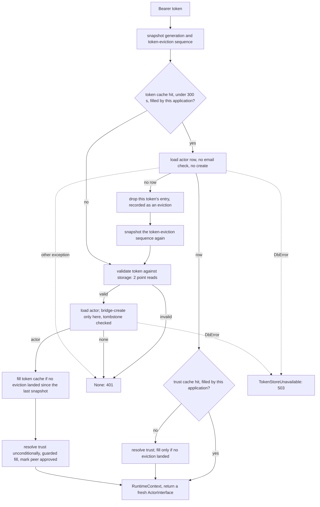

# Implementation Plan: per-request actors on the MCP path, and a subscription list that caches empty

**Date:** 2026-11-06
**Research:** thoughts/research/2026-11-05-subs-list-cache-lifetime.md, with the cost follow-up thoughts/research/2026-11-06-actor-load-cost-and-email-as-creator.md
**Branch:** docs/3-16-rollup-records (written here; implement on `release/3.16.0-subs-list-cache-lifetime`, one PR, one commit per phase)

## Update Log

- **2026-11-06**: Six plans, not five: the wire baseline
  (`2026-11-06-subscription-wire-baseline.md`) lands between the security
  plan and this one (owner). Each phase names the recordings it re-records
  and the ones it must leave identical. One unverified note is answered: a
  fire-and-forget callback does keep the `Actor` alive after the call. Line
  references into `tests/integration/` are by test and fixture name once the
  baseline plan has rewritten those files.

- **2026-11-06**: The review of the baseline plan found mismatches between this
  plan's "Wire rows" lists and that plan's rows, and rows it needs that do
  not exist yet. They are recorded in
  `2026-11-06-subscription-wire-baseline.md`, Evaluation Notes, "Second
  review", and are settled when that plan's row set is redrafted; the
  lists here are not corrected until then.
- **2026-11-06**: The order, the dependencies between the six plans and
  the gates between them moved to one copy in `thoughts/todo/INDEX.md`
  (owner); the copy here is a pointer. Phase 3's verification gains the Emm
  run (owner). Open, not checked: Phase 1 adds the `rewrite_email` keyword
  and the email plan removes it in the same release; whether Phase 1 can do
  without it, or the email plan can go first, would remove that dependency
  and is for this plan's next draft.

## Overview

The MCP handler stops keeping a live `ActorInterface` across requests: it
builds the `Actor` per request, as every REST handler does, and keeps only the
token and trust caches. That ends the staleness of everything the shared
object carried (the actor row, the `_internal` bucket, the per-key property
cache, the subscription list). With no instance outliving a request,
`Actor.get_subscriptions()` can memoise an empty list, so the second and
later subscription reads on one instance cost nothing: a request that writes
several properties, clears them, mutates a list several times or calls the
per-peer accessors in a loop issues one subscription Query instead of one per
call. A request that writes once still issues one. Lands in 3.16 (minor, tag
held).

## Implementation Order

The order of the six 3.16 plans, what depends on what between them and the
gates between them are kept in one place: `thoughts/todo/INDEX.md`, "Planned
for 3.16: order, dependencies and gates". One PR per plan, one commit per
phase, phases in the order written. What this plan uses from the others is
below.

**This plan: third, after the security plan and the baseline plan.** It
needs the security plan merged for the filter on
`AuthenticatedSubscriptionManager` that the new accessor follows when it is
reached through a peer or client view, and the baseline plan for the
recordings that show memoising the subscription list loses no diff between
two real actors. What
follows it: the email plan removes the `rewrite_email` keyword Phase 1 adds
and its three uses in `handlers/mcp.py`; the specification plan's concurrent
sender and its receiver-side overlap rule read the subscription list this
plan memoises per instance. `register_diffs`, `callback_subscription` and
`handlers/subscription.py` are edited again by the `ListAttribute` and
specification plans, so their line references are refreshed against the tree
this plan leaves.

## Decisions Made

- **What the MCP path keeps across requests**: nothing of the actor. Remove
  `_actor_cache`; a token-cache hit loads the `Actor` and then reads the trust
  cache. Chosen over caching the row alone because it removes the hazard class
  (four stale-able memos: the actor row, the `_internal` bucket, the per-key
  property cache, `subs_list`) and the one MCP global whose hit path has no
  `config is self.config` check.
- **The MCP load skips the email-as-creator check**: `Actor.__init__` gains a
  keyword-only `rewrite_email: bool = True`, and the three MCP loads pass
  `False` (`_get_or_create_actor`, the bridge reload, and `_race_winner` at
  `handlers/mcp.py:2442`). MCP authentication never compares the creator, so
  the request does not need the check. The keyword is undocumented and gets no
  changelog entry: the email plan removes it before the release.
- **What this costs, accepted**: a warm MCP request goes from no storage read
  to one strongly consistent actor-row read. A hook's first read or first
  write of each property, and its first touch of `_internal` or of
  `actor.services`, costs a read per request where the shared object served
  them from memory. For `actingweb_mcp`'s tool wrapper that is three
  consistent reads per call (actor row, `mcp_usage_count`, and for actors
  with subscribers the subscription list). A throttle on the actors table now
  answers 503 on warm MCP requests that used to succeed from memory, and
  under FastAPI every authenticated MCP request does a blocking read on the
  event loop, where only tool traffic did.
- **A cached token never creates an actor**: when the row is missing for a
  cached token, the entry is dropped and the request takes the full path, so
  the bridge create only ever follows a token validated against storage.
- **The token and trust caches are bound to the application**: each entry
  records the `Config` that filled it, and an entry filled by another
  application is a miss. `_actor_cache` carried the only such check
  (`handlers/mcp.py:2472`); removing the cache without moving the check would
  let an application accept a token and a trust another application in the
  same process validated, whenever both have the actor id.
- **A resolver bug on a warm request answers 401**: a non-`DbError` exception
  on the cached-token branch falls into the existing `except Exception`
  (`handlers/mcp.py:2430-2432`), as the full path always has. One flow with
  one error mapping is the point of the reshape; a 500 for this branch alone
  would need its own mapping on both handlers. A client that re-authenticates
  takes the full path, where the same bug answers the same way.
- **TTL shape** (research Decision 2): resolved by the first decision. The
  token cache is already absolute; positive trust entries get
  `_TRUST_CACHE_TTL = _cache_ttl`, because their only expiry today is the
  actor sweep that is being removed. For an active client nothing observable
  changes (trust is already re-resolved each time its token entry expires);
  the TTL bounds entries whose tokens went quiet.
- **The trust-deletion sibling**: reads into a local, lazily, and never caches
  a folded fault; resets `subs_list` after a deletion. `Actor.delete` and
  `purge_relationships` hand it the list they already read, extending the
  `_pre_reads` pattern (`actor.py:1060`).
- **Deletion and purge clear what subscriptions leave behind**: the
  subscription-suspension rows (both backends define `delete_all` "for cleanup
  on actor delete" and nothing calls it,
  `db/dynamodb/subscription_suspension.py:149-157`,
  `db/postgresql/subscription_suspension.py:148-163`) and every subscription
  diff of the actor, by actor id. Without the first, an id recreated with
  `Actor.create(actor_id=…)` inherits a suspension and silently produces no
  diffs. Without the second, the diffs of a subscription created during the
  wipe have no row left to find them through.
- **Consistency**: `consistent_read=True` stays on the DynamoDB subscription
  list fetch.
- **A peer-indexed accessor is added**:
  `SubscriptionManager.get_subscriptions_by_peer()`. On the authenticated
  view it is delegated and follows the filter the security plan puts on that
  view, so a peer or client view gets at most its own key.
- **Ride-alongs**: correct the "trust list" claim in three places and the
  section references that point at the wrong register section; correct the
  outdated `strict` notes; rewrite the actor-cache documentation; drop the
  redundant reset at `handlers/subscription.py:270`.

## What We're NOT Doing

- **Who may reach whose subscriptions** - the REST rule on
  `/subscriptions/<peerid>/…`, the `DELETE /callbacks/subscriptions/…` hole
  and the filter on `AuthenticatedSubscriptionManager` are
  `thoughts/plans/2026-11-06-peer-authorisation-fixes.md`, which lands first.
- **Closing the deletion race** - the actor row is removed last and nothing on
  the subscription-create path reads the deletion tombstone
  (`actor.py:1090-1094`), so a request already past authentication can still
  insert a subscription after the last wipe. This plan narrows the window; a
  tombstone check on create is a change to the deletion design
  (`actingweb/deletion.py`), and a row left that way is what
  `actingweb-verify-orphans` reports.
- **Cross-process invalidation of the token and trust caches** - register
  sections 1 and 8 of `thoughts/todo/mcp-cache-lifecycle-and-revocation.md`;
  this plan removes the instance-memo half of section 1 and leaves the rest
  with its own design question.
- **Relaxing `consistent_read` on the subscription fetch** - decided above;
  the audit in `thoughts/todo/dynamodb-known-next.md` keeps the item.
- **Moving MCP authentication off the event loop** - warm tool requests
  already read storage on the loop (the permission evaluator's trust read,
  `permission_evaluator.py:610`, and sync hooks); offloading would compete for
  the integration's shared ten-worker pool (`fastapi_integration.py:605`,
  `:621-622`) and needs the runtime-context variable carried back from the
  copied context. A design of its own.
- **Removing the double read on a faulted subscription fetch** - fault path
  only, and the swallow in `Subscriptions.__init__` is a recorded decision
  (`subscription.py:311-314`).
- **Reusing a memoised list across several `delete_reciprocal_trust` calls** -
  a loop of M single-peer deletions on one instance goes from one list read
  to M when the actor has subscriptions. Rare, and the price of the sibling
  never trusting a memo it is about to invalidate.
- **Policing what a consumer's hook holds** - a hook that keeps the
  `ActorInterface` in its own global recreates the old lifetime; the migration
  guide says so.

## What Already Exists

- `actingweb/handlers/mcp.py:2352-2419` - the full authentication path already
  builds an `Actor`, resolves trust and sets `RuntimeContext`. The new flow is
  this path with a token-cache read in front.
- `actingweb/handlers/mcp.py:160-180` - `_trust_cache_get` and
  `_trust_cache_put`; the per-entry TTL by `cached_at` is there. The expiry
  test moves into one helper that the lookup and the sweep both call.
- `actingweb/handlers/mcp.py:2988-3015` - `clear_token_from_cache(token,
  actor_wide=False)` pops one token and records the eviction so an in-flight
  fill cannot put it back. Reused for the cached-token drop.
- `actingweb/handlers/mcp.py:298-364` - the generation counter and
  `_token_fill_still_valid`; unchanged, and now also guarding the trust fill
  on a cached token, which today has no guard (`:2314`).
- `actingweb/handlers/mcp.py:2468-2475` - the `config is self.config` check on
  the actor entry; the same test moves to the token and trust entries.
- `actingweb/actor.py:374-378` - `Actor.get(rewrite_email=False)` exists;
  `__init__` only needs to pass it through.
- `actingweb/subscription.py:260-278` - `Subscriptions.fetch()` leaves
  `self.subscriptions` as `None` on a fold; `get_subscriptions()` uses that to
  tell a fold from an empty read.
- `actingweb/actor.py:1056-1066`, `:1111-1116` - `Actor.delete`'s `_pre_reads`.
- `actingweb/db/__init__.py:314` (`get_subscription_suspension`) and its
  `delete_all()` on both backends - exists, uncalled. `Actor` already imports
  the factory (`actor.py:16`).
- `actingweb/db/dynamodb/subscription_diff.py:163-222`,
  `actingweb/db/postgresql/subscription_diff.py:261-395` - the diff list
  already deletes by actor id alone: `fetch(actor_id=…)` with no `subid`, then
  `delete()`, removes every diff of the actor on both backends (DynamoDB skips
  the `subid` test when none was given, `:215-216`; PostgreSQL runs `DELETE
  FROM subscription_diffs WHERE id = %s`, `:376-384`). `Subscriptions.delete()`
  only ever calls it per subscription (`subscription.py:286-293`).
- `tests/test_actor_deletion_tombstone.py:504-519` - the DynamoDB operation
  counter; `tests/test_adoption_bounded_reads.py:183-208` - a backend-agnostic
  counter of two specific reads. Both are lifted into one helper module.
- `tests/_adoption_helpers.py:145` (`seam_fault`) and
  `tests/test_db_fault_auth_paths.py:47-50` - the fault seam and the patched
  OAuth server the new handler tests use.
- `../actingweb_mcp/api/trust_unified.py:837-878` - the consumer's grouping
  helper; the shape the new accessor returns.

## Phase 1: the MCP path builds its actor per request

### Changes

- `actingweb/actor.py:113-142` - `Actor.__init__(actor_id=None, config=None,
  *, rewrite_email: bool = True)`, passed to `self.get(...)`. No docstring
  entry beyond one line saying it is internal.
- `actingweb/handlers/mcp.py`
  - Delete `_actor_cache` (`:110`), its `global` mention (`:3006`), the
    comment block at `:2462-2467`, and the `actor_hits`/`actor_misses`
    counters (`:142-149`). Keep the periodic debug line (`:2333-2339`),
    without "Actor hits", after the trust lookup on the cached-token branch.
  - `authenticate_and_get_actor_cached()` (`:2247-2431`) becomes the flow in
    the diagram, all inside the existing `try`. The snapshot is taken before
    the token-cache read. The token-cache fill moves after a successful actor
    load. A non-`DbError` exception on the cached-token branch answers `None`
    through the existing `except Exception`, as decided.
  - The cached-token drop is `self.clear_token_from_cache(bearer_token,
    actor_wide=False)`, followed by a fresh `_current_token_eviction_seq()`
    snapshot. Without the second snapshot the drop's own eviction record
    (`_record_token_eviction`, `:330-343`) refuses this request's fill at
    `_token_fill_still_valid` (`:346-357`), and the next request pays full
    validation again. A `DbError` never drops anything.
  - Token entries (`:2376-2381`) and trust entries carry the `Config` that
    filled them. The token-cache read (`:2280-2286`) treats an entry whose
    `config` is not `self.config` as a miss and leaves it in place.
    `_trust_cache_put(trust_key, trust, config)` stores it and
    `_trust_cache_get(trust_key, config)` answers a miss for another
    application's entry (`:160-180`; call sites `:2306`, `:2314`, `:2395`).
  - One helper, `_trust_entry_expired(entry, now)`, holds the TTL choice
    (negative or positive) that `_trust_cache_get` makes at `:171-173`; the
    lookup and the sweep both call it.
  - Rename `_get_or_create_actor_cached` (`:2453-2560`) to
    `_get_or_create_actor`; drop the cache read (`:2468-2475`), the fill
    (`:2551-2557`) and the `current_time`/`generation_at_read` parameters; add
    `create: bool = True` so the cached-token branch can load without the
    bridge. Its loads (`:2480`, `:2531`, `:2534`) and `_race_winner`'s
    (`:2442`) use `Actor(actor_id, config, rewrite_email=False)`.
  - `_update_trust_with_client_info` (`:2791`) and `_mark_client_peer_approved`
    (`:3091`) take the request's core actor instead of loading a second one.
  - `_TRUST_CACHE_TTL: float = _cache_ttl` (`:122`, no longer `None`-able),
    comment rewritten.
  - `_cleanup_expired_cache_entries()` (`:782-815`): tokens by `cached_at`;
    trust entries by `_trust_entry_expired` over a copy of the dict; the
    actor loop goes.
  - `evict_mcp_caches_for_actor()` (`:367-413`): no actor pop. Docstring:
    actor-wide because one revocation covers every client of the actor; the
    register section is 1.
  - `clear_token_from_cache()` (`:2988-3039`) and the method docstring at
    `:2248-2261`: two caches, no actor wrapper. No alias for
    `authenticate_and_get_actor_cached`: it still caches the token and the
    trust, so the name holds.
- `actingweb/trust.py:250-252` - the trust list was never on the cached
  wrapper.
- `actingweb/mcp/invalidation.py:3-4`, `:23`, `:35-36`, `:63` - "actor
  wrappers" out of the prose; section 2 becomes 1.
- `actingweb/runtime_context.py:15-18`, `:103`, `:185` - keep the reason for
  the ContextVar (an application may still hold the object); drop "MCP's
  per-actor cache is the primary example".
- `tests/_read_counters.py` (new) - the DynamoDB operation counter from
  `tests/test_actor_deletion_tombstone.py:504-519` (which then imports it),
  and a backend-agnostic counter that wraps `get_connection` on PostgreSQL and
  named backend methods (`DbActor.get`, the subscription list's `fetch`) on
  either.
- `tests/test_mcp_revocation_evicts_caches.py` - `:3`, `:60` prose; `_seed`
  drops the actor entry and gives trust entries a `cached_at`; `:61`, `:99`
  counts 4 become 3; `:70` goes; `test_the_actor_wrapper_goes_too…`
  (`:76-86`) is deleted.
- `tests/test_mcp_trust_cache_key.py` - `:11`, `:117` prose; `:126-133`
  clears two caches; `:212-217` patches the two trust helpers and takes the
  new argument; `TestActorExpiryEviction` (`:268-310`) becomes a trust expiry
  test that ages both tuples' `cached_at`; re-verify `:188` and `:246`.
- `tests/test_mcp_fail_closed_authorization.py:659`, `:670`, `:678`, `:680` -
  the two trust helpers' new argument.
- `tests/test_runtime_context_isolation.py:29` - docstring.
- The renamed method and its shorter signature at
  `tests/test_deletion_in_progress_answers.py:53`, `:90`,
  `tests/integration/test_unique_creator_http.py:227`, `:243`,
  `tests/test_adoption_strict_listing_and_rollback.py:257`,
  `tests/test_adoption_owner_actor_and_sweep_faults.py:334`,
  `tests/test_db_fault_auth_paths.py:51`.
- The tests that seed `_token_cache` with `{"actor_id": …}` only
  (`tests/test_mcp_refresh_rotation.py:67`, `:229`, `:640`,
  `tests/test_mcp_token_store_faults.py:336`, `:401`,
  `tests/test_oauth2_logout_mcp_tokens.py:94`) exercise eviction, not a hit
  (they carry no `cached_at`, so they are already past the TTL); they need no
  `config` key.

### Wire rows

None re-recorded: the MCP path is not on the wire suite's route. Every
recording is byte-identical after the commit, on both backends.

### New Tests, both unit and integration tests

A new file drives `authenticate_and_get_actor_cached` against real storage: a
real actor from `create_core_actor` with a backend-following config
(`Config(unique_creator=False, …)`, not `make_config`, which pins DynamoDB),
`get_actingweb_oauth2_server` patched as in `test_db_fault_auth_paths.py`, and
`_token_cache` seeded with every key the hit path reads.

- Two warm authentications return two different `ActorInterface` objects
  wrapping two different `Actor` instances.
- A warm request costs one actor-row read and nothing else, with
  `force_email_prop_as_creator` on and off: `{GetItem: 1}` on DynamoDB, one
  connection on PostgreSQL. (The flag makes no difference because the load
  skips the check; the test pins that.)
- A property and an `_internal` value written through another `Actor`
  instance between two requests are read back fresh in the second.
- With one subscriber present before request 1: a second subscription created
  through another instance between two requests gets the diff from request
  2's write. Asserted on the publisher's stored diffs.
- A cached token whose actor row was removed elsewhere answers `None`, creates
  nothing, and the entry is gone; the same with no tombstone (the case a
  failed tombstone write leaves).
- A cached token for an actor row that is missing and a token that still
  validates: the bridge create runs once, on the full path, and the token
  entry is present afterwards (the second snapshot).
- A freshly validated token whose actor turns out deleted leaves no token
  entry behind.
- `DbError` on the actor read with a cached token: `post()` answers 503 on
  `MCPHandler` and on `AsyncMCPHandler`, and the token entry stays.
- A non-`DbError` exception from the trust resolver on a cached token answers
  401.
- A token entry and a trust entry filled under one `Config` are misses for a
  handler built with another `Config` holding the same actor id, and that
  handler validates against its own token store; the first application's
  entries are still there afterwards.
- A cached negative trust entry (trust `None`) is a hit and yields an empty
  peer id.
- A positive trust entry older than 300 s is a miss and is resolved again
  through the method; the sweep removes it; a negative one expires after 10 s.
- A revocation that lands between the token-cache read and the trust fill
  leaves the trust cache unfilled, on the cached-token branch.
- `_update_trust_with_client_info` and `_mark_client_peer_approved` issue no
  second actor read; `_race_winner`'s load does not rewrite the creator of an
  actor whose stored email differs from it.

### Failure Scenarios

- Actor read on a cached token, backend throttle - 503, where a warm request
  used to succeed. Accepted (Decisions); covered by the fault test and named
  in the changelog.
- Cached token, actor row removed elsewhere - the row read finds nothing, the
  entry is dropped, validation fails (the actor's token rows went with its
  buckets): 401. Today the cached wrapper keeps being served until the token
  entry expires, up to 300 s after the row is removed. During a wipe the row
  still resolves (`actor.py:1090-1094`), so a cached token is served until
  the row goes, before and after this plan. Covered.
- Cached token, row missing, tombstone write had failed - no create without a
  storage validation. Covered. This is the case the first draft got wrong.
- Token dropped while another request is filling it - the recorded eviction
  refuses that fill. Covered by the existing rotation tests
  (`tests/test_mcp_trust_cache_key.py:413-433`) plus the deleted-actor test.
- The request that dropped the token cannot cache it again - prevented by the
  second snapshot. Covered by the bridge test.
- Two applications in one process, the same actor id in both - the token and
  trust entries are per application. Covered.
- Trust entry for a client that stopped calling - expires by its own TTL and
  is swept. Covered.
- Resolver bug on a warm request - 401 and a re-authentication instead of a
  500. Decided; covered.

### Verification

- [ ] Run the contract's `### Checks` fast tier verbatim
- [ ] Run the contract's `### Checks` full tier before the phase commit, one
      run at a time; re-run a parallel failure sequentially before trusting it
- [ ] `grep -rnw "_actor_cache" actingweb tests` returns nothing

### Implementation Status: Not Started

---

## Phase 2: the subscription list memo, its sibling, the clean-up on deletion, and the accessor

### Changes

- `actingweb/actor.py`
  - `get_subscriptions()` (`:2440-2484`): guard `if self.subs_list is None:`.
    Build the `Subscriptions` wrapper, `fetch(strict=strict)`, and assign
    `self.subs_list` only when `wrapper.subscriptions is not None`; a folded
    fault answers the filtered `[]` and leaves the memo `None`. Docstring: one
    fetch per `Actor` instance, reset by this instance's create and delete
    methods; an instance an application keeps does not see subscriptions
    created elsewhere.
  - `delete_reciprocal_trust()` (`:2007-2226`): keyword-only `_subscriptions:
    list[dict[str, Any]] | None = None`. When not given, read once into a
    local with `fetch(strict=False)`, lazily, at the first relationship that
    reaches the subscription block (`:2084`), so a call with no relationship,
    or one that `continue`s at `:2062`, reads nothing. Never assign
    `self.subs_list` from it. Whenever a trust row is deleted, `self.subs_list
    = None`.
  - `Actor.delete()` (`:1132-1142`): pass `_subscriptions=[]` to each
    `delete_reciprocal_trust` call; set `self.subs_list = None`. After
    `trusts.delete()`: one more `Subscriptions(...).delete()` (a subscription
    a peer created during the wipe, whose trust row lived until its sibling
    call); then every diff of the actor, with
    `get_subscription_diff_list(config).fetch(actor_id=self.id)` and
    `.delete()`; then the suspension rows, with
    `get_subscription_suspension(config, self.id).delete_all()`. A `False`
    from `delete_all()` (both backends fold a fault to `False` with a log)
    raises `DbError`, so the resumable delete stops before the row goes and a
    repeated call finishes it.
  - `purge_relationships()` (`:2261-2310`): pass `_subscriptions=sub_rows`;
    set `self.subs_list = None` after `subs.delete()`; then the same
    actor-wide diff delete and suspension `delete_all()`. A `False` there
    leaves `confirmed` False, as an unconfirmed list does.
  - Docstrings and comments: `purge_relationships` (`:2240-2243`),
    `register_diffs` (`:3867-3878`), `create_subscription` (`:2345-2352`),
    `Actor.delete` (what the wipe now covers).
- `actingweb/handlers/subscription.py:269-270` - remove the hand reset. (The
  peer rule on the same handlers is the security plan's.)
- `actingweb/db/protocols.py:1124-1126` - both backends raise when strict and
  fold when not.
- `actingweb/interface/subscription_manager.py`
  - `@dataclass class PeerSubscriptions: peer_id: str; outbound:
    list[SubscriptionInfo]; inbound: list[SubscriptionInfo]`, not frozen and
    with lists, as `PeerSyncResult` is (`:162-170`).
  - `get_subscriptions_by_peer() -> dict[str, PeerSubscriptions]`: one
    `get_subscriptions()` call, grouped. A peer without subscriptions has no
    key. A read fault raises `DbError`, as the other accessors do.
- `actingweb/interface/authenticated_views.py` - `get_subscriptions_by_peer()`
  is delegated beside the three read-only properties and passes through the
  filter the security plan adds there, so a view built for a trust returns at
  most that trust's key.
- `actingweb/interface/__init__.py:42-46` - export `PeerSubscriptions` and
  `SubscriptionInfo`.

### Wire rows

A row is one recording under `tests/integration/wire/`
(`thoughts/plans/2026-11-06-subscription-wire-baseline.md`). "Re-recorded"
means the file changes in this phase's commit and the diff is read in review;
every other recording is byte-identical after the commit, and `git show
--stat HEAD -- tests/integration/wire` lists only the rows named here. The
expectations are from reading; that plan's "Recorded outcomes" overrides
them.

Re-recorded:

- `WC6` - after the publisher is deleted, no suspension row of it remains
  (read: one does today; its diffs already go with their subscriptions).
- `WC7` - an actor created again under the same id is not suspended and
  registers a diff.

Identical, and the ones to watch, because they are the memo's risk: `WC1`
and `WC2` (a subscription created over HTTP gets the next diff), `WD13` and
`WD14` (several subscribers on one write), `WC3` to `WC5` (a deleted
subscription or trust gets no further diff), `WD10` (writes while suspended,
then a resume) and `WD5` (an interface-layer write on a running loop, where
the `Actor` outlives the call).

### New Tests, both unit and integration tests

Read counts use `tests/_read_counters.py`: list fetches are counted at the
subscription list's `fetch` (backend-agnostic); DynamoDB operation profiles
are used only where the test names operations.

- N `get_subscriptions()` calls on a zero-subscription actor issue one list
  fetch.
- Three writes of three different properties on one instance of a
  zero-subscription actor: one list fetch in total. On DynamoDB the second
  and third writes show no `Query`.
- For each creation path (`Actor.create_subscription`,
  `SubscriptionManager.create_local_subscription`,
  `AuthenticatedSubscriptionManager.create_local_subscription`,
  `create_remote_subscription` with the peer's 201 mocked, and the handler's
  `post()` followed by `register_diffs` on the same `myself`): prime the memo
  with an empty read, create, `register_diffs()`; the new subscription gets
  the diff.
- The memo rule, one test per case: strict read with rows; strict empty;
  strict fault (raises, memo `None`); `strict=False` fault (`[]`, memo `None`,
  the next call reads again); the constructor's swallowed fault followed by a
  successful re-read (memoised); no config and no actor id (unchanged).
- Trust deletion on an instance whose memo was filled before a subscription
  for that peer was created elsewhere: the subscription is deleted and the
  memo is `None`.
- Trust deletion under a subscription read fault: the trust row goes, the
  subscriptions stay, the memo is `None`.
- `Actor.delete()` with three relationships and no peer-trustee rows: two
  subscription list fetches, the pre-read and the final wipe's (its
  constructor fetches, `subscription.py:315-316`), where today there are
  four. With one peer-trustee row: one more (the `delete_peer_trustee` path
  at `:1277` reads its own).
- A subscription created after `subs.delete()` and before the last sibling
  call, with a diff: both are gone when `Actor.delete()` returns.
- A diff left with no subscription row (the state a subscription created
  between the pre-read and the first wipe leaves) is gone after
  `Actor.delete()`, on both backends.
- Suspension: an actor with a suspended target is deleted and its id created
  again with `Actor.create(actor_id=…)`; the new actor is not suspended and
  registers a diff. The same after `purge_relationships()`. A suspension
  `delete_all()` that answers `False` makes `Actor.delete()` raise `DbError`
  with the row still present, and a second call finishes; in
  `purge_relationships()` it leaves `confirmed` False.
- `purge_relationships()` with no peer-trustee rows: its pre-read and the
  strict re-read, no per-relationship fetch.
- `get_subscriptions_by_peer()`: grouping; peers without subscriptions are
  absent; with a loop of the two per-peer accessors over five peers, one list
  fetch.
- The accessor through a view: with subscriptions for two peers, a view built
  with `as_peer` for peer A and a view built with `as_client` for an
  `mcp_client` trust each return at most their own key; owner mode returns
  both. (Depends on the security plan's filter having landed.)

### Failure Scenarios

- Empty list memoised, a subscription created in another process during the
  same request - this request's write misses it. Bounded by the instance's
  lifetime, which is one request for every instance the library builds;
  stated as a `Behavior change` for applications that keep an instance.
- Folded fault memoised as "no subscribers" - prevented by assigning only on
  a real read. Covered.
- Sibling leaves deleted rows in the memo - prevented by the reset. Covered.
- A peer subscribes while the actor is being deleted - narrowed by the final
  subscription wipe and the actor-wide diff delete, not closed (What We're NOT
  Doing). Covered up to the last wipe. Without the wipe the plan would have
  opened a window the falsy guard used to narrow.
- A recreated actor id inherits a suspension - cleared on deletion and on
  purge. Covered.
- A suspension clean-up faults during deletion - `DbError`, the row stays, the
  delete is resumed. Covered. A silent `False` would have left the next actor
  with that id mute.
- The actor-wide diff delete removes diffs a concurrent request just stored
  for a subscription of an actor that is being deleted - the actor is going;
  intended.

### Verification

- [ ] Run the contract's `### Checks` fast tier verbatim
- [ ] Run the contract's `### Checks` full tier before the phase commit, one
      run at a time
- [ ] `grep -n "not self.subs_list" actingweb/actor.py` returns nothing
- [ ] `git show --stat HEAD -- tests/integration/wire` lists `WC6` and `WC7`
      only

### Implementation Status: Not Started

---

## Phase 3: documentation, changelog and records

### Changes

- `CHANGELOG.rst`, `Unreleased`:
  - `CHANGED` - **Behavior change:** an MCP hook is handed an actor built for
    that request. The entry states: values read through it are current; the
    first read or first write of each property, the first touch of
    `_internal`, and each `actor.services` client cost a storage read per
    request; a warm MCP request reads the actor row, so a backend throttle
    answers 503 where it used to succeed from memory; `actor.creator` is not
    re-synced to the stored email on an MCP request; the debug line loses
    "Actor hits". **Check:** hooks that read-modify-write a property on every
    call, that keep the actor in a global, or whose clients do not retry a
    503. Nothing in it names `rewrite_email`.
  - `CHANGED` - **Behavior change:** an `Actor` memoises an empty
    subscription list as well; code that keeps one instance across many
    writes sees subscriptions created elsewhere only on a new instance.
  - `ADDED` - `SubscriptionManager.get_subscriptions_by_peer()`,
    `PeerSubscriptions`.
  - `FIXED` - on one actor instance, every subscription read of an actor with
    no subscribers went to storage again: one strongly consistent Query per
    property written, per list mutation and per per-peer accessor call. The
    second and later reads on an instance are now served from the first. A
    request that writes once issues one, as before. With the measured before
    and after for a request that writes three properties and for a loop of
    the per-peer accessors.
  - `FIXED` - a subscription created in another process could go without
    diffs from a long-lived MCP actor.
  - `FIXED` - for up to 300 seconds after an actor's row was removed, a
    worker holding its token kept serving the deleted actor's cached state
    (distinct from the existing entry at `:471`, which is about recreating
    it).
  - `FIXED` - a trust lookup on a cached MCP token could re-cache a trust
    revoked while it was being read.
  - `FIXED` - in a process hosting more than one application, a token or a
    trust one application had validated could be accepted by another that had
    the same actor id.
  - `FIXED` - a trust deletion left deleted subscriptions in the instance's
    list.
  - `FIXED` - deleting an actor, or purging its relationships, left its
    subscription suspensions and could leave subscription diffs; an actor
    created again under the same id started suspended and sent no diffs.
- `docs/migration/v3.16.rst` - item 18 under "Start here" (`:16-123`) and a
  `---` subsection "MCP actors are built per request" after "Idempotent
  appends" (`:1135`), ending before "Cross-site requests" (`:1191`): the reads
  it costs per request and per session (about k + 2 authentications for k
  tool calls), the 503, what a hook should check, that designs premised on a
  shared five-minute actor object can assume a per-request one, and
  `get_subscriptions_by_peer()`. (The item number assumes the security plan
  added none ahead of it; renumber against the guide as it stands.)
- `docs/guides/mcp-applications.rst:914-975` - the performance section: two
  caches, the log line, the per-request actor read, the "50x" claim revised.
- `docs/guides/caching.rst` - every actor-cache mention (`:10`, `:14`,
  `:16-97`, `:137-157`, `:215-216`, `:265-285`).
- `docs/guides/hooks.rst:304-319` - the runtime context is per request; the
  "hot cached actor" wording goes.
- `docs/reference/security.rst:103` - one sentence: positive MCP trust entries
  expire 300 s after they were resolved, per process; the permission cache is
  unchanged and has no TTL.
- `docs/guides/subscriptions.rst:41-46`, `docs/sdk/developer-api.rst:290-310`
  - `get_subscriptions_by_peer()` and the per-instance memo.
- `thoughts/todo/subs-list-cache-asymmetry.md` - delete, with its row in
  `thoughts/todo/INDEX.md`.
- `thoughts/todo/mcp-cache-lifecycle-and-revocation.md` - the inherited
  constraint (actor-wide because a revocation covers every client); section 1
  without instance state; section 2 records the positive TTL and leaves
  "configurable" open; section 6 lists two MCP globals, both now recording
  the application that filled each entry.
- `thoughts/todo/dynamodb-known-next.md:93-95` - the pointer to the deleted
  todo becomes a pointer to this plan.
- `thoughts/research/2026-08-15-mcp-actor-cache-holds-instance-state.md` - a
  dated correction line: the cached object did not carry the trust list.

### New Tests, both unit and integration tests

- None beyond the docs build in the full tier.

### Failure Scenarios

- A page still describing the actor cache - the widened grep below.
- The changelog or a guide advertising a keyword the release will not have -
  the `rewrite_email` grep below.

### Verification

- [ ] Run the contract's `### Checks` full tier verbatim (docs build included)
- [ ] `grep -rniw "_actor_cache\|invalidate_actor_cache\|actor_hits" docs` and
      `grep -rni "actor hits\|actor loading\|cached actor\|actor cache" docs`
      return nothing outside released migration guides
- [ ] `grep -rn "rewrite_email" CHANGELOG.rst docs` returns nothing
- [ ] `thoughts/todo/INDEX.md` has no row for a file that no longer exists
- [ ] Emm's suite on this branch, before the PR opens, run as
      `thoughts/todo/emm-suite-against-master.md` describes: no failure the
      run on `master` did not have, and the result recorded in this plan's
      verification document

### Implementation Status: Not Started

---

## Evaluation Notes

### Architecture

Fits the existing patterns; nothing critical. Folded in: the token drop goes
through `clear_token_from_cache(actor_wide=False)` so a concurrent fill cannot
restore it, and the fill moves after the actor load; the lost throttle
tolerance is recorded as a decision; the sweep and the lookup share one expiry
helper; the sibling's read is lazy; peer-trustee rows are a stated
precondition of the read-count tests; the plan closes an unguarded trust fill
on the cached-token path (`mcp.py:2314`) and says so in the changelog; the
prose and test sites the first draft missed are listed. Verified correct as
drafted: the memo rule, `Actor.delete` passing `[]`, `purge_relationships`
passing its rows, and removing the handler's reset.

### Security

One major finding, taken: as first drafted, a cached token could reach the
bridge create without the token being re-checked in storage, and the tombstone
that guards it is not guaranteed to exist (`deletion.py:177-183`). The
cached-token branch now never creates. Taken: `_TRUST_CACHE_TTL` cannot be
`None`; a final subscription wipe in `Actor.delete`; the changelog does not
overstate what the trust TTL bounds. The reviewer also found that a peer or
client view lists every peer's subscriptions; that, and the REST side of the
same exposure found while checking it, moved to
`thoughts/plans/2026-11-06-peer-authorisation-fixes.md`.

### Scalability

The first draft's "one read" was wrong for both consumers: with
`with_email_as_creator(True)` a load is a GetItem plus an `_internal` Query,
and a hook's first write of a key pays a list-existence read the shared object
hid. The owner had the consequence evaluated
(`thoughts/research/2026-11-06-actor-load-cost-and-email-as-creator.md`) and
chose to skip the check on the MCP load. Taken: the cost statement names
writes and `actor.services`; the two secondary actor loads on the MCP path are
removed; the read-count tests name what they count. Memory goes down: the
unbounded actor cache and everything each wrapper held are gone.

### Usability

Taken: the user-facing performance page (`docs/guides/mcp-applications.rst`)
the first draft missed; the 503 on warm requests as a stated behaviour change;
the empty-memo behaviour change for held instances; the trust TTL is not sold
as a behaviour change; the deleted-actor entry is distinguished from the
existing `SECURITY` entry; the accessor follows the module's conventions
(`get_subscriptions_` prefix, lists, a `peer_id` field) so the consumer's
helpers take its values unchanged; "Start here" gets an item. No consumer code
stashes state on the actor or keys a cache by it.

### Tests and code quality

Taken: the first draft's verification grep could never pass (the method name
contains `_actor_cache`); its integration test had no tool to call and would
have passed on today's code, so it is replaced by a real-storage unit test
that starts with a subscriber present; the counters as they stood could not
prove "no other read" or count list fetches, so one helper module does both
and is created in Phase 1; `make_config` pins DynamoDB, so the new tests name
a backend-following config; the Phase 2 integration test could not detect the
removed reset and became a handler-level unit test; two memo cases had no
test. No existing test breaks under Phase 2.

### Outside voice

Run on the previous draft by Codex (outside the command sandbox) and a
fresh-context reviewer, 2026-11-06. It has not been re-run on this draft.
What each finding led to:

- **The peer-view filter was wrong for a client view** (the accessor id of a
  client view is the client id, `interface/authenticated_views.py:49`,
  `interface/actor_interface.py:732-735`). The filter left this plan for the
  security plan, which filters on the peer id of the view's trust. This plan
  keeps the accessor and one test, built with `as_peer` and `as_client`.
- **The security entry overstated, and missed `DELETE
  /callbacks/subscriptions/…`.** The entry and the REST rule left this plan
  with the filter.
- **A simpler REST fix exists** (pass `peerid` so the `owner` row applies,
  delete the `friend` row). Handed to the security plan as its design.
- **The headline saving was overstated.** The Overview and the `FIXED` entry
  now say the second and later reads on one instance, and that a request
  writing once still issues one Query.
- **"Closed" should be "narrowed".** Reworded; the remaining window is under
  What We're NOT Doing with where a leftover row shows up. The orphaned diffs
  the reviewer found are removed by an actor-wide diff delete, which both
  backends already support.
- **The `Actor.delete()` read-count test contradicted the final wipe.** It
  expects two fetches.
- **The cached-token drop cancelled the request's own token fill.** A second
  snapshot after the drop, with a test.
- **`rewrite_email` must not reach the changelog or the docs, and
  `_race_winner` was a third MCP load.** No entry, no documentation, a grep
  in Phase 3, and the keyword passed at `handlers/mcp.py:2442`.
- **Deletion and purge never clear suspension rows.** Added to Phase 2, with
  a fault that stops the delete instead of a logged `False`.
- **The token and trust caches were not bound to an application.** Added to
  Phase 1; the item that argued it away is gone.
- **A resolver bug answering 401.** The decision stands; its reason is in
  Decisions.
- **"After an actor was deleted" was not exact.** The entry says "after its
  row was removed", and the failure scenario states the wipe window.

### Unverified notes

- Whether `ServiceClient._load_tokens` works at all against an
  `ActorInterface` (it reads `self.actor.property`, which the wrapper does not
  define, `interface/services/service_client.py:71-79`). Read, not run.
- The in-region latency of the added read; only laptop wall times exist.
- [Answered 2026-11-06] A fire-and-forget callback keeps the `Actor` alive
  after the call that registered the diff: the task's closure holds `self`
  and writes `self.last_response_code` when the peer answers
  (`actor.py:2744-2786`). It happens only when `register_diffs` runs on a
  running event loop without `with_sync_callbacks()`; a REST write runs in
  the executor and sends before it answers. Nothing reads the memo on that
  instance again, so the stretch is harmless; WD5 pins the lifetime.
- No rate limit was found on the `/mcp` authentication path in the library.
- The name and shape of the filter the security plan adds to
  `AuthenticatedSubscriptionManager`; that plan was being written alongside
  this draft, so the accessor's delegation is stated by behaviour, not by a
  function name.
- Whether the PostgreSQL suspension `delete_all()` can answer `False` for a
  reason other than a fault; it was read (`:148-163`), not run. If it cannot,
  raising on `False` is exact.
- Whether a finisher-driven delete (`deletion_finish.py`, with `_pre_reads`)
  expects the steps this plan adds to tolerate rows that are already gone;
  each added step is a delete by actor id, which does.
