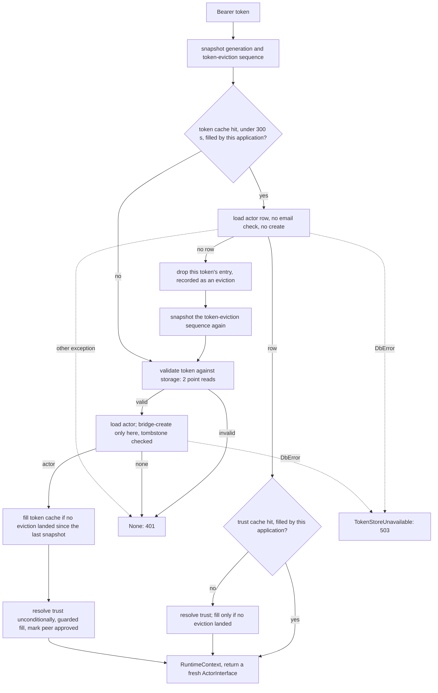

# Implementation Plan: per-request actors on the MCP path, and a subscription list that caches empty

**Date:** 2026-11-06
**Research:** thoughts/research/2026-11-05-subs-list-cache-lifetime.md, with the cost follow-up thoughts/research/2026-11-06-actor-load-cost-and-email-as-creator.md
**Branch:** implement on `release/3.16.0-subs-list-cache-lifetime`, one PR, one commit per phase (drafted on `docs/3-16-rollup-records`, redrafted on `docs/3-16-subs-list-plan-redraft`)

## Update Log

- **2026-11-06**: Six plans, not five: the wire baseline
  (`2026-11-06-subscription-wire-baseline.md`) lands between the security
  plan and this one (owner). Each phase names the recordings it re-records
  and the ones it must leave identical. One unverified note is answered: a
  fire-and-forget callback does keep the `Actor` alive after the call. Line
  references into `tests/integration/` are by test and fixture name once the
  baseline plan has rewritten those files.

- **2026-11-06**: The review of the baseline plan found mismatches between this
  plan's "Wire rows" lists and that plan's rows, and rows it needs that do
  not exist yet. They are recorded in
  `2026-11-06-subscription-wire-baseline.md`, Evaluation Notes, "Second
  review", and are settled when that plan's row set is redrafted; the
  lists here are not corrected until then.
- **2026-11-06**: The order, the dependencies between the six plans and
  the gates between them moved to one copy in `thoughts/todo/INDEX.md`
  (owner); the copy here is a pointer. Phase 3's verification gains the Emm
  run (owner). Open, not checked: Phase 1 adds the `rewrite_email` keyword
  and the email plan removes it in the same release; whether Phase 1 can do
  without it, or the email plan can go first, would remove that dependency
  and is for this plan's next draft.
- **2026-11-07, from the wire baseline's redraft (owner)**:
  `tests/integration/wire/rows.toml` is now the only copy of which phase may
  change which recording (owners as `plan:phase`, checked by
  `verify_groups.py` against a commit's `Wire-Phase` trailer); this plan's
  "Re-recorded" and "Identical" lists are superseded by it and are dropped
  at its next draft. Rows owned here: `WC6`, `WC7` and `WM1` (the stale
  memo, the risk this plan addresses), all in Phase 2. Reserved ids:
  `WM2`-`WM9`.
- **2026-11-11, from the wire baseline's recordings**
  (`subscription-wire-baseline`, Phase 1; `tests/integration/wire/rows.toml`
  is the list of rows and owners): `WM1` confirms the stale memo (the second
  write through one instance reaches B only). `WC6`: A's suspension row
  survives its deletion. `WC7`: the re-created actor starts with that row,
  but its write sends nothing because no trust or subscription survives,
  so the recording cannot tell "suspended" from "nobody to send to"; the
  row needs a subscriber that survives (or the suspension asserted from the
  snapshot, which it already holds) when this plan re-records it. No test
  file this plan cites was retired.
- **2026-11-12, redraft against `master` after #171, #172 and #173 merged**
  (owner's two decisions the same day):
  - **What moved.** `handlers/mcp.py`, `subscription.py`, `mcp/invalidation.py`
    and `runtime_context.py` are byte-identical to the tree this plan was
    drafted on, so Phase 1's references into them stand. `actor.py` grew by
    about 1,700 lines and `trust.py` by 158; every reference into them is
    refreshed. Docs references in Phase 3 are refreshed.
  - **`rewrite_email` is not added to `Actor.__init__`** (owner). The MCP
    loads call `Actor.get(actor_id, rewrite_email=False)`, which exists.
  - **The memo reset in `delete_reciprocal_trust`** follows the subscription
    block, not the trust row: since #171 the method can remove a peer's
    subscriptions and then leave with the row kept.
  - **The view filter exists** (`_own_rows`); it filters a list and a client
    view owns two ids. The accessor's delegation and test say so.
  - **A reset the draft missed**: the dead-subscription clean-up in
    `SubscriptionManager` deletes on the core actor.
  - **Wire rows** (owner): the "Re-recorded" and "Identical" lists are gone;
    `rows.toml` is the list. Phase 2 re-records `WC6` and `WC7`, adds `WM2`
    and `WM3`, and gives up `WM1`, which it does not change.
  - **Tests the draft missed** in Phase 1 are listed.
  - Reviewed again: see Evaluation Notes, "Redraft of 2026-11-12".
- **2026-11-12, from that review** (three evaluators and the outside voice;
  owner's three decisions the same day):
  - **The memo is reset where one instance invites a subscriber**: before
    the strict read in `resume_subscriptions`, and after the trust calls
    that send a request to the peer (owner). Without them a subscriber that
    arrives during a suspended bulk operation gets no resync, and a peer
    that subscribes back during a trust approval misses the next diff.
  - **Suspension rows are also cleared when an actor is created under an
    explicit id** (owner): rows left by a deletion before 3.16 are otherwise
    never cleared.
  - **`actingweb-verify-orphans` does not see subscriptions, diffs or
    suspensions**; the plan no longer says it does, and
    `thoughts/todo/verify-orphans-subscription-tables.md` records the gap
    (owner).
  - **Resets are in a `finally`**, the clean-up's async twin is named, and
    the sibling reads the list per relationship.
  - One more row, `WM4` (the resume); `WM3` uses a new subscriber `B2`; the
    `WC6`/`WC7` registry text is edited with the recordings. The
    subscribe-back has no row: the harness cannot record it (Wire rows).
  - The changelog names the new failure on deletion, the blocking read under
    FastAPI and `SubscriptionInfo`.
- **2026-11-12**: approved by the owner (`/implement_plan` on
  `release/3.16.0-subs-list-cache-lifetime`); the redraft is this branch's
  first commit.

## Overview

The MCP handler stops keeping a live `ActorInterface` across requests: it
builds the `Actor` per request, as every REST handler does, and keeps only the
token and trust caches. That ends the staleness of everything the shared
object carried (the actor row, the `_internal` bucket, the per-key property
cache, the subscription list). With no instance outliving a request,
`Actor.get_subscriptions()` can memoise an empty list, so the second and
later subscription reads on one instance cost nothing: a request that writes
several properties, clears them, mutates a list several times or calls the
per-peer accessors in a loop issues one subscription Query instead of one per
call. A request that writes once still issues one. Lands in 3.16 (minor, tag
held).

## Implementation Order

The order of the six 3.16 plans, what depends on what between them and the
gates between them are kept in one place: `thoughts/todo/INDEX.md`, "Planned
for 3.16: order, dependencies and gates". One PR per plan, one commit per
phase, phases in the order written. What this plan uses from the others is
below.

**This plan: third, after the security plan and the baseline plan.** It
needs the security plan merged for the filter on
`AuthenticatedSubscriptionManager` that the new accessor follows when it is
reached through a peer or client view, and the baseline plan for the
recordings that show which diffs memoising the subscription list keeps and
which it gives up between two real actors (`WM2`). What
follows it: the email plan removes `rewrite_email` from `Actor.get` and with
it the argument Phase 1 passes at the MCP loads in `handlers/mcp.py` (a
shared call site, not a keyword this plan adds; the two plans could land in
either order); the specification plan's concurrent
sender and its receiver-side overlap rule read the subscription list this
plan memoises per instance. `register_diffs`, `callback_subscription` and
`handlers/subscription.py` are edited again by the `ListAttribute` and
specification plans, so their line references are refreshed against the tree
this plan leaves.

## Decisions Made

- **What the MCP path keeps across requests**: nothing of the actor. Remove
  `_actor_cache`; a token-cache hit loads the `Actor` and then reads the trust
  cache. Chosen over caching the row alone because it removes the hazard class
  (four stale-able memos: the actor row, the `_internal` bucket, the per-key
  property cache, `subs_list`) and the one MCP global whose hit path has no
  `config is self.config` check.
- **The MCP load skips the email-as-creator check** [Updated 2026-11-12,
  owner]: `Actor.__init__` is not touched. One module helper in
  `handlers/mcp.py`, `_load_actor(actor_id, config)`, builds `Actor(config=
  config)` and calls `.get(actor_id=actor_id, rewrite_email=False)`
  (`actor.py:833-835`; `get` builds the stores itself on a hit, `:855-859`,
  so a hit is attribute for attribute what `Actor(actor_id, config)` gives.
  On a miss `id` is `None` either way, but the three stores are `None` here
  where the constructor leaves them built, `:586-595`; no MCP caller reads
  them after a miss, `handlers/mcp.py:2443`, `:2483`). The helper reads
  `actor_module.Actor` when called, as `:2478-2480` does, so a test's patch
  of `actingweb.actor.Actor` still lands. The MCP loads
  use it: `_get_or_create_actor`, the bridge reload, and `_race_winner` at
  `handlers/mcp.py:2442`. MCP authentication never compares the creator, so
  the request does not need the check. Nothing new is public; the email plan
  removes the keyword from `get` and the argument from the helper.
- **What this costs, accepted**: a warm MCP request goes from no storage read
  to one strongly consistent actor-row read. A hook's first read or first
  write of each property, and its first touch of `_internal` or of
  `actor.services`, costs a read per request where the shared object served
  them from memory. For `actingweb_mcp`'s tool wrapper that is three
  consistent reads per call (actor row, `mcp_usage_count`, and for actors
  with subscribers the subscription list). A throttle on the actors table now
  answers 503 on warm MCP requests that used to succeed from memory, and
  under FastAPI every authenticated MCP request does a blocking read on the
  event loop, where only tool traffic did.
- **A cached token never creates an actor**: when the row is missing for a
  cached token, the entry is dropped and the request takes the full path, so
  the bridge create only ever follows a token validated against storage.
- **The token and trust caches are bound to the application**: each entry
  records the `Config` that filled it, and an entry filled by another
  application is a miss. `_actor_cache` carried the only such check
  (`handlers/mcp.py:2472`); removing the cache without moving the check would
  let an application accept a token and a trust another application in the
  same process validated, whenever both have the actor id.
- **A resolver bug on a warm request answers 401**: a non-`DbError` exception
  on the cached-token branch falls into the existing `except Exception`
  (`handlers/mcp.py:2430-2432`), as the full path always has. One flow with
  one error mapping is the point of the reshape; a 500 for this branch alone
  would need its own mapping on both handlers. A client that re-authenticates
  takes the full path, where the same bug answers the same way.
- **TTL shape** (research Decision 2): resolved by the first decision. The
  token cache is already absolute; positive trust entries get
  `_TRUST_CACHE_TTL = _cache_ttl`, because their only expiry today is the
  actor sweep that is being removed. For an active client nothing observable
  changes (trust is already re-resolved each time its token entry expires);
  the TTL bounds entries whose tokens went quiet. [Added 2026-11-12] It also
  bounds a stale trust type: since #172 a re-authorisation can re-type a
  client's row (`interface/trust_manager.py:526-533`, `:715-727`), and a
  worker that missed the eviction would otherwise keep the old type for as
  long as the actor stays hot. Authorisation is not affected (the evaluator
  reads the row from storage, `permission_evaluator.py:883`); the
  client-info and `peer_approved` writes are (they look the row up by the
  cached `relationship`, `actor.py:1990-1994`).
- **The trust-deletion sibling** [Updated 2026-11-12]: when it is not handed
  a list it reads one into a local with `fetch(strict=False)` for each
  relationship that reaches the subscription block (today's falsy guard
  re-reads per relationship while the list is empty, and a single read would
  keep a folded `[]`, or miss a peer that subscribed while an earlier
  relationship's remote delete was waiting). It never assigns the memo from
  that read, and resets `subs_list` in a `finally` around the block, so the
  memo is unread whatever happens inside the block or to the trust row after
  it. Since #171 the method can leave with the row kept and
  the subscriptions gone (`actor.py:3083-3085`; the exits are the side-store
  faults at `:3200-3297`, `TrustReplaced` at `:3317` and `DbError` at
  `:3330`), so "after a trust row is deleted" would leave deleted rows in the
  memo. `Actor.delete` and `purge_relationships` hand it the list they
  already read, extending the `_pre_reads` pattern (`actor.py:1519`).
- **Every delete on the core actor resets the memo** [Added 2026-11-12]: the
  dead-subscription clean-up in `SubscriptionManager`
  (`interface/subscription_manager.py:1657-1663`) deletes through
  `get_subscription_obj(...).delete()` and resets nothing, and so does its
  async twin (`:2736-2750`, `await asyncio.to_thread(sub_obj.delete)`). Each
  keeps its delete call and sets `self._core_actor.subs_list = None` in a
  `finally` around its loop (a delete that faults mid-loop is logged and the
  sync carries on with the instance, `:1666`, `:2752`).
  `Actor.delete_subscription` (`actor.py:3671`) is not used there: it also
  wipes the peer's replica when the last outbound subscription goes, which
  this clean-up does not do today.
- **One instance resets its memo where it invites a subscriber** [Added
  2026-11-12, owner]: an instance reads its subscription list once, except
  after the two things it does itself that let a subscriber arrive mid-flow.
  `resume_subscriptions` sets the memo to unread before its strict read
  (`actor.py:4431`): the first suspended write fills an empty memo
  (`register_diffs` reads the list at `:5279`, before the suspension check),
  and the resync is the only recovery for what was written while suspended
  (`:4427-4430`). The trust methods that can send a request to the peer
  leave the memo unread on every exit, through a `finally` around the
  method body: `modify_trust_and_notify` (`:1959`; the request at `:2101`,
  "notify peer so their auto-subscribe will succeed", `:2075`),
  `create_reciprocal_trust` (`:2170`; `:2264`, `:2323`) and
  `create_reciprocal_trust_async` (`:2363`), which has its own `httpx` path
  (`:2457`, `:2518`) and its own approval branch (`_approve_on_create`,
  `:2452`). `modify_trust_and_notify_async` (`:2115`) runs the sync method
  in a thread and needs nothing. A `finally` on the method, not a reset
  after each request, so a branch added later cannot miss it. The cost is
  one more list read after those calls. Any other
  subscription created elsewhere during the instance's life is still not
  seen: that is the rule (`WM1`, `WM2`).
- **A create under an explicit id clears that id's suspension rows** [Added
  2026-11-12, owner]: `Actor.create(actor_id=…)` calls `delete_all()` for the
  id once the row is persisted, beside the tombstone clear and under its
  rule (`actor.py:1216-1245`): only when `created and actor_id`. Before the
  row would be wrong: `create()` answers `False` for an id a live actor
  holds, and a clear ahead of that would wipe the live actor's suspensions
  in the middle of its import. Deletion and purge clear them from 3.16 on,
  but a row left by a deletion on an earlier version, or by a delete that
  faulted after the row went, would otherwise make the new actor mute; the
  MCP bridge creates by explicit id (`handlers/mcp.py:2511-2517`). A `False`
  from `delete_all()` is treated as the tombstone fault is: the new row is
  removed unless the create replaced a holder, and `DbError` is raised, so no
  actor is left over a suspension that could not be cleared. Both backends
  answer `True` when there is nothing to delete
  (`db/dynamodb/subscription_suspension.py:149-157`,
  `db/postgresql/subscription_suspension.py:148-163`). Between the row and
  the clear the new actor is suspended and has no subscriber.
- **An override of `delete_reciprocal_trust` must take keyword arguments**
  [Added 2026-11-12]: `Actor.delete` and `purge_relationships` pass
  `_subscriptions` on every call, so a subclass override with a fixed
  parameter list gets a `TypeError`. Accepted and stated in the migration
  guide; no consumer in `../actingweb_mcp` or `../actingwebdemo` overrides
  it. (`TrustManager` passes its two keywords only when given,
  `interface/trust_manager.py:996`; that guard does not fit a keyword passed
  always.)
- **Wire rows** [Added 2026-11-12, owner]: the new rows are recorded in
  Phase 2, in its one commit. `WM2` and `WM3` record the new behaviour; what
  it was before is pinned by unit tests and stated in the changelog, not by
  a recording made first. `WM4` records something Phase 2 must not change. `WM1` is
  not this plan's: a non-empty memo that misses a subscription created
  elsewhere is the per-instance rule this plan keeps.
- **Deletion and purge clear what subscriptions leave behind**: the
  subscription-suspension rows (both backends define `delete_all` "for cleanup
  on actor delete" and nothing calls it,
  `db/dynamodb/subscription_suspension.py:149-157`,
  `db/postgresql/subscription_suspension.py:148-163`) and every subscription
  diff of the actor, by actor id. Without the first, an id recreated with
  `Actor.create(actor_id=…)` inherits a suspension and silently produces no
  diffs. Without the second, the diffs of a subscription created during the
  wipe have no row left to find them through.
- **Consistency**: `consistent_read=True` stays on the DynamoDB subscription
  list fetch.
- **A peer-indexed accessor is added**:
  `SubscriptionManager.get_subscriptions_by_peer()`. On the authenticated
  view it is delegated through the filter #171 put there (`_own_rows`,
  `interface/authenticated_views.py:848-866`), so a peer view gets at most
  its own key and a client view at most two: its trust's peer id and its
  client id, where subscriptions were filed before 3.16. [Updated
  2026-11-12]
- **Ride-alongs**: correct the "trust list" claim in three places and the
  section references that point at the wrong register section; correct the
  outdated `strict` notes; rewrite the actor-cache documentation; drop the
  redundant reset at `handlers/subscription.py:381-382`.

## What We're NOT Doing

- **Who may reach whose subscriptions** - the REST rule on
  `/subscriptions/<peerid>/…`, the `DELETE /callbacks/subscriptions/…` hole
  and the filter on `AuthenticatedSubscriptionManager` are
  `thoughts/plans/2026-11-06-peer-authorisation-fixes.md`, merged as #171.
- **Refreshing a memo on a held instance for subscriptions created
  elsewhere** (`WM1`, `WM2`) - an instance reads its subscription list once,
  outside the two resets it makes itself; that is the rule, and after Phase 1
  the library builds no instance that serves more than one request's writes
  (the system actor of `trust_type_registry.py:94` is kept, and has no
  subscribers).
- **Finding rows the deletion race leaves** - `actingweb-verify-orphans`
  sweeps properties, attributes and trusts only
  (`maintenance/verify_orphans.py:3`); nothing reports a subscription, diff
  or suspension row without an actor. Extending the sweep is
  `thoughts/todo/verify-orphans-subscription-tables.md`.
- **A recording of the empty-memo behaviour before Phase 2** - owner,
  2026-11-12: the unit tests pin it; one commit fewer.
- **Closing the deletion race** - the actor row is removed last and nothing on
  the subscription-create path reads the deletion tombstone
  (the row goes last, `actor.py:1601-1608`), so a request already past
  authentication can still
  insert a subscription after the last wipe. This plan narrows the window; a
  tombstone check on create is a change to the deletion design
  (`actingweb/deletion.py`). Nothing reports a row left that way ("Finding
  rows the deletion race leaves", below).
- **Cross-process invalidation of the token and trust caches** - register
  sections 1 and 8 of `thoughts/todo/mcp-cache-lifecycle-and-revocation.md`;
  this plan removes the instance-memo half of section 1 and leaves the rest
  with its own design question.
- **Relaxing `consistent_read` on the subscription fetch** - decided above;
  the audit in `thoughts/todo/dynamodb-known-next.md` keeps the item.
- **Moving MCP authentication off the event loop** - warm tool requests
  already read storage on the loop (the permission evaluator's trust read,
  `permission_evaluator.py:610`, and sync hooks); offloading would compete for
  the integration's shared ten-worker pool (`fastapi_integration.py:605`,
  `:621-622`) and needs the runtime-context variable carried back from the
  copied context. A design of its own.
- **Removing the double read on a faulted subscription fetch** - fault path
  only, and the swallow in `Subscriptions.__init__` is a recorded decision
  (`subscription.py:311-314`).
- **Reusing one list across relationships or calls in
  `delete_reciprocal_trust`** - M relationships, in one call or in a loop of
  single-peer calls on one instance, go from one list read to M when the
  actor has subscriptions (`Actor.delete` and `purge_relationships` hand
  theirs in and are not affected). Rare, and the price of the sibling
  never trusting a memo it is about to invalidate.
- **Policing what a consumer's hook holds** - a hook that keeps the
  `ActorInterface` in its own global recreates the old lifetime; the migration
  guide says so.

## What Already Exists

- `actingweb/handlers/mcp.py:2352-2419` - the full authentication path already
  builds an `Actor`, resolves trust and sets `RuntimeContext`. The new flow is
  this path with a token-cache read in front.
- `actingweb/handlers/mcp.py:160-180` - `_trust_cache_get` and
  `_trust_cache_put`; the per-entry TTL by `cached_at` is there. The expiry
  test moves into one helper that the lookup and the sweep both call.
- `actingweb/handlers/mcp.py:2988-3015` - `clear_token_from_cache(token,
  actor_wide=False)` pops one token and records the eviction so an in-flight
  fill cannot put it back. Reused for the cached-token drop.
- `actingweb/handlers/mcp.py:298-364` - the generation counter and
  `_token_fill_still_valid`; unchanged, and now also guarding the trust fill
  on a cached token, which today has no guard (`:2314`).
- `actingweb/handlers/mcp.py:2468-2475` - the `config is self.config` check on
  the actor entry; the same test moves to the token and trust entries.
- `actingweb/actor.py:833-835` - `Actor.get(rewrite_email=False)` exists and
  is all the MCP load needs (`__init__`, `:564-596`, is left alone).
- `actingweb/interface/authenticated_views.py:848-866` - `_own_rows`, the
  filter the three listing properties pass through (`:869-881`).
- `tests/integration/_wire.py`, the `wire_pair` fixture and
  `wire_pair.add_subscriber` (`tests/integration/conftest.py`) - the harness
  the two new rows are recorded on; `tests/integration/wire/rows.toml` is the
  only list of rows and owners, and CI checks the `Wire-Phase` trailer.
- `actingweb/subscription.py:260-278` - `Subscriptions.fetch()` leaves
  `self.subscriptions` as `None` on a fold; `get_subscriptions()` uses that to
  tell a fold from an empty read.
- `actingweb/actor.py:1515-1521`, `:1570-1577` - `Actor.delete`'s `_pre_reads`.
- `actingweb/db/__init__.py:314` (`get_subscription_suspension`) and its
  `delete_all()` on both backends - exists, uncalled. `Actor` already imports
  the factory (`actor.py:23-26`).
- `actingweb/db/dynamodb/subscription_diff.py:163-222`,
  `actingweb/db/postgresql/subscription_diff.py:261-395` - the diff list
  already deletes by actor id alone: `fetch(actor_id=…)` with no `subid`, then
  `delete()`, removes every diff of the actor on both backends (DynamoDB skips
  the `subid` test when none was given, `:215-216`; PostgreSQL runs `DELETE
  FROM subscription_diffs WHERE id = %s`, `:376-384`). `Subscriptions.delete()`
  only ever calls it per subscription (`subscription.py:286-293`).
- `tests/test_actor_deletion_tombstone.py:504-519` - the DynamoDB operation
  counter; `tests/test_adoption_bounded_reads.py:183-208` - a backend-agnostic
  counter of two specific reads. Both are lifted into one helper module.
- `tests/_adoption_helpers.py:145` (`seam_fault`) and
  `tests/test_db_fault_auth_paths.py:47-50` - the fault seam and the patched
  OAuth server the new handler tests use.
- `../actingweb_mcp/api/trust_unified.py:837-878` - the consumer's grouping
  helper; the shape the new accessor returns.

## Phase 1: the MCP path builds its actor per request

### Changes

- `actingweb/actor.py` - no change in this phase.
- `actingweb/handlers/mcp.py`
  - `_load_actor(actor_id, config)` (new, module level): `Actor(config=
    config)`, then `.get(actor_id=actor_id, rewrite_email=False)`; returns the
    `Actor`, whose `id` is `None` when no row was found.
  - Delete `_actor_cache` (`:110`), its `global` mention (`:3006`), the
    comment block at `:2462-2467`, and the `actor_hits`/`actor_misses`
    counters (`:142-149`). Keep the periodic debug line (`:2333-2339`),
    without "Actor hits", after the trust lookup on the cached-token branch.
  - `authenticate_and_get_actor_cached()` (`:2247-2431`) becomes the flow in
    the diagram, all inside the existing `try`. The snapshot is taken before
    the token-cache read. The token-cache fill moves after a successful actor
    load. A non-`DbError` exception on the cached-token branch answers `None`
    through the existing `except Exception`, as decided.
  - The cached-token drop is `self.clear_token_from_cache(bearer_token,
    actor_wide=False)`, followed by a fresh `_current_token_eviction_seq()`
    snapshot. Without the second snapshot the drop's own eviction record
    (`_record_token_eviction`, `:330-343`) refuses this request's fill at
    `_token_fill_still_valid` (`:346-357`), and the next request pays full
    validation again. A `DbError` never drops anything.
  - Token entries (`:2376-2381`) and trust entries carry the `Config` that
    filled them. The token-cache read (`:2280-2286`) treats an entry whose
    `config` is not `self.config` as a miss and leaves it in place.
    `_trust_cache_put(trust_key, trust, config)` stores it and
    `_trust_cache_get(trust_key, config)` answers a miss for another
    application's entry (`:160-180`; call sites `:2306`, `:2314`, `:2395`).
  - One helper, `_trust_entry_expired(entry, now)`, holds the TTL choice
    (negative or positive) that `_trust_cache_get` makes at `:171-173`; the
    lookup and the sweep both call it.
  - Rename `_get_or_create_actor_cached` (`:2453-2560`) to
    `_get_or_create_actor`; drop the cache read (`:2468-2475`), the fill
    (`:2551-2557`) and the `current_time`/`generation_at_read` parameters; add
    `create: bool = True` so the cached-token branch can load without the
    bridge. Its loads (`:2480`, `:2531`, `:2534`) and `_race_winner`'s
    (`:2442`) use `_load_actor`. The create at `:2511` (`Actor(` with no id)
    is unchanged.
  - `_update_trust_with_client_info` (`def` at `:2723`, its load at `:2791`)
    and `_mark_client_peer_approved` (`:3041`, `:3091`) use the core actor of
    the interface they are already handed (`actor.core_actor`) instead of
    loading a second one; the `if core_actor.actor:` guard on the second load
    goes with it. Those two loads ran the email
    check; they go with the load. Neither helper approves a trust, so
    `modify_trust_and_notify` does not write the request actor's
    `last_response_code` (`actor.py:2104-2112`).
  - `_TRUST_CACHE_TTL: float = _cache_ttl` (`:122`, no longer `None`-able),
    comment rewritten.
  - `_cleanup_expired_cache_entries()` (`:782-815`): tokens by `cached_at`;
    trust entries by `_trust_entry_expired` over a copy of the dict; the
    actor loop goes.
  - `evict_mcp_caches_for_actor()` (`:367-413`): no actor pop. Docstring:
    actor-wide because one revocation, or one re-typing of a client's trust
    (`interface/trust_manager.py:526-533`), covers every client of the actor;
    the register section is 1.
  - `clear_token_from_cache()` (`:2988-3039`) and the method docstring at
    `:2248-2261`: two caches, no actor wrapper. No alias for
    `authenticate_and_get_actor_cached`: it still caches the token and the
    trust, so the name holds.
- `actingweb/trust.py:302-304` (inside `_after_row_delete`, `:277`) - the
  trust list was never on the cached wrapper.
- `actingweb/mcp/invalidation.py:3-4`, `:23`, `:35-36`, `:63` - "actor
  wrappers" out of the prose; section 2 becomes 1.
- `actingweb/runtime_context.py:15-18`, `:103`, `:185` - keep the reason for
  the ContextVar (an application may still hold the object); drop "MCP's
  per-actor cache is the primary example".
- `tests/_read_counters.py` (new) - the DynamoDB operation counter from
  `tests/test_actor_deletion_tombstone.py:504-519` (which then imports it),
  and a backend-agnostic counter that wraps `get_connection` on PostgreSQL and
  named backend methods (`DbActor.get`, the subscription list's `fetch`) on
  either.
- `tests/test_mcp_revocation_evicts_caches.py` - `:3`, `:60` prose; `_seed`
  drops the actor entry and gives trust entries a `cached_at` (`:46-47`);
  `:61`, `:99` counts 4 become 3; `:70` goes;
  `test_the_actor_wrapper_goes_too…` (`:76-86`) is deleted; the
  `_actor_cache` uses at `:34` and `:129` go.
- `tests/test_mcp_trust_cache_key.py` - `:11`, `:117` prose; `:126-133`
  clears two caches; `:212-217` patches the two trust helpers and takes the
  new argument; `TestActorExpiryEviction` (`:268-310`) becomes a trust expiry
  test that ages both tuples' `cached_at`; the `_actor_cache` use at `:321`
  goes; re-verify `:188` and `:246`.
- `tests/test_db_fault_fifth_pass.py:447-451`, `:460-470` and
  `tests/test_mcp_client_info_cache.py:97-107` - they patch
  `actingweb.actor.Actor` inside the two helpers (`mock.patch.object(
  actor_module, "Actor", return_value=core)`) and pass a bare
  `mock.Mock(id="a1")`. The patch and the unused import go, and the helpers
  are handed `mock.Mock(id="a1", core_actor=core)`. [Added 2026-11-12;
  missed by the first draft.]
- `tests/test_mcp_trust_cache_key.py:66-70`, `:97-98` - `FakeCoreActor` has
  no `get`, and the patch is `lambda actor_id=None, config=None:
  FakeCoreActor(actor_id, cfg)`. Under `_load_actor` every test through
  `_auth` (`:148`) would answer `None`. The fake gains `get(actor_id=None, *,
  rewrite_email=True)` that sets `self.id` and returns a row. [Added
  2026-11-12; the tests review's High finding.]
- `tests/test_mcp_fail_closed_authorization.py:659`, `:670`, `:678`, `:680` -
  the two trust helpers' new argument.
- `tests/test_runtime_context_isolation.py:29` - docstring.
- The renamed method and its shorter signature (callers pass `(actor_id,
  {...}, 0.0)` today) at
  `tests/test_deletion_in_progress_answers.py:53`, `:90`,
  `tests/integration/test_unique_creator_http.py:227`, `:243`,
  `tests/test_adoption_strict_listing_and_rollback.py:257`,
  `tests/test_adoption_owner_actor_and_sweep_faults.py:334`,
  `tests/test_db_fault_auth_paths.py:51`.
- The tests that seed `_token_cache` with `{"actor_id": …}` only
  (`tests/test_mcp_refresh_rotation.py:67`, `:229`, `:640`,
  `tests/test_mcp_token_store_faults.py:336`, `:401`,
  `tests/test_oauth2_logout_mcp_tokens.py:94`) exercise eviction, not a hit
  (they carry no `cached_at`, so they are already past the TTL); they need no
  `config` key.

### Wire rows

None re-recorded: the MCP path is not on the wire suite's route. Every
recording is byte-identical after the commit, on both backends.

### New Tests, both unit and integration tests

A new file drives `authenticate_and_get_actor_cached` against real storage: a
real actor from `create_core_actor` with a backend-following config
(`Config(unique_creator=False, …)`, not `make_config`, which pins DynamoDB),
`get_actingweb_oauth2_server` patched as in `test_db_fault_auth_paths.py`, and
`_token_cache` seeded with every key the hit path reads.

- Two warm authentications return two different `ActorInterface` objects
  wrapping two different `Actor` instances.
- A warm request costs one actor-row read and nothing else, with
  `force_email_prop_as_creator` on and off: `{GetItem: 1}` on DynamoDB, one
  connection on PostgreSQL. (The flag makes no difference because the load
  skips the check; the test pins that.)
- A property and an `_internal` value written through another `Actor`
  instance between two requests are read back fresh in the second.
- With one subscriber present before request 1: a second subscription created
  through another instance between two requests gets the diff from request
  2's write. Asserted on the publisher's stored diffs.
- A cached token whose actor row was removed elsewhere answers `None`, creates
  nothing, and the entry is gone; the same with no tombstone (the case a
  failed tombstone write leaves).
- A cached token for an actor row that is missing and a token that still
  validates: the bridge create runs once, on the full path, and the token
  entry is present afterwards (the second snapshot).
- A freshly validated token whose actor turns out deleted leaves no token
  entry behind.
- `DbError` on the actor read with a cached token: `post()` answers 503 on
  `MCPHandler` and on `AsyncMCPHandler`, and the token entry stays.
- A non-`DbError` exception from the trust resolver on a cached token answers
  401.
- A token entry and a trust entry filled under one `Config` are misses for a
  handler built with another `Config` holding the same actor id, and that
  handler validates against its own token store. With a token the second
  application does not know, the first application's entries are still
  there afterwards; with one it accepts, its fill replaces the token slot
  (one slot per token, `handlers/mcp.py:2376`) and the first application
  then misses and validates again.
- A cached negative trust entry (trust `None`) is a hit and yields an empty
  peer id.
- A positive trust entry older than 300 s is a miss and is resolved again
  through the method; the sweep removes it; a negative one expires after 10 s.
- A revocation that lands between the token-cache read and the trust fill
  leaves the trust cache unfilled, on the cached-token branch.
- `_update_trust_with_client_info` and `_mark_client_peer_approved` issue no
  second actor read; `_race_winner`'s load does not rewrite the creator of an
  actor whose stored email differs from it.
- `_load_actor`: a hit returns an `Actor` with its three stores built and
  the creator as stored (flag on, vouched email differing); a miss returns
  one whose `id` is `None`; one row read either way.

### Failure Scenarios

- Actor read on a cached token, backend throttle - 503, where a warm request
  used to succeed. Accepted (Decisions); covered by the fault test and named
  in the changelog.
- Cached token, actor row removed elsewhere - the row read finds nothing, the
  entry is dropped, validation fails (the actor's token rows went with its
  buckets): 401. Today the cached wrapper keeps being served until the token
  entry expires, up to 300 s after the row is removed. During a wipe the row
  still resolves (it goes last, `actor.py:1601-1608`), so a cached token is
  served until
  the row goes, before and after this plan. Covered.
- Cached token, row missing, tombstone write had failed - no create without a
  storage validation. Covered. This is the case the first draft got wrong.
- Token dropped while another request is filling it - the recorded eviction
  refuses that fill. Covered by the existing rotation tests
  (`tests/test_mcp_trust_cache_key.py:413-433`) plus the deleted-actor test.
- The request that dropped the token cannot cache it again - prevented by the
  second snapshot. Covered by the bridge test.
- Two applications in one process, the same actor id in both - the token and
  trust entries are per application. Covered.
- Trust entry for a client that stopped calling - expires by its own TTL and
  is swept. Covered.
- Resolver bug on a warm request - 401 and a re-authentication instead of a
  500. Decided; covered.

### Verification

- [ ] Run the contract's `### Checks` fast tier verbatim
- [ ] Run the contract's `### Checks` full tier before the phase commit, one
      run at a time; re-run a parallel failure sequentially before trusting it
- [x] `grep -rnw "_actor_cache" actingweb tests` returns nothing

### Implementation Status: Complete

Notes (2026-11-12):

- **New tests**: `tests/test_mcp_per_request_actor.py` (22). Run against
  `master`'s `handlers/mcp.py`, 19 fail; the three that pass pin what held
  already (the bridge create on the full path, a resolver bug answering
  `None`, another application's unknown token left in place).
- **One helper, `_set_mcp_runtime_context`**, holds the `RuntimeContext`
  write both branches made; the cached branch no longer repeats it inline.
- **`tests/_read_counters.py`** holds the DynamoDB operation counter (the
  tombstone test imports it) and `count_reads` (actor row, subscription
  list, PostgreSQL connections). `tests/test_adoption_bounded_reads.py`'s
  `_counting` is left where it is: it counts `_internal` marker reads, which
  nothing else needs. Deviation from "both are lifted".
- **Test edits beyond the list**: none; `tests/test_mcp_revocation_evicts_caches.py`
  gained a sibling token in the token-keyed eviction test, since the actor
  entry it asserted on is gone.
- **Phase review** (2026-11-12, outside voice: Codex and a fresh-context
  reviewer, on `0f7b8f7`; fixed in the commit after it):
  - A revocation could still land between a fill's validity check and its
    write (the eviction popped, then bumped; the fill checked, then wrote),
    so a revoked token or trust entry could outlive its eviction by its TTL.
    Older than this plan (it was there with `_actor_cache`), reachable by a
    client timing a request against a logout. Fixed: the fills check and
    write, and the evictions pop and bump, under one re-entrant lock
    (`_cache_generation_lock`); a test runs the eviction from inside a fill
    and fails without the lock.
  - No test failed without the trust cache's per-application check. Added:
    a token entry of one application over a trust entry of another.
  - A bridge create whose row is gone on the reload returned an interface
    with no id. It now answers `None`; tested.
  - Two comments in `oauth2_server/token_manager.py` named the actor
    wrapper; rewritten.
  - Accepted, Low: the periodic sweep pops by key and can remove an entry a
    request refilled after the scan (a re-validation, never a bypass; the
    token loop always did this). Accepted, already in Failure Scenarios: a
    cached token is served while its actor is being deleted, until the row
    goes.

---

## Phase 2: the subscription list memo, its sibling, the clean-up on deletion, and the accessor

### Changes

- `actingweb/actor.py`
  - `get_subscriptions()` (`:3556-3601`; the falsy guard is at `:3584`):
    guard `if self.subs_list is None:`.
    Build the `Subscriptions` wrapper, `fetch(strict=strict)`, and assign
    `self.subs_list` only when `wrapper.subscriptions is not None`; a folded
    fault answers the filtered `[]` and leaves the memo `None`. Docstring: one
    fetch per `Actor` instance, reset by this instance's create and delete
    methods; an instance an application keeps does not see subscriptions
    created elsewhere.
  - `delete_reciprocal_trust()` (`:3065-3333`): keyword-only `_subscriptions:
    list[dict[str, Any]] | None = None`, beside `expected_secret` and
    `before_local_delete` (`:3070-3072`; `TrustManager` forwards only those
    two, `interface/trust_manager.py:999-1007`, and is not changed). When not
    given, each relationship that reaches the subscription block
    (`:3177-3198`) reads the list into a local with `fetch(strict=False)`, so
    a call with no relationship, or one that `continue`s at `:3139` or
    `:3147`, reads nothing. Never assign `self.subs_list` from it, and never
    read `self.subs_list` there: `before_local_delete` runs the
    `trust_deleted` hooks on this actor just before the block (`:3176`), and a
    hook that lists subscriptions fills the memo. The block's loop sits in a
    `try` whose `finally` sets `self.subs_list = None`, so every exit leaves
    no deleted row in the memo: a fault inside the loop (`sub_obj.delete()`
    at `:3198` clears diffs and deletes the row, `subscription.py:93`,
    `:122`, neither wrapped), the side-store faults `:3200-3297`,
    `TrustReplaced` `:3317`, `DbError` `:3330`, and the normal one.
  - `resume_subscriptions()` (`:4423-4433`): `self.subs_list = None` before
    the strict `get_subscriptions(...)` at `:4431`.
  - `modify_trust_and_notify()` (`:1959`), `create_reciprocal_trust()`
    (`:2170`) and `create_reciprocal_trust_async()` (`:2363`, its own `httpx`
    path): the body in a `try` whose `finally` sets `self.subs_list = None`.
    When the phase is written, `grep -n "requests\.\|httpx\|aw_proxy"
    actingweb/actor.py` is read once more for a trust method that sends to
    the peer and is not one of these three.
  - `create()` (`:1057`): in the `if created and actor_id:` branch
    (`:1222-1245`), after the tombstone clear,
    `get_subscription_suspension(config, self.id).delete_all()`; a `False`
    takes the same path as the tombstone's `DbError` (row removed unless
    `replace_holder`, instance unbound, `DbError("suspension clear",
    self.id)` raised).
  - `Actor.delete()` (`:1515-1614`; the wipe is `:1583-1608`): pass
    `_subscriptions=[]` to each
    `delete_reciprocal_trust` call; set `self.subs_list = None`. After
    `trusts.delete()`: one more `Subscriptions(...).delete()` (a subscription
    a peer created during the wipe, whose trust row lived until its sibling
    call); then every diff of the actor, with
    `get_subscription_diff_list(config).fetch(actor_id=self.id)` and
    `.delete()`; then the suspension rows, with
    `get_subscription_suspension(config, self.id).delete_all()`. A `False`
    from `delete_all()` (both backends fold a fault to `False` with a log)
    raises `DbError`, so the resumable delete stops before the row goes and a
    repeated call finishes it.
  - `purge_relationships()` (`:3335`; the wipe is `:3368-3427`): pass
    `_subscriptions=sub_rows`;
    set `self.subs_list = None` after `subs.delete()`; then the same
    actor-wide diff delete and suspension `delete_all()`. A `False` there
    leaves `confirmed` False, as an unconfirmed list does.
  - Docstrings and comments: `purge_relationships` (`:3343-3346`),
    `register_diffs` (`:5267-5278`), `create_subscription` (`:3452-3460`),
    `Actor.delete` (what the wipe now covers), `delete_reciprocal_trust`
    (`:3083-3085`: the memo is reset when the row is kept).
- `actingweb/handlers/subscription.py:381-382` - remove the hand reset (the
  create goes through `Actor.create_subscription`, which resets, `:3460`).
- `actingweb/db/protocols.py:1141-1143` - both backends raise when strict and
  fold when not.
- `actingweb/interface/subscription_manager.py`
  - `@dataclass class PeerSubscriptions: peer_id: str; outbound:
    list[SubscriptionInfo]; inbound: list[SubscriptionInfo]`, not frozen and
    with lists, as `PeerSyncResult` is (`:196-205`).
  - `get_subscriptions_by_peer() -> dict[str, PeerSubscriptions]`: one
    `get_subscriptions()` call, grouped. A peer without subscriptions has no
    key. A read fault raises `DbError`, as the other accessors do.
  - The dead-subscription clean-up (`:1645-1668`) and its async twin
    (`:2736-2754`): `self._core_actor.subs_list = None` in a `finally` around
    each loop (Decisions).
- `tests/integration/conftest.py:1370` - the teardown comment "actor deletion
  leaves them" (suspension rows) is no longer true; reword.
- `actingweb/interface/authenticated_views.py` - `get_subscriptions_by_peer()`
  after the three read-only properties (`:869-881`): `groups =
  self._manager.get_subscriptions_by_peer()`, then `{g.peer_id: g for g in
  self._own_rows(list(groups.values()))}`. `_own_rows` filters on `peer_id`,
  which `PeerSubscriptions` carries, so the filter is reused unchanged: owner
  mode returns every key, a peer view its own, a client view its trust's peer
  id and its client id.
- `actingweb/interface/__init__.py:42-46` - export `PeerSubscriptions` and
  `SubscriptionInfo`.

### Wire rows

`tests/integration/wire/rows.toml` is the only list of rows and owners; this
section says what this phase does to it. The phase's commit carries the
trailer `Wire-Phase: subs-list-cache-lifetime:2`, which CI checks against
the owners as `master` has them (`verify_groups.py`).

Re-recorded (owned by this phase on `master`), each in both topologies:

- `WC6` - after the publisher is deleted, no suspension row of it remains.
  The change is in the snapshot's suspension fields (`after.publisher.
  suspensions` and `after.extra["A.suspensions"]`, today `[["properties",
  "y"]]`); nothing on the wire changes.
- `WC7` - the actor created again under the same id starts with no
  suspension row. The same two fields in both of its steps (four values per
  file); its scenario is not changed, and its write still sends nothing,
  because nobody subscribes to the new actor. What a recreated actor sends
  is `WM3`'s.

Both rows' `expected` text in `rows.toml` is rewritten in the same commit
(`WC6` says "A's suspension row for y stays", `WC7` "it starts with the old
suspension row for y"), and each gets a dated `reason` line naming this
phase, as the file's header asks.

Added (ids from this plan's reserved range `WM2`-`WM9`; a recording that
does not exist on `master` needs no owner there), each in both topologies,
owners `subs-list-cache-lifetime:2`, `exposure = false` (each records a diff
withheld from, or delivered to, a subscriber with an approved trust and a
grant that covers the target):

- `WM2` - the empty memo on a held instance. A pair with no subscription
  (`wire_pair(..., subscribe=False)`); one `Actor` instance of A writes `x`
  (its memo becomes `[]`, asserted); B subscribes over REST; the same
  instance writes again and B gets no callback: B keeps the baseline value.
  `expected` says this is the per-instance rule, that before 3.16 an empty
  list was read again on every write so B did get this diff, and that an
  instance the library builds lives for one request. A second instance of A
  then writes and B gets the diff: the recording shows the bound.
- `WM3` - a recreated publisher sends. `WC6`'s setup and delete, then A
  created again under its id through the SDK (same creator and passphrase,
  as `WC7` does). The scenario asserts the new A holds no trust and no
  subscription, then adds a new subscriber with `wire_pair.add_subscriber(s,
  "B2", …)`, which runs trust, approval and subscription (B itself cannot
  subscribe: its trust went with the delete, and the pair's own subscribe
  step only posts the subscription, `conftest.py:1343-1346`). A fresh
  `a.interface()` writes `y`, the target that was suspended: the diff reaches
  B2. On today's code the inherited suspension drops it (both backends match
  the subtarget, DynamoDB by `target_key`, PostgreSQL by `subtarget IN (%s,
  '')`).
- `WM4` - a subscriber that arrives during a suspended operation gets the
  resync. A pair with no subscription; one instance of A suspends
  `properties`, writes `x` (the memo becomes `[]`), B subscribes over REST,
  the same instance resumes: B gets the resync callback. Identical on
  today's code; it pins the reset in `resume_subscriptions`. `WD10` starts
  with a subscriber and cannot show this.

No row for the subscribe-back during a trust approval: in the harness B
subscribes as a step of its own (`conftest.py:1223-1227`), and no wire app
subscribes from a lifecycle hook, so the subscription cannot arrive inside
A's approval request without a hook that would change every other
recording. The unit tests cover it.

Given up: `WM1`. Its recording is not changed by this phase (a non-empty
memo, and the subscription is created on another instance). In the same
commit its `owners` becomes `[]` and its `expected` loses "Known wrong: the
memo is not refreshed" for "by design: an instance reads its subscription
list once (3.16)"; a `rows.toml` edit is not a recording change and needs no
trailer (`verify_groups.py` checks `.json` paths only, and refuses empty
owners for exposure rows only).

Every other recording is byte-identical after the commit on both backends.
The ones to watch, because they are the memo's risk: `WC1` and `WC2` (a
subscription created over HTTP gets the next diff), `WD13` and `WD14`
(several subscribers on one write), `WC3` to `WC5` (a deleted subscription or
trust gets no further diff), `WD10` (writes while suspended, then a resume)
and `WD5` (an interface-layer write on a running loop, where the `Actor`
outlives the call). Gate 3 applies to the three new rows: five consecutive
sequential wire runs per backend leave them byte-identical before the
commit.

### New Tests, both unit and integration tests

Read counts use `tests/_read_counters.py`: list fetches are counted at the
subscription list's `fetch` (backend-agnostic); DynamoDB operation profiles
are used only where the test names operations.

- N `get_subscriptions()` calls on a zero-subscription actor issue one list
  fetch.
- Three writes of three different properties on one instance of a
  zero-subscription actor: one list fetch in total. On DynamoDB the second
  and third writes show no `Query`.
- For each creation path (`Actor.create_subscription`,
  `SubscriptionManager.create_local_subscription`,
  `AuthenticatedSubscriptionManager.create_local_subscription`,
  `create_remote_subscription` with the peer's 201 mocked, and the handler's
  `post()` followed by `register_diffs` on the same `myself`): prime the memo
  with an empty read, create, `register_diffs()`; the new subscription gets
  the diff.
- The memo rule, one test per case: strict read with rows; strict empty;
  strict fault (raises, memo `None`); `strict=False` fault (`[]`, memo `None`,
  the next call reads again); the constructor's swallowed fault followed by a
  successful re-read (memoised); no config and no actor id (unchanged).
- Trust deletion on an instance whose memo was filled before a subscription
  for that peer was created elsewhere: the subscription is deleted and the
  memo is `None`.
- Trust deletion under a subscription read fault: the trust row goes, the
  subscriptions stay, the memo is `None`.
- Trust deletion that leaves with the row kept, one test per exit, each with
  the memo primed with the peer's subscription and each asserting
  `get_subscriptions(peerid=…) == []` on the same instance afterwards (all
  four fail today, where the memo keeps the deleted rows):
  - `TrustReplaced` at `:3317`: the model is
    `tests/test_trust_conditional_delete.py:146-165` (`repair_then_delete`
    patching `Trust.delete`, with its `Receiver`, `_subscribe` and `_subs`
    helpers). A secret that changed earlier leaves at `:3103` or `:3170`
    with the subscriptions kept, which is not this case.
  - `DbError` at `:3330`: `Trust.delete` patched to answer `False` with the
    row left.
  - A side-store fault: `RemotePeerStore.delete_all` patched to raise
    `DbError`.
  - A fault inside the loop: the second of two subscriptions' delete raises;
    the first is gone from the listing.
- The block uses its own read, not the memo. With the memo primed
  non-empty, a second subscription for the peer is created through another
  instance, then the trust is deleted on the first: both go (fails today,
  which trusts a non-empty memo). With the memo primed empty: the same, to
  guard the `is None` code. With a `trust_deleted` hook that lists
  subscriptions and then creates one for the peer through another instance:
  that one goes too.
- A call with no relationship, and one whose only relationship `continue`s,
  issue no list fetch.
- Several relationships in one call with no list handed in: one fetch per
  relationship that reaches the block, and a subscription created for the
  second peer after the first relationship's block still goes.
- The dead-subscription clean-up, sync and async: a real actor
  (`create_core_actor`, `tests/_adoption_helpers.py:46`) with
  `sync_subscription` and `_peer_trust_state` patched so one subscription
  answers 404; afterwards the same `SubscriptionManager`'s listing does not
  hold it. With two dead subscriptions and the second delete faulting, the
  first is still gone from the listing. (The existing tests use a
  `MagicMock` or `FakeCoreActor` and cannot show a memo.)
- `resume_subscriptions`: one instance of a zero-subscriber actor suspends,
  writes, a subscription is created through another instance, the first
  resumes: one resync callback is sent to it (fails under the `is None`
  guard without the reset).
- Trust approval: one instance lists subscriptions (empty), calls
  `modify_trust_and_notify` with the peer request mocked to create the
  peer's subscription through another instance, then `register_diffs()`:
  the diff is stored. The same for `create_reciprocal_trust` and, with the
  `httpx` client mocked, for `create_reciprocal_trust_async` (both its
  request branch and its approve-on-create branch).
- `Actor.create(actor_id=…)` over a leftover suspension row (written
  directly, no previous actor): the new actor is not suspended. With
  `delete_all()` answering `False`: `DbError`, and no actor row exists
  afterwards. A create under the id of a live actor that has a suspension
  answers `False` and the suspension is still there. A create without an
  explicit id issues no suspension call.
- The `WM2` behaviour at unit level: with an empty memo on one instance and
  a subscription created through another, `register_diffs()` on the first
  stores no diff for it; a new instance does.
- `Actor.delete()` with three relationships and no peer-trustee rows: two
  subscription list fetches, the pre-read and the final wipe's (its
  constructor fetches, `subscription.py:315-316`), where today there are
  four. With one peer-trustee row: one more (the `delete_peer_trustee` path
  at `actor.py:1736` reads its own).
- A subscription created after `subs.delete()` and before the last sibling
  call, with a diff: both are gone when `Actor.delete()` returns.
- A diff left with no subscription row (the state a subscription created
  between the pre-read and the first wipe leaves) is gone after
  `Actor.delete()`, on both backends; the same after
  `purge_relationships()`. A fault in the actor-wide diff delete raises
  `DbError` from `Actor.delete()` with the row still present.
- Suspension: an actor with a suspended target is deleted and its id created
  again with `Actor.create(actor_id=…)`; the new actor is not suspended and
  registers a diff. The same after `purge_relationships()`. A suspension
  `delete_all()` that answers `False` makes `Actor.delete()` raise `DbError`
  with the row still present, and a second call finishes; in
  `purge_relationships()` it leaves `confirmed` False.
- `purge_relationships()` with no peer-trustee rows: its pre-read and the
  strict re-read, no per-relationship fetch.
- `get_subscriptions_by_peer()`: grouping; peers without subscriptions are
  absent; with a loop of the two per-peer accessors over five peers, one list
  fetch.
- The accessor through a view: with subscriptions for three peers, a view
  built with `as_peer` for peer A returns A's key only; a view built with
  `as_client` for an `mcp_client` trust returns the key of its trust's peer
  id and, when a subscription is filed under its client id, that key too,
  and never a third peer's; owner mode returns all three.

### Failure Scenarios

- Empty list memoised, a subscription created in another process during the
  same request - this request's write misses it. Bounded by the instance's
  lifetime, which is one request for every instance the library builds;
  stated as a `Behavior change` for applications that keep an instance.
- Folded fault memoised as "no subscribers" - prevented by assigning only on
  a real read. Covered.
- Sibling leaves deleted rows in the memo - prevented by the `finally`
  around the block, on every exit. Covered, one test per exit.
- A subscriber arrives while an instance has a bulk operation suspended -
  the resume reads the list again. Covered (unit and `WM4`).
- A peer subscribes back during a trust call on an instance whose memo is
  empty - the memo is unread after the call. Covered (unit; no wire row, see
  Wire rows).
- An id deleted before 3.16 is created again - its suspension rows go at
  create. Covered.
- A create under a live actor's id - refused, and that actor's suspensions
  are untouched because the clear follows a persisted row. Covered.
- A subclass override of `delete_reciprocal_trust` with a fixed parameter
  list - `TypeError` during a delete. Accepted (Decisions); named in the
  migration guide.
- A hook fills the memo just before the sibling's block - the block reads
  its own list. Covered.
- The dead-subscription clean-up leaves the row it deleted in the memo -
  reset after its loop. Covered.
- A peer subscribes while the actor is being deleted - narrowed by the final
  subscription wipe and the actor-wide diff delete, not closed (What We're NOT
  Doing). Covered up to the last wipe. Without the wipe the plan would have
  opened a window the falsy guard used to narrow.
- A recreated actor id inherits a suspension - cleared on deletion and on
  purge. Covered.
- A suspension clean-up faults during deletion - `DbError`, the row stays, the
  delete is resumed. Covered. A silent `False` would have left the next actor
  with that id mute.
- The actor-wide diff delete removes diffs a concurrent request just stored
  for a subscription of an actor that is being deleted - the actor is going;
  intended.

### Verification

- [ ] Run the contract's `### Checks` fast tier verbatim
- [ ] Run the contract's `### Checks` full tier before the phase commit, one
      run at a time
- [ ] `grep -n "not self.subs_list" actingweb/actor.py` returns nothing (a
      tripwire for the old guard only; the read-count tests are the proof)
- [ ] `git show --stat HEAD -- tests/integration/wire` lists `rows.toml` and
      the `WC6`, `WC7` and `WM2` to `WM4` files only (two topologies each), and
      the commit carries `Wire-Phase: subs-list-cache-lifetime:2`
- [x] `poetry run python tests/integration/verify_groups.py` passes after
      the commit (it reads commits already made)
- [x] The wire step (`pytest tests/ -m wire -p no:rerunfailures`,
      sequential) passes on both backends and on `.venv311`

### Implementation Status: Complete

Notes (2026-11-12):

- **New tests**: `tests/test_subscription_list_memo.py` (52). Against the
  old `actor.py` (the rest of the phase kept), 25 fail; with the resets in
  `resume_subscriptions` and the three trust methods removed, the six
  resume and trust-call tests fail. The 21 others that pass on the old
  `actor.py` pin what held already (every creation path resets, a rows
  memo, the accessor).
- **Wire rows**: `WC6` and `WC7` re-recorded (the suspension fields only, as
  planned); `WM2` to `WM4` recorded; `WM1` given up in `rows.toml`. Gate 3:
  five sequential runs per backend, byte-identical. In `WM3` B2's trust and
  subscription are set up unrecorded, as every added peer is (an actor
  added inside a step leaves its trust secret unnamed in the transcript);
  the recording is the write and B2's callback.
- **`delete_all` added to `SubscriptionSuspensionProtocol`**
  (`db/protocols.py`): both backends had it, the protocol did not, so the
  calls did not type-check. Read on both backends: `False` only on a fault
  (the unverified note is answered).
- **Two helpers on `Actor`**: `_wipe_subscription_leftovers` (the final
  subscription wipe, then the next) and `_wipe_diffs_and_suspensions` (the
  actor-wide diff delete and the suspension `delete_all`), shared by
  `delete()` and `purge_relationships()`.
- **The trust calls' tests**: the approval paths (`modify_trust_and_notify`,
  approve-on-create in both `create_reciprocal_trust` forms) run with the
  peer's request mocked to subscribe through another instance and then
  assert the diff. The request branches cannot finish without a peer; their
  tests subscribe inside the mocked request, fail it, and assert the memo is
  unread on that exit.
- **Other peer requests in `actor.py`** (the grep the plan asked for):
  `_re_pair_unknown` and its async twin run inside the create methods and
  are covered by their `finally`; `get_peer_trustee` creates an actor at
  another service, not a trust, and `create_remote_subscription` resets
  through `create_subscription`. No other trust method sends to the peer.
- **`purge_relationships`** folds the leftovers' `DbError` into
  `confirmed: False` with the `# folds DbError:` marker the guard test asks
  for.
- **Phase review** (2026-11-12, outside voice: Codex and a fresh-context
  reviewer, on `011865b`; fixed in the commit after it):
  - **Medium, reachable by a user's own delete or an MCP bridge create:** on
    a DynamoDB deployment that never created the suspensions table (the docs
    called it optional; auto-creation off), `delete_all()` folded the missing
    table to `False`, so every `Actor.delete()`, every purge and every
    `Actor.create(actor_id=…)` failed. A missing table holds no suspension:
    the DynamoDB `delete_all()` answers `True` for it (tested). The
    `docs/reference/database-backends.rst` note is corrected: since 3.16 a
    suspension check that cannot read the table answers 503 for a write with
    subscribers (older than this plan), and deletion and create treat a
    missing table as empty. PostgreSQL creates the table in its migrations.
  - `create_subscription` and `delete_subscription` reset the memo in a
    `finally`: a fault after a write that landed would otherwise keep an
    empty memo the old falsy guard would have read again (tested).
  - The client-view accessor test builds a real client trust row (the
    client-credentials shape `find_client_trust` resolves) instead of
    mocking `permission_id`.
  - `WM3`'s registry text says the create-time clear has nothing to remove
    in that recording (the deletion already removed the row) and names the
    unit test that pins it.
  - Accepted, Low: the actor-wide diff wipe reads the diff bodies once more
    with no lease step inside it (the step before it runs); a lease that
    lapses there is taken over and the wipe, a delete by actor id, is
    repeated. Accepted, Low: a failed suspension clear with
    `replace_holder` keeps the new row; no library caller passes both
    `replace_holder` and `actor_id` (the Decisions already state it).

---

## Phase 3: documentation, changelog and records

### Changes

- `CHANGELOG.rst`, `Unreleased`:
  - `CHANGED` - **Behavior change:** an MCP hook is handed an actor built for
    that request. The entry states: values read through it are current; the
    first read or first write of each property, the first touch of
    `_internal`, and each `actor.services` client cost a storage read per
    request; a warm MCP request reads the actor row, so a backend throttle
    answers 503 where it used to succeed from memory, and under FastAPI that
    read runs on the event loop for every authenticated MCP request; `actor.creator` is not
    re-synced to the stored email on an MCP request; the debug line loses
    "Actor hits". **Check:** hooks that read-modify-write a property on every
    call, that keep the actor in a global, or whose clients do not retry a
    503. Nothing in it names `rewrite_email`.
  - `CHANGED` - **Behavior change:** an `Actor` memoises an empty
    subscription list as well; code that keeps one instance across many
    writes sees subscriptions created elsewhere only on a new instance. The
    entry names the two cases the instance still reads again: after a resume,
    and after a trust request it sent to the peer.
  - `CHANGED` - **Behavior change:** `Actor.delete()` raises `DbError`, and
    `purge_relationships()` answers `confirmed: False`, when the actor's
    subscription suspensions or diffs cannot be removed; a deletion also
    issues one actor-wide diff read and delete and one suspension delete.
    `Actor.create(actor_id=…)` clears that id's suspensions first and raises
    `DbError` when it cannot. **Check:** code that calls `delete()` or
    `create(actor_id=…)` without handling `DbError`.
  - `ADDED` - `SubscriptionManager.get_subscriptions_by_peer()`,
    `PeerSubscriptions`; `SubscriptionInfo` is exported from
    `actingweb.interface`.
  - `FIXED` - on one actor instance, every subscription read of an actor with
    no subscribers went to storage again: one strongly consistent Query per
    property written, per list mutation and per per-peer accessor call. The
    second and later reads on an instance are now served from the first. A
    request that writes once issues one, as before. With the measured before
    and after for a request that writes three properties and for a loop of
    the per-peer accessors.
  - `FIXED` - a subscription created in another process could go without
    diffs from a long-lived MCP actor.
  - `FIXED` - for up to 300 seconds after an actor's row was removed, a
    worker holding its token kept serving the deleted actor's cached state
    (distinct from the existing `SECURITY` entry at `:825`, which is about
    recreating it).
  - `FIXED` - a trust lookup on a cached MCP token could re-cache a trust
    revoked while it was being read.
  - `FIXED` - in a process hosting more than one application, a token or a
    trust one application had validated could be accepted by another that had
    the same actor id.
  - `FIXED` - a trust deletion left deleted subscriptions in the instance's
    list.
  - `FIXED` - deleting an actor, or purging its relationships, left its
    subscription suspensions and could leave subscription diffs; an actor
    created again under the same id started suspended and sent no diffs.
    Suspensions left by a deletion on an earlier version are cleared when
    the id is created again.
- `docs/migration/v3.16.rst` - item 23 under "Start here" (`:11-163`; 18 to
  22 are taken) and a `---` subsection "MCP actors are built per request"
  after "Idempotent appends" (`:1185`), ending before "Cross-site requests"
  (`:1241`): the reads
  it costs per request and per session (about k + 2 authentications for k
  tool calls), the 503, what a hook should check, that designs premised on a
  shared five-minute actor object can assume a per-request one,
  `get_subscriptions_by_peer()`, and that an override of
  `Actor.delete_reciprocal_trust` must accept keyword arguments. (Renumber against the guide as it stands
  when the phase is written.)
- `docs/guides/mcp-applications.rst:914-975` - the performance section: two
  caches, the log line, the per-request actor read, the "50x" claim revised.
- `docs/guides/caching.rst` - every actor-cache mention (`:10`, `:14`,
  `:16-97`, `:137-157`, `:215-216`, `:265-285`).
- `docs/guides/hooks.rst:312-327` - the runtime context is per request; the
  "cached actor" wording (`:314`, `:323`) goes.
- `docs/reference/security.rst:116` - one sentence: positive MCP trust entries
  expire 300 s after they were resolved, per process; the permission cache is
  unchanged and has no TTL.
- `docs/guides/subscriptions.rst:60-65`, `docs/sdk/developer-api.rst:290-310`
  - `get_subscriptions_by_peer()` (a client view may hold two keys) and the
  per-instance memo.
- `docs/contributing/testing.rst` and `tests/integration/README.md` - no
  change; `rows.toml` carries the new rows.
- `thoughts/todo/subs-list-cache-asymmetry.md` - delete, with its row in
  `thoughts/todo/INDEX.md`; the order table's row 2 records the merge.
- `thoughts/todo/mcp-cache-lifecycle-and-revocation.md` - the inherited
  constraint (actor-wide because a revocation covers every client); section 1
  without instance state; section 2 records the positive TTL and leaves
  "configurable" open; section 6 lists two MCP globals, both now recording
  the application that filled each entry.
- `thoughts/todo/dynamodb-known-next.md:93-95` - the pointer to the deleted
  todo becomes a pointer to this plan.
- `thoughts/todo/verify-orphans-subscription-tables.md` - stays (filed at
  this plan's redraft); its "Origin" gains this plan's verification.
- `thoughts/research/2026-08-15-mcp-actor-cache-holds-instance-state.md` - a
  dated correction line: the cached object did not carry the trust list.

### New Tests, both unit and integration tests

- None beyond the docs build in the full tier.

### Failure Scenarios

- A page still describing the actor cache - the widened grep below.
- The changelog or a guide advertising a keyword the release will not have -
  the `rewrite_email` grep below.

### Verification

- [x] Run the contract's `### Checks` full tier verbatim (docs build included)
- [x] `grep -rniw "_actor_cache\|invalidate_actor_cache\|actor_hits" docs` and
      `grep -rni "actor hits\|actor loading\|cached actor\|actor cache" docs`
      return nothing outside released migration guides
- [x] `grep -rn "rewrite_email" CHANGELOG.rst docs` returns nothing
- [x] `thoughts/todo/INDEX.md` has no row for a file that no longer exists
- [ ] Emm's suite on this branch, before the PR opens, run as
      `thoughts/todo/emm-suite-against-master.md` describes: no failure the
      run on `master` did not have, and the result recorded in this plan's
      verification document

### Implementation Status: Complete

Notes (2026-11-12):

- **Measured** for the `FIXED` entry (DynamoDB Local, an actor with no
  subscribers, `tests/_read_counters.count_reads`): three property writes on
  one instance read the subscription list 3 times before, once after; five
  peers' `get_subscriptions_to_peer` and `get_subscriptions_from_peer` 10
  times before, once after.
- **Beyond the list**: a `FIXED` entry for the fill/eviction race the Phase 1
  review found; `docs/contributing/architecture.rst` ("Actor loading", which
  the verification grep catches); `docs/reference/database-backends.rst`
  went with the Phase 2 review fix. The migration guide item is 23, as
  planned.
- **Left for the verification**: `verify-orphans-subscription-tables.md`'s
  "Origin" gains the verification document once it exists; Emm's suite runs
  before the PR (the last box above).

---

## Evaluation Notes

### Architecture

Fits the existing patterns; nothing critical. Folded in: the token drop goes
through `clear_token_from_cache(actor_wide=False)` so a concurrent fill cannot
restore it, and the fill moves after the actor load; the lost throttle
tolerance is recorded as a decision; the sweep and the lookup share one expiry
helper; the sibling's read is lazy; peer-trustee rows are a stated
precondition of the read-count tests; the plan closes an unguarded trust fill
on the cached-token path (`mcp.py:2314`) and says so in the changelog; the
prose and test sites the first draft missed are listed. Verified correct as
drafted: the memo rule, `Actor.delete` passing `[]`, `purge_relationships`
passing its rows, and removing the handler's reset.

### Security

One major finding, taken: as first drafted, a cached token could reach the
bridge create without the token being re-checked in storage, and the tombstone
that guards it is not guaranteed to exist (`deletion.py:177-183`). The
cached-token branch now never creates. Taken: `_TRUST_CACHE_TTL` cannot be
`None`; a final subscription wipe in `Actor.delete`; the changelog does not
overstate what the trust TTL bounds. The reviewer also found that a peer or
client view lists every peer's subscriptions; that, and the REST side of the
same exposure found while checking it, moved to
`thoughts/plans/2026-11-06-peer-authorisation-fixes.md`.

### Scalability

The first draft's "one read" was wrong for both consumers: with
`with_email_as_creator(True)` a load is a GetItem plus an `_internal` Query,
and a hook's first write of a key pays a list-existence read the shared object
hid. The owner had the consequence evaluated
(`thoughts/research/2026-11-06-actor-load-cost-and-email-as-creator.md`) and
chose to skip the check on the MCP load. Taken: the cost statement names
writes and `actor.services`; the two secondary actor loads on the MCP path are
removed; the read-count tests name what they count. Memory goes down: the
unbounded actor cache and everything each wrapper held are gone.

### Usability

Taken: the user-facing performance page (`docs/guides/mcp-applications.rst`)
the first draft missed; the 503 on warm requests as a stated behaviour change;
the empty-memo behaviour change for held instances; the trust TTL is not sold
as a behaviour change; the deleted-actor entry is distinguished from the
existing `SECURITY` entry; the accessor follows the module's conventions
(`get_subscriptions_` prefix, lists, a `peer_id` field) so the consumer's
helpers take its values unchanged; "Start here" gets an item. No consumer code
stashes state on the actor or keys a cache by it.

### Tests and code quality

Taken: the first draft's verification grep could never pass (the method name
contains `_actor_cache`); its integration test had no tool to call and would
have passed on today's code, so it is replaced by a real-storage unit test
that starts with a subscriber present; the counters as they stood could not
prove "no other read" or count list fetches, so one helper module does both
and is created in Phase 1; `make_config` pins DynamoDB, so the new tests name
a backend-following config; the Phase 2 integration test could not detect the
removed reset and became a handler-level unit test; two memo cases had no
test. No existing test breaks under Phase 2.

### Outside voice

Run on the first draft by Codex (outside the command sandbox) and a
fresh-context reviewer, 2026-11-06; run again on the redraft, see "Redraft
of 2026-11-12" below. What each finding of the first run led to:

- **The peer-view filter was wrong for a client view** (the accessor id of a
  client view is the client id, `interface/authenticated_views.py:49`,
  `interface/actor_interface.py:732-735`). The filter left this plan for the
  security plan, which filters on the peer id of the view's trust. This plan
  keeps the accessor and one test, built with `as_peer` and `as_client`.
- **The security entry overstated, and missed `DELETE
  /callbacks/subscriptions/…`.** The entry and the REST rule left this plan
  with the filter.
- **A simpler REST fix exists** (pass `peerid` so the `owner` row applies,
  delete the `friend` row). Handed to the security plan as its design.
- **The headline saving was overstated.** The Overview and the `FIXED` entry
  now say the second and later reads on one instance, and that a request
  writing once still issues one Query.
- **"Closed" should be "narrowed".** Reworded; the remaining window is under
  What We're NOT Doing with where a leftover row shows up. The orphaned diffs
  the reviewer found are removed by an actor-wide diff delete, which both
  backends already support.
- **The `Actor.delete()` read-count test contradicted the final wipe.** It
  expects two fetches.
- **The cached-token drop cancelled the request's own token fill.** A second
  snapshot after the drop, with a test.
- **`rewrite_email` must not reach the changelog or the docs, and
  `_race_winner` was a third MCP load.** No entry, no documentation, a grep
  in Phase 3, and the keyword passed at `handlers/mcp.py:2442`.
- **Deletion and purge never clear suspension rows.** Added to Phase 2, with
  a fault that stops the delete instead of a logged `False`.
- **The token and trust caches were not bound to an application.** Added to
  Phase 1; the item that argued it away is gone.
- **A resolver bug answering 401.** The decision stands; its reason is in
  Decisions.
- **"After an actor was deleted" was not exact.** The entry says "after its
  row was removed", and the failure scenario states the wipe window.

### Unverified notes

- Whether `ServiceClient._load_tokens` works at all against an
  `ActorInterface` (it reads `self.actor.property`, which the wrapper does not
  define, `interface/services/service_client.py:71-79`). Read, not run.
- The in-region latency of the added read; only laptop wall times exist.
- [Answered 2026-11-06] A fire-and-forget callback keeps the `Actor` alive
  after the call that registered the diff: the task's closure holds `self`
  and writes `self.last_response_code` when the peer answers
  (`actor.py:2744-2786`). It happens only when `register_diffs` runs on a
  running event loop without `with_sync_callbacks()`; a REST write runs in
  the executor and sends before it answers. Nothing reads the memo on that
  instance again, so the stretch is harmless; WD5 pins the lifetime.
- No rate limit was found on the `/mcp` authentication path in the library.
- [Answered 2026-11-12] The filter the security plan added to
  `AuthenticatedSubscriptionManager` is `_own_rows`
  (`interface/authenticated_views.py:848-866`); the accessor's delegation
  names it.
- [Answered 2026-11-12, Phase 2] Whether the PostgreSQL suspension
  `delete_all()` can answer `False` for a reason other than a fault: it
  cannot (only its `except` answers `False`, on both backends), so raising
  on `False` is exact.
- Whether a finisher-driven delete (`deletion_finish.py`, with `_pre_reads`)
  expects the steps this plan adds to tolerate rows that are already gone;
  each added step is a delete by actor id, which does.
- [2026-11-12] `WM2` to `WM4` are expected to be byte-identical across runs
  by analogy with `WM1` and `WC7`; gate 3 is the check.
- [2026-11-12] Whether a consumer's hook authorises on
  `mcp_context.trust_relationship.relationship`; it can be stale for up to
  300 s on a worker that missed an eviction (unbounded today).
- [2026-11-12] Whether trust creation refuses a peer id shaped like a client
  id (`mcp_<hex>`, `client_registry.py:110`); a collision would show the
  same rows through the three existing listings as through the accessor.
- [2026-11-12] Whether Emm's tool wrapper writes `mcp_usage_count` before
  the tool body, which decides how often the trust-approval reset matters
  there.

### Redraft of 2026-11-12

Reviewed after the redraft, scaled to what it changed: the architecture,
security and tests evaluators on the changed parts, and the outside voice
(Codex, `codex exec -s read-only`, outside the command sandbox, and a
fresh-context reviewer) on the whole plan. Scalability and usability were
not re-run; nothing they judged changed.

- **Architecture.** No design problem. Taken: the clean-up's async twin; the
  resets in a `finally`; the exit inside the sibling's loop; the read per
  relationship instead of one read per call; the wording of what
  `_load_actor` leaves on a miss. Verified: the hit path is attribute for
  attribute the constructor's; no other create or delete of a subscription
  bypasses the resets; dropping the handler's hand reset is safe; the
  accessor's delegation fits the class; no path on one instance creates a
  subscription and then reads a stale empty memo.
- **Security.** No High or Medium finding. Verified: authorisation reads
  type and approval from storage on every call, so removing the cached actor
  and keeping the trust cache opens no window #171 or #172 closed; a stale
  cached type is only a lookup filter and cannot undo a re-typing; the
  accessor is no wider than the three listings; `_subscriptions` skips none
  of the checks #171 added to the sibling. Taken: the read per relationship
  (a peer that stalls its remote delete could otherwise keep an inert
  subscription row); `exposure = false` stated for the new rows; `WM3`
  asserts the recreated actor holds no inherited trust.
- **Tests.** One High, taken: `FakeCoreActor` in
  `tests/test_mcp_trust_cache_key.py` has no `get`, so every test through
  `_auth` would have failed under `_load_actor`. Taken: `WM3` needs a new
  subscriber; the "own read" tests are primed so they fail today; the
  kept-row exits name their mechanism; the clean-up test names a real
  fixture; the helper tests' edit is spelled out; the `WC6`/`WC7` registry
  text; the untested lazy read, diff-delete fault and purge orphan. Verified:
  `verify_groups.py` accepts the commit as planned; `WM2` and `WM3` are
  sensitive to the change.
- **Outside voice.** Its verdict: the review had treated the empty memo as
  bounded by one request and underweighted flows where one instance is long
  or re-entered. What each finding led to:
  - **A subscriber arriving during a suspended operation got no resync.**
    The reset in `resume_subscriptions`, a unit test and `WM4`.
  - **A subscribe-back during a trust approval lost the next diff.** The
    reset in the trust methods (owner) and unit tests; no wire row, because
    the harness subscribes as a separate step.
  - **Suspension rows from before the upgrade were never cleared.** The
    clear on a create under an explicit id (owner).
  - **`actingweb-verify-orphans` does not scan these tables.** The sentence
    is corrected and a todo filed (owner).
  - **New failure modes on deletion were not in the changelog**, nor the
    blocking read under FastAPI, nor `SubscriptionInfo`. Added.
  - **The cross-application test's wording** held only when the second
    application rejects the token. Both cases are stated.
  - **"No instance outlives a request"** was not exact (the system actor).
    Reworded.
  - **An override of the sibling with a fixed signature breaks.** Accepted,
    stated in Decisions and the migration guide.
  - **Sections the redraft left contradicted it.** Fixed: the header, the
    Implementation Order sentence, this section, the unverified note on the
    filter, and `thoughts/todo/INDEX.md`'s row 4.
  - Not taken: Codex's note that "the peer's replica" misdescribes what
    `delete_subscription` wipes; `RemotePeerStore` is that replica.
  - One commit per phase holds with the wire rows inside Phase 2.
- **Added after the four reviewers had reported, and seen by none of them**:
  the reset in `resume_subscriptions`, the `finally` on the three trust
  methods, the suspension clear in `Actor.create`, the read per
  relationship, the `finally` resets, and `WM4`. Each was checked against
  the code when it was written into the plan, by reading, not by a run:
  `Actor.create` (`actor.py:1057-1262`; the first wording cleared before the
  row and would have wiped a live actor's suspensions on a refused create),
  both `delete_all()` bodies, the async trust methods (`:2115`, `:2363`; the
  second has its own `httpx` path, which the first wording missed), and the
  harness's connect steps (`conftest.py:1184-1256`; a `WM4` row for the
  subscribe-back was dropped as unrecordable). `/implement_plan`'s phase
  review is the first independent look at them.

## Implementation Summary

**Completed:** 2026-11-12
**All phases:** Complete (Emm's suite still to run before the PR, Phase 3's
last box)
**Test status:** All passing: the Full tier on DynamoDB and PostgreSQL after
every phase and review fix, the wire step on Python 3.11 on both backends.

Commits on `release/3.16.0-subs-list-cache-lifetime`: `c9813b1` (the
redraft), `0f7b8f7` (Phase 1), `bdcc70a` (its review), `011865b` (Phase 2,
`Wire-Phase: subs-list-cache-lifetime:2`), the Phase 2 review commit, and
Phase 3's.

### Deviations from Plan
- Phase 1: one helper, `_set_mcp_runtime_context`, for the two branches'
  runtime-context write; the adoption test's counter left where it is.
- Phase 1 review: the cache fills and evictions share one re-entrant lock
  (a pre-existing race, reachable by a client); a bridge reload that finds
  no row answers `None`.
- Phase 2: `delete_all` added to `SubscriptionSuspensionProtocol`; two
  `Actor` helpers for the leftovers wipe; `WM3`'s new subscriber set up
  unrecorded.
- Phase 2 review: a missing DynamoDB suspensions table counts as holding
  none; `create_subscription` and `delete_subscription` reset in a
  `finally`.

### Learnings
- The memo rule bit this plan's own test: a view built on an instance that
  had already read its list did not see a subscription added afterwards.
  The rule is easy to forget wherever an instance is kept.
- Hardening one path (deletion now fails closed on a suspension fault) can
  turn an optional table into a required one; the review caught it because
  it read the docs' promises against the new failure.
- A wire step that adds a peer leaves the peer's trust secret unnamed in
  the transcript; peers are set up outside the recorded steps.

