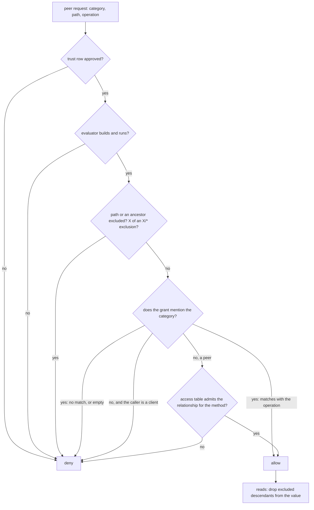

# Implementation Plan: a peer's grant is the answer on every route

**Security, unpublished.** Keep local until fixed, under the same rule as the
peer-authorisation records: never push this file before its fix.

**Date:** 2026-11-10
**Research:** thoughts/research/2026-11-10-grant-enforcement-per-route.md
**Audit:** thoughts/verifications/2026-11-09-peer-authorisation-fixes-audit.md
**Branch:** fix/3.16.0-grant-enforcement (to be created on top of
fix/3.16.0-peer-authorisation; local until both security plans are verified)

## Overview

The peer-authorisation plan made sure a peer is one the owner accepted. This
plan makes sure that what the owner granted that peer is what it gets, on
every way in: each REST route, each level of a property, the pushed and
pulled diffs, and the trust type an OAuth2/MCP client ends up with. It closes
audit items A5 to A7, A10, A13 to A20 and the subscription-creation check the
specification requires, takes two items over from `spec-1-5` (T22, C10),
documents A11 and A12, and hands A8's cleanup to the attribute-list plan.
Every fix is checked against `docs/protocol/actingweb-spec.rst`; the research
note's "Calibration against the protocol's intent" has the reading each
decision rests on.

## Decisions Made

- **Stacked branch, own PR** (owner, 2026-11-10): `fix/3.16.0-grant-enforcement`
  on top of the peer-authorisation branch, one commit per phase; both PRs
  open only when this plan is verified.
- **A5, a deny holds on every path** (owner, 2026-11-10): an exclusion covers
  its node and the node's descendants, and an exclusion ending in `/*` also
  names the node before it. A read of a parent, the listing and diffs drop
  excluded parts at any depth. A non-admin peer's write or delete of a parent
  is 403 when the stored value or the request body holds an excluded
  descendant. Allow patterns keep today's meaning (`public/*` does not grant
  the node `public`). The same rule applies to the `resources` category.
- **One access decision for every route** (spec `:201-205`, `:2297-2298`;
  owner, 2026-11-10 for the unmatched case):
  - the grant **mentions** the category (the key is present, even empty):
    the rule answers, and a request it does not match is denied;
  - the grant does **not mention** the category: the access table answers
    (it is the application's per-trust-level rule and denies by default);
  - the evaluator cannot be built, or raises: denied;
  - an OAuth2/MCP client is never sent to the access table: no match is
    denied, as `/mcp` already does.
- **`POST /properties` is all or nothing** (spec `:936-949`): every name in
  the body is validated and authorised before anything is changed; one
  refusal is 403 with nothing applied.
- **List paths are authorised on the list name; serving items by path stays
  in `spec-1-5`** (owner, 2026-11-10): this plan closes the leak
  (`/properties/<list>/<x>` is decided by the grant for `<list>`), not the
  conformance gap, whose diffs belong with the attribute-list port.
- **Taken over from `spec-1-5`** (owner, 2026-11-10): T22 (a name no pattern
  covers is denied for a peer, on the listing and the views) and C10
  (deleting a grant notifies the peer).
- **The `resources` grant governs REST `/resources`** (spec `:1358-1370`):
  GET is `read`, PUT and POST are `write`, DELETE is `delete`, on the same
  decision as every other route. Friend and partner lose DELETE and their
  excluded names; associate and viewer gain `GET` on `public/*`.
- **Subscription creation validates read access** (spec `:2438-2442`): 403
  for a `properties`, `resources`, `methods` or `actions` path the peer may
  not read.
- **A10, the library declines and binds; the consumer owns the view** (owner,
  2026-11-10):
  - the application's OAuth2 allow-list (`configure_oauth2_trust_types`)
    is for clients: external parties that reach `/mcp` only. A type outside
    it is declined wherever an OAuth2 sign-in would create a client's
    trust: registration, the authorize POST, the callback, and the SPA
    authorize route, whose `trust_type` is "for MCP authorization" and
    which Emm's frontend never sends (checked 2026-11-10; owner: a separate
    list only if that route were not for MCP clients). Trusts between
    actors go through `/trust` with the user's session and are not
    restricted by this list;
  - with no list configured, every registered type except `admin`; `admin`
    only when listed;
  - the authorize form is bound to the browser by a cookie checked at the
    callback; without a match (another browser, or the client skipped the
    form) the library pauses and renders the confirmation template (client
    name, redirect host, requested level, Approve and Decline) in the
    browser where the user signed in, and creates the trust only on Approve;
  - the confirmation view is a library template the consumer overrides; no
    redirect-to-consumer option;
  - a decision hook before the trust is created can decline or lower the
    type, and fails closed;
  - re-authorising an existing client row sets the row to the type this
    authorisation approved, up or down, and removes its permission override
    (owner, 2026-11-10);
  - an anonymously registered client loses `client_credentials`; a client an
    actor's owner created keeps it.
- **A8's cleanup moves to the attribute-list plan** (owner, 2026-11-10,
  after the outside voice): replica keys are property names only for
  whole-target subscriptions, a replica list is deleted by its meta row, and
  that plan rewrites the replica store next. Recorded in that plan's Update
  Log. This plan keeps the grantor's half (C10). **The PRs are not held for
  it** (owner, 2026-11-10): the cleanup is opt-in, off by default and
  OPTIONAL in the specification, and access at the granting actor is not
  affected; the records may be published describing it as a known limit,
  and the changelog says what the cleanup does not cover yet.
- **A trust delete's remaining race is accepted and documented** (owner,
  2026-11-10): the secret is checked immediately before the cleanup and
  again at the row delete; a re-pair landing in between keeps its row and
  loses its subscriptions until the peer's next sync.
- **Refusals say little** (evaluation, 2026-11-10): a 403 body is
  `{"error": "forbidden"}`, or `{"error": "not_approved"}` for an
  unapproved row; it does not say that an exclusion caused it. A refused
  bulk POST lists the names refused, which the caller sent.
- **Lows: all, hooks unified** (owner, 2026-11-10): A13, A15, A16, A17, A20
  and the stale notification URL are fixed; A14 gets one firing path per
  event with a migration note.
- **Hook contracts consumers rely on stay** (evaluation, 2026-11-10; no
  behaviour change, so no owner decision): the `path` a property hook
  receives is unchanged (Emm's wildcard guard reads the name from it);
  `trust_deleted` keeps firing before the delete (Emm reads the cached peer
  profile there); `trust_approved` fires only where no
  `trust_fully_approved_local` hook is registered.
- **A11 stays with `spec-1-5`** (owner, 2026-11-09, unchanged): this plan
  only adds the "unfiltered" warning to `FanOutManager`'s documentation.
- **A12 is the owner's right** (spec `:1797-1801`): documented, not changed.
- **A depth-3 PUT's diff gets its shape fixed here** (owner, 2026-11-10,
  after Phase 0's `WG7`): Phase 1 registers the diff of a nested PUT or
  DELETE at its true depth and the filter judges the true path; the
  subscriber side and Emm's handling of nested diffs are read before the
  change.
- **The authorize form's provider buttons are fixed in Phase 3** (owner,
  2026-11-10, after Phase 0's `WG16`): the Apple button's state is not
  wrapped, and the preselected type is the safe client default, not the
  first listed.
- **Release shape:** part of the unreleased 3.16.0 minor. Entries under
  `Unreleased` (`SECURITY`, `CHANGED`, `FIXED`), a section in
  `docs/migration/v3.16.rst` for each behaviour change, no version bump.
- **[Added 2026-11-10] An application's own subscription target needs only
  an approved trust at delivery** (owner, re-run 1 Issue F): the grant has
  no category for it; a relationship downgrade does not stop a
  subscription it already has (entry 35).
- **[Added 2026-11-10] A client's override that names another type is
  removed at authorisation, logged** (owner, re-run 2 Issue 4; entry 37).
- **[Added 2026-11-11] A client's override that names another type is
  inert** (owner, re-run 3 Issue 2): the evaluator uses the row's type; the
  re-type has no rollback, the removal is cleanup (entry 43).
- **[Added 2026-11-11] The verify/iterate loop's stop rule** (owner): clean
  means no Medium-or-higher finding a peer or OAuth2/MCP client can reach;
  owner-only, application-stored-data and Low findings are recorded as
  accepted, with no code change. One closing verification on the whole
  branch diff.
- **[Added 2026-11-11] The cross-actor grant write (entry 57) ships with
  this branch**, not as a separate patch (owner).
- **[Added 2026-11-11] The parse and encoding hardening (entries 30, 39,
  44, 48, 54, 62, 66, 69-72) stays in this plan** (owner); no more of that
  kind is added here.
- **[Added 2026-11-11] Behaviour changes made on review are kept** (owner):
  the read hook on a plain-text direct GET, 409 on a sub-path PUT to a value
  with no parts, the owner-side BOM/UTF-16 normalisation, and the grant-edit
  validation (400s, the permissions GET's 404, `created_by` set by the API),
  each with a changelog line.

## What We're NOT Doing

- The replica cleanup after a revocation (A8: exclusions, dropped `read`,
  scalars, copies fetched by query) - moved to
  `plans/2026-11-06-attribute-list-v2-port.md` Phase 4 by the owner; it is
  OPTIONAL in the specification and off by default.
- Serving list items by path (`GET`/`PUT`/`DELETE /properties/<list>/<n>`) -
  `spec-1-5` P2 to P4, with the diffs the attribute-list port defines.
- Always confirming after sign-in in place of the cookie - the outside
  voice's simpler mechanism; the owner chose the cookie with the fallback
  when both were offered (2026-11-10), so the honest flow has no extra step.
- A consumer-hosted confirmation step (redirect plus pending-token
  endpoints) - the owner chose the template; more surface to secure.
- Widening allow patterns (`public/*` also granting the node `public`) - no
  security gain; the owner chose the deny side only.
- Filtering `FanOutManager`'s payload per subscriber - the class is removed
  by `spec-1-5` Phase 4.
- Filtering the *content* of diffs for targets other than `properties` - an
  application registers those diffs itself and the specification leaves
  their rights to it; this plan checks their creation and documents the
  delivery.
- A `/meta` check on the owner's own base-URI change (A12) - the
  specification gives the owner that change; it is the recovery route for a
  moved peer.
- Changing the 404 a trust DELETE answers before authorising - a peer's
  cleanup of a half-deleted pair depends on it (`actor.py:3054-3056`).
- Firing per-trust hooks from `delete_all_relationships`, `Actor.delete` and
  the purge - they are documented as the caller's job
  (`trust_manager.py:826`); unifying covers the routes that fire today.
- Changing what a property hook receives as `path`, or adding a
  `property_name` argument - a compatible signature change belongs with a
  hooks cleanup, not a security fix; the permission path is fixed without
  it.
- Making the writes of a bulk POST transactional across storage faults -
  validation and authorisation become all-or-nothing; a storage fault on the
  n-th write is the existing `DbError` contract.
- Passing the caller to `resource_*` callback hooks - additive API, not
  needed once the handler evaluates the grant.
- Expiring anonymous registrations or their trust rows -
  `todo/dcr-registrations-and-client-trust-rows-never-expire.md`.
- Cross-process invalidation of MCP caches after a row's type changes -
  `todo/mcp-cache-lifecycle-and-revocation.md`; the single-process eviction
  (`actingweb/mcp/invalidation.py`) is called.
- Any change in Emm's production code - Emm's worktree carries test-harness
  changes only; what Emm should adopt is listed in the migration guide.
- The SPA's login itself (sessions, cookies, tokens of `/oauth/spa/*`) -
  separate from MCP client authorisation by the owner's rule; only the trust
  type that route creates is checked.

## What Already Exists

- `actingweb/handlers/properties.py:160-221` `_check_property_permission` -
  the one route that already implements "rule, else access table, else
  deny"; stays as a thin wrapper around the shared decision so the existing
  test patches on this module keep working.
- `actingweb/auth.py:797-860` `_match_access_row` - the access-table lookup,
  bound to an `Auth` object; its matching loop becomes a pure function both
  it and the decision call.
- `actingweb/permission_evaluator.py:265` `evaluate_bulk_property_access` -
  many names on one grant read; reused by the bulk POST pre-check and the
  listing.
- `actingweb/permission_evaluator.py:539`
  `evaluate_property_with_exclusions` - one caller (`actor.py:3944`), a
  one-level walk; removed in Phase 1 in favour of the snapshot functions.
- `actingweb/permission_evaluator.py:592` `_is_unapproved` - the approval
  gate under every evaluation (peer-authorisation A1); stays first.
- `actingweb/actor.py:3874-4020` `filter_subscription_blob` - the one filter
  for push and pull since iteration 50; keeps its signature and its
  full-path evaluation (`:3914`).
- `actingweb/permission_evaluator.py:436` `evaluate_resource_access` - no
  REST caller today.
- `actingweb/permission_integration.py:460-514` `AccessControlConfig.
  configure_oauth2_trust_types` / `get_oauth2_trust_types` - the allow-list
  API, read today only by the form renderer and by Emm's password route;
  extended, not replaced.
- `actingweb/oauth2_server/token_manager.py:127-189`, `:689` - authorisation
  codes with `expires_at` in the payload and a single-use `_consume`; the
  pending authorisation copies this shape. `:2036-2046`
  `purge_expired_tokens` - the PostgreSQL reaper's bucket list.
- `actingweb/oauth2_server/state_manager.py` - encrypted, timestamped state
  that already carries `trust_type`; the form nonce rides in it.
- `actingweb/cross_site.py`, `handlers/base_handler.py:45-87` - cross-site
  helpers; reused by the confirm POST.
- `actingweb/db/*/trust.py` `modify(only_if_secret=)` - the conditional-write
  shape the conditional delete copies on both backends.
- `tests/integration/_wire.py`, `tests/integration/test_harness.py`,
  `tests/integration/wire/rows.toml` - the recording harness, its apps and
  its row registry.

## Phase 0: today's behaviour, recorded

No library change. The owner's rule: prove what happens today before
changing it; later phases re-record explicitly, with the diff read.

### Changes

**Harness** (the wire apps cannot record half the rows as they are):

- `tests/integration/test_harness.py`
  - `resource_*` callback hooks on the wire app (`resource_x`,
    `resource_private/x`, `resource_public/x`, answering a fixed body).
  - A recording hook for `trust_fully_approved_local`, `trust_approved` and
    `trust_deleted` that records the hook name and the sorted argument names
    through `record_event` (`_wire.py:98-103`).
  - A fourth recorded app `wire_oauth` with OAuth2 and MCP on, one MCP tool,
    and its provider endpoints pointed at a local stub (token and userinfo)
    served by the test; port chosen beside the existing three
    (`conftest.py:982-984`).
  - Access rows for a relationship name outside the registry (`wire_legacy`)
    so the "category not mentioned" path can be recorded.
- `tests/integration/_wire.py` - the normaliser names `client_id`
  (`mcp_<hex>`), `client_secret`, `access_token`, `refresh_token`, `code`
  and `state`; `set-cookie` is kept among the recorded headers with its
  value normalised; the snapshot can include the system actor's and a
  client's trust row.
- `tests/integration/verify_groups.py` - a row with `exposure = true` must
  name an owner; `tests/integration/test_wire_harness.py:303-310` gets the
  parametrised case.
- `tests/integration/XDIST_GROUPS.md:38` and the new test file - group
  `wire_peer_paths`.
- `tests/integration/wire/rows.toml` - reserve
  `"grant-enforcement-per-route" = ["WG1-WG19"]`; one entry per row, with
  `owners` naming the phase in the table below and `exposure = true` where
  the row records data reaching a peer that may not read it. `WP1` and
  `WA17` keep no owner: the `permission_changes` shape does not change
  here.

**Rows**, in `tests/integration/test_wire_grants.py` (new). Actors: A
(owner), F (friend), S (associate), P (partner), an admin peer, an
unapproved U, L (relationship `wire_legacy`). A holds `private = {"k": 1}`,
`settings = {"theme": "x", "private": "s", "deep": {"private": "d"}}`, lists
`notes` and `memory_personal`, and an override for F adding
`excluded_patterns: ["memory_*", "settings/private", "*/deep/private"]`.
The toggled flag for a scenario is set in the test with try/finally, as
`tests/test_peer_binding.py:658` does.

| Row | Scenario | Expected today (from reading; the recording decides) | Changed by |
| --- | --- | --- | --- |
| WG1 | F: `GET`/`PUT /properties/private`, `GET /properties`, `GET /properties?metadata=true` | whole object served and overwritten; listed (exposure) | Phase 1 |
| WG2 | F: `GET /properties/settings`, `…/settings/private`, `PUT /properties/settings` | parent serves both excluded children; child 403; overwrite 201 (exposure) | Phase 1 |
| WG3 | F: `GET /properties/memory_personal`, `…/memory_personal/x`, `PUT …/memory_personal/x?index=0` | 403; whole list; item written (exposure) | Phase 1 |
| WG4 | F: `POST /properties` with (a) an allowed scalar plus `{"private/x": 1}`; (b) bulk `items` for `memory_personal`; (c) list creation `memory_new` alone; (d) a bare `{"private": {…}}` | (a) 201, denied key skipped; (b) 201 applied; (c) list created, then 403; (d) 201 (exposure) | Phase 1 |
| WG5 | A peer of a registered type whose base rule is `{"properties": {"allowed": ["notes"]}}` and which the access table admits: `GET /properties/color`, the listing, a pull of a whole-target subscription | 200; `color` listed; pull `{}` (exposure) | Phase 1 |
| WG6 | Flows that must not change: F `GET`/`PUT /properties/color`, `GET /properties/notes`, `POST /properties/notes/items`, `PUT /properties/settings/theme`; the admin peer's `PUT /properties/private` and `PUT /properties/settings`; L's `GET /properties/color`; F and P: `POST /methods/wire_ping`, `GET /methods`, one action `POST` and `GET /actions` | 200/201/204 as today | none |
| WG7 | F: whole-target subscription; A writes `private`, `settings/private`, `settings/deep/private`, `color`; push and pull | excluded values sent inside their parents (exposure); `color` sent | Phase 1 |
| WG8 | F: subtarget `memory_personal`, resource `item`; subtarget `settings`; subtarget `settings`, resource `private`; A writes | item sent (exposure); `private` dropped, `deep.private` sent (exposure); nothing | Phase 1 |
| WG9 | L: pull of a `properties` subscription; S, F: a property hook route (`GET` of a hooked property) with a grant that does not mention the category | `{}`; served | Phase 2 |
| WG10 | F, S, P, admin: `GET`/`PUT`/`DELETE /resources/x`, `/resources/private/x`, `/resources/public/x`, `/resources/private` | F, P, admin: all served; S: 403 (exposure for F on `private/x`) | Phase 2 |
| WG11 | Emm's shape: a type with `"methods": []` and an access row `("methods", "POST", "a")`: `POST /methods/wire_import`, `GET /methods` | 403; listing as today | none |
| WG12 | F: `POST /subscriptions/<F>` for `properties/memory_personal`, `properties/color`, `properties`; a named-pattern type (`patterns: ["color"]`) for `properties` | 201 each | Phase 2 |
| WG13 | F: `GET /trust/friend/<F>/shared_properties`; U the same on its pending row; U: `GET /subscriptions/<U>` | every name in `excluded_properties`, for U too; 200 for U (exposure) | Phase 2 |
| WG14 | `wire_oauth`: anonymous `POST /oauth/register` with `trust_type: admin`; a `client_credentials` token; `tools/list` on `/mcp` | registered as `admin`; token issued; session on the system actor (exposure) | Phase 3 |
| WG15 | `wire_oauth`: a client's own `POST /oauth/authorize` with `trust_type=admin`, then the provider callback, no form rendered | `admin` trust on the user's actor (exposure) | Phase 3 |
| WG16 | `wire_oauth`, the honest flows (form requested with `Accept: application/json`): POST with `mcp_client`, callback by GET; the provider-button link, callback by cross-site form POST (the Apple route); then token and `tools/list` | `mcp_client` trust, token works | Phase 3 (the form gains a nonce; the outcome must not change) |
| WG17 | `wire_oauth`: an owner-created client (`OAuth2ClientManager.create_client`) using `client_credentials` | token bound to the owner's actor | none |
| WG18 | A deletes F's permission override (REST); deletes it again | no permission callback either time; 204 twice | Phase 4 |
| WG19 | Trust hooks: approve by REST PUT (twice), by `TrustManager.approve_relationship`; delete by REST, by `delete_relationship` | names and arguments differ per route; the repeat PUT fires again | Phase 4 |

- `tests/integration/wire/WG*.json` - the recordings, both topologies where
  the row crosses hosts. Recorded with
  `WIRE_RECORD=WG1,WG2,…,WG19` (there is no "all", `_wire.py:689-695`), one
  run at a time.

### New Tests, both unit and integration tests

- The nineteen rows, each on both backends by the existing parametrisation.
- `tests/integration/test_wire_harness.py` - the exposure-needs-an-owner
  case; the normaliser replaces each new OAuth secret and fails on an
  unnamed `mcp_<hex>` id.

### Failure Scenarios

- A row's "expected today" is wrong - the recording is what the library
  does; the row's `expected` is corrected to it and the difference written
  into the verification before Phase 1 starts. Covered by the recording.
- The stub provider does not match a real provider's callback - WG16
  records both callback methods through the two real handlers
  (`oauth2_endpoints.py:522`, `oauth2_callback.py:1469-1491`). Covered.
- A parallel run corrupts a recording - sequential recording, explicit rows
  (contract warning). Procedure.
- The new app's port collides with another fixture - the fixture asserts
  the port is free at start and fails with the port in the message. Test.

### Verification

- [x] Run the contract's `### Checks` fast tier verbatim (4835 passed)
- [x] `poetry run python tests/integration/verify_groups.py`
- [x] Full tier, both backends; a failure is re-run sequentially before it
      is believed (DynamoDB 6210 passed, PostgreSQL 6007 passed, docs
      clean; the one failure on the first DynamoDB run was `WG16` comparing
      the registry's types, which other tests in a worker extend: the row
      now keeps the wire apps' own types, re-recorded)
- [ ] `git show --stat HEAD -- tests/integration/wire` shows only `WG*`
      files and `rows.toml`; the commit carries its `Wire-Phase` trailer
- [ ] Each recording read against its "expected today"; differences written
      down

### Implementation Status: Complete

#### Phase 0 notes (2026-11-10)

**Harness, as built** (deviations from the Changes above):

- The provider stand-in is served by `wire_oauth` itself under `/_stub/`
  (`tests/integration/_oauth_stub.py`): a worker has one free port of its
  ten (5564), so no separate server. The recorder skips `/_stub/` (a real
  provider is not part of what crosses the wire); the stand-in answers
  fixed tokens and code, and signs Apple's `id_token` with a test RSA key
  served as JWKS. The library's Google and Apple provider classes are
  replaced in `oauth2._PROVIDER_REGISTRY` by subclasses that change the
  endpoints only for an app whose `fqdn` registered the stand-in. The
  authorization endpoint is a fixed `https://wire-provider.example.test/`
  URL that nothing fetches (the library's OAuth2 client refuses an `http`
  one); a row plays the browser and goes straight to the callback.
- `wire_oauth` renders the library's own templates (the harness's copy of
  the authorize form has no provider buttons).
- `Scenario.extra_snapshot` (under `"extra"`, absent unless set) carries
  what a row adds to the snapshot: A's properties for the REST rows, the
  client trust rows for the OAuth2 rows.
- Normaliser: `client_secret`, `access_token`, `refresh_token` are secret
  keys (an unnamed value fails the guard); `mcp_<hex>` has its own guard;
  `client_id_issued_at` is an epoch, and `created_at`, `expires_at`,
  `issued_at` are epochs when numeric (they are timestamp strings
  elsewhere); a host inside a percent-encoded URL is named; `set-cookie` is
  kept as a list with each value replaced. `code` and `state` are named by
  the rows (raw, percent-encoded, form-encoded, and a JSON-wrapped state's
  nonce), not by key.
- The trust hook recorder is off unless a row opens
  `trust_hooks_recorded()`; the wire app also gains `resource_<name>`
  callback hooks, a `wire_hooked` property hook, a `wire_ping` method, a
  `wire_act` action, and the relationships `wire_allowed`, `wire_named`
  (registered) and `wire_legacy` (access rows only).
- The 82 existing recordings stay byte-identical with the harness changes
  (all wire files green before any `WG` row existed). The `WG` rows were
  compared twice on DynamoDB with fresh actors and once on PostgreSQL; two
  unstable spots were fixed in the rows (the `shared_properties` lists come
  in no fixed order; a JSON-wrapped state was form-encoded).
- `WG16` gained a step: a POST choosing Apple and Apple's form-POST
  callback (the honest Apple path), beside the Apple button's own link.
- The `Wire-Phase` trailer is a convention, not a check (nothing in the
  tree reads it).

**What the recordings showed against "expected today"** (each row's
`expected` in `rows.toml` now says what was recorded):

- `WG3`: with the friend grant's `memory_*` the tail is 403 too (the glob
  matches `memory_personal/x`); with an exclusion naming the list exactly
  (peer E, added to the row) the tail serves the whole list and the
  `?index=0` PUT writes item 0. A7 confirmed; Phase 1's tail test uses the
  exact-name exclusion.
- `WG4`: worse than expected. The bulk items for the excluded list answer
  **403 and are applied**; the excluded list is created, then 403.
- `WG5`: wider than expected. The access table serves `wire_allowed` the
  whole listing, `private` and `memory_personal` included.
- `WG7`: a depth-3 PUT (`settings/deep/private`) is stored correctly (the
  row's snapshot of A) but its diff is registered with `resource` = the
  second segment and the raw body: the subscriber gets
  `{"settings": {"deep": "d2"}}` and its replica of `settings` is
  overwritten. The filter evaluates `settings/deep`, which no exclusion
  names, so a depth-3 private value is pushed whatever the grant says.
  Owner, 2026-11-10: fixed in Phase 1, shape and filter.
- `WG9`: the associate is already refused on the property hook route (the
  rule is mentioned and does not match); F and L are served.
- `WG13`: `shared_properties` is empty for a friend and every property,
  `color` included, is in `excluded_properties`; the unapproved peer gets
  the same.
- `WG16`: `wire_oauth` lists its types (the wire types, `admin` among
  them, no default), so the form's preselection does not depend on what a
  test worker's registry holds; the form then preselects `admin` (the first
  listed). Following the **Google button** with no type chosen creates an
  **`admin`** trust for the client: the button's state carries the default
  type. **The Apple button never completes:** the form mints a nonce (43
  characters) for the link; the authorization URL wraps any state shorter
  than 50 characters in JSON with the trust type; Apple posts that JSON
  back and `/oauth/callback/apple` finds no nonce (400). The POST path
  (provider chosen in the form) works for both providers. The row is now an
  exposure (the Google button). Owner, 2026-11-10: fixed in Phase 3.
- `WG8`: the A-side SDK append crosses no wire; each subscription's pull
  holds what the filter left (empty for the excluded list and for
  `settings` with resource `private`; `deep.private` without `private` for
  `settings`); the pushes answer 403 at F, which holds no callback row
  (the subscriptions were made at A directly).
- `WG1`, `WG2`, `WG6`, `WG10` to `WG12`, `WG14`, `WG15`, `WG17` to `WG19`
  match the table.


---

## Phase 1: one access decision, and the property tree

A5, A7, T22, and the property half of A18 and A19.



One note the diagram cannot carry: an empty path (the listing, a
whole-target subscription) is decided per name, never as a whole.

### Changes

- `actingweb/auth.py` - `access_table_admits(config, relationship, approved,
  path, subpath, method) -> bool`: the matching loop of `_match_access_row`
  (`:797-860`) as a pure function with no `Auth` state; `_match_access_row`
  delegates to it.
- `actingweb/permission_evaluator.py`
  - `GrantSnapshot` (frozen dataclass): `approved`, `relationship`,
    `is_client`, the effective rules per category, and a per-category
    `mentioned` flag (`category in permissions`, replacing the falsy test at
    `:217`). `snapshot(actor_id, peer_id)` builds it from one trust-row read
    and the cached override and registry lookups (today an evaluation reads
    the row twice, `:605` and `:701`).
  - Pure functions over a snapshot:
    - `path_excluded(rules, path)`: true when `path` or any ancestor prefix
      matches an `excluded_patterns` or `denied` entry, or when a pattern
      ends in an unescaped `/*` and its head (the pattern minus those two
      characters) glob-matches `path` or an ancestor. Uses `glob_match`
      unchanged, so `access-control.rst:329-331` ("one matcher") stays true.
    - `drop_excluded(rules, path, value)`: for a JSON object, the value
      without any descendant for which `path_excluded` is true, at any
      depth; arrays are never descended (the grant's unit is the list
      name); skipped entirely when the rules hold no exclusion.
    - `holds_excluded(rules, path, *values)`: true when
      `drop_excluded(v) != v` for any given value. Data-based, so it is
      defined for every pattern (`*/secret`, `*private*`, `mem*/x`).
  - `evaluate_permission` and `evaluate_bulk_property_access` call
    `path_excluded` for `PROPERTIES` and `RESOURCES` before the allow match,
    and for those two categories return DENIED, not NOT_FOUND, when the
    category is mentioned and nothing matches (`:832-837`) or the mentioned
    rule is empty. `METHODS` and `ACTIONS` get the same change in Phase 2,
    with their handlers, so nothing about them moves in this commit. The
    empty target keeps NOT_FOUND (`:820-825`); callers decide per name.
    `/mcp` is unaffected (it denies anything but ALLOWED). "Mentioned" is
    `category in effective_permissions`: a type's `base_permissions` is the
    dict as declared (`trust_type_registry.py:54`), the six built-in types
    declare every category, and the merge adds an override's category only
    when it is not `None` (`permission_evaluator.py:660-669`).
  - `evaluate_property_with_exclusions` (`:539-590`) is removed; its one
    caller moves to the snapshot functions.
- `actingweb/access_decision.py` (new) -
  `decide(config, actor_id, peer_id, category, path, operation, *,
  method=None, evaluator=None, snapshot=None) -> Decision` where `Decision`
  has `allowed`, `reason` (`not_approved`, `excluded`, `not_granted`,
  `no_table_row`, `unavailable`) and the snapshot for reuse. The flow in the
  diagram. `method` defaults from the operation (read/write/delete →
  GET/PUT/DELETE). Imports `permission_evaluator` and the pure table
  function only; nothing from `actor` (`auth.py:9` imports `actor`, and
  `actor.py:30` imports the evaluator). `DbError` propagates.
- `actingweb/handlers/properties.py`
  - `_check_property_permission` (three copies: properties, metadata, items)
    keep their names and signatures, resolve the evaluator from their own
    module (existing patches stay live) and call `decide`; they keep the
    `Decision` on the handler for the rest of the request.
  - Every refusal from `decide` answers 403 with `{"error": "forbidden"}`
    (`"not_approved"` for an unapproved row); the `Decision.reason` goes to
    the debug log only.
  - GET of a value (`:476-517`) passes it through `drop_excluded` for a
    peer; the listing (`:561-640`) filters names first, uses `decide` per
    name (the NOT_FOUND includes at `:582-584` and `:634-637` go: T22), then
    `drop_excluded` per value; `?metadata=true` (`:654`) computes sizes
    after filtering.
  - PUT (`:923`) and DELETE (`:1744`) answer 403 for a non-admin peer when `holds_excluded` is true for the stored value or the
    request body. Root `DELETE /properties` (`:1759-1769`) by a peer needs
    every stored name to pass `decide` for `delete`.
  - List branch (`:330-457`, `:780-860`, DELETE's at `:1779`): a path whose
    first segment is an existing list is decided on the bare list name. The
    existence read happens only after the name itself is allowed; a refusal
    is 403 whatever the name is. What a tail returns is unchanged
    (`spec-1-5`).
  - `post()`: `authorize("POST", …)` stays (`:1073`); the missing `return`
    after the 400 at `:1077` is added. Then one validation-and-authorisation
    pass over all three body shapes (JSON, form list, form arguments) builds
    a prepared batch per key (list snapshot, pending updates and deletes, so
    nothing is read twice), calls `evaluate_bulk_property_access` once for
    every target name with `write`, and `holds_excluded` per name. A 400
    (`:1250`, `:1310`, `:1695`) or a refusal ends the request with nothing
    applied; the 403 body lists `refused` names. The apply pass consumes the
    batch. A body with no names is decided by the table alone.
  - Each `execute_property_hooks` call passes the handler's `Decision` in
    the auth context and the true property path as
    `auth_context["permission_path"]`; the `path` argument the hook sees is
    not changed.
- `actingweb/interface/hooks.py`
  - `_check_hook_permission` (`:354-446`), for `hook_type == "property"`
    only in this phase: uses the `Decision` from the context when present,
    else `decide` on `permission_path` (else the path built at `:617`, for
    callers outside the handlers). "Category not mentioned" goes to the
    table; an error denies. The early allows for "no peer" stay; the two
    for a peer with no actor id or no config (`:387-389`, `:394-395`)
    become denials.
  - `execute_property_hooks` (`:617-622`, async `:1056`): a permission
    denial returns the module sentinel `PERMISSION_DENIED` on every
    operation; handlers map it to 403. `None` keeps its meaning (the hook
    hides the value: 404 on GET).
- `actingweb/actor.py:3874-4020` - `filter_subscription_blob` and the
  whole-target filter build one snapshot per call (accepting one from the
  caller: push passes the row it read at `:3627`, the pull loop at
  `handlers/subscription.py:422-428` builds one before the loop), keep the
  full-path evaluation (`:3914`), apply `drop_excluded` to object values
  rooted at the evaluated path, and unwrap the full-state fallback's extra
  level (`:4734`) before filtering. The blob is parsed once. (These are the
  functions Phase 1's evaluator change reaches anyway, so the rows change
  here.)
- **Decided by the owner after Phase 0 (`WG7`):**
  `actingweb/handlers/properties.py` PUT (`:749-1000`) and DELETE of a
  nested path deeper than two segments: first read how a subscriber applies
  a diff with a `resource` (`callback_processor`, `remote_storage`) and how
  Emm's data hook reads one; then the diff is
  registered with `resource` = every segment after the property name
  (`deep/private`) and the body nested under all but the last, so the
  subscriber's replica is updated at the right depth and the filter
  evaluates the true path (`settings/deep/private`). A two-segment path is
  unchanged. Tests: a depth-3 PUT and DELETE pushed and pulled, allowed and
  excluded, in `test_subscription_grants_flow.py`.
- `actingweb/interface/authenticated_views.py:132-194`, `:474`,
  `:537-577`, `:686` - `decide` with `is_client` from the context; reads go
  through `drop_excluded`; the subscribe check (`:674-694`) evaluates
  `subtarget` on the `properties` category instead of
  `properties/<subtarget>`.
- Docs: `docs/guides/access-control.rst` ("Exclusions and the property
  tree"; "When no rule matches": mentioned vs not mentioned; `:385-389`,
  `:565-581`, `:622`), `docs/guides/access-control-simple.rst:154`, `:266`,
  `:452`, `docs/sdk/authenticated-views.rst`,
  `docs/reference/routing-overview.rst` (the 403 body),
  `docs/reference/hooks-reference.rst` (the `path` a property hook receives,
  as it is; a bulk hook veto does not revert),
  `docs/protocol/actingweb-spec.rst` (under "Permission Evaluation": an
  exclusion of a path applies to its descendants and to data returned for
  its ancestors), `CHANGELOG.rst` (`SECURITY`: the parent, the list tail,
  the bulk POST, the unmatched rule; `CHANGED` with **Behavior change:** for
  each), `docs/migration/v3.16.rst` ("Grants hold at every level", "A rule
  that does not match denies").
- `tests/integration/wire/` - `WG1` to `WG5`, `WG7`, `WG8` re-recorded;
  `WG6` unchanged.

### New Tests, both unit and integration tests

- `tests/test_property_tree_grants.py` (new, unit, real evaluator):
  `private/*` excludes `private`, `private/a`, `private/a/b`; exact
  `settings/private` excludes itself and below, not `settings`;
  `memory_personal` excludes `memory_personal/0`; `a\*` and a trailing
  `/\*` are literals; `drop_excluded` at depth 1 to 3 including
  `*/deep/private`, on a non-object, on an object left empty (`{}`), and not
  into arrays; `holds_excluded` for stored and incoming values; no walk when
  the rules hold no exclusion (asserted by a counting matcher); the same
  table for `RESOURCES`.
- `tests/test_access_decision.py` (new, unit): mentioned and matching;
  mentioned and unmatched in both rule shapes; mentioned and empty
  (`"properties": {}` with a table row: denied; the `methods` twin of this
  case, Emm's shape, is Phase 2's); not mentioned with a
  GET-only, a POST-only and no table row; a client with a category not
  mentioned (denied); evaluator cannot be built; evaluator raises;
  `DbError` propagates; unapproved row; a caller with no `Auth` object; one
  trust-row read per request (counting store).
- `tests/integration/test_property_grants_flow.py` (new, both backends,
  FastAPI and Flask handlers): WG1 to WG5 with the new answers: parent GET
  filtered at both depths; parent PUT and DELETE 403 for F, served for the
  admin peer (spec `:802`); with an exclusion naming the list exactly
  (`memory_personal`, which `WG3` showed the glob grant does not exercise),
  `/memory_personal/x` and the `?index=` PUT 403;
  a non-list name with a numeric key unchanged; mixed bulk POST 403 with
  `refused`, and a following GET shows nothing changed (scalars, list
  items, list creation, metadata), for the JSON and both form shapes; an
  all-allowed bulk POST 201; a 400 in the last key leaves the first
  unapplied; `POST /properties/x` (non-empty name) is 400 and changes
  nothing; root DELETE by a non-admin type holding `delete` and an
  exclusion is 403; the `allowed`-shape miss is 403 on GET, absent from the
  listing, and not pushed.
- `tests/integration/test_subscription_grants_flow.py` (new, both
  backends): whole-target push and pull omit `private`, `settings.private`,
  `settings.deep.private`; subtarget `settings` drops both; subtarget
  `settings`, resource `private` delivers nothing; an excluded list with
  each resource `item`, `items`, `value`, `old_item`, `index`, `action`
  delivers nothing; the full-state fallback to a peer without
  `subscriptionresync` omits the excluded child.
- `tests/test_transparent_hook_permissions.py` - the error fallback flips
  to deny; "not mentioned" goes to the table; a hook returning `None` is
  404 and a denial is 403; a wildcard hook still receives the `path` it
  receives today on every route (pins Emm's guard); method and action hooks
  unchanged in this phase.
- Updated, listed because their patch targets or assertions move:
  `tests/test_handler_permission_integration.py` (the legacy case becomes
  "category not mentioned"), `tests/test_subscription_permission_filtering.py`
  (7 patches on `actor`), `tests/test_authenticated_views.py` (12),
  `tests/test_authenticated_bulk_list_reads.py`,
  `tests/integration/test_property_lists_advanced.py` (2),
  `tests/test_db_fault_permissions.py:78`, `:95` (still `DbError`).
- Pins that must stay green unchanged:
  `tests/test_peer_paths_binding.py:943-1059`,
  `tests/integration/test_property_path_control_chars.py:71-96`, wire rows
  `WS*`, `WL*`, `WD*`, `WQ*`, `WP*`.

### Failure Scenarios

- Grant read faults mid-request (`DbError`) - 503 by the fault contract;
  pinned in `test_db_fault_permissions.py` and `test_access_decision.py`.
- A property value is not JSON - `drop_excluded` returns it untouched when
  the node is allowed; unit test.
- An application whose type excludes `foo/*` and whose peers write the whole
  `foo` object - 403; **Behavior change:** in the changelog and the
  migration section, and a debug log line on the owner's side naming the
  exclusion. Test.
- An application using `allowed`/`denied`-shaped property rules that served
  unmatched names through the access table - those names are now 403.
  **Behavior change:**, migration section with the fix (list them). Test.
- A bulk POST whose pre-pass succeeds and whose third write faults - earlier
  writes stay (NOT doing); the response is the 503 and `register_diffs`
  runs for what was applied, where today it is skipped. Test with a
  faulting store.
- A wide exclusion pattern (`*token*`) on a large object - the walk visits
  every node once per read; bounded by the value's size, skipped without
  exclusions; a benchmark-free unit test asserts the visit count is linear.
- A consumer's wildcard property hook that reads `path[0]` - unchanged; the
  pin above fails if a later edit "cleans up" the doubled path.
- The pull loop serves K stored diffs - one snapshot for the loop, asserted
  by the counting store.

### Verification

- [x] Run the contract's `### Checks` fast tier verbatim
- [x] Full tier on both backends before the commit; sequential re-run of
      any failure
- [ ] `git show --stat HEAD -- tests/integration/wire`: `WG1` to `WG5`,
      `WG7`, `WG8` changed (and `WG9`, owned by Phases 1 and 2), nothing
      else; `Wire-Phase` trailer
- [x] Sphinx build with `-W`
- [x] codex on the diff (three findings: one fixed, one rejected with
      reason, one is Phase 2's)
- [ ] `/verify_implementation` for the phase

### Implementation Status: Complete

#### Phase 1 notes (2026-11-10)

As built, and where it differs from the Changes above:

- The access table's pure functions live in `actingweb/access_table.py`
  (`matching_access_row`, `access_table_admits`), re-exported from
  `actingweb.auth`; `Auth._match_access_row` delegates to them. A module of
  its own because `auth` imports the actor and the actor's filter needs the
  decision.
- `actingweb/access_decision.py`: `decide`, `Decision`, `grant_snapshot`,
  `forbidden_body`, and the hook sentinel `PERMISSION_DENIED` (there, not in
  `interface/hooks.py`, so handlers import it without the interface).
  `GrantSnapshot`, `snapshot()`, `evaluate_rules_for()` and
  `evaluate_snapshot()` are on the evaluator; `path_excluded`,
  `drop_excluded`, `holds_excluded` are module functions there.
  `evaluate_permission` and the bulk evaluation keep their signatures and
  apply the same rule (so `/mcp` and every other caller agree).
- An empty path with a stated rule goes to the access table (as the old
  NOT_FOUND did); the listing and the root DELETE decide per name.
- The three `_check_property_permission` copies became one base class
  (`_PropertyHandlerBase`); the evaluator is still resolved from
  `actingweb.handlers.properties` (likewise in `interface/hooks.py` and
  `interface/authenticated_views.py`), so existing patches apply. Tests
  that mocked `evaluate_property_access` use `tests/_grant_fakes.py`
  (`StubEvaluator`, which routes the decision's two calls to those mocks).
- A hook's `PERMISSION_DENIED` is raised by `_run_hooks` and answered 403 by
  a decorator on every verb of the three handlers.
- **Depth-3 diff, smaller than planned:** the resource stays the second
  segment and the blob is the resource's whole stored value, which is the
  contract `register_diffs` already documents ("the blob is the FULL
  resource object"). No new wire shape, so the subscriber side and Emm read
  it as a two-segment write; the filter then drops the excluded child at
  its true path (`test_subscription_grants_flow.py`). DELETE likewise sends
  the remaining resource.
- **Full-state fallback:** filtered where it is built, per peer, for
  exclusions only (at the true paths; a list's state is not descended);
  whether the peer may read it at all stays with the pull filter. The
  first draft decided allow per key there and emptied the state for a peer
  with no grant read (`test_property_list_spans.py` caught it).
- **The subtarget filter** keeps the property's value whole under an
  allowed subtarget and drops only excluded children (the first draft
  required each child to be allowed; `test_peer_paths_binding.py:967`
  pinned the intended behaviour).
- **Bulk POST pre-pass:** control characters (400) first, then the `items`
  shape (400) and that an `items` key names an existing list, then the
  decision per name and the excluded-descendant check. The index bounds
  and the item size (400/413) are still checked per key in the apply pass:
  a batch whose second key fails them leaves the first applied (the
  existing `DbError` contract's sibling; recorded as a limit, not fixed
  here). A DbError mid-apply now registers the diffs of what was applied
  before re-raising.
- **`POST /properties/<name>`** is a real 400 now (the missing `return`):
  `test_www_templates.py` and `test_subscription_baseline_storage.py` posted
  to a named path and relied on the body being written anyway; both post to
  the collection.
- **The developer views' bulk list read** keeps its one bulk call; names it
  leaves NOT_FOUND (category not mentioned) go to the table for a peer and
  are refused for a client.
- **A refused diff leaves a gap:** a diff the peer may read none of is not
  pushed (the push's existing design, peer-authorisation plan); now that
  `private` is refused, `WG7` shows F holding a sequence gap and applying no
  later push until its resync. Documented in the migration guide.
- Not added: a Flask run of the property flow (the handlers are framework
  free and the integration app is FastAPI; the Flask integration's cookie
  and template work is Phase 3's), and a separate wildcard-hook path pin
  (no hook `path` changed; `WG9` records a hook's path).
- Release shape: new public names (`access_decision`, `access_table`,
  `PERMISSION_DENIED`), changed 403 bodies and a removed evaluator method:
  minor (3.16.0, as planned).

Review round (advisor, then codex `exec -s read-only` on the diff):

- **Emptied objects in diffs** (advisor): the library's subscriber stores a
  property as a diff carries it (`remote_storage.apply_callback_data`
  replaces, never merges), so `{"settings": {}}` after a refused child
  wiped its copy of `settings`. A diff now drops any object the filter
  emptied, at any depth (`_prune_emptied`); `WG7`, `WG8` re-recorded.
- **Developer views' writes** (advisor): `__setitem__`/`__delitem__` refuse a
  write or delete that would touch an excluded part, as REST does
  (`tests/test_grant_edges.py`).
- **Bulk POST under a store fault**: a key is recorded as applied only
  after its write, so the diffs registered before the 503 are exactly what
  was written (test added; the first version recorded the faulting key).
- **Wildcard hook path pin**: a `*` property hook on the wire app, recording
  only inside `property_hook_paths()`, pins the `path` on GET, PUT, nested
  PUT, `?index=` PUT, DELETE and nested DELETE
  (`test_wire_grants.py::test_a_wildcard_hook_receives_the_path_it_always_has`).
- codex 2 (fixed): the listing filtered values before the property hooks
  and did not filter what a hook returned; it filters after, as the direct
  read does.
- codex 1 (not changed): a PUT hook returning an object with an excluded
  sibling stores it. The hook is the application's code and receives the
  merged stored object, excluded parts included; the peer's own body and
  target are checked. Re-checking the hook's output would refuse every
  nested PUT through a merging hook.
- codex 3 (Phase 2, as planned): push and pull decide by the rule only, so a
  grant that does not mention properties gets nothing pushed (A19, `WG9`).
- The grep for the per-path API (`evaluate_property_access`,
  `evaluate_bulk_property_access`, `NOT_FOUND`) leaves `shared_properties`
  and the views' subscription check for non-properties targets (Phase 2)
  and `permission_integration.py` (denies anything but ALLOWED).

**For the owner (not changed here):**

- The subscriber's replica replaces a property with what a resource-level
  diff carries (two segments or three), losing the property's other keys
  until the next whole write or resync. Existing (Phase 0's `WG7` shows it
  for a two-segment write); the migration guide states it as a known
  limit. Belongs with the replica work (attribute-list plan).
- A refused diff is not pushed (existing design), so a subscriber holds a
  sequence gap. Owner, 2026-11-10: test the recovery. Observed: the first
  callback after the gap timeout triggers a resync and the replica
  converges on what the peer may read
  (`test_wire_grants.py::test_a_subscriber_recovers_from_a_refused_diff`,
  both backends, three runs). The migration guide says so.
- The replica's replace-not-merge: owner, 2026-11-10, moved to the
  attribute-list plan (its Update Log).

Checks: fast tier (4904 unit), full tier DynamoDB 6302 passed and PostgreSQL
6099 passed, docs clean; all wire rows
compared on DynamoDB after re-recording WG1 to WG5, WG7, WG8, WG9.

---

## Phase 2: every other way in

A6, A17, A18 (methods, actions), A19 (push and pull), A20, subscription
creation.

### Changes

- `actingweb/handlers/resources.py` - each verb calls `decide(…,
  "resources", name, op)` (GET `read`, PUT and POST `write`, DELETE
  `delete`, with the request's method for the table) after authentication;
  the bare `authorize()` call goes (the table is inside `decide`). The hook
  is not run on a refusal.
- `actingweb/permission_evaluator.py` - the Phase 1 "mentioned and
  unmatched is DENIED" rule extends to `METHODS` and `ACTIONS`.
- `actingweb/handlers/methods.py:27-78`, `actingweb/handlers/actions.py:27-78`
  - `_check_method_permission` and `_check_action_permission` keep their
  names and call `decide` with the request's method (today the fallback
  hardcodes `GET`); with the Phase 1 rule a mentioned-but-empty category
  (Emm's `"methods": []`) stays denied. `MethodsHandler.delete` (`:255-260`)
  and `async_methods.py:181` use the check. The listing filters (`:141-160`
  in both) answer an empty list when the evaluator cannot be built. The
  JSON-RPC entry on bare `/methods` (sync, and
  `async_methods.py:202-253`) checks `params["method"]` before dispatch.
- `actingweb/interface/hooks.py` - `_check_hook_permission` for `method` and
  `action` hooks moves to `decide` (the Phase 1 change, now with its
  handlers).
- `actingweb/handlers/subscription.py`
  - creation (`:322-325`): for target `properties`, `resources`, `methods`
    or `actions`, `decide(…, target, subtarget[/resource], "read")`; a
    request without a subtarget is admitted when the grant's rule for the
    category has at least one allow pattern with `read` (judged on the
    rule, not on what is stored: Emm's subscriber subscribes before
    `displayname` exists), or, when the grant does not mention the
    category, when the table admits the relationship. 403 `{"error": "forbidden"}` otherwise. Other
    targets: the table only, as today.
  - listing (`:219-227`): `approved=False` removed; an unapproved peer gets
    403.
- `actingweb/interface/authenticated_views.py:659-720`
  `AuthenticatedSubscriptionManager` - `_check_subscription_permission`
  gains `resource` and uses the same check.
- `actingweb/actor.py:3955`, `:4019` - the filter's "ALLOWED only" becomes
  `decide`'s answer, so a grant that does not mention `properties` follows
  the table on push and pull as on a direct read (A19).
- `actingweb/handlers/trust.py:1529-1653` `shared_properties` - requires an
  approved row; evaluates `read` through `decide`; answers
  `shared_properties` only. `actingweb/interface/integrations/
  fastapi_integration.py:1145` - the OpenAPI example loses
  `excluded_properties`.
- Docs: `docs/reference/routing-overview.rst:31` and the resources section,
  `docs/guides/access-control.rst:74-75` ("Resources": one grant for REST
  and MCP), `README.rst:258`, `docs/guides/subscriptions.rst` (creation
  403; diffs of other targets are the application's to filter),
  `docs/protocol/actingweb-spec.rst:2209` (the `resources` grant applies to
  `/resources` and to MCP resources alike), `CHANGELOG.rst`,
  `docs/migration/v3.16.rst` ("`/resources` follows the grant", "A
  subscription needs read access", "A `*` callback hook now answers
  lower-trust peers on `public/*`").
- `tests/integration/wire/` - `WG9`, `WG10`, `WG12`, `WG13` re-recorded;
  `WG11` unchanged.

### New Tests, both unit and integration tests

- `tests/integration/test_resources_grant.py` (new, both backends): F reads
  and writes `x`, is 403 on `private/x`, on `private` (the `X/*` rule) and
  on DELETE; P is 403 on `security/x`; S reads `public/x` and nothing else,
  through a `*` callback hook too; an admin peer and the creator do
  everything; a type that does not mention `resources` follows the table; a
  type with `resources: []` is denied; the hook is not run on a refusal.
- `tests/test_methods_actions_decision.py` (new, unit, sync and async
  handlers): an evaluator that cannot be built denies the call and empties
  both listings; "not mentioned" follows the table with the request's
  method; Emm's shape is 403 on POST (WG11 asserted); the JSON-RPC name is
  checked on both twins; DELETE on both twins.
- `tests/integration/test_subscription_grants_flow.py` (extended): creation
  403 for an excluded subtarget, 201 for an allowed one, for the whole
  target with a friend and with a named-pattern type (Emm's subscriber
  shape), 403 for a type with nothing readable; a `resources` subscription
  to `private/x` is 403; L (not mentioned, table admits) pulls and is
  pushed its data; an unapproved peer's listing is 403; an approved peer's
  is unchanged; an old subscription to a now-excluded path delivers nothing.
- `tests/test_shared_properties_endpoint.py` - rewritten against the real
  evaluator: only readable names, no `excluded_properties`, 403 for a
  pending row. `tests/test_v2_cost_library_callers.py` - its one patch.
- Pins unchanged: `tests/test_peer_paths_binding.py`, the `WS`, `WL`, `WD`,
  `WQ`, `WA`, `WT` wire rows.

### Failure Scenarios

- A per-trust `resources` override written for MCP URIs (`data://*`) now
  denies every REST name for that peer - intended (one grant); migration
  section with the fix. Test.
- Friend applications that relied on DELETE of a resource - 403; the
  migration section names the registry change (`delete` in the type's
  `resources.operations`). Test for the override.
- The evaluator cannot be built at startup - peers get 403 and empty
  listings where they were served; one ERROR log per process. Test.
- A subscriber whose whole-target subscription is refused at creation
  because its type reads nothing - it gets a 403 where it got a silent
  empty stream; the library's subscriber logs it
  (`subscription_manager.py` create path). Test that Emm's shape is 201.
- An application's own diffs for target `resources` reach a peer the grant
  excludes - creation is refused for an excluded path; a broader
  subscription still carries what the application registers. Documented in
  the subscriptions guide (NOT doing).

### Verification

- [x] Run the contract's `### Checks` fast tier verbatim
- [x] Full tier on both backends before the commit
- [ ] `git show --stat HEAD -- tests/integration/wire`: `WG8`, `WG9`,
      `WG10`, `WG12`, `WG13` changed, nothing else; `Wire-Phase` trailer
- [x] `grep -rn "excluded_properties" actingweb/` has no hit
- [x] Sphinx build with `-W`
- [x] codex on the diff; `/verify_implementation` at the end of the plan
      (owner, 2026-11-10)

### Implementation Status: Complete

#### Phase 2 notes (2026-11-10)

- `access_decision.py` gained `named_route_allows` and `listable_names`
  (methods and actions, both handlers and both async twins: the twins
  inherit the check, and their listings, which were not filtered at all,
  now are), `subscription_allowed` (creation, also used by the developer
  views' subscription manager) and `evaluator_or_none`.
  `STATED_RULE_CATEGORIES` in the evaluator adds methods and actions to the
  "a stated rule that does not match denies" rule; tools and prompts keep
  NOT_FOUND (MCP denies anything but ALLOWED).
- A caller that is not a peer keeps the access table with `GET` on the
  methods and actions routes, as before; only the peer's fallback uses the
  request's method. `DELETE /methods/<name>` keeps its access-row check and
  adds the grant.
- `PUT /methods/<name>` (handled by POST) is decided as `PUT`; method and
  action hooks are decided with the request's verb, which the handlers put
  in the hook context (both from codex).
- Whole-target subscription creation is judged on the rule (a rule that
  reads at least one name), never on what is stored; an application's own
  target (not properties, resources, methods or actions) is decided by the
  access row for creating a subscription, in the developer views too (the
  first version admitted any such target there; codex).
- `/resources`, subscription creation and `shared_properties` build the
  evaluator through `evaluator_or_none` (or catch the failure): one that
  cannot be built denies (403) or answers 503, never 500 (codex).
- `shared_properties` asked for the operation `subscribe`, which no rule
  grants, so it listed nothing (`WG13`); it decides `read` now.
- The push/pull filter decides through `decide` (`Actor._may_read`): a grant
  that does not mention properties leaves each name to the access table
  (`WG9`: L now pulls `color`).
- `WG8` gained creation steps (its excluded subscriptions are now 403 at
  creation) and Phase 2 joined its owners; the integration test for an
  excluded list now subscribes while the list is readable and excludes it
  after (an old subscription delivers nothing).
- The built-in types' `resources` rules now apply to REST: `friend` and
  `partner` lose DELETE (their rule has no `delete`), `associate` and
  `viewer` read `public/*` (`WG10`). In the migration guide.

Checks: fast tier, full tier both backends (below), wire rows compared
twice on DynamoDB after re-recording WG8, WG9, WG10, WG12, WG13; codex on
the diff (six findings, all fixed with tests).

---

## Phase 3: a client's trust type is the user's choice

A10.

```mermaid
sequenceDiagram
    participant C as MCP client
    participant B as User's browser
    participant L as Library (/oauth)
    participant P as Provider
    C->>B: open /oauth/authorize
    B->>L: GET authorize
    L-->>B: consumer's form + nonce cookie (nonce in the form and in each provider link's state)
    B->>L: POST (trust_type, nonce) or follow a provider link
    L->>L: type acceptable for clients? else access_denied
    L-->>B: 302 provider (state: type, nonce)
    B->>P: sign in
    P-->>B: back to /oauth/callback (GET) or /oauth/callback/apple (POST)
    B->>L: callback (state, cookie?)
    L->>L: type acceptable? decision hook (fails closed) -> effective type
    alt cookie nonce == state nonce
        L->>L: set trust to effective type, then issue code
        L-->>B: 302 client redirect_uri (+ client's state)
    else no match
        L->>L: store pending authorisation (single use, expires)
        L-->>B: confirmation template (client, redirect host, level)
        B->>L: POST /oauth/authorize/confirm (approve or decline)
        L->>L: re-check client, actor, type; set trust, then issue code
        L-->>B: 302 client redirect_uri (code, or access_denied)
    end
```

### Changes

- `actingweb/permission_integration.py:460-514` `AccessControlConfig`
  - `configure_oauth2_trust_types` keeps its signature and meaning (the
    list for OAuth2/MCP clients).
  - `client_trust_type_acceptable(name)` and `default_client_trust_type()`
    (new, public): a configured list answers; `None` or `{"allowed": None}`
    means every registered type except `admin`; an unknown type is never
    acceptable.
- `actingweb/oauth2_server/oauth2_server.py`
  - anonymous registration (`handle_client_registration`, `:96-101`): a
    `trust_type` that is not acceptable, or a `grant_types` asking for
    `client_credentials`, answers 400 `invalid_client_metadata` naming
    `OAuth2ClientManager.create_client`. The trust row on the system actor
    is always created with the default type (the requested type is kept as
    client metadata). `MCPClientRegistry.register_client` is unchanged, so
    the owner path still takes any registered type.
  - authorize GET (`:195-203`): returns a fresh nonce with `show_form`.
  - authorize POST (`:215-223`): an unacceptable `trust_type` answers
    `access_denied`; the form's nonce goes into the state.
  - `handle_oauth_callback(params, *, form_nonce_cookie=None,
    decide_trust=None)` (`:340-455`): re-checks acceptability; calls
    `decide_trust` (the hook, below) to get one effective type, used for
    the trust, the pending record and the code (`:442`); compares the
    state's nonce with the cookie's, consuming the nonce. On a match:
    create or update the trust, and only when that succeeded issue the code
    (`:425-446` today logs a failed trust and issues the code anyway). An
    existing row for the client whose relationship differs is set to the
    effective type and its permission override deleted
    (`trust_manager.py:539-543` never rewrites it today); the MCP caches
    for the actor are evicted. Without a match: store a pending
    authorisation and answer `action: "confirm"`.
  - `handle_confirmation(token, approve, cookie)` (new): consumes the
    pending record; on decline redirects to the client with
    `access_denied` and the client's `state`; on approve re-reads the
    client (still enabled, same `session_generation`), the actor (still
    exists) and acceptability, then trust, then code.
  - `client_credentials` (`:640-679`): refused with `unauthorized_client`
    when the client's `actor_id` is the OAuth2 system actor; any other
    client keeps the grant. The metadata (`:713-717`) keeps advertising it
    (owner-created clients use it).
- `actingweb/oauth2_server/token_manager.py` - the pending authorisation,
  beside `mcp_auth_codes`: stored under a hash of its token, `expires_at`
  in the payload and checked after the consume (the TTL alone hides a row
  only after the 3600 s skew buffer, `constants.py:264`), consumed through
  `_consume` with a raising variant so a store fault is 503, not "already
  used". Fields: client id, redirect URI, the client's `state`, PKCE
  challenge and method, provider, actor id, email, the provider token data
  the trust stores, effective type, client `session_generation`. The
  bucket is added to `purge_expired_tokens` (`:2036-2046`).
- `actingweb/oauth2_server/state_manager.py` - `create_mcp_state` and
  `create_state` carry `form_nonce`.
- `actingweb/handlers/oauth2_endpoints.py`
  - form render (`:560-830`): sets the nonce cookie
    (`__Host-aw_authz_nonce`, `HttpOnly`, `Secure`, `SameSite=None`,
    `Path=/`, ten minutes; over `http://` the unprefixed name without
    `Secure`, for development and the test apps); passes `form_nonce` to
    the template and the JSON description; the provider-link states it
    mints (`:750-759`) carry the nonce and the default client type; the
    offered list is the acceptable types, still narrowed by the scope
    filter (`:631-650`) and, now enforced at the POST too, the per-client
    `allowed_trust_types` (`:654-668`). The variables `trust_types`,
    `default_trust_type`, `oauth2_trust_control_enabled` stay.
  - callback (`:522`): passes the cookie and the hook callable; renders
    `confirm` by setting `response.template_name = "aw-oauth-confirm.html"`
    with `client_name`, `redirect_host`, the type's display name and
    description, and the pending token; for `Accept: application/json` the
    same as JSON.
  - **Decided by the owner after Phase 0 (`WG16`):** the provider links
    the form mints (`:750-781`): an Apple link's state
    is the bare nonce, never wrapped in JSON (`oauth2.py:681-695` wraps any
    state under 50 characters when a trust type is passed, which `WG16`
    showed breaks the Apple button today); the type rides in the nonce's
    payload. The default selected type is `default_client_trust_type()`,
    not the first in the registry (today `admin` is preselected).
  - `POST /oauth/authorize/confirm` (new): cross-site refused with
    evidence required (`_refuse_cross_site(require_evidence=True)`); the
    pending token must also match a second `__Host-` cookie set with the
    confirmation page.
  - The form, the confirmation and their JSON variants send
    `X-Frame-Options: DENY`, `Content-Security-Policy: frame-ancestors
    'none'`, `Cache-Control: no-store`, `Referrer-Policy: no-referrer`.
- `actingweb/handlers/oauth2_callback.py`
  - the Apple MCP path (`:1469-1491`): passes the cookie and the hook, and
    handles `confirm` as the GET callback does.
  - the SPA route's trust creation (`:660-690`): a `trust_type` that is not
    `client_trust_type_acceptable` creates no trust and the callback answers
    its existing error shape with `access_denied`;
    `handlers/oauth2_spa.py:532` refuses it at the authorize call already
    (400). A request without `trust_type` (a user login) is untouched, as
    is everything else on this route.
- `actingweb/interface/integrations/flask_integration.py:1419-1469`,
  `fastapi_integration.py:2261-2343`, `base_integration.py` - cookies on
  the handler's response are applied on the template and redirect branches
  (they are dropped there today); the template name comes from the handler
  with the current default; the new route on both.
- `actingweb/templates/aw-oauth-authorization-form.html` - the nonce as a
  hidden input in every form. `actingweb/templates/aw-oauth-confirm.html`
  (new, self-contained, no `base.html`): Approve and Decline.
- `actingweb/interface/hooks.py` - `oauth2_trust_requested(actor, *,
  client_id, client_name, redirect_uri, provider, email, trust_type,
  confirmed, **kwargs)`: return `None` to accept, a type name to use it, or
  `False` to decline. Its own dispatcher, not `execute_lifecycle_hooks`
  (`:785-790` takes the last non-None result and swallows exceptions): any
  `False` declines; an exception declines and is logged; differing type
  names decline; a returned type that is not acceptable declines;
  `DbError` propagates. Added to the event enum (`:234-235`).
- `actingweb/oauth2_server/__init__.py` (or the server class) -
  `complete_client_authorization(actor, client_id, redirect_uri, trust_type,
  …)` (new, public): policy, hook, trust, code in one call, for a consumer
  route that authenticates the user itself (Emm's
  `/oauth/authorize/password` does these steps by hand and reads
  `config._oauth2_trust_types` directly).
- `examples/demo/` - configures its client list explicitly; its two form
  templates gain the hidden input; `trust_hooks.py` unchanged here.
- `tests/integration/utils/oauth2_helper.py:59-79`,
  `tests/integration/conftest.py:808-826` - the `oauth2_client` fixture
  creates an actor through the factory and its client through that actor's
  authenticated client-creation route (the one `OAuth2ClientManager`
  serves), then uses `client_credentials`. The thirteen files using the
  fixture (`test_mcp_permission_filtering.py`, `test_mcp_integration.py`,
  `test_mcp_tools.py`, `test_mcp_resources.py`, `test_mcp_prompts.py`,
  `test_mcp_client_descriptions.py`, `test_mcp_basic.py`,
  `test_mcp_resource_regression.py`,
  `test_mcp_notification_integrations.py`, `test_oauth2_flows.py`,
  `test_trust_oauth_integration.py`, `test_authenticated_access.py`,
  `test_runtime_context_advanced.py`) then act on that actor, not the
  system actor; assertions naming `_actingweb_oauth2` are updated.
- Docs: `docs/guides/authentication.rst`, `docs/guides/oauth2-setup.rst`
  (`:171`, `:179`), `docs/guides/spa-authentication.rst` (the client list applies
  to `trust_type` on the SPA authorize call), `docs/guides/web-ui.rst:168`, `:274-282` (`form_nonce`, the
  confirm template and its variables), `docs/guides/mcp-applications.rst:1186`
  (the sample route uses the public helper), `docs/guides/hooks.rst:187`,
  `docs/reference/hooks-reference.rst:134`, `docs/reference/routing-overview.rst`
  (`/oauth/authorize/confirm`), `docs/reference/security.rst`,
  `docs/quickstart/configuration.rst`, `CHANGELOG.rst` (`SECURITY`;
  `CHANGED` with **Breaking:** for the registration 400 and the lost grant,
  **Behavior change:** for the confirmation step, the re-typed row and the
  default lists), `docs/migration/v3.16.rst` ("An MCP client's access
  level": the list and its default, the hidden input, the confirmation template, the
  helper for own routes, the grant, and the query for rows to review).
- `tests/integration/wire/` - `WG14`, `WG15`, `WG16` re-recorded (`WG16`:
  the nonce appears, the outcome is identical); `WG17` unchanged.

### New Tests, both unit and integration tests

- `tests/test_oauth2_trust_type_list.py` (new, unit): the list set, unset
  and `{"allowed": None}`; `admin` only when listed; an unknown type.
- `tests/integration/test_oauth2_trust_binding.py` (new, both backends, the
  stub provider, FastAPI and Flask):
  - honest flows: form POST with a GET callback; provider link with the
    Apple form-POST callback (broken today, `WG16`): no confirmation, trust
    of the chosen type, the token's `trust_type` equals the row's;
  - the client posts the form itself: confirmation shown with the client's
    name, redirect host and level; no trust and no code before Approve;
    both after; Decline returns `access_denied` with the client's `state`
    and creates nothing;
  - a nonce from another browser's form, and a replayed nonce: confirmation;
  - `trust_type=admin` with no list: declined at the POST; an old state
    replayed at the callback: declined;
  - the confirm POST cross-site, without the page cookie, with an expired
    token (at 10 min and at 61 min), with a reused token (400), with a
    store fault (503); a client disabled, an actor deleted, and a changed
    `session_generation` between pause and confirm: no trust, no code;
  - trust creation failing: no code issued (match path and confirm path);
  - an existing `admin` row for the client re-authorised as `mcp_client`:
    the row is `mcp_client`, its override gone, the next `tools/list`
    reflects it; an existing `mcp_client` row re-authorised as a higher
    listed type takes that type (the approval is followed both ways);
  - the hook: lowers (row, pending record, code and token all carry the
    lowered type), declines, raises (declined), two hooks disagreeing
    (declined), returns an unacceptable type (declined);
  - a custom template without the hidden input: confirmation path, one
    warning logged per process;
  - the response headers on the form and the confirmation; cookies present
    on the template and redirect responses in both integrations;
  - the PKCE challenge survives the confirmation
    (`tests/test_oauth2_pkce_binding.py` extended).
- `tests/integration/test_mcp_oauth2.py:159-300`,
  `tests/integration/test_oauth2_public_clients.py:178-199`,
  `test_oauth2_flows.py` - anonymous registration with `trust_type=admin`
  or `grant_types: ["client_credentials"]` is 400; `client_credentials` for
  a stored system-actor client is `unauthorized_client`; an owner-created
  client (including one stored before this change, with the old
  `grant_types`) works and its token is bound to the owner's actor; the
  system actor's row for an anonymous registration is the default type.
- `tests/integration/test_spa_trust_type.py` (new): the SPA route with a
  type in the client list creates the trust; with `admin` (unlisted) the
  authorize call is 400 and a hand-built state creates none at the
  callback; a login without `trust_type` is unchanged; the SPA session, cookies and tokens are byte-identical
  to a run before the change (the existing SPA tests stay green unchanged).
- `tests/test_public_client_authorization_helper.py` (new):
  `complete_client_authorization` applies the list and the hook.
- Emm's suite (worktree, no production change) on this phase's commit:
  expected the baseline.

### Failure Scenarios

- Cookies blocked, or the form and the sign-in in different browsers - the
  confirmation path, by design. Test.
- A provider returning by cross-site POST (Apple) - `SameSite=None; Secure`
  carries the cookie, and the second handler reads it. Test through
  `/oauth/callback/apple`.
- A sibling subdomain plants a cookie - the `__Host-` prefix refuses a
  `Domain=` cookie; the nonce is single-use. Test for the prefix on HTTPS
  config.
- A slow sign-in outlives the ten-minute cookie - the confirmation, not an
  error. Test.
- The pending record expires, is reused, or the store faults - 400 with
  "start again from the client", or 503; no trust, no code. Tests above.
  PostgreSQL reaps the bucket from the token endpoint's purge; an idle
  deployment keeps an expired row (with provider tokens) until the next
  token request - stated in the security reference; the row is unusable
  after `expires_at`.
- A consumer route that creates the trust itself bypasses the binding - it
  authenticates the user on its own page; the migration section points it
  to `complete_client_authorization`. Stated.
- An app that offered every registry type, `admin` included - `admin` is
  declined with a description and an ERROR log naming the configuration
  call. **Behavior change:**.
- A server-to-server integration that registered anonymously for
  `client_credentials` - 400 at registration, `unauthorized_client` for an
  already stored client. **Breaking:**.
- Rows a client obtained before the fix - re-typed when the client next
  authorises; until then they stand. The migration section gives the query
  (trust rows with `established_via=oauth2_client` and a relationship
  outside the client list); the verification runs it against the demo and
  Emm's test data.
- Another process still holds the old row in an MCP cache - up to the cache
  TTL (`todo/mcp-cache-lifecycle-and-revocation.md`); stated in the
  changelog entry.

### Verification

- [ ] Run the contract's `### Checks` fast tier verbatim
- [ ] Full tier on both backends before the commit
- [ ] `git show --stat HEAD -- tests/integration/wire`: `WG14` to `WG16`
      changed, nothing else; `WG16`'s diff is the nonce only
- [ ] Browser walk against the `wire_oauth` app with the stub provider on
      `localhost` (the demo's QA mode has no provider): the honest flow,
      the skipped-form flow ending in the confirmation, Decline, a declined
      type. Through offstage or the Chrome extension, per the user's
      instructions; the browser agent types no real credentials.
- [ ] Emm's suite on the phase commit (worktree; baseline: PostgreSQL 2
      failed / 7406 passed, DynamoDB 3 failed / 54 passed)
- [ ] Sphinx build with `-W`
- [ ] `/verify_implementation` for the phase with `/security-review`, then
      codex on the diff

### Implementation Status: Complete

#### Phase 3 notes (2026-11-10)

- Policy: `client_trust_type_acceptable` / `default_client_trust_type` are
  module functions in `permission_integration.py` with `AccessControlConfig`
  methods delegating to them. The default is the configured one, else
  `mcp_client`, else the first acceptable.
- Anonymous registration raises `ValueError` (the handler's existing 400
  `invalid_client_metadata`); `requested_trust_type` keeps what was asked.
  `register_client` already ignored requested `grant_types` (it always stores
  `authorization_code`, `refresh_token`), so the refusal is the only change
  there.
- The pending authorisation lives on the OAuth2 system actor in bucket
  `mcp_pending_authorizations` (keyed by a SHA-256 of the token), added to
  the purge list; consumed with `_consume` (single use), `expires_at`
  checked after the consume.
- The trust store gained `modify(relationship=...)` (keyword-only, both
  backends and the protocol) for the re-type; `create_or_update_oauth_trust`
  re-types an existing client row, deletes its override (a failed delete
  fails the authorisation: no code, codex) and evicts the actor's MCP
  caches.
- The confirm route asks `cross_site` with `session_cookie=True`: the shared
  `_refuse_cross_site` never refuses a request without a session cookie or
  basic auth, and the page cookie is this route's ambient credential (a
  test caught it).
- The decision hook (codex): a level other than the user's choice goes to
  the confirmation page (the user approves what is shown); at Approve and
  from `complete_client_authorization` a different answer declines; the
  client's own `allowed_trust_types` applies to the hook's answer too. The
  plan's "decline or lower" could not be checked as "lower" (types have no
  order); "shown before granted" is the enforceable form.
- `complete_client_authorization` is a method of `ActingWebOAuth2Server`
  (`get_actingweb_oauth2_server(config)`).
- The form's JSON answer never worked under FastAPI (the `Accept` header
  was matched case-sensitively, and FastAPI lowercases it): fixed with a
  case-free lookup; `WG16` records JSON now.
- The Apple button: the link's state is no longer passed with a trust type
  to `create_authorization_url` (the type rides in the state), so it is not
  wrapped in JSON; `WG16` records both Apple paths completing.
- SPA callback: a hand-built state with an unlisted type signs the user in
  without creating a trust (the plan said "answers its existing error
  shape"; dropping the trust is the smaller change on that route and
  creates nothing).
- The `oauth2_client` fixture: no HTTP route creates an owner's client, so
  `create_owner_client` (in `tests/integration/utils/oauth2_helper.py`) makes
  an actor over HTTP and its client with `OAuth2ClientManager` and the test
  app's config (`TEST_APP_CONFIG`, filled by the `test_app` fixture). Two
  more files made their own anonymous `client_credentials` clients
  (`test_mcp_oauth2.py`, `test_mcp_resource_regression.py`) and moved too;
  the other fixture users needed no change.
- Not done: a Flask run of the binding tests (the wire apps are FastAPI;
  the Flask integration got the same cookie, header and template changes,
  read but not exercised by a test), and the browser walk (the wire rows
  and `test_oauth2_trust_binding.py` drive the real handlers in-process;
  no GUI tool was used).
- Release shape: new route, template, hook event, config methods, server
  method and a DB keyword: minor (3.16.0).

Checks: unit suite, full tier both backends, docs; `WG14` to `WG16`
re-recorded and compared twice; codex on the diff (three findings, fixed
with tests).

---

## Phase 4: the trust lifecycle, and the grant-delete callback

A13 to A16, the stale notification URL, C10, and the documented items.

### Changes

- `actingweb/handlers/trust.py:1500-1520` (the permissions DELETE) - reads
  the override first (strict); when one existed, deletes it and sends the
  permission callback with the effective (now default) grant through the
  sender the PUT uses; when none existed, answers 404 and sends nothing
  (today the 404 branch never runs, `db/*/attribute.py` delete answers True
  for an absent row). `TrustPermissionStore.delete_permissions`
  (`trust_permissions.py:609-640`) itself sends nothing: its other callers
  (`trust.py:256`, `:518`, `:541`, `trust_manager.py:656`) run where the
  peer has no row or is getting a new one.
- `actingweb/db/protocols.py:838`, `actingweb/db/dynamodb/trust.py:485-497`,
  `actingweb/db/postgresql/trust.py:672-677` - `delete(only_if_secret=None)`:
  True when the row is deleted or already absent; False when a row with
  another secret remains; a fault raises `DbError`. DynamoDB: condition
  `attribute_not_exists(id) | secret == s`; PostgreSQL: `AND secret = %s`,
  and a re-read on rowcount 0 to tell absent from replaced.
- `actingweb/trust.py:149-250` `Trust.delete(only_if_secret=None)` - the
  secret is compared on a consistent read before the client disable and
  token revocation (`:186-195`) and again by the row delete.
- `actingweb/actor.py`
  - `delete_reciprocal_trust` (`:3016-3216`) and
    `delete_reciprocal_trust_async` (`:3821` on): `expected_secret=`; each
    row from the consistent query is compared before the remote DELETE and
    again immediately before the local cascade (`:3109-3197`); a row whose
    secret differs is skipped. A final delete that reports "replaced"
    (`:3203-3214`) is a lost race, not a fault. The window between the
    second check and the cascade's first step is the remaining race; it is
    written into the deletion-invariants reference.
  - `create_reciprocal_trust_async` (`:2466-2475`): one `except Exception`
    that drops the attempt, as the sync twin (`:2273`).
  - `modify_trust_and_notify` (`:1981-2021`) and its async twin (`:2051`
    on): on the branch that notifies (`:2018`), the URL is the `baseuri`
    argument when given, else read again after the write.
- `actingweb/handlers/trust.py`
  - DELETE (`:1195-1300`): passes the secret it authorised against (the
    bearer's row for a peer, the row as read for the creator); a lost race
    answers 404.
  - PUT (`:963-1132`): validate; snapshot the current override; write
    permissions; modify and notify; hook. A failed permission write stops
    before the modify (500, row unapproved, peer not told). A failed modify
    restores the snapshot (or deletes the new override) and answers its
    404/400.
- `actingweb/interface/trust_manager.py`
  - `_fire_approved(peer_id, row)`: every approving route (REST PUT and the
    web UI through it, `approve_relationship`, `approve_relationship_async`
    (`:359`), `modify_and_notify`, approve-on-create) fires
    `trust_fully_approved_local` once, on the transition from unapproved to
    both-approved only, with `trust_data=<row>`. `trust_approved` is fired
    in its place only when no `trust_fully_approved_local` hook is
    registered; registering `trust_approved` logs one deprecation warning.
  - `_fire_deleted(row, initiated_by_peer)`: every route that fires today
    (REST, `delete_relationship(_async)`, the client sweep, `sync_peer`)
    passes `trust_data=<the row>` and `initiated_by_peer`, **before** the
    delete, as documented and as today.
- `examples/demo/shared_hooks/protocol/trust_hooks.py` - registers
  `trust_fully_approved_local`; docstrings corrected.
- `thoughts/reference/trust-row-deletion-invariants.md` - the conditional
  delete, the two checks and the remaining window (its own rule: same
  commit).
- `actingweb/fanout.py` module docstring and
  `docs/guides/subscriptions.rst:499` - "sends the payload as given to every
  subscriber; it does not apply grants".
- Docs: `docs/reference/hooks-reference.rst` (`trust_deleted`'s real
  arguments at `:410`; `trust_approved` deprecated; the built-in notes at
  `:387-419`), `docs/guides/trust-relationships.rst` (`:148`, `:219` gain
  `**kwargs`; the owner's base-URI change is unchecked by design; the
  DELETE's 404; a bearer on an unknown id is 403; a deleted grant notifies
  the peer), `docs/guides/troubleshooting.rst:279`,
  `docs/sdk/handler-architecture.rst:142`, `docs/guides/hooks.rst:181`,
  `CHANGELOG.rst` (including the **Behavior change:** for the 403 on an
  unknown id, which the peer-authorisation entries do not carry, and a note
  under the revocation entry that `auto_delete_on_revocation` does not yet
  act on exclusions, a dropped `read`, scalars or copies fetched by query),
  `docs/quickstart/configuration.rst:996-1018` (the same limit),
  `docs/migration/v3.16.rst` ("Trust hooks fire once, with the same
  arguments").
- Records, in this phase's commit: `thoughts/todo/grant-enforcement-per-route.md`
  deleted and its `todo/INDEX.md` row removed; the order table's row for
  this plan updated.
- `tests/integration/wire/` - `WG18`, `WG19` re-recorded. `WG18` is the
  recording for C10; the `WP3` row `spec-1-5` planned for it is dropped
  there (that plan's Update Log).

### New Tests, both unit and integration tests

- `tests/test_grant_delete_callback.py` (new): the REST delete of an
  existing override sends one permission callback with the default grant; a
  second delete answers 404 and sends nothing; `Trust.delete`,
  `Trust.create` and `create_or_update_oauth_trust` send nothing; a failed
  send is resent as the PUT's sender does.
- `tests/test_trust_conditional_delete.py` (new, both backends, sync and
  async): `delete` with a matching secret, a non-matching one, and an
  absent row; a row replaced between the handler's read and the delete
  survives with its subscriptions, permissions and OAuth2 client; the
  handler answers 404; a fault is `DbError`; a stale secret that still
  authenticates through DynamoDB's index is refused by the consistent
  check.
- `tests/test_trust_re_pair.py` - the async create with a non-httpx
  exception drops its row; a second attempt creates, not re-pairs.
- `tests/test_trust_handler_permissions.py` - PUT order: a failing
  permission write leaves the row unapproved and the peer un-notified; a
  failing modify leaves the previous override (or none) in place.
- `tests/test_trust_notify_url.py` (new, sync and async):
  `approved=True, baseuri=new` notifies the new URL; a modify that does not
  notify adds no read.
- `tests/test_trust_manager_hooks.py` (`:52-54` rewritten),
  `tests/integration/test_trust_lifecycle.py` - one table-driven test per
  event: each approving route (sync and async) fires
  `trust_fully_approved_local` exactly once with `trust_data`; a repeat PUT
  fires nothing; with only a `trust_approved` hook registered it fires
  instead, once; with both registered only the canonical one fires; each
  deleting route passes the row and `initiated_by_peer`, before the delete
  (the hook can still read the peer profile).
- `tests/test_demo_example.py` - the demo's hook sees a web-UI approval.
- Emm's suite on the final commit.

### Failure Scenarios

- A conditional delete loses to a concurrent re-pair - 404 to the caller,
  the new row and its side data intact when the re-pair landed before the
  second check; inside the remaining window the cascade has run and the new
  row stands without subscriptions (documented; the peer's next sync
  re-creates them). Test for both sides of the check.
- A consumer hook written to the documented four parameters without
  `**kwargs` - raises `TypeError` today on REST deletes (swallowed) and
  keeps doing so; the reference is corrected and the dispatcher logs the
  hook name at ERROR once per process. Test for the log.
- An app registering both approval hook names - only the canonical one
  runs; **Behavior change:** in the changelog. Test.
- The permission callback for a deleted grant fails to send - bounded
  resend; the delete stands. Test.
- A PUT's permission write succeeds and the modify then faults (`DbError`)
  - the restore runs in a `finally`; if the restore itself faults the
  override stays on an unapproved row, which grants nothing (peer-
  authorisation A1). Test with a faulting store.

### Verification

- [ ] Run the contract's `### Checks` fast tier verbatim
- [ ] Full tier on both backends before the commit; PostgreSQL-only
      failures are real
- [ ] `git show --stat HEAD -- tests/integration/wire`: `WG18`, `WG19`
      changed, nothing else; `WT5` unchanged (the hook order did not
      move)
- [ ] Sphinx build with `-W`
- [ ] Emm's suite on the final commit (worktree; baseline as above; run on
      `master` first if the baseline has moved)
- [ ] `/verify_implementation` for the whole plan with `/security-review`,
      then codex on the branch diff
- [ ] `grep -n "approved=False" actingweb/handlers/subscription.py` has no
      hit

### Implementation Status: Complete

#### Phase 4 notes (2026-11-10)

- Grant delete: `TrustPermissionStore.get_permissions_uncached` (drops the
  cache entry, then a strict read) and `notify_default_grant` (an override
  with no updates for the stored trust type, through `_notify_peer`, so the
  503 resends apply; only when `notify_peer_on_change`). The handler
  answers 404 for no override, 500 when the delete itself answers False.
- Conditional delete: `TrustReplaced` (in `actor.py`) carries the lost race
  to the handler, which answers 404; `TrustManager.delete_peer_trust`
  passes `expected_secret` only when given, so a subclass or fake with the
  old signature keeps working through it. `Trust.delete` compares with
  `secret_equals`.
- PUT: the grant is stored with `notify_peer=False` (codex: the peer was
  told of a grant a failed trust write then rolled back) and sent with
  `notify_stored_grant` once the trust write landed; `update_permissions`
  gained `notify_peer=` (additive, defaulted). The restore of the previous
  override is silent too.
- DELETE: the handler compares the row it read with the secret it was
  authorised against *before* the `trust_deleted` hook (codex: a stale
  bearer fired the new row's hook, then lost the race), so a replaced row
  fires nothing and answers 404.
- Hooks: `fire_approved(peer_id, before, after)` decides the transition
  itself (callers pass the row read before the write and after it);
  `approve_relationship_async` runs the sync method in an executor, so it
  is one path. `modify_and_notify` (the public `TrustManager` method) fires
  nothing: the REST `PUT` calls it and fires afterwards, and firing in both
  would double it; an application calling it directly gets no hook, as
  before. The `TypeError` log is per hook and event, once per process, at
  ERROR with the hook's name; every later failure logs as before.
- The plan's "built-in" notes on the approval hooks were wrong: nothing
  caches a peer profile on approval (only `sync_peer` and
  `refresh_peer_profile` do); the hooks reference now says so. The
  `trust_deleted` built-in is the delete cascade, after the hook.
- Accepted, not fixed (codex, recorded here): a grant `DELETE` racing an
  owner's grant `PUT` is last-writer-wins between two owner requests; two
  simultaneous approvals of one pending row can both see the transition
  and fire the hook twice (the write is conditioned on the secret, not on
  the row being unapproved).
- `WG18`: 204 with one permission callback to F, then 404 with none.
  `WG19`: the repeat REST approve fires nothing, `approve_relationship`
  fires `trust_fully_approved_local` (the harness registers both names),
  `trust_deleted` carries `initiated_by_peer` on both routes. Compared twice
  after recording; no other row changed.
- `subscription.py`: `grep -n "approved=False"` has no hit.
- Found by the sequential PostgreSQL run (then reproduced on DynamoDB, and
  at the Phase 3 commit): `test_subscription_callback_flows` followed by
  `test_subscription_grants_flow` delivered a list the grant had since
  excluded. Cause: `PermissionEvaluator.permission_store` was captured at
  construction, and the store singleton is rebuilt whenever another app's
  config asks for it (the test servers run three apps in one process), so
  the evaluator read a stale cache. Fixed by looking the store up on each
  use (`tests/test_evaluator_store_lookup.py` fails without it). The
  parallel runs had hidden it: `--dist loadgroup` put the two files on
  different workers.
- Full tier on the final tree (2026-11-10): ruff, format, pyright clean;
  unit 4973 passed; DynamoDB 6411 passed; PostgreSQL 6208 passed; the
  sequential PostgreSQL integration run 1372 passed and 1 failed,
  `test_callback_processor_concurrency.py::test_two_concurrent_deliveries_run_the_handler_once`,
  which fails the same way on `master` and at the Phase 3 commit (filed:
  `thoughts/todo/callback-concurrency-test-sequential-postgresql.md`); docs
  build with `-W`. Codex on the Phase 4 diff: six findings, three fixed
  (the PUT's early grant callback, the hook on a stale DELETE, the
  `TypeError` wording), three accepted above.
- Emm's suite on the final commit is left to `/verify_implementation` (the
  plan's verification list), run after this commit.

---

## Evaluation Notes

Five evaluators read the draft against the code on 2026-11-10; the outside
voice ran afterwards with their findings. Every finding below quoted its
line; the quotes are in the session, the plan text carries the fix.

### Architecture

- `decide(config, auth_obj, …)` had no `auth_obj` at the filter, the hook
  check and the views, and an import cycle through `auth` - now a pure
  `access_table_admits` in `auth.py` and a `decide` keyed on the peer id
  (Phase 1).
- `has_excluded_descendant` by "literal prefix" was undefined for `*/secret`
  and `mem*/x` - replaced by the data-based `holds_excluded` (owner's
  decision wording adjusted: "when the stored value or the request body
  holds an excluded descendant").
- "Evaluate on the bare subtarget name when a resource is set" would have
  leaked `settings/private` - dropped; full-path evaluation kept.
- A denied hook result of `None` collided with "the hook hides the value" -
  a sentinel.
- The cookie could not be set or read where the draft put it (both
  integrations return before copying cookies; the template name is
  hard-coded; the Apple MCP path is a second handler; the server has no
  hooks) - Phase 3 names each site.
- The pending record lacked what completion needs; the lifecycle dispatcher
  fails open - full field list in `token_manager`, a dedicated fail-closed
  dispatcher.
- `Trust.delete` has its own pre-row cascade; the DB `delete` needed a
  third meaning - Phase 4 specifies both and names the remaining window.
- `trust_deleted` after the delete broke the documented contract and Emm -
  kept before.
- Overlap with `spec-1-5` (list items by path, the missing `return`, C10,
  T22) - split by the owner; both queued plans carry an Update Log entry.

### Security

- A rule that is present but unmatched returned NOT_FOUND and would have
  been sent to the table on push, pull and hooks - "mentioned" versus "not
  mentioned" (owner decision); the listing's own NOT_FOUND include removed.
- An existing client row is never re-typed on re-authorisation - re-typed
  to the approved type in both directions (owner), override dropped, caches
  evicted.
- The form GET mints provider states itself - they carry the nonce and the
  default type.
- Root `DELETE /properties` and wildcard-led exclusions - covered.
- The full-state fallback's extra wrapper level hid child exclusions -
  unwrapped.
- The exclusion rule was properties-only while `/resources` got the grant -
  applies to `RESOURCES` too; creation checked for resources, methods,
  actions.
- Client views must not reach the access table - `is_client` denies.
- Cookie hardening (`__Host-`, single use, frame and cache headers, the
  confirm POST's evidence and page cookie) - folded in.
- The SPA authorize route creates a trust from a caller-chosen type in a
  cleartext state - the client list applies there (owner: a separate list
  only if the route were not for MCP clients; it is, and Emm never sends
  the field).
- `{"allowed": None}` must mean "all but `admin`" - specified and tested.
- Checked and sound: an anonymous registrant cannot set `actor_id`; `/mcp`
  is unchanged by `decide`; nothing from A5 to A20 is dropped silently.

### Scalability

- Each new helper would have reloaded the grant (two trust-row reads per
  evaluation today) - one `GrantSnapshot` per request, reused by the hook
  check; push passes the row it already read; the pull loop builds one.
- The bulk POST pre-pass would have read each list twice - a prepared
  batch.
- The descendant walk is skipped without exclusions and never enters
  arrays; a wildcard-led exclusion walks the whole value (accepted, linear).
- The pending bucket is added to the PostgreSQL purge list.
- The notify re-read only on the notifying branch; the conditional delete
  adds no read on success.
- The replica cleanup's double bucket read and N+1 deletes - moved with A8.

### Usability

- The request's-method fallback would have let Emm's `subscriber` execute
  methods - a mentioned-but-empty category denies; `WG11` pins it.
- De-doubling the hook path would have disabled Emm's wildcard property
  guard - the hook's `path` is unchanged; a pin test.
- The new 403s carried no body - `forbidden` or `not_approved`, and
  `refused` names on the bulk POST; no reason that would reveal an
  exclusion.
- Templates that never POST (provider links) would always confirm - the
  nonce is in the link states; "every form", not "a hidden input".
- Emm's password route reads `_oauth2_trust_types` and builds the trust by
  hand - public list methods and `complete_client_authorization`.
- A registration asking for `client_credentials` was silently downgraded -
  400 at registration.
- A whole-target subscription by a named-pattern type (Emm's subscriber)
  must stay 201 - specified and tested.
- Confirmation: Decline, the redirect host beside the client's self-chosen
  name, a self-contained default template.
- Docs the draft missed - named per phase.

### Tests and code quality

- The harness could not record the OAuth, resources, flag and hook rows - a
  Harness block in Phase 0 (fourth app, stub provider, normaliser, hooks,
  the owner rule in `verify_groups.py`, explicit `WIRE_RECORD` rows, the
  xdist group).
- Row ownership per phase was wrong (the filter's rows change with the
  evaluator in Phase 1; `WG16` changes in Phase 3) - corrected; rows
  reserved are the rows defined.
- 45 patch sites target the modules where the checks live - the
  `_check_*_permission` wrappers stay and resolve the evaluator in their
  own module; the affected files are listed.
- Phase 1 changed method and action hooks ahead of their handlers - scoped
  to property hooks; the rest in Phase 2.
- Async twins named: `async_methods.py:181`, `:202-253`, `actor.py:3821`,
  `:2051`, `trust_manager.py:359`.
- `client_credentials` had two rules - actor-based only; thirteen fixture
  users listed.
- Missing regression tests added: the list-diff resources, A19's push half,
  the notify URL, Flask for the confirm route, the `allowed`-shape miss.
- Duplication removed: no `trust_type_policy` module (methods on
  `AccessControlConfig`), `evaluate_property_with_exclusions` deleted, the
  pending store reuses the authorisation-code pattern.

### Outside voice

Providers: codex (`exec -s read-only`, outside the sandbox) and a
fresh-context Claude reviewer; codex's citations were spot-checked.

- The replica store was underweighted: its keys are property names only for
  whole-target subscriptions, lists delete by a meta row, and the
  attribute-list plan rewrites it next - **the owner moved A8's cleanup to
  that plan** (its Update Log, 2026-11-10).
- The grant-delete callback placed in the store function would fire on
  every trust delete and create, and on a no-op delete - sent from the
  handler only, after a strict read.
- A code was issued even when trust creation failed; a hook-lowered type
  was not what the code carried; the pending record's expiry, single use
  and 503 did not follow from the primitives; confirmation re-checked too
  little - all four fixed in Phase 3.
- Anonymous registration still created a system-actor row of the requested
  type - always the default type.
- "Always confirm after sign-in" is simpler than cookie plus fallback - put
  to the owner earlier as an option and not chosen; recorded under NOT
  doing.
- Split A10 into its own plan - the owner kept it as a phase.
- Three plans rewrite the publish path - the Update Log entries name the
  functions each must rebase on; `spec-1-5`, the last of the three, owns a
  post-stack matrix (scalar, nested, list, delete, push, pull, resync).

### Unverified notes

- Browser handling of a `Secure`, `SameSite=None` cookie on
  `http://localhost` was not checked; the plan uses an unprefixed,
  non-`Secure` cookie over HTTP for that reason.
- Whether real connector clients (claude.ai, ChatGPT) ever send
  `trust_type` or `grant_types: ["client_credentials"]` at registration was
  not checked (no outside calls); the library's fixtures send neither, so
  the 400 looks harmless for them.
- No code path was found that authenticates against the
  `oauth2_interactive` rows the SPA route creates; its severity rests on
  that.
- `interface/subscription_manager.py`'s baseline fetch URL for a subtarget
  plus resource was not read; this plan no longer changes what a list tail
  returns, so nothing there should break.
- Whether an application writes its own keys into `remote:{peer}` was not
  checked; relevant to the cleanup the attribute-list plan now owns.
- `spec-1-5` `:672` plans "MCP resources map to methods (O6)" while Phase 2
  here writes that the `resources` grant covers `/resources` and MCP
  resources; the two sentences must be reconciled when `spec-1-5` is next
  drafted.
- The MCP token bucket and the SPA token bucket being disjoint (an MCP
  token cannot reach REST) is from the research trace, not re-read here.

## Implementation Summary

**Completed:** 2026-11-10
**All phases:** Complete (0 to 4; commits `70521b6`, `167ed5e`,
`3e66670`, `6097f62`, `7b36fbf` on `fix/3.16.0-grant-enforcement`, local
only, never pushed)
**Test status:** All passing on both backends (parallel Full tier); one
pre-existing sequential-PostgreSQL failure, filed
(`thoughts/todo/callback-concurrency-test-sequential-postgresql.md`, fails
on `master` too). Verification (`/verify_implementation`, with Emm's suite)
follows.

### Deviations from Plan

- Phase 0: the depth-3 diff shape was fixed here rather than only recorded
  (owner); the Apple button and the `admin` preselect moved into Phase 3
  (owner).
- Phase 1: the depth-3 diff fix is smaller than planned (the resource stays
  the second segment, the value is filtered whole); diffs drop objects the
  filter emptied, because the subscriber replaces a property rather than
  merging; the replica replace-not-merge went to the attribute-list plan
  (owner).
- Phase 3: the hook's "lower or decline" became "a different level is
  shown before it is granted" (types have no order); the SPA callback with
  an unlisted type signs in without a trust instead of answering an error.
- Phase 4: `TrustManager.modify_and_notify` fires no approval hook (the
  REST `PUT` fires after it; firing in both would double it); the PUT's
  grant is now stored silently and announced after the trust write (codex);
  the DELETE checks the row's secret before the hook (codex). Two races
  accepted and recorded under the Phase 4 notes (grant DELETE vs PUT,
  simultaneous approvals).
- Added outside the plan, found by its own runs: the permission evaluator
  reads the live store (a stale cache in a process serving several apps),
  and a todo for the concurrency test that fails in sequential PostgreSQL
  runs on `master`.

### Learnings

- Parallel runs (`--dist loadgroup`) can hide an order-dependent defect for
  a long time: the stale-store bug only showed in a sequential run, where
  a test file that starts a second app ran before the grants flow.
- The access table as a fallback had to be bounded by "mentioned vs not
  mentioned": a stated rule that does not match denies; only an unmentioned
  category falls to the table, and never for a client.
- The hooks reference promised a profile fetch on approval that nothing
  performs; documentation claims about built-in behaviour need a grep for
  the call site before they are repeated.
- The wire recordings were the cheapest way to see what changed on each
  route: every phase's diff to `tests/integration/wire/` was exactly the
  rows it owned.


## Iterations

### 2026-11-10, after verification thoughts/verifications/2026-11-10-grant-enforcement-per-route.md

Owner decisions (2026-11-10): Issue 3, re-check the path at delivery;
Issue 4, refuse a call with no name and keep the listing (and check that
the bare GETs list methods, actions and resources); Issue 7, fire the
deletion hook after the last secret check; browser QA of the OAuth pages
through Emm.

#### 1. The developer views see stored objects that arrive as text

**Category**: Verification fix (Issue 1, High)

**What changed**: `AuthenticatedPropertyStore._readable` parses a stored
value that is JSON text of an object or array, filters the object, and
hands it back as text (the type the caller always got);
`_refuse_excluded_parts` parses the stored value the same way, so a write
over a stored excluded part is refused as over REST.

**Files affected**:
- `actingweb/interface/authenticated_views.py`: `_as_json_object`,
  `_readable`, `_refuse_excluded_parts`.
- `tests/test_grant_stored_text.py` (new), `TestTheViews`: real storage, a
  freshly loaded actor; read, `get`, `to_dict` drop `private`; a write and
  a delete over it raise `PermissionError` and the stored value is
  unchanged. Both tests fail on the code before.

**Rationale**: both backends return a property as the text the database
holds (`property.py:357-365`), and `drop_excluded`/`holds_excluded` walk
objects only; the earlier test used a store of dicts.

#### 2. A diff value given as JSON text is filtered as the object

**Category**: Verification fix (Issue 2, High)

**What changed**: `Actor._diff_part` parses a string value that is JSON of
an object or array, filters and prunes it, and sends it as text again (or
nothing when nothing is left); the subtarget branch of
`filter_subscription_blob` does the same for a property value that is
text.

**Files affected**:
- `actingweb/actor.py`: `_diff_part`, `filter_subscription_blob`.
- `tests/test_grant_stored_text.py`, `TestTheDiffFilter`: whole-target and
  subtarget diffs carrying `{"theme","private"}` as text arrive without
  `private`; only-excluded text sends nothing; plain text is unchanged.
  The three filtering tests fail on the code before.

**Rationale**: a form-posted object or an SDK write of a JSON string is
stored and diffed as text; a direct GET parses it and filters, the diff
did not.

#### 3. Subscriptions to other targets are re-checked at delivery

**Category**: Verification fix (Issue 3, owner decision)

**What changed**: `filter_subscription_blob` asks `subscription_allowed`
again for a target other than `properties` (`_may_still_subscribe`, fail
closed), on the push and on the pull; the push now passes every target
through the filter. `subscription_allowed` takes an optional `snapshot`
(a pull serving many diffs reads the grant once). Content of those
targets is still the application's.

**Files affected**:
- `actingweb/actor.py`: `callback_subscription`, `filter_subscription_blob`,
  `_may_still_subscribe`.
- `actingweb/access_decision.py`: `subscription_allowed(snapshot=)`.
- `tests/test_grant_stored_text.py`, `TestOtherTargetsAtDelivery`: a
  `resources/x` subscription delivers while allowed and nothing once `x`
  is excluded; an unapproved peer gets nothing.
- `tests/test_subscription_permission_filtering.py`: the test that pinned
  "non-property targets skip filtering" now pins the re-check (sent when
  allowed, not sent when refused).
- `tests/test_subscription_callbacks.py`, `tests/test_debug_payload_guard.py`:
  transport tests with mock configs pass the filter through (they test the
  HTTP send, and the re-check fails closed on a mock config).

**Rationale**: creation was decided by the grant, delivery was not: a
grant narrowed afterwards kept delivering.

#### 4. A request that names nothing is decided by the stated rule

**Category**: Verification fix (Issue 4, owner decision; spec checked)

**What changed**: in `decide`, for `methods`, `actions` and `resources`
with a stated rule and no name: a call (POST, PUT, DELETE, JSON-RPC with an
empty `method`) is refused; the library's GET listing of methods and
actions is admitted when the rule names anything (it is filtered per name
afterwards); a bare `GET /resources` is refused (no listing to filter, it
runs the application's `resource_` hook). A grant that does not mention the
category keeps the access table. Spec reading (owner asked): a method, an
action and a resource are addressed by the path
(`actingweb-spec.rst:640`, `:1121`, `:1213-1217`, `:1232-1234`); no listing
is defined, the methods/actions listings are the library's.

**Files affected**:
- `actingweb/access_decision.py`: `_NAMED_KINDS`, `_names_something`, the
  nameless branch of `decide`.
- `tests/test_methods_actions_decision.py`: nameless calls refused beside a
  table row admitting every verb (all three categories, three verbs, a
  naming and an empty rule); the listing admitted only when the rule names
  something; bare resources GET refused; a grant not mentioning the
  category keeps the table. Twelve fail on the code before.

**Rationale**: the empty name went to the access table, so a stated rule
was skipped and every `*` method hook ran with `method_name == ""` for the
consumer's `"methods": []` shape.

#### 5. The confirmation page names the host, and redirect URIs carry no userinfo

**Category**: Verification fix (Issue 5)

**What changed**: the confirmation's `redirect_host` is the URI's host and
port (`_shown_host`), not `netloc`; client registration refuses a redirect
URI with a user name or password (`ValueError`, a 400
`invalid_client_metadata` at `/oauth/register`; the owner's
`create_client` raises too).

**Files affected**:
- `actingweb/oauth2_server/oauth2_server.py`: `_shown_host`.
- `actingweb/oauth2_server/client_registry.py`: the userinfo check in
  `register_client`.
- `tests/test_oauth2_token_endpoint_errors.py`:
  `test_a_redirect_uri_with_a_user_name_is_refused`,
  `test_the_confirmation_names_the_host_without_userinfo`.

**Rationale**: `https://claude.ai@evil.test/cb` read as claude.ai on the
page while the code went to evil.test.

#### 6. An existing client's row: no code without it, re-type order, description

**Category**: Verification fix (Issue 6; Issue 10, two of its items)

**What changed**: `create_or_update_oauth_trust` answers False when the
row is gone at the update (the modify answered False, or the read found
nothing), so no code is issued; a re-type removes the old override before
the row changes (`_drop_client_override`; a failed removal leaves the row's
type as it was) and evicts the MCP caches after (`_evict_retyped`); the
default-description rename runs at every authorisation of a client again,
as before Phase 3.

**Files affected**:
- `actingweb/interface/trust_manager.py`: `create_or_update_oauth_trust`,
  `_drop_client_override`, `_evict_retyped` (replace `_retyped_client_row`).
- `tests/test_client_trust_update.py` (new): the two lost-row cases answer
  False; a failed override removal leaves `friend` and the next
  authorisation re-types with the override gone; the description follows
  the name at the same level. All four fail on the code before.

**Rationale**: the plan says a code only when the trust was written; the
override's own `trust_type` decides over the row's, so removing it after
the type changed left it deciding when the removal failed; the rename had
been moved under `if retyped:` by accident.

#### 7. `trust_deleted` fires after the delete's last secret check

**Category**: Verification fix (Issue 7, owner decision)

**What changed**: `delete_reciprocal_trust` (and its async twin, and
`TrustManager.delete_peer_trust`) take a keyword-only
`before_local_delete(row)` callback, called for each row after its last
secret check and before its local cleanup; the REST trust DELETE fires
`trust_deleted` (through `fire_deleted`, the fresh row as `trust_data`)
there instead of before calling the delete. A delete that loses to a
re-pair fires nothing; a peer's refusal of the remote DELETE (502) fires
nothing either, since nothing was deleted. The hook still runs before any
local data goes.

**Files affected**:
- `actingweb/actor.py`: `delete_reciprocal_trust(_async)(before_local_delete=)`.
- `actingweb/interface/trust_manager.py`: `delete_peer_trust` passes the
  keywords only when given.
- `actingweb/handlers/trust.py`: the DELETE's hook moved into the callback.
- `tests/test_trust_conditional_delete.py`, `TestTheHookAfterTheLastCheck`:
  a lost race fires no hook (fails on the code before); a delete fires
  once, with the row, while the subscriptions are still there.

**Rationale**: the application's cleanup ran for a row that survived.

#### 8. The PUT's rollback snapshot is read from the store

**Category**: Verification fix (Issue 8)

**What changed**: the trust PUT reads the previous override with
`get_permissions_uncached`, as the grant DELETE does.

**Files affected**:
- `actingweb/handlers/trust.py`: the PUT's snapshot.
- `tests/test_trust_handler_permissions.py`:
  `test_a_failed_modify_restores_what_the_store_holds_not_the_cache` (a
  stale cached override; fails on the code before); the mock-based PUT test
  stubs the uncached read too.

**Rationale**: a stale cache entry made a failed modify write a stale
grant back, or delete a live one.

#### 9. The confirmation: cookie kept on a 503, a referrer policy browsers accept, every answer re-checked

**Category**: Verification fix (Issue 10, the confirmation items)

**What changed**: the confirm cookie is cleared after the pending record
is spent, not before the store is read, so a 503's retry still answers;
the form and confirmation pages send `Referrer-Policy: same-origin` (under
`no-referrer` a browser sends `Origin: null` on the page's own POST, which
`cross_site` refuses when the browser sends no `Sec-Fetch-Site`; same-origin
still refers no other site); `_decided_type` re-checks acceptability on any
`decide_trust` answer (a caller's own one did not); Approve re-checks the
client's own `allowed_trust_types`.

**Files affected**:
- `actingweb/handlers/oauth2_endpoints.py`: `_handle_confirm`,
  `_set_page_headers`.
- `actingweb/oauth2_server/oauth2_server.py`: `_decided_type`,
  `handle_confirmation`.
- `tests/integration/test_oauth2_trust_binding.py`:
  `test_a_store_fault_leaves_the_retry`,
  `test_a_client_changed_before_approve_gets_nothing` (disabled,
  `session_generation` changed, list narrowed: the last two were missing
  tests, the third a new check), `test_a_callers_own_decision_cannot_grant_an_unoffered_type`;
  the header test pins `same-origin`.

**Rationale**: the 503 retry was a dead end; an honest Approve would be
refused in a browser without Fetch Metadata; the public methods trusted a
caller's hook answer.

#### 10. A conditional delete of a row already gone still cleans up

**Category**: Verification fix (Issue 11)

**What changed**: `Trust.delete(only_if_secret=)` on an absent row runs
the conditional row delete and the permission and cache cleanup an
unconditional delete runs (`_after_row_delete`, shared), not `return True`;
a row that appeared meanwhile carries another secret and is refused.

**Files affected**:
- `actingweb/trust.py`: `delete`, `_after_row_delete`.
- `tests/test_trust_conditional_delete.py`:
  `test_an_absent_row_still_loses_its_leftover_grant` (fails before).

#### 11. `sync_peer` fires `trust_deleted` through the one path

**Category**: Verification fix (Issue 11)

**What changed**: both twins of `sync_peer`'s revocation cleanup pass a
`before_local_delete` callback that fires `fire_deleted(row,
initiated_by_peer=True)` with the row the delete read; a row already gone
fires nothing (it fired with `{}` and `"friend"`).

**Files affected**:
- `actingweb/interface/subscription_manager.py`: `sync_peer`,
  `sync_peer_async`.
- `tests/test_revoked_trust_detection.py`: the delete is asserted with the
  callback, and calling it fires `trust_deleted` with the row and
  `initiated_by_peer=True`.

#### 12. A list's diff object passes whole once its name may be read

**Category**: Verification fix (Issue 11)

**What changed**: the diff filter no longer walks a `list:<name>` value
(`list`, `operation`, `items`) as property paths; the list is decided by
its name and passes whole, in the whole-target and the subtarget branch.

**Files affected**:
- `actingweb/actor.py`: `_readable_keys`, the subtarget branch of
  `filter_subscription_blob`.
- `tests/test_grant_stored_text.py`, `TestListDiffObjects`: exclusions
  `*/items` and `*/operation` leave a list diff whole; an excluded list is
  still dropped. Fail before.

#### 13. `shared_properties` reads approval as the grant does

**Category**: Verification fix (Issue 11)

**What changed**: only `approved is False` is refused as `not_approved`;
a row without the field is approved, as `GrantSnapshot` and every other
route read it.

**Files affected**:
- `actingweb/handlers/trust.py`: `TrustSharedPropertiesHandler.get`.
- `tests/test_shared_properties_endpoint.py`:
  `test_a_row_without_the_approved_field_is_not_refused_as_unapproved`.

#### 14. No list-existence probe; a non-object JSON body is 400

**Category**: Verification fix (Issue 11)

**What changed**: `PUT /properties/<list>/<x>?index=` decides write
permission before it looks the list up; the bulk POST pre-pass validates
shapes, then authorises a peer's names, then checks that an `items` write
names a list, so a peer gets 403 whether the list exists or not (the owner
still gets 404/400). A JSON body that is valid but not an object is a 400
in the pre-pass (it was a 500).

**Files affected**:
- `actingweb/handlers/properties.py`: `put` (index branch),
  `_post_is_admissible`, `_post_is_authorised`,
  `_json_body_is_not_an_object`.
- `tests/integration/test_property_grants_flow.py`:
  `test_a_peer_cannot_probe_for_a_list_it_may_not_write`,
  `test_a_json_body_that_is_not_an_object_is_400`. Fail before.

#### 15. A bulk POST that stops part way registers what it wrote

**Category**: Verification fix (Issue 11)

**What changed**: the form-arguments branch registers the diffs of the
keys it wrote before a `DbError` (as the JSON branch did), and a key is
counted only after its write; the JSON apply registers them before
returning on a 400, 413 or a hook's 403.

**Files affected**:
- `actingweb/handlers/properties.py`: `post`.
- `tests/test_grant_edges.py`:
  `test_a_form_post_that_faults_registers_what_it_applied`,
  `test_a_post_stopped_part_way_registers_what_it_applied`. Fail before.

#### 16. Hygiene from the verification

**Category**: Verification fix (Issue 11, hygiene)

**What changed**: the per-item shape checks in `_apply_post_params` (both
list formats) are removed: the pre-pass (`_items_problem`) checks the
whole request first for every caller, so they could not run (and had
drifted: only the pre-pass refuses a `bool` index). One `peer_of` in
`access_decision` serves the properties, resources, methods and actions
handlers (`_peer_of` stays as an alias). `auth_obj` is annotated on the
methods this plan added. The FastAPI OpenAPI text no longer mentions
excluded properties; `_apply_cookies`' docstring says what SameSite the
binding's cookies get.

**Files affected**:
- `actingweb/handlers/properties.py`, `resources.py`, `methods.py`,
  `actions.py`, `actingweb/access_decision.py`,
  `actingweb/interface/integrations/fastapi_integration.py`.

**Rationale**: the code review's cleanup findings; the contract requires
type hints on every function.

#### 17. The plan's undeclared deviations, closed

**Category**: Verification fix (deviations the verification listed)

**What changed**:
- `requested_trust_type` is stored with an anonymously registered client
  (`client_registry.register_client`).
- An authorisation asking for `admin` when it is not offered logs at ERROR
  and names the configuration call that offers it.
- A browser that was shown the form and posts it without `form_nonce` (a
  custom template without the hidden input) logs one warning per process
  (`_warn_form_without_nonce`).
- An evaluator that cannot be built logs at ERROR once per process, DEBUG
  after (`_evaluator_unavailable`).
- The library's subscriber logs a peer's 403 on a subscription request
  (`create_remote_subscription`).
- The approval notification goes to the base URI given, else to the row's
  as read after the write (a move by another request is followed).
- Registering `trust_approved` logs the deprecation (once per process),
  not its first fire.
- The push passes the trust row it read to the grant snapshot
  (`PermissionEvaluator.snapshot(row=)`, `Actor.grant_for(row=)`).

**Files affected**:
- `actingweb/oauth2_server/client_registry.py`, `oauth2_server.py`;
  `actingweb/handlers/oauth2_endpoints.py`; `actingweb/access_decision.py`;
  `actingweb/actor.py`; `actingweb/interface/hooks.py`,
  `trust_manager.py`; `actingweb/permission_evaluator.py`.
- Tests: `test_the_requested_trust_type_is_kept`,
  `test_a_form_posted_without_its_nonce_is_named_once`,
  `test_an_unbuildable_evaluator_is_named_once`,
  `test_a_refused_remote_subscription_is_logged`,
  `test_a_move_by_another_request_is_followed`, the deprecation test now
  expects the warning at registration; `test_trust_approve_notify_async.py`
  stubs the read after the write.

#### 18. Two deviations accepted as they are

**Category**: Decision recorded (verification deviations)

- **A sign-in slower than ten minutes** ends in "Invalid or expired state",
  not the confirmation: the state and the nonce cookie both live 600 s
  (`state_manager.py:38`), so there is no window where the cookie is gone
  and the state is not. Lengthening the state's life to reach the
  confirmation would lengthen every authorisation code request's window;
  restarting from the client is the answer.
- **`permission_path` is not passed to the property hooks**: the hook
  context carries the request's `Decision`, which the hook's own check
  uses (`hooks.py:442-444`); the path would only be read when there is no
  decision.

#### 19. The tests the verification found missing, and a caller with no `Auth`

**Category**: Verification fix (missing tests per phase)

**What changed**: a property request with no `Auth` object is refused (it
raised `AttributeError`, a 500; found writing its test). Tests added:
- Phase 1: `test_a_caller_with_no_auth_object_is_refused`,
  `test_a_property_hook_not_mentioned_follows_the_table`,
  `test_a_hooks_denial_is_a_403_at_the_handler` (`test_access_decision.py`);
  `test_an_admin_peer_deletes_a_parent_holding_an_excluded_part`;
  `test_an_excluded_depth_three_delete_shows_nothing_excluded` (the
  remaining resource is sent, filtered, as designed).
- Phase 2 (`test_methods_actions_decision.py`): resources not mentioned
  follow the table; `resources: []` and an empty pattern list deny; a
  whole-target subscription needs a rule that reads something; a
  `resources` subscription to an excluded path is refused; the actions
  DELETE asks the grant.
- Phase 3: an isolated `admin` registration is 400; the flow cookie is
  `__Host-` over https; a re-type evicts the MCP caches (and a same-level
  authorisation does not); the SPA "listed type passes" test is
  deterministic (it swallowed every exception past the check).
- Phase 4: `create_or_update_oauth_trust` sends no grant callback (create
  and re-type); `delete_relationship_async` fires `trust_deleted` with the
  row; a PUT whose restore faults raises and leaves the row unapproved.

**Files affected**:
- `actingweb/handlers/properties.py`: `_decide_property` (`auth_obj is
  None`; the evaluator failure logs once).
- The test files named above.

#### 20. Test gaps accepted, with the reason

**Category**: Decision recorded

- **Push assertions in `test_subscription_grants_flow.py`**: the pushed
  side of the depth-3 and excluded-list cases is pinned by the `WG7` and
  `WG8` recordings (both hosts), which assert the callbacks' bodies.
- **"The replaced row keeps its OAuth2 client"**: a re-pair applies to a
  peer's trust row; an OAuth2 client's row is never re-paired, so a
  conditional delete cannot lose one to it.
- **"Expired at 61 minutes"**: the pending authorisation lives ten minutes
  (`PENDING_AUTHORIZATION_TTL = 600`), the number the plan's text had
  wrong; the ten-minute expiry is tested.
- **The client sweep's hook**: the sweep deletes through
  `delete_relationship`, whose hook is tested.
- **Flask cookie handling** (declared in Phase 3): the wire apps are
  FastAPI; Flask sets the same cookies through `set_cookie` with the same
  attributes.
- **The demo's hook on a web-UI approval**: the web UI's Approve posts to
  the REST PUT, whose hook is tested on the real handler; the browser walk
  through Emm (below) covers the page.

#### 21. Docs and changelog for this batch

**Category**: Verification fix (doc items, Issue 9)

**What changed**: `trust-relationships.rst` gains "What changes and who is
told" (the grant DELETE's callback and 404, the PUT order, the trust
DELETE's 404 on a lost race, the 403 for a bearer on an unknown peer, the
owner's unchecked base-URI move); `handler-architecture.rst` says which
hooks fire where; `subscriptions.rst` the delivery re-check;
`access-control.rst` the nameless requests; `hooks.rst` and the hooks
reference the hook's new place and the deprecation at registration, and
`oauth2_trust_requested` in the event list; the migration guide's custom
backends list names `DbTrust.delete(only_if_secret=)` and
`modify(relationship=)`, the subclass note names `before_local_delete`, and
the MCP section the redirect-URI rule; the deletion-invariants reference
moves step 0. CHANGELOG: a **Breaking** entry under CHANGED for the store
and subclass keywords (Issue 9), the security entries extended for this
batch, the `auto_delete_on_revocation` limit moved to the revocation
entry, two FIXED entries.

**Files affected**: `docs/guides/trust-relationships.rst`,
`subscriptions.rst`, `access-control.rst`, `hooks.rst`;
`docs/reference/hooks-reference.rst`; `docs/sdk/handler-architecture.rst`;
`docs/migration/v3.16.rst`; `thoughts/reference/trust-row-deletion-invariants.md`;
`CHANGELOG.rst`.

#### 22. `WG19` re-recorded; the Full tier on this batch

**Category**: Verification fix (follow-up of entry 7)

**What changed**: `WG19` records the REST delete's `trust_deleted` after
its `DELETE` to the peer (entry 7 moved it after the last secret check);
compared twice, `rows.toml` says why. No other recording changed (`WT5`
included).

Full tier on this batch (2026-11-10): ruff, format, pyright clean;
`verify_groups` OK; unit 5032 passed (one parallel isolation flake,
`test_property_lookup_readiness`, passes alone); DynamoDB 6483 passed
(before the re-recording, `WG19` failed as expected); PostgreSQL 6280
passed; sequential PostgreSQL 1384 passed, failing only
`test_callback_processor_concurrency` (fails on `master` too; its todo);
docs build with `-W`.

### 2026-11-10, after the review of the first iteration batch (commit `10f9563`)

The code review (built-in, high) and the outside voice (codex and a
fresh-context reviewer) on `78b5953..10f9563`, and the browser walk
(gstack browse on the library's `wire_oauth` harness and on Emm's env 9
at `10f9563`), found what follows; each fix has a test that fails on
`10f9563` where one could be written.

#### 23. Regressions and gaps in the first batch, fixed

**Category**: Bug fix (review of entries 1-22)

- **Bare JSON-RPC on `/methods` was refused** (entry 4's nameless branch
  ran at the URL check before the body was parsed): the URL check is
  skipped for JSON-RPC with no name in the path, and the JSON-RPC handler
  decides the method the body names. `test_bare_jsonrpc_is_decided_by_the_method_it_names`
  (both twins, through `post()`; fails on `10f9563`).
- **The re-type order** (entry 6) removed the override before the type
  changed, so a failed change left the old type without its override
  (wider). The type changes first, the override goes after, and a failed
  removal puts the old type back. `test_a_failed_type_change_keeps_the_override`.
- **The absent-row cleanup** (entry 10) called the conditional delete on a
  handle with nothing loaded, which answers False, so the cleanup never ran
  outside the test: it now runs directly. The test builds the handle after
  the row went, as the retry does.
- **Async `sync_peer`** ran async `trust_deleted` hooks on a fresh loop in a
  worker thread (entry 11): it awaits them on the running loop
  (`TrustManager.fire_deleted_async`), with the row it read, before the
  delete; the sync twin keeps the callback.
- **Application targets at delivery** (entry 3): re-checked against the
  creation row, which a subscription the application made itself never
  passed; they now need an approved trust only; `resources`, `methods` and
  `actions` keep the grant check. `TestApplicationTargetsAtDelivery`.
- **The re-read after the approval write** (entry 17) could raise after
  the commit (503, peer never told): a `DbError` there falls back to the
  URL read before. `test_a_faulting_re_read_still_tells_the_peer`.
- **The re-read could point at a replaced row** (outside voice): its base
  URI is used only when the row still holds the secret the notice carries.
  `test_a_replaced_row_s_base_uri_does_not_get_the_old_secret`.
- **`trust_deleted` for a row already gone** (outside voice): the delete
  re-reads the row whenever a callback is given and fires only when it is
  there. `test_a_row_another_delete_removed_fires_no_hook`.
- **A bulk `items` update a hook refused** left the applied batch without
  a diff (outside voice): the key is recorded, so the diff is registered
  before the 403. `test_a_bulk_items_update_a_hook_refuses_still_reaches_subscribers`.
- **JSON text nested beyond the parser** raised `RecursionError`: it is
  text (`as_json_object`). `test_text_nested_beyond_the_parser_is_text`.

**Files affected**: `actingweb/handlers/methods.py`, `async_methods.py`,
`properties.py`, `trust.py` (handler); `actingweb/interface/trust_manager.py`,
`subscription_manager.py`; `actingweb/actor.py`; `actingweb/trust.py`;
`actingweb/permission_evaluator.py`; the tests named.

#### 24. One JSON-text helper; cleanups

**Category**: Refactor (code review)

`permission_evaluator.as_json_object` is the one parser of stored JSON
text (views and the diff filter used copies), and both callers return
before parsing when the rules hold no exclusion. The `_peer_of` alias is
gone (`peer_of` everywhere); the evaluator-failure logger is public
(`log_evaluator_unavailable`); the delete callbacks no longer wrap
`fire_deleted` in a second try/except (`_execute_lifecycle_hook` already
logs and lets `DbError` through); new test functions are annotated.

#### 25. The confirmation's refusals are a page for a person

**Category**: UX refinement (browser walk F-003, F-004)

A refused confirmation (used or expired page, another browser, cross-site,
a store fault) renders `aw-oauth-confirm.html` with an `error` sentence
and no form for a browser, with its status kept (both integrations now
pass the handler's status to a template response); an API caller keeps
the JSON. The card has a 16 px side gutter at phone width.
`test_a_refusal_is_a_page_for_a_browser_and_json_for_a_client`.

**Files affected**: `actingweb/handlers/oauth2_endpoints.py`
(`_confirm_refusal`), `actingweb/templates/aw-oauth-confirm.html`,
`actingweb/interface/integrations/fastapi_integration.py`,
`flask_integration.py`.

#### 26. Accepted, with the reason

- **Browser walk F-001** (Back after Approve renders a new confirmation
  and a second code): the harness's stand-in provider accepts its fixed
  code every time. A real provider's authorization code is single use
  (RFC 6749 §4.1.2), so a replayed callback fails at the code exchange; the
  confirmation token itself is single use (tested).
- **Browser walk F-002** (`admin` offered on the harness form): the
  harness's client list includes it on purpose (it records `WG14`-`WG16`);
  with no list, `admin` is not offered (tested).
- **A `DbError` from `trust_deleted` after the remote DELETE** (the hook
  now fires after it) leaves the local row while the peer's is gone: the
  row is the retry handle (deletion invariants, rule 2); the retry's remote
  DELETE answers 404, which counts as deleted, and the local delete
  finishes.
- **An `Actor` subclass overriding `delete_reciprocal_trust`** gets the new
  keywords on the REST route: recorded as **Breaking** in the changelog and
  the migration guide.
- **A pending record spent and then `_complete` faulting** leaves the
  retry a "start again" page: rare, and the user restarts from the client.
- **Emm (consumer adoption, not changed here)**: its authorize template has
  no `form_nonce` input (every provider sign-in will ask for a
  confirmation), its password route (`api/oauth_password.py`) mints the
  code itself instead of calling `complete_client_authorization`, and it
  sets its own `Referrer-Policy`. The migration guide names the first two
  ("An MCP client's access level": the hidden input, and "Your own
  sign-in route"); the third is Emm's own header.

#### 27. `WG15` re-recorded; the Full tier on this batch

**Category**: Verification fix (follow-up of entry 25)

**What changed**: `WG15`'s confirmation page is 23 characters longer (the
`error` block and the side gutter of entry 25); nothing else in the
recording changed. Re-recorded and compared on both backends.

Full tier on this batch (2026-11-10): ruff, format, pyright clean;
`verify_groups` OK; unit 5042 passed; DynamoDB 6493 passed and PostgreSQL
6290 passed (before the re-recording, `WG15` failed as expected);
sequential PostgreSQL 1385 passed, failing only
`test_callback_processor_concurrency` (fails on `master` too; its todo);
docs build with `-W`.

### 2026-11-10, after verification thoughts/verifications/2026-11-10-grant-enforcement-per-route-reverify-1.md

The re-run's reviews (built-in code review high, outside voice with codex,
security review, all on `10f9563..0cef4d6`) read the second batch's own
failure paths. Each fix below has a test that fails on `0cef4d6` unless
noted.

#### 28. A re-type that faults half way is put back, and a retry repairs it

**Category**: Bug fix (re-run 1, Issue A)

**What changed**: a `DbError` from removing the old override now puts the
type back before it propagates (it escaped past the rollback); a failed
rollback is logged. "Re-typed" also counts a stored override written for
another type (`_stale_client_override`), so a retry with the same type
removes what a half-done re-type left (it saw no type change and kept the
wider override for good). An override for the approved type stays.

**Files affected**: `actingweb/interface/trust_manager.py`
(`_stale_client_override`, `_put_type_back`);
`tests/test_client_trust_update.py`
(`test_a_faulting_override_removal_puts_the_type_back`,
`test_a_retry_removes_an_override_a_half_done_re_type_left`,
`test_an_override_for_the_approved_type_stays`, the last a guard that
passes on both).

#### 29. Async `sync_peer` fires `trust_deleted` from the delete's re-read

**Category**: Bug fix (re-run 1, Issue B; supersedes entry 23's async item)

**What changed**: `sync_peer_async` passes `before_local_delete` like the
sync twin, so the hook fires only for a row the delete re-read and before
it deletes (it fired from a separate read, before and apart from the
delete: twice on a failed delete, for a re-paired row). The delete runs in
a worker thread; `HookRegistry.execute_lifecycle_hooks_for_loop` awaits a
coroutine hook on the caller's loop and runs a sync hook in that thread
(entry 23 ran sync hooks on the loop). `TrustManager.fire_deleted` takes
`loop=`; `fire_deleted_async` is gone (it duplicated the argument contract,
Issue J).

**Files affected**: `actingweb/interface/hooks.py`,
`actingweb/interface/trust_manager.py`,
`actingweb/interface/subscription_manager.py`;
`tests/test_revoked_trust_detection.py` (a real registry with a coroutine
and a sync hook, through a worker-thread delete: order, loop, thread).

#### 30. A value too deep for the filter is withheld, never sent unfiltered

**Category**: Bug fix (re-run 1, Issue C)

**What changed**: with an exclusion stated, `drop_excluded` withholds
(`None`) a value nested more than `MAX_FILTER_DEPTH` (100) levels, counted
without recursion over objects and arrays; `as_json_object` answers
`TOO_DEEP` for text beyond the parser (entry 23 made it plain text, sent
unfiltered). A diff leaves such a part out (`_EMPTIED`), a read gets
`None`, the views refuse to overwrite one, `holds_excluded` counts it as
holding an excluded part (a peer's write is 403). The full-state fallback
uses `as_json_object` too (its own `json.loads` raised).

**Files affected**: `actingweb/permission_evaluator.py`,
`actingweb/actor.py` (`_diff_part`, the full-state fallback),
`actingweb/interface/authenticated_views.py`;
`tests/test_grant_stored_text.py` (nested objects at 5000, text beyond the
parser, a value within the depth, a view reading and writing one).

#### 31. A bulk `items` refusal raised by the hook is a 403 with its diff

**Category**: Bug fix (re-run 1, Issue E)

**What changed**: `_finish_bulk_list_update` catches `_HookDenied` (the
canonical PERMISSION_DENIED) as it treats a None: the key is recorded, 403.
It escaped to the bulk path's generic handler: 500, no diff.

**Files affected**: `actingweb/handlers/properties.py`;
`tests/test_grant_edges.py`
(`test_a_bulk_items_update_a_hook_denies_is_403_with_its_diff`).

#### 32. Every failed confirmation is a page for a person

**Category**: UX refinement (re-run 1, Issue G)

**What changed**: an error from `handle_confirmation` (an expired or spent
pending record) goes through `_confirm_refusal` like the four refusals
before it (it reached the browser as JSON). The 503 text says "Reload this
page" (Back replays a spent provider code; reload re-posts with the cookie
kept). A template that fails to render answers its handler's error status,
else 500 (`template_fallback_status`; it was 200). The migration guide says
an overridden `aw-oauth-confirm.html` needs an `` branch.
The Accept test of `_confirm_refusal` (JSON also for no Accept) is kept:
the page is for a browser, which always sends one.

**Files affected**: `actingweb/handlers/oauth2_endpoints.py`,
`actingweb/interface/integrations/base_integration.py`,
`fastapi_integration.py`, `flask_integration.py`,
`docs/migration/v3.16.rst`; `tests/test_oauth2_confirm_refusal.py` (new;
the JSON and redirect cases pass on both, as guards).

#### 33. A secret written with the approval is the call's own

**Category**: Bug fix (re-run 1, Issue H)

**What changed**: the replaced-row check compares the re-read secret with
the one this call wrote, else the one read before.

**Files affected**: `actingweb/actor.py`;
`tests/test_trust_notify_url.py`
(`test_a_secret_written_with_the_approval_is_this_call_s_own`).

#### 34. A refused bare JSON-RPC method answers 403; one gate for both twins

**Category**: Bug fix and refactor (re-run 1, Issues I and J)

**What changed**: the parse-then-gate block, the body's method check and
the result write are `MethodsHandler` helpers (`_parse_and_gate`,
`_body_method_refused`, `_write_post_result`) the async twin inherits; a
refused body method answers HTTP 403 with the JSON-RPC error (it answered
200).

**Files affected**: `actingweb/handlers/methods.py`,
`async_methods.py`; `tests/test_methods_actions_decision.py`; changelog and
migration guide.

#### 35. Decided and accepted

- **Issue F (owner decision 2026-11-10, "approval only")**: an
  application's own target needs only an approved trust at delivery; a
  relationship downgrade or a client row does not stop a subscription it
  already has. Pinned by `test_approval_alone_decides_after_a_downgrade`;
  `docs/guides/subscriptions.rst` says how to stop one.
- **Issue D**: the absent-row cleanup's window (a re-pair between the read
  and the permissions delete loses its override) is recorded in
  `thoughts/reference/trust-row-deletion-invariants.md`; a second read
  only moves it.
- **Issue K**: the missing type hint is added.

#### 36. The Full tier on this batch

Full tier (2026-11-10): ruff, format, pyright clean; `verify_groups` OK;
unit 5054 passed before the guard marker on `_put_type_back`
(`test_no_broad_except_folds_a_db_fault_unmarked` caught it; passes after);
DynamoDB 6507 passed; PostgreSQL 6304 passed; docs build with `-W`. No
wire recording changed.

### 2026-11-11, after verification thoughts/verifications/2026-11-10-grant-enforcement-per-route-reverify-2.md

Each fix has a test that fails on `6f2becd` unless noted; the tests drive
the route where one exists (re-run 2 found helper-level tests missing the
bug they were for).

#### 37. A client's override for another type is removed on its own read, logged

**Category**: Decision changed / Bug fix (re-run 2, Issues 4, 5, 6)

**What changed**: owner decision 2026-11-10 ("keep rule, log, document"):
an OAuth2/MCP client's override naming a type other than the one the user
approves is removed at the authorisation, now decided on a read right
before the delete (an owner's override for the approved type written
meanwhile is kept) and logged at WARNING. The rollback puts the old type
back only while the row still holds the type this call wrote (a concurrent
authorisation's type stays). The migration guide says a client's override
must name its row's type.

**Files affected**: `actingweb/interface/trust_manager.py`
(`_drop_client_override`, `_put_type_back`), `docs/migration/v3.16.rst`;
`tests/test_client_trust_update.py`
(`test_an_override_for_another_type_is_removed_with_a_warning`,
`test_an_owner_s_override_written_during_the_check_is_kept`,
`test_the_rollback_leaves_a_type_another_authorisation_wrote`).

#### 38. The async revocation delete runs on its own executor; hooks are bounded

**Category**: Bug fix (re-run 2, Issues 3, 7, 13)

**What changed**: `sync_peer_async` deletes on a small executor of its own
(`_revocation_executor`, with the request's context copied), so a
coroutine `trust_deleted` hook that needs the default executor is never
waiting on a thread the delete holds (reproduced with a one-worker default
pool). `execute_lifecycle_hooks_for_loop` waits at most
`LOOP_HOOK_TIMEOUT_SECONDS` (120) for a coroutine hook, then cancels and
logs it; the sync and loop-bridged executors share one hook loop and error
policy (`_each_lifecycle_hook`). Both `sync_peer` twins pass the probe's
secret as `expected_secret`: a trust re-paired since the probe is kept
(`TrustReplaced`, logged at INFO) and fires no hook.

**Files affected**: `actingweb/interface/subscription_manager.py`,
`actingweb/interface/hooks.py`; `tests/test_revoked_trust_detection.py`
(`test_a_hook_needing_the_default_pool_does_not_deadlock`,
`test_a_coroutine_hook_that_never_finishes_is_given_up`,
`test_a_trust_re_paired_since_the_probe_is_kept`, both twins assert
`expected_secret`).

#### 39. "Withheld" is left out; one walk; no exclusion, no walk

**Category**: Bug fix (re-run 2, Issues 1, 2, 8, 13)

**What changed**: `_diff_part` returns the value untouched when nothing is
excluded (its prune recursed: a 1500-deep value lost the diff). The
filter measures depth in its own walk (`_drop` with a depth, kept arrays
measured once); an excluded part is dropped unwalked whatever its depth.
A value too deep to filter is left out of the full-state diff and the REST
listing (it was `null`, which wipes a subscriber's copy), and a direct
read of one is 403. Text beyond the parser: `_parsed` answers `TOO_DEEP`
(a peer write touching it is 403), the direct read sends it as stored
unless the grant excludes something (then 403), the listing leaves it out
for such a peer, and a diff blob that cannot be parsed is not sent.

**Files affected**: `actingweb/permission_evaluator.py`,
`actingweb/actor.py` (`_diff_part`, `_filter_full_state`, the blob
parse), `actingweb/handlers/properties.py`; `tests/test_property_tree_grants.py`
(three tests), `tests/integration/test_property_grants_flow.py`
(`test_a_value_too_deep_to_filter_is_withheld_not_null`, over HTTP).

#### 40. A hook refusing a later POST key: the earlier keys reach subscribers

**Category**: Bug fix (re-run 2, Issue 9)

**What changed**: the JSON and form POST branches register the diffs of
the keys written before a hook's PERMISSION_DENIED (`_HookDenied`), then
answer 403, as they do on a `DbError`.

**Files affected**: `actingweb/handlers/properties.py`;
`tests/test_grant_edges.py`
(`test_a_hook_refusing_a_later_key_registers_what_was_applied`, through
`post()`, both shapes).

#### 41. Statuses, the notice's secret, the JSON-RPC 403 signal

**Category**: Bug fix and refactor (re-run 2, Issues 10, 11, 12, 13)

**What changed**: a `server_error` completing a confirmation is 500. The
approval notice's `Authorization` carries the secret the row holds now
(the one the call wrote). The JSON-RPC refusal's 403 is read from the
result's error code (`JSONRPC_FORBIDDEN`), not handler state. Changelog:
bold **Behavior change:** leads for the depth rule, the JSON-RPC 403 and
the OAuth2 page's render fallback (500, not 200), and the confirm entry's
`Referrer-Policy` corrected to `same-origin`.

**Files affected**: `actingweb/handlers/oauth2_endpoints.py`,
`actingweb/actor.py`, `actingweb/handlers/methods.py`, `CHANGELOG.rst`;
`tests/test_oauth2_confirm_refusal.py` (500 case),
`tests/test_trust_notify_url.py` (the header),
`tests/test_base_integration.py`
(`test_a_template_that_fails_to_render_is_not_a_200`; a guard, no
previous behaviour to fail on).

#### 42. The Full tier on this batch

Full tier (2026-11-11): ruff, format, pyright clean; `verify_groups` OK;
unit 5068 passed; DynamoDB 6520 passed and PostgreSQL 6317 passed, each
failing only `test_a_retype_whose_override_cannot_be_removed_issues_no_code`,
whose premise entry 37 changed: it made the removal fail with no override
stored, and the removal now reads first and has nothing to do. The test
stores an override for the old type (its point stands: no code when it
cannot be removed); the file passes on both backends. Docs build with
`-W`. No wire recording changed.

### 2026-11-11, after verification thoughts/verifications/2026-11-11-grant-enforcement-per-route-reverify-3.md

#### 43. A client's override for another type is inert; the re-type has no rollback

**Category**: Decision changed (re-run 3, Issue 2; supersedes entries 28 and 37's rollback and fail-closed removal)

**What changed**: owner decision 2026-11-11: the evaluator does not apply
an OAuth2/MCP client's override (peer id `oauth2_client:`) whose
`trust_type` differs from the row's type; the client gets its row's type.
So a stale override can never decide, and the re-type is "change the
type, then delete an override for another type" with no rollback: a
removal that fails or raises is logged and retried at the next
authorisation, and the authorisation stands (each rollback so far raced a
concurrent authorisation; the store has no conditional write to close
it). `_drop_client_override`, `_stale_client_override` and
`_put_type_back` are replaced by `_clean_client_override`; the re-type log
no longer claims a removal. A peer's override is applied as before.

**Files affected**: `actingweb/permission_evaluator.py`
(`_get_effective_permissions`), `actingweb/interface/trust_manager.py`,
`docs/migration/v3.16.rst`, `CHANGELOG.rst`;
`tests/test_client_trust_update.py` (the failed and faulting removals
re-type and the next authorisation cleans up; three evaluator tests:
a client's stale override is not applied, one for its type is, a peer's
is), `tests/integration/test_oauth2_trust_binding.py`
(`test_a_retype_whose_override_cannot_be_removed_still_issues_a_code`, a
smoke test). The rollback race tests are removed with the rollback.

#### 44. Text beyond the parser never reaches a peer

**Category**: Bug fix (re-run 3, Issues 1, 3, 8)

**What changed**: one rule (`permission_evaluator.beyond_parser`): JSON text
nested beyond the parser is never sent to a peer, whatever its grant
(nothing about it can be checked: a sub-path, an exclusion, a read hook).
A peer's direct read (any sub-path) is 403, the listing and the hooks'
listing leave it out, `_diff_part` and the full-state fallback leave it
out, the developer view reads `None`; the owner reads it as stored, as
plain text is read. A peer's write over it is refused only when its grant
excludes something. The direct GET parses once (`RecursionError` is the
signal). The PUT and sub-path delete parses treat it as text (they
answered 500), and the FastAPI integration passes a JSON body it cannot
parse through as written (it answered 500 for the owner). `withheld()`
names the "filtered to `None`" test every caller repeated.

**Files affected**: `actingweb/permission_evaluator.py`,
`actingweb/handlers/properties.py`, `actingweb/actor.py`,
`actingweb/interface/authenticated_views.py`,
`actingweb/interface/integrations/fastapi_integration.py`;
`tests/integration/test_property_grants_flow.py`
(`test_text_beyond_the_parser_never_reaches_a_peer`, over HTTP with a
200,000-deep string, both backends).

#### 45. A plain call's hook result keeps its status

**Category**: Bug fix (re-run 3, Issue 4)

**What changed**: `_write_post_result(result, jsonrpc=)` reads the
refusal's code only from a JSON-RPC answer (whose top-level `error` is the
library's); a plain call whose hook returns -32000 answers 200 again.

**Files affected**: `actingweb/handlers/methods.py`, `async_methods.py`;
`tests/test_methods_actions_decision.py`
(`test_a_plain_call_s_hook_result_keeps_its_status`, both twins).

#### 46. Revocation hygiene and tests that show their bug

**Category**: Bug fix / test quality (re-run 3, Issues 5, 6, 7)

**What changed**: the revocation pool is forgotten in a forked child
(`os.register_at_fork`); the bridged hook's docstring says a hook that
swallows the cancellation keeps running; a late `TrustReplaced` is a
WARNING naming the window it falls in. The deadlock test's helper wires
the async delete as the first fix ran it (default executor), so on that
code it deadlocks rather than failing by wiring.

**Files affected**: `actingweb/interface/subscription_manager.py`,
`actingweb/interface/hooks.py`; `tests/test_revoked_trust_detection.py`
(`test_a_forked_child_starts_its_own_revocation_pool`).

#### 47. The Full tier on this batch

Full tier (2026-11-11): ruff, format, pyright clean; `verify_groups` OK;
unit 5071 passed; DynamoDB 6525 passed; PostgreSQL 6322 passed; docs build
with `-W`. No wire recording changed.

### 2026-11-11, after verification thoughts/verifications/2026-11-11-grant-enforcement-per-route-reverify-4.md

#### 48. A write into text beyond the parser never loses data

**Category**: Bug fix (re-run 4, Issues 1, 4)

**What changed**: a sub-path PUT into a stored value nested beyond the
parser answers 409 (entry 44 let the merge fall back to the written part,
which replaced the whole property: 204, data lost); a body nested beyond
the parser answers 400 on every body parse (properties, methods, actions,
both twins, the FastAPI JSON dependency), where it answered 500.

**Files affected**: `actingweb/handlers/properties.py`, `methods.py`,
`actions.py`, `async_actions.py`,
`actingweb/interface/integrations/fastapi_integration.py`;
`tests/integration/test_property_grants_flow.py`
(`test_writes_over_text_beyond_the_parser`, both backends: 409 with
nothing lost, 400, a whole replacement), `tests/test_grant_edges.py`
(`test_touches_excluded_beyond_the_parser`: a grant with and without an
exclusion; no built-in type is without one, so no peer over HTTP).

#### 49. A client's override is compared with its row everywhere

**Category**: Bug fix (re-run 4, Issues 2, 3, 6)

**What changed**: one rule, `trust_permissions.override_applies` (always
for a peer; for a client only when it names the row's type), used by the
evaluator, the owner's grant API and the views. The cleanup compares a
client's override with the row's type, not the approved one: before the
write (an override inert already, which would apply again once the row
took its type; if it cannot be removed and this approval is its type, no
code) and after a type change (against the row as stored, so an
overlapping authorisation's override for the type it wrote is kept). The
owner's edit of an inert override writes the row's type (it kept the stale
one, answered 200 and was never applied); `GET /trust/.../permissions`,
`GET /permissions/<peer>`, the trust GET's permissions and the web UI's
custom-permissions flag show only an override that applies. The evaluator
reads the row once (`_approval` returns its type with the approval) and
resolves the type in one place.

**Files affected**: `actingweb/trust_permissions.py`,
`actingweb/permission_evaluator.py`, `actingweb/interface/trust_manager.py`,
`actingweb/handlers/trust.py`, `permissions.py`, `www.py`,
`docs/migration/v3.16.rst`, `CHANGELOG.rst`;
`tests/test_client_trust_update.py`
(`test_an_overlapping_authorisation_s_override_is_kept`,
`test_a_stale_override_that_cannot_go_does_not_come_back`,
`test_the_owner_s_edit_of_a_stale_client_override_applies`,
`test_the_owner_does_not_see_a_stale_client_override_as_applied`,
`test_the_evaluator_reads_the_row_to_decide_a_client_override`, the last a
guard for the row-reading branch), `tests/test_permission_pattern_matching.py`
and `tests/test_db_fault_permissions.py` (stubs follow the signatures).

#### 50. One parse; the direct GET's own try; the warning says what ran

**Category**: Bug fix / cleanup (re-run 4, Issues 5, 6, 8)

**What changed**: `as_json_object` skips text that does not open an
object or array; the diff, the full state and the view parse once and
reuse it (`beyond_parser` is that comparison). The direct GET parses in
its own step (`_parsed`), so a `RecursionError` from a hook or the filter
is not taken for stored text; a hook's result nested beyond the parser is
refused for a peer, as the listing does. The late-`TrustReplaced` warning
no longer claims the peer's sync re-creates subscriptions.

**Files affected**: `actingweb/permission_evaluator.py`,
`actingweb/actor.py`, `actingweb/interface/authenticated_views.py`,
`actingweb/handlers/properties.py`,
`actingweb/interface/subscription_manager.py`;
`tests/test_grant_stored_text.py`
(`test_text_beyond_the_parser_is_withheld_with_no_exclusion`).

#### 51. The Full tier on this batch

Full tier (2026-11-11): ruff, format, pyright clean; `verify_groups` OK;
unit 5078 passed; DynamoDB 6533 passed; PostgreSQL 6330 passed; docs build
with `-W`. No wire recording changed.

### 2026-11-11, after verification thoughts/verifications/2026-11-11-grant-enforcement-per-route-reverify-5.md

#### 52. The owner's edit replaces an override that does not apply

**Category**: Bug fix (re-run 5, Issue 1)

**What changed**: both edit paths (`PUT /trust/<rel>/<peer>` with
`permissions`, `PUT .../permissions`) replace a client override that does
not apply with a fresh one holding only the owner's edit, for the row's
type (entry 49 merged into it and re-stamped it, so its other fields,
never shown to the owner, came into force).

**Files affected**: `actingweb/handlers/trust.py`, `docs/migration/v3.16.rst`;
`tests/test_client_trust_update.py`
(`test_the_owner_s_edit_of_a_stale_client_override_applies` now holds a
field outside the edit).

#### 53. The re-type fails closed on an unread override; the row is read fresh

**Category**: Bug fix (re-run 5, Issues 2, 4)

**What changed**: a read fault in the pre-write cleanup answers
`_UNKNOWN_OVERRIDE`, and a re-type refuses on it (it read as "none left");
the cleanup reads the row itself before the write. `GET
/trust/<type>/<peer>/permissions` answers 404 unless `<type>` is the
row's, as the PUT does.

**Files affected**: `actingweb/interface/trust_manager.py`,
`actingweb/handlers/trust.py`; `tests/test_client_trust_update.py`
(`test_a_read_fault_before_the_re_type_issues_no_code`,
`test_the_permissions_get_answers_only_for_the_row_s_type`).

#### 54. Bodies, list items, plain text and bytes

**Category**: Bug fix (re-run 5, Issues 3, 5, 6)

**What changed**: a list item `PUT ?index=` refuses a body beyond the
parser with 400 (it stored it as text, and list items are not filtered);
the other routes' body parses (callbacks, subscriptions, resources, trust)
treat it as invalid JSON. A direct read of plain text is 404 for a
sub-path and runs the read hook, as the listing does (**Behavior change**,
in the changelog). The PUT parses its body once. `as_json_object` decodes
bytes as `json.loads` does before its prefix check.

**Files affected**: `actingweb/handlers/properties.py`, `callbacks.py`,
`subscription.py`, `resources.py`, `trust.py`,
`actingweb/permission_evaluator.py`, `CHANGELOG.rst`;
`tests/test_grant_edges.py`
(`test_plain_text_has_no_parts_and_the_read_hook_decides_it`,
`test_a_list_item_body_beyond_the_parser_is_400`),
`tests/test_grant_stored_text.py`
(`test_bytes_are_read_as_the_parser_reads_them`).

#### 55. Accepted, with the reason

- **Re-run 5, Issue 7** (`is_client_peer` by prefix, `_is_client_row` also
  by `established_via`): only `oauth2_client:` rows are created and
  re-typed by a client authorisation, so only they can hold an override for
  another type; a row without the prefix is never re-typed.
- **`_parsed` and `as_json_object`** overlap but answer different questions
  (any JSON value; only objects and arrays).

#### 56. The Full tier on this batch

Full tier (2026-11-11): ruff, format, pyright clean; `verify_groups` OK;
unit 5083 passed; DynamoDB 6538 passed; PostgreSQL 6335 passed; docs build
with `-W`. No wire recording changed.

### 2026-11-11, after verification thoughts/verifications/2026-11-11-grant-enforcement-per-route-reverify-6.md

#### 57. An override's identity is not the request's

**Category**: Bug fix, security (re-run 6, Issue 1; predates this branch, on `master`)

**What changed**: `TrustPermissionStore.update_permissions` takes only the
permission categories and `notes`; `actor_id`, `peer_id`, `trust_type`,
`created_by` and `updated_at` are refused and logged. It copied any field
the request named, and the store keys on `actor_id`/`peer_id`, so an
owner's PUT could write a grant into another actor. In the changelog's
SECURITY section.

**Files affected**: `actingweb/trust_permissions.py`, `CHANGELOG.rst`;
`tests/test_trust_permissions_unit.py`
(`test_an_update_cannot_change_whose_override_it_is`).

#### 58. One text path on a direct read, with the filter

**Category**: Bug fix (re-run 6, Issues 2, 8)

**What changed**: plain text and the owner's text beyond the parser share
one branch: no parts (404), the read hook, then the exclusion filter and
the withheld check on what the hook returned (entry 54 skipped the filter);
a result that cannot be serialised is 404, as on the JSON branch.

**Not changed (re-run 6, Issue 8, the hook's sub-path):** the path a read
hook receives is a pinned contract (a consumer's guard reads it; the wire
test `test_a_wildcard_hook_receives_the_path_it_always_has` holds it, and
the Full tier caught the attempted change). It stays as before 3.16.

**Files affected**: `actingweb/handlers/properties.py`;
`tests/test_grant_edges.py`
(`test_a_read_hook_s_result_on_plain_text_is_filtered`).

#### 59. The re-type and the edit read the store

**Category**: Bug fix (re-run 6, Issues 3, 4)

**What changed**: the re-type decides from the row it just read (one read
for the decision and the pre-write cleanup); `PUT .../permissions` decides
replace-or-merge from the store, not the process cache.

**Files affected**: `actingweb/interface/trust_manager.py`,
`actingweb/handlers/trust.py`; `tests/test_client_trust_update.py`
(`test_the_re_type_decides_from_the_row_it_just_read`,
`test_the_trust_put_s_edit_replaces_a_stale_override`, the second a guard
for entry 52's other path).

#### 60. No parts, no merge; leftovers

**Category**: Bug fix / cleanup (re-run 6, Issues 5, 6, 7)

**What changed**: a sub-path PUT onto plain text or a JSON list or scalar
answers 409 (it replaced the whole value, or answered 500). The changelog
names the routes that refuse a body beyond the parser instead of "every
route", and the permissions PUT and async trust POST join them. A failed
restore after a failed trust write is logged; the PUT's unused `old` read
is gone; the permissions GET reads one row; bytes decode with
`surrogatepass`, as `json.loads` does.

**Files affected**: `actingweb/handlers/properties.py`, `trust.py`,
`async_trust.py`, `actingweb/permission_evaluator.py`, `CHANGELOG.rst`;
`tests/integration/test_property_grants_flow.py`,
`tests/test_grant_stored_text.py`
(`test_bytes_with_lone_surrogates_are_read_as_the_parser_reads_them`).

#### 61. The Full tier on this batch

Full tier (2026-11-11): ruff, format, pyright clean; `verify_groups` OK;
unit 5089 passed; DynamoDB 6543 and PostgreSQL 6340 passed, each failing
only `test_a_wildcard_hook_receives_the_path_it_always_has`, which pins
the hook path entry 58 tried to change; reverted (entry 58), that file
passes on both backends. Docs build with `-W`. No wire recording changed.

### 2026-11-11, after verification thoughts/verifications/2026-11-11-grant-enforcement-per-route-reverify-7.md

#### 62. What a peer's client reads as JSON is filtered as JSON

**Category**: Bug fix (re-run 7, Issue 1)

**What changed**: on a direct read's text branch, a peer's value that is
JSON text (stored behind a byte-order mark, or returned by the read hook)
is parsed and filtered as the object and sent as JSON; it went out raw with
`Content-Type: application/json`, unfiltered, and a client read it as the
object. Text beyond the parser is 403 there too; plain text is sent as
before; the owner's reads are unchanged.

**Files affected**: `actingweb/handlers/properties.py`;
`tests/test_grant_edges.py`
(`test_json_text_a_peer_s_client_reads_as_json_is_filtered`).

#### 63. The owner's grant API: statuses and bookkeeping

**Category**: Bug fix (re-run 7, Issues 2, 3, 4, 5)

**What changed**: a trust PUT whose trust write and override restore both
fail answers 500 naming it (it answered 400/404 while the new grant
stood). A `permissions` body that is not an object answers 400 on both
edit paths (500). The store sets `created_by` (the create path took it
from the body). The
permissions PUT checks the row with one read, as the GET. A sub-path
DELETE on a JSON list or scalar answers 404 (500). The SECURITY entry tells
operators on shared hosts to review existing overrides.

**Files affected**: `actingweb/handlers/trust.py`,
`actingweb/handlers/properties.py`, `actingweb/trust_permissions.py`,
`CHANGELOG.rst`; `tests/test_client_trust_update.py`
(`test_a_grant_that_is_not_an_object_is_400`,
`test_the_store_owns_created_by`,
`test_the_permissions_put_reads_the_store_not_the_cache` (a guard for entry
59), `test_a_failed_restore_is_not_reported_as_nothing_changed`),
`tests/integration/test_property_grants_flow.py`,
`tests/test_db_fault_callers.py` (its mock follows the one-row read).

#### 64. Accepted, with the reason (re-run 7, Issue 6)

- `store_permissions` keys on the object's own identity: the sweep found
  every caller builds it from the URL or the row.
- A sub-path write through a scalar child replaces that child: inside the
  path the writer may write (pre-existing).
- The re-type's write is unconditional: no conditional store (entry 43).
- `updated_at` is not stamped (still refused from a request): stamping it
  changed every wire recording that holds a grant (97 rows, only that
  field, checked); a display field is not worth re-recording that
  evidence for.

#### 65. The Full tier on this batch

Full tier (2026-11-11): ruff, format, pyright clean; `verify_groups` OK;
unit 5092 passed. DynamoDB and PostgreSQL each failed 97 wire rows, every
difference the new `updated_at` in a recorded grant (checked field by
field); stamping it was dropped (entry 64) rather than re-record them. The
re-run follows below.
Re-run after dropping the stamp: unit 5093 passed; DynamoDB 6548 passed;
PostgreSQL 6345 passed; docs build with `-W`; ruff, format, pyright clean;
`verify_groups` OK. No wire recording changed.

### 2026-11-11, after verification thoughts/verifications/2026-11-11-grant-enforcement-per-route-reverify-8.md

#### 66. Text is JSON when a JSON client reads it as JSON, everywhere

**Category**: Bug fix (re-run 8, Issues 1, 4)

**What changed**: `as_json_object` reads a string as a client reads its
UTF-8 bytes (`json.loads(bytes)`: a byte-order mark skipped, UTF-16/32
read), with a fast path for text that opens an object or array; `_parsed`
falls back to it. So the direct read, the listing, the write check, diffs,
the full state and the views agree: such text is the object, filtered as
one, and a peer cannot overwrite one holding an excluded part (entry 62
handled a byte-order mark on the direct read only). The text branch's own
strip is gone; bytes are written as text to the owner (they were a 404).

**Files affected**: `actingweb/permission_evaluator.py`,
`actingweb/handlers/properties.py`, `CHANGELOG.rst`;
`tests/test_grant_stored_text.py`
(`test_text_a_json_client_reads_as_an_object_is_one_everywhere`, three
encodings; `test_a_view_does_not_let_a_peer_overwrite_bom_text_with_an_excluded_part`),
`tests/test_grant_edges.py` (the BOM written as an escape).

#### 67. Grant edits: bodies, `null`, and rule types

**Category**: Bug fix (re-run 8, Issues 2, 3, 5, 6)

**What changed**: one check, `trust_permissions.permission_updates_problem`,
on both edit paths: an edit is an object; a category is an object (or the
`properties` shorthand list of names) or null; its `patterns`,
`excluded_patterns`, `operations`, `allowed` and `denied` are lists of
strings; 400 otherwise (a string there replaced the base list on merge,
dropping the trust type's exclusions). In the trust PUT, `"permissions":
null` is no change again (entry 63 answered 400, which broke a client
echoing the trust GET), and a body that is not an object is 400 (500). The
access-control guide's examples and the changelog say what the grant API
takes and sets.

**Files affected**: `actingweb/trust_permissions.py`,
`actingweb/handlers/trust.py`, `docs/guides/access-control.rst`,
`CHANGELOG.rst`; `tests/test_client_trust_update.py`
(`test_the_trust_put_s_body_and_permissions`,
`test_the_permissions_put_refuses_a_mistyped_rule_and_a_wrong_type`),
`tests/integration/test_property_grants_flow.py` (the list DELETE case
goes one level deeper, where it raised).

#### 68. The Full tier on this batch

Full tier (2026-11-11): ruff, format, pyright clean; `verify_groups` OK;
unit 5099 passed; DynamoDB 6554 passed; PostgreSQL 6350 passed with one
parallel failure, `test_verification_fetch.py::TestLateAndFull::test_a_full_pool_refuses_at_once`
(a timing test this batch does not touch), which passes alone three times
in a row; docs build with `-W`. No wire recording changed.

### 2026-11-11, after verification thoughts/verifications/2026-11-11-grant-enforcement-per-route-reverify-9.md

#### 69. The merge fails closed on a mistyped rule

**Category**: Bug fix (re-run 9, Issue 1)

**What changed**: `merge_permissions` keeps the trust type's value when an
override's `patterns`, `excluded_patterns`, `operations`, `allowed` or
`denied` is not a list of strings (`null`, a string), and keeps the trust
type's rule when an override category is not an object; both are logged.
So a row stored before the intake check, or through the store API, can no
longer drop the base exclusions. The intake check refuses such a key
present with `null` too, and `notes` that is not text; its categories are
derived from the editable fields.

**Files affected**: `actingweb/trust_permissions.py`,
`docs/guides/access-control.rst`, `CHANGELOG.rst`;
`tests/test_trust_permissions_unit.py`
(`test_a_rule_list_that_is_not_a_list_keeps_the_base_value`).

#### 70. One strict decode; writes read as reads do; one byte-order mark

**Category**: Bug fix (re-run 9, Issues 2, 3, 4, 5)

**What changed**: the text branch decodes bytes once, strictly, before the
peer filter (undecodable bytes are 404; a lenient decode on output handed a
client an object the strict parse had not filtered). Sub-path PUT and
DELETE read the stored value through `_parsed`, as reads do. `_client_text`
strips no byte-order mark beyond the one the codec consumes, as
`json.loads(bytes)`; `_parsed` parses failing text again only when it has a
byte-order mark or NULs. The changelog gives the owner-visible
normalisation a **Behavior change:** sentence; the guide says what an
update ignores rather than "refuses"; the stored-text tests write the mark
as an escape; a trust handler comment is corrected.

**Files affected**: `actingweb/handlers/properties.py`,
`actingweb/permission_evaluator.py`, `actingweb/handlers/trust.py`,
`CHANGELOG.rst`, `docs/guides/access-control.rst`;
`tests/test_grant_edges.py` (`test_undecodable_bytes_are_not_sent`,
`test_sub_path_writes_read_bom_text_as_reads_do`),
`tests/test_grant_stored_text.py`
(`test_a_second_byte_order_mark_is_not_skipped`).

#### 71. The Full tier on this batch

Full tier (2026-11-11): ruff, format, pyright clean; `verify_groups` OK;
unit 5103 passed; DynamoDB 6558 passed; PostgreSQL 6355 passed; docs build
with `-W`. No wire recording changed.

### 2026-11-11, after verification thoughts/verifications/2026-11-11-grant-enforcement-per-route-reverify-10.md

#### 72. A malformed override fails toward less access

**Category**: Bug fix (re-run 10, Issue 1; corrects entry 69)

**What changed**: `merge_permissions` reads each override rule through
`_well_formed_rule`: a category that is not an object allows nothing (an
explicit deny rule replaces the trust type's, never merges into it), except
the `properties` shorthand list of names, which is normalised; an allow
list (`patterns`, `operations`, `allowed`) that is not a list of names is
empty; an exclusion (`excluded_patterns`, `denied`) given as one string
excludes that pattern, any other malformed one is dropped so the trust
type's exclusions stay. Entry 69 kept the trust type's value for every
key, which for allow keys and whole categories handed out the trust type's
wider grant where the override used to deny. (`patterns` merges by union:
no override narrows it, so a malformed one acts as an empty one. Checked
against `master` for the same stored row: a malformed `patterns`, and a
`properties` list stored through the store API, denied there and now
merge with the trust type's patterns as a well-formed override does; both
need the owner's or application's own write, and the changelog and guide
say exactly this rather than "never more".) The
evaluator takes the category list from `trust_permissions`; the merge logs
at debug, not on every evaluation at warning.

**Files affected**: `actingweb/trust_permissions.py`,
`actingweb/permission_evaluator.py`, `CHANGELOG.rst`,
`docs/guides/access-control.rst`; `tests/test_trust_permissions_unit.py`
(`test_a_malformed_override_allows_less_never_more`, through the
evaluator).

#### 73. Leftovers

**Category**: Bug fix / test quality (re-run 10, Issues 2, 3)

**What changed**: the strict bytes decode is for a peer; the owner reads
undecodable bytes as before. The sub-path DELETE test builds its own value
(the PUT had rewritten the shared one). The changelog says the read and
write hooks receive BOM/UTF-16 JSON as an object (delete hooks get the
text). `_parsed`'s dead bytes re-parse is gone. The guide says which keys
are ignored.

**Files affected**: `actingweb/handlers/properties.py`, `CHANGELOG.rst`,
`docs/guides/access-control.rst`; `tests/test_grant_edges.py`
(`test_the_owner_reads_undecodable_bytes_as_before`).

#### 74. The Full tier on this batch

Full tier (2026-11-11): ruff, format, pyright clean; `verify_groups` OK;
unit 5105 passed; DynamoDB 6560 passed; PostgreSQL 6357 passed; docs build
with `-W`. No wire recording changed.
