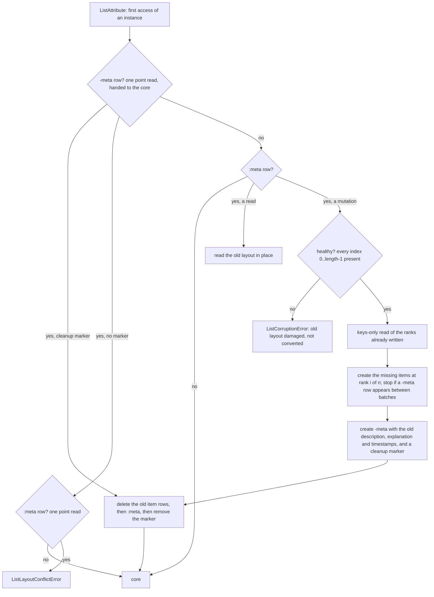

# Implementation Plan: one list implementation for properties and attributes, and list diffs that reach a replica

**Date:** 2026-11-13
**Research:** thoughts/research/2026-11-05-attribute-list-v2-port.md
**Supersedes:** thoughts/plans/2026-11-06-attribute-list-v2-port.md (kept: it
records the purpose-built `ListAttribute` design, its reviews and why it was
dropped)
**Branch:** `release/3.16.0-attribute-list-v2-port`, one PR: a records
commit, then one commit per phase. **The branch is not pushed before the PR
opens** (owner, 2026-11-13): Phases 2 and 3 close two holes that are open on
`master` and in v3.15.1, and the repository is public. The todo-index commit
(`2ece153`) and the `rows.toml` owners ride in the same PR.

## Update Log

- **2026-11-13**: written as a replacement for the 2026-11-06 plan (owner).
  What changed against it, each from a check of that plan against `master`
  after #171, #172, #173 and #175 merged, or from the owner the same day:
  - **Code shape reversed (owner).** Attributes are the private twin of
    properties: an application picks between them on whether the data may
    reach a peer, and the replica of a peer's `/properties` lives in
    attributes so it is not exposed again. So attribute lists and property
    lists offer the same interface on the storage layer. The list format
    moves out of `ListProperty` into a storage-agnostic core; `ListProperty`
    and `ListAttribute` are that core over two storages. The purpose-built
    v2 `ListAttribute`, its subset of the surface, its claim protocol and
    its self-compaction are gone.
  - **Row layout follows the core.** Attribute lists take the property
    layout (`list:{name}-meta`, `list:{name}-#{rank}`); the old plan kept
    `list:{name}:meta`. The old layout is recognised and converted.
  - **"Stored diffs are permission-filtered" dropped.** #172 stores a diff
    whole and filters it when it is served, on the push and on both poll
    routes (`actor.py:3886-3890`, `handlers/subscription.py:25-33`). The
    old plan's `SECURITY` entry and its `WD9` re-record are gone.
  - **Owner decisions, 2026-11-13:** conversion by deterministic ranks, no
    claim; a list diff that cannot be applied has the replica rebuilt from a
    baseline, for every peer; the full state for a peer without resync is a
    `clear` then an `extend`; the revocation cleanup (A8) covers
    whole-target peers only; four phases along the owner's three parts (the
    list interface, the replica on it, the publishing side); the existing
    verify tool is extended; `actor.attribute_lists(bucket)` is added; the
    two holes the security review found are fixed here and this file stays
    local until the PR.
  - **Already done elsewhere:** a bulk list update a hook rejects after
    writing notifies subscribers (`handlers/properties.py:521-530`,
    `:1564-1569`).
  - **Carried from the old plan's Update Log:** the resource-level merge
    (grant plan, Phase 1) and A8 (grant plan) are in Phase 3 here; the
    `remote:<peer>$aux` whitelist in `actingweb-peer-state` is in Phase 2;
    `rows.toml` is the only copy of which phase may change which recording.
  - **Review, same day:** five evaluators read the first draft against the
    code; what they changed is in "Evaluation Notes".
- **2026-11-13, later (owner)**: no separate PR for the row owners. Nobody
  else is working in the repository, so this plan takes ownership in
  `rows.toml` on its own branch, and the check that forbade that is relaxed
  in the records commit ("Wire-row ownership").

## Overview

`ListProperty` v2 (fractional ranks, handles, spanned items, keyed appends,
`verify()`, `compact()`) reaches storage through nine methods and one factory
name, and contains no HTTP, permission or diff code. This plan extracts that
format logic into `actingweb/list_core.py`, gives the attribute storage layer
the primitives the core needs on both backends, and makes `ListAttribute` the
same core over an attribute bucket, reachable as
`actor.attribute_lists(bucket)`. `RemotePeerStore`, the one caller of
`ListAttribute` in the library, then applies diffs through handles, learns the
diff shapes a subtarget- and resource-level subscription receive, and rebuilds
the replica from a baseline when a list diff cannot be applied. On the
publishing side, list edits made over REST and the web UI send list diffs,
where today they reach a replica as scalars or not at all. Lands in 3.16
(minor, tag held).

The specification text for the wire behaviour this plan settles is written by
`thoughts/plans/2026-11-06-spec-1-5.md`, which lands after it.

## Implementation Order

The order of the seven 3.16 plans, what depends on what between them and the
gates are kept in one place: `thoughts/todo/INDEX.md`, "Planned for 3.16:
order, dependencies and gates". This plan is next.

**This plan.** It needs the wire baseline (merged) for the recordings it
re-records and the ones it must leave identical. From the grant plan (merged)
it uses the one filter (`Actor.filter_subscription_blob`) and the path rules
`path_excluded` and `drop_excluded` (`permission_evaluator.py:202`, `:219`).
From `subs-list-cache-lifetime` (merged) it inherits one rule for every edit
to `register_diffs` and `resume_subscriptions`: the subscriber list is read
once per `Actor` instance and the memo resets listed in that plan stay. What
follows it: the specification plan documents the list diffs Phase 4 defines,
changes `register_diffs` after it, and adds the overlap rule that ends the
doubling `WD15` records after Phase 3.

**Before Phase 1:** the records commit ("Wire-row ownership").

## Decisions Made

Owner, 2026-11-06, still standing:

- **Sequencing**: port now, with `compact()` and the window `ListProperty`
  documents (a crash leaves both copies: duplicates, visible to `verify()`),
  not after `whole-list-rewrite-atomicity.md`.
- **Storage primitives**: the full set, with property semantics (a fault
  raises `DbError`; a create answers `True` only when this call created the
  row). PostgreSQL widens `attributes.bucket_name` and `name` to `TEXT` and
  gains an index for range reads in the same revision.
- **Ride-alongs**: `pop` with a negative index on the receiver; the wrong
  subscription documentation; a non-resync peer's full state replacing the
  replica; REST and web-UI list edits emitting list diffs.
- **A large bulk edit is announced as a resync**, not as hundreds of diffs.
- **Peer input is untrusted**: the receiver validates list names, refuses a
  scalar whose key starts with `list:`, and enforces `list_item_max_bytes`.

Owner, 2026-11-13:

- **Code shape [Updated 2026-11-13]**: one list implementation. The format
  logic is extracted from `ListProperty` into a core class that takes a
  storage object; `ListProperty` is the core over property storage plus the
  property-only v1 format and its migration; `ListAttribute` is the core over
  an attribute bucket. The 2026-11-06 choice (purpose-built, `property_list.py`
  untouched) is reversed.
- **Surface [Updated 2026-11-13]**: all of it. `ListAttribute` has every
  public method of `ListProperty` except the property v1 migration.
- **Interface**: `ActorInterface.attribute_lists(bucket)` returns the
  `AttributeListStore` for a bucket, exported from `actingweb.interface`. No
  notifying wrapper: attribute lists are private and register no diffs.
- **Conversion [Updated 2026-11-13]**: the old layout is converted by writing
  item i at the i-th rank of `generate_n_keys_between(None, None, n)` with
  create-if-not-exists. Two converters write identical rows, an interrupted
  one resumes, and the create of the `-meta` row picks the winner. No claim.
- **A list diff that cannot be applied has the replica rebuilt.** The
  subscriber fetches the subscription's baseline and replaces what it holds,
  whatever the peer advertises (the pull needs no capability from the
  publisher). A list that was reported out of step and that the baseline
  does not carry is deleted; an ordinary resync deletes nothing today
  (`remote_storage.py:549-552`). Deleting every name the baseline omits
  needs to know which keys of the peer's one bucket belong to this
  subscription, which the replica does not record; the specification plan's
  C6 owns that. At most one such rebuild per subscription per 60 seconds;
  within that time a further out-of-step diff is logged, later diffs keep
  being applied, and the rebuild stays owed. The rest of `subscription-subscriber-fault-hardening.md` stays
  a todo.
- **Non-resync full state**: a `clear` for each list the following `extend`
  carries items for, then the full state, as two diffs with two sequence
  numbers and two callbacks. The only form a pre-3.16 receiver applies
  correctly.
- **Revocation cleanup (A8)**: for a peer subscribed to the whole
  `properties` target only. The replica's stored shape does not change. The
  flag stays off by default.
- **Operator tool**: `actingweb-verify-property-lists` gains attribute
  buckets. No new entry point.
- **Four phases**; the two holes fixed here; this file local until the PR.

Deduced from those and from the review; confirm at approval:

- **Row layout [Updated 2026-11-13]**: an attribute list is
  `list:{name}-meta` and `list:{name}-#{rank}` in its bucket, each value the
  string the core writes, stored as the attribute's JSON `data`. Span bodies
  and key rows live in the side bucket `{bucket}$aux` (per bucket, because
  key-row hashes are keyed by actor only, `property_list.py:2681-2687`). The
  old layout (`list:{name}:meta`, `list:{name}:{index}`) is read by the
  old-layout readers and the converter only.
- **Reads do not convert.** A read of an unconverted list reads the old
  layout in place; a mutation converts first; the tool converts only with
  `--repair`. So a `GET`, a dry run and a pre-3.16 process still running
  beside 3.16 do not start n writes.
- **Rows of both layouts are out of step, not merged.** A `:meta` row beside
  a `-meta` row that carries no cleanup marker is what a pre-3.16 writer
  leaves. Neither copy is known to be right; a read raises
  `ListLayoutConflictError`, and on a replica that ends in a rebuild.
- **The core never passes through `Attributes`.** That wrapper caches a
  bucket per instance and deletes on falsy data (`attribute.py:356-363`);
  the attribute storage object calls the backend primitives directly. A
  string item (`"0"`, `"null"`, `"[]"`) is truthy, so falsy items are stored.
- **Limits**: `config.list_item_span_threshold` and `list_item_max_bytes`
  apply to both storages; the attribute storage also spans an item whose
  stored form (the JSON encoding of the string) would pass
  `DbAttribute.MAX_ROW_BYTES` less the key overhead.
- **Typed errors instead of text**: `ListRankExhaustedError(RuntimeError)` at
  the rank cap and `ListLayoutConflictError(ListCorruptionError)`; the
  storage supplies the noun ("property" or "attribute"), the location and
  the remedy an error names. On a replica the remedy is a rebuild, never
  "run compact()".
- **Every attribute write is bucket-conditional.** A put or create that
  meets a row another bucket owns raises a collision error; it neither
  overwrites nor answers `False`. On the replica path a collision is a
  refused key (a WARNING, the sequence advances), not a fault to retry: the
  key stays taken, so a 503 would repeat for ever.
- **A list diff is bound to its key.** At every level the receiver applies a
  list operation to the name the diff arrived under, never to a name the
  value carries.
- **A name is a scalar or a list in a replica, never both.** A list arriving
  where a scalar is stored deletes the scalar first (the core refuses
  otherwise, `property_list.py:1475-1482`; replica buckets hold such scalars
  from pre-3.16 REST diffs, `WL7`). `""` arriving for a list's name deletes
  the list (a pre-3.16 publisher's list `DELETE`, `WL6`). Any other scalar
  arriving for a list's name is out of step.
- **A value-addressed miss is not out of step.** A `remove` whose item is
  absent, and an `update` whose `old_item` is absent while `item` is
  present, leave the replica in the state the diff asks for. This is what an
  overlapping subscription's second delivery looks like until the
  specification plan's overlap rule.
- **A list diff is filtered as a unit.** The publisher decides that a value
  is a list diff by `property_lists.exists(name)`, never by its shape, and
  then passes it whole or not at all; exclusion patterns are not applied
  inside items, in diffs or in baselines. Checked against the specification
  at the owner's request (2026-11-13): an exclusion covers the descendants
  of a path and they are removed from a subscription diff
  (`docs/protocol/actingweb-spec.rst:2300-2302`), and the specification
  addresses a list item by index only, never by a path below the list; the
  evaluator already says so for baselines ("Arrays are not descended (a
  list's unit is its name)", `permission_evaluator.py:222-224`). What a
  pushed diff is filtered by today, `<list>/item/<key>` and
  `<list>/operation`, are the names of the diff's own fields, not property
  paths. If the specification plan gives list items paths, it owns filtering
  them in diffs and baselines alike.
- **Bulk edits**: a run of appends in one request is one `extend`. Over 25
  changes to one list: no per-item diff, one resync to the list's
  subscribers who may read it, sent without a stored suspension
  (`suspend_subscriptions` leaves a marker with no expiry that overlapping
  requests share, `db/dynamodb/subscription_suspension.py:35-39`,
  `:110-111`). Subscribers the resync missed are recorded the way a resume
  records them (`actor.py:4559-4573`).

## What We're NOT Doing

- **Resolving spanned diff references on the receiver** - a recorded decision
  (`remote_storage.py:399-413`). Such a diff now ends in a rebuilt replica,
  at most once a minute, instead of a silent miss.
- **Rebuilding one list instead of the subscription** - sequence numbers are
  per subscription, so a baseline of one list cannot say which later diffs
  it already contains.
- **Crash-atomic whole-list rewrites** -
  `thoughts/todo/whole-list-rewrite-atomicity.md` keeps it.
- **Idempotent re-application of diffs, recording finished callbacks, and
  recovery of a quiet subscription** - the rest of
  `thoughts/todo/subscription-subscriber-fault-hardening.md`.
- **One callback per change across overlapping subscriptions** - after Phase
  3 an overlapping subscriber holds an appended item twice (`WD15`); the
  rule that ends it is in `thoughts/plans/2026-11-06-spec-1-5.md`, and the
  3.16 tag is held past it.
- **The scalar and subtarget halves of the pushed full-state fallback** -
  `thoughts/todo/full-state-fallback-replica.md` keeps them.
- **A v1 format for attribute lists in the core** - the property v1 branches
  and `migrate_to_v2` stay in `ListProperty`; the old attribute layout has
  its own readers and converter in `attribute_list.py`.
- **Revocation cleanup for subtarget- and resource-level subscriptions, and
  recording the target with each replica key** - owner decision; it changes
  the stored shape.
- **A switch that turns conversion or the old-layout probe off** - one point
  read per list instance; `attribute-list-old-layout-removal.md` removes
  both.
- **`limit` and `reverse` on the range read** - a positional diff in the
  middle of a list costs one keys-only read of the list; the guide says so.
- **A notifying wrapper for attribute lists** - they are private.
- **A delimiter that cannot appear in a bucket or a name** -
  `thoughts/todo/prop-list-key-prefix-scheme.md` (next major).
- **A receiver-side cap on callback body size** - left to the deployment's
  edge.
- **Changing what a stored diff holds** - stored whole, filtered when served
  (#172).
- **The specification** - `thoughts/plans/2026-11-06-spec-1-5.md`.

## What Already Exists

- `actingweb/property_list.py` (about 5,900 lines): the v2 format. Storage is
  reached through `get_property(self.config)` at 71 sites and nine methods;
  the partition is chosen only by `actor_id=`, the side partition through
  `_aux()` and `_aux_or_none()` (`:868-880`). About 1,100 to 1,300 lines are
  the property v1 format and its migration.
- `actingweb/property_list_span.py` - envelope codec, `encode_item`, `wrap`,
  `split_parts`, `new_gen`, `part_names`, `key_row_name`, `aux_partition`.
- `property_list.diff_reference`, `fit_full_state`, `spanned_reference`
  (`:389-494`) and `interface/property_store.py:256-343` (`_register_diff`).
- `DbPropertyProtocol` (`db/protocols.py:273-670`) and its implementations
  (`db/dynamodb/property.py:619-828`, `db/postgresql/property.py:532-824`).
- `e5f6a7b8c9d0_widen_properties_name_to_text.py`; head is `f6a7b8c9d0e1`.
- `interface/app.py:1558-1691` (`check_ready()`), `StoreNotReady` (`:29-38`);
  `db/postgresql/actor.py:29-45` (an index probed as missing or INVALID).
- `tests/test_property_list_integrity.py:31-163` - `FakePropertyDb`,
  `CrashInjectingPropertyDb`, `CountingPropertyDb`, installed by patching
  `actingweb.property_list.get_property`; 18 subclasses across the list
  suites.
- `tests/mcp_token_double.py:59-253` - `MemoryStore` and an in-memory
  attribute backend nested in `make_config()`.
- `tests/_adoption_helpers.py:144-176` (`seam_fault`),
  `tests/integration/_isolated_store.py:79-131`.
- `actingweb/maintenance/verify_property_lists.py` and
  `migrate_property_lists.py`.
- `callback_processor.py:861-878` (the gap timeout's mark), `:263-287`
  (`_release_claim`); `handlers/callbacks.py:1135-1144` (what
  `RESYNC_TRIGGERED` runs); `subscription_manager.py:1262-1293` (the baseline
  fetch).
- `tests/performance/test_backend_performance.py:589`
  (`TestListPropertyPerformance`), `:661` (spanned).
- `tests/integration/wire/`, `rows.toml`, `verify_groups.py`.

## Wire-row ownership

`tests/integration/wire/rows.toml` is the only copy of which phase may
change which recording. Today `verify_groups.py:196-231` reads the owners at
the merge base with `master`, so that no branch can make its own phase an
owner. The owner lifted that for this plan (2026-11-13: one worker in the
repository); the rule becomes "owners as the commit's first parent has
them", so a branch takes ownership in an earlier commit of its own, never in
the commit that changes the recording.

**The records commit**, first on the branch, carries no library code:

- this plan, the superseded mark on the 2026-11-06 plan, and the
  `thoughts/todo/` edits that point at it (on top of `2ece153`);
- `tests/integration/verify_groups.py` - `check_wire_phase` reads
  `rows.toml` at each commit's first parent instead of at the merge base
  (`:265-334`); which recordings count as "added on this branch" is still
  decided at the merge base; the docstrings (`:11-15`, `:196-203`) follow;
- `tests/integration/test_wire_harness.py:477-479` - the test that a branch
  adding its own phase fails becomes two: an ownership change in an earlier
  commit of the branch passes; one made in the commit that changes the
  recording fails;
- the rule's three other statements: `rows.toml:33-38`,
  `tests/integration/README.md:68`, `docs/contributing/testing.rst:194-196`;
- the owners themselves, below.

Its verification is the fast tier and `verify_groups.py`. No list of rows is repeated in the phases: each phase's
verification reads `git show --stat HEAD -- tests/integration/wire` against
the registry, and every diff of a recording is read in review as the visible
form of a changelog entry. The replica snapshot in a recording is taken
through `RemotePeerStore` (`tests/integration/_wire.py:394-411`), so the row
layout does not show in it.

What the records commit changes in `rows.toml`:

- rows owned by `attribute-list-v2-port:4` become owned by `:3` and `:4`;
- `WL12` is owned by `:2` and `:3`;
- `WD12` (no owner today) gains `:4`; `WG7` gains `:3` beside the grant plan;
- the rows that record `permission_changes` (`WA17`, `WP1` to `WP4`, `WG18`)
  gain `:3`: Phase 3 adds keys to that dict;
- `WD9` loses this plan as an owner.

Canaries with no owner that hold replica lists and must stay byte-identical
through Phases 2 and 3: `WL11.target`, `WD8`, `WD10`.

New rows use the reserved ids `WD21`-`WD29` and `WL18`-`WL29`.

## Phase 1: the list core, extracted

A refactor with no behaviour change for property lists. Every wire recording
is byte-identical.

### Changes

- `actingweb/list_core.py` (new; not added to `actingweb.__all__`)
  - `ListStorage`, a protocol:
    - `get`, `put`, `remove`, `get_range`, `get_prefix`,
      `get_last_in_range`, `create_if_not_exists`, `set_if_value_equals`,
      `delete_if_value_equals`, `batch_delete`, each with keyword-only
      `side: bool = False`. A fault raises `DbError`; `put` and `remove`
      may also answer `False` for a write that did not land, as the property
      `set()` does today, and the core keeps raising its `RuntimeError`
      ("write failed", pinned at `tests/test_property_list_integrity.py:250`)
      for that. The attribute storage never answers `False`;
    - `create_many_if_not_exists(rows, *, side=False) -> set[str]`, the
      names this call created; the default is a loop;
    - `side_available()`, `scalar_exists(name)`;
    - read-only properties `span_threshold`, `item_max_bytes`, `key_scope`,
      `noun`, `location`, `remedy`.
  - `ListCore`: the v2 format logic moved from `ListProperty` method by
    method with its docstrings, public methods included. It takes
    `(storage, name)`. Two hooks a subclass fills: `_foreign_rows()` (sweep
    and count rows of another format in the list's range; the v2 `clear`,
    `delete` and `verify` call it, `property_list.py:3435`, `:3505`,
    `:4537`) and `_on_stored_format(meta)` (what to do with a meta row whose
    format is not 2; the core's default raises).
  - The helpers that mix formats today are split so the core holds only the
    v2 half: `_save_metadata` (the v1 `length` merge, `:1711`, `:1775`),
    `_load_metadata` (the v1 default with no db, `:1454-1455`).
  - It logs under `"actingweb.property_list"`: six `caplog` sites and
    consumers' logging configuration name that logger.
  - The rank constants, `_v2_is_rank`, `ListItemHandle`, `AppendOnceResult`,
    `UNRESOLVED`, the list exceptions and the two new ones
    (`ListRankExhaustedError` raised at `:2600`, `:3231`, `:3756`;
    `ListLayoutConflictError`) live here; `property_list.py` re-exports each
    under its current name.
- `actingweb/property_list.py`
  - `PropertyListStorage(actor_id, config)`: implements `ListStorage` by
    calling the module-global `get_property(config)` once per operation, as
    today, with `actor_id` or `aux_partition(actor_id)`.
  - `ListProperty(ListCore)`: `(actor_id, name, config=None)` and the `_db`
    attribute are unchanged. Each public method that has a v1 branch today
    keeps that branch and calls the core's `_v2_*` method directly for v2
    (not the core's public method, which would read the meta row a second
    time). `migrate_to_v2`, the lazy migration, `_dispatch_and_stash`,
    `sweep_foreign_format_rows`, the v1 half of `verify` and `compact`, and
    the environment helpers stay here.
- `actingweb/property.py`, `actingweb/maintenance/*.py`,
  `actingweb/interface/property_store.py` - import lines only.
- Tests: no assertion changes. Allowed edits, each a patch-target string for
  a global whose reader moved: `actingweb.property_list._KEYED_IN_FLIGHT_SECONDS`
  (`tests/test_property_list_append_once.py:168`) and
  `actingweb.property_list.time.sleep`
  (`tests/test_v2_list_mutation_committed.py:50`,
  `tests/test_v2_metadata_cas.py:94`) become `actingweb.list_core.…`.
  `tests/test_v1_maintenance_scoped_reads.py:40`, `:98-120` scan
  `list_core.py` as well.

### New Tests, both unit and integration tests

- Structure: `list_core.py` imports nothing from `actingweb.db` except
  `actingweb.db.exceptions`, nothing from `actingweb.property` or
  `actingweb.attribute`, and never names `get_property`.
- Surface: the public names of `ListProperty` before the phase (a frozen
  list) are present with the same signatures; `property_list.X is
  list_core.X` for every re-export, and the lazy exports of
  `actingweb/__init__.py:76-81` still resolve.
- The core's own public layer, which `ListProperty` no longer executes:
  `ListCore` over a minimal in-memory `ListStorage` written in the test
  module, every public method, with the counting pins of the property suites
  (reads and writes per operation) repeated for it; and one existing fault
  suite (`test_v2_list_mutation_committed`) run through a bare `ListCore`
  over `PropertyListStorage`, so the public layer meets a real storage
  adapter in this phase.
- `ListRankExhaustedError` is raised at the cap and is a `RuntimeError`; a
  storage write failure is not one.

### Failure Scenarios

- A method moved with a changed call order - the cost and fault-injection
  suites pin call sequences and run unedited.
- A test patches a global the moved code no longer reads, and passes without
  testing anything - the three named targets are edited; a grep for other
  `actingweb.property_list.` patch strings is part of the verification.
- The core's public methods drift from `ListProperty`'s - the core's own
  suite above, and from Phase 2 the parity run.
- The v1 dispatch entering the core for a v1 list - the v1 suites run
  unedited.

### Verification

- [x] Run the contract's `### Checks` fast tier verbatim
- [x] Run the contract's `### Checks` full tier before the phase commit, one
      run at a time (DynamoDB 6,840 passed; PostgreSQL 6,635 passed; docs
      build clean)
- [x] Run the benchmarks alone on both backends; `TestListPropertyPerformance`
      within 10% of a run on `master`, both recorded in the verification
      (two runs each, in both orders; the largest regression +9.3% in the
      branch-first run, every case faster than `master` in the master-first
      run: noise dominates)
- [x] `git diff master -- tests/` shows new files, import lines and the three
      patch targets; `git show --stat HEAD -- tests/integration/wire` is
      empty (plus the records commit's harness tests, and the guard file
      the plan names, `test_v1_maintenance_scoped_reads.py`)
- [x] `grep -rn '"actingweb.property_list\.' tests/` lists no target whose
      reader moved (only `get_property`, which `PropertyListStorage` reads)

### Implementation Status: Complete

Notes (2026-11-13):

- `list_core.py` (about 4,800 lines) and `property_list.py` (about 2,100)
  were produced by a script from the pre-phase file: every method without a
  v1 branch moved with its storage calls rewritten
  (`get_property(config).X(actor_id=…)` to `self._storage.X(…)`,
  `set(value=None)` to `remove`, any other `set` to `put`, the side
  partition to `side=True`); the dual-format public methods were split by
  hand-written rules. All 5,201 unit tests passed with only the three patch
  targets edited, before any new test was added.
- **Deviations from the Changes list.** `ListStorage` also carries
  `actor_id` (log and error text, `ListMetadataContentionError`) and
  `side_key()` (what `_aux()` returns, `ValueError` without a side
  partition). The core has six hooks, not two: besides `_foreign_rows()`
  (one hook with `sweep=`, deleting or counting) and `_on_stored_format()`,
  `_before_mutation()` (the lazy migration), `_default_metadata_no_db()`
  and `_merge_length_delta()` (the split halves of `_load_metadata` and
  `_save_metadata`), and `_not_v2_error()` (the property list keeps its
  "is v2-only -- call migrate_to_v2()" text). The rank-cap text names
  `_RANK_REMEDY`, a class attribute (`"run compact() to rebalance"`), which
  `ListAttribute` overrides in Phase 2.
- `ListProperty` keeps verbatim overrides of the dual-format methods whose
  v2 half was already a `_v2_*` call; `clear`, `delete`, `remove_where` and
  `update_where` had their v2 half inline, which became `_v2_clear`,
  `_v2_delete`, `_v2_remove_where`, `_v2_update_where` in the core. The
  cached `_is_v2()` reads (`slice`, `index`, `count`, `sizes_from_rows`,
  `to_list_from_rows`) call `super()`, which costs no read (the core's
  `_require_v2()` reads the same cache).
- Tests: `tests/test_list_core.py` (structure, frozen surface, every public
  method over an in-memory `ListStorage`, call parity with the property
  list per operation, the rank-cap error) and
  `tests/test_list_core_fault_suite.py` (the mutation-committed suite
  through a bare `ListCore` over `PropertyListStorage`, less its v1 case and
  the notifying wrapper's diffs). The parity is on range reads, last-rank
  reads and writes: point reads differ by one (the property list's lazy
  migration check reads the meta row on a fresh instance), and `verify` and
  `compact` on the property list spend one keys-only range read counting
  v1-shaped rows.
- Outside voice (codex and a fresh-context reviewer, on `a0952d9..07c5b10`):
  the mechanical rewrite is clean (every method compared with its original,
  docstrings stripped). Taken: Emm's suite patches
  `actingweb.property_list.time.sleep`, so `property_list` keeps a `time`
  name; the rank constants, `_v2_is_rank` and `_KEYED_IN_FLIGHT_SECONDS`
  are re-exported as this section says (they were not), and the surface
  test checks them; a guard test fails when a test patches a re-exported
  name on `property_list` (the patch would change nothing). Accepted: at
  the four probed writes the property handle is now built inside the
  in-flight mark, so a `get_property` construction fault (only possible on
  a process's first handle, when tables auto-create) counts as an unknown
  outcome and keeps the new span bodies for the aged sweep instead of
  deleting them.

---

## Phase 2: attribute lists on the core

`clear()` and `delete()` bypass the dispatch altogether: they remove the rows
of both layouts, whatever their health and whether or not the `-meta` row
carries the cleanup marker (`clear()` writes a fresh `-meta` without it).
That is what lets `set_list` repair a damaged list.

### Changes

- `actingweb/db/protocols.py` (`DbAttributeProtocol`, `:1279-1569`) - nine
  methods. Shared contract: a fault raises `DbError`; `False` means the
  condition did not hold; a row another bucket owns under the same composite
  key is never read, matched, overwritten or deleted, and a write that meets
  one raises `AttributeKeyCollision(DbError)`; a row's TTL is ignored.
  - `get_attr_range(actor_id, bucket, lower, upper, *, keys_only=False,
    consistent_read=True)`, `get_attr_prefix(...)`,
    `get_last_attr_in_range(actor_id, bucket, lower, upper)`.
  - `create_attr_if_not_exists(actor_id, bucket, name, data) -> bool` -
    `True` only when this call created the row.
  - `create_attrs_if_not_exist(actor_id, bucket, rows) -> set[str]`.
  - `set_attr_if_data_equals`, `delete_attr_if_data_equals` - `expected` is a
    string as read back; compared exactly.
  - `delete_attrs(actor_id, bucket, names) -> None`.
  - `put_attr(actor_id, bucket, name, data) -> None` - unconditional within
    the bucket; falsy `data` is refused, not turned into a delete.
  - `MAX_ROW_BYTES` is a class attribute of the two backends, read with
    `getattr`; it is not a member of the runtime-checkable protocol.
- `actingweb/db/dynamodb/attribute.py`, `actingweb/db/postgresql/attribute.py`
  - the nine. DynamoDB: `between` and `begins_with` with the exact `bucket`
  filter and a page loop; one conditional put per created row; every put and
  create carries `attribute_not_exists(id) OR bucket = :bucket`.
  PostgreSQL: `COLLATE "C"` on bounds and order; one multi-row `INSERT … ON
  CONFLICT DO NOTHING RETURNING name` for the batch create; `DO UPDATE …
  WHERE attributes.bucket = EXCLUDED.bucket` for the put.
  - **The existing `set_attr` gains the same bucket condition**
    (`db/dynamodb/attribute.py:272`, `db/postgresql/attribute.py:436-438`):
    today a write to bucket `a`, name `b:c` replaces the row of bucket
    `a:b`, name `c`, and a peer id may contain `:` (`trust.py:15`), so one
    peer's replica write can replace another peer's row. A collision
    raises. `create_attr_if_absent` already carries the condition
    (`db/dynamodb/attribute.py:448-449`, `db/postgresql/attribute.py:663`)
    and keeps answering `False`, as do `conditional_update_attr` and
    `delete_attr_conditional`; their contracts do not change. `remote:{peer}`
    is the only bucket the library names that contains `:`.
  - `callback_processor.py:788-790` clears a peer's callback state by
    substring (`f":{peer_id}:" in attr_name`), so deleting the trust with
    peer `b` removes `state:a:b:` too; it matches the parsed peer
    segment instead.
- `actingweb/db/postgresql/migrations/versions/` - one revision after
  `f6a7b8c9d0e1`: the `ALTER TABLE attributes` with both `TYPE TEXT` clauses
  under `SET lock_timeout`; then, in an autocommit block, `DROP INDEX
  CONCURRENTLY IF EXISTS` and `CREATE INDEX CONCURRENTLY
  ix_attributes_list_rows ON attributes (id, bucket, name COLLATE "C") WHERE
  starts_with(name, 'list:')`, with the same literal clause in the list
  queries. The index is partial because `attributes` also holds tokens and
  sessions written at a high rate. It is the full index instead if `EXPLAIN`
  under a forced generic plan does not use the partial one; the verification
  records which. `schema.py:214-243` follows.
- `actingweb/interface/app.py` (`check_ready()`) - on PostgreSQL, a third
  check: the two column types and the index present and valid
  (`indisvalid`); `AttributeSchemaNotReady(StoreNotReady)` names the
  revision, `alembic upgrade head`, and how to rebuild an invalid index. It
  applies to every PostgreSQL deployment, with or without subscriptions; the
  "two ways" wording at `:1563`, `:1595` is generalised to a count the text
  does not state (the email plan adds a check there too). On both backends
  `check_ready()` also refuses a custom attribute backend that lacks one of
  the nine methods, naming it: without that, every list diff would fail
  with an `AttributeError` the processor logs and passes.
- `actingweb/attribute_list.py` - rewritten.
  - `AttributeListStorage(actor_id, bucket, config)`: `ListStorage` on the
    nine, main bucket `bucket`, side bucket `{bucket}$aux`
    (`side_available()` is false for a bucket that contains `$`).
  - `ListAttribute(ListCore)`: `(actor_id, bucket, name, config)`. The
    dispatch of the diagram runs once per instance; its `-meta` read is
    handed to the core as the stash, so a converted list costs one extra
    point read (`:meta`) per instance and no more.
  - Old-layout readers (`__len__`, `__getitem__`, iteration, `to_list`,
    `slice`, `index`, `count`, `get_metadata`, `storage_format()` answering
    `"attribute-v1"`): one range read, in place, no write.
  - The converter, as the diagram: the health check and the read are one
    range read filtered to `^\d+$` suffixes (a list named `x` never matches
    rows of a list named `x:y`); items are encoded with `encode_item` (one
    carrying the reserved envelope key is stored wrapped; one over the
    stored-size limit is spanned); creates go through the batch create;
    a create that answers "not created" is compared with what was to be
    written, and a difference raises `ListLayoutConflictError`.
  - `delete()` and `clear()` remove old-layout rows with the same suffix
    filter, the core's rows and the list's side-bucket rows. Deletion
    accepts any name; validation is on creation only.
  - Every v1 mutator, both shift loops and `ListAttributeIterator` are
    deleted.
- `actingweb/attribute_list_store.py` - `exists()` (either meta row);
  `list_all()` by skip-scan (read one row at the cursor, derive the list
  name, jump past `list:{name}-$` or the old layout's range), never a
  whole-bucket read; `get(name)` without attribute lookup; `__getattr__`
  with the control-character check of `PropertyListStore.__getattr__`
  (`property.py:269-291`); `list_all_with_rows` and `list_prefix_with_rows`
  as `PropertyListStore` has them.
- `actingweb/interface/actor_interface.py`, `actingweb/interface/__init__.py`
  - `attribute_lists(bucket) -> AttributeListStore`; the module docstring of
  `actingweb/__init__.py:32-36` no longer calls the two modules legacy.
- Teardown, here and not in Phase 3, because spans exist from this phase:
  `Attributes.delete_bucket()` (`attribute.py:549-562`) deletes
  `{bucket}$aux` with the bucket; `RemotePeerStore.delete_all()`
  (`remote_storage.py:294-301`) deletes the side bucket, then the main one,
  and a fault on the side bucket still deletes the main one and then
  raises; `maintenance/peer_state.py:146-154` (`_remote_peer`) strips a
  trailing `$aux` before the pattern test and the bucket comparison (the
  docstring at `:45-52` and the note at `:319` follow). Actor deletion
  already deletes by actor id on both backends.
- `actingweb/remote_storage.py` - one more line of Phase 3 moves here so
  that no phase leaves a silent drop: a list arriving where a scalar of that
  name is stored deletes the scalar first.
- `actingweb/maintenance/verify_property_lists.py` - the walk takes a store
  factory. `--attributes` adds each actor's attribute lists: its
  `remote:{peer}` buckets from the trust list, plus any `--bucket` named;
  lists are found by the skip-scan. A dry run performs no write and reports
  an old-layout list as such. `--repair` on an attribute list: `repair_keys`,
  `compact` where `needs_rebalance`, conversion of a healthy old-layout
  list. `--delete-damaged-replicas` (with `--repair`, `remote:` buckets
  only): delete a list reported damaged or in both layouts so the next
  baseline rebuilds it. `--spans`, `--sweep-spans` and `--identity-key`
  apply to attribute lists unchanged; `--repair-reverted` is property-only
  and says so. Names are printed with `%r`. The checkpoint records the mode;
  one written without `--attributes` is refused by a run with it. `--rps`
  counts reads. The parser description and
  `actingweb-migrate-property-lists --help` say where attribute lists are
  converted.
- `tests/mcp_token_double.py` - the in-memory attribute backend moves to
  module level and implements the nine.
- `tests/test_db_protocols.py:141-165` - signature pins for the nine.
- `tests/test_attribute_list.py`, `tests/test_attribute_list_store.py`,
  `tests/integration/test_attribute_lists_advanced.py`,
  `tests/integration/conftest.py` - old-layout assertions move to the
  conversion tests.

### New Tests, both unit and integration tests

- **Parity.** A test-only adapter implements the nine attribute primitives by
  delegating to the patched property fake, mapping the main bucket to
  `ACTOR` and `{bucket}$aux` to `ACTOR + AUX_SUFFIX`, so every fault, crash
  and counting subclass and every raw-store assertion is reused. An autouse
  parametrised fixture rebinds the test module's `ListProperty` name (and
  the one in `tests.test_property_list_integrity`, whose helpers other
  suites import) to a `ListAttribute` subclass with the property
  constructor. Suites: `test_property_list_integrity`,
  `test_property_list_spans`, `test_property_list_append_once`,
  `test_v2_append_last_rank`, `test_v2_consistent_read`,
  `test_v2_handle_mutators`, `test_v2_list_mutation_committed`,
  `test_v2_count_hint`, `test_v2_metadata_cas`,
  `test_v2_value_addressed_reads`, `test_property_list_fault_reads`, and the
  class-level half of `test_list_item_limits`. A `property_only("reason")`
  marker excludes v1 and migration classes,
  `test_v2_cost_plain_property_partition` (it spies on the DynamoDB property
  model) and the handler half of `test_list_item_limits`.
- Primitive contract, written once and parametrised over the in-memory
  double, DynamoDB and PostgreSQL: success; row missing; value differs; an
  existing row with equal data (create answers `False`); an expired row;
  empty input and `lower > upper`; byte order against a locale collation;
  batch delete of 0, 1 and more than 25 names; a range over 1 MB;
  `consistent_read` passed through; falsy `data` refused; a backend without
  `MAX_ROW_BYTES`.
- Collision, both backends: for `put_attr`, both creates, the conditional
  write and delete, **and the existing `set_attr` and
  `create_attr_if_absent`**: bucket `a` name `b:c` against bucket `a:b` name
  `c` raises and leaves the other row as it was; a range whose greatest key
  belongs to the other bucket.
- PostgreSQL only, in an isolated schema (`isolated_store` gains a target
  revision): the revision up and down; the downgrade fails on a long row; a
  name over 255 characters; an invalid index left by a failed build is
  refused by `check_ready()` and rebuilt by a second upgrade; `EXPLAIN` on a
  seeded multi-bucket actor for the four list queries.
- Falsy items round-trip in order; `WL12` shows them in the replica.
- Row size on DynamoDB: an item just under and over the threshold with
  characters JSON escapes; a name at the byte cap; the measured inflation
  recorded in the verification.
- Old-layout reads: every read method on an unconverted list issues no
  write; a read then a mutation converts once.
- Conversion: each mutator converts a healthy list; description, explanation
  and timestamps carry over and `exists()` then
  `get_metadata()["updated_at"]` works before and after; a crash after each
  write (inside the cleanup too), then a second access, yields the right
  list with no residue; a kill every k writes on a 5,000-item list converges
  in ⌈n/k⌉ runs; two concurrent converters end in one list; a converter that
  finds `-meta` between batches stops; a lost create with different data
  raises; an old-layout list with a hole or a wrong `length` raises and
  loses no row; an enveloped item; an item over the stored-size limit;
  `clear()` and `delete()` on a damaged list; a list named `x` beside
  `x:y`.
- Old writers, as fixtures that plant what pre-3.16 code writes beside a
  converted list: an `append` (`list:{name}:0`, `:meta` with `length: 1`), a
  `clear()` (an empty `:meta`), a `clear()` then `extend`. Each raises
  `ListLayoutConflictError` on access and loses no row.
- Side bucket: same-named lists in two buckets keep separate key rows and
  bodies; a bucket containing `$` has no spanning and says so; `delete()`,
  `clear()`, bucket deletion and actor deletion leave no row in either.
- Store and interface: `exists()` and `list_all()` on a mix of layouts and a
  name containing `:` or ending `-meta`; `list_all()` issues no whole-bucket
  read (a source guard beside the existing ones); `get()` and `__getattr__`
  with `exists`, `__dict__`, `_x` and a control character;
  `actor.attribute_lists("b")` round trip; creating a list over a same-named
  scalar attribute raises with the attribute wording.
- Receiver: a list diff for a name held as a scalar ends in the list.
- Teardown: `delete_bucket()`, `delete_all()`, trust deletion and the last
  outbound subscription's deletion leave no row in either bucket; a fault on
  the side bucket; a crash in the conversion's cleanup followed by
  `delete()`. `actingweb-peer-state` reports `remote:<peer>$aux` with its
  peer and prunes it with it; for an unknown peer it stays `remote-unknown`.
- Callback state: deleting the trust with peer `b` leaves `state:a:b:`.
- `check_ready()` refuses a backend without one of the nine methods.
- Tool, integration on both backends: `--attributes` on a mixed set; a dry
  run writes nothing; each repair; `--delete-damaged-replicas` refused
  outside `remote:` buckets and without `--repair`; a checkpoint of the
  other mode; a fault mid-walk; exit codes; no item value in the output.
- `tests/performance/` - `TestListAttributePerformance` mirroring
  `TestListPropertyPerformance` (same sizes and operations), both backends.
- Round-trip pins on the counting double at 5,000 items: conversion fresh
  and resumed, `clear` plus `extend`, the tool's enumeration, reads per
  `append` on a converted list.

### Failure Scenarios

- An existing replica list reads as new and empty because the core finds no
  `-meta` row - the dispatch probes `:meta`. Covered; this is the failure
  the layout change introduces.
- A conversion that never finishes on a large list because each run restarts
  - it resumes from the ranks already written. Covered.
- A crash inside the cleanup read as a layout conflict - the marker.
  Covered.
- Two processes convert at once - identical rows; one creates `-meta`.
  Covered.
- A converter slower than another's whole conversion plus a later delete
  re-creates the deleted item - bounded to one batch by the `-meta` check
  between batches. Accepted: replica paths take no common claim (a claim is
  per subscription, a resync takes none, `callback_processor.py:105-107`,
  `:1036-1045`), so this window is real; a rebuild replaces the list.
- A pre-3.16 process beside 3.16: it reads a converted list as empty
  (`attribute_list.py:109-116`) and its writes leave both layouts - a
  conflict, never merged. The guide states what an operator sees and does.
- A peer's replica write replacing another peer's row through the `:`
  collision - every put and create is bucket-conditional. Covered on both
  backends, for the existing methods too.
- PostgreSQL without the revision, or with an invalid index -
  `check_ready()` refuses at start with the remedy.
- The `ALTER` waits behind a long transaction - `lock_timeout`; the guide
  says to retry.
- The tool's dry run converting lists under old processes - reads do not
  convert. Covered.
- The tool deleting an application's list that no baseline rebuilds -
  `--delete-damaged-replicas` is refused outside `remote:` buckets.

### Verification

- [x] Run the contract's `### Checks` fast tier verbatim
- [x] Run the contract's `### Checks` full tier before the phase commit, one
      run at a time (the PostgreSQL run included): DynamoDB 7,272 passed,
      PostgreSQL 7,069 passed, docs build clean
- [x] Run the benchmarks alone on both backends (mean of
      `TestListAttributePerformance` beside `TestListPropertyPerformance`
      in the same run: DynamoDB `to_list` 25.1 ms against 14.9,
      `items_with_handles` 24.0 against 20.1, append+remove 35.0 against
      25.7; PostgreSQL 5.3 against 5.1, 6.5 against 7.7, 11.7 against 18.9)
- [x] `grep -n "Shift all items" actingweb/attribute_list.py` returns nothing
- [x] `git show --stat HEAD -- tests/integration/wire` lists only rows
      `rows.toml` assigns to `attribute-list-v2-port:2`, with
      the `Wire-Phase` trailer if any changed; `WL11.target`, `WD8` and
      `WD10` are unchanged (only `WL12.target`, both topologies: the falsy
      items read back)

### Implementation Status: Complete

Notes (2026-11-13):

- **Deviations from the Changes list.**
  - The range and prefix primitives return each row's stored JSON value as
    it is (`dict[str, Any]`), not a string: the old layout's rows hold JSON
    items, and its reader needs their types. `AttributeListStorage` turns
    values into the strings the core reads.
  - The attribute span threshold is not measured per item: it is the
    configured threshold capped at (the backend's `MAX_ROW_BYTES` less
    4,096 bytes of key overhead) / 6, the worst JSON growth (a control
    character in the `str()` fallback). Parts are cut at the threshold, so
    a body row fits too. On DynamoDB that is 67,584 bytes. Measured growth
    of the stored form: quotes and backslashes 2.0, `\uXXXX` escapes about
    1.17, plain ASCII 1.0 (`tests/integration/test_attribute_list_row_size.py`).
  - Reads do not write, including a conversion's unfinished cleanup: a
    `-meta` row with the marker reads as the core's list, and the next
    mutation (or `convert()`) finishes the cleanup.
  - `ListAttribute.convert()` is public (the tool's `--repair` uses it).
    `storage_format()` is typed `int | str` in the core; `ListProperty`
    keeps `-> int`.
  - `ListNameTakenError(ValueError)` (in the core) is what a list creation
    over a same-named scalar raises; the replica catches it to replace the
    scalar (Phase 3's rule moved here), and `RemotePeerStore.get_list()`
    answers `[]` for a name held as a scalar (a replica name is one or the
    other).
  - `AttributeListStore` returns a fresh `ListAttribute` per access (the
    old store cached one per name; a cached instance keeps its layout
    decision and metadata past concurrent writers).
  - `callback_processor.clear_all_state_for_peer` matches the peer segment
    of both `state:` and `pending:` keys.
  - **PostgreSQL revision**: the migration environment (`env.py`) now lets
    Alembic own the transaction (the search path is set and committed
    first), which `autocommit_block()` needs. The index is built
    CONCURRENTLY only on a table that holds rows, with no lock timeout (a
    concurrent build waits for every older transaction in the database;
    the parallel test workers' migrations timed out under the 10 s
    `lock_timeout` the plan put on the whole revision); an empty table is
    indexed inside the transaction. `lock_timeout` stays on the `ALTER`.
    The prefix query carries byte bounds beside `starts_with()`, so the
    partial index gives it a range; `EXPLAIN` under a forced generic plan
    uses `ix_attributes_list_rows` for all four list queries (the partial
    index, not the full one). The INVALID-index message also names
    `REINDEX INDEX CONCURRENTLY` (a second upgrade rebuilds the index only
    when the failed build left the revision unapplied).
  - `list_all()`'s skip-scan reads backwards ("greatest name below the
    cursor", the only one-row read the primitives have), jumping a list's
    item rows as one block. Known gap, in its docstring: a pre-3.16 list
    whose name continues another's with `-#` or `:<digit>` is not listed.
  - DynamoDB `get_last_attr_in_range` reads pages of 10.
- **Parity**: `tests/_attribute_parity.py` (the adapter and the autouse
  parametrised fixture) runs the twelve suites against
  `AttributeParityList`; 120 of their attribute runs are skipped as `property_only` (the v1 format and its
  migration, a write that answers `False`, the operator script, the HTTP
  handler half of `test_list_item_limits`). The adapter maps a one-row delete
  to the property `set(value=None)` so the suites' fault injection on it
  reaches the attribute run.
- **Existing tests changed**: `test_db_attribute_buckets.py`'s collision
  test pinned last-writer-wins; it now pins the first writer keeping the row
  and the second getting `AttributeKeyCollision`. `test_attribute.py`'s
  `delete_bucket` test expects the side bucket first.
  `test_attribute_list.py` and `test_attribute_list_store.py` are rewritten
  onto the in-memory backend. `TestApplyResyncData` in
  `test_remote_storage.py` moved onto it (its mocked config could not hold a
  list once the core bypasses `Attributes`).
- **Outside voice** (codex and a fresh-context reviewer, on
  `a125c50..2e20d85`), fixed in this commit: a failed batch create deleted
  the bodies of heads that had already landed (DynamoDB's batch is one put
  per row), so bodies are now left to the aged sweep; PostgreSQL's batch
  create committed the rows before a collision and named the wrong key (now
  rolled back, naming the colliding one); a resumed conversion adopted
  whatever sat at a conversion rank (now every existing row in the list's
  new range is compared with the item it should hold, and any other row is
  a conflict: conversion ranks are a fresh list's first ranks); a stale
  instance's cached "old" layout could re-convert a list after a pre-3.16
  write (a mutation now settles the layout again unless the instance knows
  the `-meta` row); a converter finding a partial old layout because another
  converter is cleaning up now yields to it; rows at or above the recorded
  length are a crashed pre-3.16 append's leftovers, ignored and swept, not
  damage; the migration emits the concurrent build offline (`--sql`);
  `prime_from_rows` settles the layout (both layouts raise); the old-layout
  sweep is one keys-only read; `_below` never builds a surrogate or
  `chr(-1)`; the known gap's wording; `compact()` and `repair_keys()`
  convert first. Noted, not changed: a peer-chosen subscription id
  containing `:` would make the callback-state cleanup match by the wrong
  segment (subscription ids are UUID hex today); a crash leaving the
  cleanup marker in place lets old-layout rows written after it be swept as
  residue until the next mutation finishes the cleanup. The Phase 2 gaps
  the reviewer tied to Phase 3 (a collision answering 503 on the replica
  path, `getattr` resolving a peer list named `get`) close in Phase 3, in
  the same PR.
- A note for the changelog phase: a new config-free surface (no route, hook
  or response field): `actor.attribute_lists()`, `AttributeListStore.get()`,
  `ListAttribute.convert()`, `AttributeKeyCollision`,
  `AttributeSchemaNotReady`, `ListNameTakenError`, the nine primitives, the
  tool flags `--attributes`, `--bucket`, `--delete-damaged-replicas`; a
  changed contract: `set_attr` raises on a composite-key collision.

---

## Phase 3: the replica on the new lists

### Changes

- `actingweb/remote_storage.py`
  - `apply_callback_data` (`:328-393`) and `apply_resync_data` (`:524-621`)
    take the subscription's `subtarget` and `resource` as keyword arguments,
    passed by `handlers/callbacks.py:950-952`, the incremental sync
    (`:1327-1403`) and every site in `interface/subscription_manager.py`
    (`:415`, `:514`, `:1110`, `:1191`, `:1193`, `:1244`, `:1293`, `:1981`,
    `:2059`, `:2061`, `:2109`, `:2160`). The shapes, by level:
    - target level: a set of top-level keys. A value is a list operation
      only when it has `list` and `operation` **and `list` equals the key**
      (the legacy branch: equals `key[5:]`); otherwise it is the scalar's
      value. Today the value's `list` wins (`:355-357`), so a property
      whose value is shaped like a list diff edits another list in every
      subscriber's replica;
    - subtarget level: a list diff whose `list` is the subtarget is one list
      operation; an object keyed by the subtarget's own name is the full
      state (`actor.py:5123-5135`) and is unwrapped; anything else is the
      value of the one scalar;
    - resource level: the value is merged into the stored property at the
      resource's path, and an empty value deletes that path. Segments are
      taken as keys, never interpreted; a parent that is not an object is
      replaced.
    A pulled baseline for a subtarget- or resource-level subscription is
    stored under the subtarget's name, not spread into top-level keys.
  - A scalar key that starts with `list:` is refused, in both methods; the
    legacy `list:` dict branch (`:362-368`) stays for pre-3.16 publishers.
  - List names are validated where a list is created (`_apply_list_operation`
    for creating operations, `set_list`): a non-empty string, no control
    characters, no `#` or `$`, no leading `_`, within a byte cap that keeps
    the longest row key under DynamoDB's 1,024-byte sort key. A refused name
    answers an error result and a WARNING written with `%r`. Deleting
    operations accept any stored name. The lookup is
    `AttributeListStore.get(name)`, not `getattr`.
  - Scalar and list exclusivity, as decided.
  - `_apply_list_operation` (`:395-522`): positional branches take one
    keys-only read to resolve the index (none for the first and last) and
    one handle write; value branches take one handles read with
    `resolve=False` and re-read and retry a lost handle write, up to 8
    times. The `len()` guards (`:471`, `:486`, `:493-496`) use that read.
    `pop` normalises any negative index.
  - **Out of step.** `ReplicaOutOfStep(list, why)` for:
    `ListCorruptionError` and its subclasses, `ListRankExhaustedError`,
    `ListMetadataContentionError`, a spanned diff reference, an index out of
    range, a lost positional write, a scalar arriving for a list's name. Not
    for a value-addressed miss, a refused name, a key collision (refused,
    logged, the sequence advances) or any other `DbError`. A plain
    `RuntimeError` is logged as today. `apply_callback_data` applies the
    remaining keys, logs a WARNING naming the actor, peer, list and
    operation, and returns the first one in its result under
    `out_of_step`; it does not raise, so the data hooks that follow it
    (`handlers/callbacks.py:954-1033`) run as today.
  - `set_list` (`:156-182`): validate the name, encode and size-check every
    item, then `clear()`, then `extend()`. A baseline holding an item that
    cannot be stored deletes that list and logs it, so the next diff does
    not find the stale one. `get_list`: one `to_list()`.
- `actingweb/callback_processor.py`, `actingweb/handlers/callbacks.py`,
  `actingweb/interface/subscription_manager.py`
  - The handler closure reports `out_of_step` to the processor after the
    hooks. In `process_callback` and `process_callback_sync`, after the
    handler for one callback: the sequence advances for it and the state row
    is written from the claimed row in one compare-and-swap modelled on
    `_release_claim` (`:263-287`), setting `rebuild_owed`. When 60 seconds
    have passed since `rebuilt_at` it answers a new `ProcessResult.REBUILD`
    and the rest of the drained batch is dropped (the rebuild supersedes
    it). Inside the 60 seconds the rest of the batch is applied as usual, so
    nothing is left pending behind a rebuild that is not running.
  - `REBUILD` runs a new manager entry, `rebuild_subscription` (sync and
    async), not `sync_subscription`: that one pulls the retained diffs first
    and would apply them a second time (the publisher keeps
    high-granularity diffs after a 204, `actor.py:3968-3971`). The new
    entry, in this order: reads the subscription's current sequence from the
    publisher (the diffs GET, whose diffs it does not apply); fetches the
    baseline; applies it with `apply_resync_data` and deletes each list
    recorded as out of step that the baseline does not carry (the names are
    kept in the state row with `rebuild_owed`); writes that
    sequence, clears the pending queue through it and clears the publisher's
    diffs up to it; clears `rebuild_owed` and sets `rebuilt_at`. A change
    that lands between the two requests is in the baseline and arrives
    again as a diff: the window errs toward applying it twice, never toward
    losing it. A fault leaves `rebuild_owed` set and prunes pending through
    the claimed sequence, and the next callback or sync runs it again.
  - The manager's poll loops (`:1193`, `:1244`, `:2061`, `:2109`): on
    `out_of_step` the loop stops, records nothing for the later diffs, and
    calls `rebuild_subscription`.
  - A resync callback keeps `rebuild_owed` and `rebuilt_at` through
    `_reset_state` (`callback_processor.py:328-350`, `:1042-1045`, an
    unconditional replace today) and clears `rebuild_owed` only after its
    handler returns; a handler that faults, raised (`:1058-1060`) or
    swallowed (`:1061-1066`), leaves or sets it.
- Revocation cleanup (A8), `handlers/callbacks.py:1469-1535`,
  `peer_permissions.py:772-815`:
  - order of checks, each ending the work with no read: the flag off; no
    subscription from this actor to the peer's whole `properties` target;
    the grant equal to the stored one;
  - `revoked_replica_names(store, grant) -> RevokedNames | NotEvaluated`:
    names are enumerated without values (scalar names by key, list names by
    the skip-scan); a name is kept when the grant's patterns allow `read`
    for it and the evaluator's path rules (`path_excluded`, with ancestor
    and `x/*` matching, `permission_evaluator.py:188-216`) do not exclude
    it; the publisher's matcher, not `has_property_access`'s plain glob
    (`peer_permissions.py:122-125`). `NotEvaluated`, deleting nothing and
    logging why, for: the `allowed`/`denied` shape, a falsy `properties`, a
    dict without `patterns` or `operations`, an override-only copy;
  - scalars are deleted as well as lists; a list through
    `ListAttribute.delete()`; an object replica holding an excluded
    descendant is rewritten without it (`drop_excluded`);
  - it deletes where the grant is written under compare-and-swap
    (`handlers/callbacks.py:473`, `:1219`); at the other writers
    (`subscription_manager.py:2589`, `:2674`, `:2984`,
    `remote_storage.py:677`, `maintenance/peer_state.py:380`) it stores,
    reads the stored copy back, and deletes only if that copy is the one it
    evaluated;
  - the `has_revocations` gates (`callbacks.py:453-455`, `:1214-1216`) go;
    the restore after a losing callback (`_still_granted`, `:67-74`) becomes
    name-keyed; the store is built with `validate_peer_id=False` (`:1492`);
  - `permission_changes` keeps all four keys it has
    (`granted_patterns`, `revoked_patterns`, `has_revocations`,
    `is_initial`, `peer_permissions.py:793-796`); `has_revocations` is true
    when the evaluation would delete a name; it gains `deleted_names` and
    `not_evaluated`.
- `tests/test_remote_storage.py` - the list classes are rewritten onto
  `make_config()` and a real `ListAttribute`, asserting through `get_list()`
  (the file patches `actingweb.attribute.Attributes`, `:105`, which the core
  bypasses, and asserts on the mock's lists at 57 sites). `:1131` expects
  two bucket deletes.

### New Tests, both unit and integration tests

- Regression for the damage this plan exists for: a crash injected after
  each write of a receiver `insert` and `delete` leaves `verify()` clean and
  the list before or after.
- Binding: at target level, a value whose `list` names another list is
  stored as a scalar and the other list is untouched; the same through the
  legacy `list:` branch.
- Receiver, every branch against the real class: `pop(-2)`; an `update`
  whose `old_item` matches two rows; a `remove` and an `update` that miss
  (no mark); the 8-retry path succeeding after a lost write; each rejected
  name on create and accepted on delete; a `list:` scalar key in a diff and
  in a baseline; an enveloped item; an item over the limit in a diff and in
  a `set_list`; a scalar arriving for a list's name in each of the four
  pre-3.16 shapes (`{"action": …}`, `{"index", "value"}`, the bulk text,
  `""`).
- Shapes, for callbacks and for pulled baselines: a subtarget-level list
  diff, scalar, string and full state; a resource-level two- and
  three-segment write, a delete at each depth, a write under a string
  parent, a second write that keeps the first key; a baseline for a
  subtarget-level subscription does not create top-level keys.
- Out of step, one test per cause: the sequence advances, the other keys of
  the callback are applied, the data hooks fire, and `REBUILD` follows; with
  two applied high-granularity diffs before it, nothing is doubled after
  the rebuild; out of step on the second of three drained callbacks; the
  async twin; a second cause inside 60 seconds is logged and owed, and the
  next callback after the interval rebuilds; out of step on the second of
  three inside the 60 seconds applies the third; a list the publisher has
  since deleted is gone after the rebuild; a change landing between the
  sequence read and the baseline; a resync callback whose handler fails
  softly leaves the rebuild owed and does not reset the interval; a key
  collision for the peer that writes second is refused and its sequence
  advances; N edits of a spanned item
  cause one rebuild a minute; a `DbError` answers 503 and marks nothing; a
  plain `RuntimeError` from the core marks nothing; a fault during the
  rebuild leaves it owed; a fault between `clear` and `extend` in a resync
  leaves it owed; each of the four manager poll paths ends in one baseline
  fetch.
- A rebuild does not itself come out of step for the same cause: damage,
  both layouts, the rank cap (1,200 inserts at index 1, then one more), a
  scalar collision, an unstorable item.
- Cost (counting double), 500 and 5,000 items: one keys-only read for
  `insert` in the middle, `update` by index, `delete` and `pop(-2)`; none
  for `append`, `pop()`, `pop(0)`, `insert(0, …)`; a 5,000-item `set_list`.
- Teardown: revocation (a spanned list, an old-layout list, a list with a
  name no longer valid, a non-hex peer id) leaves no row in either bucket.
- A8: the three early exits issue no read; an exclusion added, `read`
  dropped, a pattern removed; `private/*` excluding `private`; an ancestor
  exclusion; scalars and lists; an object with an excluded descendant; each
  shape that is not evaluated; a peer with a subtarget-level subscription
  only; each writer, and a writer whose fetched grant is older than the
  stored one deletes nothing; a losing callback restores by name;
  `permission_changes` has its four keys and the two new ones.
- Integration, both backends, in `test_wire_list_properties.py`,
  `test_wire_grants.py` and `test_wire_peer_paths.py` (the `wire_peer_paths`
  group): new rows for a list diff to a subtarget-level subscriber ending in
  a list, a resource-level write that keeps its sibling keys, an out-of-step
  diff ending in a rebuild and an equal replica, and a resync whose baseline
  holds an item over the DynamoDB row limit.

### Failure Scenarios

- The rebuild replays retained diffs and doubles the replica - its own
  manager entry applies no retained diff and takes the sequence from the
  publisher before the baseline. Covered.
- The rebuild keeps an out-of-step list the publisher deleted - it deletes
  the lists it was owed for when the baseline omits them. Covered. Other
  names the baseline omits stay, as after any resync today (C6).
- Diffs stranded in the pending queue behind a throttled or failed rebuild,
  ending in the gap timeout's replaying path - the batch is dropped only
  when a rebuild runs, and a failed one prunes the queue. Covered.
- A rebuild takes no claim, so a callback applied between its `clear` and
  `extend` can be doubled or lost - the same class as the converter window;
  the next out-of-step diff rebuilds again.
- A rebuild on every callback - at most one a minute per subscription; a
  cause the rebuild does not clear would repeat at that rate, and the tests
  show none of the known causes survives one.
- A peer sends diffs built to be out of step - one baseline fetch a minute
  per subscription. Accepted.
- A rebuild that cannot reach the publisher - `rebuild_owed` stays set; the
  replica is out of step and the log says so each time.
- A value shaped like a list diff editing another list - bound to the key.
  Covered.
- A list diff addressed to a subtarget stored as scalars - the shape rule.
  Covered, and visible in the re-recorded subtarget rows.
- A resource-level write wiping its siblings - the merge. Covered (`WG7`).
- A pre-3.16 publisher's REST edit arriving for a list - out of step and
  rebuilt, where the first draft deleted the list. Covered.
- An overlapping subscriber holds an appended item twice (`WD15`) - taken
  knowingly until the specification plan's overlap rule; its second
  `remove` is a miss, not a rebuild.
- The cleanup deleting data the peer may still read - evaluated with the
  publisher's matcher; a shape it cannot evaluate deletes nothing; a grant
  older than the stored one deletes nothing. Covered.
- The cleanup reading every item of a large replica on each grant write -
  the three early exits and names-only enumeration. Covered.
- Side bucket outliving its list - both buckets on every teardown path.

### Verification

- [x] Run the contract's `### Checks` fast tier verbatim
- [x] Run the contract's `### Checks` full tier before the phase commit, one
      run at a time (DynamoDB 7,336 passed; PostgreSQL 7,133 passed; docs
      build clean)
- [x] `git show --stat HEAD -- tests/integration/wire` lists only rows
      `rows.toml` assigns to `attribute-list-v2-port:3`, with
      the `Wire-Phase` trailer; `WL11.target`, `WD8` and `WD10` unchanged
      (31 rows re-recorded, each with a dated reason)
- [x] `grep -n "getattr(.*list_store" actingweb/remote_storage.py` returns
      nothing

### Implementation Status: Complete

Notes (2026-11-13):

- **What the recordings show**: REST list edits (`WL1`-`WL5`, `WL7`) and
  spanned references (`WL13`) now reach a subscriber as out-of-step diffs
  that end in a rebuild (the subscription's sequence read, the baseline,
  the publisher's diffs cleared), so the replica equals the publisher's
  list; subtarget- and resource-level values are stored under the
  subtarget (`WS1`-`WS5`, `WL1`-`WL6`, `WL11`, `WL16` `.subtarget`); a
  `""` for a list's name deletes it (`WL6.target`, `WL10.target`);
  `pop(-2)` is applied (`WL14`); `WD15` holds the overlapping append twice,
  as the plan accepts; `permission_changes` carries `deleted_names` and
  `not_evaluated` (`WA17`, `WP1`-`WP4`, `WG18`). No new `WD21+`/`WL18+`
  rows: the re-recorded rows already record each shape the Integration
  bullet names.
- **Deviations.**
  - Positional diffs go through the core's positional methods (one
    keys-only read and one unconditional write), not handle CAS writes: a
    lost write cannot happen there, so out of step comes from an index out
    of range, damage, a layout conflict, the rank cap, metadata contention
    or a spanned reference. `pop(0)` and `insert(0, ...)` take the
    keys-only read too: the primitives have no first-row read (the plan's
    "none for `pop(0)`, `insert(0, …)`" needs one).
  - A value-addressed `update` uses one values read (`to_list()`), and an
    already-applied update (`item` present, `old_item` absent) is a no-op.
  - The out-of-step mark is a `ProcessedCallback.out_of_step` field the
    handler sets; the processor marks `rebuild_owed`/`rebuild_lists` with a
    compare-and-swap from the claimed row and answers `REBUILD` when the
    60-second interval allows, stopping the drained batch there (the rest
    is pruned); an owed rebuild is also answered on the next callback after
    the interval. `settle_rebuild()` and `rebuild_state()` are public on
    the processor.
  - `rebuild_subscription_async()` runs the sync one in a worker thread.
  - `set_list` replaces a same-named scalar with one point read up front;
    `RemotePeerStore.get_list()` answers `[]` for a name held as a scalar.
  - A8 lives in `actingweb/replica_revocation.py`; scalar names are read
    without values by two keys-only range reads either side of `list:`
    (`RemotePeerStore.list_scalar_names()`). An "override-only copy" has no
    marker in `PeerPermissions`; it is caught as a property rule without
    `patterns`. The other grant writers read the old grant only with the
    flag on. `_delete_revoked_peer_data` is removed (its tests now cover the
    evaluator).
- **Tests not written as the plan lists them** (recorded so verification
  can decide): the four manager poll paths ending in one baseline fetch and
  `rebuild_subscription` are exercised through the re-recorded wire rows,
  not unit tests; the counting-double cost pins at 500/5,000 items; the
  revocation teardown of a spanned, old-layout and invalid-named list.
  (`rebuild_subscription` has unit tests since the outside-voice fixes:
  `tests/test_replica_rebuild.py`.)
- **Outside voice (2026-11-13, codex and a fresh-context reviewer, on
  `fd01275..e7d9313`); fixed in a fixup to this phase:**
  - A property named `out_of_step` read as the mark (a peer could force a
    rebuild a minute and drop its batches): the mark and the failed entries
    are attributes of a `ReplicaApplyResult`, never keys.
  - A failed rebuild was not throttled and two deliveries could rebuild at
    once: `CallbackProcessor.begin_rebuild()` reserves each attempt with one
    compare-and-swap that sets `rebuilt_at`, success or not;
    `rebuild_subscription(force=True)` skips the interval, not the race.
  - A rebuild did not delete what the dropped batch deleted: a whole-target
    rebuild deletes every replica name the baseline does not carry, a
    subtarget rebuild its subtarget, and each owed list.
  - The rebuild window could re-apply an index diff to a baseline that
    already held it: the sequence is read before and after the baseline,
    again up to three times while it moves; still moving leaves the rebuild
    owed. The recorded sequence never moves backwards.
  - A resync settled an owed rebuild with entries it could not store, or
    without the owed lists: it settles only when every entry was stored and
    each owed list was carried; `rebuild_subscription` likewise reports
    `failed` entries and leaves the rebuild owed.
  - An owed rebuild waited for the next callback: `sync_subscription()` (and
    its async form, so the poll paths) runs it when due.
  - A mark that lost its compare-and-swap or faulted left the replica
    unmarked: retried from a fresh read (`settle_rebuild(lists=)`), and the
    rebuild runs even if that faults.
  - `has_revocations` was overwritten with "something was deleted": it stays
    the grant comparison, or-ed with a deletion.
  - A wrapped scalar (`{"value": v}`, a non-object the receiver stored) lost
    its `value` to an exclusion `<name>/value`: kept whole.
  - The restore after a losing callback dropped non-object values and
    matched replica names as globs: values are stored wrapped, names are
    escaped into exact patterns.
  - The skewed-clock branch reconciled only on revoked patterns: on any
    change to the `properties` grant.
  - Validation was bypassed through `clear`/`update` on a new list: any
    operation but `delete_all` on a list that does not exist validates the
    name.
  - A resource-level write could shadow a list of the same name: refused.
  - The handler's rebuild ignored the app's processing config: passed.
  - `actingweb-peer-state`: a cleanup fault after a rebuilt copy is reported
    as `rebuilt, replica not cleaned`, not as `not rebuilt`.
  - **Accepted, not peer-reachable:** a crash between storing a grant and
    its cleanup (`cleanup_after_store`) leaves revoked data until the next
    grant change; the callback path deletes before it stores, so a crash
    there leaves the old grant with the data its successor revoked already
    gone (the newer grant is the publisher's, so that is the right data to
    have deleted).

---

## Phase 4: publishers that emit list diffs, and the records

What each site registers today and after this phase (`list`, `operation` and
`length` on every diff after):

| Site | Today | After |
| --- | --- | --- |
| `PUT /properties/{list}?index=N` (`handlers/properties.py:1218-1226`) | `{"index", "value"}` | `append` when `index` equals the length; otherwise `update` with `item`, `index`, and `old_item` on the handle path |
| items `add` (`:2552-2565`) | `{"action": "add", …}` | `append`, `item`, `index` |
| items `update` (`:2635-2644`) | `{"action": "update", …}` | `update`, `item`, `index`, `old_item` on the handle path |
| items `delete` (`:2698-2702`) | `{"action": "delete", "index"}` | `remove` with `item` on the handle path; `delete` with `index` on a v1 list, and for a spanned item whose value was not read |
| metadata `PUT` (`:2395-2399`) | `{"action": "metadata_update", …}` | `metadata` |
| list `DELETE` (`:2206-2207`, `handlers/www.py:476-481`) | `""` | `delete_all`, `length: 0` |
| bulk `POST /properties` with `items` (`:1737-2090`, tail `:481-535`) | a text summary under the list's key | up to 25 changes: a run of appends as one `extend`, otherwise one `update` or `remove` per item, in order, on `subtarget={list}`. More than 25: no per-item diff, one resync after the batch |
| `POST /properties` creating an empty list (`:1697-1731`, form `:1441-1475`) | a text marker | `extend` with `items: []`, `length: 0` |
| web-UI item add, update, delete (`handlers/www.py:1166`, `:1253`, `:1274`, `:1324`, `:1343`) | nothing | `append`, `update`, `remove` or `delete`, as the REST rows |
| web-UI list create and metadata edit (`:1415-1449`, `:1057-1074`) | nothing | empty `extend`; `metadata` |
| web-UI simple property create and update (`:1513`) | nothing | the property diff the REST PUT registers |

HTTP response bodies do not change. On the bulk path the response and the
diff are one variable today (`:1574-1577`); they are separated. `DELETE
/properties` does not remove lists (`property_store.py:207-211`) and gets no
row.

### Changes

- `actingweb/property_list.py` - module-level `build_list_diff(list_name,
  operation, *, length, config, item=UNSET, index=None, items=None,
  old_item=UNSET, spanned_bytes=None) -> dict`, lifted from
  `interface/property_store.py:300-331`; `_register_diff` there calls it.
- `actingweb/handlers/properties.py`, `actingweb/handlers/www.py` - each row
  of the table. A value read with `resolve=False` that is unresolved is never
  serialised. The existing rule for a hook-rejected batch (`:521-530`)
  carries over.
- `actingweb/actor.py`
  - `request_resync(target, subtarget)` (new, public): resets the subscriber
    memo (`:4555`), re-sends to subscribers a previous send missed and
    records the ones this send misses (`:4559-4573`), and sends the resync
    of `_send_resync_callbacks` (`:4604`) to the subscriptions on the target
    whose grant lets them read `subtarget`; no suspension row. A subscriber
    that may not read the list is not told its name. A subscriber's timeout
    does not fail the request.
  - `filter_subscription_blob` (`:4184-4293`): when the name is a list
    property (`property_lists.exists(name)`), a value under it passes whole
    or not at all; `drop_excluded` is not applied inside it. A scalar
    property whose value is shaped like a list diff is filtered as any
    object.
  - `_callback_subscription_resync` fallback (`:5015-5055`) and
    `_get_full_state_for_subscription` (`:5074-5185`): after `fit_full_state`
    and `_filter_full_state`, build a `clear` (`length: 0`) for every list
    whose entry still carries `items`; store it under one sequence number and
    the full state (each list an `extend` with `length`) under the next; send
    two low-granularity callbacks in order.
- `tests/test_property_list_spans.py:985-997`,
  `tests/test_v2_cost_library_callers.py:221-227` - the full state is two
  diffs, and `extend` carries `length`.
- `CHANGELOG.rst`, `Unreleased`, each entry in the project's form (a bold
  symptom, the cause, the new behaviour, a **Check:**), one shift per entry:
  - `SECURITY` - an attribute write could replace a row of another bucket
    whose name shares a `:`-joined key, so one peer's replica write could
    replace another peer's stored data. `SECURITY` - a property value shaped
    like a list diff edited a different list in subscribers' replicas.
  - `CHANGED`, **Breaking:** - list edits over REST and the web UI send list
    diffs (hooks that branch on the diff's shape); a custom database backend
    implements nine attribute methods, and a write to a colliding key raises;
    attribute list rows are `list:{name}-meta` and `list:{name}-#{rank}`,
    `get_metadata()["length"]` is advisory and `updated_at` best-effort,
    `ListAttributeIterator` is removed, and replica side buckets
    `{bucket}$aux` appear to code that enumerates buckets;
    `RemotePeerStore.apply_callback_data` and `apply_resync_data` take the
    subscription's level and report `out_of_step`.
  - `CHANGED`, **Behavior change:**, one each - an old-layout attribute list
    converts on its first change; PostgreSQL needs the revision before
    start (`AttributeSchemaNotReady`); a list diff that cannot be applied
    has the replica rebuilt; a write below a property merges at a
    resource-level subscriber; web-UI edits notify subscribers; a bulk list
    update over 25 items is announced as a resync and appends in one request
    arrive as one `extend`; a peer without resync support receives `clear`
    then `extend`; the receiver refuses list names with control characters,
    `#`, `$` or a leading underscore and scalar keys starting `list:`; a
    list diff is filtered as a unit; with `auto_delete_on_revocation` on,
    the cleanup is computed from the stored grant, deletes scalars too, runs
    for whole-target peers, and `permission_changes` gains `deleted_names`
    and `not_evaluated` (an exclusion-based deletion is in `deleted_names`,
    not in `revoked_patterns`).
  - `ADDED` - `actor.attribute_lists(bucket)` and the property list
    interface on attribute lists; `actingweb.list_core` and `ListStorage`;
    `ListRankExhaustedError`, `ListLayoutConflictError`,
    `AttributeKeyCollision`, `AttributeSchemaNotReady`; `--attributes` and
    `--delete-damaged-replicas`; the nine primitives;
    `AttributeListStore.get()`; `Actor.request_resync()`;
    `SubscriptionManager.rebuild_subscription()`.
  - `FIXED`, one each - an interrupted `insert` or `delete` diff damaging a
    replica; a falsy list item making a replica unreadable; a resync with an
    item over the DynamoDB row limit failing; `pop` with a negative index; a
    full state doubling a replica list; list edits over REST reaching a
    replica as scalars; a diff for a subtarget-level subscription stored as
    scalars; revoked data kept for a peer id that is not 32 hex characters.
- `docs/migration/v3.16.rst` - the PostgreSQL revision joins the start
  blockers in the lead and the top warning (`:17-31`), and `:724` names the
  new head. A subsection "Attribute lists and list diffs": the layout; what
  a pre-3.16 process reads (a converted list as empty) and writes during a
  rolling deploy, and the rule (finish the deploy; then
  `actingweb-verify-property-lists --attributes`; a conflict on a replica
  rebuilds itself, elsewhere `--repair`); "Rolling back" (a 3.15 process
  reads converted lists as empty until `sync_peer` runs for the peer); the
  diff shapes, the bulk threshold, the two-diff full state, the rebuild and
  its one-a-minute bound, the O(n) read for a mid-list diff, the merge, the
  overlap doubling until the specification change; the nine methods and
  `ListStorage` under "Custom database backends" (`:748`). The
  resource-level limit the grant plan documented there is removed.
- Other docs: `docs/guides/subscriptions.rst` (operation table, "How a
  replica is stored", the wrong samples at `:347-350`, `:556-566`, `:603`,
  `:696`, and `:429-431`); `docs/contributing/testing.rst:512-543`;
  `docs/guides/property-lists.rst` (attribute lists, when to choose which,
  the tool at `:1030-1042`); `docs/sdk/attributes-buckets.rst:219-261`;
  `docs/quickstart/configuration.rst:993-1028` and
  `docs/guides/trust-relationships.rst:404-411` (the cleanup);
  `docs/contributing/architecture.rst:381-433`;
  `docs/reference/hooks-reference.rst:122-133` (diff shapes a hook
  receives); `docs/guides/database-maintenance.rst:896`,
  `docs/reference/actor-deletion.rst:305`;
  `docs/guides/troubleshooting.rst:270-286` (a layout conflict, repeated
  rebuilds); `docs/guides/postgresql-migration.rst` and
  `docs/reference/database-backends.rst` where they list the `attributes`
  columns and indexes.
- `thoughts/todo/attribute-list-shift-design.md` - delete, with its
  `INDEX.md` row. `whole-list-rewrite-atomicity.md`,
  `subscription-subscriber-fault-hardening.md`,
  `full-state-fallback-replica.md`, `prop-list-key-prefix-scheme.md` -
  updated for what landed. A new `attribute-list-old-layout-removal.md` with
  an `INDEX.md` row.
- A note to the consumer (`../actingweb_mcp/thoughts/inbound/`): its test
  double of `Attributes` lacks the new methods, and its suite patches
  `AttributeListStore` and `get_metadata`, so it does not exercise the new
  rows; its orphan sweep treats two bucket names as deletable; its callback
  hook's branch on `"list" in value` now takes REST edits too; it derives
  revoked memory types from `revoked_patterns` and must read
  `deleted_names`; remote memory reads empty on a 3.15 process beside 3.16.

### New Tests, both unit and integration tests

- `build_list_diff`: every operation's field set; `None` as a legal `item`
  and `old_item`; a diff over the threshold becomes a reference.
- One handler test per row of the table asserting the registered diff, and
  per row again with a spanned item; the `delete`-by-index diff for a v1
  property list. The bulk path: a run of appends is one `extend`; a mixed
  batch keeps order; callbacks per subscriber are counted; exactly 25 and 26
  changes (the second writes no suspension row and sends one resync per
  reading subscriber); two overlapping bulk requests; a list-only POST; a
  hook-rejected batch.
- `request_resync`: the memo reset; a subscriber whose grant excludes the
  list receives nothing; a peer without resync support receives `clear` then
  `extend`; a missed subscriber is recorded and re-sent by the next call.
- Filter: an exclusion matching `<list>/operation` and one matching a key
  inside an item leave a list diff whole, on push and both poll routes; a
  scalar property shaped like a list diff is filtered as an object; a `clear`
  and its `extend` are both served or both withheld.
- Full state: a subscriber whose trust row says it lacks
  `subscriptionresync`, already holding the list, ends with the publisher's
  list once; consecutive sequence numbers; a list that became a reference
  gets no `clear`.
- Integration, both backends, in the `wire_peer_paths` group, for a
  target-level and a subtarget-level subscription: after each of append,
  insert at front, update, delete, pop, remove, clear, list delete and
  empty-list creation over HTTP and through the web-UI form routes, the
  replica equals the publisher's list; a bulk POST of 10 and of 30 changes;
  no scalar named `index`, `value`, `list`, `operation`, or after the list,
  is in the replica bucket afterwards.

### Failure Scenarios

- A handler registers a diff the receiver cannot apply - the vocabulary is
  closed; the handler tests assert membership, and since Phase 3 a miss ends
  in a rebuild.
- Full-state `clear` delivered, `extend` lost, list then quiet - the replica
  is empty until the next change shows the gap. Accepted and documented.
- A bulk edit over 25 whose resync misses a subscriber - recorded and
  re-sent by the next resync request or resume; until then the next diff
  arrives in sequence and is applied to a stale list. Documented; closing it
  is the quiet-subscription half of the hardening todo.
- A request that dies mid-batch above the threshold - no diff and no resync
  were sent; nothing is left suspended.
- A subscriber learning the name of a list it may not read from a resync -
  not sent. Covered.
- A scalar shaped like a list diff passing the filter whole - decided by
  what the name is, not by shape. Covered.
- A doc sample that does not run - checked against the signatures; `-W`.

### Verification

- [x] Run the contract's `### Checks` fast tier verbatim
- [x] Run the contract's `### Checks` full tier before the phase commit, one
      run at a time (docs build included)
- [x] `grep -n '"action":' actingweb/handlers/properties.py` shows no
      `register_diffs` blob
- [x] `grep -rn "auto_delete_on_revocation\|apply_callback_data(" docs/`
      shows no sample against the old behaviour
- [x] `git show --stat HEAD -- tests/integration/wire` lists only rows
      `rows.toml` assigns to `attribute-list-v2-port:4`, with
      the `Wire-Phase` trailer
- [x] `thoughts/todo/INDEX.md` has no row for a file that no longer exists
- [x] Emm's suite on this branch, before the PR opens, run as
      `thoughts/todo/emm-suite-against-master.md` describes: no failure the
      run on `master` did not have, recorded in this plan's verification
      document

### Implementation Status: Complete

Notes (2026-11-13):

- **Shape.** `build_list_diff()`, `UNSET` and `LIST_DIFF_OPERATIONS` in
  `property_list.py` (an unknown operation raises); `handle_old_item_fields()`
  there too, which names the item a handle held without reading bodies
  (`old_item`, or `spanned_bytes` for a spanned or malformed item, never
  serialising `UNRESOLVED`; `NotifyingListProperty` uses it as well, which
  fixes a malformed item's diff failing to serialise). The handlers share
  `register_list_diff()` and `list_length_hint()` in `handlers/properties.py`
  (`www.py` imports them). The bulk path records each change as it lands in a
  per-list `_PostListDiffs`, kept apart from `pair` (the response body), so a
  request stopped part way announces what was written; the threshold counts
  the planned changes after validation (v2: updates not cancelled by a delete
  plus in-range deletes; v1: updates plus deletes), and a batch over it
  requests the resync only once the whole batch was applied (a 403 from the
  post hook included, a fault not).
- **Deviations.**
  - A web-UI delete addressed by rank (no index) of a spanned item is a
    `remove` reference (the replica rebuilds); by index it is `delete`.
  - **Found and fixed:** a list created through the web UI's form or `POST
    /properties` with `property_type=list` and no description stored no
    metadata, so it did not exist (WL10 recorded it as missing); the
    metadata is now stored, and the announced empty `extend` is true.
  - The web UI's simple property create and update registers the value
    written (as text when it is text), as the REST `PUT` does.
  - `request_resync()` decides readability per subscription with
    `_may_read(subtarget)` for `properties` (the subscription's creation
    check for other targets); it re-sends to a previously missed subscriber
    only when that subscriber may still read the list, and the pending record
    is rewritten with this call's misses.
  - The filter recognises a list by name only behind a shape gate (a value
    with `list` and `operation`, or a subtarget state keyed by its own name),
    so ordinary objects cost no `exists()` read; the gate decides nothing.
  - `tests/test_property_list_spans.py:985-997` needed no change (a spanned
    list gets no `clear`, so its first stored diff is still the reference);
    the two-diff shape is tested in `tests/test_list_diff_resync_and_filter.py`.
  - No consumer note (owner, 2026-11-13): what it would have told Emm is
    in `docs/migration/v3.16.rst`, "Attribute lists and list diffs", under
    "What to check in your application" (hooks that branch on a diff's
    shape, `deleted_names` beside `revoked_patterns`, test doubles of the
    attribute store, bucket sweeps and `$aux`, direct row reads, the replica
    API, mixed versions), where every consumer picks it up.
- **Recordings.** Re-recorded, owned by `:4`: `WL1`-`WL6` (both levels),
  `WL7.target`, `WL8` (both), `WL10.target`, `WL13.target`, `WD12` (list
  diffs instead of scalars; the full state a `clear` then an `extend`, B holds
  `notes` once). `WP4` (owned by `:3`) is re-recorded in the Phase 3 fixup:
  an older-stamped callback whose `properties` differ now reconciles.
  `tests/integration/test_subscription_sync_coverage.py::test_003` pinned the
  empty replica as owned by `:4`; it now asserts the three items.
- **Tests.** `tests/test_list_diff_publishers.py` (each table row, the bulk
  threshold at 25/26, a run of appends, a mixed batch, a hook-rejected batch,
  the web UI rows), `tests/test_list_diff_resync_and_filter.py`
  (`request_resync`, the filter as a unit on push and pull, the two-diff full
  state, a replica already holding the list), and
  `tests/integration/test_list_diff_replica.py` (both levels: the replica
  equals the publisher's list after every edit over HTTP, the web UI and the
  SDK, bulk 10 and 30, list create and delete, and no stray scalar). Not
  written as listed: per-row tests with a spanned item for every route (the
  reference path is covered by `build_list_diff` and the `remove` reference
  tests), and two overlapping bulk requests.

---

## Evaluation Notes

The 2026-11-06 plan's notes stay in that file. Its outside-voice findings,
against this plan:

- **Closed by the code shape**: the unfenced 600-second takeover; `clear()`,
  `delete()` and `set_list` bypassing the claim; `compact()` keeping a body
  generation (the core's writes a fresh one, `property_list.py:5078-5084`);
  the tool and self-compaction existing to service the claim; `append_once`
  without `repair_keys`.
- **Closed on `master`**: the filter moved ahead of the store (#172).
- **Taken here**: the old-writer `append`; "503, and the diff is delivered
  again"; a damaged list invisible to the publisher; the simpler conversion;
  the suspend and resume of the bulk path; the receiver's two misread
  subtarget shapes; the filter and a bare list diff.
- **Decided otherwise by the owner**: one replacing diff; diffs as
  invalidations.
- **Left to the specification plan**: concurrent resync callbacks through a
  sender that here needs two in order; `register_diffs` edited by three
  plans.

Review of this plan's first draft, 2026-11-13 (five evaluators, each against
the code):

### Architecture

Taken: the out-of-step path gets its own manager entry, because the
gap-timeout path replays retained diffs before any baseline; a crash inside
the conversion's cleanup was read as a layout conflict, hence the marker; the
mark is one compare-and-swap from the claimed row and ends the batch; the
resync-capability gate had no counterpart in the pull it copies (owner:
dropped); the manager's poll loops stop on out of step; the core cannot be
v2-only by moving `_v2_*` methods alone, hence the two hooks and the split
helpers; a bulk resync that misses is recorded; the data hooks still run; one
rebuild a minute, and an unstorable baseline item no longer leaves a stale
list; the scalar-before-list rule moves to Phase 2; a pre-3.16 read plants
nothing and a pre-3.16 `clear()` does, so an empty `:meta` is a conflict too;
the callback claim does not serialise replica writers; a lost create is
compared. `ListStorage` names its delete and normalises faults.

### Security

Taken: bucket-conditional attribute writes, the existing ones included; a
list diff bound to its key; the level rules applied to pulled baselines; the
cleanup evaluated with the publisher's matcher, deleting nothing for shapes
it cannot evaluate or for a grant older than the stored one; `request_resync`
silent toward subscribers who may not read the list; a list diff recognised
by what its name is, not by shape, and filtered as a unit so diffs and
baselines agree; validation on creation only, so a stored name can always be
deleted; both buckets deleted on a side-bucket fault; names printed with
`%r`. Accepted with its bound: a peer can cause one baseline fetch a minute
per subscription.

### Scalability

Taken: the converter resumes from the ranks already written and uses a batch
create; reads do not convert; the cleanup's three early exits and names-only
enumeration; a run of appends as one `extend`; the batch create for
`set_list`; one extra point read per instance for the old-layout probe;
skip-scan enumeration for the tool and `list_all()`; keys-only and
`resolve=False` on the receiver; the partial index, a valid-index probe and
a rebuild path. Not taken, with the reason under "What We're NOT Doing":
`limit` and `reverse` on the range read; rebuilding one list; a switch for
the probe. Stated in the guide: the O(n) read for a mid-list diff, and that
a bulk resync blocks the request for each subscriber in turn when callbacks
are synchronous.

### Usability

Taken: `actor.attribute_lists(bucket)` (owner); the rolling-deploy and
rollback paragraphs; a dry run that writes nothing; the tool's flags
(`--delete-damaged-replicas` limited to replica buckets, the checkpoint mode,
what each existing flag does, the pointer from the migrate tool); the
changelog entries that were missing and one shift per entry; metadata carried
through conversion; all four `permission_changes` keys kept; typed errors
with the storage's noun and remedy; the start-up refusal named and
generalised; ten more documentation pages.

### Tests and code quality

Taken: six more recordings hold `permission_changes` and need this plan as an
owner; three module-global patch targets move, and the core keeps the logger
name; out of step is returned, not raised, through code that catches
`Exception` at five sites; the parity mechanism (an adapter over the property
fake and a rebound class name) and the suites that cannot join it; one
primitive contract suite over the double and both backends; the pre-3.16
publisher shapes against a list; `ListRankExhaustedError` instead of
`RuntimeError`; the fault between `clear` and `extend`; the source guards
extended; the protocol's properties and keyword-only `side`;
`test_remote_storage.py` rewritten, not rerun; the named tests that were
missing; benchmarks that mirror the existing class; the xdist group.

### Outside voice

Codex (gpt-5.6-sol, outside the command sandbox) and a fresh-context
reviewer, 2026-11-13, on the draft that already carried the five reviews.
Taken: the rebuild did not replace (a deleted list survived it), had no
stated source for its sequence, stranded the drained batch when throttled or
failed, and was forgotten by a resync callback that reset the state row; a
key collision raised as a `DbError` would have answered 503 for ever for the
peer that writes second, so it is a refused key on the replica path;
`create_attr_if_absent` already carries the bucket condition, and the two
other conditional methods keep their contracts; Phase 1 contradicted itself
on what a failed property write raises (the core keeps the `RuntimeError`);
the structure test exempts `actingweb.db.exceptions`; the teardown of side
buckets and the `peer-state` whitelist move to Phase 2, where spans first
exist; `clear()` and `delete()` against a marked `-meta` row; the callback
state cleared by substring; a start-up probe for the nine methods; one fault
suite through the bare core. For the index: this plan and the email plan
both add a check to `check_ready()`, and the specification plan edits the
resync block of `callback_processor.py` this plan changes.

Decided by the owner (2026-11-13), with the fact that both holes are also in
released v3.15.1: the two `SECURITY` fixes stay in this plan and ship with
3.16.0; no 3.15.2 patch, one PR.

### Unverified notes

- That PynamoDB serialises a Python string in a `JSONAttribute` the same way
  every time, which the exact compare on DynamoDB rests on; and that an
  `update` with a condition on an absent item fails rather than creates.
- That `VARCHAR(255)` to `TEXT` on a primary-key column keeps the index
  without a rebuild; the migration test times it on a seeded table.
- That the planner proves the partial index's predicate from a literal
  clause under a generic plan; the plan falls back to the full index if not.
- That the publisher's diff GET returns retained diffs from sequence 1 when
  nothing has cleared them (the reason for the separate rebuild entry); the
  doubling test shows it either way.
- Whether orphan span generations accumulate in a replica's side bucket
  across rebuilds (`clear()` keeps orphan generations,
  `property_list.py:3438-3442`); `--sweep-spans` removes them.
- Whether the tool's `remote:{peer}` enumeration misses buckets when
  `storage_prefix` is configured (`subscription_config.py:39`;
  `get_remote_bucket` hardcodes `remote:`).
- Whether a subscription with a callback can exist toward an OAuth2 peer id,
  and whether such an id can contain `$`; if it can, that replica has no
  spanning.
- Whether a pre-3.16 crash can leave old item rows with no `:meta` row; the
  dispatch would not see them, and `clear()` and `delete()` would still
  remove them.
- Whether `ListProperty.clear()` keeps the meta row; `WL11.target` records an
  empty list after `clear` and is a canary for it.

## Implementation Summary

**Completed:** 2026-11-13
**All phases:** Complete (records commit, Phases 1-4, one commit each; the
branch is not pushed until the PR opens: Phases 2 and 3 close holes open in
v3.15.1)
**Test status:** All passing. Full tier before the Phase 4 commit, with the
amended Phase 3 under it: DynamoDB 7,387 passed, PostgreSQL 7,167 passed,
ruff, pyright and `verify_groups.py` clean, docs build clean (`-W`). The
amended Phase 3 tree alone: unit suite 5,801 passed, `WP4` and the sync
coverage tests passed.

### Still owed before the PR opens
- Emm's suite ran on `6d1387c` and `/verify_implementation` ran
  (`thoughts/verifications/2026-11-13-attribute-list-v2-port.md`): its
  peer-reachable findings are fixed through `/iterate_plan` before the PR.

### Deviations from Plan
- Each phase's notes list them. In short: the format moved with two hooks
  and split helpers (Phase 1); `pop(0)`/`insert(0, …)` keep a keys-only read
  (Phase 3); a rebuild is reserved per attempt and deletes what the baseline
  no longer carries, and the out-of-step mark is an attribute of
  `ReplicaApplyResult` (Phase 3 outside voice); a form-created list without
  a description now exists, and the consumer note became a checklist in
  the migration guide (Phase 4).

### Learnings
- A wire row that pins a known-wrong outcome to a later phase (`WL10`'s
  missing list, `test_003`'s empty replica) is where that phase finds bugs
  its own tests would not: the web-UI list form had never created a list.
- A flag that a peer's data can name (`out_of_step` as a result key) is a
  peer-reachable switch; results that steer control flow belong outside the
  per-key map.

## Iterations

### 2026-11-13, after verification thoughts/verifications/2026-11-13-attribute-list-v2-port.md

#### 1. A delete is `delete` by index with `old_item` (OV2)

**Category**: Verification fix (decision changed)

**What changed**: REST, bulk and web-UI deletes of a v2 item send `delete`
with the index and, when the item was read, `old_item` (they sent `remove`
by value). The receiver's `delete` with `old_item` deletes the one equal
item, or the one at `index` among equal ones; none equal is an applied
delete (no-op); equal items none at `index` is out of step.

**Files affected**:
- `actingweb/handlers/properties.py` — the items `delete` action and
  `_PostListDiffs.deleted`
- `actingweb/handlers/www.py` — the item delete form
- `actingweb/remote_storage.py` — `delete` with `old_item`
- `tests/test_replica_receiver.py`, `tests/test_list_diff_publishers.py` —
  the move-to-top batch, duplicates, a moved item, a drifted duplicate

**Rationale**: a value-addressed `remove` took the first equal item: a bulk
batch that updated a row into a duplicate of the row it then deleted, or any
list with duplicates, diverged the replica silently.

#### 2. A bulk resync reaches a whole-target subscription as a whole-target resync (OV4)

**Category**: Verification fix

**What changed**: `Actor.request_resync(target, subtarget)` sends a
subscription to the whole target a resync of the whole target, and a
subscription to the subtarget its own; a subscriber's store fault is recorded
as a miss (`fold_faults`), not raised.

**Files affected**: `actingweb/actor.py`;
`tests/test_list_diff_resync_and_filter.py`.

**Rationale**: a receiver resets the whole subscription's sequence on a
resync; a baseline of one list dropped the other keys' diffs in flight.

#### 3. A bulk batch stopped part way announces what landed (OV1, OV5)

**Category**: Verification fix

**What changed**: the stop paths register the list diffs whatever `pair`
holds; a batch over the limit is owed its resync from its first write; a
resync that faults is logged and the committed batch answers as it would.

**Files affected**: `actingweb/handlers/properties.py`;
`tests/test_list_diff_publishers.py`.

**Rationale**: a single-key batch that faulted after some writes registered
nothing; a 503 after a committed batch invited a retry whose positional
deletes hit shifted items.

#### 4. The receiver and the rebuild (CR1, CR2, CR5, CR6, CR7)

**Category**: Verification fix

**What changed**:
- `set_list` clears (both layouts) before it size-checks, so a baseline
  repairs a list in both layouts and spans an item over the threshold.
- A baseline list whose name the replica refuses answers `refused name`,
  not a failure, so a rebuild is not owed for ever.
- A rebuild deletes stale names only for a `properties` subscription (the
  replica bucket is shared by every target).
- Only a list's state keyed by its own name is unwrapped at subtarget level;
  the publisher's full-state fallback sends a subscription to one property
  its state bare, as every diff it gets.
- A batch stopped for a rebuild prunes the pending queue only through the
  callback that stopped it.

**Files affected**: `actingweb/remote_storage.py`,
`actingweb/interface/subscription_manager.py`, `actingweb/callback_processor.py`,
`actingweb/actor.py` (the fallback); `tests/test_replica_receiver.py`,
`tests/test_replica_rebuild.py`, `tests/test_callback_processor.py`,
`tests/test_list_diff_resync_and_filter.py`, `tests/test_property_list_spans.py`.

**Rationale**: the verification's code review findings 1, 2, 5, 6 and 7.

#### 5. Attribute list conversion (CR3, CR8, CR10)

**Category**: Verification fix

**What changed**: a converter checks for a finished conversion after reading
the new rows and before every batch (a late converter neither recreates a
row deleted since nor reports the other's rows as a conflict);
`prime_from_rows` leaves no layout on a conflict; the no-op `try` in
`_create_batch` is gone.

**Files affected**: `actingweb/attribute_list.py`; `tests/test_attribute_list.py`.

#### 6. The web UI and the post hook (OV6, OV7)

**Category**: Verification fix

**What changed**: a rank-addressed web-UI update or delete carries the
resolved position; the post hook runs before a new list's metadata is
written on all three create paths (JSON `_type`, the REST form, the web UI).

**Files affected**: `actingweb/handlers/www.py`,
`actingweb/handlers/properties.py`; `tests/test_list_diff_publishers.py`.

#### 7. Docs (OV3, OV8)

**Category**: Verification fix

**What changed**: the CHANGELOG, the migration guide, the subscriptions guide
and the property lists guide describe `delete` with `old_item`, the bulk
order as applied, the whole-target resync, and that misses are recorded with
synchronous callbacks only.

**Files affected**: `CHANGELOG.rst`, `docs/migration/v3.16.rst`,
`docs/guides/subscriptions.rst`, `docs/guides/property-lists.rst`.

**Recordings**: `WL3` (both levels), `WL7.target`, `WL10.target`
re-recorded (owned by `:4`).

**Not changed**: CR9 (the old-layout probe's extra read) is the accepted cost
filed in `attribute-list-old-layout-removal.md`.

### 2026-11-13, after verification thoughts/verifications/2026-11-13-attribute-list-v2-port-2.md

#### 8. The widened resync is `request_resync`'s only (finding 1)

**Category**: Verification fix

**What changed**: `request_resync` pushes a peer subscribed to the whole
target a resync of the whole target (`widen`, inside
`_callback_subscription_resync`, after the OAuth2 client's marker, which
stays for the list); `resume_subscriptions` keeps its behaviour (its rows
belong to other plans: `WD10`, `WD11`, `WM4`, `WL17` showed the change when
it was applied there). A whole-target subscription's miss is not recorded
under the subtarget's key, so a resume never re-sends it a subtarget-only
resync.

**Files affected**: `actingweb/actor.py`;
`tests/test_list_diff_resync_and_filter.py`.

#### 9. A value-addressed delete checks `length`; a value-addressed update never overwrites by index (findings 2, 3, 6)

**Category**: Verification fix

**What changed**: a `delete` with `old_item` and `length` applies only when
the replica is one longer than `length`; equal with the item gone is an
applied delete; anything else is out of step. An `update` with `old_item`
updates the one equal row, or the one at `index` among equal rows, is a
no-op when the new item is there and the old one is not, and is out of
step otherwise. The web UI sends an exact `length` (the item count it read).

**Files affected**: `actingweb/remote_storage.py`, `actingweb/handlers/www.py`;
`tests/test_replica_receiver.py`, `tests/test_remote_storage.py` (three tests
that pinned the index fallback and the dropped ambiguous update now expect
out of step).

#### 10. Other targets' data in the shared replica bucket (findings 4, 5)

**Category**: Verification fix

**What changed**: `replica_revocation.stores_another_target()`; a
`properties` rebuild deletes no stale name, and the revocation cleanup is
`NotEvaluated`, when the actor has a callback subscription to the peer for
another target.

**Files affected**: `actingweb/replica_revocation.py`,
`actingweb/interface/subscription_manager.py`; `tests/test_replica_rebuild.py`.

#### 11. The rebuild and the claim (findings 7, 9, 11)

**Category**: Verification fix

**What changed**: the owed lists are read before the baseline; a rebuild
stays owed when a callback recorded a later sequence during it or a new list
was marked; the lost-mark fallback ends the claim at the stop sequence. The
iteration-4 change that kept a stopped batch's rest pending is reverted
(it waited for the gap timeout as pruned entries do, and counted against
`max_pending`).

**Files affected**: `actingweb/interface/subscription_manager.py`,
`actingweb/callback_processor.py`; `tests/test_replica_rebuild.py`,
`tests/test_callback_processor.py`.

#### 12. Filter and receiver shapes (findings 8, 10, U1)

**Category**: Verification fix

**What changed**: a list-diff-shaped value with no item data passes the
filter whole once its name may be read, list or not (a deleted list's
`delete_all`); the callback path unwraps only a list diff keyed by its name
(the `{"_list": true}` form is a baseline's); the full-state fallback is
keyed by name again at every level (the bare form of iteration 4 broke the
pre-3.16 receivers the fallback serves).

**Files affected**: `actingweb/actor.py`, `actingweb/remote_storage.py`;
`tests/test_list_diff_resync_and_filter.py`, `tests/test_replica_receiver.py`,
`tests/test_property_list_spans.py`.

#### 13. Publisher details (findings 12, 13)

**Category**: Verification fix

**What changed**: a bulk batch owes its resync only from a write that
landed; a web-UI rank-addressed delete of a spanned item stays a reference.

**Files affected**: `actingweb/handlers/properties.py`,
`actingweb/handlers/www.py`; `tests/test_list_diff_publishers.py`.

**Accepted with a record** (owner-only or Low, the stop rule): 14 (the
converter's check-then-act, owner data); 15 (a folded resync fault with the
store down leaves no miss record; logged); 16 (a pre-3.16 attribute list
with a hole refuses writes; reads raised for the hole before, and the tool
reports it); 17 (old-layout read cost, filed in
`attribute-list-old-layout-removal.md`); a 3.16 subscriber reached by the
fallback through a stale capability cache stores a scalar's keyed state as
an object until the next change; a 3.15 receiver applies `delete` by index
(it received REST deletes as scalars before).

### 2026-11-14, after verification thoughts/verifications/2026-11-14-attribute-list-v2-port-3.md

#### 14. One subscription per name writes the replica (OV5, OV1, OV2)

**Category**: Decision changed (the plan accepted the doubling until the
specification plan; WD15)

**What changed**: `RemotePeerStore.apply_callback_data` and
`apply_resync_data` take the subscription's `target`; a `properties`
subscription at subtarget or resource level stores nothing when the actor
also subscribes to the peer's whole `properties` target
(`ReplicaApplyResult.skipped`; its hooks still run, the processor still
sequences it). Every call site passes the target; a skipped apply neither
owes nor settles a rebuild, and a skipped rebuild sweeps nothing.

**Files affected**: `actingweb/remote_storage.py`,
`actingweb/handlers/callbacks.py`, `actingweb/interface/subscription_manager.py`;
`tests/test_replica_receiver.py`. `WD15` re-recorded (owned by `:4`): the
item is held once.

**Rationale**: per-operation second-delivery rules cannot cover `append`,
`insert`, `extend` and `pop`, and the ones added in iteration 2 were defeated
by traffic between the two deliveries.

#### 15. The rebuild after a dropped batch (OV3, OV4, CR4)

**Category**: Verification fix

**What changed**: the names a dropped batch deleted (empty values,
`delete_all`) are owed, so the rebuild deletes them even where it cannot
sweep the bucket; the rebuild stays owed when the recorded sequence changed
at all while it ran (not only above the baseline's); the sync paths' resync
handler settles an owed rebuild only when the baseline stored everything and
carried each owed list, as the callback handler does.

**Files affected**: `actingweb/callback_processor.py` (`_deleted_names`),
`actingweb/interface/subscription_manager.py`; `tests/test_replica_rebuild.py`.

#### 16. Receiver shapes (OV11, CR1, CR2)

**Category**: Verification fix

**What changed**: a value-addressed update or delete without an index takes
the first of equal rows (equal values give the same list); an insert index
is read as `list.insert` reads it (negative from the end, clamped), and a
negative update or delete index counts from the end; a subtarget-level
baseline that is a JSON array is the list.

**Files affected**: `actingweb/remote_storage.py`;
`tests/test_replica_receiver.py`, `tests/test_remote_storage.py`.

#### 17. Revocation scope (CR3, OV6)

**Category**: Verification fix

**What changed**: the cleanup covers a `properties` subscription at any level
(`subscribes_to_properties`); where another target's subscription shares the
bucket it deletes only names matching a pattern the grant dropped and that
the new grant does not let the subscriber read (`revoked_by_patterns`, what
pre-3.16 deleted), instead of nothing. Documented in the configuration guide
and the CHANGELOG.

**Files affected**: `actingweb/replica_revocation.py`,
`docs/quickstart/configuration.rst`, `CHANGELOG.rst`;
`tests/test_replica_revocation.py`, `tests/test_replica_rebuild.py`.

#### 18. Smaller ones (OV8, OV9, CR6, CR10, the claim note)

**Category**: Verification fix

**What changed**: `request_resync` keeps a whole-target subscriber's miss
record a resume wrote; an item-less list diff passes whole only for
`delete_all`, `clear`, `pop` and `delete` with scalar values (and a
non-string `operation` no longer raises inside the filter);
`repair_keys()` and `sweep_span_orphans()` announce a reference (the
replica rebuilds); the PostgreSQL batch-create docstring says the batch is
rolled back; the lost-mark fallback ends only the claim its batch held.

**Files affected**: `actingweb/actor.py`, `actingweb/interface/property_store.py`,
`actingweb/db/postgresql/attribute.py`, `actingweb/callback_processor.py`;
`tests/test_list_diff_resync_and_filter.py`, `tests/test_replica_rebuild.py`.

**Accepted with a record**: OV7 (under steady traffic a rebuild is owed again
each minute: throttled, cost and bounded staleness); OV10 (concurrent v2
writers make a length wrong: a rebuild, no corruption); CR5 (a held
`ListAttribute` instance keeps a settled old layout; owner-only, the store
hands out an instance per access); CR7, CR8, CR9 (read cost).

### 2026-11-14, after verification re-run 4 (outside voice and code review on `60c7ca7..7955475`; recorded in thoughts/verifications/2026-11-14-attribute-list-v2-port-4.md)

#### 19. The rebuild's sequence check read a cached row (finding 1)

**Category**: Bug fix (introduced in iteration 15)

**What changed**: the rebuild reads the recorded sequence through a fresh
`Subscription` after the apply (a `Subscription` serves its first read from
a copy taken at construction, so the object built before the baseline never
saw a callback recorded meanwhile, and "never backwards" wrote over it).
`tests/test_replica_rebuild.py` now builds the double as the real class
does, a snapshot per construction.

#### 20. A skipped rebuild sweeps nothing; covering is narrower (findings 2, 3)

**Category**: Verification fix

**What changed**: a skipped apply returns before any stale work (the
subtarget branch deleted the covering subscription's copy); only a
whole-target subscription that is pushed to (granularity not `none`)
covers; deleting a covering subscription owes each covered subtarget
subscription a rebuild (`Actor._owe_covered_rebuilds`).

**Files affected**: `actingweb/interface/subscription_manager.py`,
`actingweb/replica_revocation.py`, `actingweb/actor.py`;
`tests/test_replica_rebuild.py`.

#### 21. An array baseline asks the publisher (finding 4, code review 3, 4)

**Category**: Verification fix (replaces iteration 16's receiver guess)

**What changed**: the baseline fetch for a subtarget that answers an array
asks `GET properties/<name>/metadata`: 200 is a list (wrapped), 404 a scalar
(the bare array, stored as the scalar's value), anything else a failed fetch;
a resync callback whose replica already holds the list skips the probe (so
`WD10.import`, a canary, is unchanged). The receiver no longer reads a bare
array as a list, and the callback handler's and the rebuild's own array
wrappers are gone.

**Files affected**: `actingweb/interface/subscription_manager.py`,
`actingweb/handlers/callbacks.py`, `actingweb/remote_storage.py`;
`tests/test_replica_rebuild.py`, `tests/test_subscription_baseline_fetch.py`,
`tests/test_replica_receiver.py`.

#### 22. Revocation in a shared bucket (findings 5, 6)

**Category**: Verification fix

**What changed**: `revoked_by_patterns` deletes lists only (as 3.15), and
answers `NotEvaluated` when the grant changed without dropping a pattern.

#### 23. Receiver and processor details (finding 7, 8; code review 1, 5, 6, 8)

**Category**: Verification fix

**What changed**: an insert whose `length` says the replica is short is out
of step (the clamp no longer hides it); a dropped batch's deleted names are
owed only for a subscription to the whole target; an empty subtarget
baseline (a failed fetch) keeps what the replica holds and does not settle;
an item the replica cannot store is out of step; the converter reads only
rank rows (a pre-3.16 sibling named `<name>-#...` blocked it);
`--delete-damaged-replicas` owes a rebuild to every subscription to the
peer.

**Files affected**: `actingweb/remote_storage.py`,
`actingweb/callback_processor.py`, `actingweb/attribute_list.py`,
`actingweb/maintenance/verify_property_lists.py`;
`tests/test_replica_receiver.py`, `tests/test_attribute_list.py`,
`tests/test_replica_rebuild.py`.

#### 24. `request_resync`'s kept record; docs (codex, code review 10)

**Category**: Verification fix

**What changed**: a whole-target record `resume_subscriptions` wrote stays
only when this call missed that subscriber too; the revocation module
docstring and the configuration guide describe the any-level coverage and
the shared-bucket rule.

**Plan wording**: iteration 14 said a skipped apply "neither owes nor
settles"; a skipped resync does settle an owed rebuild (there is nothing for
that subscription to rebuild: the covering one stores the names).

**Accepted with a record**: the converter's check-then-act (owner-only, as
before); per-key and per-apply read cost (`_list_exists`, `_covered`);
`repair_keys`/`sweep_span_orphans` making every subscriber rebuild (cost of
an owner's maintenance).

#### 25. Three checks on iteration 4 before re-run 5

**Category**: Verification fix (rule from here on: a fix routes the
ambiguous case to the existing out-of-step rebuild, discriminates on a fact
exact on the wire, or reverts; no new inference or state)

**What changed**:
- The insert `length` check of iteration 23 is reverted: the SDK's insert
  `length` is the v2 count hint (advisory), so a drifted hint would have made
  every SDK insert out of step. Accepted: a short replica's clamped insert
  is not caught by the insert itself.
- A subtarget whose GET answers 404 (exact: gone at the publisher) is
  fetched as `{subtarget: ""}`, which a baseline reads as gone (the list or
  scalar is deleted), as a callback's `""` does; before, the empty-baseline
  rule of iteration 23 kept the stale value and left the rebuild owed for
  ever.
- Checked, no change: the async proxy sets `last_response_code`, and
  `GET properties/<name>/metadata` exists in v3.15.1.
- `tests/test_replica_rebuild.py::TestRealSubscription` runs the rebuild's
  sequence check against the real `Subscription` on DynamoDB Local; it fails
  on `7955475` (the cached read) and passes now.

**Files affected**: `actingweb/remote_storage.py`,
`actingweb/interface/subscription_manager.py`; `tests/test_replica_receiver.py`,
`tests/test_replica_rebuild.py`.
- The first subscription treats the gone form as no baseline (as before:
  nothing to delete, and no peer-metadata refresh, which 17 recordings,
  some owned by other plans, pinned). `WL17.target` re-recorded (owned by
  `:4`): a list deleted while suspended is now gone at the subscriber after
  the resume (it kept the deleted list).

### Open decisions (2026-11-14, after re-run 5; for the owner)

The verify/iterate loop stopped at re-run 5 under its stop rule (a
peer-reachable Medium in iteration-written code). Open:

1. **Iteration 14 reversed a recorded decision** (the overlap doubling was
   accepted until the specification plan; `WD15` is co-owned by `spec-1-5`).
   Keep the skip (and fix its granularity hole), or revert it and the
   covered-rebuild state it needed, back to the accepted doubling.
2. **A subtarget baseline is ambiguous on the wire** (a list's items or a
   scalar array; an empty list, a falsy value, a text scalar or a failure).
   Iterations 21-25 fixed parts of it at the receiver and in the fetch, and
   re-run 5 found the rest (findings 1, 4). A real fix is a wire marker (the
   publisher saying "list" in a baseline), which is the specification plan's
   territory; until then, revert to the iteration-16/pre-21 behaviour and
   accept, or keep the probe and fix the bypassing caller and the
   empty-baseline rule.
3. **The tool's owed rebuilds** (finding 3): mark only a whole-target
   subscription or the one whose subtarget is the list, or drop the marking
   and document that the next baseline is the operator's to trigger.
4. Whether the remaining findings go to `/iterate_plan` once more on that
   basis, or the branch's PR opens with them recorded.

### 2026-11-14, after the owner's decisions on verification re-run 5

#### 26. The owner's decisions (1 keep and fix, 2 A as the spec reads, 3 A, `length` b)

**Category**: Decision changed and verification fix

**Checked against the specification** (`docs/protocol/actingweb-spec.rst`):
properties are "untyped, UTF-8 encoded attribute/value pairs" whose value
"MAY [be] either a blob or a json structure", and actors "MUST NOT apply any
logic or process on semantics when a property is changed using PUT or POST"
(806-837): a regular property may hold a JSON array, and no rule makes an
array a list or says how a list is created; lists and properties share one
namespace (1015); `GET /properties` marks lists with `_list` (862-888); a
single list's GET is a JSON array (977), and `GET properties/<name>/metadata`
answers 404 when it is not a list (1072-1104). A list diff's `length` is
"Advisory ... Receivers MUST NOT use it to address rows" (about 2700).

**What changed**:
- (1) A whole-target subscription with granularity `none` covers again: it
  is polled by `sync_peer` into the same replica, so excluding it doubled
  every pushed change (re-run 5 finding 2).
- (2-A) A single property's baseline is what the wire says: 404 is gone;
  another non-2xx or no answer is a failed fetch; a 2xx body is the value
  (an empty body or `{}` is empty, text the proxy could not parse is the
  text, `0` and `false` are values), and an array is a list only when the
  metadata route answers for it. The sync paths' "duplicates, fetch a
  baseline" branch goes through the same fetch (it bypassed it, finding 1),
  and the callback handler takes any fetched value, falsy included, as
  fetched (finding 4).
- (3-A) `--delete-damaged-replicas` owes the rebuild only to a subscription
  whose baseline carries the list: the whole `properties` target, or that
  list (finding 3).
- (b) The delete diff's `length` is no longer consulted (the spec's MUST NOT);
  a delete with `old_item` takes the one equal row, or the one at `index`
  among equal rows, is a no-op when none is held, and is out of step when
  equal rows exist and none is at `index`.

**Files affected**: `actingweb/replica_revocation.py`,
`actingweb/interface/subscription_manager.py`, `actingweb/handlers/callbacks.py`,
`actingweb/maintenance/verify_property_lists.py`, `actingweb/remote_storage.py`,
`docs/guides/subscriptions.rst`; `tests/test_replica_rebuild.py`,
`tests/test_replica_receiver.py`, `tests/test_subscription_baseline_fetch.py`.

**Accepted**: a dict value `{"<name>": ""}` held by property `<name>` reads as
the gone form at subtarget level; without the length check a delete arriving
on a drifted replica whose item is gone is a no-op (overlapping subscriptions
no longer deliver twice, so a second delivery no longer reaches it).

#### 27. The fetch's new values reach every caller (scoped review of iteration 26)

**Category**: Verification fix (no High; the Mediums were callers iteration
26 left on the old dict-only contract)

**What changed**: the callback handler's log line no longer takes `len()` of
a number; the subscribe and "no diffs" sync paths store a single property's
falsy value (`is not None` at subtarget level; unchanged at target level,
whose recordings belong to other plans); the callback processor reads a
resync's timestamp only from a dict; a body that is not JSON is the
property's text only when the publisher answered it itself (no redirect
followed, `application/json`; the proxy records both), so a login page behind
a proxy is a failed fetch, not a value; an empty JSON object written with
whitespace is empty. Documented: a polled whole-target subscription covers a
pushed subtarget one, whose values then arrive with the poll.

**Files affected**: `actingweb/aw_proxy.py`,
`actingweb/interface/subscription_manager.py`, `actingweb/handlers/callbacks.py`,
`actingweb/callback_processor.py`, `actingweb/remote_storage.py`,
`docs/guides/subscriptions.rst`; `tests/test_replica_rebuild.py`.

**Accepted**: a property stored as JSON `null` reads as a failed fetch
(predates this plan); a list deleted between its items GET and its metadata
GET is stored once as an array value.
- Found by the Full tier: a callback whose data is a string (a subtarget
  scalar such as `color = "blue"`) was answered 400 by the receiver, because
  the processor read the timestamp from it as from an object; it is applied
  now. `WS1.subtarget`, `WS2.subtarget`, `WS9.subtarget` re-recorded (owned
  by `:4`).

### 2026-11-14, after the outside voice on iteration 27 (`cd4bda3..dbbc776`, codex and a fresh-context reviewer)

#### 28. The paths next to iteration 27's, on the same contract

**Category**: Verification fix (1 High, 3 Medium peer-reachable; 3 Medium
an intermediary or configuration can reach; 3 Low)

**What changed**:
- High: the pending queue's drain (both the async and sync processors) read
  the timestamp from a string callback as from an object, so a text value
  that arrived out of order raised on every later delivery and wedged the
  subscription until the gap timeout. It reads only from a dict now.
- The push path kept `callback_data or {}`, so a subtarget's `0`, `false`
  and `""` (deleted) became `{}`; only a missing body is empty now.
- The low-granularity fetch's log line took `len()` of a number (503 for
  ever); it uses the same safe length as the resync line.
- A target-level callback whose `data` is not an object reached
  `data.items()` inside the processor, which logs a handler error and moves
  the sequence on (acknowledged and lost). It is refused (400) before the
  processor.
- A 404 reached through a redirect, and a metadata answer through a redirect
  or as an empty object (a login page parses as `{}`), no longer decide
  "gone" or "a list": both are failed fetches.
- The content type is compared as a media type (any case, parameters
  ignored; `application/jsonx` is not JSON).
- `sync_subscription()` (and the async version) report `success=False`, store
  nothing and leave the sequence when a subtarget's baseline could not be
  fetched, instead of reporting success.
- `ProcessedCallback.data` is typed `Any`; the migration guide's checklist
  and the CHANGELOG say a subtarget hook's `data` may be text, a number or a
  boolean.

**Files affected**: `actingweb/callback_processor.py`,
`actingweb/handlers/callbacks.py`, `actingweb/interface/subscription_manager.py`,
`CHANGELOG.rst`, `docs/migration/v3.16.rst`;
`tests/test_callback_processor.py`, `tests/test_callback_in_progress_answer.py`,
`tests/test_replica_rebuild.py`, `tests/test_subscription_baseline_fetch.py`
(each new test fails on `dbbc776`; two older proxy doubles set
`last_response_redirected = False`, which the real proxy always sets).

**Accepted**:
- Low: the async proxy (httpx) does not follow redirects and the sync one
  (requests) does, so a publisher that redirects gives the async path a
  failed fetch and the sync path a JSON value; both fail safe (no value is
  stored from a redirected text answer). One redirect policy for both
  clients changes every proxy call and belongs to its own change.
- Low: subscribe skips the peer metadata refresh when a subtarget baseline
  is falsy (`if transformed_data:`); changing it moves recordings other plans
  own, and nothing is lost (the refresh runs on the next subscribe or sync).
- A same-origin redirect (http to https) on the sync path is a failed fetch
  for a text value; it is reported now (`success=False`), and the remedy is
  the trust's base URI.
- Narrowed before the commit (advisor): a target-level `""` (what
  `DELETE /properties` sends a whole-target subscriber), `0` or `[]` is an
  empty set of keys and answered 204, as on `dbbc776`; only a truthy body
  that is not an object is refused. The sync failure applies only to a
  single property's baseline (`properties`, a subtarget, no resource): a
  resource-level or another target's empty answer still succeeds.

### 2026-11-14, after the outside voice on iteration 28 (`dbbc776..a98690a`) and the owner's decisions

#### 29. No 400 at target level; a same-host redirect is the publisher's answer

**Category**: Decision changed (owner, 2026-11-14), Verification fix

**Review findings**: the iteration-28 refusal of a target-level body that is
not an object came after a low-granularity fetch had already deleted the
diff (lost), refused hooks-only custom targets that received the value on
`dbbc776`, and was undone by the poll path, which applied it anyway (Medium,
peer-reachable, three findings). A redirect on the publisher's own host
(`http` to `https`, a trailing slash) made every list baseline and deleted
property a failed fetch (Medium). Lows: the duplicate-diffs sync path still
reported success on a failed baseline; `data: dict` in the hook docs.

**Owner's decisions**: 1. remove the 400. 2. option a (a same-host redirect
is the publisher's answer), logged at WARNING since it shows a wrong base
URI.

**What changed**:
- The 400 is gone. `RemotePeerStore.apply_callback_data` ignores a
  target-level body that is not an object (WARNING; nothing stored, the
  sequence moves on), the same on push and poll. The callback handler does
  not pass it to the whole `properties` target's hooks (which read an
  object; Emm's `on_property_change` builds `data.keys()` outside a `try`);
  a custom target's hooks receive it as sent, as on `dbbc776`.
- `AwProxy` records `last_response_redirected` only for a redirect to
  another host; one on the trust's own host logs `update the trust's base
  URI` and is the publisher's answer; one to another host logs as well.
- The duplicate-diffs sync path (sync and async) fails like the no-diffs
  path on a single property's failed baseline.
- `data: Any` in `ActingWebApp.subscription_data_hook`'s example and
  `examples/p2p_quickstart.py`; the CHANGELOG and the migration guide
  updated (the 400 sentence replaced; a checklist item for base URIs that
  redirect).

**Files affected**: `actingweb/aw_proxy.py`, `actingweb/handlers/callbacks.py`,
`actingweb/remote_storage.py`, `actingweb/interface/subscription_manager.py`,
`actingweb/interface/app.py`, `examples/p2p_quickstart.py`, `CHANGELOG.rst`,
`docs/migration/v3.16.rst`; `tests/test_aw_proxy.py`,
`tests/test_callback_in_progress_answer.py`, `tests/test_replica_receiver.py`,
`tests/test_subscription_baseline_fetch.py` (each new test fails on
`a98690a`).

**Accepted**:
- Low: the permission callback's fetch (`callbacks.py`, `properties/<name>`)
  stays on the pre-3.16 reading (an array is a list without the probe; a
  text value stored as `{}`); routing it through the shared fetch changes
  recordings other plans own.
- Codex Lows: `application/*+json` is not JSON for a body that did not parse
  (only text labelled `+json` is affected); a metadata answer of `{}` no
  longer confirms a list (this library's route always answers fields).
- Unverified, not reachable from this library's publisher: a body carrying
  both `url` and a falsy `data` is fetched.

**Emm**: suite on `a98690a` (environment 9): the baseline's failures only,
on both lanes.
